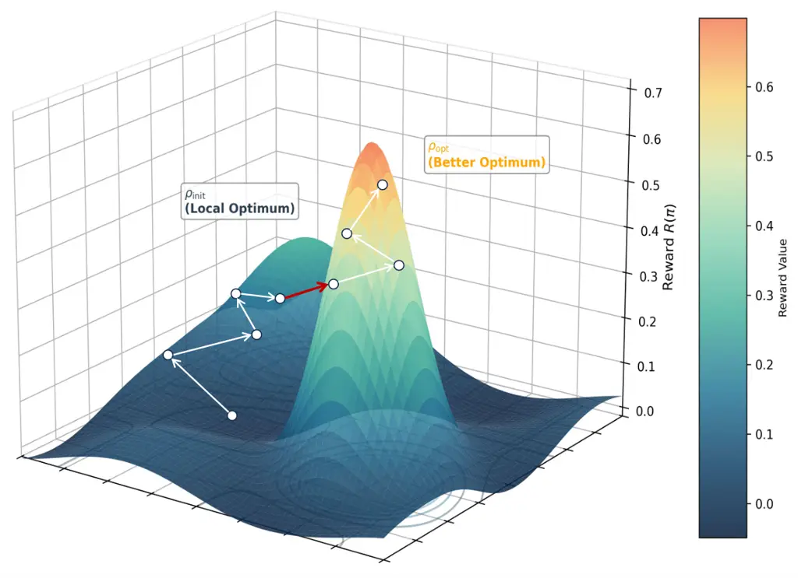
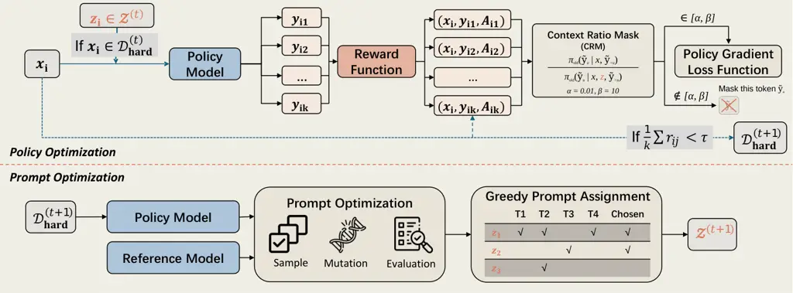

# P²O: Joint Policy and Prompt Optimization

Xinyu Lu ^(†)^(†)thanks: Equal contribution^(†)^(†)thanks:
Code:˜[https://github.com/zlkqz/P2O](https://github.com/zlkqz/P2O)
Affiliation: University of Chinese Academy of Sciences
Email: [zhangkaiqi.zlk@gmail.com](mailto:)    Kaiqi Zhang
Affiliation: Chinese Information Processing Laboratory, Institute of
Software, Chinese Academy of Sciences
Email: [luxinyu2021@iscas.ac.cn](mailto:)    Jinglin Yang
Affiliation: Institute of Information Engineering, Chinese Academy of
Sciences Affiliation: School of Cyber Security, University of Chinese
Academy of Sciences Affiliation: National Computer Network Emergency
Response Technical Team/Coordination Center of China    Boxi Cao
Affiliation: Chinese Information Processing Laboratory, Institute of
Software, Chinese Academy of Sciences    Yaojie Lu Affiliation: Chinese
Information Processing Laboratory, Institute of Software, Chinese
Academy of Sciences    Hongyu Lin Affiliation: Chinese Information
Processing Laboratory, Institute of Software, Chinese Academy of
Sciences    Min He Affiliation: National Computer Network Emergency
Response Technical Team/Coordination Center of China    Xianpei Han
Affiliation: Chinese Information Processing Laboratory, Institute of
Software, Chinese Academy of Sciences Affiliation: University of Chinese
Academy of Sciences    Le Sun Affiliation: Chinese Information
Processing Laboratory, Institute of Software, Chinese Academy of
Sciences Affiliation: University of Chinese Academy of Sciences

###### Abstract

Reinforcement Learning with Verifiable Rewards (RLVR) enhances Large
Language Model (LLM) reasoning but is suffer from advantage collapse:
when all rollouts of a query receive identical rewards, the group
variance vanishes, most damagingly on hard samples, where scaling
rollout budgets yields little. We introduce Joint Policy and Prompt
Optimization (P²O) to mitigate this collapse by alternating continuous
policy updates with discrete prompt evolution. P²O mines hard samples
with a success-rate threshold, evolves reasoning prompts for them with
GEPA, and internalizes the elicited trajectories via context
distillation, which optimizes each trajectory under the original query
and thus removes inference-time prompting, with a Context Ratio Mask
(CRM) filtering out extreme likelihood ratios. P²O restores critical
advantage signals and surpasses the GRPO baseline by up to 8.2 points in
average accuracy on six held-out benchmarks across all training datasets
and backbones, while also outperforming DAPO and other baselines. The
gains are especially pronounced on hard benchmarks, reaching up to 16.3
points above GRPO on average across AIME24 and AIME25. Our findings
expose the limits of standard exploration in sparse-reward environments,
illuminating the potential of unifying evolutionary algorithms with
reinforcement learning. This integration of discrete semantic search and
continuous parameter updates provides a self-reinforcing framework that
facilitates more effective LLM alignment.

|     |
| --- |
|     |

## 1 Introduction

Large Language Models (LLMs) have achieved remarkable proficiency across
a spectrum of complex reasoning tasks (Jaech et al., 2024; Guo et al.,
2025). A defining characteristic of these tasks is the existence of
objective verification mechanisms capable of providing deterministic
feedback. Capitalizing on this, Reinforcement Learning with Verifiable
Rewards (RLVR) (Lambert et al., 2024) has emerged as a dominant paradigm
for reasoning alignment. By leveraging outcome-based supervision, RLVR
enables models to autonomously explore the solution space, thereby
bypassing the inherent bottlenecks of imitation learning (Liu et al.,
2025a).

Despite its potential, RLVR is fundamentally bottlenecked by advantage
collapse: when all rollouts within a group exhibit zero reward
variance—whether uniformly succeeding on trivial instances or uniformly
failing on challenging ones—the advantage estimates vanish, thereby
neutralizing the learning signal (Song et al., 2025). This failure mode
on hard samples is particularly detrimental; although these instances
carry high informational value, they yield no effective supervision.
Moreover, scaling rollout budgets offers fundamentally limited gains,
extensive sampling cannot rescue a universally failing policy from
zero-reward trajectories.

Common approaches to mitigate exploration challenges include curriculum
learning strategies, which progressively introduce harder samples as
training advances (Blakeman et al., 2025), and various reward shaping
techniques that provide intermediate feedback. However, curriculum
learning requires heuristic-based and computationally expensive schedule
generation (Bercovich et al., 2025), while reward shaping demands
domain-specific expert heuristics.



Figure 1: Conceptual Illustration of the P²O Framework. Standard policy
optimization often gets trapped in local optima ($`\rho_{\text{init}}`$)
due to sparse rewards on hard samples. P²O bridges this exploration gap
using optimized prompts (the red arrow) to reach high-reward regions
that are inaccessible via standard exploration. Subsequently, the model
consolidates these gains (the white arrows) by updating its parameters
to master the new region ($`\rho_{\text{opt}}`$), effectively
internalizing the prompt-induced capabilities.

The recent success of prompt optimization methods (Fernando et al.,
2023; Opsahl-Ong et al., 2024; Yuksekgonul et al., 2025) offers a
compelling way to break this stalemate. These methods demonstrate that
even when a model fails to solve a hard problem under a standard policy,
a carefully evolved prompt can often elicit the correct reasoning path.
This implies that the solution lies within the model’s latent search
space but is inaccessible via standard gradient ascent (Zelikman et al.,
2022). As illustrated in Figure 1, optimized prompts act as a bridge,
enabling the model to “jump” out of the local optimum
($`\rho_{\text{init}}`$) and cross the reward-sparse valley. However,
relying solely on inference-time prompts is insufficient. The “jump”
must be followed by internalization, where the model parameters are
updated to master the new region ($`\rho_{\text{opt}}`$).

Building on this intuition, we propose P²O (Joint Policy and Prompt
Optimization), a novel framework that synergizes adaptive prompt
evolution with reinforcement learning to overcome the hard sample
bottleneck. Specifically, P²O identifies challenging instances through
an empirical success-rate threshold and employs the Genetic-Pareto
(GEPA) (Agrawal et al., 2025) prompt optimization algorithm to evolve
templates that elicit successful reasoning chains for them. Rather than
relying on inference-time prompting, we distill these trajectories into
the policy by scoring them under the original query with a stop-gradient
behavior source, while our Context Ratio Mask filters out tokens whose
likelihood departs too far from the original-query distribution. This
creates a self-reinforcing cycle: as the model improves, previously hard
samples become tractable, and GEPA focuses its efforts on the new
frontier of difficulty.

The core contributions of this paper include:

\(1\) We propose P²O, which alternates continuous policy optimization
with discrete prompt evolution, restoring non-degenerate advantage
estimates on the hard samples where standard RLVR receives insufficient
learning signals.

\(2\) We introduce a context distillation strategy with a Context Ratio
Mask (CRM) that distills reasoning gains induced by optimized prompts
directly into model parameters, eliminating inference-time prompt
dependency and stabilizing optimization at scale.

\(3\) We empirically demonstrate that P²O breaks the rollout-scaling
ceiling of vanilla GRPO: it surpasses GRPO, DAPO, and compute-matched
reflection and distillation baselines without any external teacher, and
its effectiveness stems from successful parameter internalization rather
than the sheer capability of the reflection operator.

## 2 Preliminaries

### 2.1 Policy Optimization

In RLVR, the LLM is parameterized as a policy $`\pi_{\theta}`$ that
generates a response $`y`$ for a query $`x\in\mathcal{D}`$, and a
verifier provides the reward $`r(x,y)`$. We use GRPO (Shao et al.,
2024), which avoids a separate critic by estimating the baseline from a
group of $`K`$ responses sampled for the same query. For a query $`x`$,
GRPO samples a response group $`\{y_{i}\}_{i=1}^{K}`$ and computes the
relative advantage of each response as:

```math
A(x,y_{i})=\frac{r(x,y_{i})-\mu_{\mathrm{group}}}{\sigma_{\mathrm{group}}}, \tag{1}
```

where $`\mu_{\mathrm{group}}`$ and $`\sigma_{\mathrm{group}}`$ denote
the mean and standard deviation of rewards within the sampled group.
When all responses in a group receive the same binary reward, the group
variance becomes zero, causing the normalized advantage estimate to
degenerate and providing no effective learning signal. This advantage
collapse motivates our intervention on hard samples.

### 2.2 Prompt Optimization

#### Optimization Objective.

Prompt optimization treats the LLM as a frozen black-box function
$`\mathcal{M}`$ and searches over discrete prompts $`z`$ in the space of
natural-language strings $`\mathcal{P}`$. Given an input $`x`$, the
model produces $`\hat{y}=\mathcal{M}(z,x)`$, and the optimization
problem is formulated as:

```math
z^{*}=\arg\max_{z\in\mathcal{P}}\mathbb{E}_{(x,y)\sim\mathcal{D}_{\text{val}}}\left[S(\mathcal{M}(z,x),y)\right] \tag{2}
```

Here $`S(\cdot,\cdot)`$ denotes the task metric. Unlike policy
optimization, which adjusts continuous weights $`\theta`$, this is a
discrete, derivative-free search over the semantic space of
instructions.

#### GEPA (Genetic-Pareto).

We use GEPA (Agrawal et al., 2025) as the prompt optimizer. GEPA uses a
reflection model to turn error feedback into semantic mutations and
maintains a diverse candidate population through Pareto-based selection.
Its specific adaptation is detailed in the prompt-evolution procedure in
Section 3.

## 3 P²O: Joint Policy and Prompt Optimization

Policy optimization and prompt optimization act on complementary spaces.
P²O couples them by introducing a set of prompt templates
$`\mathcal{Z}`$ for samples on which ordinary policy rollouts provide
little learning signal. Let
$`\mathcal{D}_{\text{hard}}\subset\mathcal{D}`$ denote this subset and
let $`\mathcal{T}(x,z)`$ insert template $`z`$ into query $`x`$. For a
template-augmented rollout, we write $`\tilde{x}=\mathcal{T}(x,z)`$. The
resulting joint objective is:

```math
\max_{\theta,\mathcal{Z}}\mathcal{J}_{\text{joint}}=\sum_{x\notin\mathcal{D}_{\text{hard}}}\mathbb{E}_{y\sim\pi_{\theta}(\cdot\mid x)}[r(x,y)]+\sum_{x\in\mathcal{D}_{\text{hard}}}\max_{z\in\mathcal{Z}}\mathbb{E}_{\tilde{y}\sim\pi_{\theta}(\cdot\mid\tilde{x})}[r(x,\tilde{y})]. \tag{3}
```

Ordinary rollouts optimize tractable samples, whereas a template
supplies an alternative reasoning context for hard samples. Because
optimizing discrete templates and continuous policy parameters jointly
is highly non-trivial, P²O alternates between policy distillation and
prompt evolution.

### 3.1 Overview of P²O Framework



Figure 2: Overview of the P²O Framework. The training process is
formulated as an alternating maximization procedure between two phases:
(1) Policy Optimization with Context Distillation, where the policy
$`\pi_{\theta}`$ is updated under a CRM to internalize reasoning
patterns elicited by augmented inputs $`\tilde{x}`$; and (2)
Evolutionary Prompt Optimization, where the prompt template set
$`\mathcal{Z}`$ is evolved using GEPA to discover successful
trajectories for the remaining hard samples
($`\mathcal{D}_{\text{hard}}`$).

Figure 2 shows how P²O realizes the joint objective. At epoch $`t`$, we
augment the standard GRPO pipeline with three components: (1)
template-guided rollout, where an assigned $`z\in\mathcal{Z}^{(t)}`$ is
inserted for each $`x\in\mathcal{D}_{\text{hard}}^{(t)}`$ to elicit a
higher-quality trajectory; (2) hard-set update, where rollout rewards
update the policy and determine $`\mathcal{D}_{\text{hard}}^{(t+1)}`$;
and (3) prompt evolution, where GEPA uses this new hard set to produce
$`\mathcal{Z}^{(t+1)}`$ for epoch $`t+1`$. The complete pseudocode for
this alternating loop (Algorithm 1) and the GEPA subroutine
(Algorithm 3) are provided in Appendix A.

#### Threshold-based hard-set definition.

At epoch $`t`$, each query $`x_{i}`$ receives $`K`$ rollouts with binary
verifiable rewards $`r_{ik}\in\{0,1\}`$. We define $`\tau\in(0,1]`$
exclusively as an empirical success-rate threshold:

```math
\mathcal{D}_{\text{hard}}^{(t+1)}=\left\{x_{i}\in\mathcal{D}\;\middle|\;\widehat{p}_{i}^{(t)}\triangleq\frac{1}{K}\sum_{k=1}^{K}r_{ik}<\tau\right\}. \tag{4}
```

In our default configuration, $`K=6`$ and $`\tau=2/6`$, so a sample is
considered as hard when at most one of its six rollouts succeeds.

### 3.2 Phase 1: Policy Optimization with Context Distillation

We fix $`\mathcal{Z}^{(t)}`$ while updating $`\theta`$. For
$`x\in\mathcal{D}_{\text{hard}}^{(t)}`$, an assigned template $`z`$
forms $`\tilde{x}=\mathcal{T}(x,z)`$ and elicits a trajectory
$`\tilde{y}`$; all other queries use bare-context trajectories $`y`$.
The augmented policy is treated as a detached behavior source, while
every likelihood used for learning is evaluated under the original
query:

```math
\displaystyle g_{\text{P}^{2}\text{O}}\triangleq{} \displaystyle\sum_{x\notin\mathcal{D}^{(t)}_{\text{hard}}}\mathbb{E}_{y\sim\pi_{\theta}(\cdot\mid x)}\!\left[A(x,y)\nabla_{\theta}\log\pi_{\theta}(y\mid x)\right] \tag{5}
```

```math
\displaystyle+\sum_{x\in\mathcal{D}^{(t)}_{\text{hard}}}\mathbb{E}_{\tilde{y}\sim{\color[rgb]{1,0,0}\operatorname{sg}[\pi_{\theta}]}(\cdot\mid{\color[rgb]{1,0,0}\tilde{x}})}\!\left[A(x,\tilde{y})\nabla_{\theta}\log\pi_{\theta}(\tilde{y}\mid{\color[rgb]{1,0,0}x})\right].
```

Here $`\operatorname{sg}[\cdot]`$ denotes stop-gradient. Decoupling the
rollout context $`\tilde{x}`$ from the gradient context $`x`$ distills
prompt-elicited reasoning into the policy parameters, following Context
Distillation (Snell et al., 2022), rather than creating an
inference-time prompt dependency. The rewards already collected in this
phase also update $`\mathcal{D}_{\text{hard}}^{(t+1)}`$ through Eq. 4.

#### Off-policy correction with Context Ratio Mask.

The hard-sample trajectory $`\tilde{y}`$ is generated under the
template-augmented context $`\tilde{x}`$ but optimized under the
original query $`x`$ for context distillation. This introduces a
context-induced discrepancy between the rollout and optimization
distributions. Inspired by the train–inference discrepancy in
systems (Team et al., 2025), where excessive distribution deviation can
accumulate and destabilize optimization, we introduce a Context Ratio
Mask (CRM) to filter out tokens with large likelihood deviations between
the two contexts:

```math
\displaystyle\mathcal{J}_{\mathrm{P}^{2}\mathrm{O}}(\theta)=\mathbb{E}_{\begin{subarray}{c}x\sim\mathcal{D}_{\mathrm{hard}}^{(t)},\\
\tilde{y}_{i}\sim\pi_{\mathrm{old}}(\cdot\mid\tilde{x}_{i})\end{subarray}}\Bigg[\frac{1}{G}\sum_{i=1}^{G}\frac{1}{|\tilde{y}_{i}|}\sum_{u=1}^{|\tilde{y}_{i}|}{\color[rgb]{0,0,1}\mathbf{1}\!\left[\alpha\leq\frac{\pi_{\mathrm{old}}\!\left(\tilde{y}_{i,u}\mid x,\tilde{y}_{i,<u}\right)}{\pi_{\mathrm{old}}\!\left(\tilde{y}_{i,u}\mid\tilde{x}_{i},\tilde{y}_{i,<u}\right)}\leq\beta\right]} \tag{6}
```

```math
\displaystyle\cdot\min\!\Bigg\{\tilde{r}_{i,u}\hat{A}_{i,u},\operatorname{clip}\!\left(\tilde{r}_{i,u},1-\epsilon,1+\epsilon\right)\hat{A}_{i,u}\Bigg\}\Bigg],\qquad\tilde{r}_{i,u}=\frac{\pi_{\theta}\!\left(\tilde{y}_{i,u}\mid x,\tilde{y}_{i,<u}\right)}{\pi_{\mathrm{old}}\!\left(\tilde{y}_{i,u}\mid x,\tilde{y}_{i,<u}\right)}.
```

The context ratio captures the likelihood shift introduced by the
auxiliary template. While moderate shifts indicate transferable
reasoning signals, excessive deviations suggest template-dependent
behaviors that may destabilize training. We therefore set
$`\alpha=0.01`$ and $`\beta=10`$ to filter out extreme ratios while
retaining useful distillation signals.

### 3.3 Phase 2: Evolutionary Prompt Optimization

After policy optimization, the updated policy $`\pi_{\theta}`$ may still
fail on a subset of challenging instances, resulting in the new hard set
$`\mathcal{D}_{\mathrm{hard}}^{(t+1)}`$. These samples indicate regions
where standard policy exploration remains insufficient. Phase 2
therefore searches for auxiliary prompts that reshape the reasoning
context and recover informative trajectories for subsequent policy
optimization.

With $`\pi_{\theta}`$ fixed, we optimize the prompt space by searching
for templates that maximize the success rate of template-augmented
rollouts:

```math
z^{\prime}\sim\pi_{\text{init}}\left(\cdot\mid\text{prompt}_{\text{meta}},z,\mathcal{F}_{z}\right) \tag{7}
```

where $`\mathcal{F}_{z}`$ contains the query, failed prediction, and
verification feedback. The generated candidates are evaluated on the
hard-sample development split and retained through Pareto-based
selection. The resulting template set $`\mathcal{Z}^{(t+1)}`$ is then
assigned to hard samples for the next epoch.

By alternating template evolution with context distillation, P²O
continuously expands the set of reachable reasoning trajectories and
transfers these gains back into the policy.

## 4 Experiments

### 4.1 Settings

#### Datasets.

We conduct experiments on two datasets: a subset randomly sampled from
DeepScaler (Luo et al., 2025) and a subset of DeepMath (He et al., 2025)
filtered to difficulty level $`\geq 7`$. For each dataset, we randomly
sample two splits of $`N=5{,}000`$ and $`N=10{,}000`$ examples
respectively.

#### Method Configuration.

We combine GRPO with a one-step off-policy strategy, excluding the KL
divergence penalty. The training hyperparameters include a maximum
learning rate of $`1\times 10^{-6}`$, a global batch size of 128, and a
maximum generation length of 12k tokens. During the rollout phase, we
utilize a temperature of $`T=0.6`$ and sample $`K=6`$ trajectories per
prompt. All models are trained for 10 epochs and evaluated with the best
dev checkpoint. We use Qwen3-4B and Qwen3-8B (Yang et al., 2025) as the
training backbone. For GEPA, we use a validation set of 300 examples.
Unlike the original GEPA setting (Agrawal et al., 2025), we use beam
size $`W`$ to parallelize the Pareto search for improved computational
efficiency. The candidate selection beam size is set to $`W=16`$
(yielding $`\sim 40`$ templates per iteration). We evaluate two GEPA
reflection variants: P²O$`{{}_{\text{Self-Ref}}}`$, using the pre-RL
model as mutation operator, and P²O$`{{}_{\text{Teacher-Ref}}}`$, using
Kimi-K2 for reflection.

#### Reward.

We employ a strict binary reward ($`r\in\{0,1\}`$). A reward of 1 is
granted solely when the response follows the \boxed{} format and matches
the ground truth.

#### Evaluation Protocol.

We employ the open-source evaluation suite¹¹ 1
[https://github.com/QwenLM/Qwen2.5-Math/tree/main/evaluation](https://github.com/QwenLM/Qwen2.5-Math/tree/main/evaluation)
provided by Qwen for all mathematical benchmarks. To ensure statistical
robustness and encourage exploration on smaller datasets (fewer than 100
samples), we report the average performance across 32 rollouts per
question, generated with a temperature of $`0.6`$. For larger datasets,
we adopt greedy sampling.

#### Baselines.

We compare P²O against four baselines throughout the experiments:

\(1\) GRPO (Shao et al., 2024) with varying rollout budgets. This
standard RLVR baseline serves to test the naive scaling hypothesis:
whether advantage collapse on hard samples can be resolved simply by
allocating more compute for exploration.

\(2\) DAPO (Yu et al., 2025). Our experimental configuration is largely
aligned with the original DAPO, incorporating its higher clip parameter,
token-level policy-gradient loss, and dynamic sampling strategy; we do
not apply DAPO’s overlong reward shaping to align with our reward
setting. This baseline is included to validate our premise that actively
bridging the exploration gap on hard samples yields superior convergence
compared to passively discounting them.

\(3\) Single-Turn Reflection. This ablation replaces GEPA with a single
round of self reflection per hard sample at each epoch’s end, serving to
validate the necessity of GEPA’s complex prompt evolution and search
strategies.

\(4\) Teacher-Distill-SFT. A compute-matched baseline designed to test
whether P²O$`{}_{\text{Teacher-Ref}}`$’s teacher budget is better spent
on data synthesis. It uses an identical teacher budget to generate two
rollouts per problem, filters trajectories via ground-truth-verified
rejection sampling, and fine-tunes the model via behavioral cloning.

#### Compute Cost Analysis.

We account for the overhead of prompt evolution explicitly: the GEPA
budget is a hard cap of $`10`$K rollouts per epoch covering everything
in Algorithm 3, which on DeepMath-5K and DeepScaler-5K amounts to two
additional rollouts per training sample per epoch, so
GRPO$`{}_{\text{Rollout-8}}`$ and P²O with $`K=6`$ are equivalent in
rollout compute. Table 5 spells out the per-epoch budgets and how each
method spends them, including the teacher-side token cost.

### 4.2 Main Results

|                                                   |        |        |      |         |         |          |      |
| ------------------------------------------------- | ------ | ------ | ---- | ------- | ------- | -------- | ---- |
| Model                                             | AIME24 | AIME25 | AMC  | MATH500 | Minerva | Olympiad | AVG  |
| Base Models                                       |        |        |      |         |         |          |      |
| Qwen3-4B                                          | 23.8   | 19.4   | 68.0 | 82.8    | 31.6    | 49.9     | 45.9 |
| Qwen3-8B                                          | 28.3   | 22.1   | 69.4 | 81.6    | 31.2    | 49.5     | 47.0 |
| DeepMath-5K                                       |        |        |      |         |         |          |      |
| Qwen3-4B-GRPO$`{}_{\textnormal{Rollout-6}}`$      | 33.8   | 29.0   | 79.5 | 87.6    | 41.5    | 57.5     | 54.8 |
| Qwen3-4B-GRPO$`{}_{\textnormal{Rollout-8}}`$      | 35.6   | 28.3   | 79.7 | 89.0    | 40.1    | 56.4     | 54.9 |
| Qwen3-4B-GRPO$`{}_{\textnormal{Rollout-12}}`$     | 33.3   | 28.6   | 78.4 | 88.2    | 43.0    | 56.6     | 54.7 |
| Qwen3-4B-DAPO                                     | 30.0   | 24.4   | 74.0 | 86.8    | 40.8    | 53.5     | 51.6 |
| Qwen3-4B-P²O$`{}_{\textnormal{Single-Turn-Ref}}`$ | 27.1   | 22.1   | 74.2 | 85.6    | 41.2    | 52.1     | 50.4 |
| Qwen3-4B-Teacher-Distill-SFT                      | 28.1   | 25.6   | 73.0 | 85.0    | 36.0    | 52.6     | 50.1 |
| Qwen3-4B-P²O$`{}_{\textnormal{Self-Ref}}`$        | 55.3   | 40.0   | 86.2 | 91.2    | 43.0    | 62.4     | 63.0 |
| Qwen3-4B-P²O$`{}_{\textnormal{Teacher-Ref}}`$     | 46.5   | 32.5   | 82.3 | 88.6    | 41.5    | 59.3     | 58.5 |
| Qwen3-8B-GRPO$`{}_{\textnormal{Rollout-6}}`$      | 45.6   | 37.1   | 82.8 | 89.6    | 40.4    | 59.9     | 59.2 |
| Qwen3-8B-P²O$`{}_{\textnormal{Self-Ref}}`$        | 57.1   | 41.7   | 86.7 | 92.2    | 43.0    | 63.4     | 64.0 |
| Qwen3-8B-P²O$`{}_{\textnormal{Teacher-Ref}}`$     | 53.4   | 42.3   | 88.8 | 91.2    | 40.8    | 63.9     | 63.4 |
| DeepScaler-5K                                     |        |        |      |         |         |          |      |
| Qwen3-4B-GRPO$`{}_{\textnormal{Rollout-6}}`$      | 46.9   | 37.7   | 88.1 | 90.4    | 41.5    | 58.2     | 60.5 |
| Qwen3-4B-GRPO$`{}_{\textnormal{Rollout-8}}`$      | 40.6   | 31.0   | 82.5 | 88.0    | 40.4    | 56.1     | 56.4 |
| Qwen3-4B-GRPO$`{}_{\textnormal{Rollout-12}}`$     | 41.9   | 32.3   | 80.8 | 86.0    | 43.0    | 57.8     | 57.0 |
| Qwen3-4B-DAPO                                     | 44.4   | 34.2   | 82.0 | 90.0    | 42.6    | 59.7     | 58.8 |
| Qwen3-4B-P²O$`{}_{\textnormal{Single-Turn-Ref}}`$ | 25.2   | 22.5   | 70.0 | 82.0    | 36.0    | 51.3     | 47.8 |
| Qwen3-4B-Teacher-Distill-SFT                      | 28.5   | 24.4   | 70.8 | 81.8    | 32.0    | 49.8     | 47.9 |
| Qwen3-4B-P²O$`{}_{\textnormal{Self-Ref}}`$        | 59.0   | 42.2   | 88.4 | 92.0    | 42.6    | 62.1     | 64.7 |
| Qwen3-4B-P²O$`{}_{\textnormal{Teacher-Ref}}`$     | 57.7   | 40.2   | 87.0 | 91.6    | 43.4    | 64.0     | 64.0 |
| Qwen3-8B-GRPO$`{}_{\textnormal{Rollout-6}}`$      | 50.8   | 42.9   | 86.4 | 90.8    | 40.1    | 59.0     | 61.7 |
| Qwen3-8B-P²O$`{}_{\textnormal{Self-Ref}}`$        | 61.7   | 45.4   | 89.5 | 91.6    | 41.5    | 63.6     | 65.6 |
| Qwen3-8B-P²O$`{}_{\textnormal{Teacher-Ref}}`$     | 55.5   | 45.0   | 85.7 | 91.2    | 43.0    | 59.6     | 63.3 |
| DeepMath-10K                                      |        |        |      |         |         |          |      |
| Qwen3-4B-GRPO$`{}_{\textnormal{Rollout-6}}`$      | 31.9   | 29.2   | 80.2 | 87.6    | 42.6    | 55.7     | 54.5 |
| Qwen3-4B-P²O$`{}_{\textnormal{Self-Ref}}`$        | 48.6   | 39.2   | 83.0 | 89.8    | 43.4    | 59.6     | 60.6 |
| Qwen3-4B-P²O$`{}_{\textnormal{Teacher-Ref}}`$     | 46.8   | 33.7   | 84.8 | 90.4    | 43.8    | 62.5     | 60.3 |
| DeepScaler-10K                                    |        |        |      |         |         |          |      |
| Qwen3-4B-GRPO$`{}_{\textnormal{Rollout-6}}`$      | 33.3   | 32.3   | 81.1 | 86.8    | 41.5    | 55.9     | 55.2 |
| Qwen3-4B-P²O$`{}_{\textnormal{Self-Ref}}`$        | 49.1   | 37.7   | 85.2 | 90.4    | 40.8    | 59.9     | 60.5 |
| Qwen3-4B-P²O$`{}_{\textnormal{Teacher-Ref}}`$     | 45.3   | 39.6   | 81.6 | 89.6    | 39.7    | 59.9     | 59.3 |

Table 1: Comparative Evaluation on Mathematical Reasoning Benchmarks.
Accuracy (%) of P²O against the baselines; gains are largest on
challenging benchmarks such as AIME24 and AIME25. Best results are
highlighted in bold.

Figure 3: Training Dynamics and Prompt Optimization Effectiveness of
P²O. All curves are from the DeepScaler-5K dataset, and the P²O variants
use the Teacher-Ref reflection source. Top: training reward (left) and
validation accuracy (right) of P²O, P²O$`{}_{\textnormal{w/o-CRM}}`$,
P²O$`{}_{\textnormal{w/o-Context-Distillation}}`$, and the GRPO
baseline; P²O$`{}_{\textnormal{w/o-CRM}}`$ keeps pace for most of
training but then collapses, whereas P²O keeps improving, highlighting
the necessity of the Context Ratio Mask (Eq. 6). Bottom-left: optimized
prompts (triangles) consistently outperform standard prompts (circles)
on both Pass@1 and Pass@6. Bottom-right: intractable hard samples
decline steadily across training epochs.

Table 1 summarizes the performance of models trained on DeepMath and
DeepScaler across six challenging mathematical benchmarks, comparing P²O
against the Qwen3-4B/8B base models and four baselines.

#### Comparison with GRPO and DAPO.

As shown in Table 1, P²O consistently outpaces the policy-optimization
baselines by directly addressing the exploration bottleneck on hard
samples. P²O breaks the rollout-scaling ceiling under a matched rollout
budget: on DeepMath-5K and DeepScaler-5K, neither a larger GRPO budget
nor DAPO’s dynamic sampling helps consistently, whereas P²O spends its
extra budget on prompt evolution and, with the same $`K=6`$ rollouts as
GRPO$`{}_{\text{Rollout-6}}`$, reaches 63.0% on DeepMath-5K and 64.7% on
DeepScaler-5K ($`+8.2`$ and $`+4.2`$ points). Gains persist across data
scale and backbones: on the 10K corpora, P²O leads
GRPO$`{}_{\text{Rollout-6}}`$ by 6.1 points on DeepMath-10K (60.6% vs.
54.5%) and by 5.3 points on DeepScaler-10K (60.5% vs. 55.2%), and on the
larger backbone Qwen3-8B-P²O$`{}_{\text{Self-Ref}}`$ improves over
Qwen3-8B-GRPO$`{}_{\text{Rollout-6}}`$ by 4.8 points on DeepMath-5K
(64.0% vs. 59.2%) and by 3.9 points on DeepScaler-5K (65.6% vs. 61.7%).
Gains concentrate on the hardest benchmarks: on AIME24,
P²O$`{}_{\text{Self-Ref}}`$ exceeds GRPO$`{}_{\text{Rollout-6}}`$ by
21.5 points on DeepMath-5K (55.3% vs. 33.8%) and by 12.1 points on
DeepScaler-5K (59.0% vs. 46.9%).

#### Comparison with Reflection and Distillation Baselines.

P²O also surpasses the two baselines that spend the extra budget on
lighter-weight substitutes for GEPA. Single-Turn Reflection scores only
50.4% and 47.8%, below even standard GRPO, and fails to break the
difficulty ceiling: the additional gain comes from coupling prompt
optimization with policy optimization iteratively, rather than adding
either one alone. Teacher-Distill-SFT spends the same teacher budget on
synthesized trajectories and behavioral cloning yet reaches only 50.1%
and 47.9%, showing that injecting teacher capability as static
supervision is far less effective than P²O$`{}_{\text{Teacher-Ref}}`$’s
context distillation.

#### Impact of Reflection Models on Prompt Evolution.

P²O$`{}_{\text{Self-Ref}}`$ outperforms P²O$`{}_{\text{Teacher-Ref}}`$
in all four settings, with the advantage most pronounced on DeepMath-5K
(63.0% vs. 58.5% avg.), where the two variants differ by $`4.5`$ points,
and gains of $`0.7`$, $`0.3`$, and $`1.2`$ points on DeepScaler-5K,
DeepMath-10K, and DeepScaler-10K, respectively. This indicates that a
stronger external teacher does not necessarily yield a more useful
mutation operator: self-generated refinements, which stay close to the
policy’s own reasoning capacity, are easier to internalize, whereas
teacher priors may be harder to absorb. We examine this inversion in
detail in Appendix G, where the stronger teacher evolves templates with
higher dev scores yet yields a substantially weaker model. Crucially,
both variants consistently surpass the GRPO baseline across all
datasets, confirming that GEPA-driven structural exploration robustly
improves performance regardless of the reflection source.

### 4.3 Training Dynamics

As shown in Figure 3 (top), the continuous integration of optimized
prompts maintains a training reward consistently superior to that of the
GRPO baseline. By contrast, P²O$`{}_{\textnormal{w/o-CRM}}`$ tracks P²O
for most of the optimization and then collapses abruptly in the late
stage, corroborating the design of the Context Ratio Mask in Eq. 6:
without the mask, the rare but extreme template-induced likelihood
ratios accumulate into unstable updates. Crucially, this advantage of
P²O over the GRPO baseline translates into gains in validation accuracy,
confirming that the model effectively internalizes the elicited
reasoning patterns to achieve robust in-distribution generalization.

Meanwhile, as shown in Figure 3 (bottom), as the model’s intrinsic
capability grows during training, GEPA effectively assists in
continuously conquering “hard samples”, as evidenced by the steady
decline in the number of intractable instances (Right). Furthermore, the
performance breakdown (Left) reveals that prompt optimization yields
consistent gains across both Pass@1 and Pass@6 metrics. This
demonstrates that the evolved templates do not merely facilitate a
single lucky guess; rather, they robustly enhance the model’s solution
space, boosting both the deterministic success rate and the broader
exploration coverage required for effective distillation. Moreover,
introducing prompt optimization into policy optimization does indeed
alleviate advantage collapse (Appendix E).

### 4.4 Ablations

| Model                                                      | AIME24 | AIME25 | AMC  | MATH500 | Minerva | Olympiad | AVG  |
| ---------------------------------------------------------- | ------ | ------ | ---- | ------- | ------- | -------- | ---- |
| Qwen3-4B-GRPO                                              | 46.9   | 37.7   | 88.1 | 90.4    | 41.5    | 58.2     | 60.5 |
| Qwen3-4B-P²O                                               | 59.8   | 49.4   | 92.2 | 91.4    | 36.4    | 62.2     | 65.2 |
| Qwen3-4B-P²O$`{}_{\textnormal{w/o-Context-Distillation}}`$ | 36.5   | 31.5   | 81.1 | 89.6    | 40.1    | 54.8     | 55.6 |
| Qwen3-4B-P²O$`{}_{\textnormal{Same-Template-in-Group}}`$   | 57.3   | 44.6   | 88.9 | 90.8    | 40.4    | 63.0     | 64.2 |

Table 2: Ablation Study of P²O Components. Comparison of performance on
mathematical benchmarks when excluding context distillation or group
prompt diversity. Data points are derived from the Teacher-Ref w/o-CRM
variant on the DeepScaler-5K dataset.

#### Importance of Context Distillation.

We compare Qwen3-4B-P²O against its w/o-Context-Distillation variant,
which differs only in how template-augmented trajectories contribute
gradients (Section C). As shown in Table 2, this causes a severe drop:
65.2%$`\to`$55.6%, even 4.9% below the GRPO baseline (60.5%). Training
on $`(\tilde{x},\tilde{y})`$ induces a “dependency” effect, where the
model relies on the auxiliary prompt $`z`$ rather than internalizing the
reasoning logic, and thus fails to generalize when only $`x`$ is
available at evaluation. Context distillation is therefore a
prerequisite, not merely an enhancement, for transferring the teacher
reference’s capabilities into the model’s intrinsic parameters.

#### Impact of Group Prompt Diversity.

Standard P²O induces template diversity across the $`K`$ rollouts per
query via the greedy assignment (Algorithm 2), whereas
P²O$`{}_{\text{Same-Template-in-Group}}`$ fixes one sampled template
$`z\sim\mathcal{Z}^{(t)}`$ for all $`K`$ rollouts. As shown in Table 2,
the diversity-driven approach achieves 65.2% average accuracy,
outperforming the single-template baseline (64.2%), with pronounced
gains on AIME24 (+2.5%) and AIME25 (+4.8%). This confirms that diverse
Pareto-optimal prompts within a group broaden reasoning space coverage,
yielding more diverse supervision signals and more effective
distillation of complex reasoning capabilities.

|                      |      |         |                    |
| -------------------- | ---- | ------- | ------------------ |
| Variant              | P²O  | w/o-CRM | $`\Delta`$         |
| DeepMath-5K          |      |         |                    |
| Qwen3-4B Self-Ref    | 63.0 | 64.2    | $`\downarrow`$ 1.2 |
| Qwen3-4B Teacher-Ref | 58.5 | 57.9    | $`\uparrow`$ 0.6   |
| Qwen3-8B Self-Ref    | 64.0 | 61.3    | $`\uparrow`$ 2.7   |
| Qwen3-8B Teacher-Ref | 63.4 | 61.0    | $`\uparrow`$ 2.4   |
| DeepScaler-5K        |      |         |                    |
| Qwen3-4B Self-Ref    | 64.7 | 62.4    | $`\uparrow`$ 2.3   |
| Qwen3-4B Teacher-Ref | 64.0 | 65.2    | $`\downarrow`$ 1.2 |
| Qwen3-8B Self-Ref    | 65.6 | 62.2    | $`\uparrow`$ 3.4   |
| Qwen3-8B Teacher-Ref | 63.3 | 60.6    | $`\uparrow`$ 2.7   |

Table 3: Effect of the Context Ratio Mask. Six-benchmark average
accuracy (%) per training set, backbone, and reflection source;
$`\Delta`$ (P²O $`-`$ w/o-CRM) marked $`\uparrow`$/$`\downarrow`$. See
Table 9.

| $`\alpha`$ | $`\beta`$ | Qwen3-8B | $`\Delta`$ vs. w/o CRM |
| ---------- | --------- | -------- | ---------------------- |
| w/o CRM    |           | 61.3     | –                      |
| 0.8        | 1.2       | 58.3     | $`\downarrow`$ 3.0     |
| 0.05       | 5         | 63.1     | $`\uparrow`$ 1.8       |
| 0.01       | 10        | 64.0     | $`\uparrow`$ 2.7       |
| 0.005      | 50        | 61.5     | $`\uparrow`$ 0.2       |

Table 4: Hyper-parameter Ablation of the Context Ratio Mask.
Six-benchmark average accuracy (%) for Qwen3-8B on the DeepMath-5K
training set with Self-Ref, as the mask bounds $`\alpha`$ and $`\beta`$
vary; “w/o CRM” removes the mask entirely. The default interval
$`[0.01,10]`$ reaches 64.0%, 2.7 points above w/o CRM. Best result in
bold.

#### Effect of the Context Ratio Mask.

The Context Ratio Mask of Eq. 6 discards the tokens whose likelihood
departs too far from the original-query distribution under the template
context. Table 4 compares P²O with its w/o-CRM counterpart, which
differs only in this mask, across both training sets, backbones, and
reflection sources, all with the default interval
$`[\alpha,\beta]=[0.01,10]`$. The benefit of the mask grows with the
scale of the backbone: with Qwen3-8B, removing it costs 2.4–3.4 points
in all four settings and the loss concentrates on the hardest benchmarks
(AIME24 drops by 4.2–8.6 points, AIME25 by 2.3–7.1), whereas with
Qwen3-4B the effect is mixed, ranging from $`-1.2`$ to $`+2.3`$ and
averaging $`+0.1`$, for a net gain of $`+1.5`$ points across the eight
comparisons. Filtering template-dominated tokens thus pays off only when
the policy is strong enough to exploit the remaining transferable
signal, so we keep the mask in every main configuration.

We also sweep the bounds $`\alpha`$ and $`\beta`$ (Table 4). The sweep
is single-peaked: tightening the interval discards the template-elicited
tokens carry the transferable gain, loosening it admits the extreme
ratios behind the late-stage collapse of Figure 3, and our default
$`[0.01,10]`$ attains the best accuracy.

## 5 Related Works

RLVR and GRPO are widely used for LLM reasoning alignment, stabilizing
training via group baselines and verification, but still struggle with
exploration in sparse or misleading landscapes. To address these
scalability and stability issues, recent works have focused on
algorithmic advances. For instance, DAPO (Yu et al., 2025) prunes
prompts with accuracy equal to $`1`$ or $`0`$ to improve training
stability. Despite these improvements, these methods primarily focus on
optimizing the policy on a fixed search space, leaving the initial task
prompts untouched.

To further aid the model in traversing complex reasoning paths, various
“hint-based” strategies have been proposed, including strong model
guidance (Nath et al., 2025; Liu et al., 2025b), experience replay
data (Zhan et al., 2025), and expert solutions (Zhang et al., 2025b; Yan
et al., 2025; Li et al., 2025), which attempt to scaffold the reasoning
process. Similarly, Critique-GRPO (Zhang et al., 2025a) utilizes
feedback signals to guide the policy. However, most of these methods
rely heavily on external expert supervision or expert trajectory
fragments. In contrast, P²O achieves self-improvement without external
guidance. By treating the prompt as an optimizable parameter and
evolving it jointly with the policy, P²O matches or exceeds the
performance of teacher-dependent variants while remaining compatible
with teacher reflection.

## 6 Conclusion and Limitations

In this paper, we introduce P²O, a novel framework that bridges the gap
between discrete prompt evolution and continuous policy optimization to
overcome the collapse of advantages in RLVR. By dynamically identifying
hard samples and leveraging the GEPA algorithm, P²O evolves targeted
prompt templates that guide the policy toward discovering successful
reasoning trajectories that are otherwise inaccessible. Crucially, our
context distillation mechanism ensures that these prompt-elicited
capabilities are internalized directly into the model parameters,
eliminating reliance on inference-time guidance. Extensive evaluations
across challenging mathematical reasoning benchmarks demonstrate that
P²O significantly outperforms standard GRPO paradigms, establishing
joint optimization as a robust pathway for autonomous self-improvement
in LLMs.

### AI use statement

In this work, we used generative AI tools for two tasks with required
disclosure: implementing methods and formulating mathematical claims.
Our implementation modifies the open-source verl codebase, where AI
assistance was used to write parts of the core training, evaluation, and
test code—reviewed and tested by the two authors who led the
implementation—and to formulate and refine the mathematical claims and
theoretical presentation of our method (Section 3). We have not used
generative AI tools for the other required-disclosure tasks: the
research questions and hypotheses, research methodology, experimental
design, and interpretation of results were produced by the authors, and
the data are randomly sampled from public open-source corpora; the
remaining tasks are not applicable to this work, which contains no
formal proofs and no surveys or interviews. Additionally, we used
generative AI tools for tasks with recommended disclosure: creating and
editing software code and drafting and editing parts of this manuscript,
including rewriting and condensing passages, reformulating table
captions and layout, and checking the internal consistency of the
reported numbers.

We have reviewed all AI-assisted work: the assisted code was verified
and tested, the assisted mathematical statements were re-derived by the
authors, and all AI-suggested edits were checked against our
experimental records and the original sources. We take responsibility
for the final content of this work, including text, claims, or artifacts
produced with the aid of generative AI.

### Ethics statement

This work studies policy and prompt optimization for mathematical
reasoning with verifiable rewards. All datasets, backbone models, and
evaluation suites we use are publicly available, and the benchmarks are
standard, publicly released mathematics problem sets that contain no
personally identifiable information. The study involves no human
subjects and no private or sensitive data, and we identify no ethical
concerns specific to this work.

### Reproducibility statement

The complete implementation, including the training pipeline, the
GEPA-based prompt evolution, the evaluation scripts, and the
configuration files used to produce all results, is submitted as
anonymous supplementary material. The datasets, backbone models,
optimization hyper-parameters, and GEPA settings are specified in
Section 4.1; pseudocode for the P²O outer loop, the greedy template
assignment, and the GEPA subroutines is given in Appendix A, and the
context distillation objective in Appendix C. All benchmarks are
evaluated with the open-source Qwen evaluation suite, and our main
comparisons against the baselines are reported in Table 1.

## References

- Agrawal et al. (2025) L. A. Agrawal, S. Tan, D. Soylu, N. Ziems, R.
  Khare, K. Opsahl-Ong, A. Singhvi, H. Shandilya, M. J. Ryan, M. Jiang,
  et al. Gepa: reflective prompt evolution can outperform reinforcement
  learning. arXiv preprint arXiv:2507.19457. Cited by: §1, §2.2, §4.1.
- Bercovich et al. (2025) A. Bercovich, I. Levy, I. Golan, M. Dabbah, R.
  El-Yaniv, O. Puny, I. Galil, Z. Moshe, T. Ronen, N. Nabwani, et al.
  Llama-nemotron: efficient reasoning models. arXiv preprint
  arXiv:2505.00949. Cited by: §1.
- Blakeman et al. (2025) A. Blakeman, A. Grattafiori, A. Basant, A.
  Gupta, A. Khattar, A. Renduchintala, A. Vavre, A. Shukla, A.
  Bercovich, A. Ficek, et al. Nemotron 3 nano: open, efficient
  mixture-of-experts hybrid mamba-transformer model for agentic
  reasoning. arXiv preprint arXiv:2512.20848. Cited by: §1.
- Fernando et al. (2023) C. Fernando, D. Banarse, H. Michalewski, S.
  Osindero, and T. Rocktäschel Promptbreeder: self-referential
  self-improvement via prompt evolution. arXiv preprint
  arXiv:2309.16797. Cited by: §1.
- Guo et al. (2025) D. Guo, D. Yang, H. Zhang, J. Song, R. Zhang, R.
  Xu, Q. Zhu, S. Ma, P. Wang, X. Bi, et al. Deepseek-r1: incentivizing
  reasoning capability in llms via reinforcement learning. arXiv
  preprint arXiv:2501.12948. Cited by: §1.
- He et al. (2025) Z. He, T. Liang, J. Xu, Q. Liu, X. Chen, Y. Wang, L.
  Song, D. Yu, Z. Liang, W. Wang, et al. Deepmath-103k: a large-scale,
  challenging, decontaminated, and verifiable mathematical dataset for
  advancing reasoning. arXiv preprint arXiv:2504.11456. Cited by: §4.1.
- Jaech et al. (2024) A. Jaech, A. Kalai, A. Lerer, A. Richardson, A.
  El-Kishky, A. Low, A. Helyar, A. Madry, A. Beutel, A. Carney, et al.
  Openai o1 system card. arXiv preprint arXiv:2412.16720. Cited by: §1.
- Lambert et al. (2024) N. Lambert, J. Morrison, V. Pyatkin, S.
  Huang, H. Ivison, F. Brahman, L. J. V. Miranda, A. Liu, N. Dziri, S.
  Lyu, et al. Tulu 3: pushing frontiers in open language model
  post-training. arXiv preprint arXiv:2411.15124. Cited by: §1.
- Li et al. (2025) J. Li, H. Lin, H. Lu, K. Wen, Z. Yang, J. Gao, Y. Wu,
  and J. Zhang Questa: expanding reasoning capacity in llms via question
  augmentation. arXiv preprint arXiv:2507.13266. Cited by: §5.
- Liu et al. (2025a) M. Liu, S. Diao, X. Lu, J. Hu, X. Dong, Y. Choi, J.
  Kautz, and Y. Dong Prorl: prolonged reinforcement learning expands
  reasoning boundaries in large language models. arXiv preprint
  arXiv:2505.24864. Cited by: §1.
- Liu et al. (2025b) Z. Liu, C. Gong, X. Fu, Y. Liu, R. Chen, S. Hu, S.
  Zhang, R. Liu, Q. Zhang, and D. Tu Ghpo: adaptive guidance for stable
  and efficient llm reinforcement learning. arXiv preprint
  arXiv:2507.10628. Cited by: §5.
- Luo et al. (2025) M. Luo, S. Tan, J. Wong, X. Shi, W. Y. Tang, M.
  Roongta, C. Cai, J. Luo, L. E. Li, R. A. Popa, and I. Stoica
  DeepScaleR: surpassing o1-preview with a 1.5b model by scaling rl.
  Note: Notion Blog Cited by: §4.1.
- Nath et al. (2025) V. Nath, E. Lau, A. Gunjal, M. Sharma, N. Baharte,
  and S. Hendryx Adaptive guidance accelerates reinforcement learning of
  reasoning models. arXiv preprint arXiv:2506.13923. Cited by: §5.
- Opsahl-Ong et al. (2024) K. Opsahl-Ong, M. J. Ryan, J. Purtell, D.
  Broman, C. Potts, M. Zaharia, and O. Khattab Optimizing instructions
  and demonstrations for multi-stage language model programs. In
  Proceedings of the 2024 Conference on Empirical Methods in Natural
  Language Processing, Y. Al-Onaizan, M. Bansal, and Y. Chen (Eds.),
  Miami, Florida, USA, pp. 9340–9366. External Links:
  [Link](https://aclanthology.org/2024.emnlp-main.525/),
  [Document](https://dx.doi.org/10.18653/v1/2024.emnlp-main.525) Cited
  by: §1.
- Shao et al. (2024) Z. Shao, P. Wang, Q. Zhu, R. Xu, J. Song, X. Bi, H.
  Zhang, M. Zhang, Y. Li, Y. Wu, et al. Deepseekmath: pushing the limits
  of mathematical reasoning in open language models. arXiv preprint
  arXiv:2402.03300. Cited by: §2.1, §4.1.
- Snell et al. (2022) C. Snell, D. Klein, and R. Zhong Learning by
  distilling context. arXiv preprint arXiv:2209.15189. Cited by: §3.2.
- Song et al. (2025) Y. Song, J. Kempe, and R. Munos Outcome-based
  exploration for llm reasoning. arXiv preprint arXiv:2509.06941. Cited
  by: §1.
- Team et al. (2025) L. Team, A. Shen, B. Li, B. Hu, B. Jing, C.
  Chen, C. Huang, C. Zhang, C. Yang, C. Lin, et al. Every step evolves:
  scaling reinforcement learning for trillion-scale thinking model.
  arXiv preprint arXiv:2510.18855. Cited by: §3.2.
- Yan et al. (2025) J. Yan, Y. Li, Z. Hu, Z. Wang, G. Cui, X. Qu, Y.
  Cheng, and Y. Zhang Learning to reason under off-policy guidance.
  arXiv preprint arXiv:2504.14945. Cited by: §5.
- Yang et al. (2025) A. Yang, A. Li, B. Yang, B. Zhang, B. Hui, B.
  Zheng, B. Yu, C. Gao, C. Huang, C. Lv, et al. Qwen3 technical report.
  arXiv preprint arXiv:2505.09388. Cited by: §4.1.
- Yu et al. (2025) Q. Yu, Z. Zhang, R. Zhu, Y. Yuan, X. Zuo, Y. Yue, W.
  Dai, T. Fan, G. Liu, L. Liu, et al. Dapo: an open-source llm
  reinforcement learning system at scale. arXiv preprint
  arXiv:2503.14476. Cited by: §4.1, §5.
- Yuksekgonul et al. (2025) M. Yuksekgonul, F. Bianchi, J. Boen, S.
  Liu, P. Lu, Z. Huang, C. Guestrin, and J. Zou Optimizing generative ai
  by backpropagating language model feedback. Nature 639, pp. 609–616.
  Cited by: §1.
- Zelikman et al. (2022) E. Zelikman, Y. Wu, J. Mu, and N. Goodman Star:
  bootstrapping reasoning with reasoning. Advances in Neural Information
  Processing Systems 35, pp. 15476–15488. Cited by: §1.
- Zhan et al. (2025) R. Zhan, Y. Li, Z. Wang, X. Qu, D. Liu, J.
  Shao, D. F. Wong, and Y. Cheng ExGRPO: learning to reason from
  experience. arXiv preprint arXiv:2510.02245. Cited by: §5.
- Zhang et al. (2025a) X. Zhang, H. Sun, Y. Zhang, K. Feng, C. Lu, C.
  Yang, and H. Meng Critique-grpo: advancing llm reasoning with natural
  language and numerical feedback. arXiv preprint arXiv:2506.03106.
  Cited by: §5.
- Zhang et al. (2025b) X. Zhang, Z. Huang, Y. Li, C. Ni, J. Chen, and S.
  Oymak BREAD: branched rollouts from expert anchors bridge sft & rl for
  reasoning. arXiv preprint arXiv:2506.17211. Cited by: §5.

## Appendix A Algorithmic Details

This appendix gives the pseudocode for the P²O outer loop,
sample-specific template assignment, and the GEPA subroutines used in
Phase 2. The first two algorithms describe the interface introduced by
P²O; the latter two provide the implementation details of GEPA.

0:  Training data $`\mathcal{D}`$, policy $`\pi_{\theta}`$, reference
model $`\pi_{\text{init}}`$

0:  Epochs $`N_{\text{epoch}}`$, rollout number $`K`$, threshold
$`\tau`$

0:  Optimized policy $`\pi_{\theta^{*}}`$

1:  Initialize $`\mathcal{D}_{\text{hard}}^{(0)}\leftarrow\emptyset`$
and $`\mathcal{Z}^{(0)}\leftarrow\emptyset`$

2:  for $`t=0`$ to $`N_{\text{epoch}}-1`$ do

3:   Initialize $`\mathcal{D}_{\text{hard}}^{(t+1)}\leftarrow\emptyset`$

4:   for all $`(x_{i},\hat{y}_{i})\in\mathcal{D}`$ do

5:    for $`k=1`$ to $`K`$ do

6:     if $`x_{i}\in\mathcal{D}_{\text{hard}}^{(t)}`$ then

7:      Sample $`z\sim\mathcal{Z}^{(t)}`$ and roll out
$`y^{\mathrm{roll}}_{ik}\sim\pi_{\theta}(\cdot\mid\mathcal{T}(x_{i},z))`$

8:     else

9:      Roll out
$`y^{\mathrm{roll}}_{ik}\sim\pi_{\theta}(\cdot\mid x_{i})`$

10:     end if

11:
    $`r_{ik}\leftarrow\textsc{RewardFunc}(y^{\mathrm{roll}}_{ik},\hat{y}_{i})`$

12:    end for

13:    $`\widehat{p}_{i}^{(t)}\leftarrow K^{-1}\sum_{k=1}^{K}r_{ik}`$

14:    if $`\widehat{p}_{i}^{(t)}<\tau`$ then

15:
    $`\mathcal{D}_{\text{hard}}^{(t+1)}\leftarrow\mathcal{D}_{\text{hard}}^{(t+1)}\cup\{x_{i}\}`$

16:    end if

17:    Compute $`A_{ik}`$ and update $`\pi_{\theta}`$ on the original
$`x_{i}`$ using Eqs. 5 and 6

18:   end for

19:   if $`\mathcal{D}_{\text{hard}}^{(t+1)}\neq\emptyset`$ then

20:
   $`\mathcal{Z}^{(t+1)}\leftarrow\textsc{Gepa}(\mathcal{D}_{\text{hard}}^{(t+1)},\pi_{\theta},\pi_{\text{init}})`$

21:    Assign templates for the next epoch with GreedyPromptAssignment

22:   else

23:    $`\mathcal{Z}^{(t+1)}\leftarrow\emptyset`$

24:   end if

25:  end for

26:  return $`\pi_{\theta^{*}}`$

Algorithm 1 P²O Training Loop

0:  Candidate templates and dev scores
$`\mathcal{Z}=\{(z_{i},\mathbf{r}_{i})\}_{i=1}^{M}`$

0:  Hard samples $`\mathcal{D}_{\text{hard}}`$, rollout number $`K`$

0:  Sample-specific assignments $`\mathcal{A}`$

1:  Let $`\mathcal{C}(z_{i})=\{x_{j}:r_{i,j}=1\}`$ denote the dev
samples solved by $`z_{i}`$

2:  Initialize covered templates
$`\mathcal{Z}_{\text{covered}}\leftarrow\emptyset`$ and samples
$`\mathcal{S}_{\text{covered}}\leftarrow\emptyset`$

3:  while
$`\exists z_{i}:\mathcal{C}(z_{i})\setminus\mathcal{S}_{\text{covered}}\neq\emptyset`$
do

4:   Select
$`z^{*}\leftarrow\arg\max_{z_{i}\notin\mathcal{Z}_{\text{covered}}}|\mathcal{C}(z_{i})\setminus\mathcal{S}_{\text{covered}}|`$

5:   Add $`z^{*}`$ to $`\mathcal{Z}_{\text{covered}}`$ and update
$`\mathcal{S}_{\text{covered}}\leftarrow\mathcal{S}_{\text{covered}}\cup\mathcal{C}(z^{*})`$

6:  end while

7:  Compute $`\bar{r}_{i}\leftarrow N^{-1}\sum_{n=1}^{N}r_{i,n}`$ as the
sampling weight of each covered template

8:  Initialize $`\mathcal{A}\leftarrow\emptyset`$

9:  for all $`x_{j}\in\mathcal{D}_{\text{hard}}`$ do

10:   if $`x_{j}\in\mathcal{S}_{\text{covered}}`$ then

11:
   $`\mathcal{Z}_{j}\leftarrow\{z_{i}\in\mathcal{Z}_{\text{covered}}:x_{j}\in\mathcal{C}(z_{i})\}`$

12:   else

13:    $`\mathcal{Z}_{j}\leftarrow\mathcal{Z}_{\text{covered}}`$

14:   end if

15:   Sample $`\mathbf{z}_{j}=(z_{j,1},\ldots,z_{j,K})`$ from
$`\mathcal{Z}_{j}`$ weighted by $`\{\bar{r}_{i}\}`$ and add
$`(x_{j},\mathbf{z}_{j})`$ to $`\mathcal{A}`$

16:  end for

17:  return $`\mathcal{A}`$

Algorithm 2 GreedyPromptAssignment

0:  Hard Data $`\mathcal{D}_{\text{hard}}`$, Policy Model
$`\pi_{\theta}`$, Reference Model $`\pi_{\text{init}}`$

0:  Budget $`C_{\text{total}}`$, Mini-batch $`B`$, Width $`W`$

0:  Output Template Set $`\mathcal{Z}`$

1:  Split $`\mathcal{D}_{\text{hard}}`$ into
$`\mathcal{D}_{\text{hard}}^{\text{train}}`$ and
$`\mathcal{D}_{\text{hard}}^{\text{dev}}`$

2:  Initialize $`\mathcal{Z}`$ with the empty template evaluated on
$`\mathcal{D}_{\text{hard}}^{\text{dev}}`$

3:  $`C_{\text{left}}\leftarrow C_{\text{total}}`$

4:  while $`C_{\text{left}}>0`$ do

5:
  $`\mathcal{Z}_{\text{front}}\leftarrow\textsc{SelectParetoFront}(\mathcal{Z},W)`$

6:   for all $`z\in\mathcal{Z}_{\text{front}}`$ do

7:    Sample mini-batch
$`\mathcal{D}_{\text{mini}}\subset\mathcal{D}_{\text{hard}}^{\text{train}}`$
of size $`B`$

8:
   $`\bar{r}_{\text{old}}\leftarrow\operatorname{mean}(\textsc{Eval}(\pi_{\theta},z,\mathcal{D}_{\text{mini}}))`$

9:    Generate error feedback $`\mathcal{F}`$ from rollouts and rewards
on $`\mathcal{D}_{\text{mini}}`$

10:
   $`z^{\prime}\leftarrow\pi_{\text{init}}(\text{``Propose Improvement''},z,\mathcal{F})`$

11:
   $`\bar{r}_{\text{new}}\leftarrow\operatorname{mean}(\textsc{Eval}(\pi_{\theta},z^{\prime},\mathcal{D}_{\text{mini}}))`$

12:    Decrease $`C_{\text{left}}`$ by the two mini-batch evaluations

13:    if $`\bar{r}_{\text{new}}>\bar{r}_{\text{old}}`$ then

14:
    $`\mathcal{Z}\leftarrow\mathcal{Z}\cup\{(z^{\prime},\textsc{Eval}(\pi_{\theta},z^{\prime},\mathcal{D}_{\text{hard}}^{\text{dev}}))\}`$

15:     Decrease $`C_{\text{left}}`$ by the development evaluation cost

16:    end if

17:   end for

18:  end while

19:  return $`\mathcal{Z}`$

Algorithm 3 Gepa

0:  Template set with scores
$`\mathcal{Z}=\{(z_{1},(r_{1,1},\ldots,r_{1,N})),\ldots,(z_{M},(r_{M,1},\ldots,r_{M,N}))\}`$,
Width $`W`$

0:  Selected templates $`\mathcal{Z}_{\text{front}}`$

1:  A template $`z_{j}`$ dominates $`z_{i}`$ if it is no worse on every
dev sample and better on at least one

2:  $`\mathcal{Z}_{\text{front}}\leftarrow\emptyset`$

3:  for $`i=1`$ to $`M`$ do

4:   $`\text{dominated}\leftarrow\textsc{False}`$

5:   for $`j=1`$ to $`M`$ do

6:    if $`j\neq i`$ and $`z_{j}`$ dominates $`z_{i}`$ then

7:     $`\text{dominated}\leftarrow\textsc{True}`$

8:     break

9:    end if

10:   end for

11:   if not dominated then

12:
   $`\mathcal{Z}_{\text{front}}\leftarrow\mathcal{Z}_{\text{front}}\cup\{(z_{i},(r_{i,1},\ldots,r_{i,N}))\}`$

13:   end if

14:  end for

15:  if $`|\mathcal{Z}_{\text{front}}|\leq W`$ then

16:
  $`\mathcal{Z}_{\text{front}}\leftarrow\{z\mid(z,(r_{1},\ldots,r_{N}))\in\mathcal{Z}_{\text{front}}\}`$

17:  else

18:   Compute weights:
$`\bar{r}_{i}\leftarrow\frac{1}{N}\sum_{n=1}^{N}r_{i,n}`$ for each
$`(z_{i},(r_{i,1},\ldots,r_{i,N}))\in\mathcal{Z}_{\text{front}}`$

19:   Sample $`W`$ templates from $`\mathcal{Z}_{\text{front}}`$
weighted by $`\{\bar{r}_{i}\}`$

20:
  $`\mathcal{Z}_{\text{front}}\leftarrow\{\text{sampled templates}\}`$

21:  end if

22:  return $`\mathcal{Z}_{\text{front}}`$

Algorithm 4 SelectParetoFront

## Appendix B Per-Epoch Rollout Budget

Table 5 spells out how each method spends its rollouts within one epoch.
The GEPA budget is a hard cap: prompt evolution may consume at most
$`10`$K rollouts per epoch, independent of the number of search
iterations, and this cap covers everything charged in
Algorithm 3—mini-batch rollouts, reflection calls (including all Kimi-K2
calls), and dev evaluations. On the DeepMath-5K and DeepScaler-5K
training sets ($`N=5{,}000`$), the cap is exactly two extra rollouts per
training sample, which is why GRPO$`{}_{\text{Rollout-8}}`$ and P²O with
$`K=6`$ are compute-equivalent in terms of rollouts. The two
rollout-matched budgets are nevertheless spent in different places: most
of P²O’s rollouts are mini-batch rollouts and dev evaluations produced
by the training policy itself, and the teacher is invoked only for
reflection, so P²O$`{}_{\text{Teacher-Ref}}`$ has a total teacher-side
token cost below $`0.5`$M tokens, whereas Teacher-Distill-SFT spends
about $`14`$M teacher tokens to synthesize its supervision data.

|                                                |                 |               |                      |
| ---------------------------------------------- | --------------- | ------------- | -------------------- |
| Method                                         | Policy Rollouts | GEPA Rollouts | Total Rollouts/Epoch |
| GRPO$`{}_{\textnormal{Rollout-6}}`$            | $`6N`$          | –             | $`6N`$               |
| GRPO$`{}_{\textnormal{Rollout-8}}`$            | $`8N`$          | –             | $`8N`$               |
| GRPO$`{}_{\textnormal{Rollout-12}}`$           | $`12N`$         | –             | $`12N`$              |
| P²O$`{}_{\textnormal{Self-Ref}}`$ ($`K=6`$)    | $`6N`$          | $`2N`$        | $`8N`$               |
| P²O$`{}_{\textnormal{Teacher-Ref}}`$ ($`K=6`$) | $`6N`$          | $`2N`$        | $`8N`$               |

Table 5: Per-Epoch Rollout Budgets. All entries are rollout counts per
epoch, where $`N`$ is the number of training samples ($`N=5{,}000`$ for
DeepMath-5K and DeepScaler-5K, so that $`2N=10`$K). _GEPA rollouts_
include everything charged to the budget of Algorithm 3: mini-batch
rollouts, reflection calls (including all Kimi-K2 calls), and all dev
evaluations; GRPO uses none. Because the GEPA budget is a hard cap, P²O
spends $`8N`$ rollouts per epoch at $`K=6`$ and therefore matches
GRPO$`{}_{\text{Rollout-8}}`$.

## Appendix C Context Distillation Objective

We compare two variants that use identical bare-context rollouts and the
same template-augmented trajectories for hard samples. They differ only
in whether the augmented policy acts as a detached behavior source and
whether the resulting trajectory is optimized under the original or
augmented context. The differing terms are highlighted in red below.

#### P²O with context distillation (P²O).

Our configuration reuses Eq. 5:

```math
\displaystyle g_{\text{P}^{2}\text{O}}\triangleq{} \displaystyle\sum_{x\notin\mathcal{D}^{(t)}_{\text{hard}}}\mathbb{E}_{y\sim\pi_{\theta}(\cdot\mid x)}\!\left[A(x,y)\nabla_{\theta}\log\pi_{\theta}(y\mid x)\right] \tag{8}
```

```math
\displaystyle+\sum_{x\in\mathcal{D}^{(t)}_{\text{hard}}}\mathbb{E}_{\tilde{y}\sim{\color[rgb]{1,0,0}\operatorname{sg}[\pi_{\theta}]}(\cdot\mid\tilde{x})}\!\left[A(x,\tilde{y})\nabla_{\theta}\log\pi_{\theta}(\tilde{y}\mid{\color[rgb]{1,0,0}x})\right].
```

The stop-gradient policy generates a template-elicited trajectory from
$`\tilde{x}`$, but the likelihood term is evaluated under the original
query $`x`$. Consequently, the update transfers the elicited behavior
into $`\pi_{\theta}(\cdot\mid x)`$.

#### P²O without context distillation (P²O$`{}_{\textnormal{w/o-Context-Distillation}}`$).

The ablated variant instead uses

```math
\displaystyle g_{\text{w/o-Context-Distillation}}\triangleq{} \displaystyle\sum_{x\notin\mathcal{D}^{(t)}_{\text{hard}}}\mathbb{E}_{y\sim\pi_{\theta}(\cdot\mid x)}\!\left[A(x,y)\nabla_{\theta}\log\pi_{\theta}(y\mid x)\right] \tag{9}
```

```math
\displaystyle+\sum_{x\in\mathcal{D}^{(t)}_{\text{hard}}}\mathbb{E}_{\tilde{y}\sim{\color[rgb]{1,0,0}\pi_{\theta}}(\cdot\mid\tilde{x})}\!\left[A(x,\tilde{y})\nabla_{\theta}\log\pi_{\theta}(\tilde{y}\mid{\color[rgb]{1,0,0}\tilde{x}})\right].
```

Here, the augmented policy is optimized in the same context from which
it samples. This update improves $`\pi_{\theta}(\cdot\mid\tilde{x})`$
but does not explicitly transfer the prompt-induced behavior to
$`\pi_{\theta}(\cdot\mid x)`$, allowing the model to remain dependent on
the auxiliary template at evaluation time.

## Appendix D Training Dynamics of GRPO

In this section, we present the training dynamics of the GRPO baseline
with different rollout budgets in Figures 4 and 5.

Figure 4: Training Dynamics of GRPO on DeepMath-5K dataset

Figure 5: Training Dynamics of GRPO on DeepScaler-5K dataset

## Appendix E Prompt Optimization Alleviates Advantage Collapse

We measure advantage collapse at the level of individual rollout groups
using the Self-Ref w/o-CRM variant on DeepMath-5K, with the policy
frozen at the end of epoch 0 together with the $`1{,}980`$ hard samples
mined during that epoch. For each sample we draw $`K=6`$ rollouts under
the bare query $`x`$ and another $`K=6`$ rollouts under the
template-augmented query $`\tilde{x}=\mathcal{T}(x,z)`$, where the
template $`z`$ is produced by GEPA at the end of epoch 0, and we average
the per-sample group reward mean and variance over three buckets: all
hard samples, all-incorrect samples ($`\sum_{k=1}^{K}r_{ik}=0`$, i.e.,
fully collapsed groups), and near-all-incorrect samples with
$`\sum_{k=1}^{K}r_{ik}/K\leq 1/6`$ (i.e., groups that retain at most one
successful rollout).

|                                                         |                |                 |                 |             |              |             |
| ------------------------------------------------------- | -------------- | --------------- | --------------- | ----------- | ------------ | ----------- |
|                                                         |                |                 | Reward Variance |             | Reward Mean  |             |
| Bucket                                                  | \# Samples (%) | \# Improved (%) | w/o Template    | w/ Template | w/o Template | w/ Template |
| All hard samples                                        | 1980 (100%)    | 740 (37.4%)     | 0.2494          | 0.2491      | 0.4765       | 0.5295      |
| All-incorrect ($`\sum_{k=1}^{K}r_{ik}=0`$)              | 559 (28.2%)    | 202 (36.1%)     | 0               | 0.1205      | 0            | 0.1401      |
| Near-all-incorrect ($`\sum_{k=1}^{K}r_{ik}/K\leq 1/6`$) | 745 (37.6%)    | 321 (43.1%)     | 0.0399          | 0.1617      | 0.0416       | 0.2029      |

Table 6: Advantage collapse on the hard samples of DeepMath-5K at the
end of epoch 0. Self-Ref w/o-CRM variant with $`K=6`$ rollouts per
query. A sample is counted as _Improved_ if its average reward over the
$`K`$ rollouts is higher when the template is applied than under the
bare query. Variance and mean are averaged over the samples of each
bucket; the two extreme buckets are nested inside the set of all hard
samples.

Table 6 shows that templates alleviate advantage collapse exactly where
it is most severe. The average reward rises in all three buckets, and
more than one third of the samples in each bucket obtain a higher reward
($`37.4\%`$, $`36.1\%`$, and $`43.1\%`$). In the fully collapsed bucket,
the group reward variance is exactly $`0`$ without the template but
reaches $`0.1205`$ with it, as $`202`$ groups escape complete failure
and regain non-degenerate advantages; in the near-collapsed bucket, the
variance rises from $`0.0399`$ to $`0.1617`$ ($`4.1\times`$) and the
mean reward nearly quintuples ($`0.0416\to 0.2029`$). Notably, the
aggregate variance over all hard samples is almost unchanged ($`0.2494`$
vs. $`0.2491`$), so the templates do not merely inflate the reward
scale; they restore learning signals on the samples where advantage
collapse would otherwise silence the policy.

## Appendix F GEPA Iteration Dynamics

Figure 6 illustrates the internal optimization dynamics of GEPA, where
the best template score exhibits a staircase-like ascending pattern:
after two brief growth phases interspersed with plateaus, the score
reaches its peak around iteration 8 and remains stable thereafter,
indicating that GEPA reliably converges to a near-optimal prompt
template within a limited number of iterations.

Figure 6: Iteration Curve of GEPA: Results of the Self-Ref variant on
the DeepMath-10K dataset at epoch 1 during the GEPA iteration process.
Top left: the change of the best template score. Top right: the number
of candidate templates. Bottom left: the number of templates that
outperform the empty template. Bottom right: the depth of the GEPA
exploration tree.

## Appendix G Why Stronger Reflection Does Not Guarantee a Better Mutation Operator

Section 4.2 shows that P²O$`{}_{\textnormal{Teacher-Ref}}`$ trails
P²O$`{}_{\textnormal{Self-Ref}}`$ even though it reflects with a much
stronger model, Kimi-K2. To isolate what the reflection model actually
changes, we inspect the template set $`\mathcal{Z}^{(1)}`$ produced by
the _first_ GEPA call, i.e., at the end of epoch 0, on DeepMath-5K with
Qwen3-4B in the w/o-CRM configuration. At this point the two variants
share identical policy weights and hard-sample sets
$`\mathcal{D}_{\text{hard}}^{(1)}`$, and differ only in the template set
returned by GEPA, so any gap in their dev-hard scores is attributable to
the reflection model alone.

| Metric                           | Self-Ref | Teacher-Ref | $`\Delta`$ (Teacher $`-`$ Self) |
| -------------------------------- | -------- | ----------- | ------------------------------- |
| Mean dev-hard score              | 16.2     | 24.4        | $`\uparrow`$ 8.2                |
| Best dev-hard score              | 26.7     | 31.7        | $`\uparrow`$ 5.0                |
| Final downstream 6-benchmark AVG | 64.2     | 57.9        | $`\downarrow`$ 6.3              |

Table 7: Template quality versus downstream performance DeepMath-5K,
Qwen3-4B, w/o-CRM. Dev-hard scores are accuracies (%) of the template
set produced by GEPA at the end of epoch 0, averaged over all candidate
templates (_mean_) and taken at the best template (_best_), where both
variants evaluate on the same dev-hard split with the same policy
weights. The last row reports the final six-benchmark average of the
fully trained models (Table 9).
$`\Delta=\textnormal{Teacher-Ref}-\textnormal{Self-Ref}`$.

Table 7 exposes a clear inversion. On the dev split that GEPA itself
optimizes, the teacher evolves the stronger template set by a wide
margin: its mean dev-hard score is 24.4% versus 16.2%, and its best
template reaches 31.7% versus 26.7%. The stronger reflection model thus
does produce better mutations under the selection criterion, and it does
so with the same policy and the same hard samples. Yet the model trained
with this template set ends up $`6.3`$ points _lower_ (57.9% vs. 64.2%).

This inversion supports our hypothesis: what governs the benefit of
prompt evolution is not the absolute strength of the reflection model or
the dev score of the templates it produces, but whether the elicited
behavior can be absorbed by the policy. Teacher-Ref templates earn their
higher dev-hard scores with reasoning that the policy cannot yet produce
on its own, so the trajectories they elicit lie farther outside the
policy’s current distribution, and context distillation transfers only a
fraction of the prompt-induced gain into $`\pi_{\theta}(\cdot\mid x)`$.
Self-Ref templates score lower on the dev split precisely because they
remain close to the policy’s own reasoning patterns: the successes they
elicit are within reach, and each epoch of distillation converts a
larger share of them into intrinsic capability.

## Appendix H Why GEPA Finds Valid Strategies Rather Than Shortcuts

One might suspect that GEPA improves the policy by leaking answer
information into the evolved templates rather than by discovering
genuine reasoning strategies. We rule out this shortcut hypothesis on
four grounds.

1.  1.  The exposed supervision is minimal. Consider the Self-Ref w/o-CRM
        checkpoint on DeepMath-5K (Appendix E), whose $`1{,}980`$ hard
        samples are split into $`300`$ dev and $`1{,}680`$ train examples.
        GEPA reflects only on mini-batches drawn from the train split, and
        under the $`10`$K-rollout budget in practice fewer than $`300`$
        distinct samples typically enter the reflection feedback at all—less
        than $`15\%`$ of the hard set. The remaining $`85\%`$ never expose
        their answers in any form, so even a verbatim encoding of those few
        hundred answers cannot explain the improvement on the untouched
        samples.
2.  2.  The dev split filters out memorized content at selection time. A
        mutation is kept only if it also improves the held-out $`300`$ dev
        hard samples, after which candidates are pruned by Pareto domination
        (Algorithms 3 and 4). A template that merely encodes the answer to a
        train sample yields no dev-side benefit and is discarded, so
        whatever enters the final template set must help on unseen
        samples—by construction, a transferable strategy.
3.  3.  The template set is small and sample-agnostic. The final covered set
        $`\mathcal{Z}_{\text{covered}}`$ (Algorithm 2) typically contains
        only $`15`$–$`25`$ templates of at most $`2{,}048`$ tokens each, yet
        it serves thousands of hard samples per epoch. Assignment samples
        templates by dev coverage and average score and never retrieves or
        matches on question content, so an individual template has no
        structural channel for carrying per-question answers.
4.  4.  The downstream evidence is inconsistent with a shortcut. Under the
        memorization hypothesis the gains would be confined to the samples
        whose answers leaked into the templates, yet P²O improves over GRPO
        by $`21.5`$ points on AIME24 and $`11.0`$ points on AIME25, far more
        than memorizing fewer than $`300`$ answers could plausibly produce.
        All six evaluation benchmarks are OOD—no template is ever optimized
        or scored on them—and after context distillation inference uses no
        template at all. Under these conditions, the gains can only be
        attributed to reasoning ability internalized in the model
        parameters.

## Appendix I Hard Sample Success-rate Threshold $`\tau`$ Ablation

Table 8 presents the ablation results for the success-rate threshold
$`\tau`$ defined in Eq. 4. With $`K=6`$, the tested rates
$`\{1/6,2/6,4/6\}`$ correspond to hard-sample cutoffs of fewer than
$`\{1,2,4\}`$ successful rollouts. Compared with $`\tau=1/6`$, which
retains only fully incorrect samples, our default $`\tau=2/6`$ improves
average accuracy by 2.1 points. The lower threshold yields too few
samples for GEPA to iterate over, causing prompt optimization to
converge to a suboptimal local optimum. Increasing the rate to
$`\tau=4/6`$ performs comparably to the default (64.1 vs. 64.2 average),
suggesting robustness to moderate threshold changes.

| Model                 | AIME24 | AIME25 | AMC  | MATH500 | Minerva | Olympiad | AVG  |
| --------------------- | ------ | ------ | ---- | ------- | ------- | -------- | ---- |
| Qwen3-4B-P²O\_(τ=2/6) | 56.7   | 45.4   | 86.9 | 92.4    | 40.4    | 63.1     | 64.2 |
| Qwen3-4B-P²O\_(τ=1/6) | 50.0   | 42.5   | 87.3 | 90.2    | 40.8    | 61.6     | 62.1 |
| Qwen3-4B-P²O\_(τ=4/6) | 57.3   | 44.6   | 88.0 | 91.6    | 42.6    | 60.4     | 64.1 |

Table 8: Hard Sample Success-rate Threshold $`\tau`$ Ablation. Results
on DeepMath-5K using the Self-Ref w/o-CRM variant with $`K=6`$.
Thresholds are reported as rates. Our default $`\tau=2/6`$ treats
samples with at most one correct rollout as hard.

## Appendix J Context Ratio Mask Ablation

Table 9 reports the complete benchmark-wise results of the ablation
summarized in Section 4.4. For every training set, backbone, and
reflection source, we compare P²O against its w/o-CRM counterpart, where
the Context Ratio Mask of Eq. 6 is removed while hard-sample mining,
template assignment, and context distillation are kept identical.

|                                                        |        |        |      |         |         |          |      |
| ------------------------------------------------------ | ------ | ------ | ---- | ------- | ------- | -------- | ---- |
| Model                                                  | AIME24 | AIME25 | AMC  | MATH500 | Minerva | Olympiad | AVG  |
| DeepMath-5K                                            |        |        |      |         |         |          |      |
| Qwen3-4B-P²O$`{}_{\textnormal{Self-Ref}}`$             | 55.3   | 40.0   | 86.2 | 91.2    | 43.0    | 62.4     | 63.0 |
| Qwen3-4B-P²O$`{}_{\textnormal{Self-Ref, w/o-CRM}}`$    | 56.7   | 45.4   | 86.9 | 92.4    | 40.4    | 63.1     | 64.2 |
| Qwen3-4B-P²O$`{}_{\textnormal{Teacher-Ref}}`$          | 46.5   | 32.5   | 82.3 | 88.6    | 41.5    | 59.3     | 58.5 |
| Qwen3-4B-P²O$`{}_{\textnormal{Teacher-Ref, w/o-CRM}}`$ | 44.6   | 34.4   | 81.9 | 90.2    | 36.0    | 60.0     | 57.9 |
| Qwen3-8B-P²O$`{}_{\textnormal{Self-Ref}}`$             | 57.1   | 41.7   | 86.7 | 92.2    | 43.0    | 63.4     | 64.0 |
| Qwen3-8B-P²O$`{}_{\textnormal{Self-Ref, w/o-CRM}}`$    | 51.0   | 39.2   | 86.9 | 89.6    | 40.8    | 60.3     | 61.3 |
| Qwen3-8B-P²O$`{}_{\textnormal{Teacher-Ref}}`$          | 53.4   | 42.3   | 88.8 | 91.2    | 40.8    | 63.9     | 63.4 |
| Qwen3-8B-P²O$`{}_{\textnormal{Teacher-Ref, w/o-CRM}}`$ | 49.2   | 40.0   | 85.5 | 90.8    | 39.7    | 60.9     | 61.0 |
| DeepScaler-5K                                          |        |        |      |         |         |          |      |
| Qwen3-4B-P²O$`{}_{\textnormal{Self-Ref}}`$             | 59.0   | 42.2   | 88.4 | 92.0    | 42.6    | 62.1     | 64.7 |
| Qwen3-4B-P²O$`{}_{\textnormal{Self-Ref, w/o-CRM}}`$    | 51.5   | 42.1   | 88.1 | 91.0    | 40.1    | 61.8     | 62.4 |
| Qwen3-4B-P²O$`{}_{\textnormal{Teacher-Ref}}`$          | 57.7   | 40.2   | 87.0 | 91.6    | 43.4    | 64.0     | 64.0 |
| Qwen3-4B-P²O$`{}_{\textnormal{Teacher-Ref, w/o-CRM}}`$ | 59.8   | 49.4   | 92.2 | 91.4    | 36.4    | 62.2     | 65.2 |
| Qwen3-8B-P²O$`{}_{\textnormal{Self-Ref}}`$             | 61.7   | 45.4   | 89.5 | 91.6    | 41.5    | 63.6     | 65.6 |
| Qwen3-8B-P²O$`{}_{\textnormal{Self-Ref, w/o-CRM}}`$    | 53.1   | 41.3   | 86.1 | 91.4    | 42.3    | 59.0     | 62.2 |
| Qwen3-8B-P²O$`{}_{\textnormal{Teacher-Ref}}`$          | 55.5   | 45.0   | 85.7 | 91.2    | 43.0    | 59.6     | 63.3 |
| Qwen3-8B-P²O$`{}_{\textnormal{Teacher-Ref, w/o-CRM}}`$ | 50.0   | 37.9   | 84.5 | 90.6    | 42.3    | 58.2     | 60.6 |

Table 9: Full Results of the Context Ratio Mask Ablation. Benchmark-wise
accuracy (%) of P²O and its w/o-CRM counterpart with the Qwen3-4B and
Qwen3-8B backbones, on the DeepMath-5K and DeepScaler-5K training sets
and the two reflection sources. AVG averages the six benchmarks.

## Appendix K Case Study

Figure 7: Qualitative Analysis: Overcoming Local Optima in Geometric
Reasoning.

To further demonstrate how P²O overcomes the exploration bottleneck, we
analyze a representative “hard sample” from the training process in
Figure 7. The problem asks for the radius of the smallest sphere
enclosing four unit spheres.

#### Failure of the Base Policy.

Without guidance, the model falls into a common cognitive trap: it
defaults to a visually intuitive but mathematically suboptimal
configuration. As shown in the generated trace, the model attempts to
place “3 spheres on a plane… with the 4th sphere resting on top.” This
corresponds to a localized packing that yields a parent sphere radius of
$`1+\sqrt{2}`$, failing to minimize the volume.

#### Mechanism of the Optimized Prompt.

The template evolved by GEPA acts as a targeted intervention in the
model’s latent search space. It does not merely encourage the model to
“think harder”; rather, it injects specific domain
knowledge—specifically the concept of the regular tetrahedron and the
precise mathematical constant for its centroid-to-vertex distance
($`\sqrt{3/8}`$). This prompt effectively prunes the invalid search
space (planar configurations) and steers the reasoning trajectory toward
the global optimum (tetrahedral packing), allowing the model to derive
the correct radius of $`1+\frac{\sqrt{6}}{2}`$.
