# DetPO: In-Context Learning with Multi-Modal LLMs for Few-Shot Object Detection

Gautam Rajendrakumar Gare^(1,) ^(†)^(†)thanks: Equal Contribution   
Neehar Peri^(1,⋆)    Matvei Popov²    Shruti Jain¹    John Galeotti¹   
Deva Ramanan¹ Affiliation: Carnegie Mellon University
Affiliation: Roboflow

###### Abstract

Multi-Modal LLMs (MLLMs) demonstrate strong visual grounding
capabilities on popular object detection benchmarks like OdinW-13 and
RefCOCO. However, state-of-the-art models still struggle to generalize
to out-of-distribution classes, tasks and imaging modalities not
typically found in their pre-training. While in-context prompting is a
common strategy to improve performance across diverse tasks, we find
that it often yields lower detection accuracy than prompting with class
names alone. This suggests that current MLLMs cannot yet effectively
leverage few-shot visual examples and rich textual descriptions for
object detection. Since frontier MLLMs are typically only accessible via
APIs, and state-of-the-art open-weights models are prohibitively
expensive to fine-tune on consumer-grade hardware, we instead explore
black-box prompt optimization for few-shot object detection. To this
end, we propose Detection Prompt Optimization (DetPO), a gradient-free
test-time optimization approach that refines text-only prompts by
maximizing detection accuracy on few-shot visual training examples while
calibrating prediction confidence. Our proposed approach yields
consistent improvements across generalist MLLMs on Roboflow20-VL and
LVIS, outperforming prior black-box approaches by up to 9.7 mAP. Our
code and optimized prompts are available on our [project
page](https://ggare-cmu.github.io/DetPO/).

###### Keywords: 

Few-Shot Object Detection In-Context Learning Prompt Optimization
Vision-Language Models

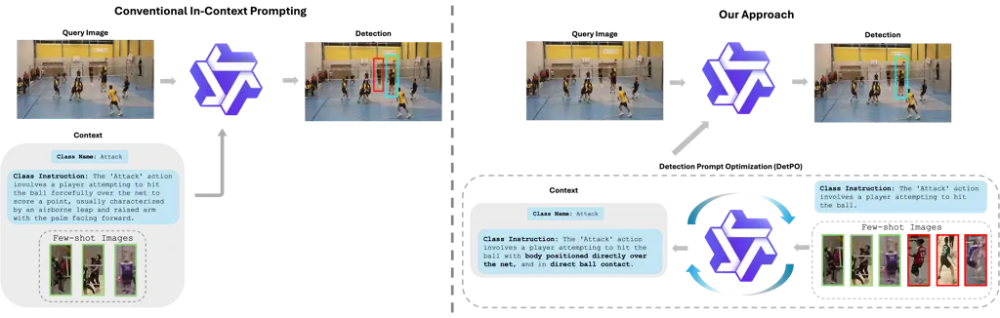

Figure 1: In-Context Learning for Object Detection. We cast the problem
of gradient-free few-shot object detection as multimodal in-context
learning (ICL). Here, a frozen multi-modal LLM (MLLM) is presented with
a class name, a textual description, and a few visual examples (left),
similar to the instructions given to a human annotator tasked with
annotating that class \[44\]. Rather than presenting the visual examples
directly to the MLLM, we find that it is far more effective to use them
to optimize a better text-only prompt (right) via prompt optimization;
we use a critique MLLM to discover prompt instructions that perform
better on the few-shot training dataset. These improved instructions are
then fed into the target MLLM. In practice, we use the same MLLM for
both the critique and target.

|                          |             |              |        |      |
| ------------------------ | ----------- | ------------ | ------ | ---- |
| Method                   | Class Names | Instructions | Images | mAP  |
| Qwen2.5-VL \[5\] (7B)    | ✓           | ✗            | ✗      | 4.6  |
| Qwen2.5-VL \[5\] (7B)    | ✓           | ✓            | ✗      | 6.2  |
| Qwen2.5-VL \[5\] (7B)    | ✓           | ✓            | ✓      | 1.8  |
| Qwen2.5-VL \[5\] (72B)   | ✓           | ✗            | ✗      | 7.1  |
| Qwen2.5-VL \[5\] (72B)   | ✓           | ✓            | ✗      | 10.4 |
| Qwen2.5-VL \[5\] (72B)   | ✓           | ✓            | ✓      | 10.1 |
| Qwen3-VL \[4\] (8B)      | ✓           | ✗            | ✗      | 10.4 |
| Qwen3-VL \[4\] (8B)      | ✓           | ✓            | ✗      | 11.4 |
| Qwen3-VL \[4\] (8B)      | ✓           | ✓            | ✓      | 7.0  |
| Qwen3-VL \[4\] (30B-A3B) | ✓           | ✗            | ✗      | 10.7 |
| Qwen3-VL \[4\] (30B-A3B) | ✓           | ✓            | ✗      | 11.9 |
| Qwen3-VL \[4\] (30B-A3B) | ✓           | ✓            | ✓      | 9.8  |
| Gemini 3 Pro \[12\]      | ✓           | ✗            | ✗      | 21.9 |
| Gemini 3 Pro \[12\]      | ✓           | ✓            | ✗      | 23.0 |
| Gemini 3 Pro \[12\]      | ✓           | ✓            | ✓      | 23.9 |

Table 1: Multi-Modal ICL Hurts Detection Accuracy. Current MLLMs
struggle to learn from multi-modal in-context examples for object
detection. We posit that rigid post-training prompt structures make it
difficult to effectively leverage additional context. To address this
limitation, we propose Detection Prompt Optimization (DetPO) to encode
few-shot multi-modal examples into a single text-only prompt,
significantly improving detection accuracy.

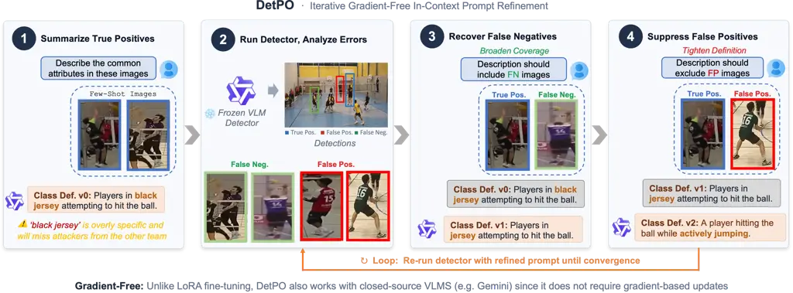

Figure 2: Detection Prompt Optimization. Our iterative framework begins
by generating an initial class definition from a set of few-shot images.
The resulting prompt is evaluated on the training set, yielding false
positive and false negative predictions. We ask a critique model to use
these false negatives to broaden the initial class definition, and false
positives to tighten it. We iteratively evaluate and improve the prompt
on the training set until convergence. As shown above, the false
negative sample removes the constraint “black jersey” from the prompt,
while the false positive sample adds the attribute “actively jumping” to
better distinguish the target class from similar actions.

## 1 Introduction

Multi-Modal LLMs (MLLMs) achieve remarkable zero-shot performance across
diverse vision-language tasks like image captioning, OCR, and VQA \[5,
10, 1\]. On flagship vision tasks like object detection, generalist
MLLMs like Qwen3-VL \[4\] perform on-par with specialist object
detectors like GroundingDINO \[33\] on popular benchmarks like RefCOCO
\[66\] and OdinW-13 \[29\]. However, such models struggle to generalize
to out-of-distribution concepts (e.g. material property estimation,
defect detection, and contextual action recognition) and imaging
modalities (e.g. X-rays, thermal spectrum data, and aerial imagery) not
typically found in internet-scale pre-training \[44\]. We argue that
some data will always remain out-of-distribution, whether due to being
sequestered from the internet or being created after a model’s training
cutoff. This motivates the need to learn from few-shot examples, similar
to how human annotators are taught new concepts via few-shot multi-modal
instructions \[37\].

Few-Shot Detection via In-Context Learning (ICL). Since frontier MLLMs
are typically only accessible via APIs, and state-of-the-art
open-weights models are prohibitively expensive to fine-tune on
consumer-grade hardware, we argue that gradient-free few-shot learning
is best framed through the lens of multi-modal in-context learning
(ICL). Although ICL has been extensively studied for LLMs \[8, 13\],
multi-modal ICL for object detection poses unique challenges. We
primarily explore this problem using the recently released Roboflow20-VL
(RF20-VL) \[44\] benchmark, which aggregates 20 distinct datasets from
domains typically not found in internet-scale pre-training. Importantly,
object classes are specified via few-shot visual examples and rich
textual instructions. In practice, we find that prompting with few-shot
visual examples yields inconsistent benefits compared to using class
names and instructions (Table 1). We posit that this arises from rigid
prompt structures used during post-training, making it difficult to
exploit additional multi-modal contextual information during zero-shot
inference.

Detection Prompt Optimization Improves Concept Alignment. To address
these limitations, we introduce Detection Prompt Optimization (DetPO), a
black-box optimization approach that iteratively refines text-only
prompts by maximizing detection accuracy on few-shot visual training
examples. Unlike classical detectors that primarily learn from true
positive examples, we find that MLLMs benefit from seeing corner cases
and negative examples, akin to how human annotators refine their
understanding of a target class by learning what not to annotate. At
each iteration, DetPO refines a text-only prompt based on the model’s
true positive, false positive, and false negative predictions on the
few-shot training set.

DetPO Down-Weights False Positive Detections. We further observe that
current MLLMs often overpredict bounding boxes and lack per-box
confidence scores by default. We find that simply prompting models for
per-box scores improves detection accuracy without additional compute
cost. However, these self-reported confidence scores can sometimes be
poorly calibrated. In such cases, we can optionally post-process
detections with VQA Score \[32\]. We prompt the model with bounding box
predictions overlaid on the test image and ask “Is this bounding box an
instance of class {CLS}?” We use the normalized probability of the yes
token as the final bounding box confidence score. This simple
post-processing step down-weights false positives and improves mAP.

Contributions. We present three major contributions. First, we benchmark
state-of-the-art MLLMs on RF20-VL and LVIS and show that naively
prompting with multi-modal in-context examples yields poor performance.
Next, we propose Detection Prompt Optimization (DetPO) to iteratively
use model predictions on the training set to refine text-only prompts
and estimate better per-box confidence scores to improve concept
alignment. Lastly, we extensively ablate our design choices and
demonstrate that DetPO consistently improves performance across popular
MLLMs, establishing a new state-of-art for black-box few-shot object
detection.

## 2 Related Works

Vision-Language Models are often pre-trained on large-scale, weakly
supervised image-text pairs \[52\] before fine-tuning on task-specific
data. While early VLMs mainly focused on image classification \[46\] and
VQA, recent methods have extended these models for visual grounding
through open-vocabulary detection. Early efforts adapted VLMs for
detection by classifying region proposals \[19, 18\] or by integrating
detection heads into either frozen \[25\] or fine-tuned \[39, 38, 14\]
encoders. RegionCLIP \[68\] introduced a multi-stage pipeline that
combined pseudo-label generation, region-text contrastive pre-training,
and fine-tuning on detection benchmarks. GLIP \[30\] reformulates
detection as a phrase grounding task, where a single text query is
applied to the entire image. Detic \[69\] improves long-tail detection
performance by leveraging image-level supervision from ImageNet’s 21K
classes \[49\]. Modern VLMs demonstrate strong zero-shot performance and
are often employed as “black-box” tools in downstream tasks \[36, 43,
23, 41, 55\]. More recently, multi-modal large language models (MLLMs)
such as Qwen2.5-VL \[5\], Qwen3-VL \[4\], Gemini 2.5 Pro \[11\], and
Gemini 3 Pro \[12\] reframe spatial understanding as a next-token
prediction task. Notably, generalist MLLMs demonstrate strong zero-shot
visual grounding capabilities on-par with specialist models like
GroundingDINO \[34\] on popular object detection benchmarks like
OdinW-13 \[29\] and RefCOCO \[66\]. However, we find that these
generalist models achieve poor zero-shot detection accuracy on
out-of-distribution classes, tasks, and modalities, motivating the need
for few-shot concept alignment.

Few-Shot Object Detection (FSOD) focuses on recognizing novel object
categories with limited training examples \[24\]. Prior work primarily
explores two paradigms: meta-learning and transfer learning.
Meta-learning methods aim to learn transferable representations from
base classes that can generalize to unseen novel classes. For instance,
Kang et al. \[21\] re-weights features from base classes to infer novel
ones, while Xiao et al. \[62\] unifies few-shot detection and viewpoint
estimation. Fan et al. \[15\] develops a matching-based few-shot object
detection network that learns a similarity metric between image pairs,
and Wu et al. \[61\] enhances object features using universal
prototypes. Xu et al. \[63\] further propose a generative framework that
improves robustness to noisy object proposals. In contrast, transfer
learning methods partially freeze weights pretrained on base datasets to
enable adaptation to novel classes with limited samples. These methods
typically adopt a two-stage fine-tuning process, training on base
classes followed by refinement of the box classifier and regressor using
$`K`$-shot examples. This strategy has generally outperformed
meta-learning approaches \[58\]. Different from prior work, we explore
few-shot object detection for generalist MLLMs using multi-modal
in-context learning.

In-Context Learning (ICL) is an emergent capability that enables LLMs to
reason by analogy \[13\]. Brown et al. \[8\] first popularized few-shot
learning via ICL. Subsequent methods extend this idea by improving
reasoning through structured prompting, such as decomposing complex
instructions into simpler steps \[60, 65\]. Recently, ICL has also
gained traction in the vision-language community. Flamingo \[3\]
demonstrated that large-scale VLMs can perform ICL effectively,
improving tasks like image captioning with only a few examples. More
recently, Emu 2 \[54\] demonstrated that scaling encoder-decoder
architectures with auto-regressive training improves ICL. Different from
prior work, we address multi-modal in-context learning of object
detection.

Prompt Optimization seeks to automate prompt engineering to maximize
model performance on downstream tasks \[47\]. This problem has been
extensively studied for LLMs, where prompting provides a natural and
flexible interface for humans to interact with generalist models.
Notably, prompting has become a standard approach for solving many
flagship NLP tasks \[51, 8, 50\]. However, since LLMs are particularly
sensitive to user prompts \[59\], they often require careful prompt
design \[48, 53\]. Soft prompt tuning methods demonstrate strong
performance using gradient-based optimization \[35, 45, 27\]. However,
such optimization techniques are impractical for frontier MLLMs that
typically only accessible via APIs, and state-of-the-art open-weights
models are prohibitively expensive to fine-tune on consumer-grade
hardware. In this work, we draw inspiration from discrete prompt search
methods such as prompt generation \[6, 2, 40\], prompt scoring \[16\],
and prompt paraphrasing \[20, 67\] to optimize class descriptions
directly in natural language space.

## 3 Detection Prompt Optimization for FSOD

In this section, we present our Detection Prompt Optimization (DetPO)
framework for improving MLLM alignment to target concepts using few-shot
multi-modal examples. Existing prompt optimizers treat the downstream
(visual) task as a black-box to be “blindly" optimized via a numeric
reward. For example, GEPA \[2\] refines a set of candidate prompts using
only the numeric IoU’s of predicted bounding boxes compared to the
ground-truth. In contrast, DetPO directly feeds visual examples of false
positives and false negatives to an MLLM to generate the refined class
prompt; this allows, for example, the MLLM to “see” that occluded
ground-truth objects are being systematically missed and update the
prompt accordingly. Our key insight is that visual tasks should leverage
visual feedback during prompt optimization. We describe our algorithm
below and provide psuedo-code in Appendix 0.C.

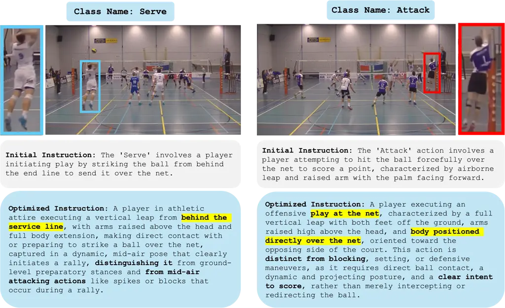

Figure 3: Contrastive Prompt Refinement Reduces Class Confusion. We
present an example of prompt refinement on the challenging Actions
dataset above. Even for the visually similar Attack and Serve classes,
which both depict a player airborne while striking the ball, our method
discovers discriminative attributes that reduce class confusion.
Specifically, DetPO is able to differentiate that Serve occurs behind
the service line, while Attack is played at the net.

Constrastive Prompt Refinement. Unlike traditional detectors, which are
trained primarily on true positive examples, we find that MLLMs achieve
higher detection accuracy when provided with corner cases and negative
examples, similar to how human annotators learn from examples of what
not to annotate. Figure 2 illustrates the prompt refinement procedure of
our Detection Prompt Optimization (DetPO) framework. For each class
$`C`$, we generate an initial class description by prompting the model
to describe key features of all ground-truth instances of $`C`$ in the
training set. We then refine this description by prompting the model to
contrast $`C`$ with ground-truth instances from all other classes,
encouraging the model to focus on discriminative features.

Using this detailed initial prompt, we run inference on the training
images to generate candidate detections and identify all false positives
and false negatives. Next, we find the top $`K`$ most severe false
positives and false negatives (e.g., the false positives with the
highest confidence scores and the false negatives with the lowest IoU),
and use these predictions to guide the next refinement step (Figure 5).
For the sampled false positive, we instruct the critique model to revise
the class definition to explicitly exclude the incorrect instance,
whereas for the sampled false negative, we prompt the critique model to
revise the definition to explicitly include the missed instance. To
guide this revision, the critique model is first asked to identify the
key differences between a reference ground-truth instance and the false
positive, or the key similarities between the reference instance and the
false negative, and then update the class definition accordingly. To
better capture contextual cues, we prompt the model with full images,
highlighting the reference ground-truth instance and the false positive
or false negative using different-colored bounding boxes. After updating
the prompt, we rerun inference on the few-shot training set and repeat
this process until training set performance converges or a maximum
number of refinement steps is reached (Figure 4).

Finally, we generate multiple candidate refinements of the optimized
prompt and evaluate them, together with the initial prompt, on the
few-shot validation set. The prompt achieving the highest validation
performance is selected for inference on the test set.

Confidence Score Estimation. Although specialist detectors typically
predict per-box confidence scores, MLLMs do not by default. We find that
simply prompting the model to predict a confidence score per-box works
well in practice, down weighting false positives more effectively than
the baseline prompt. We include all prompt templates in Appendix 0.D.

VQA Score. Directly asking the model to self-report bounding box
confidence scores inside the optimization loop effectively balances
iteration speed and confidence estimation accuracy. However, it does not
explicitly incorporate object-specific visual features. To address this
limitation, we post-process the confidence scores after optimization for
each predicted bounding box on the test set using VQA Score \[32\].
Specifically, for each prediction, we draw a box on the original image
and prompt the model with the binary question: “Is there an instance of
class {CLS} inside this bounding box? Please answer Yes or No.” We
compute the final confidence score as the normalized likelihood of the
Yes token (i.e.,
$`\frac{p(\texttt{Yes})}{p(\texttt{Yes})+p(\texttt{No})}`$). Although
VQA Score provides higher quality confidence estimates than
self-reported scores, its runtime scales linearly with the number of
predictions, making it computationally expensive in practice. We include
this optional re-ranking step as an upper bound on the performance of
our approach, but note that using self-reported confidence scores is a
strong alternative (Table 3). Notably, recent black-box LLMs like Gemini
3 Pro \[12\] do not expose token probabilities in their API, likely to
hamper efforts to distill the model’s predictions. Therefore, we utilize
Qwen3-VL (30B-A3B) to post-process Gemini’s predictions to generate
VQA-based confidence scores. Our results show that DetPO is robust to
ensembling different black-box models.

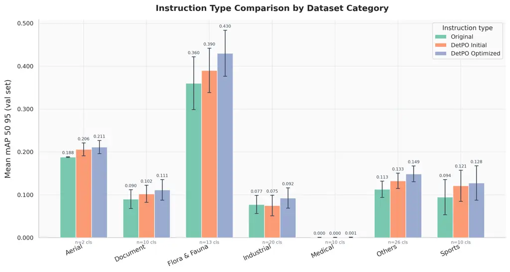

(a) Instruction Type Comparision

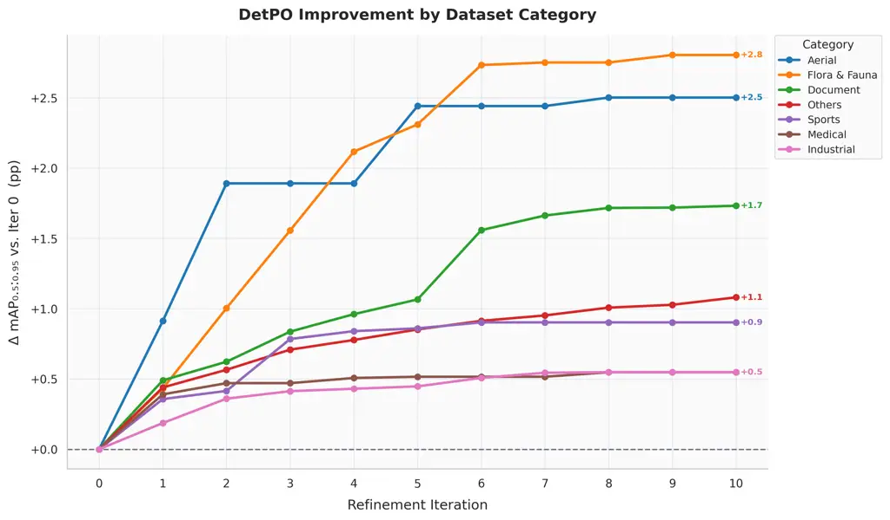

(b) Iterative Accuracy Improvement

Figure 4: Improvement from Contrastive Prompt Refinement. We compare the
original baseline prompt against both the initial DetPO prompt and the
final optimized DetPO prompt (left). These results demonstrate that the
DetPO optimized prompts consistently improves detection accuracy across
nearly all categories. Further, we show that successive refinement
iterations improves performance on the training set (right).
Importantly, we plot the change in mAP relative to the initial DetPO
prompt. Most domains show strong initial gains that begin to plateau
around iteration 6, with the Flora & Fauna and Aerial categories showing
the largest overall improvements (+2.8 and +2.5, respectively).

## 4 Experiments

In this section, we evaluate DetPO against recent state-of-the-art
specialist and generalist detectors. Further, we ablate our design
choices to highlight the impact of contrastive prompt refinement and
confidence score estimation.

Datasets and Metrics. We evaluate DetPO on Roboflow20-VL (RF20-VL), a
subset of the Roboflow100-VL \[44\] benchmark. RF20-VL is a few-shot
object detection benchmark curated from Roboflow Universe, a
community-driven platform that hosts diverse open-source datasets for
real-world computer vision tasks. Notably, the benchmark includes 20
datasets spanning diverse domains such as aerial imagery, X-rays,
medical imaging, and wildlife monitoring. Each dataset provides 10-shot
training examples and rich annotation instructions per class. We follow
the standard COCO evaluation protocol \[31\] and report mean Average
Precision (mAP) for each super-category, as defined by Robicheaux et al.
\[44\], along with the average mAP across all 20 datasets. We refer
readers to Appendix 0.A for full details of our experimental setup,
model configurations, and prompts, and Appendix 0.E for benchmarking
results on LVIS.

Baselines. We evaluate the zero-shot performance of specialist detectors
like GroundingDINO \[33\], LLMDet \[17\], SAM3 \[9\], MQ-GLIP \[64\],
and YOLO-E \[57\], as well as generalist models like Qwen 2.5-VL \[5\],
Qwen 3-VL \[4\], and Gemini 3 Pro \[12\]. Further, we evaluate prompt
optimization approaches like GEPA \[2\] and MIPROv2 \[40\] with Qwen
3-VL and Gemini 3 Pro using DSPy \[22\].

|                                    |        |          |               |            |         |        |       |      |
| ---------------------------------- | ------ | -------- | ------------- | ---------- | ------- | ------ | ----- | ---- |
| Method                             | Aerial | Document | Flora & Fauna | Industrial | Medical | Sports | Other | All  |
| Specialist Models                  |        |          |               |            |         |        |       |      |
| GroundingDINO \[33\] (C)           | 28.5   | 5.1      | 33.7          | 12.8       | 0.4     | 5.1    | 16.9  | 16.8 |
| LLMDet \[17\] (C)                  | 32.3   | 4.4      | 33.6          | 12.6       | 0.7     | 6.7    | 16.7  | 17.2 |
| SAM3 \[9\] (C)                     | 32.3   | 15.3     | 17.1          | 13.8       | 2.0     | 14.2   | 17.8  | 16.3 |
| MQ-GLIP \[64\] (C)                 | 30.1   | 2.5      | 32.8          | 5.5        | 0.5     | 6.4    | 10.8  | 14.0 |
| MQ-GLIP \[64\] (V)                 | 1.8    | 1.1      | 17.6          | 1.8        | 0.1     | 6.6    | 6.8   | 6.7  |
| MQ-GLIP \[64\] (C + V)             | 29.8   | 2.5      | 32.7          | 5.6        | 0.5     | 6.5    | 10.9  | 14.0 |
| YOLO-E \[57\] (C                   | 10.2   | 1.6      | 16.4          | 8.1        | 0.3     | 7.8    | 10.9  | 9.2  |
| YOLO-E \[57\] (V)                  | 11.6   | 10.7     | 17.5          | 15.2       | 2.3     | 8.5    | 16.4  | 13.2 |
| YOLO-E \[57\] (C + V)              | 12.8   | 6.1      | 21.0          | 14.7       | 1.7     | 10.9   | 15.7  | 13.4 |
| Generalist Models                  |        |          |               |            |         |        |       |      |
| Qwen3-VL \[4\] (30B-A3B) (C + I)   | 9.0    | 7.8      | 23.5          | 9.6        | 0.7     | 14.4   | 10.1  | 11.9 |
| w/ GEPA \[2\]                      | 9.3    | 12.4     | 23.6          | 10.8       | 1.3     | 15.1   | 11.3  | 13.0 |
| w/ MIPROv2 \[40\]                  | 8.7    | 5.6      | 18.6          | 10.3       | 0.0     | 15.1   | 9.9   | 10.7 |
| w/ DetPO (Ours) + VQA Score \[32\] | 16.1   | 25.2     | 36.5          | 20.1       | 0.2     | 25.7   | 18.4  | 21.6 |
| Gemini 3 Pro \[12\] (C + I + V)    | 27.0   | 26.7     | 31.3          | 26.2       | 2.6     | 26.9   | 13.3  | 23.8 |
| w/ GEPA \[2\]                      | 19.2   | 30.6     | 32.1          | 32.7       | 2.0     | 28.2   | 20.8  | 25.6 |
| w/ MIPROv2 \[40\]                  | 22.9   | 27.0     | 31.6          | 26.4       | 3.0     | 29.7   | 19.8  | 25.0 |
| w/ DetPO (Ours) + VQA Score \[32\] | 26.2   | 35.7     | 35.4          | 23.3       | 3.9     | 28.2   | 20.4  | 26.3 |

Table 2: Roboflow20-VL Benchmark. We evaluate recent specialist and
generalist models on 20 datasets from the Roboflow20-VL (RF20-VL)
benchmark. Notably, we find that specialist object detectors such as
MQ-GLIP and YOLO-E fail to benefit from few-shot visual examples, with
performance capped at 14.0 mAP. The best specialist model, LLMDet (17.2
mAP), relies solely on class name inputs. In contrast, generalist MLLMs
like Qwen3-VL (30B-A3B) and Gemini 3 Pro augmented with DetPO prompts
outperform specialist detectors, reaching 21.6 and 26.4 mAP
respectively. Across all evaluated generalist models, our Detection
Prompt Optimization (DetPO) framework substantially improves accuracy
over the baseline. Note that C is class names, I is instructions, and V
is for images.

|                                  |      |      |       |      |     |      |      |      |
| -------------------------------- | ---- | ---- | ----- | ---- | --- | ---- | ---- | ---- |
| Method                           | A    | D    | F & F | I    | M   | S    | O    | All  |
| Qwen2.5-VL (7B) \[5\] (C + I)    | 4.9  | 5.1  | 13.5  | 3.9  | 0.1 | 7.3  | 5.0  | 6.2  |
|    w/ DetPO (Ours)               | 6.2  | 12.1 | 19.3  | 4.2  | 0.0 | 9.1  | 7.5  | 9.1  |
|     + VQA Score \[32\]           | 9.4  | 17.3 | 23.4  | 7.2  | 0.0 | 12.8 | 8.8  | 11.9 |
| Qwen2.5-VL (72B) \[5\] (C + I)   | 6.3  | 10.7 | 19.0  | 7.5  | 0.4 | 14.4 | 9.1  | 10.4 |
|    w/ DetPO (Ours)               | 11.1 | 23.0 | 26.1  | 12.4 | 0.5 | 14.8 | 14.9 | 15.7 |
|     + VQA Score \[32\]           | 10.8 | 26.3 | 26.7  | 13.0 | 0.5 | 16.7 | 15.0 | 16.5 |
| Qwen3-VL \[4\] (8B) (C + I)      | 7.1  | 7.3  | 24.8  | 9.3  | 0.2 | 10.2 | 10.9 | 11.4 |
|    w/ DetPO (Ours)               | 8.3  | 19.1 | 30.3  | 13.7 | 0.1 | 14.2 | 12.2 | 15.3 |
|     + VQA Score \[32\]           | 12.3 | 24.2 | 32.3  | 13.5 | 0.2 | 17.2 | 14.3 | 17.5 |
| Qwen3-VL \[4\] (30B-A3B) (C + I) | 9.0  | 7.8  | 23.5  | 9.6  | 0.7 | 14.4 | 10.1 | 11.9 |
|    w/ DetPO (Ours)               | 13.8 | 18.6 | 34.6  | 19.7 | 0.1 | 21.8 | 16.4 | 19.4 |
|     + VQA Score \[32\]           | 16.1 | 25.2 | 36.5  | 20.1 | 0.2 | 25.7 | 18.4 | 21.6 |

Table 3: DetPO Transfers Across Generalist Detectors. We evaluate our
detection prompt optimization approach across popular MLLMs like Qwen
2.5-VL and Qwen 3-VL. Notably, we find that DetPO consistently improves
over the baseline. Further, VQA Score yields modest improvements for all
models, highlighting the importance of well-calibrated confidence score
estimates.

DetPO Outperforms Specialist Zero-Shot Models. While specialist
detectors outperform baseline generalist models (with the exception of
Gemini 3 Pro) on RF20-VL, prompting generalist models with DetPO’s
black-box optimized prompts significantly outperforms specialist object
detectors (Table 2). While top-performing specialist models like LLMDet
and GroundingDINO achieve 17.2 and 16.8 AP, respectively, their
test-time performance is fundamentally limited because it is difficult
to effectively leverage few-shot visual examples. In contrast, applying
DetPO to generalist models yields substantial gains. Gemini 3 Pro with
DetPO prompts achieves a state-of-the-art 26.4 mAP, outperforming the
best specialist model by 9.2%. Similarly, Qwen3-VL (30B-A3B) prompted
with our optimized prompt achieves 21.6 mAP, improving by 9.7% over the
baseline prompt (Figure 4). This suggests that effectively prompted
generalist models can surpass purpose-built zero-shot specialists.

DetPO Improves over Prior Prompt-Optimization Frameworks. Table 2 also
shows that DetPO outperforms existing general-purpose prompt
optimization techniques like GEPA \[2\] and MIPROv2 \[40\] for object
detection. When applied to Qwen3-VL (30B-A3B), GEPA provides a marginal
improvement over the baseline, achieving 13.0 mAP, while MIPROv2
actually degrades to 10.7 mAP. In contrast, DetPO substantially improves
the model’s performance to 19.4 AP. This trend also holds for Gemini 3
Pro, where DetPO (26.4 mAP) outperforms GEPA (25.6 mAP) and MIPROv2
(25.0 mAP). These results indicate that our task-specific optimization
approach is better suited for extracting robust object detection
capabilities from generalist MLLMs than prior approaches.

DetPO Transfers Across Different MLLMs. We evaluate the generalizability
of our prompt optimization approach across a diverse set of generalist
detectors, including the Qwen2.5-VL and Qwen3-VL families. As shown in
Table 3, DetPO consistently improves detection performance over baseline
prompts, regardless of model scale or architecture. For example, smaller
models like Qwen2.5-VL (7B) improve from 6.2 to 9.1, while larger open
models like Qwen2.5-VL (72B) improve from 10.4 to 15.7 mAP. Furthermore,
VQA Score yields modest but consistent improvements across Qwen model
variants (e.g., boosting Qwen3-VL 8B from 15.3 to 17.5 mAP), suggesting
that precise confidence estimation is critical for maximizing detection
performance in generalist models.

|                                                                |      |      |       |      |     |      |      |      |
| -------------------------------------------------------------- | ---- | ---- | ----- | ---- | --- | ---- | ---- | ---- |
| Method                                                         | A    | D    | F & F | I    | M   | S    | O    | All  |
| Qwen3-VL \[4\] (30B-A3B) (C + I)                               | 9.0  | 7.8  | 23.5  | 9.6  | 0.7 | 14.4 | 10.1 | 11.9 |
|    + Contrastive Prompt Optimization     (Self-Reported Score) | 13.8 | 18.6 | 34.6  | 19.7 | 0.1 | 21.8 | 16.4 | 19.4 |
|     w/ SigLIPv2 \[56\] Score                                   | 14.1 | 13.4 | 28.0  | 18.8 | 0.0 | 17.3 | 14.0 | 16.4 |
|     w/ VQA Score \[32\]                                        | 16.1 | 25.2 | 36.5  | 20.1 | 0.2 | 25.7 | 18.4 | 21.6 |

Table 4: Ablation on Confidence Score. We evaluate different approaches
for estimating confidence scores with Qwen3-VL (30B-A3B). By default, we
use the model’s self-reported score (row 2). Notably, we find that using
SigLIPv2’s cosine similarity score between image crops of predicted
boxes and class names for confidence scoring degrades overall
performance (dropping from 19.4 to 16.4 mAP). In contrast, VQA Score
effectively calibrates detection confidence, improving performance to
21.6 mAP.

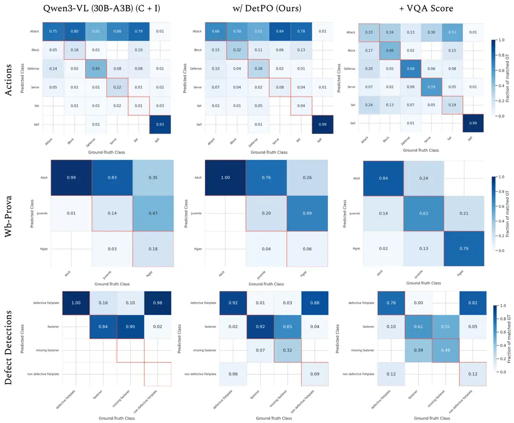

Figure 5: Detection Confusion Matrix. We compare Qwen3-VL (30B-A3B),
Qwen3-VL with DetPO, and with VQA Score across the Actions, Wb-Prova,
and Defect Detections datasets. We find that DetPO and VQA Score
consistently resolve baseline class imbalances. Notably, our proposed
approach improves true positive rates for underrepresented classes
(Juvenile, Piglet) and nuanced actions (Defense, Serve), while
mitigating aggressive false positive predictions in defect detection.

Contrastive Prompt Optimization Reduces Class Confusion. We visualize a
detection confusion matrix \[42\] for Qwen3-VL (30B-A3) in Figure 5.
Based on the confusion matrices, DetPO and VQA Score generally improve
the model’s ability to distinguish nuanced or underrepresented classes.
The most dramatic improvement occurs in the Wb-Prova dataset, where the
baseline almost entirely fails to identify Juvenile and Piglet boars,
instead misclassifying them as Adult. Further, VQA Score sigificantly
improves their true positive rates on the diagonal to 63% and 79%
respectively, effectively resolving the severe class imbalance. In the
Actions dataset, the baseline struggles with specific actions like Block
(16%), Defense (45%), and Serve (22%). Adding DetPO slightly improves
Block (32%) and achieves near-perfect ball recall (99%), while VQA Score
significantly helps distinguish nuanced actions, bringing Defense to 68%
and Serve to 59%. Finally, in the Defect Detections dataset, the
baseline suffers from aggressive overconfidence, misclassifying 98% of
non-defective fishplates as defective. Incorporating DetPO and VQA Score
helps mitigate false positives, incrementally improving the model’s
ability to correctly recognize non-defective parts (up to 12%). We
include examples of the original prompt, DetPO’s initial prompt, an
DetPO’s optimized prompt for the soft plastic class below. We highlight
key details from each prompt in blue.


Estimating Confidence Scores Improves Detection Accuracy. Table 4
evaluates different methods for confidence estimation applied to
Qwen3-VL (30B-A3B). Our results suggest that self-reported confidence
scores (row 2) provide a significant improvement over the baseline,
which does not predict per-box confidences at all (where we assign each
bounding box with a score of 1.0). We find that using SigLIPv2’s cosine
similarity score between image crops of predicted boxes and class names
for confidence scoring degrades overall performance, dropping from 19.4
to 16.4 mAP, particularly hurting performance for Documents (18.6 to
13.4 mAP) and Flora & Fauna (34.6 to 28.0 mAP). In contrast, we find
that VQA Score proves to be highly effective; by leveraging the model’s
own logit scores, we can boost overall performance to 21.6 mAP.
Furthermore, VQA Score demonstrates consistent improvements across all
domains.

|                                    |      |      |       |      |      |      |      |      |
| ---------------------------------- | ---- | ---- | ----- | ---- | ---- | ---- | ---- | ---- |
| Method                             | A    | D    | F & F | I    | M    | S    | O    | All  |
| Black Box Prompting                |      |      |       |      |      |      |      |      |
| GroundingDINO \[33\] (C)           | 28.5 | 5.1  | 33.7  | 12.8 | 0.4  | 5.1  | 16.9 | 16.8 |
| Qwen3-VL \[4\] (8B) (C + I)        | 7.1  | 7.3  | 24.8  | 9.3  | 0.2  | 10.2 | 10.9 | 11.4 |
|    w/ DetPO (Ours) + VQA Score     | 12.3 | 24.2 | 32.3  | 13.5 | 0.2  | 17.2 | 14.3 | 17.5 |
| Qwen3-VL \[4\] (30B-A3B) (C + I)   | 7.1  | 7.3  | 24.8  | 9.3  | 0.2  | 10.2 | 10.9 | 11.4 |
|    w/ DetPO (Ours) + VQA Score     | 16.1 | 25.2 | 36.5  | 20.1 | 0.2  | 25.7 | 18.4 | 21.6 |
| Gemini 3 Pro \[12\] (C + I + V)    | 27.0 | 26.7 | 31.3  | 26.2 | 2.6  | 26.9 | 13.3 | 23.8 |
|    w/ DetPO (Ours) + VQA Score     | 26.2 | 35.7 | 35.4  | 23.3 | 3.9  | 28.2 | 20.4 | 26.3 |
| White-Box Fine-Tuning              |      |      |       |      |      |      |      |      |
| Grounding-DINO (Fine-Tuned) \[44\] | 39.9 | 34.5 | 45.7  | 37.8 | 23.3 | 26.3 | 24.7 | 33.4 |
| Qwen3-VL \[4\] (8B) (C + I) (LoRA) | 7.9  | 13.7 | 26.2  | 10.2 | 0.3  | 11.0 | 12.3 | 13.2 |

Table 5: Black Box Prompting vs White-Box Fine-Tuning. We compare black
box prompting methods against fine-tuned open-weight models. While our
DetPO framework significantly improves the spatial reasoning
capabilities of frontier MLLMs like Gemini 3 Pro, full white-box
fine-tuning of specialist models (e.g., GroundingDINO) currently
performs the best. However, our analysis reveals a strong trendline as
recent closed-source MMLMs like Gemini are far more performant. We
suspect that DetPO applied to the next generation of frontier MMLMs will
outperform all prior art.

In-Context Prompting Under Performs Fine-Tuning. Table 5 shows that
black-box prompt optimization still underperforms “white-box”
fine-tuning of open-weight models. We note that this is surprising given
that for other recognition tasks like visual question answering (VQA),
frontier closed-source models resoundingly outperform their open-weight
counterparts \[28\]. Currently, this is not the case for spatial tasks
such as object detection. However, our analysis reveals a strong
trendline as recent closed-source MMLMs like Gemini are far more
performant. We suspect that DetPO applied to the next generation of
frontier MMLMs will outperform fine-tuned open-weight models such as
GroundingDINO.

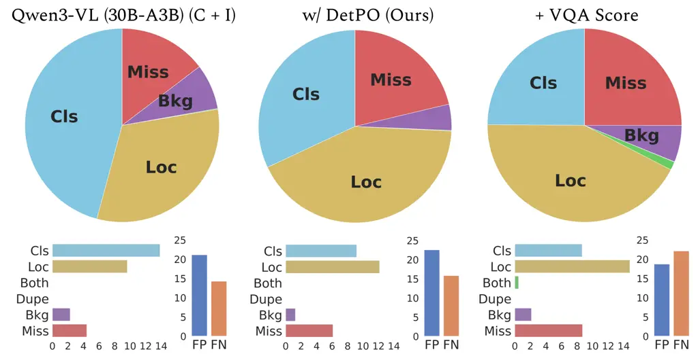

Figure 6: Detection Errors. We diagnose errors in the baseline Qwen3-VL
(30B-A3B) model (left), the proposed DetPO method (center), and DetPO +
VQA Score (right) with TIDE \[7\]. The top row shows the relative
distribution of error types, while the bottom row describes the absolute
error counts and the overall false positive (FP) versus false negative
(FN) rates. DetPO notably reduces classification errors compared to the
baseline. While adding in VQA Score successfully reduces overall false
positives, it shifts the primary error bottleneck to localization (Loc)
and significantly increases missed detections (FN).

Analysis of DetPO Errors. We systematically analyze model errors using
TIDE \[7\] in Figure 6. Our analysis shows that DetPO directly addresses
the baseline model’s primary weakness by substantially reducing the
class confusion rate. We attribute this improvement to contrastive
prompt refinement, which explicitly highlights discriminative features
between classes. However, re-scoring detections with VQA Score creates a
new trade-off: while classification errors remain low and false
positives decrease overall, localization errors and missed detections
increase substantially. We posit that this is because some true positive
detections are incorrectly down-weighted. Overall, DetPO effectively
reduces both false positives and mis-classifications, significantly
improving detection accuracy.

Qualitative Examples. We visualize qualitative examples in Figure 7. Our
approach significantly outperforms the baseline Qwen3-VL model across a
diverse set of challenging domains, including aerial imagery, sports,
agriculture, thermal imaging, and underwater scenes. The baseline model
generates many dense, overlapping, and erroneous bounding boxes in both
the aerial airplane scene and the thermal street view, leading to many
false positives. Further, it suffers from poor recall, failing almost
entirely to detect the wheat heads. In contrast, the proposed method
effectively mitigates these shortcomings, suppressing false positives to
produce precise, well localized predictions that closely align with the
ground truth. It also successfully recovers objects missed by the
baseline (such as the wheat heads and smaller fish), demonstrating
strong performance across diverse environments.

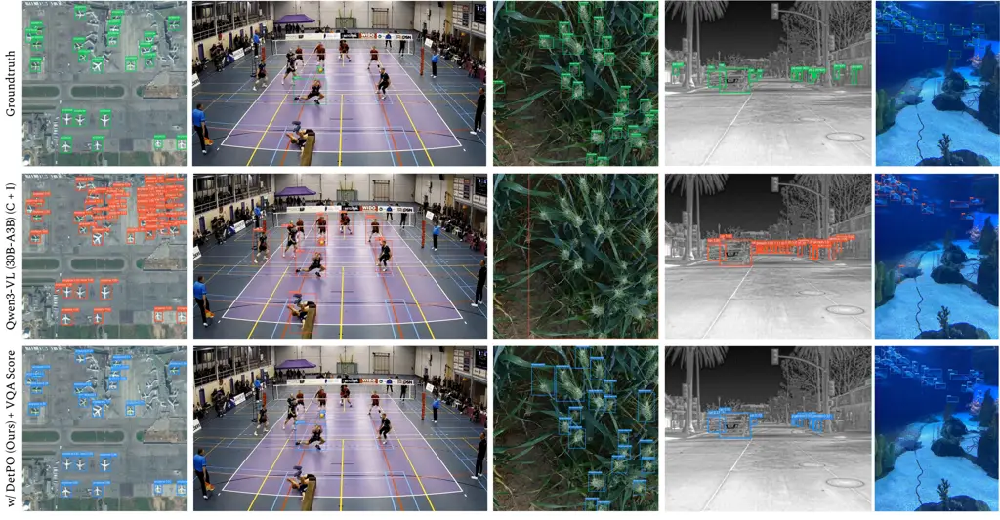

Figure 7: Qualitative Results. The baseline Qwen3-VL model suffers from
high false positive rates (dense, overlapping boxes) and poor recall in
complex environments. In contrast, our proposed method mitigates these
issues, significantly reducing erroneous predictions while successfully
recovering missed objects (like wheat heads and fish). Best viewed
zoomed in.

Limitations and Future Work While Detection Prompt Optimization (DetPO)
effectively bridges the gap between zero-shot generalization and
task-specific adaptation, the iterative prompt refinement process
introduces computational overhead similar to training a specialist
model. However, it is important to note that this optimization cost is
only incurred once during the initial prompt discovery phase; subsequent
inference calls using the optimized prompt are no more expensive than
standard MLLM inference calls. We expect that future innovations in
speeding up inference (e.g. vLLM \[26\]) will continue to reduce
wall-clock time. Further, we find that DetPO fails to improve
performance on medical datasets, likely because weak base-model
performance limits the benefits of prompt optimization. More generally,
DetPO appears most effective in the intermediate regime where models are
capable but not yet saturated. Furthermore, our experiments
demonstrating the effectiveness of VQA Score suggest that MLLM
self-reported confidence scores are suboptimal. Future work may improve
performance further by investigating better confidence calibration
mechanisms. Finally, evaluating closed-source MLLMs like Gemini 3 Pro
via APIs introduces potential training data leakage concerns. By
evaluating these models on specific training examples, there is a risk
of images and optimized prompts being used in future pre-training
mixtures.

## 5 Conclusion

In this paper, we demonstrate that current MLLMs struggle to effectively
leverage few-shot multi-modal in-context examples for object detection.
To address this limitation, we present Detection Prompt Optimization
(DetPO) as a simple yet effective solution. By iteratively refining
text-only prompts and incorporating visual feedback from both positive
and negative detections, DetPO bridges the gap between zero-shot
generalization and task-specific adaptation without gradient-based
training. Our experiments on RF20-VL and LVIS demonstrate that DetPO
improves concept alignment, reduces false positive detections through
improved confidence calibration, and yields consistent performance
improves across diverse domains and generalist MLLMs. Our results
suggest that prompt-level optimization can serve as a practical
alternative to fine-tuning in cases where it is infeasible (e.g.,
closed-source APIs) or prohibitively expensive (e.g., state-of-the-art
open-weights MLLMs), enabling generalist MLLMs to better adapt to novel
classes, modalities, and tasks encountered in real-world scenarios.

## Acknowledgments

This work was supported in part by the NSF GRFP (Grant No. DGE2140739).

## References

- \[1\] J. Achiam, S. Adler, S. Agarwal, L. Ahmad, I. Akkaya, F. L.
  Aleman, D. Almeida, J. Altenschmidt, S. Altman, S. Anadkat, et
  al. (2023) Gpt-4 technical report. arXiv preprint arXiv:2303.08774.
  Cited by: §1.
- \[2\] L. A. Agrawal, S. Tan, D. Soylu, N. Ziems, R. Khare, K.
  Opsahl-Ong, A. Singhvi, H. Shandilya, M. J. Ryan, M. Jiang, et
  al. (2025) Gepa: reflective prompt evolution can outperform
  reinforcement learning. arXiv preprint arXiv:2507.19457. Cited by:
  Table 10, Table 10, Table 10, Table 10, Appendix 0.J, Appendix 0.B,
  Table 6, §2, §3, Table 2, Table 2, §4, §4.
- \[3\] J. Alayrac, J. Donahue, P. Luc, A. Miech, I. Barr, Y. Hasson, K.
  Lenc, A. Mensch, K. Millican, M. Reynolds, et al. (2022) Flamingo: a
  visual language model for few-shot learning. Advances in neural
  information processing systems 35, pp. 23716–23736. Cited by: §2.
- \[4\] S. Bai, Y. Cai, R. Chen, K. Chen, X. Chen, Z. Cheng, L. Deng, W.
  Ding, C. Gao, C. Ge, W. Ge, Z. Guo, Q. Huang, J. Huang, F. Huang, B.
  Hui, S. Jiang, Z. Li, M. Li, M. Li, K. Li, Z. Lin, J. Lin, X. Liu, J.
  Liu, C. Liu, Y. Liu, D. Liu, S. Liu, D. Lu, R. Luo, C. Lv, R. Men, L.
  Meng, X. Ren, X. Ren, S. Song, Y. Sun, J. Tang, J. Tu, J. Wan, P.
  Wang, P. Wang, Q. Wang, Y. Wang, T. Xie, Y. Xu, H. Xu, J. Xu, Z.
  Yang, M. Yang, J. Yang, A. Yang, B. Yu, F. Zhang, H. Zhang, X.
  Zhang, B. Zheng, H. Zhong, J. Zhou, F. Zhou, J. Zhou, Y. Zhu, and K.
  Zhu (2025) Qwen3-vl technical report. arXiv preprint arXiv:2511.21631.
  Cited by: Appendix 0.C, Table 6, Table 7, Table 1, Table 1, Table 1,
  Table 1, Table 1, Table 1, §1, §2, Table 2, Table 3, Table 3, Table 4,
  Table 5, Table 5, Table 5, §4.
- \[5\] S. Bai, K. Chen, X. Liu, J. Wang, W. Ge, S. Song, K. Dang, P.
  Wang, S. Wang, J. Tang, et al. (2025) Qwen2. 5-vl technical report.
  arXiv preprint arXiv:2502.13923. Cited by: Table 1, Table 1, Table 1,
  Table 1, Table 1, Table 1, §1, §2, Table 3, Table 3, §4.
- \[6\] E. Ben-David, N. Oved, and R. Reichart (2022) PADA:
  example-based prompt learning for on-the-fly adaptation to unseen
  domains. Transactions of the Association for Computational Linguistics
  10, pp. 414–433. Cited by: §2.
- \[7\] D. Bolya, S. Foley, J. Hays, and J. Hoffman (2020) Tide: a
  general toolbox for identifying object detection errors. In European
  Conference on Computer Vision, pp. 558–573. Cited by: Figure 8, Figure
  8, Figure 6, Figure 6, §4.
- \[8\] T. Brown, B. Mann, N. Ryder, M. Subbiah, J. D. Kaplan, P.
  Dhariwal, A. Neelakantan, P. Shyam, G. Sastry, A. Askell, et
  al. (2020) Language models are few-shot learners. Advances in neural
  information processing systems 33, pp. 1877–1901. Cited by: §1, §2,
  §2.
- \[9\] N. Carion, L. Gustafson, Y. Hu, S. Debnath, R. Hu, D. Suris, C.
  Ryali, K. V. Alwala, H. Khedr, A. Huang, et al. (2025) Sam 3: segment
  anything with concepts. arXiv preprint arXiv:2511.16719. Cited by:
  Table 6, Appendix 0.E, Table 2, §4.
- \[10\] G. Comanici, E. Bieber, M. Schaekermann, I. Pasupat, N.
  Sachdeva, I. Dhillon, M. Blistein, O. Ram, D. Zhang, E. Rosen, et
  al. (2025) Gemini 2.5: pushing the frontier with advanced reasoning,
  multimodality, long context, and next generation agentic capabilities.
  arXiv preprint arXiv:2507.06261. Cited by: §1.
- \[11\] G. DeepMind (2024) Introducing gemini 2.0: our new ai model for
  the agentic era. External Links:
  [Link](https://blog.google/technology/google-deepmind/google-gemini-ai-update-december-2024/)
  Cited by: §2.
- \[12\] G. DeepMind (2025) Gemini 3 pro model card. Note:
  https://storage.googleapis.com/deepmind-media/Model-Cards/Gemini-3-Pro-Model-Card.pdf
  Cited by: Table 1, Table 1, Table 1, §2, §3, Table 2, Table 5, §4.
- \[13\] Q. Dong, L. Li, D. Dai, C. Zheng, J. Ma, R. Li, H. Xia, J.
  Xu, Z. Wu, B. Chang, et al. (2024) A survey on in-context learning. In
  Proceedings of the 2024 conference on empirical methods in natural
  language processing, pp. 1107–1128. Cited by: §1, §2.
- \[14\] Y. Du, F. Wei, Z. Zhang, M. Shi, Y. Gao, and G. Li (2022)
  Learning to prompt for open-vocabulary object detection with
  vision-language model. In Proceedings of the IEEE/CVF Conference on
  Computer Vision and Pattern Recognition, pp. 14084–14093. Cited by:
  §2.
- \[15\] Q. Fan, W. Zhuo, C. Tang, and Y. Tai (2020) Few-shot object
  detection with attention-rpn and multi-relation detector. In
  Proceedings of the IEEE/CVF conference on computer vision and pattern
  recognition, pp. 4013–4022. Cited by: §2.
- \[16\] J. Feldman, J. Davison, and A. M. Rush (2019) Commonsense
  knowledge mining from pretrained models. arXiv preprint
  arXiv:1909.00505. Cited by: §2.
- \[17\] S. Fu, Q. Yang, Q. Mo, J. Yan, X. Wei, J. Meng, X. Xie, and W.
  Zheng (2025) Llmdet: learning strong open-vocabulary object detectors
  under the supervision of large language models. In Proceedings of the
  Computer Vision and Pattern Recognition Conference, pp. 14987–14997.
  Cited by: Table 6, Appendix 0.E, Table 2, §4.
- \[18\] X. Gu, T. Lin, W. Kuo, and Y. Cui (2021) Open-vocabulary object
  detection via vision and language knowledge distillation. arXiv
  preprint arXiv:2104.13921. Cited by: §2.
- \[19\] X. Gu, T. Lin, W. Kuo, and Y. Cui (2021) Open-vocabulary object
  detection via vision and language knowledge distillation. arXiv
  preprint arXiv:2104.13921. Cited by: §2.
- \[20\] Z. Jiang, F. F. Xu, J. Araki, and G. Neubig (2020) How can we
  know what language models know?. Transactions of the Association for
  Computational Linguistics 8, pp. 423–438. Cited by: §2.
- \[21\] B. Kang, Z. Liu, X. Wang, F. Yu, J. Feng, and T. Darrell (2019)
  Few-shot object detection via feature reweighting. In Proceedings of
  the IEEE/CVF International Conference on Computer Vision,
  pp. 8420–8429. Cited by: §2.
- \[22\] O. Khattab, A. Singhvi, P. Maheshwari, Z. Zhang, K.
  Santhanam, S. Vardhamanan, S. Haq, A. Sharma, T. T. Joshi, H. Moazam,
  et al. (2023) Dspy: compiling declarative language model calls into
  self-improving pipelines. arXiv preprint arXiv:2310.03714. Cited by:
  Appendix 0.B, §4.
- \[23\] M. Khurana, N. Peri, D. Ramanan, and J. Hays (2024)
  Shelf-supervised multi-modal pre-training for 3d object detection.
  arXiv preprint arXiv:2406.10115. Cited by: §2.
- \[24\] M. Köhler, M. Eisenbach, and H. Gross (2021) Few-shot object
  detection: a comprehensive survey. arXiv preprint arXiv:2112.11699.
  Cited by: §2.
- \[25\] W. Kuo, Y. Cui, X. Gu, A. Piergiovanni, and A. Angelova (2022)
  F-vlm: open-vocabulary object detection upon frozen vision and
  language models. arXiv preprint arXiv:2209.15639. Cited by: §2.
- \[26\] W. Kwon, Z. Li, S. Zhuang, Y. Sheng, L. Zheng, C. H. Yu, J. E.
  Gonzalez, H. Zhang, and I. Stoica (2023) Efficient memory management
  for large language model serving with pagedattention. In Proceedings
  of the ACM SIGOPS 29th Symposium on Operating Systems Principles,
  Cited by: §4.
- \[27\] B. Lester, R. Al-Rfou, and N. Constant (2021) The power of
  scale for parameter-efficient prompt tuning. arXiv preprint
  arXiv:2104.08691. Cited by: §2.
- \[28\] B. Li, Z. Lin, W. Peng, et al. (2024) NaturalBench: evaluating
  vision-language models on natural adversarial samples. In The
  Thirty-eighth Annual Conference on Neural Information Processing
  Systems, Cited by: §4.
- \[29\] C. Li, H. Liu, L. H. Li, P. Zhang, J. Aneja, J. Yang, P.
  Jin, H. Hu, Z. Liu, Y. J. Lee, and J. Gao (2022) ELEVATER: a benchmark
  and toolkit for evaluating language-augmented visual models. Neural
  Information Processing Systems. Cited by: §1, §2.
- \[30\] L. H. Li, P. Zhang, H. Zhang, J. Yang, C. Li, Y. Zhong, L.
  Wang, L. Yuan, L. Zhang, J. Hwang, et al. (2022) Grounded
  language-image pre-training. In Proceedings of the IEEE/CVF Conference
  on Computer Vision and Pattern Recognition, pp. 10965–10975. Cited by:
  §2.
- \[31\] T. Lin, M. Maire, S. Belongie, J. Hays, P. Perona, D.
  Ramanan, P. Dollár, and C. L. Zitnick (2014) Microsoft coco: common
  objects in context. In Computer vision–ECCV 2014: 13th European
  conference, zurich, Switzerland, September 6-12, 2014, proceedings,
  part v 13, pp. 740–755. Cited by: §4.
- \[32\] Z. Lin, D. Pathak, B. Li, J. Li, X. Xia, G. Neubig, P. Zhang,
  and D. Ramanan (2024) Evaluating text-to-visual generation with
  image-to-text generation. In European Conference on Computer Vision,
  pp. 366–384. Cited by: Table 7, §1, §3, Table 2, Table 2, Table 3,
  Table 3, Table 3, Table 3, Table 4.
- \[33\] S. Liu, Z. Zeng, T. Ren, F. Li, H. Zhang, J. Yang, Q. Jiang, C.
  Li, J. Yang, H. Su, et al. (2024) Grounding dino: marrying dino with
  grounded pre-training for open-set object detection. In European
  conference on computer vision, pp. 38–55. Cited by: Table 6, §1, Table
  2, Table 5, §4.
- \[34\] S. Liu, Z. Zeng, T. Ren, F. Li, H. Zhang, J. Yang, C. Li, J.
  Yang, H. Su, J. Zhu, et al. (2023) Grounding dino: marrying dino with
  grounded pre-training for open-set object detection. arXiv preprint
  arXiv:2303.05499. Cited by: Appendix 0.A, Appendix 0.E, §2.
- \[35\] X. Liu, Y. Zheng, Z. Du, M. Ding, Y. Qian, Z. Yang, and J.
  Tang (2024) GPT understands, too. AI Open 5, pp. 208–215. Cited by:
  §2.
- \[36\] Y. Ma, N. Peri, S. Wei, W. Hua, D. Ramanan, Y. Li, and S.
  Kong (2023) Long-tailed 3d detection via 2d late fusion. arXiv
  preprint arXiv:2312.10986. Cited by: §2.
- \[37\] A. Madan, N. Peri, S. Kong, and D. Ramanan (2024) Revisiting
  few-shot object detection with vision-language models. Advances in
  Neural Information Processing Systems 37, pp. 19547–19560. Cited by:
  §1.
- \[38\] M. Minderer, A. Gritsenko, and N. Houlsby (2023) Scaling
  open-vocabulary object detection. arXiv preprint arXiv:2306.09683.
  Cited by: §2.
- \[39\] M. Minderer, A. Gritsenko, A. Stone, M. Neumann, D.
  Weissenborn, A. Dosovitskiy, A. Mahendran, A. Arnab, M. Dehghani, Z.
  Shen, et al. (2022) Simple open-vocabulary object detection. In
  European Conference on Computer Vision, pp. 728–755. Cited by: §2.
- \[40\] K. Opsahl-Ong, M. J. Ryan, J. Purtell, D. Broman, C. Potts, M.
  Zaharia, and O. Khattab (2024) Optimizing instructions and
  demonstrations for multi-stage language model programs. arXiv preprint
  arXiv:2406.11695. Cited by: Appendix 0.B, Table 6, §2, Table 2, Table
  2, §4, §4.
- \[41\] A. Osep, T. Meinhardt, F. Ferroni, N. Peri, D. Ramanan, and L.
  Leal-Taixe (2024) Better call sal: towards learning to segment
  anything in lidar. In ECCV, Cited by: §2.
- \[42\] N. Peri, A. Dave, D. Ramanan, and S. Kong (2023) Towards
  long-tailed 3d detection. In Conference on Robot Learning,
  pp. 1904–1915. Cited by: §4.
- \[43\] N. Peri, A. Dave, D. Ramanan, and S. Kong (2023) Towards
  long-tailed 3d detection. In corl, Cited by: §2.
- \[44\] M. Popov, P. Robicheaux, A. Madan, I. Robinson, J. Nelson, D.
  Ramanan, and N. Peri (2025) Roboflow100-vl: a multi-domain object
  detection benchmark for vision-language models. In The Thirty-ninth
  Annual Conference on Neural Information Processing Systems Datasets
  and Benchmarks Track, Cited by: Figure 1, Figure 1, §1, §1, Table 5,
  §4.
- \[45\] G. Qin and J. Eisner (2021) Learning how to ask: querying lms
  with mixtures of soft prompts. arXiv preprint arXiv:2104.06599. Cited
  by: §2.
- \[46\] A. Radford, J. W. Kim, C. Hallacy, A. Ramesh, G. Goh, S.
  Agarwal, G. Sastry, A. Askell, P. Mishkin, J. Clark, et al. (2021)
  Learning transferable visual models from natural language supervision.
  In International conference on machine learning, pp. 8748–8763. Cited
  by: §2.
- \[47\] K. Ramnath, K. Zhou, S. Guan, S. S. Mishra, X. Qi, Z. Shen, S.
  Wang, S. Woo, S. Jeoung, Y. Wang, et al. (2025) A systematic survey of
  automatic prompt optimization techniques. arXiv preprint
  arXiv:2502.16923. Cited by: §2.
- \[48\] L. Reynolds and K. McDonell (2021) Prompt programming for large
  language models: beyond the few-shot paradigm. In Extended abstracts
  of the 2021 CHI conference on human factors in computing systems,
  pp. 1–7. Cited by: §2.
- \[49\] O. Russakovsky, J. Deng, H. Su, J. Krause, S. Satheesh, S.
  Ma, Z. Huang, A. Karpathy, A. Khosla, M. Bernstein, et al. (2015)
  Imagenet large scale visual recognition challenge. International
  journal of computer vision 115, pp. 211–252. Cited by: §2.
- \[50\] V. Sanh, A. Webson, C. Raffel, S. H. Bach, L. Sutawika, Z.
  Alyafeai, A. Chaffin, A. Stiegler, T. L. Scao, A. Raja, et al. (2021)
  Multitask prompted training enables zero-shot task generalization.
  arXiv preprint arXiv:2110.08207. Cited by: §2.
- \[51\] T. Schick and H. Schütze (2021) Exploiting cloze-questions for
  few-shot text classification and natural language inference. In
  Proceedings of the 16th conference of the European chapter of the
  association for computational linguistics: main volume, pp. 255–269.
  Cited by: §2.
- \[52\] C. Schuhmann, R. Beaumont, R. Vencu, C. Gordon, R. Wightman, M.
  Cherti, T. Coombes, A. Katta, C. Mullis, M. Wortsman, et al. (2022)
  Laion-5b: an open large-scale dataset for training next generation
  image-text models. Advances in neural information processing systems
  35, pp. 25278–25294. Cited by: §2.
- \[53\] T. Shin, Y. Razeghi, R. L. Logan IV, E. Wallace, and S.
  Singh (2020) Autoprompt: eliciting knowledge from language models with
  automatically generated prompts. arXiv preprint arXiv:2010.15980.
  Cited by: §2.
- \[54\] Q. Sun, Y. Cui, X. Zhang, F. Zhang, Q. Yu, Y. Wang, Y. Rao, J.
  Liu, T. Huang, and X. Wang (2024) Generative multimodal models are
  in-context learners. In Proceedings of the IEEE/CVF Conference on
  Computer Vision and Pattern Recognition, pp. 14398–14409. Cited by:
  §2.
- \[55\] A. Takmaz, C. Saltori, N. Peri, T. Meinhardt, R. de Lutio, L.
  Leal-Taixe, and A. Osep (2025) Towards Learning to Complete Anything
  in Lidar. In International Conference on Machine Learning (ICML),
  Cited by: §2.
- \[56\] M. Tschannen, A. Gritsenko, X. Wang, M. F. Naeem, I.
  Alabdulmohsin, N. Parthasarathy, T. Evans, L. Beyer, Y. Xia, B.
  Mustafa, et al. (2025) Siglip 2: multilingual vision-language encoders
  with improved semantic understanding, localization, and dense
  features. arXiv preprint arXiv:2502.14786. Cited by: Table 4.
- \[57\] A. Wang, L. Liu, H. Chen, Z. Lin, J. Han, and G. Ding (2025)
  YOLOE: real-time seeing anything. External Links: 2503.07465,
  [Link](https://arxiv.org/abs/2503.07465) Cited by: Table 2, Table 2,
  Table 2, §4.
- \[58\] X. Wang, T. E. Huang, T. Darrell, J. E. Gonzalez, and F.
  Yu (2020) Frustratingly simple few-shot object detection. In
  International Conference on Machine Learning (ICML), Cited by: §2.
- \[59\] A. Webson and E. Pavlick (2022) Do prompt-based models really
  understand the meaning of their prompts?. In Proceedings of the 2022
  conference of the north american chapter of the association for
  computational linguistics: Human language technologies, pp. 2300–2344.
  Cited by: §2.
- \[60\] J. Wei, X. Wang, D. Schuurmans, M. Bosma, F. Xia, E. Chi, Q. V.
  Le, D. Zhou, et al. (2022) Chain-of-thought prompting elicits
  reasoning in large language models. Advances in neural information
  processing systems 35, pp. 24824–24837. Cited by: §2.
- \[61\] A. Wu, Y. Han, L. Zhu, and Y. Yang (2021) Universal-prototype
  enhancing for few-shot object detection. In Proceedings of the
  IEEE/CVF International Conference on Computer Vision, pp. 9567–9576.
  Cited by: §2.
- \[62\] Y. Xiao, V. Lepetit, and R. Marlet (2022) Few-shot object
  detection and viewpoint estimation for objects in the wild. IEEE
  Transactions on Pattern Analysis and Machine Intelligence 45 (3),
  pp. 3090–3106. Cited by: §2.
- \[63\] J. Xu, H. Le, and D. Samaras (2023) Generating features with
  increased crop-related diversity for few-shot object detection. In
  Proceedings of the IEEE/CVF Conference on Computer Vision and Pattern
  Recognition, pp. 19713–19722. Cited by: §2.
- \[64\] Y. Xu, M. Zhang, C. Fu, P. Chen, X. Yang, K. Li, and C.
  Xu (2023) Multi-modal queried object detection in the wild. Advances
  in Neural Information Processing Systems 36, pp. 4452–4469. Cited by:
  Table 2, Table 2, Table 2, §4.
- \[65\] S. Yao, D. Yu, J. Zhao, I. Shafran, T. Griffiths, Y. Cao,
  and K. Narasimhan (2023) Tree of thoughts: deliberate problem solving
  with large language models. Advances in neural information processing
  systems 36, pp. 11809–11822. Cited by: §2.
- \[66\] L. Yu, P. Poirson, S. Yang, A. C. Berg, and T. L. Berg (2016)
  Modeling context in referring expressions. In European conference on
  computer vision, pp. 69–85. Cited by: §1, §2.
- \[67\] W. Yuan, G. Neubig, and P. Liu (2021) Bartscore: evaluating
  generated text as text generation. Advances in neural information
  processing systems 34, pp. 27263–27277. Cited by: §2.
- \[68\] Y. Zhong, J. Yang, P. Zhang, C. Li, N. Codella, L. H. Li, L.
  Zhou, X. Dai, L. Yuan, Y. Li, et al. (2022) Regionclip: region-based
  language-image pretraining. In Proceedings of the IEEE/CVF Conference
  on Computer Vision and Pattern Recognition, pp. 16793–16803. Cited by:
  §2.
- \[69\] X. Zhou, R. Girdhar, A. Joulin, P. Krähenbühl, and I.
  Misra (2022) Detecting twenty-thousand classes using image-level
  supervision. In European Conference on Computer Vision, pp. 350–368.
  Cited by: §2.

## Appendix 0.A Baseline Implementation Details

We present additional implementation details to reproduce our baseline
experiments below.

GroundingDINO is a text-promptable vision-language model designed for
open-set object detection. It combines the DINO transformer-based object
detector with language grounding so that textual queries like “a brown
dog” or “traffic light” guide the detection process. The model aligns
image regions with text embeddings to produce bounding boxes for objects
that match the query, even if those categories were not explicitly
included in training. We use GroundingDINO \[34\] with pretrained
weights from mmdetection (MM-GroundingDINO-L\*). We prompt the model
with all the class names combined into a single prompt. For “white-box”
experiments, we fine-tune GroundingDINO on each few-shot dataset for
1000 iterations with a batch size of 4 and a learning rate of 3e-4. We
resize all images to (640, 1333) and don’t use any additional data
augmentations.

MQ-GLIP proposes a learnable module that enables multi-modal prompting.
We choose GLIP with a SWIN-L backbone as the underlying detection model
for our experiments. We use the model checkpoint trained on Objects365,
FourODs, GoldG, and Cap24M. Lastly, we use class names as the text
prompts and few-shot visual examples as visual prompts.

YOLO-E presents a unified open-vocabulary framework that integrates
re-parameterizable region-text alignment (RepRTA) and semantic-activated
visual prompt encoding (SAVPE). We select the YOLOv8-based architecture
as the underlying detection model. We utilize the model checkpoint
pre-trained on large-scale grounding datasets including Objects365 and
GoldG. Lastly, we use class names as text prompts and few-shot training
images as visual prompts to enable zero-shot detection.

SAM3 is a recent open-vocabulary image and video segmentation model.
Unlike traditional segmentation models that require predefined object
classes, SAM3 can detect and generate pixel-level masks for any object
described by a concept, using prompts such as natural-language text
(e.g., “red car”), example images, or interactive clicks. We prompt for
each class independently since SAM3 does not natively support
multi-class detection.

LLMDet integrates LLM supervision into GroundingDINO’s architecture to
improve open-vocabulary object detection. Unlike traditional detectors
that can only recognize a fixed set of predefined classes, LLMDet
leverages the semantic knowledge of LLMs to learn from both region-level
descriptions and image-level captions, enabling it to detect objects
described in natural language, even if those object categories were not
present during training. This language-guided supervision helps the
model generalize better to new or rare object categories and perform
zero-shot detection.

## Appendix 0.B Prompt Optimization Baseline Details

We use DSPy \[22\] to define a object detection program that takes an
image and text prompt as input and produces a JSON string of bounding
box detections. The detection prompt is automatically constructed from
each dataset’s categories and README metadata (i.e., per-class
descriptions and annotator instructions), instructing the model to
detect all target classes simultaneously. For Gemini 3 Pro, bounding
boxes use the native \[ymin, xmin, ymax, xmax\] format normalized to
$`[0,1000]`$; for Qwen 3-VL, we use \[x1, y1, x2, y2\] in the same
coordinate space. We optimize per-image F1 at IoU $`\geq 0.5`$ with
greedy matching. The metric provides structured text feedback (e.g.
precision, recall, and specific error descriptions) to guide prompt
evolution.

GEPA automatically improve prompts or instructions by estimating
gradient-like signals from model outputs and feedback to iteratively
update prompts. The algorithm evaluates how changes to a prompt affects
task performance and then adjusts the prompt in the direction that
improves results. This automatically refines prompts for better
accuracy, reasoning quality, or task performance while treating the MLLM
as a black box. We run GEPA \[2\] with the light budget preset,
generating 6 candidate prompts over $`{\sim}10`$ evolutionary trials.
GEPA reflects on minibatches of 3 training examples per step using the
same base model as the reflection LM (temperature 0.8), and selects the
candidate with the highest validation F1.

MiPROv2 is an automated prompt optimization algorithm that improves LLM
performance by generating, evaluating, and combining multiple candidate
instructions and demonstrations. It searches over different prompt
structures such as task instructions, examples, and formatting and
selects the best configuration based on validation performance. We run
MIPROv2 \[40\] with the same light budget preset as GEPA. Unlike GEPA,
MIPROv2 proposes instruction candidates via LLM-based generation rather
than evolutionary reflection, and selects among them using Bayesian
optimization over validation scores.

## Appendix 0.C DetPO Implementation Details

We present additional implementation details to reproduce our DetPO
experiments below and open source our code on
[GitHub](https://github.com/ggare-cmu/DetPO).

DetPO (Detection Prompt Optimization) is a single-class iterative prompt
optimization framework that automatically refines per-class
natural-language descriptions for MLLM-based object detection. DetPO
uses the MLLM as both a detector and a prompt critic, iteratively
improving textual class definitions by reasoning over its own detection
errors. Given a set of object classes $`\mathcal{C}`$, a training split,
and a maximum number of iterations $`T_{max}`$, DetPO produces a refined
natural-language class definition $`Pc`$ for each class $`c`$ that
maximizes detection performance on a held-out validation set. The full
procedure is summarized in Algorithm 1 and is described in detail below.

Stage 1: Initial Prompt Generation. The goal of stage 1 is to bootstrap
a class definition from labeled visual examples before running inference
on unannotated test images. It consists of two parts:

SummarizePositive. All ground truth instances in the training set
containing class $`c`$ are annotated with green bounding boxes. Next,
the MLLM is prompted with all annotated images and is asked to identify
the consistent visual characteristics of the highlighted objects. This
produces a concise class definition. A seed description from the dataset
README provides a prior that grounds the initial generation:

```math
\displaystyle P_{c}\;\leftarrow\;\mathrm{MLLM}\!\left(\,\bigl\{\,\mathrm{DrawGreen}(x,\,b_{c})\;\big|\;x\in\mathcal{X}^{+}(c)\,\bigr\}\,\right). \tag{1}
```

RefineContrastive. For every other class $`c^{-}\neq c`$, one example
image containing $`c^{-}`$ is randomly sampled. That image is annotated
with a red bounding box around the $`c^{-}`$ instance. We prompt the
MLLM with both a negative example from $`c^{-}`$ and positive example
from class $`c`$. The MLLM then identifies the key features
distinguishing the object inside the green box from the red box, and
produces an updated $`P_{c}`$ that excludes $`c^{-}`$ while including
$`c`$:

```math
\displaystyle P_{c}\;\leftarrow\;\mathrm{RefineContrastive}\!\left(P_{c},\;\mathrm{DrawGreen}(x^{+}_{c}),\;\mathrm{DrawRed}(x^{-}_{c^{-}})\right). \tag{2}
```

This loop iterates over all $`|\mathcal{C}|-1`$ negative classes,
progressively sharpening $`P_{c}`$ to exclude visually similar but
semantically distinct objects.

Stage 2: Iterative Error-Driven Refinement. Stage 2 runs a closed-loop
optimization in which $`P_{c}`$ is evaluated on the training split. We
identify the worst false positive (FP) and worst false negative (FN)
detections and update $`P_{c}`$ to address each error type.

IdentifyErrors. At each iteration $`t`$, we run inference on the
training split using $`P_{c}`$ and compute COCO-style metrics.
Per-detection error scores are derived as follows:

False Positive Score. For each predicted box that does not overlap with
any ground truth box of class $`c`$, the false positive error is
proportional to the model’s confidence and its overlap with the ground
truth boxes of other classes:

```math
\varepsilon_{\mathrm{FP}}(d)\;=\;s_{d}\cdot\max\!\bigl(0.2,\;\mathrm{IoU}(b_{d},b^{*}_{\neq c})\bigr), \tag{3}
```

where $`s_{d}`$ is the detection confidence and $`b^{*}_{\neq c}`$ is
the nearest ground truth box of any class other than $`c`$.

False Negative Score. For each ground truth box of class $`c`$ that is
not matched with a prediction, the false negative error reflects how far
the best matching prediction falls from a correct detection:

```math
\displaystyle\sigma(g) \displaystyle\;=\;\max_{d}\;\bigl[s_{d}\cdot\mathrm{IoU}(b_{d},g)\bigr], \tag{4}
```

```math
\displaystyle\varepsilon_{\mathrm{FN}}(g) \displaystyle\;=\;1-\sigma(g). \tag{5}
```

The worst false positive is selected as
$`\arg\max_{d}\,\varepsilon_{\mathrm{FP}}(d)`$ and the worst false
negative as $`\arg\max_{g}\,\varepsilon_{\mathrm{FN}}(g)`$. To encourage
diversity, previously selected images are excluded from the candidate
pool. We use the best match (e.g. highest-scoring correct detection),
worse false positive (e.g. highest error false positive), and worse
false negative (e.g. highest error false negative) as visual evidence.

RefineInclude. The MLLM then receives the best match (green) and worst
false negative (blue) images alongside the current $`P_{c}`$. The MLLM
identifies features shared by both objects and produces a definition
that would also detect the blue instance. False negative refinement is
applied before false positive refinement within each iteration so that
the broadened definition is subsequently tightened:

```math
\displaystyle P_{c}\;\leftarrow\;\mathrm{RefineInclude}\!\left(P_{c},\;x^{+}_{{\color[rgb]{0,0.5,0}\textbf{green}}{}},\;x^{\mathrm{FN}}_{{\color[rgb]{0,0,0.707}\textbf{blue}}{}}\right). \tag{6}
```

RefineExclude. The MLLM receives the best match (green) and worst false
positive (red) images alongside the updated $`P_{c}`$. The MLLM is asked
to identify features that distinguish the two objects and produce a
definition that would reject the worse false positive:

```math
\displaystyle P_{c}\;\leftarrow\;\mathrm{RefineExclude}\!\left(P_{c},\;x^{+}_{{\color[rgb]{0,0.5,0}\textbf{green}}{}},\;x^{\mathrm{FP}}_{{\color[rgb]{0.707,0,0}\textbf{red}}{}}\right). \tag{7}
```

Conservative Update Rule and Early Stopping After each iteration, we
compare the mAP of the updated prompt to the previous iteration’s
training mAP. If performance decreases, $`P_{c}`$ is reverted to the
previous best prompt (prev_instructions). The best global prompt is
tracked separately:

```math
\displaystyle P_{c}^{(t)} \displaystyle\;\leftarrow\;\begin{cases}P_{c}^{(t)}&\text{if }\mathrm{mAP}(P_{c}^{(t)})\geq\mathrm{mAP}(P_{c}^{(t-1)})\\
P_{c}^{(t-1)}&\text{otherwise (revert)}\end{cases} \tag{8}
```

```math
\displaystyle P_{c}^{*} \displaystyle\;\leftarrow\;\arg\max_{t}\;\mathrm{mAP}(P_{c}^{(t)},\;\mathcal{D}_{\mathrm{train}}). \tag{9}
```

The loop terminates at $`t=T_{\max}`$ or when all sub-sample evaluation
scores are already perfect (early stopping).

Stage 3: Validation Set Candidate Selection After $`T_{\max}`$
iterations, Stage 3 selects the final prompt from a set of candidates by
evaluating each on the held-out validation split.

GenerateAlternative. We also ask the MLLM to generate an additional
candidate prompt $`P_{c}^{\mathrm{alt}}`$ to refine the best prompt
without any visual examples. This allows the MLLM to remove
dataset-specific artifacts:

```math
\displaystyle P_{c}^{\mathrm{alt}}\;\leftarrow\;\mathrm{MLLM}\!\left(P_{c}^{*},\;\textit{``Refine for generalization''}\right). \tag{10}
```

Candidate Evaluation and Selection. We evaluate five candidate prompts
on $`\mathcal{D}_{\mathrm{val}}`$ using COCO mAP. The highest-scoring
candidate is selected as the final output for class $`c`$:

```math
\displaystyle P_{c}^{\mathrm{final}}\;\leftarrow\;\arg\max_{p\,\in\,\mathcal{P}}\;\mathrm{mAP}(p,\;\mathcal{D}_{\mathrm{val}}), \tag{11}
```

where
$`\mathcal{P}=\{P_{c}^{(0)},\;P_{c}^{(1)},\;P_{c}^{*},\;P_{c}^{(T_{\max})},\;P_{c}^{\mathrm{alt}}\}`$.
$`P_{c}^{(0)}`$ is the dataset provided seed prompt, $`P_{c}^{(1)}`$ is
the Stage 1 prompt, $`P_{c}^{*}`$ is the best training iteration prompt,
$`P_{c}^{(T_{\max})}`$ is the final training iteration prompt, and
$`P_{c}^{\mathrm{alt}}\}`$ is the alternative generated prompt.

Model Specific Details. We conduct all Qwen2.5-VL experiments using the
“qwen2.5-vl-72b-instruct” model and “qwen2.5-vl-7b-instruct” model.
Similarly, we conduct all Qwen3-VL experiments using the
“qwen3-vl-8b-instruct” and “qwen3-vl-30b-a3b-instruct” models. We prompt
the model based on guidelines from Qwen’s official documentation. For
Gemini 3 Pro experiments, we generate initial DetPO prompts using
gemini-3-flash-preview. Since the Gemini API does not expose token-level
log probabilities, we perform score calibration with VQAScore using
Qwen3-VL \[4\] (30B-A3B).

1

def tune_prompt(classes, train_set, T_max):

refined_prompt = ""

\# Stage 1: Initial prompt

P_c = SummarizePositive(c)

for c_neg in classes:

if c_neg == c: continue

P_c = RefineContrastive(P_c, sample_positive(c), sample_negative(c_neg))

\# Stage 2: Iterative refinement

for t in range(T_max):

FP, FN = IdentifyErrors(ModelDetect(train_set, P_c))

\# Select worst errors

FP_err = argmax(FP, key="confidence")

FN_err = argmin(FN, key="IoU")

\# Update prompt

x_pos = sample_positive(c)

P_c = RefineExclude(P_c, x_pos, FP_err)

P_c = RefineInclude(P_c, x_pos, FN_err)

refined_prompt = P_c

\# Early stop

if has_converged(EvaluatePrompt(P_c, train_set)):

break

\# Stage 3: Val set based selection

P_c_alt = GenerateAlternative(refined_prompt)

candidates = \[P_c_initial, refined_prompt, P_c_alt\]

refined_prompt = argmax(candidates, key=lambda p: EvaluatePrompt(p,
val_set))

return refined_prompt

Algorithm 1 DetPO Algorithm

## Appendix 0.D Prompts

We improve Qwen3-VL’s base prompt through small-scale validation on
multiple datasets and select the best prompt:

System Prompt


Multi-Class Detection Prompt


Single-Class Detection Prompt


Prompting with Rich Textual Instructions


We include the rich textual description for all classes when using the
multi-class detection prompt. In contrast, we only append the relevant
class description when using the single-class detection prompt.

Prompting with Few-Shot Visual Examples


Initial Class Definition Generation Prompt


Class Definition Refinement using False-Positive Prompt


Class Definition Refinement using False-Negative Prompt


Generate Alternative Class Definition


DetPO Single Class Detection Prompt


Confidence Estimation using VQA Score Prompt


## Appendix 0.E LVIS Rare 50 10-Shot Benchmark Results

To further evaluate few-shot detection performance, we constructed a
subset of LVIS by sampling the 50 least frequent classes in the
validation set that contain at least 10 examples each. While many
specialist detectors report zero-shot performance on the full LVIS
dataset, LLMs typically avoid this due to its large number of classes.
We find that specialist detectors like GroundingDINO \[34\], SAM3 \[9\],
and LLMDet \[17\] consistently outperform our Qwen3-VL (30B-A3B)
generalist baseline. Interestingly, zero-shot predictions from SAM3
slightly outperform GroundingDINO fine-tuned on LVIS v1, suggesting that
LVIS categories are likely in-distribution for SAM3’s PCS training
dataset. Furthermore, LLMDet (which shares GroundingDINO’s architecture
but does not fine-tune on LVIS) achieves significantly lower
performance. Consistent with the results in our main paper, DetPO yields
a significant 3.2 mAP improvement over the Qwen3-VL baseline. VQA score
further improves performance by 3.4 mAP. In contrast, prompt
optimization techniques like GEPA and MIPROv2 fail to improve upon the
Qwen3-VL’s baseline prompt. We attribute this failure to such methods
attempting to optimize for all 50 classes in a single prompt.

|                                          |         |
| ---------------------------------------- | ------- |
|    Method                                |    mAP  |
|    Specialist Models                     |         |
|    GroundingDINO (Fine-Tuned) \[33\] (C) |    40.3 |
|    SAM3 \[9\] (C)                        |    40.5 |
|    LLMDet \[17\] (C)                     |    27.1 |
|    Generalist Models                     |         |
|    Qwen3-VL \[4\] (30B-A3B) (C + I)      |    21.9 |
|     w/ GEPA \[2\]                        |    21.9 |
|     w/ MIPROv2 \[40\]                    |    21.9 |
|     w/ DetPO (Ours)                      |    25.1 |
|      + VQA Score                         |    28.5 |

Table 6: LVIS Rare 50 10-Shot Benchmark. We evaluate model performance
on the 50 least frequent LVIS validation classes with atleast 10
examples per-class. While specialist models achieve the highest overall
mAP, our DetPO approach and VQA Score substantially improve the
performance of the generalist Qwen3-VL baseline.

We further diagnose Qwen3-VL’s errors in Figure 8. Comparing the
baseline Qwen3-VL (left) to our DetPO method (center) demonstrates a
significant reduction in background errors and overall false positives.
While this trade-off inherently increases false negatives, our method
yields a more balanced distribution of error types. The addition of VQA
Score (right) further limits false positives but considerably increases
false negatives.

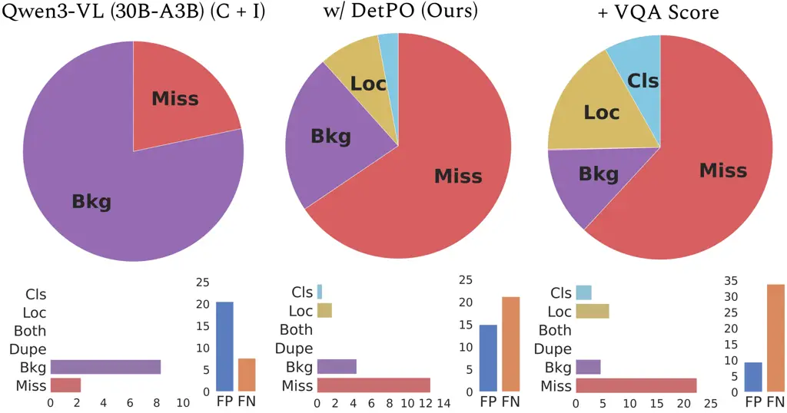

Figure 8: Detection Errors. We diagnose errors in the baseline Qwen3-VL
(30B-A3B) model (left), the proposed DetPO method (center), and DetPO +
VQA Score (right) with TIDE \[7\]. The top row shows the relative
distribution of error types, while the bottom row describes the absolute
error counts and the overall false positive (FP) versus false negative
(FN) rates. DetPO successfully reduces background errors (FP) at the
cost of increased misses (FN), a trade-off that is further amplified
when incorporating VQA Score.

## Appendix 0.F Token and Run-Time Analysis

Figures 9 and 10 demonstrate the significant efficiency gains of DetPO
over GEPA when evaluated on the aerial-airport dataset. As shown in
Figure 9, DetPO achieves an 81% reduction in total token usage. Unlike
GEPA, which exhausts the majority of its tokens during the optimization
phase, DetPO bypasses this loop and concentrates its token usage almost
entirely in the final detection stage. Consequently, this reduction in
LLM API calls and token consumption directly translates to faster
execution. Figure 10 illustrates that DetPO completes the task in 10
minutes and 46 seconds, making it 1.2$`\times`$ faster than GEPA’s 12
minutes and 57 seconds runtime. Ultimately, DetPO offers a streamlined
pipeline that conserves both computational resources and real-world
processing time. Note that since GEPA optimizes multiple classes in
parallel (unlike DetPO, which optimizes each class separately), we
expect that DetPO’s runtime will increase proportional to the number of
classes. Future work should parallelize DetPO’s optimization and
inference steps to further increase efficiency.

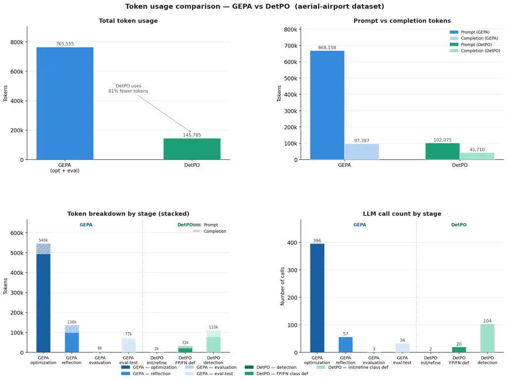

Figure 9: Token Analysis. We compare token usage between GEPA and DetPO
on the aerial-airport dataset. DetPO uses 81% fewer total tokens
compared to GEPA (top left). DetPO’s efficiency gains primarily stem
from a massive reduction in prompt tokens (top right). In contrast, GEPA
expends the vast majority of its tokens (546k) during the optimization
phase, whereas DetPO’s token usage is concentrated mostly in the final
detection stage (bottom left). DetPO significantly reduces the number of
required API calls compared to GEPA’s intensive optimization loop
(bottom right).

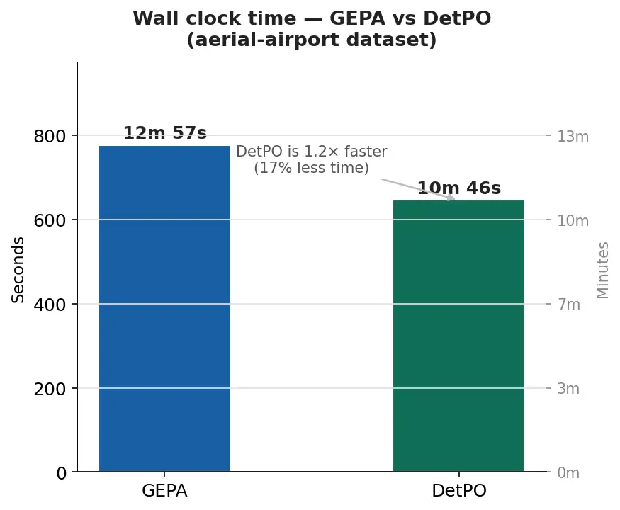

Figure 10: Wall Clock Analysis. We compare the total execution time
between GEPA and DetPO on the aerial-airport dataset. DetPO completes
the task in 10 minutes and 46 seconds, outperforming GEPA’s time of 12
minutes and 57 seconds. Overall, DetPO achieves a 17% reduction in
processing time, making it 1.2x faster than GEPA.

## Appendix 0.G Impact of $`K`$ Shots

We evaluate the impact of the number of examples provided to DetPO
during optimization in Table 7. We observe that performance consistently
improves when increasing from 3-shot to 5-shot settings. However, gains
from 5-shot to 10-shot are marginal, suggesting diminishing returns and
saturation of performance with additional training examples.

|                                  |      |      |       |      |     |      |      |      |
| -------------------------------- | ---- | ---- | ----- | ---- | --- | ---- | ---- | ---- |
| Method                           | A    | D    | F & F | I    | M   | S    | O    | All  |
| Qwen3-VL \[4\] (30B-A3B) (C + I) | 9.0  | 7.8  | 23.5  | 9.6  | 0.7 | 14.4 | 10.1 | 11.9 |
|    w/ DetPO 3-shot               | 12.9 | 17.2 | 33.4  | 19.1 | 0.1 | 22.1 | 16.4 | 18.9 |
|     + VQA Score                  | 16.2 | 23.6 | 33.8  | 20.1 | 0.1 | 26.5 | 18.3 | 21.0 |
|    w/ DetPO 5-shot               | 14.1 | 18.1 | 34.5  | 19.0 | 0.1 | 22.9 | 15.6 | 19.2 |
|     + VQA Score                  | 16.4 | 25.6 | 36.6  | 19.7 | 0.4 | 26.1 | 17.9 | 21.6 |
|    w/ DetPO 10-shot              | 13.8 | 18.6 | 34.6  | 19.7 | 0.1 | 21.8 | 16.4 | 19.4 |
|     + VQA Score \[32\]           | 16.1 | 25.2 | 36.5  | 20.1 | 0.2 | 25.7 | 18.4 | 21.6 |

Table 7: Ablation on Few-Shot Examples. We ablate the impact of the
number of few-shot examples (3-shot, 5-shot, and 10-shot) using the
DetPO on optimization performance. Notably, we see consistent
improvements in increasing from 3 shots to 5 shots, but note marginal
improvements from 5 shots to 10 shots, suggesting that adding additional
examples does not significantly improve model performance.

## Appendix 0.H Analysis on Prompt Optimization Variance

We evaluate DetPO’s variance with Qwen3-VL (8B) over three runs in
Table 8. Notably, DetPO’s variance averaged over 20 datasets is 4.4%,
while its improvement over the baseline is 35.0%. This shows that the
improvements are consistent and significant.

|                       |               |                |                |                |               |                |                |                |
| --------------------- | ------------- | -------------- | -------------- | -------------- | ------------- | -------------- | -------------- | -------------- |
| Method                | A             | D              | F & F          | I              | M             | S              | O              | All            |
| Qwen3-VL-8B           |               |                |                |                |               |                |                |                |
|    w/ DetPO (Seed 42) | 8.3           | 19.1           | 30.3           | 13.7           | 0.1           | 14.2           | 12.2           | 15.3           |
|    w/ DetPO (Seed 43) | 9.5           | 19.2           | 30.7           | 13.9           | 0.1           | 14.8           | 12.0           | 15.6           |
|    w/ DetPO (Seed 44) | 7.4           | 18.9           | 30.3           | 14.1           | 0.1           | 15.0           | 11.8           | 15.3           |
| Mean $`\pm`$ STD      | 8.4$`\pm`$0.8 | 19.0$`\pm`$0.1 | 30.4$`\pm`$0.2 | 13.9$`\pm`$0.2 | 0.1$`\pm`$0.0 | 14.7$`\pm`$0.4 | 12.0$`\pm`$0.2 | 15.4$`\pm`$0.1 |

Table 8: Variance Analysis. We evaluate DetPO’s stability across three
different runs with Qwen3-VL (8B). Scores remain consistent, with a
relative variance of 4.4% averaged over 20 datasets.

## Appendix 0.I Ablation on Sampling Strategy

We study the effect of the error selection strategy used during prompt
refinement. Specifically, we compare our “worst-case” strategy, which
selects the most severe false positives (i.e., highest-confidence false
positives) and false negatives (i.e., lowest-IoU misses), against
randomly sampled false positives and false negatives at each iteration.
We find that prompts optimized using random samples perform marginally
better at 10-shots (Table 9). However, this gap is within the inter-run
variance. We hypothesize that, on larger training sets, prioritizing the
most severe and representative failure cases encourages the model to
capture corner cases and hard negatives, analogous to providing detailed
corrective feedback to human annotators, whereas random errors would
provide a weaker learning signal.

|                           |      |      |       |      |     |      |      |      |
| ------------------------- | ---- | ---- | ----- | ---- | --- | ---- | ---- | ---- |
| Method                    | A    | D    | F & F | I    | M   | S    | O    | All  |
| Qwen3-VL-8B               |      |      |       |      |     |      |      |      |
|    w/ DetPO, Worst FP/FN  | 8.3  | 19.1 | 30.3  | 13.7 | 0.1 | 14.2 | 12.2 | 15.3 |
|    w/ DetPO, Random FP/FN | 9.2  | 20.4 | 30.2  | 13.4 | 0.2 | 15.2 | 12.2 | 15.6 |
| Qwen3-VL-30B              |      |      |       |      |     |      |      |      |
|    w/ DetPO, Worst FP/FN  | 13.8 | 18.6 | 34.6  | 19.7 | 0.1 | 21.8 | 16.4 | 19.4 |
|    w/ DetPO, Random FP/FN | 14.9 | 18.9 | 35.1  | 18.7 | 0.1 | 21.5 | 16.9 | 19.6 |

Table 9: FP/FN Selection Criterion. We ablate different sampling
strategies in selecting false positive and false negatives for prompt
refinement. Notably, we find that selecting random errors performs
marginally better in the 10-shot case than our proposed strategy, but
posit that prioritizing the most severe and representative failure cases
will yield greater benefits on larger training sets.

## Appendix 0.J Adapting DetPO for Multiclass Evaluation

We evaluate DetPO’s per-class instructions under a multiclass evaluation
setting. Directly concatenating all single-class prompts into a
multi-class prompt leads to degraded performance due to excessive prompt
length. Instead, we find that summarizing the per-class instructions
into a compact unified prompt yields substantially better performance.
As shown in Table 10, although DetPO’s multi-class performance is lower
than its single-class performance, this strategy still outperforms
GEPA \[2\]. We provide the summarization prompt below.

|                                |      |      |       |      |     |      |      |      |
| ------------------------------ | ---- | ---- | ----- | ---- | --- | ---- | ---- | ---- |
| Method                         | A    | D    | F & F | I    | M   | S    | O    | All  |
| Qwen3-VL-8B                    |      |      |       |      |     |      |      |      |
|    w/ DetPO, Single-class      | 8.3  | 19.1 | 30.3  | 13.7 | 0.1 | 14.2 | 12.2 | 15.3 |
|    w/ DetPO, Multi-class       | 8.6  | 10.1 | 26.9  | 9.9  | 0.1 | 11.0 | 10.5 | 12.5 |
|    w/ GEPA \[2\] (Multi-class) | 6.3  | 10.8 | 22.4  | 8.5  | 0.1 | 12.8 | 11.5 | 11.6 |
| Qwen3-VL-30B                   |      |      |       |      |     |      |      |      |
|    w/ DetPO, Single-class      | 13.8 | 18.6 | 34.6  | 19.7 | 0.1 | 21.8 | 16.4 | 19.4 |
|    w/ DetPO, Multi-class       | 13.6 | 12.0 | 29.6  | 11.7 | 1.0 | 17.5 | 15.5 | 16.0 |
|    w/ GEPA \[2\] (Multi-class) | 9.3  | 12.4 | 23.6  | 10.8 | 1.3 | 15.1 | 11.3 | 13.0 |

Table 10: Single-class vs. Multi-class Evaluation. We compare DetPO’s
single-class performance with its multi-class performance and GEPA’s
multi-class performance. Althought DetPO’s multi-class performance is
lower than its single-class performance, we find that it still
outperforms GEPA \[2\].

DetPO Multiclass Summarization Prompt


