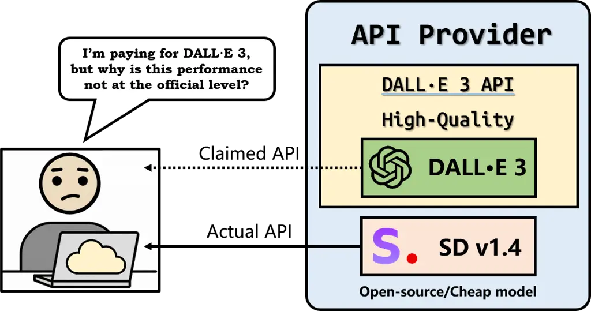
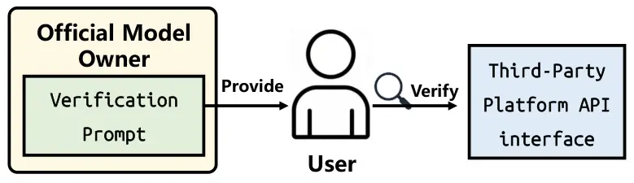
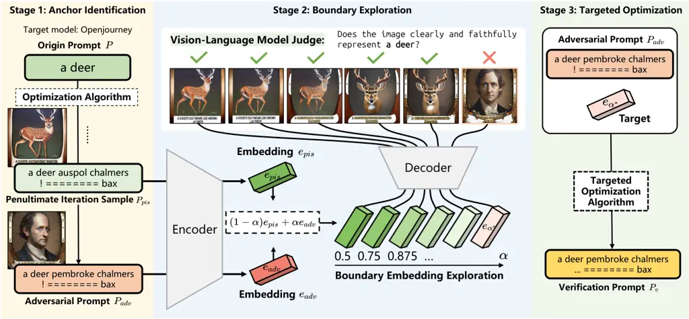
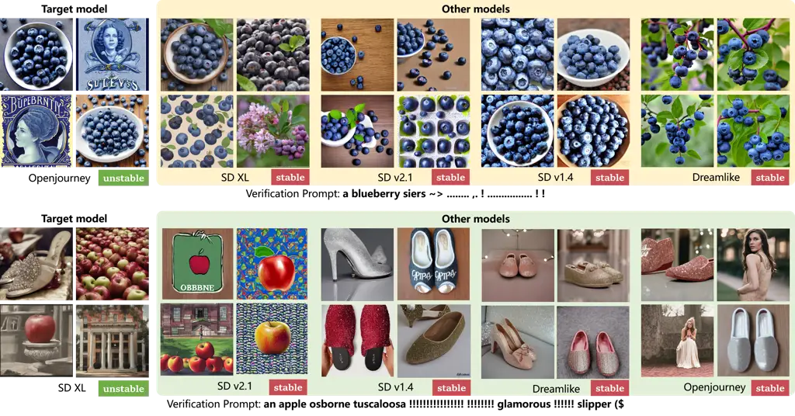

# Verify Claimed Text-to-Image Models via Boundary-Aware Prompt Optimization

Zidong Zhao  
Zhejiang University  
Hangzhou, China Yihao Huang  
East China Normal University  
Shanghai, China Qing Guo  
Nankai University  
Tianjin, China Affiliation:  Anran Li  
University of Science and Technology of China  
Hefei, China Kailong Wang  
Huazhong University of Science and Technology  
Wuhan, China Jin Song Dong  
National University of Singapore  
Singapore, Singapore Geguang Pu  
East China Normal University  
Shanghai, China

###### Abstract

As Text-to-Image (T2I) generation becomes widespread, third-party
platforms increasingly integrate multiple model APIs for convenient
image creation. However, false claims of using official models can
mislead users and harm model owners’ reputations, making model
verification essential to confirm whether an API’s underlying model
matches its claim. Existing methods address this by using verification
prompts generated by official model owners, but the generation relies on
multiple reference models for optimization, leading to high
computational cost and sensitivity to model selection. To address this
problem, we propose a reference-free T2I model verification method
called Boundary-aware Prompt Optimization (BPO). It directly explores
the intrinsic characteristics of the target model. The key insight is
that although different T2I models produce similar outputs for normal
prompts, their semantic boundaries in the embedding space (transition
zones between two concepts such as “corgi” and “bagel”) are distinct.
Prompts near these boundaries generate unstable outputs (e.g., sometimes
a corgi and sometimes a bagel) on the target model but remain stable on
other models. By identifying such boundary-adjacent prompts, BPO
captures model-specific behaviors that serve as reliable verification
cues for distinguishing T2I models. Experiments on five T2I models and
four baselines demonstrate that BPO achieves superior verification
accuracy.

## I Introduction

Text-to-image (T2I) models \[1, 2, 3, 4, 5, 6\] such as Stable Diffusion
\[5\], DALL·E \[3\], and Imagen \[4\] have achieved remarkable progress
\[7, 8\], generating realistic and diverse images from text. However,
their training and deployment require substantial computational
resources, leading most users to rely on third-party platforms that
provide API-based access \[9, 10, 11\]. While this improves
accessibility, it raises a critical security issue: how can users ensure
that the API is indeed powered by the model claimed by the provider? For
example, as in Fig. , a provider might advertise DALL·E 3 but secretly
substitute it with a cheaper model like Stable Diffusion v1.4, causing
both economic fraud and a serious breach of user trust.



Fig. 1: API provider may claim an official model while actually serving
a cheaper one.

TVN \[12\] is the only T2I model verification method and suggests that
users can obtain a verification prompt from the official model owner to
test whether a third-party API uses the claimed model. It identifies a
non-transferable adversarial prompt \[13\] that triggers a semantic
change only in the target model, which can thus serve as a verification
prompt. For example, the prompt causes the target model to generate a
dog, while other reference models produce a cat. If a third-party API
produces a dog image as output, it is likely powered by the target
model. In essence, the method relies on the semantic shift discrepancy
of verification prompts across models as evidence to distinguish the
models.

Although TVN \[12\] can achieve good verification performance, multiple
reference models are relied upon to guide optimization, which increases
computational cost and strong dependence on model selection. To this
end, we aim to develop a reference-free method that relies solely on the
target model. The key challenge is that existing methods rely on loss
gradients from reference models to enhance the discriminative power of
verification prompts. Without such reference models to provide extra
information, it becomes non-trivial to identify prompts that are still
discriminative using only the target model.

To address this issue, instead of using non-transferable adversarial
prompts that rely heavily on reference models to capture transfer
behavior, we propose to directly explore the intrinsic characteristics
of the target model itself. Our key insight originates from empirical
observations that different T2I models exhibit distinct semantic
boundaries, which are transition zones in the embedding space between
two concepts (_e.g_., “corgi” and “bagel”). Prompts near these
boundaries produce unstable or ambiguous outputs, whereas those farther
away yield consistent images. Since different models have distinct
semantic boundaries, prompts that are unstable for the target model but
stable for others can serve as verification cues for distinguishing
between T2I models.

Based on this insight, we propose a white-box T2I model verification
method via semantic Boundary-aware Prompt Optimization, termed BPO. BPO
is a reference-free approach that requires only the target model itself.
It starts from an original prompt, it first derives an adversarial
prompt and the most recent failed prompt as semantic anchors through
adversarial attacks on the target model. These two prompts lie on
opposite sides of the model’s semantic boundary. BPO then interpolates
between their embeddings to explore the continuous transition region and
identify a critical embedding near this boundary. Finally, BPO refines
the adversarial prompt by optimizing it toward the critical embedding
through targeted optimization.

To sum up, our contributions are as follows:

- •
  We propose the first reference-free T2I model verification method that
  relies solely on the target model itself.
- •
  We propose BPO, a white-box prompt optimization method that identifies
  adversarial prompts near the target model’s semantic boundary as
  verification prompts through a three-stage pipeline.
- •
  Experiments conducted on ten basic prompts across five T2I models, and
  compared with four baselines, verify the effectiveness of the proposed
  method.

## II Related work

### II-A Text-to-Image Models

In recent years, text-to-image (T2I) generation \[1, 2, 3, 4, 5, 6\] has
achieved remarkable progress \[7, 8\], with diffusion models emerging as
the dominant paradigm for synthesizing high-fidelity images from natural
language descriptions. These models typically employ a text encoder to
map a user’s prompt into a semantic embedding \[5, 4\], which then
conditions a Denoising Diffusion Probabilistic Model (DDPM) \[2\] to
generate the corresponding image from random noise, often leveraging
techniques like Classifier-Free Guidance \[14\].

To enhance efficiency and scalability, two major strategies have been
proposed. The first involves operating in a compressed latent space, as
pioneered by Latent Diffusion Models (LDMs) \[5\], which significantly
reduces computational load by performing the diffusion process in a
lower-dimensional space. The second strategy adopts cascaded pipelines
where a base model generates a low-resolution image that is subsequently
refined by a series of super-resolution modules \[15\]. This cascaded
approach has proven effective for both latent-space and pixel-space
models, such as Imagen \[4\], to achieve high-fidelity synthesis at
megapixel resolutions. Despite these advances, deploying and running
such models locally still requires substantial GPU resources and
technical expertise \[16\], posing a significant barrier to widespread
adoption for individual users.

### II-B Third-Party Platforms for Large Models

The proliferation of powerful generative models has led to the rise of
third-party platforms (_e.g_., Hugging Face \[17\], Replicate \[18\])
and enterprise-grade cloud services (_e.g_., AWS Bedrock \[19\], Google
Vertex AI \[20\]), which provide access to these models via standardized
APIs. This Machine-Learning-as-a-Service (MLaaS) \[11\] paradigm enables
users to leverage advanced generative capabilities without managing
complex local infrastructures.

However, this abstraction introduces new trust and transparency
challenges \[21, 22\]. Since the execution environment is entirely
opaque, users can access the model only through API calls, with no
visibility into its internal architecture, parameter weights, or
specific version details \[23\]. Consequently, verifying that the API
truly corresponds to the provider’s claimed model is difficult. This
opacity creates a perverse incentive for unscrupulous providers to
engage in model substitution, serving requests with cheaper or
open-source models to reduce computational costs while charging users
for premium services. This verification gap allows for risks such as
economic fraud, reduced reproducibility, invalidated audits, and
ultimately diminished trust in the MLaaS ecosystem.

### II-C Model Verification

Existing studies on model verification for Large Language Models (LLMs)
primarily rely on analyzing behavioral fingerprinting, which infers
model identity from output characteristics \[24, 25, 26\]. However, such
text-based approaches cannot be directly applied to text-to-image (T2I)
models, which generate visual rather than textual outputs, posing a
distinct verification challenge.

To bridge this gap, Guo _et al_. \[12\] introduced Non-Transferable
Adversarial Attacks (TVN), the first verification method designed for
T2I models, built on the concept of non-transferable adversarial attacks
\[13\]. It uses the Non-dominated Sorting Genetic Algorithm (NSGA-II)
\[27\] to craft an adversarial prompt perturbation that causes only the
target model to generate an anomalous image.

However, the optimization procedure of TVN is inherently constrained by
its reliance on ensemble gradient guidance. It requires loading multiple
white-box reference models into memory simultaneously to approximate the
decision boundary of the target, which makes the process highly
resource-intensive. Furthermore, its effectiveness is strongly dependent
on the selection of these reference models; poor selection can lead to
unintentional attack transferability, causing false positives.
Therefore, we need to search for a more resource-saving verification
method that operates independently of reference models.



Fig. 2: The process of the model verification.

## III Preliminary

### III-A Problem Definition

Task scenario. As illustrated in Figure , model verification aims to
determine whether a black-box T2I model matches the claimed official
model. Since users typically lack access to internal parameters,
verification relies only on outputs. Users obtain verification prompts
from the official model owner who has the white-box T2I target model and
test them on third-party platforms, comparing results to confirm model
equivalence. Users seek verification to avoid deception and ensure
service quality, while official model owners use it to protect their
reputation from misuse.

Definition. Let $`M_{v}`$ denote the third-party T2I model to be
verified and $`M_{t}`$ the target (official) model. Given a verification
text prompt $`x`$. Let $`\tau(\cdot)`$ be an evaluator that captures the
characteristic features of a T2I model’s output. The verification can
then be defined as:

```math
\mathbb{I}(M_{v}\equiv M_{t})=\begin{cases}1,&\text{if }\tau(M_{v}(x))=\tau(M_{t}(x)),\\
0,&\text{otherwise.}\end{cases} \tag{1}
```

That is, the two models are considered equivalent if images produced by
them have similar characteristics. Meanwhile, to ensure the
discriminative power of verification, the verification prompt $`x`$
would be better satisfied:

```math
\tau(M_{i}(x))\neq\tau(M_{t}(x)),\quad\forall M_{i}\neq M_{t}, \tag{2}
```

where $`M_{i}`$ denotes any non-target model.

Fig. 3: Analysis of semantic boundaries via interpolation in different
T2I models.



Fig. 4: Overview of the BPO method.

### III-B Motivation

Our idea arises from two empirical observations regarding the behavior
of T2I models in their embedding space.

Observation 1: Semantic boundaries are model-specific. We conduct a
semantic interpolation experiment to analyze the transition between two
distinct concepts (_e.g_., “a photo of a corgi dog” and “a photo of a
bagel”) across multiple T2I models. Specifically, let
$`e_{\text{corgi}}`$ and $`e_{\text{bagel}}`$ denote the text embeddings
of the two concepts. We generate interpolated embeddings $`e_{\sigma}`$
using the linear interpolation formula:
$`e_{\sigma}=(1-\sigma)e_{\text{corgi}}+\sigma e_{\text{bagel}}`$. where
we uniformly sample $`\sigma`$ from 0 to 1 with a step size of 0.05. For
each resulting $`e_{\sigma}`$, we generate 10 images and calculate the
probability of the output depicting a “corgi”.

The results are illustrated in Figure . The x-axis represents the
interpolation ratio $`\alpha`$ (moving from corgi to bagel), and the
y-axis indicates the probability of generating a corgi. A probability of
1.0 indicates a stable “corgi” semantics, 0.0 indicates a stable “bagel”
semantics, and the fluctuating region between them represents the
semantic transition region. As observed in the figure, the transition
intervals where the model is uncertain and the probability drops from 1
to 0 differ significantly across models. For instance, Stable Diffusion
v2.1 shifts earliest with a boundary range of $`[0.35,0.65]`$. In
contrast, Dreamlike Photoreal retains the “corgi” concept much longer,
shifting in the range of $`[0.60,0.75]`$. Other models also exhibit
distinct transition zones: Stable Diffusion XL in $`[0.45,0.70]`$,
Stable Diffusion v1.4 in $`[0.50,0.65]`$, and Openjourney in
$`[0.50,0.80]`$. This quantitative divergence confirms that semantic
boundaries are indeed model-specific fingerprints.

Observation 2: Boundary prompts exhibit semantic instability. As
observed in the transition zones of Figure  (_e.g_., SD v2.1), the model
exhibits significant uncertainty. When a prompt lies exactly on this
semantic boundary, the generated outputs become inconsistent across
different random seeds, sometimes generating a “corgi” and other times a
“bagel”. This demonstrates that such boundary prompts inherently exhibit
semantic instability.

Key Insight. Based on these observations, we propose a key insight:
although different T2I models generate similar outputs for normal
prompts (stable regions), their semantic boundaries are distinct.
Embeddings located near these boundaries reveal subtle representational
differences, thus providing a reliable basis for verification. However,
the embedding space is highly complex. Direct interpolation between
randomly selected concepts (like cat and apple) provides only a coarse
boundary estimate. Therefore, we propose to first identify an adjacent
concept through an adversarial attack to locate the boundary precisely.
The detailed method is introduced in Section .

## IV Method

### IV-A Overview

We propose the Boundary-aware Prompt Optimization (BPO), a white-box
method that verifies T2I models by exploiting their model-specific
semantic boundaries. The overall pipeline of our proposed method is
conceptually illustrated in Figure . As shown in the figure, BPO
operates on a target model and follows a three-stage framework to
progressively pinpoint the verification prompt. In Stage 1 (Anchor
Identification), BPO starts from an original benign prompt and performs
an adversarial attack to obtain two semantic anchor prompts: an
adversarial prompt and a non-adversarial one lying close to it,
positioned on opposite sides of the model’s semantic boundary. In Stage
2 (Boundary Exploration), BPO interpolates the embeddings of the anchor
prompts to locate a target embedding near the boundary, on the side
corresponding to the adversarial prompt. Finally, in Stage 3 (Targeted
Optimization), BPO optimizes the adversarial prompt toward this target
embedding to produce a boundary-aware verification prompt that captures
the distinctive characteristics of the target model.

### IV-B Stage 1: Anchor Identification

Given an original benign normal initial prompt $`I`$, we first append a
learnable suffix $`s`$ (_e.g_., token sequences such as “! ! !”) to form
a perturbed prompt $`P=I+s`$, where “$`+`$” denotes textual
concatenation. BPO then operates entirely in the text-encoder embedding
space of the target model $`M_{t}`$. Let $`E_{t}(\cdot)`$ and
$`G_{t}(\cdot)`$ denote the text encoder and image generator of
$`M_{t}`$ respectively, _i.e_.,
$`G_{t}\big(E_{t}(\cdot)\big)=M_{t}(\cdot)`$. The objective is to
maximize the embedding distance between the original and perturbed
prompts, equivalently minimizing their cosine similarity:

```math
\min_{s}\cos\!\big(E_{t}(I+s),\,E_{t}(I)\big), \tag{3}
```

where $`\cos(\cdot,\cdot)`$ denotes cosine similarity.

By iteratively updating the suffix $`s`$ through gradient-based
optimization such as GCG \[28\] with total $`K`$ iterations, the
semantics of the perturbed prompt gradually diverge from those of the
original prompt. Let $`S(\cdot)`$ be a semantic extractor that
identifies the concepts in an image. Once perturbed prompt of the
$`k^{*}`$th iteration ($`P_{k^{*}}`$) satisfies

```math
S\big(M_{t}(P_{k^{*}})\big)\neq S\big(M_{t}(I)\big), \tag{4}
```

we denote it as the adversarial prompt $`P_{adv}`$, where $`S(\cdot)`$
is the semantic extractor. We denote the perturbed prompt of the
$`(k^{*}-1)`$th iteration (_i.e_., $`P_{k^{*}-1}`$) as the penultimate
iteration sample $`P_{pis}`$. $`P_{adv}`$ and $`P_{pis}`$ differ
semantically since $`M_{t}(P_{pis})`$ shares the same semantics as
$`M_{t}(I)`$, whereas $`M_{t}(P_{adv})`$ does not, placing them on
opposite sides of the semantic boundary. The detailed procedure of this
stage is described in Algorithm .

Input: Original prompt $`I`$, initial suffix $`s`$, model
$`M_{t}(E_{t},G_{t})`$, semantic extractor $`S(\cdot)`$, maximum
iterations $`K`$, batch size $`B`$

Output: Boundary prompts $`(P_{\text{adv}},P_{\text{pis}})`$

1 Initialize $`s_{1:n}`$ ;

2 $`P_{\text{adv}}\leftarrow\text{None}`$ ;

3 for _$`i=1`$ to $`K`$_ do

    4 $`P_{i}\leftarrow I+s_{1:n}`$ ;

    5 $`\mathcal{L}(s_{1:n})\leftarrow\cos(E_{t}(P_{i}),E_{t}(I))`$ ;

    6 for _$`j=1`$ to $`n`$_ do

       7
$`\mathcal{X}_{j}\leftarrow\text{Top-}k(-\nabla_{\mathbf{e}_{s_{j}}}\mathcal{L}(s_{1:n}))`$

    8 end for

    9 for _$`b=1`$ to $`B`$_ do

       10
$`s^{(b)}_{1:n}\!\leftarrow\!\text{Uniform}(\mathcal{X}_{j^{*}})`$,
where $`j^{*}\!\leftarrow\!\text{Uniform}(1,\!n)`$

    11 end for

    12 $`s_{1:n}\leftarrow s^{(b^{*})}_{1:n}`$, where
$`b^{*}\!\leftarrow\argmin\limits_{b}\;\mathcal{L}(s^{(b)}_{1:n})`$;

    13 if _$`S(M_{t}(I+s_{1:n}))\neq S(M_{t}(I))`$_ then

       14 $`P_{\text{adv}}\leftarrow I+s_{1:n}`$ ;

       15 $`P_{\text{pis}}\leftarrow P_{i}`$ ;

       16 break

17 end for

18 return $`(P_{\text{adv}},P_{\text{pis}})`$

Algorithm 1 BPO Stage 1: Anchor Identification

### IV-C Stage 2: Boundary Exploration

Given the two anchor prompts $`P_{adv}`$ and $`P_{pis}`$ on opposite
sides of the semantic boundary, this stage seeks an intermediate
embedding near the boundary that differs semantically from the original
prompt $`I`$.

Inspired by the observation that the embedding space exhibits smoothness
and approximate linearity in local regions \[29, 30, 31, 32\], we
formulate the boundary exploration as a search process along the linear
path between the two anchor prompts $`P_{adv}`$ and $`P_{pis}`$. Let
their embeddings be $`e_{adv}=E_{t}(P_{adv})`$ and
$`e_{pis}=E_{t}(P_{pis})`$ respectively. We interpolate between these
embeddings using a weight $`\alpha\in[0,1]`$:

```math
e_{\alpha}=(1-\alpha)e_{pis}+\alpha e_{adv}. \tag{5}
```

Our goal is to find an intermediate embedding on the adversarial side of
the boundary. To achieve this, we employ a binary-search-inspired
strategy shown in Algorithm  to identify the $`\alpha^{*}`$ at a desired
precision that satisfies:

```math
S\big(G_{t}(e_{\alpha^{*}})\big)\neq S\big(M_{t}(I)\big). \tag{6}
```

The binary search terminates when the search interval narrows to a
threshold $`\varepsilon`$. The resulting embedding $`e_{\alpha^{*}}`$
lies close to the decision boundary.

Input: Embedding $`e_{\text{adv}}`$ and $`e_{\text{pis}}`$, model
$`M_{t}`$, generator of model $`G_{t}`$, semantic extractor
$`S(\cdot)`$, original prompt $`I`$, threshold $`\varepsilon`$

Output: Boundary embedding $`e_{\alpha^{*}}`$

1 $`\alpha_{\text{low}}\leftarrow 0`$ ;

2 $`\alpha_{\text{high}}\leftarrow 1`$ ;

3 while _$`|\alpha_{\text{high}}-\alpha_{\text{low}}|>\varepsilon`$_ do

    4
$`\alpha\leftarrow\frac{1}{2}(\alpha_{\text{low}}+\alpha_{\text{high}})`$
;

    5
$`e_{\alpha}\leftarrow(1-\alpha)e_{\text{pis}}+\alpha e_{\text{adv}}`$ ;

    6 if _$`S(G_{t}(e_{\alpha}))=S(M_{t}(I))`$_ then

       7 $`\alpha_{\text{low}}\leftarrow\alpha`$

    8 else

       9 $`\alpha_{\text{high}}\leftarrow\alpha`$

    10 end if

11 end while

12
$`e_{\alpha^{*}}\leftarrow(1-\alpha^{*})e_{\text{pis}}+\alpha^{*}e_{\text{adv}}`$,
where $`\alpha^{*}\leftarrow\alpha_{\text{high}}`$;

13 return $`e_{\alpha^{*}}`$

Algorithm 2 BPO Stage 2: Boundary Exploration

### IV-D Stage 3: Targeted Optimization

The goal of the final Stage is to generate a verification prompt
$`P_{v}`$ whose embedding is close to the embedding $`e_{\alpha^{*}}`$
discovered in Stage 2. Thus, the final prompt reflects the
characteristics of the model’s semantic boundary.

We realize this with adversarial optimization and start from the anchor
prompt $`P_{adv}`$. Let the prompt being optimized be
$`P^{\prime}=I+s^{\prime}`$, where $`s^{\prime}`$ is a new learnable
suffix. Compared with the untargeted adversarial attack in Stage 1, we
apply the target adversarial attack in this stage, thus instead of
maximizing the distance from the original prompt, the objective is now
to maximize the cosine similarity with the target boundary embedding:

```math
\max_{s^{\prime}}\cos\!\big(E_{t}(I+s^{\prime}),\,e_{\alpha^{*}}\big). \tag{7}
```

We apply the same gradient-based optimization as in Stage 1 with this
new objective. This resulting $`P_{v}`$ acts as our final verification
prompt. When applied to the target model $`M_{t}`$, it will induce
highly unstable outputs. Conversely, when applied to any other model
$`M_{i}`$, $`P_{v}`$ will fall into a stable semantic region and produce
consistent images.

## V Experiment

### V-A Experiment Setting

Baselines and datasets. We follow the setting of TVN \[12\], using
GPT-4o to randomly generate 10 basic prompts as original benign prompts
$`I`$, for more details, please refer to the Supp. We compare BPO with
four baselines mentioned in TVN: Normal prompt, Random token insertion,
Greedy search attack, and the TVN method. Normal prompt is the original
prompt without modification. Random token insertion means randomly
adding the characters as the suffix. Greedy search means using greedy
search to find an adversarial suffix to generate a verification prompt.
All these baselines are evaluated using the criteria proposed by TVN.

Model set. Five representative open-source T2I models are used in our
experiments: Stable Diffusion v1.4 (SD1.4), Stable Diffusion v2.1
(SD2.1), Stable Diffusion XL (SDXL), Dreamlike Photoreal 2.0
(Dreamlike), and Openjourney. We utilize the generated image outputs for
evaluation to simulate the black-box API usage scenario, where users
lack access to internal model parameters.

Evaluation metrics. Our key insight is that boundary-adjacent prompts
exhibit semantic instability on the target model. We quantify this by
first generating 10 images for a given verification prompt. We then use
a Vision-Language Model (qwen-vl-max) as a semantic judge to calculate
$`r`$, the ratio of images that semantically deviate from the original
benign prompt $`I`$.

A prompt is considered maximally unstable if it yields an even split
between images that retain the original semantics and those that deviate
from them (_i.e_., $`r=0.5`$). Conversely, a prompt is perfectly stable
if it consistently produces outputs that either fully align with
($`r=0`$) or fully deviate from ($`r=1`$) the original concept.

To formalize this concept, we propose the consistency score $`C`$. The
score is defined as: $`C=|2r-1|`$. This metric yields $`C=1`$ for
stability (_e.g_., $`r=0`$ or $`r=1`$) and $`C=0`$ for maximum
instability (_e.g_., $`r=0.5`$, a 5/5 split). For a verification prompt
optimized on $`M_{t}`$ (yielding score $`C_{t}`$), a model under test
$`M_{v}`$ (yielding score $`C_{v}`$) is identified as the target model
if and only if its score is less than or equal to the target’s score:
$`C_{v}\leq C_{t}`$.

Verification procedure. To ensure a rigorous evaluation, the
verification workflow is divided into two distinct phases. In the first
phase, following the selection strategy from TVN \[12\], the official
model owner utilizes an LLM (_e.g_., GPT-4o) to randomly generate 10
benign prompts as the original prompt set. BPO is then applied to each
benign prompt to generate 10 corresponding candidate verification
prompts. Then the owner selects the single best prompt from these
candidates that exhibits the maximum standard deviation of CLIP-text
scores over 10 generated images. The owner then calculates a $`C_{t}`$
for the target model $`M_{t}`$ and distributes this verification
information to users.

In the second phase, the user employs this single selected verification
prompt to query the third-party API. By generating 10 images with API
$`M_{v}`$ and calculating the consistency score $`C_{v}`$, the user
verifies the model identity by checking if the condition
$`C_{v}\leq C_{t}`$ is met.

Implementation details. We implement BPO by optimizing an 8-token suffix
via our three-stage pipeline. Both Stage 1 and Stage 3 are configured
with 100 iterations and a batch size of 256. In Stage 2, we employ a
Vision-Language Model (qwen-vl-max) to identify the semantic flipping
point, setting the search precision threshold to $`\varepsilon=0.001`$.

For the semantic judge employed in our pipeline, we use the standardized
prompt: “Does the image clearly and faithfully represent ‘{origin
prompt}’? Answer with only ‘Yes’ or ‘No’.” All experiments and
efficiency benchmarks were performed on a workstation equipped with an
Intel Core i9-14900K CPU, 128GB RAM, and a single NVIDIA RTX 4090 GPU
(24GB). We implemented the proposed framework using PyTorch and the
Hugging Face Diffusers library.

| Model                 | Method     | Accuracy | Precision | Recall | F1-Score |
| --------------------- | ---------- | -------- | --------- | ------ | -------- |
| Stable Diffusion v1.4 | Normal     | 0.17     | 0.17      | 1.00   | 0.29     |
|                       | Random     | 0.33     | 0.20      | 1.00   | 0.33     |
|                       | Greedy     | 0.17     | 0.17      | 1.00   | 0.29     |
|                       | TVN        | 0.50     | 0.25      | 1.00   | 0.40     |
|                       | BPO (Ours) | 1.00     | 1.00      | 1.00   | 1.00     |
| Stable Diffusion v2.1 | Normal     | 0.17     | 0.17      | 1.00   | 0.29     |
|                       | Random     | 0.17     | 0.17      | 1.00   | 0.29     |
|                       | Greedy     | 0.17     | 0.17      | 1.00   | 0.29     |
|                       | TVN        | 1.00     | 1.00      | 1.00   | 1.00     |
|                       | BPO (Ours) | 0.80     | 0.50      | 1.00   | 0.67     |
| Stable Diffusion XL   | Normal     | 0.17     | 0.17      | 1.00   | 0.29     |
|                       | Random     | 0.17     | 0.17      | 1.00   | 0.29     |
|                       | Greedy     | 0.33     | 0.20      | 1.00   | 0.33     |
|                       | TVN        | 0.83     | 0.50      | 1.00   | 0.67     |
|                       | BPO (Ours) | 1.00     | 1.00      | 1.00   | 1.00     |
| Dreamlike             | Normal     | 0.17     | 0.17      | 1.00   | 0.29     |
|                       | Random     | 0.17     | 0.17      | 1.00   | 0.29     |
|                       | Greedy     | 0.17     | 0.17      | 1.00   | 0.29     |
|                       | TVN        | 0.50     | 0.25      | 1.00   | 0.40     |
|                       | BPO (Ours) | 1.00     | 1.00      | 1.00   | 1.00     |
| Openjourney           | Normal     | 0.17     | 0.17      | 1.00   | 0.29     |
|                       | Random     | 0.33     | 0.20      | 1.00   | 0.33     |
|                       | Greedy     | 0.33     | 0.20      | 1.00   | 0.33     |
|                       | TVN        | 0.17     | 0.17      | 1.00   | 0.29     |
|                       | BPO (Ours) | 1.00     | 1.00      | 1.00   | 1.00     |
| Average               | Normal     | 0.17     | 0.17      | 1.00   | 0.29     |
|                       | Random     | 0.23     | 0.18      | 1.00   | 0.30     |
|                       | Greedy     | 0.23     | 0.18      | 1.00   | 0.30     |
|                       | TVN        | 0.60     | 0.43      | 1.00   | 0.55     |
|                       | BPO (Ours) | 0.96     | 0.90      | 1.00   | 0.93     |

TABLE I: Performance of model verification compared with baselines.



Fig. 5: Comparison of generated images between the target model and
other models using the same verification prompt.

| Model                 | Prompt             | Accuracy | Precision | Recall | F1-Score |
| --------------------- | ------------------ | -------- | --------- | ------ | -------- |
| Stable Diffusion v1.4 | $`P_{\text{pis}}`$ | 0.40     | 0.25      | 1.00   | 0.40     |
|                       | $`P_{\text{adv}}`$ | 0.60     | 0.33      | 1.00   | 0.50     |
|                       | $`P_{\text{v}}`$   | 1.00     | 1.00      | 1.00   | 1.00     |
| Stable Diffusion v2.1 | $`P_{\text{pis}}`$ | 0.60     | 0.33      | 1.00   | 0.50     |
|                       | $`P_{\text{adv}}`$ | 1.00     | 1.00      | 1.00   | 1.00     |
|                       | $`P_{\text{v}}`$   | 0.80     | 0.50      | 1.00   | 0.67     |
| Stable Diffusion XL   | $`P_{\text{pis}}`$ | 0.40     | 0.25      | 1.00   | 0.40     |
|                       | $`P_{\text{adv}}`$ | 0.60     | 0.33      | 1.00   | 0.50     |
|                       | $`P_{\text{v}}`$   | 1.00     | 1.00      | 1.00   | 1.00     |
| Dreamlike             | $`P_{\text{pis}}`$ | 1.00     | 1.00      | 1.00   | 1.00     |
|                       | $`P_{\text{adv}}`$ | 1.00     | 1.00      | 1.00   | 1.00     |
|                       | $`P_{\text{v}}`$   | 1.00     | 1.00      | 1.00   | 1.00     |
| Openjourney           | $`P_{\text{pis}}`$ | 1.00     | 1.00      | 1.00   | 1.00     |
|                       | $`P_{\text{adv}}`$ | 1.00     | 1.00      | 1.00   | 1.00     |
|                       | $`P_{\text{v}}`$   | 1.00     | 1.00      | 1.00   | 1.00     |
| Average               | $`P_{\text{pis}}`$ | 0.80     | 0.72      | 1.00   | 0.78     |
|                       | $`P_{\text{adv}}`$ | 0.84     | 0.73      | 1.00   | 0.80     |
|                       | $`P_{\text{v}}`$   | 0.96     | 0.90      | 1.00   | 0.93     |

TABLE II: Ablation performance of each prompt in the three-stage BPO
pipeline on model verification.

### V-B Compare with Baselines

We first evaluate the performance of our BPO method. The comparative
results are summarized in Table , which presents the verification
performance in terms of accuracy, precision, recall, and F1-score of our
method compared with four baselines across five T2I models. In the first
column are the T2I models, and the methods are in the second column. The
metrics are in the first row, and each cell reports the result. The
results reveal a substantial performance gap between BPO and all
competing methods. On average, BPO achieves an accuracy of 0.96 and an
F1-score of 0.93, clearly outperforming TVN, which attains only 0.60
accuracy and 0.55 F1-score. The three basic baselines perform
considerably worse, with an average F1-score of 0.30. Remarkably, BPO
attains perfect (1.00) accuracy and F1-score on four of the five T2I
models, namely Stable Diffusion v1.4, Stable Diffusion XL, Dreamlike,
and Openjourney, demonstrating its consistency across diverse
architectures. Overall, these findings highlight that BPO constitutes a
more reliable verification performance than the baselines.

We present some visualization results in Figure  and provide more
extensive results in the Supp. The figure compares the generated images
from the target model (left column) versus other non-target models
(right columns) using the same verification prompt optimized by BPO. In
the first row, where Openjourney is the target model, the generated
outputs exhibit semantic instability, fluctuating randomly between
“blueberries” and unrelated portraits. In contrast, all non-target
models consistently generate stable images of blueberries. A similar
pattern is evident in the second row with SDXL as the target model:
while the target model produces a chaotic mix of apples, shoes, and
architecture, other models remain semantically stable, either
consistently generating apples or consistently converging on a distinct
non-apple concept (_e.g_., shoes or a woman). These results corroborate
our findings, demonstrating that BPO successfully identifies the target
model by inducing model-specific semantic collapse while maintaining
stability on irrelevant models.

### V-C Ablation Study

To evaluate the necessity of the second and third stages of our method,
we make an ablation study. As shown in Table , we compared the
verification performance of the prompt $`P_{v}`$ method with the prompts
($`P_{pis}`$ and $`P_{adv}`$) generated in the first stage. The models
are listed in the first column, and prompts are listed in the second
column. We report the verification performance with metrics accuracy,
precision, recall, and F1-score. Specifically, $`P_{v}`$ achieves an
average accuracy of 0.96, significantly outperforming both the
adversarial prompt $`P_{adv}`$ (0.84) and the penultimate-stage prompt
$`P_{pis}`$ (0.80). A similar improvement pattern is observed in the
F1-score, where $`P_{v}`$ attains 0.93, exceeding $`P_{adv}`$ (0.80) and
$`P_{pis}`$ (0.78). These consistent gains across metrics indicate that
the second and third stages of our method play a critical role.

### V-D Discussion

Number of generated images used in verification. The calculation of the
consistency score $`C`$ requires generating a set of images for
evaluation. We investigate the impact of this quantity on verification
performance in Figure . The horizontal axis represents the sample size
used to calculate the consistency score $`C`$, varying from 5 to 20,
while the vertical axis denotes the average verification accuracy across
all models. As illustrated, the accuracy exhibits an upward trend as the
image count increases from 5, reaching a stable high of approximately
0.96 at a sample size of 10. Beyond this point (10 images or more), the
performance plateaus, showing negligible improvement despite the
increased inference cost. The finding confirms that 10 images are
suitable for achieving a good verification performance, and we use this
as the default setting in our experiments.

Fig. 6: Verification performance with varying numbers of generated
images in the model verification phase.

Impact of suffix length. In BPO, we append a learnable suffix to the
prompt for optimization. We evaluate the sensitivity of BPO to its token
length, with results plotted in Figure . The horizontal axis indicates
the token length varying from 5 to 10, while the vertical axis
represents the average verification accuracy. As observed, shorter
suffixes (lengths 5 and 6) yield suboptimal performance, stagnating
around 0.72, likely due to insufficient optimization capacity to reach
the precise semantic boundary. The accuracy improves as the length
increases, peaking at 0.96 for lengths 8 and 9. Thus, we adopt a length
of 8 as our default setting.

Efficiency analysis. To assess computational efficiency, we compare the
average time required to generate a single verification prompt using BPO
versus TVN, which achieves the closest verification performance to our
method among all baselines. The detailed timing results for each target
model are summarized in Table . The data reveals that BPO consistently
outperforms TVN across all tested models. On average, BPO requires only
159.08 seconds per prompt, whereas TVN consumes 321.07 seconds. This
yields an approximate $`\mathbf{2\times}`$ speedup, enabled by BPO’s
reference-free design: it removes the overhead of loading multiple
reference models and avoids the computationally expensive loss
computation on these models.

Fig. 7: Verification performance with varying suffix lengths.

| Method | Time (s) |        |        |           |             |
| ------ | -------- | ------ | ------ | --------- | ----------- |
|        | SDXL     | SD2.1  | SD1.4  | Dreamlike | Openjourney |
| TVN    | 366.66   | 224.72 | 553.12 | 256.97    | 203.87      |
| BPO    | 323.47   | 149.88 | 108.11 | 121.34    | 92.60       |

TABLE III: The average time for TVN and BPO methods to generate one
verification prompt on each model.

Impact of VLM selection. In our framework, a VLM serves as the semantic
judge to evaluate the semantic consistency of images generated from a
single verification prompt. To investigate the impact of BPO across
different VLMs, we evaluated the average verification accuracy using
qwen-vl-max, gemini-2.5-flash, and gpt-5. The results demonstrate
consistently high performance across all tested models: qwen-vl-max
achieved an accuracy of 0.96, while both gemini-2.5-flash and gpt-5
attained 0.92. These findings indicate that while qwen-vl-max serves as
the optimal choice for our default setting, BPO remains highly effective
across different advanced commercial VLMs.

## VI Conclusion

We presented BPO, a reference-free verification framework for
text-to-image models. By exploring each model’s unique semantic
boundaries, BPO identifies prompts that induce model-specific
instability, enabling reliable verification without the computational
burden of reference models. Extensive experiments on multiple
open-source T2I models show that BPO achieves superior accuracy and
efficiency compared to existing methods. These findings highlight
semantic boundaries as intrinsic model fingerprints, offering a
promising direction for future verification research and intellectual
property protection in the MLaaS ecosystem.

## References

- \[1\] S. E. Reed, Z. Akata, X. Yan, L. Logeswaran, B. Schiele, and
  H. Lee, “Generative adversarial text to image synthesis,” in
  _Proceedings of the 33rd International Conference on Machine Learning
  (ICML)_, 2016, pp. 1060–1069.
- \[2\] J. Ho, A. Jain, and P. Abbeel, “Denoising diffusion
  probabilistic models,” in _Advances in Neural Information Processing
  Systems (NeurIPS)_, 2020.
- \[3\] A. Ramesh, M. Pavlov, G. Goh, S. Gray, C. Voss, A. Radford,
  M. Chen, and I. Sutskever, “Zero-shot text-to-image generation,” in
  _Proceedings of the 38th International Conference on Machine Learning
  (ICML)_, 2021, pp. 8821–8831.
- \[4\] C. Saharia, W. Chan, S. Saxena, L. Li, J. Whang, E. L. Denton,
  S. K. S. Ghasemipour, R. G. Lopes, B. K. Ayan, T. Salimans, J. Ho,
  D. J. Fleet, and M. Norouzi, “Photorealistic text-to-image diffusion
  models with deep language understanding,” in _Advances in Neural
  Information Processing Systems 35: Annual Conference on Neural
  Information Processing Systems 2022, NeurIPS 2022, New Orleans, LA,
  USA, November 28 - December 9, 2022_, 2022.
- \[5\] R. Rombach, A. Blattmann, D. Lorenz, P. Esser, and B. Ommer,
  “High-resolution image synthesis with latent diffusion models,” in
  _IEEE/CVF Conference on Computer Vision and Pattern Recognition, CVPR
  2022, New Orleans, LA, USA, June 18-24, 2022_, 2022, pp.
  10 674–10 685.
- \[6\] C. Zhang, C. Zhang, M. Zhang, I. S. Kweon, and J. Kim,
  “Text-to-image diffusion models in generative ai: A survey,” 2024.
  \[Online\]. Available: https://arxiv.org/abs/2303.07909
- \[7\] F. Bie, Y. Yang, Z. Zhou, A. Ghanem, M. Zhang, Z. Yao, X. Wu,
  C. Holmes, P. Golnari, D. A. Clifton, Y. He, D. Tao, and S. L. Song, “
  RenAIssance: A Survey Into AI Text-to-Image Generation in the Era of
  Large Model ,” _IEEE Transactions on Pattern Analysis & Machine
  Intelligence_, vol. 47, no. 03, pp. 2212–2231, 2025.
- \[8\] N. Zhang and H. Tang, “Text-to-image synthesis: A decade
  survey,” 2024. \[Online\]. Available: https://arxiv.org/abs/2411.16164
- \[9\] J. Hoffmann, S. Borgeaud, A. Mensch, E. Buchatskaya, T. Cai,
  E. Rutherford, D. de Las Casas, L. A. Hendricks, J. Welbl, A. Clark,
  T. Hennigan, E. Noland, K. Millican, G. van den Driessche, B. Damoc,
  A. Guy, S. Osindero, K. Simonyan, E. Elsen, O. Vinyals, J. W. Rae, and
  L. Sifre, “An empirical analysis of compute-optimal large language
  model training,” in _Advances in Neural Information Processing Systems
  35: Annual Conference on Neural Information Processing Systems 2022,
  NeurIPS 2022, New Orleans, LA, USA, November 28 - December 9,
  2022_, 2022.
- \[10\] A. Ulhaq and N. Akhtar, “Efficient diffusion models for vision:
  A survey,” 2024. \[Online\]. Available:
  https://arxiv.org/abs/2210.09292
- \[11\] M. Ribeiro, K. Grolinger, and M. A. Capretz, “Mlaas: Machine
  learning as a service,” in _2015 IEEE 14th International Conference on
  Machine Learning and Applications (ICMLA)_, 2015, pp. 896–902.
- \[12\] J. Guo, W. Jiang, R. Zhang, G. Lu, and H. Li, “One prompt to
  verify your models: Black-box text-to-image models verification via
  non-transferable adversarial attacks,” _arXiv preprint
  arXiv:2410.22725_, 2024.
- \[13\] R. Wang, T. Zhang, X. Xie, L. Ma, C. Tian, F. Juefei-Xu, and
  Y. Liu, “Generating adversarial examples withcontrollable
  non-transferability,” _CoRR_, vol. abs/2007.01299, 2020.
- \[14\] J. Ho and T. Salimans, “Classifier-free diffusion
  guidance,” 2022. \[Online\]. Available:
  https://arxiv.org/abs/2207.12598
- \[15\] J. Ho, C. Saharia, W. Chan, D. J. Fleet, M. Norouzi, and
  T. Salimans, “Cascaded diffusion models for high fidelity image
  generation,” _J. Mach. Learn. Res._, vol. 23, pp. 47:1–47:33, 2022.
- \[16\] D. Decatur, T. Groueix, W. Yifan, R. Hanocka, V. Kim, and
  M. Gadelha, “Reusing computation in text-to-image diffusion for
  efficient generation of image sets,” 2025. \[Online\]. Available:
  https://arxiv.org/abs/2508.21032
- \[17\] Hugging Face, “Hugging face: The ai community building the
  future,” https://huggingface.co, 2025.
- \[18\] Replicate, “Replicate: Run ai with an api,”
  https://replicate.com, 2025.
- \[19\] Amazon Web Services, Inc., “Amazon bedrock: Foundation models
  via api on aws cloud,” https://aws.amazon.com/bedrock/, 2023.
- \[20\] Google Cloud, “Vertex ai: Unified machine learning platform,”
  https://cloud.google.com/vertex-ai, 2021.
- \[21\] R. Guidotti, A. Monreale, S. Ruggieri, F. Turini, F. Giannotti,
  and D. Pedreschi, “A survey of methods for explaining black box
  models,” _ACM Comput. Surv._, vol. 51, no. 5, pp. 93:1–93:42, 2019.
- \[22\] S. Shao, Y. Li, H. Yao, Y. Chen, Y. Yang, and Z. Qin, “Reading
  between the lines: Towards reliable black-box llm fingerprinting via
  zeroth-order gradient estimation,” 2025. \[Online\]. Available:
  https://arxiv.org/abs/2510.06605
- \[23\] N. Carlini, S. Chien, M. Nasr, S. Song, A. Terzis, and
  F. Tramèr, “Membership inference attacks from first principles,” in
  _43rd IEEE Symposium on Security and Privacy, SP 2022, San Francisco,
  CA, USA, May 22-26, 2022_. IEEE, 2022, pp. 1897–1914.
- \[24\] Z. Xu, X. Yue, Z. Wang, Q. Liu, X. Zhao, J. Zhang, W. Zeng,
  W. Xing, D. Kong, C. Lin, and M. Han, “Copyright protection for large
  language models: A survey of methods, challenges, and trends,” 2025.
  \[Online\]. Available: https://arxiv.org/abs/2508.11548
- \[25\] D. Pasquini, E. M. Kornaropoulos, and G. Ateniese,
  “$`\{`$LLMmap$`\}`$: Fingerprinting for large language models,” in
  _34th USENIX Security Symposium (USENIX Security 25)_, 2025, pp.
  299–318.
- \[26\] G. Richardeau, E. L. Merrer, C. Penzo, and G. Tredan, “The 20
  questions game to distinguish large language models,” _arXiv preprint
  arXiv:2409.10338_, 2024.
- \[27\] K. Deb, A. Pratap, S. Agarwal, and T. Meyarivan, “A fast and
  elitist multiobjective genetic algorithm: Nsga-ii,” _IEEE Transactions
  on Evolutionary Computation_, vol. 6, no. 2, pp. 182–197, 2002.
- \[28\] A. Zou, Z. Wang, N. Carlini, M. Nasr, J. Z. Kolter, and
  M. Fredrikson, “Universal and transferable adversarial attacks on
  aligned language models,” 2023. \[Online\]. Available:
  https://arxiv.org/abs/2307.15043
- \[29\] A. Radford, L. Metz, and S. Chintala, “Unsupervised
  representation learning with deep convolutional generative adversarial
  networks,” in _4th International Conference on Learning
  Representations, ICLR 2016, San Juan, Puerto Rico, May 2-4, 2016,
  Conference Track Proceedings_, Y. Bengio and Y. LeCun, Eds., 2016.
- \[30\] U. Bhalla, A. Oesterling, S. Srinivas, F. P. Calmon, and
  H. Lakkaraju, “Interpreting CLIP with sparse linear concept embeddings
  (splice),” in _Advances in Neural Information Processing Systems 38:
  Annual Conference on Neural Information Processing Systems 2024,
  NeurIPS 2024, Vancouver, BC, Canada, December 10 - 15, 2024_,
  A. Globersons, L. Mackey, D. Belgrave, A. Fan, U. Paquet, J. M.
  Tomczak, and C. Zhang, Eds., 2024.
- \[31\] T. Y. Cheng, P. Sharma, M. Boss, and V. Jampani, “MARBLE:
  material recomposition and blending in clip-space,” in _IEEE/CVF
  Conference on Computer Vision and Pattern Recognition, CVPR 2025,
  Nashville, TN, USA, June 11-15, 2025_. Computer Vision Foundation /
  IEEE, 2025, pp. 13 061–13 071.
- \[32\] Y. K. Jang, D. Huynh, A. Shah, W. Chen, and S. Lim, “Spherical
  linear interpolation and text-anchoring for zero-shot composed image
  retrieval,” in _Computer Vision - ECCV 2024 - 18th European
  Conference, Milan, Italy, September 29-October 4, 2024, Proceedings,
  Part XIX_, ser. Lecture Notes in Computer Science, A. Leonardis,
  E. Ricci, S. Roth, O. Russakovsky, T. Sattler, and G. Varol,
  Eds. Springer, 2024, pp. 239–254.
