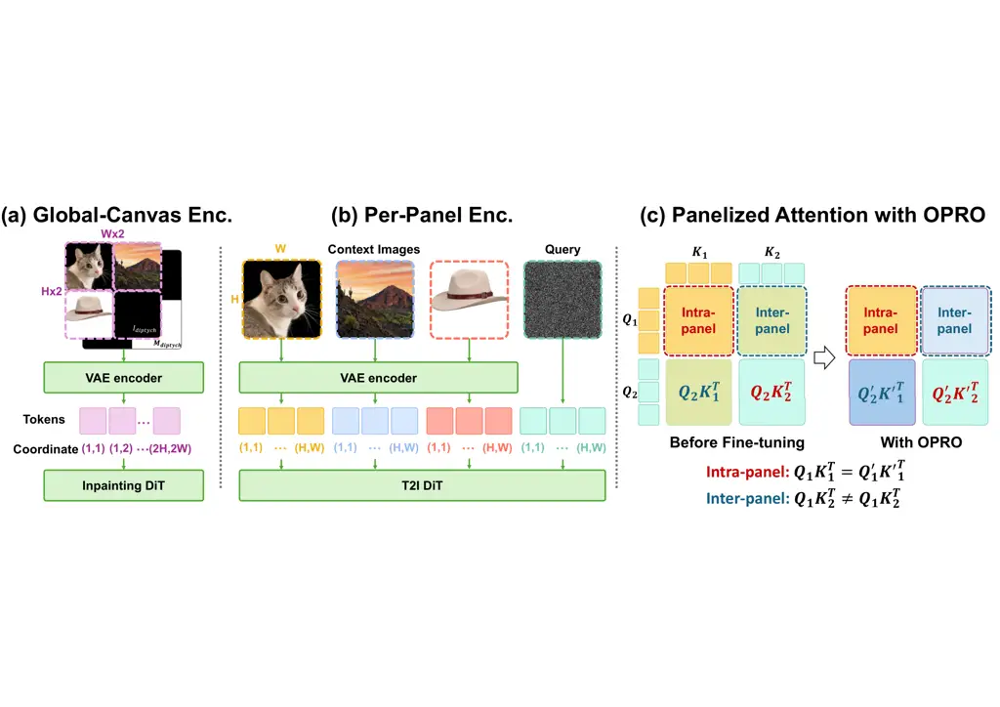
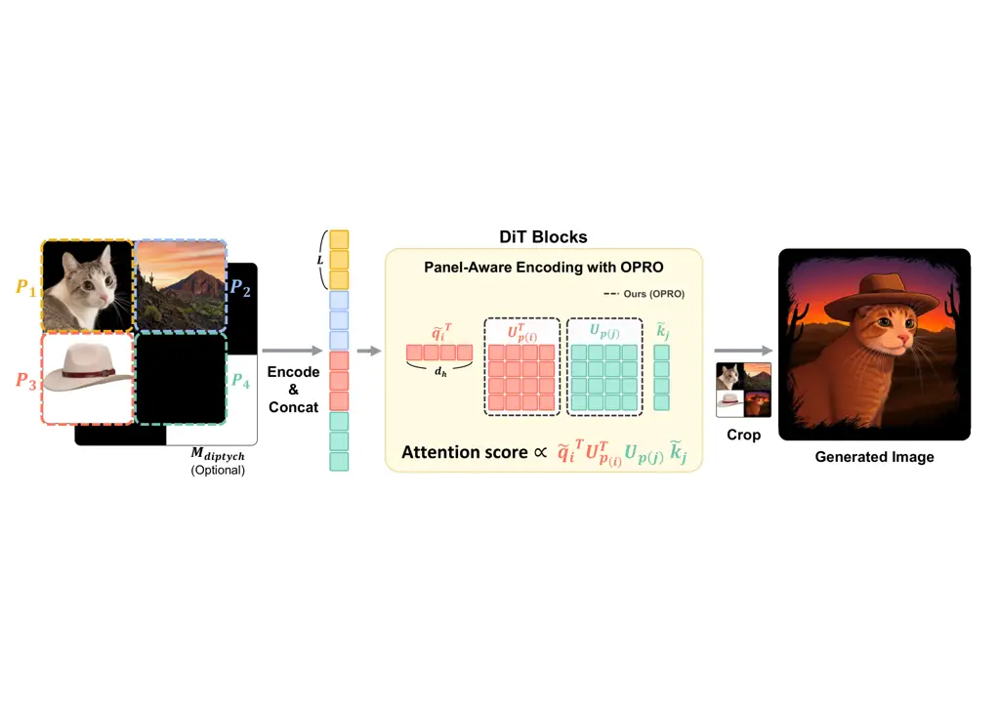
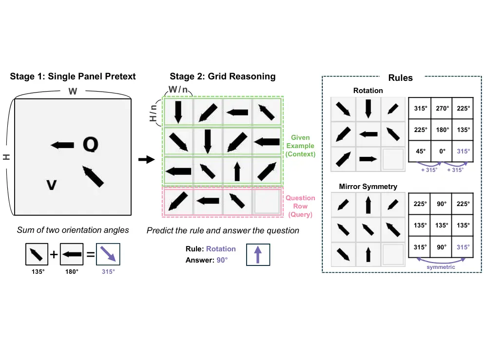
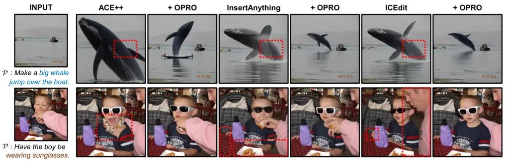
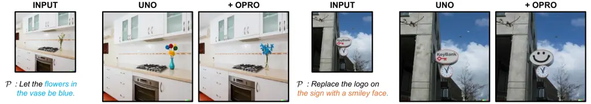
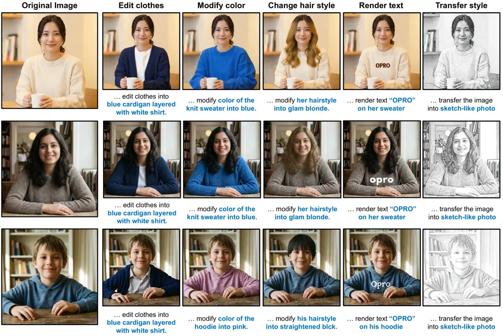
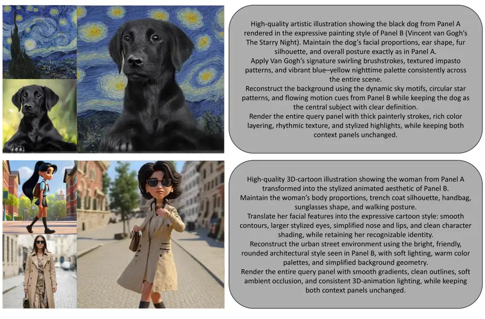

# OPRO: Orthogonal Panel-Relative Operators for Panel-Aware In-Context Image Generation

Sanghyeon Lee    Minwoo Lee    Euijin Shin    Kangyeol Kim    Seunghwan
Choi    Jaegul Choo Affiliation: Korea Advanced Institute of Science and
Technology (KAIST) Affiliation: Daejeon, Korea Affiliation: {shlee6825,
minwoo011015, ejshin0310, kangyeolk, shadow2496, jchoo}@kaist.ac.kr

###### Abstract

We introduce a parameter-efficient adaptation method for panel-aware
in-context image generation with pre-trained diffusion transformers. The
key idea is to compose learnable, panel-specific orthogonal operators
onto the backbone’s frozen positional encodings. This design provides
two desirable properties: (1) isometry, which preserves the geometry of
internal features, and (2) same-panel invariance, which maintains the
model’s pre-trained intra-panel synthesis behavior. Through controlled
experiments, we demonstrate that the effectiveness of our adaptation
method is not tied to a specific positional encoding design but
generalizes across diverse positional encoding regimes. By enabling
effective panel-relative conditioning, the proposed method consistently
improves in-context image-based instructional editing pipelines,
including state-of-the-art approaches.

## 1 Introduction

Large-scale pre-trained models, from diffusion models \[14, 28\] to more
recent diffusion transformers (DiTs) \[27, 6, 10\], have achieved
state-of-the-art results in high-fidelity image generation. A promising
application for these models is in-context image generation (ICG). In
this paradigm, the model adapts its outputs to visual examples provided
in context, much as large language models (LLMs) use textual prompts for
in-context learning \[4, 36\]. Enabling such flexible, example-based
control has long been a research topic in image generation, often
referred to as exemplar- or reference-based generation \[11, 26\].



Figure 1: Two positional regimes in tiled ICG and the role of OPRO in
panelized attention. (a) Global-canvas encoding: Inpainting-based DiTs
treat the tiled layout as a single image on a single global coordinate
grid, so different panels become disjoint regions of a unified canvas.
(b) Per-panel encoding: T2I-based methods encode each panel in its own
local frame and then fuse context features into target generation
through attention, reusing the same coordinate range across panels. (c)
In panelized attention, diagonal blocks are intra-panel and off-diagonal
blocks are inter-panel. OPRO preserves the intra-panel blocks while
modulating the inter-panel blocks.

A typical setup for ICG is the tiled-panel layout \[30, 16\], which
arranges one or more context panels and a target query panel as separate
visual regions. As illustrated in Fig. 1, existing ICG approaches are
commonly based on two main paradigms: leveraging inpainting-based
DiTs \[2\] and text-to-image (T2I) DiTs \[3\].

ICG methods based on inpainting DiTs \[30, 31, 21, 43\] formulate the
generation process as a spatial completion problem. These methods place
the context panels on a unified canvas, mask the target panel, and
generate it conditioned on the visible panels and the text instruction.
Because inpainting-based ICG methods process the entire tiled layout as
a single image, positional encodings  \[32\] are assigned to a single
global coordinate grid shared across all panels as illustrated
in Fig. 1(a).

Alternatively, ICG frameworks based on T2I DiTs \[16, 15, 37\]
incorporate context images through feature injection or inversion
techniques \[22\]. Rather than arranging all panels on a unified canvas,
T2I-based methods first encode or invert the context images separately
and then fuse the resulting latent representations into the
target-generation process through attention \[34\]. To condition the
target query, these methods concatenate the extracted context
representations within the attention pathway of the target-generation
stream. Each panel uses its own coordinate system before inter-panel
fusion as illustrated in Fig. 1(b). This allows both the reference and
target panels to share the same scale for positioning.

Despite the distinct structural choices of global-canvas and per-panel
encodings, both remain panel-agnostic at the attention level. In
inpainting-based ICG, the tiled layout is processed on a single global
coordinate grid; tokens from different panels are treated as distant
regions within a single canvas rather than members of distinct panels.
In T2I-based ICG, context features are encoded in separate streams and
fused into target generation through attention; because each stream is
position-encoded in its own local frame, tokens from different panels
can share identical positional indices. In neither case does the
attention mechanism receive an explicit signal indicating whether a
token pair is intra-panel or inter-panel. Consequently, the adapter must
simultaneously learn inter-panel relation transfer and preserve the
backbone’s pre-trained intra-panel synthesis behavior, creating a dual
burden for adaptation.

This observation motivates an adaptation mechanism that explicitly
distinguishes inter-panel from intra-panel interactions in attention. To
this end, we introduce the Orthogonal Panel-Relative Operator (OPRO), a
parameter-efficient fine-tuning (PEFT) method that applies learnable,
panel-specific orthogonal operators to the backbone’s position-aware
queries and keys. OPRO is designed to preserve pre-trained intra-panel
behavior while introducing a learnable panel-relative modulation for
inter-panel interactions as illustrated in Fig. 1(c). This design is
guided by two key properties. First, _isometry_ (Proposition 1)
preserves the norms of the transformed queries and keys, preventing
unintended rescaling of attention logits and thereby maintaining the
backbone’s feature geometry during fine-tuning. Second, _invariance on_
the same panel (Proposition 2) guarantees that the attention scores
between tokens of the same panel remain identical to those of the
pre-trained backbone. Together, these properties allow the adapter to
focus its capacity on inter-panel transfer without perturbing
pre-trained intra-panel synthesis.

Our main contributions are summarized as follows:

- •
  We propose OPRO, a parameter-efficient panel-relative adaptation
  method for tiled in-context generation, which applies learnable,
  panel-specific orthogonal operators to the backbone’s position-aware
  queries and keys.
- •
  We establish that OPRO provides two exact guarantees for structured
  adaptation: _same-panel invariance_, which preserves pre-trained
  intra-panel attention, and _isometry_, which preserves feature norms
  and avoids unintended rescaling of attention logits.
- •
  We introduce a two-stage compositional reasoning benchmark to perform
  a controlled analysis of OPRO and evaluate its consistent performance
  improvements across diverse positional regimes, including APE,
  RoPE \[32\], LieRE \[25\], and ComRoPE \[39\].
- •
  We demonstrate that OPRO is effective in real-world ICG by improving
  instructional image editing, including gains over state-of-the-art
  methods \[43, 37\] on MagicBrush \[41\].

## 2 Related Work

### 2.1 In-Context Image Generation

Motivated by the in-context learning phenomenon in large language
models \[4, 36\], early ICG methods sought to replicate similar behavior
in diffusion models. Prompt Diffusion \[35\], iPromptDiff \[7\], and
Context Diffusion \[23\] are trained on curated visual or textual
queries/instructions paired with targets. These methods integrate the
encoded features into the diffusion backbone and optimize the model
under a standard diffusion objective \[14\]. Although effective within
their specific training settings, these approaches are better
characterized as training-time context conditioning. Their ability to
generalize to unseen tasks remains to be thoroughly established.

Recent works, such as IC-LoRA \[16\] and Diptych \[30\], highlight an
emerging tiled-canvas in-context regime for large-scale diffusion
transformers and inpainting models \[27, 6, 2\]. In these setups,
reference images and the textual query are arranged on a single canvas,
and the model empirically transfers concepts, styles, and identities
without full model retraining. IC-LoRA exploits this behavior via PEFT
on tiled canvases, providing an alternative to explicit conditioning
methods such as IP-Adapter \[38\]. Diptych builds on high-capacity
inpainting models (e.g., FluxFill \[2\]) with a left-to-right canvas
layout, where background removal reduces leakage and attention
amplification improves the fidelity of the conditioned region.

In parallel, PEFT has emerged as a practical approach to adapt robust
text-to-image backbones while retaining their zero-shot behavior.
ACE++ \[21\] proposes an instruction-based diffusion framework that
extends long-context inpainting-style inputs to diverse generation and
editing tasks, offering both full and lightweight fine-tuning variants.
InsertAnything \[31\] introduces a unified DiT-based reference insertion
framework whose in-context editing mechanism treats reference images as
contextual conditioning via multimodal attention. ICEdit \[43\] attains
strong instruction-guided editing performance with PEFT and
Mixture-of-Experts \[17\]. UNO \[37\] proposes a progressive synthesis
pipeline that harnesses the intrinsic in-context capabilities of
diffusion transformers.

### 2.2 Orthogonal Relative Positional Encodings

Rotary position embedding (RoPE) \[32\] encodes a relative offset as a
block-diagonal rotation, making the attention kernel equivariant to
translations along the modeled axes. RoPE has been widely adopted in
language models \[33, 8, 18\] for long-context stability and extensions.

This core idea was naturally adapted to 2D token layouts for vision.
While early applications used simple axis-wise frequencies, later work
proposed mixed axial frequencies to capture diagonals and perspective
effects \[12\]. 2D relative positional encodings are now a foundational
component in modern large-scale Diffusion Transformers, such as
PixArt-$`\alpha`$ \[6\] and the MMDiT architecture used in Flux \[10\].
Beyond these 2D adaptations, the concept of orthogonal rotation has been
generalized further: Lie group-based approaches (LieRE) \[25\] model
rotations directly in higher-dimensional subspaces, and commuting-angle
formulations (ComRoPE) \[39\] learn trainable rotation spectra with
guaranteed commutativity. While these foundational encodings effectively
model continuous pixel displacements through rotational transformations,
they remain inherently agnostic to discrete canvas partitions. We
propose to augment this mathematical structure by injecting an explicit
panel-aware phase into the position-aware representations.

## 3 Method

We address in-context image generation by modifying position-aware
attention to allow panel identity to influence cross-panel interactions
while preserving the backbone’s pre-trained same-panel behavior. Our key
idea is to apply a learnable, panel-specific orthogonal modulation to
the backbone’s frozen, position-aware queries and keys. Our approach is
detailed as follows. We first formalize tiled-panel ICG with
position-aware attention in Sec. 3.1. We then introduce the Orthogonal
Panel-Relative Operator (OPRO) and its core properties in Sec. 3.2.
Finally, Sec. 3.3 describes our parameterization and zero-interference
initialization strategy.

### 3.1 Tiled-Panel ICG with Position-Aware Attention

We consider a tiled layout partitioned into $`P`$ panels. After
patchification and flattening, the model processes a token sequence of
length $`L`$. Each token $`i\in\{1,\dots,L\}`$ is associated with two
attributes: a panel index $`p(i)\in\{1,\dots,P\}`$ and a spatial
coordinate $`x_{i}`$ in its native positional frame.

Let $`\tilde{q}_{i},\tilde{k}_{i}\in\mathbb{R}^{d_{h}}`$ denote the
backbone’s frozen, _position-aware_ query and key representations for
token $`i`$ in a given attention head of dimension $`d_{h}`$. These
representations are obtained after the backbone applies its native
positional mechanism. Depending on the backbone family, this positional
mechanism may arise from a single global coordinate system over a tiled
canvas or from per-panel positional encoding followed by cross-panel
fusion. We keep this definition general and do not assume a specific
positional encoding form.

The standard attention score between tokens $`i`$ and $`j`$ is

```math
s_{ij}=\frac{\langle\tilde{q}_{i},\tilde{k}_{j}\rangle}{\sqrt{d_{h}}}. \tag{1}
```

In tiled-panel ICG, standard PEFT modules update shared attention
projections but do not explicitly encode whether a token pair is
same-panel or cross-panel in the attention logit. Consequently,
panel-agnostic adaptation methods (e.g., LoRA) face a dual burden: they
must acquire inter-panel retrieval capabilities while simultaneously
preserving the pre-trained intra-panel geometry of the backbone.



Figure 2: Overview of OPRO for tiled-panel in-context image generation.
The proposed framework partitions a tiled canvas into $`P`$ panels and
processes them as a single token sequence. Within each attention layer
of a backbone, OPRO modulates the position-aware queries
($`\tilde{q}_{i}`$) and keys ($`\tilde{k}_{j}`$) via panel-specific
orthogonal operators ($`U_{p(i)}`$ and $`U_{p(j)}`$). This adaptation
explicitly guides cross-panel interactions while preserving the original
same-panel attention geometry. An example generated image is provided on
the right.

### 3.2 Orthogonal Panel-Relative Operator (OPRO)

While standard PEFT modules or simple linear adapters could be used to
inject panel identity, they inherently alter the backbone’s feature
space. This disruption forces the model to relearn intra-panel attention
geometries, degrading the pre-trained generation quality. To explicitly
encode panel identity while strictly preserving the native same-panel
behavior, we require a transformation that preserves the inner product.

Therefore, we introduce a set of learnable panel operators restricted to
the special orthogonal group:

```math
\{U_{p}\}_{p=1}^{P},\qquad U_{p}\in\mathrm{SO}(d_{h}). \tag{2}
```

By definition, these operators satisfy the orthogonality condition
$`U_{p}^{\top}U_{p}=I`$.

Given the frozen, position-aware query and key representations of the
backbone, OPRO applies the panel operator associated with each token:

```math
\hat{q}_{i}=U_{p(i)}\tilde{q}_{i},\qquad\hat{k}_{j}=U_{p(j)}\tilde{k}_{j}. \tag{3}
```

The resulting attention score becomes

```math
s^{\prime}_{ij}=\frac{\langle\hat{q}_{i},\hat{k}_{j}\rangle}{\sqrt{d_{h}}}=\frac{\tilde{q}_{i}^{\top}\left(U_{p(i)}^{\top}U_{p(j)}\right)\tilde{k}_{j}}{\sqrt{d_{h}}}. \tag{4}
```

Equation (4) demonstrates that OPRO preserves the position-aware query
and key features of the backbone while introducing an explicit
_panel-relative_ modulation through the relative operator
$`U_{p(i)}^{\top}U_{p(j)}`$. When two tokens belong to the same panel,
this relative operator collapses to the identity. Conversely, when they
belong to different panels, OPRO learns a panel-specific modulation of
the original attention score.

###### Proposition 1 (Isometry).

For all tokens $`i,j`$, the OPRO transformation preserves the norms of
the position-aware query and key vectors:

```math
\|\hat{q}_{i}\|=\|\tilde{q}_{i}\|,\qquad\|\hat{k}_{j}\|=\|\tilde{k}_{j}\|.
```

###### Proof.

By definition, $`\hat{q}_{i}=U_{p(i)}\tilde{q}_{i}`$ and
$`\hat{k}_{j}=U_{p(j)}\tilde{k}_{j}`$. Since each $`U_{p}`$ is
orthogonal, $`U_{p}^{\top}U_{p}=I`$. Therefore,

```math
\|\hat{q}_{i}\|^{2}=\tilde{q}_{i}^{\top}U_{p(i)}^{\top}U_{p(i)}\tilde{q}_{i}=\tilde{q}_{i}^{\top}\tilde{q}_{i}=\|\tilde{q}_{i}\|^{2},
```

and likewise $`\|\hat{k}_{j}\|=\|\tilde{k}_{j}\|`$. ∎

###### Proposition 2 (Same-Panel Invariance).

If two tokens $`i`$ and $`j`$ belong to the same panel, i.e.,
$`p(i)=p(j)`$, then OPRO preserves their original attention score:

```math
\langle\hat{q}_{i},\hat{k}_{j}\rangle=\langle\tilde{q}_{i},\tilde{k}_{j}\rangle.
```

Equivalently, for the same-panel token pairs,
$`s^{\prime}_{ij}=s_{ij}`$.

###### Proof.

If $`p(i)=p(j)=p`$, then from Eq. (4),

```math
\langle\hat{q}_{i},\hat{k}_{j}\rangle=\tilde{q}_{i}^{\top}U_{p}^{\top}U_{p}\tilde{k}_{j}=\tilde{q}_{i}^{\top}\tilde{k}_{j}=\langle\tilde{q}_{i},\tilde{k}_{j}\rangle.
```

Thus, the attention score is preserved for all same-panel token pairs. ∎

These two propositions together yield the structural behavior we seek.
Proposition 1 ensures that OPRO solely rotates the position-aware query
and key features of the backbone without changing their norms, thereby
avoiding unintended rescaling of the attention logits. Proposition 2
ensures that intra-panel attention remains identical to that of the
pre-trained backbone. As a result, OPRO can concentrate its capacity on
modulating cross-panel interactions, where panel identity matters,
without perturbing the pre-trained same-panel synthesis behavior of the
backbone.

#### Relation to orthogonal relative positional encodings

Our formulation above is defined for general position-aware queries and
keys, and therefore does not require a specific positional encoding
family. However, when the underlying architecture employs an orthogonal
relative positional encoding (e.g., RoPE \[32\], LieRE \[25\], or
ComRoPE \[39\]), OPRO admits an additional compositional interpretation
around the frozen positional operator. We defer this orthogonal-relative
derivation, along with the RoPE-style block-diagonal specialization, to
the supplementary material.

### 3.3 Parameterization and Zero-Interference Initialization

Section 3.2 defines OPRO through abstract orthogonal operators
$`U_{p}\in\mathrm{SO}(d_{h})`$. We now describe an efficient
parameterization for learning these operators and an initialization
strategy that preserves the pre-trained backbone at the start of
fine-tuning.

#### Low-rank Lie exponential parameterization

Directly optimizing a transformation matrix on the constrained manifold
of orthogonal matrices ($`\mathrm{SO}(d_{h})`$) demands computationally
expensive operations, such as Riemannian gradient descent or repeated
matrix projections. To handle this efficiently, we optimize an
unconstrained skew-symmetric generator in the corresponding Lie algebra
$`\mathfrak{so}(d_{h})`$ and recover the orthogonal operator via the
matrix exponential map \[20\].

Specifically, we define two learnable matrices
$`L_{p},R_{p}\in\mathbb{R}^{d_{h}\times\rho}`$ for each panel $`p`$,
where $`\rho<d_{h}`$ is the rank, and formulate the generator $`A_{p}`$
as

```math
A_{p}=L_{p}R_{p}^{\top}-R_{p}L_{p}^{\top}. \tag{5}
```

The orthogonal operator $`U_{p}`$ is then obtained through the matrix
exponential

```math
U_{p}=\exp(A_{p}). \tag{6}
```

Because $`A_{p}^{\top}=-A_{p}`$, the matrix exponential naturally
guarantees orthogonality ($`U_{p}^{\top}U_{p}=I`$) by construction. This
parameterization allows standard optimizers to operate in an
unconstrained Euclidean space while yielding a dense cross-channel
orthogonal transform in a parameter-efficient manner.

#### Zero-interference initialization

As demonstrated by ControlNet \[42\], zero initialization is a highly
effective strategy when applying additive or multiplicative modules to
pre-trained models. Because OPRO is designed to adapt a frozen backbone,
the adapter must not interfere with the pre-trained representations at
the optimization step zero. We achieve this by initializing the low-rank
matrices as follows:

```math
L_{p}=0,\quad R_{p}\sim\mathcal{N}(0,\sigma^{2}). \tag{7}
```

Under this asymmetric initialization, the generator evaluates to
$`A_{p}=0`$, yielding $`U_{p}=\exp(0)=I`$. Consequently, OPRO begins as
an exact identity mapping, leaving the original attention of the
backbone completely unchanged at the start of training. Furthermore,
this initialization still admits non-zero gradients for $`L_{p}`$,
ensuring that optimization commences immediately. Detailed derivations
of the gradients are provided in the supplementary material.

## 4 Experiments

We conduct experiments to validate OPRO’s effectiveness. First, in
Sec. 4.1, we introduce a two-stage compositional reasoning task. This
controlled proxy task is designed to analyze OPRO’s core properties: its
ability to preserve pre-trained knowledge (Same-Panel Invariance) while
robustly learning new inter-panel rules. Second, in Sec. 4.2, we
evaluate OPRO on the real-world task of instructional image editing
within a two-panel layout. We demonstrate that OPRO, when integrated as
a lightweight module, consistently enhances the performance of
state-of-the-art diffusion-based editing methods \[43, 37\]. Finally, to
demonstrate OPRO’s scalability beyond this two-panel setup, we extend
our evaluation to a three-panel layout for subject-driven generation in
the supplementary material.

Panel $`2\times 2`$  
Type MLP LoRA +OPRO $`\Delta`$ APE \[34\] 34.90 38.00 40.50 $`+2.50`$
RoPE \[32\] 37.60 46.40 49.90 $`+3.50`$ LieRE \[25\] 33.40 58.10 58.10
$`+0.00`$ ComRoPE \[39\] 38.60 58.50 66.60 $`+8.10`$

Panel $`3\times 3`$  
Type MLP LoRA +OPRO $`\Delta`$ APE \[34\] 23.70 24.40 26.30 $`+1.90`$
RoPE \[32\] 27.40 36.20 42.00 $`+5.80`$ LieRE \[25\] 29.00 34.20 42.70
$`+8.50`$ ComRoPE \[39\] 24.80 37.80 45.70 $`+7.90`$

Panel $`4\times 4`$  
Type MLP LoRA +OPRO $`\Delta`$ APE \[34\] 20.00 19.50 24.20 $`+4.70`$
RoPE \[32\] 19.60 30.30 39.20 $`+8.90`$ LieRE \[25\] 20.10 22.90 26.70
$`+3.80`$ ComRoPE \[39\] 18.90 29.20 47.20 $`+18.00`$

Table 1: Accuracy of LoRA ($`r=8`$) with/without OPRO ($`\rho=8`$)
across panels. $`\Delta`$ is the absolute gain over LoRA.

### 4.1 Two-Stage Compositional Reasoning Task



Figure 3: Two-stage compositional reasoning. Stage 1 (single-panel
pretext): classify the sum of two arrow orientations modulo
$`360^{\circ}`$ (8-way) with distractors. Stage 2 (grid reasoning): on
an $`n{\times}n`$ grid, each row provides context examples and a
held-out query; the row-wise rule is either rotation by
$`k\!\cdot\!45^{\circ}`$ or vertical mirror symmetry.

ICG requires a model to infer a latent, episode-specific rule from
visual examples and apply it to a query. This process demands two
distinct abilities: (1) robust intra-panel perception to understand the
content within each panel, (2) inter-panel reasoning to infer the
relationship between panels.

We design a synthetic two-stage benchmark (Fig. 3) motivated by
Raven-style puzzles \[40\] to concisely evaluate these abilities using
the proposed method. In Stage 1 (single-panel pretext), we equip the
model with core perceptual skills (e.g., arrow detection and angle
composition). In Stage 2 (grid reasoning), we then test a hypothesis:
can the model preserve its pre-trained Stage 1 skills when deployed in a
multi-panel context while simultaneously learning the new inter-panel
reasoning task in its adapters? Throughout the evaluation, we can
measure how effectively different adapters (OPRO vs. LoRA) handle the
panel-based structure by replacing pixel generation with classification.

#### Stage 1: Single-Panel Pretext Task

Stage 1: Pretrain the model from scratch on a single-panel geometric
task. As shown on the left of Fig. 3, each image contains a single panel
with two arrows placed at random, non-overlapping positions. Arrow
orientations are sampled from
$`\{0^{\circ},45^{\circ},\dots,315^{\circ}\}`$. The label is the sum of
the two orientations modulo $`360^{\circ}`$, quantized into 8 classes.
To prevent shortcutting, we introduce distractors by rendering arrows at
random scales and scattering letters across the panel. This pretext
induces key intra-panel skills, consisting of robust arrow detection and
geometric composition, specifically angle addition.

#### Stage 2: Grid Reasoning

Stage 2 tests the model’s ability to learn inter-panel visual reasoning
rules while preserving its pre-trained Stage 1 skills. We partition the
image into an $`n{\times}n`$ grid ($`n{\in}\{2,3,4\}`$). Crucially, as
described in Fig. 3, each row functions as an independent reasoning
problem. For a given row $`i`$, the first $`n-1`$ panels serve as visual
context (examples), and the final $`n`$-th panel is the held-out query
(question). The model’s objective is to: (1) infer a hidden visual
transformation rule from the context panels, (2) apply the found rule to
the visual content (the two arrows) in the query.

We consider two categories of visual transformation rules: (i) Rotation:
8 distinct rules defined by visually rotating the panel content (both
arrows) by $`k\cdot 45^{\circ}`$ relative to the previous panel, where
$`k{\in}\mathbb{N}`$. (ii) Mirror Symmetry: 2 distinct rules correspond
to a visual reflection of the panel content about the vertical canvas
axis (e.g., in a 3-panel row, the third panel is a reflection of the
first). To avoid ambiguity that can arise with reflections under 8-way
quantization in the limited $`2{\times}2`$ context, we use only the
Rotation rules for $`n=2`$ panels. For $`n\in\{3,4\}`$, we uniformly
sample from the complete set of both Rotation and Mirror Symmetry rules.

#### Experimental Setup

We design a two-stage experiment to evaluate OPRO’s effectiveness in
fine-tuning for a multi-panel task. All experiments are based on
ViT-B \[9\].

Stage 1 (Backbone pretraining). We train four backbones from scratch on
a single-panel pretext task, differing only in positional encodings:
APE \[34\], RoPE \[32\], LieRE \[25\], and ComRoPE \[39\].

Stage 2 (Multi-panel fine-tuning). We initialize from Stage 1 and freeze
the backbone, then fine-tune on an 8-way grid-reasoning classification
task under three settings:

- •
  Linear Probe: Only the classification head (an MLP) is trained.
- •
  LoRA: Only LoRA is trained (rank r=8).
- •
  LoRA + OPRO (Ours): Both LoRA (r=8) and our OPRO (rank $`\rho=8`$)

Both stages use $`50\text{k}`$ training and $`1\text{k}`$ validation
images at $`224\times 224`$. We use a batch size of 256, Adam \[19\],
and cross-entropy loss. We report top-1 validation accuracy (chance
level 12.5%).

#### Robustness to Positional Encodings

Tab. 1 summarizes accuracy across positional-encoding backbones and grid
sizes. LoRA+OPRO improves over LoRA in the majority of settings, with
gains that generally increase with task difficulty (larger
$`n{\times}n`$); improvements reach up to $`+18.0\%`$ for ComRoPE at
$`4{\times}4`$. Gains are observed with both absolute (APE) and relative
(orthogonal) (RoPE, LieRE, ComRoPE) encodings, indicating that the
operator is not tied to a specific positional scheme.

Figure 4: OPRO’s impact on parameter efficiency. Validation accuracy (%)
plotted against the number of trainable adapter parameters (M) for 3×3
panels

#### Parameter Efficiency

We measure the accuracy–parameter trade-off on $`3\times 3`$ grids
(Fig. 4) using a frozen ViT-B backbone (86.6M parameters). LoRA adds
trainable parameters that scale linearly with its rank $`r`$, amounting
to 1.327M for $`r=8`$. Our OPRO, which scales with its own rank
$`\rho`$, introduces a minimal overhead. For instance, at $`\rho=8`$,
OPRO adds only 0.111M parameters. This overhead is negligible,
representing just 8.4% of the LoRA parameters (at $`r=8`$) and 0.13% of
the backbone size. As shown in Fig. 4, this high parameter efficiency
allows LoRA+OPRO to achieve a significantly better accuracy–parameter
trade-off than LoRA alone.

#### Ablation Studies

To validate that the performance gains of OPRO stem from its specific
structural properties, we conducted ablation studies on two key design
principles: (i) Isometry (norm-preserving transformation) and (ii)
Same-Panel Invariance (SP-Inv). We created two variants to isolate the
impact of these properties. All variants, including OPRO, were tested at
$`\rho=4`$ for a fair comparison.

1. Additive Panel Bias (APB). Replace OPRO with per‑panel additive
   biases for queries/keys. This design is non-isometric (vector addition
   alters norms) and violates SP-Inv (the biases distort the pre-trained
   Stage 1 scores):

```math
\langle\tilde{Q}_{i}+b^{Q}_{p},\tilde{K}_{j}+b^{K}_{p}\rangle=\langle\tilde{Q}_{i},\tilde{K}_{j}\rangle+\langle\tilde{Q}_{i},b^{K}_{p}\rangle
```

```math
+\langle b^{Q}_{p},\tilde{K}_{j}\rangle+\langle b^{Q}_{p},b^{K}_{p}\rangle.
```

2. Asymmetric Orthogonal Operator: In this variant, we learn independent
   orthogonal operators for queries and keys,
   $`U_{p},V_{p}\in\mathrm{SO}(d_{h})`$:

```math
\hat{Q}_{i}=U_{p(i)}\tilde{Q}_{i},\quad\hat{K}_{j}=V_{p(j)}\tilde{K}_{j}.
```

This design maintains isometry, but breaks SP-Inv unless
$`U_{p}=V_{p}`$, as the inner product becomes:

```math
\langle\hat{Q}_{i},\hat{K}_{j}\rangle=\langle\tilde{Q}_{i},(U_{p}^{\top}V_{p})\tilde{K}_{j}\rangle.
```

For SP-Inv across all same-panel pairs, we require
$`U_{p}^{\top}V_{p}=I`$, which implies $`U_{p}=V_{p}`$. However,
independent learning generally violates this condition.

|                         |          |        |          |
| ----------------------- | -------- | ------ | -------- |
| Method                  | Isometry | SP-Inv | Accuracy |
| LoRA (Baseline)         | \-       | \-     | 36.20    |
| \+ APB                  | No       | No     | 35.70    |
| \+ Asym-OPRO            | Yes      | No     | 39.70    |
| \+ OPRO (w/o Zero Init) | Yes      | Yes    | 38.60    |
| + OPRO (Ours)           | Yes      | Yes    | 42.00    |

Table 2: Ablation on 2-stage compositional reasoning task (ViT-B,
$`3{\times}3`$). We analyze the impact of component removal. APB lacks
isometry, and Asym-OPRO violates SP-Inv. w/o Zero Init denotes OPRO with
random initialization. OPRO (Ours) satisfies all properties.



Figure 5: Comparison with inpainting-based ICG baselines on
MagicBrush \[41\] test set. Following ICEdit \[43\], a diptych prompt is
used: “A diptych with two side-by-side images …but { $`\mathcal{P}`$ }.”
Red dotted boxes highlight regions where the baselines fail to preserve
context from the input image, resulting in incorrect or incomplete
edits.



Figure 6: Comparison with a T2I baseline on MagicBrush \[41\] test set.
In UNO \[37\], we use the following instruction: “Create a single image
matching the reference, but with the following edit: { $`\mathcal{P}`$
}.”

### 4.2 Instructional Image Editing with OPRO

While Sec. 4.1 provides a controlled benchmark, the primary objective is
to evaluate OPRO on real-world in-context image generation.
Specifically, instructional image editing is formulated as a task
comprising two panels: a source reference panel and a target query
panel. To assess editing capabilities on this layout, the
MagicBrush \[41\] test set is utilized. Following prior evaluation
protocols \[41, 43\], visual consistency and editing fidelity are
measured using L1, CLIP-I \[13\], and DINO \[24, 5\] metrics.

#### Experimental Setup

To demonstrate that OPRO is agnostic to backbone architectures and
positional-encoding schemes, we integrate it as a lightweight module
(+0.93M parameters, $`\rho=32`$) into state-of-the-art baselines
representing both ICG paradigms. For inpainting-based methods
(global-canvas encoding), we evaluate ICEdit \[43\], ACE++ \[21\], and
InsertAnything \[31\], instantiated on FluxFill \[2\]. For T2I-based
methods (per-panel encoding), we evaluate UNO \[37\], instantiated on
FLUX.1. We train all models for 5,000 steps using the Adam
optimizer \[19\] with a learning rate of $`1\times 10^{-4}`$ and a batch
size of 8. The spatial layout and text conditioning are adapted to each
paradigm. For inpainting baselines, source images are resized to
$`512\times 512`$ and placed on the left half of a $`512\times 1024`$
canvas, trained with right-half masking, and prompted following ICEdit:
“A diptych with two side-by-side images of the same scene. On the right,
the scene is identical to the left but instruction.” For the T2I-based
UNO, we follow its native per-panel setup and utilize a direct
instruction prompt: “Create a single image identical to the reference
but with the following edit: instruction.”

|                             |           |        |          |        |
| --------------------------- | --------- | ------ | -------- | ------ |
| Methods                     | Train. Pa | L1 ↓   | CLIP-I ↑ | DINO ↑ |
| ACE++ \[arXiv’25\]          | 76.6M     | 0.1215 | 0.8658   | 0.7394 |
| + OPRO ($`\rho=32`$)        | +0.93M    | 0.1114 | 0.8749   | 0.7767 |
| InsertAnything \[arXiv’25\] | 37.5M     | 0.1327 | 0.8722   | 0.7917 |
| + OPRO ($`\rho=32`$)        | +0.93M    | 0.1269 | 0.8735   | 0.8009 |
| ICEdit \[NeurIPS’25\]       | 22.4M     | 0.1189 | 0.8703   | 0.7706 |
| + OPRO ($`\rho=32`$)        | +0.93M    | 0.0781 | 0.9002   | 0.8531 |
| UNO \[ICCV’25\]             | 478.2M    | 0.0575 | 0.9236   | 0.8961 |
| + OPRO ($`\rho=32`$)        | +0.93M    | 0.0387 | 0.9281   | 0.8980 |

Table 3: Quantitative results on MagicBrush \[41\] test set. OPRO
($`\rho=32`$) adds only +0.93M learnable parameters and consistently
improves.

#### Quantitative Results

As Tab. 3 demonstrates, adding OPRO consistently improves performance
across all baselines while introducing only +0.93M parameters. This
overhead corresponds to 4.16% for ICEdit (22.4M) and 0.20% for UNO
(478.2M), indicating that the additional cost remains negligible across
markedly different model scales.

The largest improvement is observed for ICEdit. OPRO reduces L1 by
34.31% (0.1189 $`\rightarrow`$ 0.0781), while increasing CLIP-I from
0.8703 to 0.9002 and DINO from 0.7706 to 0.8531. Qualitative results are
in Fig. 5 and Fig. 6.

## 5 Limitations

OPRO introduces a small number of additional orthogonal transforms in
the attention layers, which increase training time and inference
latency. We view this as a reasonable computational trade-off for
improved in-context behavior. Additionally, the model is trained on a
fixed panel layout. While we can handle multi-reference configurations
during inference by reusing learned operators for panels with shared
functional roles (detailed in the supplementary material), handling
entirely new layouts that require distinct operators remains an area for
future work.

## 6 Conclusion

We propose OPRO, a panel-relative orthogonal adapter for multi-panel
in-context image generation. By applying learnable, panel-specific
orthogonal operators to the backbone’s frozen, position-aware queries
and keys, OPRO preserves the feature geometry while cleanly decoupling
cross-panel retrieval from intra-panel synthesis. Furthermore, OPRO
consistently outperforms standard LoRA in both real-world instructional
image editing and our proposed compositional reasoning benchmark.

## Acknowledgments

This work was supported by Institute for Information & communications
Technology Planning & Evaluation(IITP) grant funded by the Korea
government(MSIT) (RS-2019-II190075, Artificial Intelligence Graduate
School Program(KAIST)), the National Research Foundation of Korea(NRF)
grant funded by the Korea government(MSIT) (No. RS-2025-00555621), and
i-Scream Media. This research was also supported by the High-Performance
Computing Support Project, funded by the Ministry of Science and ICT
(MSIT) and the National IT Industry Promotion Agency (NIPA) under grant
No. RQT-25-070278 (providing 40 H100 GPUs).

## References

- \[1\] P.-A. Absil, R. Mahony, and R. Sepulchre (2008) Optimization
  algorithms on matrix manifolds. Princeton University Press, Princeton,
  NJ. External Links: ISBN 978-0-691-13298-3 Cited by: Appendix C,
  Appendix C.
- \[2\] Black Forest Labs (2024) FLUX.1 Fill \[pro\]. External Links:
  [Link](https://docs.bfl.ai/flux_tools/flux_1_fill) Cited by: Appendix
  D, §1, §2.1, §4.2.
- \[3\] Black Forest Labs (2024) Flux. External Links:
  [Link](https://github.com/black-forest-labs/flux) Cited by: §1.
- \[4\] T. Brown, B. Mann, N. Ryder, M. Subbiah, J. D. Kaplan, P.
  Dhariwal, A. Neelakantan, P. Shyam, G. Sastry, A. Askell, et
  al. (2020) Language models are few-shot learners. Advances in neural
  information processing systems 33, pp. 1877–1901. Cited by: §1, §2.1.
- \[5\] M. Caron, H. Touvron, I. Misra, H. Jégou, J. Mairal, P.
  Bojanowski, and A. Joulin (2021) Emerging properties in
  self-supervised vision transformers. In Proceedings of the IEEE/CVF
  international conference on computer vision, pp. 9650–9660. Cited by:
  §4.2.
- \[6\] J. Chen, J. Yu, C. Ge, L. Yao, E. Xie, Y. Wu, Z. Wang, J.
  Kwok, P. Luo, H. Lu, and Z. Li (2023) PixArt-$`\alpha`$: fast training
  of diffusion transformer for photorealistic text-to-image synthesis.
  External Links: 2310.00426 Cited by: §1, §2.1, §2.2.
- \[7\] T. Chen, Y. Liu, Z. Wang, J. Yuan, Q. You, H. Yang, and M.
  Zhou (2023) Improving in-context learning in diffusion models with
  visual context-modulated prompts. arXiv preprint arXiv:2312.01408.
  Cited by: §2.1.
- \[8\] A. Chowdhery, S. Narang, J. Devlin, M. Bosma, G. Mishra, A.
  Roberts, P. Barham, H. W. Chung, C. Sutton, S. Gehrmann, et al. (2023)
  Palm: scaling language modeling with pathways. Journal of Machine
  Learning Research 24 (240), pp. 1–113. Cited by: §2.2.
- \[9\] A. Dosovitskiy (2020) An image is worth 16x16 words:
  transformers for image recognition at scale. arXiv preprint
  arXiv:2010.11929. Cited by: §4.1.
- \[10\] P. Esser, S. Kulal, A. Blattmann, R. Entezari, J. Müller, H.
  Saini, Y. Levi, D. Lorenz, A. Sauer, F. Boesel, et al. (2024) Scaling
  rectified flow transformers for high-resolution image synthesis. In
  Forty-first international conference on machine learning, Cited by:
  §1, §2.2.
- \[11\] L. A. Gatys, A. S. Ecker, and M. Bethge (2016) Image style
  transfer using convolutional neural networks. In Proceedings of the
  IEEE Conference on Computer Vision and Pattern Recognition (CVPR),
  Cited by: §1.
- \[12\] B. Heo, S. Park, D. Han, and S. Yun (2024) Rotary position
  embedding for vision transformer. In European Conference on Computer
  Vision, pp. 289–305. Cited by: §2.2.
- \[13\] J. Hessel, A. Holtzman, M. Forbes, R. Le Bras, and Y.
  Choi (2021) Clipscore: a reference-free evaluation metric for image
  captioning. In Proceedings of the 2021 conference on empirical methods
  in natural language processing, pp. 7514–7528. Cited by: §4.2.
- \[14\] J. Ho, A. Jain, and P. Abbeel (2020) Denoising diffusion
  probabilistic models. Advances in neural information processing
  systems 33, pp. 6840–6851. Cited by: §1, §2.1.
- \[15\] L. Huang, W. Wang, Z. Wu, H. Dou, Y. Shi, Y. Feng, C. Liang, Y.
  Liu, and J. Zhou (2024) Group diffusion transformers are unsupervised
  multitask learners. arXiv preprint arXiv:2410.15027. Cited by: §1.
- \[16\] L. Huang, W. Wang, Z. Wu, Y. Shi, H. Dou, C. Liang, Y. Feng, Y.
  Liu, and J. Zhou (2024) In-context lora for diffusion transformers.
  arXiv preprint arXiv:2410.23775. Cited by: §1, §1, §2.1.
- \[17\] R. A. Jacobs, M. I. Jordan, S. J. Nowlan, and G. E.
  Hinton (1991) Adaptive mixtures of local experts. Neural computation 3
  (1), pp. 79–87. Cited by: §2.1.
- \[18\] A. Q. Jiang, A. Sablayrolles, A. Roux, A. Mensch, B. Savary, C.
  Bamford, D. S. Chaplot, D. d. l. Casas, E. B. Hanna, F. Bressand, et
  al. (2024) Mixtral of experts. arXiv preprint arXiv:2401.04088. Cited
  by: §2.2.
- \[19\] D. P. Kingma (2014) Adam: a method for stochastic optimization.
  arXiv preprint arXiv:1412.6980. Cited by: Appendix A, §4.1, §4.2.
- \[20\] M. Lezcano-Casado and D. Martınez-Rubio (2019) Cheap orthogonal
  constraints in neural networks: a simple parametrization of the
  orthogonal and unitary group. In International Conference on Machine
  Learning, pp. 3794–3803. Cited by: §3.3.
- \[21\] C. Mao, J. Zhang, Y. Pan, Z. Jiang, Z. Han, Y. Liu, and J.
  Zhou (2025) Ace++: instruction-based image creation and editing via
  context-aware content filling. arXiv preprint arXiv:2501.02487. Cited
  by: Table 7, §1, §2.1, §4.2.
- \[22\] R. Mokady, A. Hertz, K. Aberman, Y. Pritch, and D.
  Cohen-Or (2023) Null-text inversion for editing real images using
  guided diffusion models. In Proceedings of the IEEE/CVF conference on
  computer vision and pattern recognition, pp. 6038–6047. Cited by: §1.
- \[23\] I. Najdenkoska, A. Sinha, A. Dubey, D. Mahajan, V. Ramanathan,
  and F. Radenovic (2024) Context diffusion: in-context aware image
  generation. In European Conference on Computer Vision, pp. 375–391.
  Cited by: §2.1.
- \[24\] M. Oquab, T. Darcet, T. Moutakanni, H. Vo, M. Szafraniec, V.
  Khalidov, P. Fernandez, D. Haziza, F. Massa, A. El-Nouby, et
  al. (2023) Dinov2: learning robust visual features without
  supervision. arXiv preprint arXiv:2304.07193. Cited by: §4.2.
- \[25\] S. Ostmeier, B. Axelrod, M. Varma, M. Moseley, A. S. Chaudhari,
  and C. Langlotz (2025) LieRE: lie rotational positional encodings. In
  Forty-second International Conference on Machine Learning, Cited by:
  Table 5, Appendix B, 3rd item, §2.2, §3.2, §4.1, Table 1, Table 1,
  Table 1.
- \[26\] T. Park, M. Liu, T. Wang, and J. Zhu (2019) Semantic image
  synthesis with spatially-adaptive normalization. In Proceedings of the
  IEEE Conference on Computer Vision and Pattern Recognition, Cited by:
  §1.
- \[27\] W. Peebles and S. Xie (2023) Scalable diffusion models with
  transformers. In Proceedings of the IEEE/CVF international conference
  on computer vision, pp. 4195–4205. Cited by: §1, §2.1.
- \[28\] R. Rombach, A. Blattmann, D. Lorenz, P. Esser, and B.
  Ommer (2022) High-resolution image synthesis with latent diffusion
  models. In Proceedings of the IEEE/CVF conference on computer vision
  and pattern recognition, pp. 10684–10695. Cited by: §1.
- \[29\] N. Ruiz, Y. Li, V. Jampani, Y. Pritch, M. Rubinstein, and K.
  Aberman (2023) Dreambooth: fine tuning text-to-image diffusion models
  for subject-driven generation. In Proceedings of the IEEE/CVF
  conference on computer vision and pattern recognition,
  pp. 22500–22510. Cited by: Figure 7, Figure 7, Appendix A.
- \[30\] C. Shin, J. Choi, H. Kim, and S. Yoon (2025) Large-scale
  text-to-image model with inpainting is a zero-shot subject-driven
  image generator. In Proceedings of the Computer Vision and Pattern
  Recognition Conference, pp. 7986–7996. Cited by: §1, §1, §2.1.
- \[31\] W. Song, H. Jiang, Z. Yang, R. Quan, and Y. Yang (2025) Insert
  anything: image insertion via in-context editing in dit. arXiv
  preprint arXiv:2504.15009. Cited by: Table 7, §1, §2.1, §4.2.
- \[32\] J. Su, M. Ahmed, Y. Lu, S. Pan, W. Bo, and Y. Liu (2024)
  Roformer: enhanced transformer with rotary position embedding.
  Neurocomputing 568, pp. 127063. Cited by: Table 5, Appendix B, 3rd
  item, §1, §2.2, §3.2, §4.1, Table 1, Table 1, Table 1.
- \[33\] H. Touvron, T. Lavril, G. Izacard, X. Martinet, M. Lachaux, T.
  Lacroix, B. Rozière, N. Goyal, E. Hambro, F. Azhar, et al. (2023)
  Llama: open and efficient foundation language models. arXiv preprint
  arXiv:2302.13971. Cited by: §2.2.
- \[34\] A. Vaswani, N. Shazeer, N. Parmar, J. Uszkoreit, L.
  Jones, A. N. Gomez, L. Kaiser, and I. Polosukhin (2017) Attention is
  all you need. Advances in neural information processing systems 30.
  Cited by: §1, §4.1, Table 1, Table 1, Table 1.
- \[35\] Z. Wang, Y. Jiang, Y. Lu, P. He, W. Chen, Z. Wang, M. Zhou, et
  al. (2023) In-context learning unlocked for diffusion models. Advances
  in Neural Information Processing Systems 36, pp. 8542–8562. Cited by:
  §2.1.
- \[36\] J. Wei, Y. Tay, R. Bommasani, C. Raffel, B. Zoph, S.
  Borgeaud, D. Yogatama, M. Bosma, D. Zhou, D. Metzler, et al. (2022)
  Emergent abilities of large language models. arXiv preprint
  arXiv:2206.07682. Cited by: §1, §2.1.
- \[37\] S. Wu, M. Huang, W. Wu, Y. Cheng, F. Ding, and Q. He (2025)
  Less-to-more generalization: unlocking more controllability by
  in-context generation. arXiv preprint arXiv:2504.02160. Cited by:
  Table 7, 4th item, §1, §2.1, Figure 6, Figure 6, §4.2, §4.
- \[38\] H. Ye, J. Zhang, S. Liu, X. Han, and W. Yang (2023) Ip-adapter:
  text compatible image prompt adapter for text-to-image diffusion
  models. arXiv preprint arXiv:2308.06721. Cited by: §2.1.
- \[39\] H. Yu, T. Jiang, S. Jia, S. Yan, S. Liu, H. Qian, G. Li, S.
  Dong, and C. Yuan (2025) ComRoPE: scalable and robust rotary position
  embedding parameterized by trainable commuting angle matrices. In
  Proceedings of the Computer Vision and Pattern Recognition Conference,
  pp. 4508–4517. Cited by: Table 5, Appendix B, 3rd item, §2.2, §3.2,
  §4.1, Table 1, Table 1, Table 1.
- \[40\] C. Zhang, F. Gao, B. Jia, Y. Zhu, and S. Zhu (2019) Raven: a
  dataset for relational and analogical visual reasoning. In Proceedings
  of the IEEE/CVF conference on computer vision and pattern recognition,
  pp. 5317–5327. Cited by: §4.1.
- \[41\] K. Zhang, L. Mo, W. Chen, H. Sun, and Y. Su (2023) Magicbrush:
  a manually annotated dataset for instruction-guided image editing.
  Advances in Neural Information Processing Systems 36, pp. 31428–31449.
  Cited by: 4th item, Figure 5, Figure 5, Figure 6, Figure 6, §4.2,
  Table 3, Table 3.
- \[42\] L. Zhang, A. Rao, and M. Agrawala (2023) Adding conditional
  control to text-to-image diffusion models. In Proceedings of the
  IEEE/CVF international conference on computer vision, pp. 3836–3847.
  Cited by: §3.3.
- \[43\] Z. Zhang, J. Xie, Y. Lu, Z. Yang, and Y. Yang (2025) In-context
  edit: enabling instructional image editing with in-context generation
  in large scale diffusion transformer. arXiv preprint arXiv:2504.20690.
  Cited by: Figure 7, Figure 7, Table 4, Table 4, Appendix A, Appendix
  E, Table 7, 4th item, §1, §2.1, Figure 5, Figure 5, §4.2, §4.2, §4.

Supplementary Material

![[Uncaptioned
image]](arxiv-2603-27637v1--451fb5a3c0f6.figures/figure-6.webp)

Figure 7: Qualitative comparison on subject-driven image generation.
Results are shown on the DreamBooth \[29\] test set under a three-panel
protocol. For each subject, two reference images sampled from a
four-shot support set occupy the first two panels, and the third panel
is synthesized from a fully masked target canvas. We compare LoRA-only
fine-tuning of ICEdit \[43\] with the same model modulated by OPRO.

This supplementary material provides additional empirical results,
analyses, and implementation details that complement the main
manuscript. Section A evaluates OPRO on subject-driven image generation
in a three-panel setting. Section B presents a RoPE-aligned
block-diagonal parameterization and its formal derivation, and Section C
provides a detailed analysis of the zero-initialization strategy.
Section D analyzes the computational overhead of OPRO. Section E
presents additional qualitative results and examines inference-time
scalability. Section F reports ablation studies on instructional image
editing, and Section G summarizes the complete hyperparameter settings
used in the experiments.

## Appendix A Subject-Driven Image Generation with OPRO

To assess the scalability of OPRO beyond the two-panel setting in the
main manuscript, we evaluate subject-driven image generation in a
three-panel layout leveraging the DreamBooth \[29\] test dataset. For
each subject, we construct a four-shot support set and randomly sample
two reference images to populate the first two panels. The third panel
serves as a fully masked target canvas. We adopt ICEdit \[43\] as the
base model and integrate OPRO as a lightweight panel-relative adaptation
module. This task places a stronger emphasis on cross-panel subject
consistency because the target panel must be synthesized from scratch
while aggregating subject cues from multiple reference panels.
Optimization proceeds for 2,000 steps with Adam \[19\] at a learning
rate of $`1\times 10^{-4}`$.

Table 4 shows that OPRO improves ICEdit on both DINO and CLIP-I, with
absolute gains of 0.0364 and 0.0348, respectively. Figure 7 further
illustrates more faithful preservation of subject appearance and more
coherent synthesis of the target panel than the LoRA-only baseline.

|                           |                     |                       |
| ------------------------- | ------------------- | --------------------- |
| Method                    | DINO ($`\uparrow`$) | CLIP-I ($`\uparrow`$) |
| ICEdit \[43\] (LoRA-only) | 0.5828              | 0.7376                |
| ICEdit \[43\] + OPRO      | 0.6192              | 0.7724                |

Table 4: Quantitative comparison on subject-driven image generation.
Results are reported on a subset of DreamBooth using a three-panel
layout with two reference panels and one fully masked target panel. OPRO
consistently improves ICEdit on both DINO and CLIP-I. Higher is better
in all cases.

## Appendix B RoPE-Aligned Block-Diagonal Parameterization

This section complements Sec. 3.2 of the main manuscript by detailing
the relationship between OPRO and orthogonal relative positional
encodings \[32, 25, 39\]. As briefly discussed in the main text, OPRO
admits an additional compositional interpretation around the frozen
positional operator. We first derive this general orthogonal-relative
form and then present a RoPE-aligned block-diagonal specialization,
which yields the panel-relative phase-shift interpretation. This
specialization is introduced for analysis and intuition; the trainable
parameterization used in the main experiments is the low-rank Lie
exponential parameterization in Sec. 3.3 of the main manuscript.

#### General orthogonal-relative form.

For completeness, the frozen position-aware vectors are expressed in
matrix form. Let $`q_{i},k_{j}\in\mathbb{R}^{d_{h}}`$ denote the content
vectors before the frozen positional transform, and let the backbone
positional mechanism be represented by an orthogonal operator
$`R(\mathbf{x})\in\mathrm{SO}(d_{h})`$:

```math
\tilde{q}_{i}=R(\mathbf{x}_{i})q_{i},\qquad\tilde{k}_{j}=R(\mathbf{x}_{j})k_{j}.
```

Assume that $`R(\mathbf{x})`$ satisfies the relative-position property

```math
R(\mathbf{x}_{i})^{\top}R(\mathbf{x}_{j})=R(\mathbf{x}_{j}-\mathbf{x}_{i}).
```

Applying OPRO gives

```math
\hat{q}_{i}=U_{p(i)}\tilde{q}_{i},\qquad\hat{k}_{j}=U_{p(j)}\tilde{k}_{j},
```

and therefore

```math
\langle\hat{q}_{i},\hat{k}_{j}\rangle=q_{i}^{\top}R(\mathbf{x}_{i})^{\top}U_{p(i)}^{\top}U_{p(j)}R(\mathbf{x}_{j})k_{j}.
```

This expression shows that OPRO preserves the frozen positional operator
while inserting a learnable panel-relative orthogonal factor
$`U_{p(i)}^{\top}U_{p(j)}`$.

#### RoPE-aligned block-diagonal specialization.

To obtain a closed-form phase interpretation, we consider a stronger
specialization in which $`U_{p}`$ is restricted to the same
block-diagonal $`\mathrm{SO}(2)`$ basis as RoPE. Let $`d_{h}`$ be even
and write

```math
R(\mathbf{x})=\mathrm{diag}\!\Big(R^{(1)}(\theta_{1}(\mathbf{x})),\,\dots,\,R^{(d_{h}/2)}(\theta_{d_{h}/2}(\mathbf{x}))\Big),
```

where each $`R^{(k)}(\theta)\in\mathrm{SO}(2)`$ is a $`2\times 2`$
rotation. We parameterize

```math
U_{p}=\mathrm{diag}\!\Big(R^{(1)}(\phi_{p,1}),\,\dots,\,R^{(d_{h}/2)}(\phi_{p,d_{h}/2})\Big).
```

Because $`R(\mathbf{x})`$ and $`U_{p}`$ are block-diagonal rotations
acting on the same two-dimensional channel pairs, they commute:

```math
U_{p}R(\mathbf{x})=R(\mathbf{x})U_{p}.
```

Hence,

```math
\displaystyle\langle\hat{q}_{i},\hat{k}_{j}\rangle \displaystyle=q_{i}^{\top}R(\mathbf{x}_{i})^{\top}U_{p(i)}^{\top}U_{p(j)}R(\mathbf{x}_{j})k_{j}
```

```math
\displaystyle=q_{i}^{\top}R(\mathbf{x}_{i})^{\top}R(\mathbf{x}_{j})U_{p(i)}^{\top}U_{p(j)}k_{j}
```

```math
\displaystyle=q_{i}^{\top}R(\mathbf{x}_{j}-\mathbf{x}_{i})U_{p(i)}^{\top}U_{p(j)}k_{j}.
```

Moreover,

```math
\begin{split}U_{p(i)}^{\top}U_{p(j)}=\mathrm{diag}\!\Big(&R^{(1)}(\phi_{p(j),1}-\phi_{p(i),1}),\,\dots,\\
&R^{(d_{h}/2)}(\phi_{p(j),d_{h}/2}-\phi_{p(i),d_{h}/2})\Big),\end{split}
```

so the effective angle of the $`k`$-th block is

```math
\theta_{k}(\mathbf{x}_{j}-\mathbf{x}_{i})+\phi_{p(j),k}-\phi_{p(i),k}.
```

Therefore, in this RoPE-aligned block-diagonal specialization, OPRO
injects a learnable panel-relative phase offset into each frequency
block.

|               |                     |                         |                     |                         |                     |                         |
| ------------- | ------------------- | ----------------------- | ------------------- | ----------------------- | ------------------- | ----------------------- |
|               | Panel $`2\times 2`$ |                         | Panel $`3\times 3`$ |                         | Panel $`4\times 4`$ |                         |
| Type          | +OPRO-BD            | $`\boldsymbol{\Delta}`$ | +OPRO-BD            | $`\boldsymbol{\Delta}`$ | +OPRO-BD            | $`\boldsymbol{\Delta}`$ |
| APE           | 37.10               | $`-0.90`$               | 23.60               | $`-0.80`$               | 19.00               | $`-0.50`$               |
| RoPE\[32\]    | 45.80               | $`-0.60`$               | 38.70               | $`+2.50`$               | 32.50               | $`+2.20`$               |
| LieRE\[25\]   | 58.70               | $`+0.60`$               | 36.20               | $`+2.00`$               | 23.30               | $`+0.40`$               |
| ComRoPE\[39\] | 57.90               | $`-0.60`$               | 40.90               | $`+3.10`$               | 29.80               | $`+0.60`$               |

Table 5: Effect of the block-diagonal implementation of OPRO on top of
LoRA ($`r=8`$). We report the accuracy (%) of LoRA+OPRO-BD and the
absolute change $`\Delta`$ (percentage points) compared to the LoRA
baseline from Tab. 1 of the main manuscript.

#### Validation on Compositional Reasoning Task

Table 5 summarizes the performance of the block-diagonal
parameterization implementation (OPRO-BD) applied to the two-stage
compositional reasoning task. With only a minimal parameter overhead
equal to the number of panels ($`P=4,9,16`$), OPRO-BD demonstrates
improvements for orthogonal positional encodings in the $`3\times 3`$
and $`4\times 4`$ panel experiments.

## Appendix C Detailed Analysis of Zero Initialization Strategy

In this section, we provide a detailed analysis of the
zero-initialization strategy. We first formally prove that our
parameterization guarantees non-degenerate gradients.

Recall from Sec. 3.3 in the manuscripts that for each panel $`p`$ we
parameterize the orthogonal operator as

```math
U_{p}=\exp(A_{p}),\qquad A_{p}=L_{p}R_{p}^{\top}-R_{p}L_{p}^{\top},
```

where $`L_{p},R_{p}\in\mathbb{R}^{d_{h}\times r}`$ are learnable
parameters and $`\exp(\cdot)`$ denotes the matrix exponential. We
initialize

```math
L_{p}=\mathbf{0},\qquad R_{p}\sim\mathcal{N}(0,\sigma^{2}),
```

so that $`A_{p}=\mathbf{0}`$ and $`U_{p}=I`$ at step 0. Thus the OPRO
operator has no effect on the pre-trained model at initialization, while
still admitting a non-degenerate gradient, as we show below.

#### Notation

Let $`\mathcal{L}`$ be a scalar loss and define the Frobenius inner
product $`\langle X,Y\rangle=\mathrm{tr}(X^{\top}Y)`$. Write

```math
G:=\nabla_{U_{p}}\mathcal{L}\quad\text{and}\quad\tilde{G}:=\mathrm{D}\exp_{A_{p}}^{*}[G],
```

where $`\mathrm{D}\exp_{A_{p}}`$ is the differential of the matrix
exponential at $`A_{p}`$ and $`\mathrm{D}\exp_{A_{p}}^{*}`$ is its
adjoint with respect to the Frobenius inner product \[1\].

###### Proposition 3 (Zero initialization identity mapping with non-degenerate gradient).

Let $`U_{p}=\exp(A_{p})`$ with

```math
A_{p}=L_{p}R_{p}^{\top}-R_{p}L_{p}^{\top}.
```

Then the gradients of $`\mathcal{L}`$ with respect to $`L_{p}`$ and
$`R_{p}`$ are

```math
\nabla_{L_{p}}\mathcal{L}=(\tilde{G}-\tilde{G}^{\top})\,R_{p},\qquad\nabla_{R_{p}}\mathcal{L}=(\tilde{G}^{\top}-\tilde{G})\,L_{p}.
```

In particular, at zero initialization ($`A_{p}=\mathbf{0}`$ and
$`L_{p}=\mathbf{0}`$), we have $`U_{p}=I`$ and $`\tilde{G}=G`$, so

```math
\nabla_{L_{p}}\mathcal{L}=(G-G^{\top})\,R_{p},\qquad\nabla_{R_{p}}\mathcal{L}=\mathbf{0}.
```

Thus, the operator is initially the identity, but optimization starts
immediately through $`L_{p}`$, while $`R_{p}`$ remains fixed at the
first step.

Proof. By the chain rule and the expression for the differential of the
matrix exponential \[1\], for any perturbation $`E`$ we have

```math
d\mathcal{L}=\langle G,\mathrm{D}\exp_{A_{p}}[dA_{p}]\rangle=\langle\tilde{G},dA_{p}\rangle.
```

Differentiating $`A_{p}=L_{p}R_{p}^{\top}-R_{p}L_{p}^{\top}`$ gives

```math
dA_{p}=dL_{p}\,R_{p}^{\top}+L_{p}\,dR_{p}^{\top}-dR_{p}\,L_{p}^{\top}-R_{p}\,dL_{p}^{\top}.
```

Substituting this into the inner product and applying the identity
$`\langle X,YZ^{\top}\rangle=\langle XZ,Y\rangle`$, we expand
$`\langle\tilde{G},dA_{p}\rangle`$:

```math
\displaystyle\langle\tilde{G},dA_{p}\rangle \displaystyle=\big\langle\tilde{G},\,dL_{p}\,R_{p}^{\top}+L_{p}\,dR_{p}^{\top}-dR_{p}\,L_{p}^{\top}-R_{p}\,dL_{p}^{\top}\big\rangle
```

```math
\displaystyle=\big\langle(\tilde{G}-\tilde{G}^{\top})\,R_{p},\,dL_{p}\big\rangle+\big\langle(\tilde{G}^{\top}-\tilde{G})\,L_{p},\,dR_{p}\big\rangle.
```

By the definition of the gradient with respect to the Frobenius inner
product, this implies

```math
\nabla_{L_{p}}\mathcal{L}=(\tilde{G}-\tilde{G}^{\top})\,R_{p},\qquad\nabla_{R_{p}}\mathcal{L}=(\tilde{G}^{\top}-\tilde{G})\,L_{p}.
```

Under zero initialization $`A_{p}=\mathbf{0}`$, the Jacobian of the
exponential map is the identity, therefore $`\tilde{G}=G`$. With
$`L_{p}=\mathbf{0}`$, the gradients simplify to:

```math
\nabla_{L_{p}}\mathcal{L}=(G-G^{\top})\,R_{p},\qquad\nabla_{R_{p}}\mathcal{L}=\mathbf{0},
```

$`\square`$



Figure 8: Qualitative results on diverse instructional editing tasks. We
demonstrate the versatility of OPRO across a broad spectrum of editing
categories. The examples illustrate the model’s capability to precisely
follow instructions for object replacement, attribute modification, text
rendering, and global style transfer, all while maintaining high
fidelity to the original image content.



Figure 9: Qualitative examples of multi-reference compositional
generation. We demonstrate the capability to integrate attributes from
multiple context panels. The model synthesizes a new image by combining
the style from the first panel and the object from the second panel.
Note that this compositional ability emerges without explicit training
on multi-reference layouts.

## Appendix D Computational Cost Analysis

We analyze the computational overhead of OPRO when integrated with
FluxFill \[2\]. OPRO introduces additional orthogonal transformations
within the attention layers. Specifically, at each step and layer, OPRO
performs two $`128\times 128`$ matrix-vector rotations, corresponding to
queries and keys, across all tokens. The additional floating-point
operations ($`\Delta\text{FLOPs}`$) can be approximated as

```math
\Delta\text{FLOPs}\approx N_{\text{panel}}\cdot N_{\text{head}}\cdot d_{h}^{2}\cdot N_{\text{tokens}}\cdot N_{\text{layers}}\cdot N_{\text{steps}}, \tag{8}
```

where $`N_{\text{tokens}}`$ denotes the number of tokens per panel.
Substituting the configuration parameters detailed in Sec. 4.2 of the
main manuscript ($`N_{\text{panel}}=2`$, $`N_{\text{head}}=24`$,
$`d_{h}=128`$, $`N_{\text{tokens}}=4{,}096`$, $`N_{\text{layers}}=57`$,
$`N_{\text{steps}}=28`$), the total additional computation amounts to
approximately 10.3 TFLOPs. Furthermore, the cost of computing the matrix
exponential is negligible (approximately 6.7 GFLOPs). Given the
substantial computational budget of diffusion transformers, this
theoretical overhead remains marginal.

## Appendix E Qualitative Results and Inference-Time Scalability

We present additional qualitative results generated by ICEdit \[43\]
equipped with OPRO. Figure 8 demonstrates the versatility of OPRO across
multiple instructional editing tasks. The provided examples illustrate
the capability of the model to execute precise modifications, including
object replacement, attribute alteration, text rendering, and global
style transfer, while preserving the content of the original image.

Furthermore, Fig. 9 details the inference-time scalability of OPRO by
demonstrating compositional generation with multi-reference inputs.
Specifically, we apply a model trained on a fixed two-panel layout to a
three-panel configuration comprising two reference images. We enable
this multi-reference inference by reusing the OPRO learned for the
single-reference panel across both references, while applying the target
operator to the generation panel. By assigning images to panels that
share identical functional roles during inference, we achieve
multi-reference compositional generation without requiring retraining.

## Appendix F Ablation Studies on Instructional Image Editing

|                         |          |        |                   |                     |                   |
| ----------------------- | -------- | ------ | ----------------- | ------------------- | ----------------- |
| Method                  | Isometry | SP-Inv | L1 $`\downarrow`$ | CLIP-I $`\uparrow`$ | DINO $`\uparrow`$ |
| LoRA (Baseline)         | \-       | \-     | 0.1189            | 0.8703              | 0.7706            |
| \+ APB                  | No       | No     | 0.0966            | 0.8893              | 0.8196            |
| \+ Asym-OPRO            | Yes      | No     | 0.0988            | 0.8880              | 0.8151            |
| \+ OPRO (w/o Zero Init) | Yes      | Yes    | 0.0780            | 0.8989              | 0.8510            |
| + OPRO (Ours)           | Yes      | Yes    | 0.0781            | 0.9002              | 0.8531            |

Table 6: Ablation Studies on MagicBrush. The table validates the design
principles of OPRO on the ICEdit baseline ($`r{=}16`$). Relative to
OPRO, breaking isometry (APB) or same-panel invariance (Asym-OPRO)
reduces performance. Removing zero initialization preserves spatial
alignment but lowers semantic consistency, as reflected by CLIP-I and
DINO.

Table 6 extends the ablation studies of the main manuscript to the
MagicBrush dataset. Consistent with the results of the compositional
reasoning task, violating isometry (APB) or same-panel invariance
(Asym-OPRO) degrades performance across all metrics. Furthermore,
omitting zero initialization (+ OPRO w/o Zero Init) achieves a spatial
alignment error (L1) comparable to that of the proposed OPRO, yet yields
lower semantic consistency scores (CLIP-I and DINO) than the proposed
method. This semantic degradation aligns with the accuracy drop observed
in the main manuscript, demonstrating that an identity mapping
initialization is essential to preserve the visual priors of the
pre-trained model.

## Appendix G Complete Hyperparameter Settings

We provide detailed hyperparameter configurations used in our
experiments. Tab. 7 summarizes the training settings for the
instructional image editing baselines. Tab. 8 presents the optimization
details for the two-stage compositional reasoning task.

|                       |                       |               |                                   |                   |                      |
| --------------------- | --------------------- | ------------- | --------------------------------- | ----------------- | -------------------- |
| Method                | Base Model            | Pos. Encoding | LoRA Target Modules               | LoRA Rank ($`r`$) | OPRO Rank ($`\rho`$) |
| ICEdit \[43\]         | FluxFill Dev          | Global-canvas | Attention (q,k,v,out)             | 16                | 32                   |
| ACE++ \[21\]          | FluxFill Dev          | Global-canvas | Attn + MLP + Modulation           | 16                | 32                   |
| InsertAnything \[31\] | FluxFill Dev (+Redux) | Global-canvas | Attention Projections (q,k,v,out) | 16                | 32                   |
| UNO \[37\]            | Flux Dev              | Per-panel     | Attention Projections + MLP       | 256               | 32                   |

Table 7: Hyperparameters for instructional image editing baselines. All
models are trained for 5,000 steps using the AdamW optimizer (weight
decay 0.01, learning rate $`1\times 10^{-4}`$) with a batch size of 8.
We use bfloat16 precision and a constant learning rate schedule. Note
that InsertAnything uses FluxPriorRedux for reference-image
conditioning, while UNO adopts an in-context approach. We adapt OPRO in
each self-attention layer.

|                        |                                          |                                          |
| ---------------------- | ---------------------------------------- | ---------------------------------------- |
| Hyperparameter         | Stage 1 (Pre-training)                   | Stage 2 (Fine-tuning)                    |
| Optimization           | Adam ($`\beta_{1}=0.9,\beta_{2}=0.999`$) | Adam ($`\beta_{1}=0.9,\beta_{2}=0.999`$) |
| Batch Size             | 256                                      | 256                                      |
| Learning Rate          | $`1\times 10^{-3}`$ (Warmup+Cosine)      | $`5\times 10^{-4}`$ (Constant)           |
| Weight Decay           | $`0.05`$                                 | $`0.05`$                                 |
| Training Steps         | 50k                                      | 2k                                       |
| Architecture / Adapter |                                          |                                          |
| Patch Size             | $`16\times 16`$                          | $`16\times 16`$                          |
| Positional Encoding    | Learnable (APE/RoPE etc.)                | Frozen                                   |
| Adapter Rank           | -                                        | LoRA $`r=8`$ / OPRO $`\rho=(2,4,8)`$     |

Table 8: Detailed hyperparameters for two-stage compositional reasoning.
