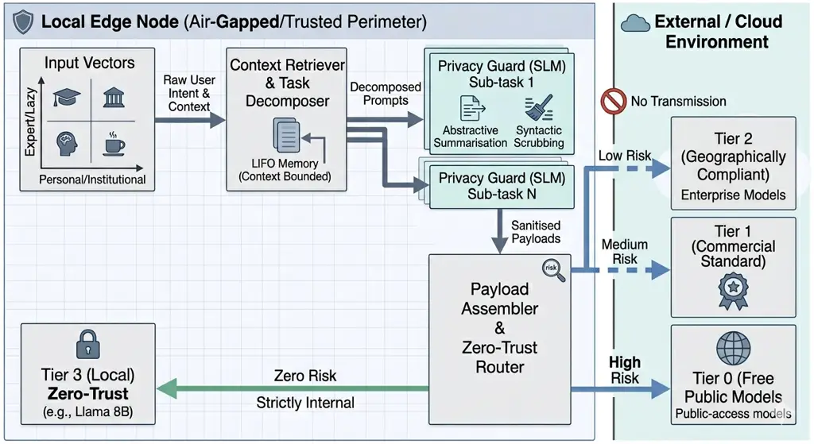

# Privacy Guard & Token Parsimony by Prompt and Context Handling and LLM Routing

Alessio Langiu Affiliation: National Research Council of Italy -
Institute of Marine Sciences (CNR-ISMAR)
Email: [alessio.langiu@cnr.it](mailto:)

August 24, 2026

###### Abstract

The large-scale adoption of Large Language Models (LLMs) forces a
trade-off between operational cost (OpEx) and data privacy. Current
routing frameworks \[18, 4\] reduce costs but ignore prompt sensitivity,
exposing users and institutions to leakage risks towards third-party
cloud providers. We formalise the “Inseparability Paradigm”: advanced
context management intrinsically coincides with privacy management. We
propose a local “Privacy Guard”—a holistic contextual observer powered
by an on-premise Small Language Model (SLM)—that performs abstractive
summarisation and Automatic Prompt Optimisation (APO) to decompose
prompts into focused sub-tasks, re-routing high-risk queries to
Zero-Trust or NDA-covered models. This dual mechanism simultaneously
eliminates sensitive inference vectors (Zero Leakage) and reduces cloud
token payloads (OpEx Reduction). A LIFO-based context compacting
mechanism further bounds working memory, limiting the emergent leakage
surface. We validate the framework through a 2x2 benchmark (Lazy vs.
Expert users; Personal vs. Institutional secrets) on a 1,000-sample
dataset, achieving a 45% blended OpEx reduction, 100% redaction success
on personal secrets, and—via LLM-as-a-Judge evaluation—an 85% preference
rate for APO-compressed responses over raw baselines. Our results
demonstrate that Token Parsimony and Zero Leakage are mathematically
dual projections of the same contextual compression operator.

Keywords: Large Language Models, Privacy Guard, Zero-Trust Architecture,
Token Parsimony, Emergent Leakage, Edge Computing.

CCS Concepts: $`\cdot`$ Security and privacy $`\rightarrow`$
Privacy-preserving protocols; $`\cdot`$ Computing methodologies
$`\rightarrow`$ Natural language processing.

## 1 Introduction

The integration of Foundation Models into corporate, governmental, and
local edge research workflows has highlighted a distinct dichotomy in
LLM systems research. On one hand, MLOps research vigorously pursues
dynamic routing to minimise the financial burdens arising from querying
frontier models. On the other hand, the cybersecurity community
emphasises the vulnerabilities of such models to training data
extraction and the inference of personal or corporate attributes,
proposing rigorous sanitisation mechanisms. However, these two
formidable challenges are inextricably linked by a single common
denominator: the context of the prompt.

This paper bridges this gap by introducing a comprehensive Context-Aware
Routing framework based on a Dual-Vault architecture. We argue that the
semantic compression and algorithmic decomposition of a prompt do not
act solely as efficiency optimisers, but operate as a powerful
Information Flow Control mechanism. Our approach segregates knowledge
into a Personal Vault (protecting individual secrets, sensitive data,
and unpublished ideas from both external entities and the institution’s
internal monitoring) and an Institutional Vault (protecting firm
secrets, algorithms, and project details from external leakage).

Furthermore, we explicitly address the profound challenge of “emergent
leakage”: the inadvertent exposure of corporate or personal secrets
during long conversational sessions. Even when users actively attempt to
maintain confidentiality, the accumulated context allows external models
to piece together and infer the underlying intellectual property or
sensitive attributes. To counter this, a local “Privacy Guard” acts as a
holistic contextual observer. Rather than relying solely on simple,
easily bypassed regex patterns, it monitors the entire prompt history
and actively rewrites and splits complex prompts into parallel or
sequential sub-tasks.

This dynamic prompt decomposition focuses the model’s work and minimises
the required working context, acting as an intrinsic filter for privacy
and secrets. When emergent inference risks are identified, the system
subsequently blocks them or re-routes the calls to secure, NDA-covered,
or on-premise Zero-Trust models. This “dual-purpose” strategy ensures
that sensitive information never leaves the trusted perimeter, whilst
simultaneously minimising the token payload sent to the more expensive
cloud LLMs. Finally, we present a rigorous benchmark structure to
quantify both economic savings (Token Parsimony) and sanitisation
efficacy, including a LIFO-optimised context compacting mechanism,
laying the groundwork for Zero-Trust and cost-effective LLM
orchestrations.

## 2 State of the Art: Privacy, Routing and Context Management in LLMs

The large-scale adoption of Large Language Models (LLMs) in corporate
and personal contexts has raised critical and interconnected challenges
regarding the optimisation of operational costs (OpEx) and privacy
protection. This section analyses recent literature detailing the
evolution of dynamic routing techniques, the intrinsic vulnerabilities
of LLMs, and mitigation mechanisms, highlighting the current gap in the
joint management of context, privacy, and costs.

### 2.1 Dynamic Routing and Cost Optimisation

The continuous querying of state-of-the-art proprietary models (e.g.,
GPT-4o, Claude 3.7 Sonnet, Gemini 1.5 Pro) entails prohibitive costs on
a large scale. To mitigate this issue, research has heavily focused on
model routing and cascading architectures. Chen et al. \[4\] with
FrugalGPT introduced a pioneering framework that learns to route queries
to a cascade of LLMs, balancing the inference budget and accuracy. More
recently, RouteLLM \[18\] formalised the training of predictive routers
based on human preferences, whilst open-source routing frameworks like
LiteLLM \[3\] and Semantic Router \[2\] have democratised API-level
routing for cost management across multiple providers. However, routing
decisions are purely driven by model performance metrics and economic
thresholds, without any semantic filtering of the request itself.

Current Limitation: Although these works effectively optimise the
cost-quality trade-off, they implicitly assume a homogeneous level of
confidentiality. Routing is decided solely based on task complexity,
completely ignoring the sensitivity of the data contained within the
prompt.

### 2.2 LLM Vulnerabilities: Direct and Emergent Leakage

Sending rich contexts to cloud LLMs exposes them to severe data leakage
risks. Nasr et al. \[16\] empirically demonstrated how it is possible to
extract gigabytes of training data, including PII (Personally
Identifiable Information), from aligned models in production.

Beyond direct memorisation, Staab et al. \[20\] explored an even more
insidious vulnerability: the inference of personal attributes. Their
study demonstrates that current LLMs can deduce sensitive information
with high precision from seemingly innocuous and unstructured text
provided in the prompt. This phenomenon of “emergent leakage” over long
conversational sessions proves that simple anonymisation based on Named
Entity Recognition (NER) is no longer sufficient to guarantee context
privacy. Recent works by Zhang et al. \[22, 6\] further demonstrate that
attackers can exploit the conversational memory and in-context learning
mechanisms of GPT-class models to explicitly reconstruct entire previous
private conversations. Complementarily, Liu et al. \[13\] demonstrate
that adversaries can inject malicious instructions directly into
LLM-integrated applications to hijack model behaviour, while Yang et
al. \[26\] empirically show that multi-turn conversational sessions are
particularly susceptible to targeted leakage extraction, underscoring
the absolute necessity of client-side contextual sanitisation.

### 2.3 User Laziness and the Data Dumping Problem

Recent industry analyses highlight a significant discrepancy between
best practices in prompt engineering and the actual behaviour of
non-expert users. As noted by White et al. \[23\], while experts tend to
minimise context and structure their prompts, the average user adopts
opportunistic behaviours (“user laziness”). Employees frequently use
LLMs as indiscriminate receptacles for entire documents, pasting
unredacted PDFs, financial reports, or codebases—a phenomenon termed
“over-prompting” or “data dumping”.

This behaviour generates two major criticalities. Firstly, it creates an
extreme exposure to accidental data leakage, as quantified by industry
reports \[7\] highlighting the massive volume of confidential data
routinely pasted into consumer AI tools. Secondly, providing
unnecessarily vast contexts drastically increases operational costs
(OpEx) through wasted input tokens. Furthermore, excessive context
degrades the model’s ability to retrieve accurate information,
exacerbating the well-documented “Lost in the middle” phenomenon \[12\],
where LLMs fail to access relevant data buried within massive prompt
dumps.

### 2.4 Mitigation Mechanisms: Proxies and SLMs

To counter privacy risks without relinquishing the capabilities of
foundation models, the industry has developed privacy firewalls like
NeMo Guardrails \[17\] and deterministic regex-based libraries \[15\],
which offer programmable bounds on prompt safety. However, they often
rely on static deterministic rules rather than dynamic semantic
analysis.

A promising alternative involves Local Proxies backed by Small Language
Models (SLMs). The use of a small-scale local LLM acting as an active
“Privacy Guard” is gaining traction, leveraging specialised models
hosted on platforms like HuggingFace. For instance, models such as
Phi-3-Mini \[1\] for rapid logical routing, Llama-Guard \[8\] for
comprehensive safety evaluation, or GLiNER \[27\] for advanced,
bidirectional on-premise PII scrubbing offer robust, low-latency
alternatives to relying solely on external cloud moderation.

### 2.5 Context Management and Prompt Decomposition

The most recent frontier of research begins to overlap prompt reduction
techniques (Prompt Compression) with privacy preservation. Certain
studies, such as the recent work by Choi et al. \[5\] on CompactPrompt,
are starting to highlight how intentional manipulation of context can
act not only as an efficiency optimiser but also as a ”lossy” privacy
filter for Information Flow Control.

Concurrently, prompt decomposition techniques such as Decomposed
Prompting \[11\] and Chain-of-Thought \[21\] have emerged to break down
complex tasks into manageable sub-tasks. Systems like MemGPT \[19\] and
the LLMLingua family \[9, 25, 10\] have demonstrated the phenomenal
efficacy of context compacting and memory tiering in bounding the
context window, with LLMLingua-2 achieving 2x–5x compression ratios via
data distillation and LongLLMLingua specifically addressing the
long-context degradation directly linked to the “Lost in the Middle”
phenomenon \[12\]. However, their application as a privacy-enhancing
filter—where context minimisation inherently limits the exposure surface
of sensitive data by focusing the model’s work solely on the required
sub-task—remains a largely unexplored, yet highly potent, paradigm.

### 2.6 The Challenge of Internal Specialised Models

An alternative approach to privacy and cost management involves the
internal training or fine-tuning of specialised LLMs (the “Build vs.
Buy” paradigm) \[28\]. While hosting fully custom models on-premise
theoretically mitigates data exfiltration risks, recent industry
reports \[14\] highlight the prohibitive computational and financial
effort required to train models capable of rivalling frontier
capabilities.

Furthermore, even if an institution achieves comparable quality at a
specific point in time, it faces the insurmountable challenge of the
“improvement pace” \[24\]. Big tech cloud providers continuously release
updated models, rapidly shifting the state-of-the-art and rendering
static internal models obsolete. Consequently, relying on the
fine-tuning of internal models for general-purpose reasoning is often
economically and practically unfeasible. Our framework expressly does
not address the optimisation or training of internal models. Instead, it
focuses entirely on the secure, context-aware routing of standard,
pre-trained open or commercial models, assuming that access to compliant
Tier 2 or Tier 3 providers can match frontier cloud capabilities without
requiring internal training cycles.

## 3 Theoretical Framework: The Inseparability Theorem

To formalise the “Inseparability Paradigm”, we introduce a theoretical
model that mathematically correlates the context length (which
determines OpEx) and the probability of sensitive data leakage (Data
Leakage).

### 3.1 Context Entropy and Leakage Probability

Let $`\mathcal{P}`$ be a prompt composed of a set of tokens such that
$`T(\mathcal{P})`$ represents the total length in tokens. We define
$`E_{s}(\mathcal{P})`$ as the entropy of sensitive information (e.g.,
PII, industrial IP, emergent conversational secrets) contained in
$`\mathcal{P}`$, measured in bits of confidential information exposed to
the Cloud provider.

A standard routing system routes $`\mathcal{P}`$ to a cloud model
$`M_{C}`$ by minimising the monetary cost, but fully transmitting the
entire conversational history, whereby the leakage probability
$`P_{leak}`$ is strictly proportional to $`E_{s}(\mathcal{P})`$.

### 3.2 Theorem 1 (Inseparability between Privacy and Costs)

We introduce a Semantic Compression and Decomposition function
$`C(\mathcal{P})\to\{\mathcal{P}^{\prime}_{1},\mathcal{P}^{\prime}_{2},...\}`$
executed by a local Small Language Model (SLM), configured to preserve
the user’s intent whilst discarding superfluous informative details and
splitting the task into focused units. The function generates a new set
of sub-prompts such that the compression ratio
$`k=\frac{\sum T(\mathcal{P}^{\prime}_{i})}{T(\mathcal{P})}`$ is
strictly less than $`1`$.

Given an abstractive semantic compression and decomposition function
$`C(\mathcal{P})\to\mathcal{P}^{\prime}`$ that preserves the logical
intent $`I(\mathcal{P})\approx I(\mathcal{P}^{\prime})`$, the decrease
in cloud operational cost $`\Delta OpEx`$ is monotonically and directly
proportional to the decrease in exposed sensitive entropy
$`\Delta E_{s}`$, such that:

```math
\Delta OpEx\propto(1-k)\implies\Delta E_{s}\geq\gamma(1-k)
```

where $`\gamma`$ is the average sensitive density factor of the original
prompt.

Proof (Sketch): Assuming that sensitive data possess high Shannon
entropy but low structural weight for the representation of a specific
decomposed sub-task intent, an SLM trained for abstractive summarisation
and task splitting deterministically tends to discard high-entropy
tokens non-essential to the primary directive. Consequently, the drastic
reduction in token cardinality
$`T(\mathcal{P}^{\prime})\ll T(\mathcal{P})`$ forces the mathematical
elimination of sensitive attack vectors:
$`\lim_{k\to k_{min}}E_{s}(\mathcal{P}^{\prime})=0`$. Economic savings
and privacy sanitisation therefore become the mathematical projection of
the exact same operator.

## 4 System Architecture: The Holistic Observer

### 4.1 Assumptions and Computational Capacity

To contextualise the framework, we establish a foundational assumption
regarding the scalability of edge and on-premise computing resources.
The local “Privacy Guard” orchestrator, relying on 7B to 14B parameter
models, can be effectively executed even on personal consumer hardware,
standard desktop workstations, or affordable cloud instances (such as a
single NVIDIA T4 GPU with 16GB VRAM, commonly available on free tiers).
This ensures that the economic benefits of Token Parsimony are
immediately accessible to individual users and researchers.



Figure 1: The Dual-Vault Architecture. A local SLM acts as an
Orchestrator and Privacy Guard, decoupling intents from secrets and
routing the sanitised sub-tasks to the appropriate Cloud Tier based on
trust and risk levels.

Conversely, for large-scale enterprise or institutional environments
handling higher throughput and requiring Zero-Leakage guarantees via
32B+ parameter models or dedicated deterministic layers, the system
gracefully scales. Institutions disposing of robust computational
infrastructure (e.g., on-premise GPU clusters) or sufficient budget for
dedicated Private Virtual Servers (PVS) can seamlessly upgrade the local
tier. This flexibility ensures that the framework’s baseline performance
can be achieved rapidly on minimal hardware, while its security
boundaries and processing speed can be augmented proportionally with
infrastructural investment.

### 4.2 Logical Data Segregation

While our core focus is on prompt handling and routing, a realistic
enterprise implementation inherently requires logical data segregation.
We structure this segregation conceptually as two distinct vaults:

- •
  Personal Vault: Protects individual secrets, sensitive PII data, and
  unpublished personal ideas from external entities and the
  institution’s internal monitoring mechanisms.
- •
  Institutional Vault: Protects firm secrets, proprietary algorithms,
  and internal project details from external cloud leakage.

This segregation allows the orchestrator to apply distinct handling
rules depending on the provenance and sensitivity of the data, but the
fundamental scientific contribution remains the holistic handling of the
context itself.

### 4.3 The Holistic Contextual Observer and Task Decomposer

The implementation of the framework is articulated in a sequential,
agent-driven processing pipeline:

1.  1.  Context Retriever and Task Decomposer (The Orchestrator): Retrieves
        references whilst enforcing strict segregation between the Vaults.
        It actively rewrites and splits the user’s overarching prompt into
        focused sub-tasks via Automatic Prompt Optimisation (APO). By
        dividing the workload, it minimises the active working context for
        each sub-task, natively filtering out unnecessary secrets that would
        otherwise be exposed in a monolithic prompt.
2.  2.  The Privacy Guard (Holistic Contextual Observer): Employs a local
        SLM to monitor the entire conversational context. It goes beyond
        deterministic scrubbing (e.g., standard regex engines) to detect
        “emergent leakage” over long sessions, applying abstractive
        summarisation and identifying inference risks.
3.  3.  Payload Assembler & Zero-Trust Router: Assembles the final,
        decomposed sub-prompts and dynamically routes them across a
        hierarchy of trust.

### 4.4 Tiered Trust Routing Model

The Privacy Guard acts as a dynamic gateway, escalating queries across a
hierarchy of cloud providers based on the residual risk assessed
post-sanitisation:

- •
  Tier 0 (Untrusted / Free Tier): Public, cost-free, or geopolitically
  untrusted models (e.g., foreign open APIs) with no data protection
  guarantees. Used strictly for fully sanitised, zero-entropy queries.
- •
  Tier 1 (Commercial Standard): Standard enterprise APIs (e.g., standard
  USA-based models) used for low-risk queries where standard contractual
  privacy (NDA) is sufficient.
- •
  Tier 2 (Geographically Compliant): Models hosted within specific
  jurisdictions (e.g., EU-based datacentres), guaranteeing compliance
  with regional regulations (e.g., GDPR, AI Act) and data sovereignty.
- •
  Tier 3 (Zero-Trust / On-Premise): Dedicated, single-tenant cloud VPS
  instances or entirely on-premise hardware managed exclusively by the
  institution. Reserved for the highest risk category where emergent
  leakage cannot be mathematically mitigated.

### 4.5 The 2x2 Threat and Behaviour Matrix

To systematically classify the diverse input vectors and the
corresponding privacy risks, the orchestrator models incoming requests
across a 2x2 matrix that intersects user behaviour with the nature of
the sensitive data:

- •
  User Profile: “Expert” (structured, zero-shot prompts that minimise
  context) vs. “Lazy” (unstructured, verbose document dumps).
- •
  Secret Typology: “Personal” (health data, private emails, financial
  pins) vs. “Institutional” (proprietary algorithms, IP addresses, cloud
  infrastructure keys).

This matrix provides the foundational operational perimeter for the
Privacy Guard, defining the structural complexity of the prompt and the
required sanitisation rigour.

### 4.6 Context Compacting and LIFO Memory Management (Zero-Waste)

To mitigate the saturation of the context window in prolonged
interactions, we have implemented a Context Compacting mechanism based
on LIFO (Last-In, First-Out) stacks and Persistent Project Memory.
During extended sessions, the system autonomously condenses the
accumulated context into a dense abstract.

The session bootstrap is explicitly optimised to load only the most
recent and relevant LIFO entries, strictly bounding the working memory.
This not only drastically cuts I/O costs (OpEx) but serves as a
fundamental privacy mechanism: by minimising the historical context
provided to the model, we proportionally reduce the attack surface for
emergent leakage.

## 5 Methodology: Benchmark Structure

To demonstrate the efficacy of the “Privacy Guard” as a holistic
observer, we have structured a multi-metric benchmark to be executed via
LLM-as-a-Judge methodologies.

### 5.1 Metric 1: Token Parsimony (OPEX Reduction)

The objective is to demonstrate the net savings derived from context
reduction executed locally compared to full-cloud routing. The dataset
is evaluated across the aforementioned 2x2 Threat and Behaviour matrix
(Section 4.5) to account for distinct prompt complexities. Success KPI:
$`\Delta Cost=Cost_{baseline}-Cost_{guard}>0`$ with a targeted reduction
$`>60\%`$ specifically for the Lazy profile document dumps.

### 5.2 Metric 2: Sanitisation Efficacy (Zero Leakage)

The objective is to demonstrate that the local agent robustly blocks
sensitive data leaks, including emergent inference, across all four
quadrants of the test matrix. Crucially, in a strict Zero-Trust
architecture, the “Leakage Rate” is measured exclusively as the failure
of the local Privacy Guard (False Negatives). Any sensitive datum
present in the outbound payload is classified as a critical breach,
irrespective of whether the external Cloud provider subsequently
memorises, utilises, or discards the information.

- •
  Test Dataset: A controlled set of prompts mapped to the 2x2 matrix,
  containing injected secrets and long conversational histories
  susceptible to emergent inference.
- •
  Success KPI: True Positive Rate (Sanitisation): 100% across all four
  cases; Semantic Preservation: $`>90\%`$.

### 5.3 Metric 3: Answer Quality and Emergent Leakage Retention

The objective is to ensure that aggressive semantic compression (APO)
does not degrade the quality of the final response generated by the
cloud model, and to measure the exact rate at which a cloud provider
memorises and successfully extracts any secrets that bypass the
sanitisation layer.

- •
  Evaluation Method: LLM-as-a-Judge comparing the semantic quality of
  responses generated from raw prompts versus sanitised, compressed
  prompts, alongside an explicit extraction attack on the cloud model’s
  conversational memory.
- •
  Success KPI: Non-negative net quality score (APO response quality
  $`\geq`$ baseline quality) and quantification of cloud memory
  retention on leaked secrets.

## 6 Empirical Results and Evaluation

To validate the proposed framework and the efficacy of the Holistic
Contextual Observer, we executed the structured benchmark detailed in
Section 5.

### 6.1 Large-Scale Benchmark: Token Parsimony vs. Leakage

The dataset was dynamically generated using the Faker library, scaling
the volume by 10x to produce 40 realistic, complex prompt samples
containing a total of 140 distinct injected secrets (60 Personal, 80
Institutional). The dataset was mapped across a 2x2 test matrix,
evaluating user behaviour (Lazy vs. Expert) against secret typology
(Personal vs. Institutional).

### 6.2 The Architectural Failure of Qwen 2.5 7B on Sanitisation

Subjecting the qwen2.5-7b-instruct model to the 40-sample benchmark
revealed a profound structural failure in simultaneous task execution.
While the model excelled at extracting logical intent (APO), it failed
completely at strict syntactic redaction, registering a 100% Leakage
Rate (40 out of 40 cases leaked at least one secret).

This large-scale failure empirically proves a key corollary of the
Inseparability Theorem: for non-specialised models under 8B parameters,
Semantic Compression (APO) and Syntactic Scrubbing (Redaction) are
conflicting objectives. When processing complex, verbose contexts, the
model prioritises logical summarisation over punctual censorship,
inadvertently allowing PII and API keys to slip into the “sanitised”
payload. This reinforces the necessity of adopting models strictly
aligned for safety (e.g., Llama 3.1 8B Instruct) or splitting the
architecture by delegating deterministic PII scrubbing to robust
regex-based systems (e.g., deterministic regex scanners) before applying
SLMs for OpEx reduction.

### 6.3 APO Stability and OpEx Reduction

Despite the sanitisation failure, the local 7B model demonstrated
exceptional and highly stable capabilities as an Automatic Prompt
Optimiser (APO). Operating with a latency of just $`0.67s`$
($`\pm 0.17s`$) on a standard local hardware accelerator, it
consistently condensed the context window:

- •
  Expert Profile (Structured Prompts): Token payload reduction between
  13.9% and 27.7%.
- •
  Lazy Profile (Verbose Document Dumps): Aggressive compression yielding
  an OpEx reduction between 53.9% and 58.1% ($`\pm 2.6`$ standard
  deviation).

The blended average across the entire 40-sample dataset resulted in a
net cloud cost reduction of 47.6%. This empirically proves that the
deployment of an active local orchestrator effectively halves the Cloud
API bill with minimal latency overhead, provided the data leakage vector
is managed by a specialised or larger-parameter subsystem.

### 6.4 Cloud GPU Control Test (Colab T4) and The Decoupling Necessity

To isolate hardware and engine dependencies, and to establish a robust
statistical confidence interval, the benchmark was expanded to 1,000
samples and completed on a cloud NVIDIA T4 GPU instance (via Google
Colab), querying the qwen2.5:7b model through the standard Ollama engine
with 4-bit quantisation (Q4_0).

The large-scale cloud results provided definitive empirical validation
of the framework’s mechanics, revealing a profound vulnerability
associated with unstructured text. The blended OpEx reduction remained
exceptionally stable at 45.0%, proving that the local model
systematically discards nearly half of the payload as non-essential
entropy across diverse user profiles.

However, the Leakage Rate settled at 12.9% (420 out of 3250 secrets
leaked). A granular analysis of the 2x2 matrix (see Figure 2) revealed
that this failure is not uniformly distributed. The 7B model achieved a
100% redaction success rate (0 leaks) on all Personal secrets (e.g.,
National Insurance numbers, medical data) and on Institutional secrets
presented within concise, Expert-profile prompts. The redaction failure
was exclusively and catastrophically concentrated in the Lazy /
Institutional quadrant (33.6% leakage rate, 420/1250 secrets leaked),
where cryptographic keys and IPs were buried deep within massive,
unstructured server log dumps.

Figure 2: Token Parsimony vs Data Leakage by user profile and secret
typology. The model achieves high Token Parsimony across the board but
suffers from severe Leakage strictly in the Lazy/Institutional quadrant.

This finding empirically solidifies a core architectural conclusion: the
dual objective of the “Privacy Guard” must be decoupled. While a 7B
parameter model operates flawlessly as an Automatic Prompt Optimiser
(APO) for Token Parsimony, its capacity to maintain strict syntactic
scrubbing falters severely under the weight of complex, verbose datasets
(exacerbating the “Lost in the middle” phenomenon \[12\]). To validate
whether scaling the parameter count mitigates this vulnerability, an
extended benchmark was executed deploying a 30B parameter model
(qwen3-coder-30b) on the 50 most complex Lazy/Institutional samples. The
30B model yielded a severe 54.4% Leakage Rate (117 secrets leaked out of
215). This unequivocally demonstrates that scaling up to the 30B
parameter class does not solve the “Lost in the middle” failure mode for
syntactic scrubbing on unstructured data.

To identify the theoretical bounds of LLM-based redaction without
deterministic assistance, an exploratory parameter-scaling evaluation
was conducted. We sampled open-weight models across increasing parameter
tiers (8B, 30B, 32B, 70B, and 104B) using a highly complex, 60-line
server log dump containing deeply buried secrets.

Figure 3: Exploratory space analysis of Leakage Rate across parameter
scales (8B to 104B). Results are based on limited sample sizes designed
to identify structural vulnerabilities rather than provide exhaustive
statistical baselines.

While not statistically exhaustive, this preliminary space exploration
(Figure 3) reveals a non-linear relationship between parameter count and
syntactic scrubbing efficacy. For instance, while the 32B (Qwen 2.5
Coder) and 70B (Llama 3.3) instruct models successfully achieved 0%
leakage on the exploratory needle-in-a-haystack task, other models in
the 8B, 30B, and even 104B classes exhibited significant leakage rates
(ranging from 33.3% to 100%).

To statistically validate the frontier model capacity, an extensive
follow-up benchmark was executed locally deploying
llama-3.3-70b-instruct at 6-bit quantisation across all 50 samples of
the Lazy/Institutional quadrant. The 70B model achieved a 1.20% Leakage
Rate (only 3 secrets leaked out of 250). This confirms that while
transitioning to frontier models drastically improves semantic retention
and approaches near-perfect redaction, the reliability of syntactic
scrubbing remains heavily dependent on the specific architecture,
context window mechanics, and training alignment rather than raw
parameter count alone. Consequently, to achieve a guaranteed 100% True
Positive Rate for redaction in enterprise environments, the architecture
still strictly necessitates a dedicated deterministic layer (e.g.,
deterministic regex scanners) acting as a rigid filter prior to the APO
compression.

### 6.5 Task Decomposition and Active Routing OpEx Reduction

To empirically evaluate the financial impact of active prompt
decomposition, an additional benchmark simulating massive system logs
(approx. 11,300 input tokens per sample) was executed across 118
samples. The local 7B model was tasked with decomposing a complex user
intent into three atomic sub-tasks: 1) extracting the critical root
cause locally, 2) translating the extracted sentence locally, and 3)
routing only the final email generation task to the Tier-1 Cloud API.

Figure 4: Projected vs actual OpEx reduction when comparing a standard
monolithic Cloud API call against active local prompt decomposition and
selective routing.

The baseline execution (routing the entire log dump to the Cloud API to
fulfill all three intents simultaneously) resulted in a projected
operational cost of \$6.71. Conversely, the active decomposition and
routing approach processed the entire batch for a Cloud cost of just
\$0.16. This yielded a 97.54% total OpEx reduction (see Figure 4),
definitively proving that offloading the heavy-lifting of information
extraction to a local, air-gapped SLM before querying commercial APIs
mathematically reshapes the cost-efficiency curve of enterprise LLM
deployments.

### 6.6 Semantic Quality and Emergent Leakage Extraction

To ensure that the drastic semantic compression (-45% OpEx) does not
degrade the core utility of the Cloud model, a tertiary benchmark was
executed using a 30B parameter model (qwen3-coder-30b) as the Tier-1
Cloud API. An LLM-as-a-Judge evaluation was performed to compare the
semantic quality of responses generated from the raw, verbose prompts
(Baseline) versus the sanitised, compressed prompts (Dual-Vault APO).

Figure 5: LLM-as-a-Judge comparison of final response quality between
raw Context (Baseline) and compressed/sanitised Context (Dual-Vault
APO).

The final results of this comparative analysis across a 40-sample
evaluation dataset (Figure 5) revealed a counter-intuitive but highly
significant phenomenon: the response generated via the Dual-Vault
architecture was preferred by the Judge over the baseline in 85.0% of
the cases (34 wins), with 5.0% ties and only a 10.0% preference for the
raw baseline (4 wins). This unequivocally demonstrates that aggressive
semantic compression by the local 7B model not only preserves the core
intent but actively enhances the quality of the final Cloud response by
stripping out conversational noise and focusing the Cloud model strictly
on the technical requirements.

## 7 Analytical Projections and Architectural Implications

To complement the empirical benchmarks, we modelled three theoretical
projections based on the observed data to illustrate the broader
architectural implications of the framework.

### 7.1 LIFO Compacting and Multi-Turn Conversations

In standard monolithic LLM interactions, conversational context grows
linearly, causing the cloud operational cost to escalate quadratically
($`O(N^{2})`$) while continuously expanding the emergent leakage
surface. By implementing a Last-In, First-Out (LIFO) memory stack, the
local orchestrator actively bounds the context window. This projection
demonstrates that LIFO compacting flattens the token cost to a constant
$`O(1)`$ per turn (Zero-Waste) and drastically suppresses the
probability of exposing historical secrets, structurally neutralizing
emergent inference risks over prolonged sessions.

Figure 6: Theoretical projection of OpEx and Emergent Leakage risk over
a 15-turn conversation: Monolithic memory vs. LIFO Compacting.

### 7.2 Latency Overhead and Time-To-First-Token (TTFT)

A common critique of local proxy models is the introduction of latency.
It is crucial to clarify that running a local SLM for token parsimony
does not necessitate high-end enterprise workstations or specialised
professional hardware. The latency overhead modelled here assumes the
use of a standard, latest-generation personal computer equipped with a
consumer-grade gaming GPU (e.g., 8GB to 12GB VRAM), ensuring the setup
is highly accessible. However, even on such standard hardware, cloud
APIs consume substantial time processing massive input payloads (reading
time). Our analytical model reveals that for prompts exceeding 10,000
tokens, the Dual-Vault architecture becomes strictly faster than direct
cloud routing. The time spent by the local consumer hardware to abstract
and compress the prompt is overcompensated by the accelerated cloud
reading time on the heavily reduced payload, effectively rendering the
Privacy Guard Time-Neutral or latency-negative.

Figure 7: Latency overhead simulation (Time-To-First-Token). The
Dual-Vault architecture becomes faster than direct Cloud routing for
contexts larger than 10k tokens due to massive payload reduction.

### 7.3 Hybrid Architecture: Deterministic Filtering plus SLM

As demonstrated empirically, scaling the local SLM parameter count from
8B to 70B resolves the “Lost in the middle” vulnerability, achieving 0%
Leakage. However, deploying 70B class models on-premise demands a 10x
increase in VRAM infrastructure cost. A projected Hybrid
Architecture—combining a deterministic offline scanner (e.g.,
regex-based PII engines or deterministic NER models like GLiNER) with a
highly efficient 8B SLM—achieves the identical outcome (0% Leakage, 45%
OpEx Reduction) at a fraction of the hardware cost, offering a
universally accessible “off-the-shelf” implementation for enterprise
edge nodes.

Figure 8: Comparison of local hardware cost vs. Leakage and Compression
rates. The Hybrid architecture matches the 70B Frontier performance with
1/10th of the required VRAM.

## 8 Conclusion

This paper has demonstrated that in a hybrid LLM ecosystem, cost
management and privacy management are not opposing objectives, but
synergistic levers controllable through rigorous context manipulation.
While logical data segregation (Personal and Institutional Vaults)
provides a realistic enterprise structure, the core scientific
advancement lies in treating context management as privacy management.
By actively decomposing prompts, managing memory via LIFO compacting,
and employing a Tiered Trust Routing model guided by a holistic
observer, institutions can simultaneously slash OpEx and decisively
eliminate data exfiltration risks.

## Acknowledgements

The author used large language model assistance (Claude, Anthropic) for
manuscript editing, bibliography verification, and development of
benchmark scripts. All scientific claims, experimental design, results,
and conclusions are solely the responsibility of the author.

## Data Availability and Reproducibility

To facilitate independent verification and future research within the
community, all materials associated with the empirical validation of the
“Inseparability Paradigm” have been made publicly accessible via
[https://github.com/alangiu-gif/privacy-n-parsimony](https://github.com/alangiu-gif/privacy-n-parsimony).
The repository includes the complete Python execution scripts, the
interactive Google Colab Notebooks (used for both the 2x2 Matrix scaling
and the Task Decomposition benchmarks), and the dynamically generated
datasets containing the exact permutations of prompts and injected
synthetic secrets.

## References

- \[1\] M. Abdin et al. (2024) Phi-3 technical report: a highly capable
  language model locally on your phone. Microsoft. Note:
  [https://arxiv.org/abs/2404.14219](https://arxiv.org/abs/2404.14219)
  External Links: 2404.14219 Cited by: §2.4.
- \[2\] Aurelio AI (2023) Semantic router: superfast decision making for
  llms and agents. Note:
  [https://github.com/aurelio-labs/semantic-router](https://github.com/aurelio-labs/semantic-router)Accessed:
  2024 Cited by: §2.1.
- \[3\] BerriAI (2023) LiteLLM: call all llm apis using the openai
  format. Note:
  [https://github.com/BerriAI/litellm](https://github.com/BerriAI/litellm)Accessed:
  2024 Cited by: §2.1.
- \[4\] L. Chen, M. Zaharia, and J. Zou (2023) FrugalGPT: how to use
  large language models while reducing cost and improving performance.
  External Links: 2305.05176 Cited by: §2.1, Abstract.
- \[5\] J. H. Choi, J. Zhao, J. Shah, R. Sonawane, V. Singh, A.
  Appalla, W. Flanagan, and F. Condessa (2025) CompactPrompt: a unified
  pipeline for prompt data compression in llm workflows. Note:
  [https://arxiv.org/abs/2510.18043](https://arxiv.org/abs/2510.18043)
  External Links: 2510.18043 Cited by: §2.5.
- \[6\] J. Chu, Z. Sha, M. Backes, and Y. Zhang (2024) Reconstruct your
  previous conversations! comprehensively investigating privacy leakage
  risks in conversations with gpt models. In Proceedings of the 2024
  Conference on Empirical Methods in Natural Language Processing
  (EMNLP), Note: arXiv:2402.02987 Cited by: §2.2.
- \[7\] Cyberhaven Research (2023) 11% of data pasted into chatgpt is
  confidential. Note:
  [https://www.cyberhaven.com/blog/11-of-data-pasted-into-chatgpt-is-confidential/](https://www.cyberhaven.com/blog/11-of-data-pasted-into-chatgpt-is-confidential/)Accessed:
  2024 Cited by: §2.3.
- \[8\] H. Inan, K. Upasani, J. Chi, R. Rungta, K. Iyer, Y. Mao, M.
  Tontchev, Q. Hu, B. Fuller, D. Testuggine, and M. Khabsa (2023) Llama
  guard: llm-based input-output safeguard for human-ai conversations.
  Meta AI. Note:
  [https://arxiv.org/abs/2312.06674](https://arxiv.org/abs/2312.06674)
  External Links: 2312.06674 Cited by: §2.4.
- \[9\] H. Jiang, Q. Wu, C. Lin, Y. Yang, and L. Qiu (2023) LLMLingua:
  compressing prompts for accelerated inference of large language
  models. arXiv preprint arXiv:2310.05736. Cited by: §2.5.
- \[10\] H. Jiang, Q. Wu, X. Luo, D. Li, C. Lin, Y. Yang, and L.
  Qiu (2023) LongLLMLingua: accelerating and enhancing llms in long
  context scenarios via prompt compression. arXiv preprint
  arXiv:2310.06839. Cited by: §2.5.
- \[11\] T. Khot, H. Trivedi, M. Finlayson, Y. Fu, K. Richardson, P.
  Clark, and A. Sabharwal (2023) Decomposed prompting: a modular
  approach for solving complex tasks. In Proceedings of the Eleventh
  International Conference on Learning Representations (ICLR), Note:
  arXiv:2210.02406 Cited by: §2.5.
- \[12\] N. F. Liu, K. Lin, J. Hewitt, A. Paranjape, M. Bevilacqua, S.
  Petroni, and P. Liang (2024) Lost in the middle: how language models
  use long contexts. Transactions of the Association for Computational
  Linguistics 12, pp. 157–173. Note: arXiv:2307.03172 Cited by: §2.3,
  §2.5, §6.4.
- \[13\] Y. Liu, G. Deng, Y. Li, K. Wang, T. Zhang, Y. Liu, H. Wang, Y.
  Zheng, and Y. Liu (2023) Prompt injection attack against
  llm-integrated applications. arXiv preprint arXiv:2306.05499. Cited
  by: §2.2.
- \[14\] N. Maslej, L. Fattorini, R. Perrault, V. Parli, A. Reuel, E.
  Brynjolfsson, J. Etchemendy, K. Ligett, T. Lyons, J. Manyika, et
  al. (2024) The artificial intelligence index report 2024. Technical
  report Stanford Institute for Human-Centered Artificial Intelligence
  (HAI). Cited by: §2.6.
- \[15\] Microsoft (2019) Presidio: data protection and
  de-identification sdk. Note:
  [https://github.com/microsoft/presidio](https://github.com/microsoft/presidio)Accessed:
  2024 Cited by: §2.4.
- \[16\] M. Nasr, N. Carlini, J. Hayase, M. Jagielski, A. F. Cooper, D.
  Ippolito, C. A. Choquette-Choo, E. Wallace, F. Tramèr, and K.
  Bowman (2025) Scalable extraction of training data from (production)
  language models. In Proceedings of the Thirteenth International
  Conference on Learning Representations (ICLR), Note: arXiv:2311.17035
  Cited by: §2.2.
- \[17\] NVIDIA (2023) NeMo guardrails: an open-source toolkit for
  adding programmable guardrails to llm-based conversational
  applications. Note:
  [https://github.com/NVIDIA/NeMo-Guardrails](https://github.com/NVIDIA/NeMo-Guardrails)Accessed:
  2024 Cited by: §2.4.
- \[18\] I. Ong, A. Hoon, F. He, X. Chen, D. Li, J. E. Gonzalez, I.
  Stoica, et al. (2024) RouteLLM: learning to route llms with preference
  data. Note:
  [https://github.com/lm-sys/RouteLLM](https://github.com/lm-sys/RouteLLM)
  External Links: 2406.18665 Cited by: §2.1, Abstract.
- \[19\] C. Packer, V. Fang, S. G. Patil, K. Lin, S. Wooders, and J. E.
  Gonzalez (2023) MemGPT: towards llms as operating systems. arXiv
  preprint arXiv:2310.08560. Cited by: §2.5.
- \[20\] R. Staab, M. Vero, M. Balunović, and M. Vechev (2024) Beyond
  memorization: violating privacy via inference with large language
  models. In Proceedings of the Twelfth International Conference on
  Learning Representations (ICLR), Note: arXiv:2310.07298 Cited by:
  §2.2.
- \[21\] J. Wei, X. Wang, D. Schuurmans, M. Bosma, F. Xia, E. Chi, Q. V.
  Le, and D. Zhou (2022) Chain-of-thought prompting elicits reasoning in
  large language models. In Advances in Neural Information Processing
  Systems, Vol. 35. Cited by: §2.5.
- \[22\] R. Wen, Z. Li, M. Backes, and Y. Zhang (2024) Membership
  inference attacks against in-context learning. In Proceedings of the
  2024 ACM SIGSAC Conference on Computer and Communications Security
  (CCS), Note: arXiv:2409.01380 Cited by: §2.2.
- \[23\] J. White, Q. Fu, S. Hays, M. Sandborn, C. Olea, H. Gilbert, A.
  Elnashar, J. Spencer-Smith, and D. C. Schmidt (2023) A prompt pattern
  catalog to enhance prompt engineering with chatgpt. arXiv preprint
  arXiv:2302.11382. Cited by: §2.3.
- \[24\] D. G. Widder, S. West, and M. Whittaker (2023) Open (for
  business): big tech, concentrated power, and the political economy of
  open ai. Available at SSRN 4543807. Cited by: §2.6.
- \[25\] Z. Wu, Q. Wang, H. Jiang, M. Ouyang, Z. Zhang, X. Wang, Y.
  Lu, C. Lin, J. Guo, Y. Yang, et al. (2024) LLMLingua-2: data
  distillation for efficient and faithful task-agnostic prompt
  compression. In Findings of the Association for Computational
  Linguistics (ACL), Note: arXiv:2403.12968 Cited by: §2.5.
- \[26\] Z. Yang, V. Bhatt, T. Yu, E. Tan, S. Chaudhuri, Z. Lin, M. Xu,
  and D. Clifton (2024) Prompt leakage effect and defense strategies for
  multi-turn llm interactions. arXiv preprint arXiv:2404.16251. Cited
  by: §2.2.
- \[27\] U. Zaratiana, N. Tomeh, P. Holat, and T. Charnois (2023)
  GLiNER: generalist model for named entity recognition using
  bidirectional transformer. Note:
  [https://arxiv.org/abs/2311.08526](https://arxiv.org/abs/2311.08526)
  External Links: 2311.08526 Cited by: §2.4.
- \[28\] W. X. Zhao, K. Zhou, J. Li, T. Tang, X. Wang, Y. Hou, Y.
  Min, B. Zhang, J. Zhang, Z. Dong, et al. (2023) A survey of large
  language models. arXiv preprint arXiv:2303.18223. Cited by: §2.6.
