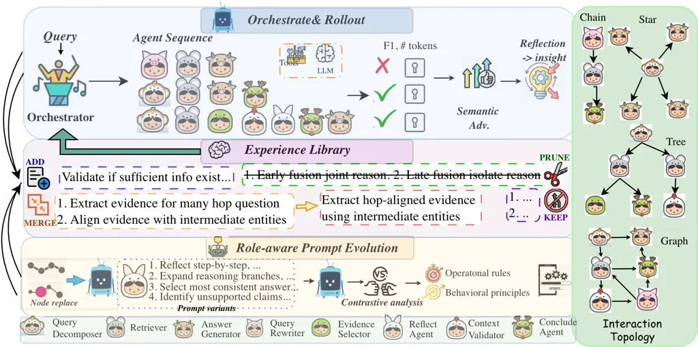
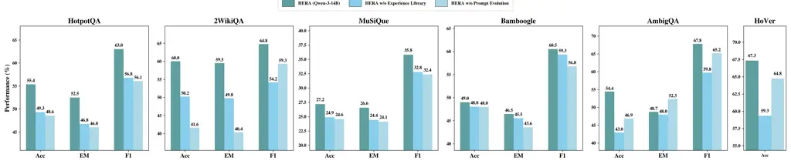
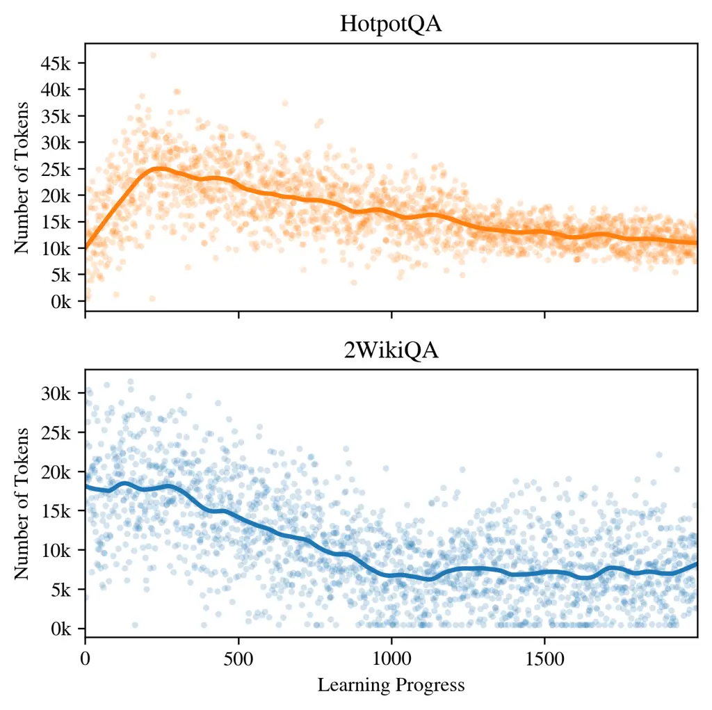
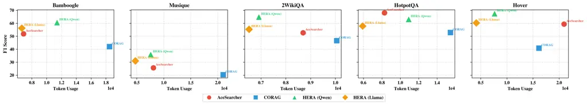
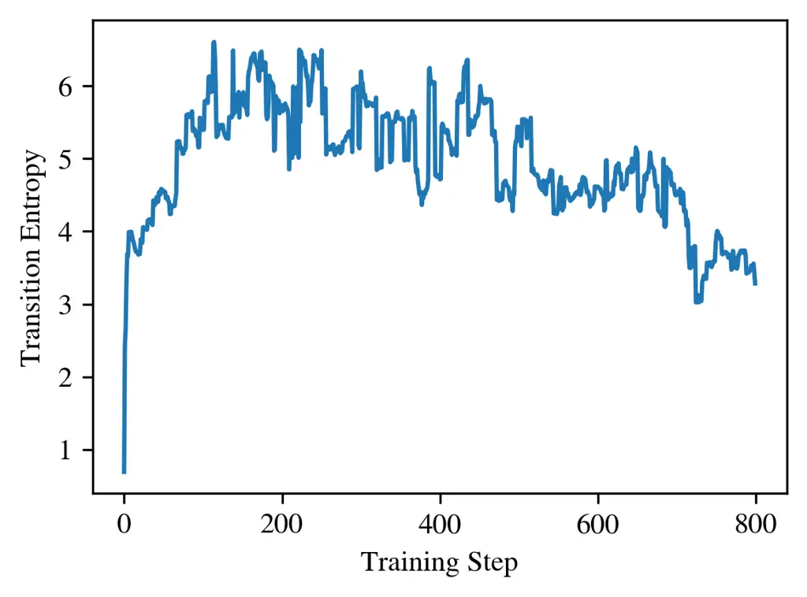
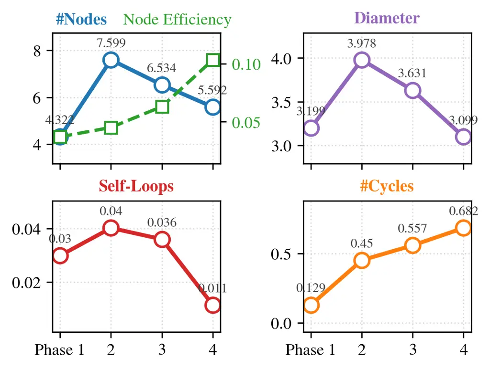
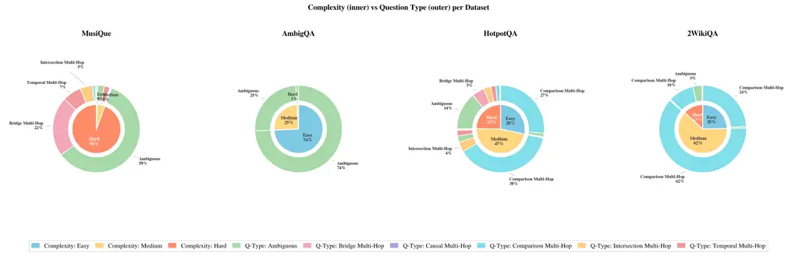
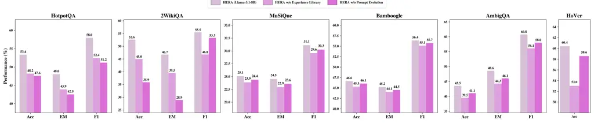
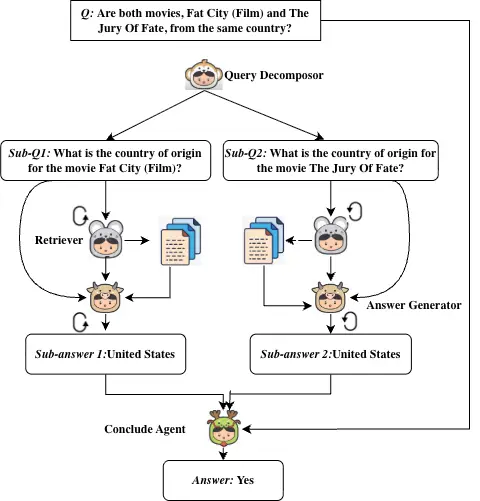
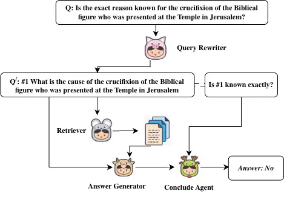

# Experience as a Compass: Multi-agent RAG with Evolving Orchestration and Agent Prompts

Sha Li Affiliation: Virginia Tech Email: [shal@vt.edu](mailto:)    Naren
Ramakrishnan Affiliation: Virginia Tech Email: [naren@vt.edu](mailto:)

###### Abstract

Multi-agent Retrieval-Augmented Generation (RAG), wherein each agent
takes on a specific role, supports hard queries that require multiple
steps and sources, or complex reasoning. Existing approaches, however,
rely on static agent behaviors and fixed orchestration strategies,
leading to brittle performance on diverse, multi-hop tasks. We identify
two key limitations: the lack of continuously adaptive orchestration
mechanisms and the absence of behavior-level learning for individual
agents. To this end, we propose HERA, a hierarchical framework that
jointly evolves multi-agent orchestration and role-specific agent
prompts. At the global level, HERA optimizes query-specific agent
topologies through reward-guided sampling and experience accumulation.
At the local level, Role-Aware Prompt Evolution refines agent behaviors
via credit assignment and dual-axes adaptation along operational and
behavioral principles, enabling targeted, role-conditioned improvements.
On six knowledge-intensive benchmarks, HERA achieves an average
improvement of 38.69% over recent baselines while maintaining robust
generalization and token efficiency. Topological analyses reveal
emergent self-organization, where sparse exploration yields compact,
high-utility multi-agent networks, demonstrating both efficient
coordination and robust reasoning.

|     |
| --- |
|     |

## 1 Introduction

Recent advances in Large Language Model (LLM)-based Multi-Agent Systems
(Li et al., 2024) have enhanced Retrieval-Augmented Generation (RAG)
(Lewis et al., 2020; Gao et al., 2023b; Jiang et al., 2023) through
collaborating specialized agents (Nguyen et al., 2025; Liu et al., 2025;
Qian et al., 2025; Chen et al., 2025b), extending tool use (Zhuang et
al., 2024; Schick et al., 2023; Jin et al., 2025) and memory integration
(Hu et al., 2025; Gutiérrez et al., 2025; Yang et al., 2025b). These
systems are promising for complex and long-context reasoning, where
effective coordination between retrieval and reasoning is critical.

Despite their promise, existing multi-agent RAG frameworks are
fundamentally constrained by static or weakly adaptive orchestration.
Most prior work relies on fixed or sequential pipelines (Gamage et al.,
2024; Liu et al., 2025; Yao et al., 2022; Qian et al., 2025; Chen et
al., 2025b), which fails to accommodate query-dependent variation in
reasoning and retrieval complexity, resulting in insufficient evidence
collection or unnecessary retrieval overhead. Besides, these systems are
highly susceptible to error propagation (Shen et al., 2025; Pei et al.,
2025), where mistakes compound across multi-turn interactions and
long-horizon agent coordination. Since these errors are inherently
compositional, reliance on global supervision signals (_e.g_., final
answer correctness) (Chen et al., 2025b; Song et al., 2025a; Song et
al., 2025b) provides limited attribution to specific failure sources,
hindering targeted improvements. Moreover, mainstream training-based
optimization remains costly and inflexible, typically requiring large
trajectory datasets (Zhu et al., 2024b; Chen et al., 2025b; Chen et al.,
2025c; Zhu et al., 2024a; Jin et al., 2025), which constrains
scalability and limits continual adaptation in dynamic knowledge
environments (Tang et al., 2025). As query distributions and underlying
corpora evolve, fixed reasoning and coordination strategies (Jeong et
al., 2024a) lead to stagnant performance and brittle generalization to
novel queries and retrieval challenges.

To address these limitations, we argue that, an effective multi-agent
RAG system must (i) adapt its coordination strategies to query
complexity, (ii) enable targeted and role-specific agent improvement,
(iii) mitigate error propagation, and (iv) support continual adaptation
without costly retraining. To this end, we propose HERA, a Hierarchical
Evolvution RAG framework that achieves these goals by distilling
execution experience as in-context knowledge and reshaping agent
behaviors by prompt evolution without parameter updates.

HERA is organized as a three-layer hierarchy that jointly evolves global
orchestration strategies and local agent behaviors using accumulated
experiential and reflective knowledge (Figure .1). At the top, a
centralized orchestrator generates query-specific execution plans in a
single step. This holistic orchestration (Ke et al., 2026) enables the
system to reason globally about the coordination of retrieval and
reasoning, producing plans tailored to the complexity and requirements
of each query. At the bottom, specialized agents execute subtasks
grounded in interaction with others. HERA employs role-aware prompt
optimization to drive targeted improvements for each agent’s unique
responsibilities, avoiding generic updates and mitigating errors arising
from misaligned multi-agent behaviors. Bridging these layers, the
experience library captures reflective insights from both successful and
failed execution trajectories. These insights provide diagnostic
information (Agrawal et al., 2026), enabling semantic credit assignment
for global learning and guiding agent-level refinement. Across HERA,
continuously evolving experience acts as a compass: it informs the
orchestrator to improve high-level coordination strategies and drives
progressive, role-specific enhancement of agent behavior, improving
robustness and reducing cascading errors.

Our contributions are summarized as follow: (i) We introduce HERA, a
hierarchical framework enabling dual-level evolution - experience-guided
orchestration and role-aware prompt adaptation, shifting policy
optimization from parameter updates to experience-driven contextual
adaptation. (ii) We design topology-based metrics to quantitatively
characterize the evolution of agent interaction topologies and track
dynamics. (iii) Empirical results on six knowledge-intensive benchmarks
demonstrate that HERA outperforms recent SOTA by an average of 38.69%
while maintaining token efficiency.

## 2 Preliminary and Problem Statement

We study the problem of dual-level evolution in multi-agent RAG for
knowledge-intensive tasks. Let $`\mathcal{Q}`$ denote a distribution
over queries, $`\mathcal{Y}`$ the answer space, and $`\mathcal{D}`$ a
corpus (_e.g_. Wikipedia) providing supporting information. We formalize
a whole system as a tuple:

```math
\mathcal{R}=\langle\mathcal{O},\mathcal{N},\mathcal{L},\mathcal{T},\mathcal{E},\mathcal{A},\mathcal{S},\Psi,\tau,\mathcal{Q},\mathcal{Y},\mathcal{D}\rangle
```

where $`\mathcal{O}`$ is a central orchestrator, $`\mathcal{N}`$ is a
set of specialized agents, $`\mathcal{E}`$ is an experience library,
$`\mathcal{S}`$ is the state space, and $`\mathcal{A}`$ is the action
space. Each agent $`\mathcal{N}_{i}`$ is abstracted as a tuple
$`(\pi_{i},\rho_{i},\mathcal{T}_{i})`$, where $`\pi_{i}\in\mathcal{L}`$
is the underlying LLM, $`\rho_{i}`$ is a role-specific prompt, and
$`\mathcal{T}i`$ denotes the tools available to the agent. The overall
action space $`\mathcal{A}`$ includes both reasoning operations and tool
invocations. The system evolves according to the transition dynamics
$`\Psi(s_{t+1}\mid s_{t},a_{t})`$, and agent executions produce
trajectories $`\tau=(s_{0},a_{0},s_{1},a_{1},\dots,s_{T})`$.

Given a query $`q`$, the orchestrator produces a multi-agent interaction
topology conditioning on the experience library:
$`\Gamma\sim\pi_{\mathcal{O}}(\cdot|q,\mathcal{E},\mathcal{N})`$, where
$`\Gamma`$ specifies the subset of agents, their execution order
(sequential or parallel), and dependency. Agents execute according to
$`\Gamma`$, producing a trajectory $`\tau`$, and the final answer
$`y\in\mathcal{Y}`$ is synthesized from the information aggregated along
the trajectory, typically based on the terminal state $`s_{T}`$.

Our goal is to jointly optimize the orchestration policy
$`\pi_{\mathcal{O}}`$ and role-specific prompts $`{\rho_{i}}`$ while
keeping the underlying LLM parameters $`{\pi_{i}}`$ frozen.

## 3 HERA: Hierarchical Evolution of Multi-agent RAG



Figure 1: Overview of HERA. A hierarchical framework that jointly
evolves orchestration strategies, the experience library, and agent
prompts.

HERA jointly evolves global orchestration and agent prompts through
experience and reflection. As shown in Figure 1, it comprises three
layers, each corresponding to a different level of optimization: the
global orchestrator optimizes high-level coordination strategies, the
experience library accumulates and refines trajectory-level knowledge to
guide learning, and the execution agents optimize role-specific
performance through prompt evolution, per their operational roles and
behavioral principles.

### 3.1 Orchestrator: Structure-Level Policy Optimization

The orchestrator’s optimization is inspired by Group Relative Policy
Optimization (GRPO) (Shao et al., 2024; Cai et al., 2025), which updates
a policy by comparing sampled actions within a group. Unlike the
training-free GRPO (Cai et al., 2025), we extend the idea beyond
token-level generation, lifting optimization from token generation to
cooperation topology. Operating over a structured action space of agent
topologies $`\Gamma`$, the orchestrator performs group-based
optimization at the level of global strategy. Given a query $`q`$, it
samples a group of candidate agent sequences. Each sequence is executed
by invoking the corresponding agents, producing a trajectory
$`\tau_{i}`$, which is subsequently evaluated to obtain a reward.
Instead of relying on scalar advantages, we adopt a hierarchical
comparison: trajectories are first ranked by downstream task performance
(_e.g_., F1 score), and then by efficiency, measured as the total number
of input and output tokens consumed across all agents. The orchestrator
is then prompted to articulate the reasons for relative success and
failure across the group, producing a set of natural language insights
$`\mathcal{I}=\pi_{\mathcal{O}}(\{\tau_{i}\}_{i=1}^{G})`$. To improve
diagnostic precision, we focus on groups explicitly containing both
successful and failed. trajectories. which serve as group-relative
semantic advantages. These semantic advantages encode structured
knowledge about effective reasoning strategies, agent interactions, and
failure modes, effectively replacing numerical gradients with
interpretable and compositional signals. As such, the orchestrator
governs high-level structure and coordination (macro) instead of the
fine-grained textual outputs (micro). These insights, curated through
selective consolidation, form the core of the experience library (§3.2).

### 3.2 Experience Library

Storing distilled experience as retrievable in-context demonstrations
has been shown to effectively shape future behavior (Zhao et al., 2024;
Ouyang et al., 2025; Xu et al., 2025b). Building on this principle, HERA
employs an Experience Library $`\mathcal{E}`$, which accumulates
semantic advantages derived from reflective comparisons of successful
and failed trajectories, serving as both an episodic memory and an
optimization medium for the orchestrator.

$`\mathcal{E}`$ is charatcerized with a Profile–Insight–Utility
structure $`(c,z,u)`$, where $`c`$ denotes the query characteristics or
types, $`z`$ is the natural language insight, and $`u`$ represents the
utility, measuring the empirical success rate of $`z`$ - that is, how
often the insight is successfully applied in subsequent agent
orchestration. $`\mathcal{E}`$ is updated online through consolidation
operations: ADD inserts insights that are distinct from any existing
entries; MERGE combines semantically similar or complementary entries,
PRUNE removes conflicting or low-utility insights to maintain
generalizable insights while preventing uncontrolled growth, and KEEP
leaves $`\mathcal{E}`$ unchanged.

Experience as a Prior. Given a query $`q`$, the orchestrator first
analyzes its characteristics and retrieves a set of relevant insights
from $`\mathcal{E}`$. Retrieval balances two objectives: maximizing
empirical utility $`u`$, which favors insights that have historically
led to successful coordination, and maintaining diversity, achieved by
selecting insights that are semantically distinct from those already
chosen and that have lower prior usage frequency. The retrieved insights
inform the orchestrator’s selection and sequencing of agents, guiding
multi-step execution toward high-performing strategies. By combining
high-utility and diverse insights, the orchestrator biases execution to
maximize task accuracy while minimizing token consumption. In this
manner, $`\mathcal{E}`$ serves as a structured, experience-driven prior,
enabling contextual policy improvement and without modifying the
underlying LLM.

### 3.3 Theoretical Interpretation

The HERA orchestrator admits a natural Expectation-Maximization (EM)
interpretation over discrete reasoning programs. In the E-step,
trajectories are sampled under the current policy, approximating the
posterior over high-reward reasoning topologies. In the M-step, semantic
insights are extracted and consolidated into the experience library,
updating a latent representation of the policy. Further, using a frozen
LLM introduces implicit regularization, analogous to KL-constrained
policy optimization. As updates occur via contextual augmentation
instead of parameter changes, the induced policy remains close to the
original model distribution. This formulation highlights that HERA
performs energy-based reweighting of candidates, ensuring stable and
consistent improvement. We provide detailed theoretical analysis in
Appendix A.

### 3.4 Role-aware Prompt Evolution (RoPE)

Globally strategy cannot prevent corrective (agents ignore actionable
error signals and repeat mistakes) or enhancement failures (agents
persist with suboptimal strategies despite successful execution) (Zhang
et al., 2025a) in multi-agent systems, motivating our Role-aware Prompt
Evolution (RoPE).

#### 3.4.1 Prompt Evolution

A key challenge in multi-agent systems is attributing global trajectory
outcomes to individual agents, especially when inter-agent dependencies
obscure direct credit assignment. RoPE addresses this by targeting
agents identified as underperforming by the orchestrator, who evaluates
complete trajectories. Formally, an agent is considered underperforming
if the orchestrator identifies it as the primary contributor to the
trajectory’s failure.

To support systematic improvement, we maintain a buffer for each agent
containing its recent failed trajectories. This buffer enables RoPE to
analyze recurring errors, identify consistent failure patterns, and
provide contextual evidence for targeted prompt refinement. Given an
underperforming agent $`\mathcal{N}_{i}`$ at time $`t`$, we retrieve its
recent failed trajectories, then we generate prompt variants, and
reexecutet the original whole agent trajectories with these prompt
variants. Then RoPE performs contrastive analysis to extract actionable
improvements along two complementary dimensions: (i) operational rules
($`\Delta\rho_{i}^{op}`$): short-term corrective behaviors derived from
recent failures, and (ii) behavioral principles
($`\Delta\rho_{i}^{bp}`$): long-term strategies distilled from patterns
across multiple trajectories. Formally, the prompt update can be
decomposed as:

```math
\Delta\rho_{i}=\Delta\rho_{i}^{op}+\Delta\rho_{i}^{bp}
```

where $`\Delta\rho_{i}^{op}`$ addresses immediate failure correction and
$`\Delta\rho_{i}^{bp}`$ promotes strategic generalization. Prompt
variants are generated along behavioral axes such as thoroughness, risk
sensitivity, error correction and heuristic injection, enabling
structured exploration to optimize accuracy, robustness, and
computational cost (see Appendix B for prompt details).

#### 3.4.2 Prompt Consolidation

Following variant evaluation, selected updates are integrated into the
agent’s prompt via prompt consolidation, which prunes redundant or
low-utility instructions to maintain a compact and coherent
representation. Formally, this can be expressed as a projection:

```math
\rho_{i}^{t+1}=\Pi_{\mathcal{C}}\left(\rho_{i}^{t}\oplus\Delta\rho_{i}\right)
```

where $`\mathcal{C}`$ represents constraints on prompt length and
coherence. With the underlying LLM fixed, prompt evolution induces a
controlled shift in the agent’s effective policy:

```math
\pi_{\mathcal{N}_{i}^{new}}(y|x)\propto\pi_{\mathcal{N}_{i}^{base}}(y|x)\cdot exp(f{\rho_{i}}(x,y))
```

where $`x,y`$ denote the input and output context of an agent
respectively, and $`\pi_{\mathcal{N}_{i}^{new}}`$ represents its
conditional generation policy. The prompt-induced term
$`f{\rho_{i}}(x,y)`$ biases this mapping by favoring outputs $`y`$ that
better align with the updated role-specific guidance. This induces an
implicit regularization effect, analogous to KL constraints, ensuring
stable and consistent policy updates.

### 3.5 Topology Mutation

While prompt evolution improves agent-level behavior, persistent
failures often indicate structural deficiencies in the coordination
topology. To address this, HERA performs topology mutation when
trajectories consistently fail (_e.g_., F1 = 0). Upon identification by
the orchestrator, HERA explores alternative structures by either
replacing the failed agent $`\mathcal{N}_{i}`$ with an alternative
$`\mathcal{N}_{i}^{{}^{\prime}}`$ or augmenting the topology with
additional agents, yielding candidate topologies
$`\Gamma^{{}^{\prime}}`$. These candidates are then incorporated into
the same gradient-free GRPO optimization loop. This process enables the
co-evolution of coordination structure and agent behaviors.

## 4 Experiments

We aim to answer the following questions: RQ1 (Effectiveness): How does
HERA ’s overall performance compare to state-of-the-art (SOTA)
baselines? (§5.1) RQ2 (Component Contribution): What is the individual
contribution of the key components? (§5.2) RQ3 (Efficiency): Does
improved performance, if any, come at the cost of increased token
consumption?(§5.3) RQ4 (Topology Evolution): How do agent coordination
topologies evolve as the system accumulates experience and updates agent
prompts? (§5.4)

Tasks and Datasets.We evaluate HERA on multi-hop QA benchmarks
2WikiMultiHopQA (2WikiQA) (Ho et al., 2020), HotpotQA (Yang et al.,
2018), MusiQue (Trivedi et al., 2022) and AmbigQA (Min et al., 2020) for
ambiguous QA. For out-of-distribution (OOD) evaluation, we use Bamboogle
(Press et al., 2023) and HoVer (Jiang et al., 2020) for multi-hop QA and
fact verification respectively. Evaluation metrics involve Exact Match
(EM), accuracy, and F1 score for QA tasks, and accuracy for fact
verification.

Baselines. We compare HERA against: (1) Direct inference and
chain-of-thought (CoT) without RAG across different LLM families and
sizes; (2) Single-turn RAG with different LLMs as answer generators; (3)
Iterative RAG: IterDRAG (Yue et al., 2024), Plan-RAG (Verma et al., 2024) Search-o1 (Li et al., 2025a), Search-R1 (Jin et al., 2025), IRCoT
(Trivedi et al., 2023), SELF-RAG (Asai et al., 2023), CORAG (Wang et
al., 2025); and (4) Agentic RAG, including InstructRAG, R1-Searcher
(Song et al., 2025a), DeepResearcher (Zheng et al., 2025), MMOA-RAG
(Chen et al., 2025c), AceSearcher (Xu et al., 2025a) , and MAO-ARAG
(Chen et al., 2025c), ExSearch (Shi et al., 2025). Model and
implementation details are provided in Appendix E.

Implementation Details. We consider core agents commonly employed in
RAG: Query Decomposer, Retriever, Answer Generator, Query Rewriter,
Evidence Selector, Context Validator, Reflect Agent, and Conclude Agent.
We use Wikipedia as the corpus, returning top-_5_ passages per step for
multi-step retrieval and top-_10_ for single-turn methods via the BGE
retriever (Xiao et al., 2024). We use Llama-3.1-8 (Grattafiori et al., 2024) and Qwen-3-14B (Yang et al., 2025a) as the backbone LLMs for the
orchestrator and GPT-4o-mini for agents. All backbones remain frozen
during learning and inference. To highlight data efficiency, we first
use GPT-4o to annotate queries from 2WikiQA, HotpotQA, AmbigQA, and
MusiQue along reasoning type (bridge, intersection, comparison, temporal
multi-hop, ambiguous) and complexity (easy, medium, hard). Based on
these annotations, we perform stratified, difficulty-aware sampling to
construct a curated training set that ensures balanced coverage across
reasoning categories while preserving distributional diversity
(statistics in Appendix D). Generative sampling uses temperature 0.9
during group rollouts, and $`0.0/0.3`$ for in-distribution and OOD
evaluation, respectively. (Pseudocode for HERA is provided in
Appendix G).

## 5 Results and Analysis

### 5.1 Overall Performance

|                                                                                     |          |       |       |         |       |       |         |       |       |         |       |       |           |       |       |       |
| ----------------------------------------------------------------------------------- | -------- | ----- | ----- | ------- | ----- | ----- | ------- | ----- | ----- | ------- | ----- | ----- | --------- | ----- | ----- | ----- |
| Dataset                                                                             | HotpotQA |       |       | 2WikiQA |       |       | MusiQue |       |       | AmbigQA |       |       | Bamboogle |       |       | HoVer |
| Metrics                                                                             | Acc      | EM    | F1    | Acc     | EM    | F1    | Acc     | EM    | F1    | Acc     | EM    | F1    | Acc       | EM    | F1    | Acc   |
| Single-turn Retrieval                                                               |          |       |       |         |       |       |         |       |       |         |       |       |           |       |       |       |
| Qwen2.5-14B-Instruct                                                                | 43.53    | 35.72 | 46.14 | 26.64   | 26.25 | 31.85 | 9.23    | 7.00  | 13.75 | 39.78   | 36.65 | 50.23 | 27.20     | 34.70 | 34.35 | 45.50 |
| Qwen3-14B                                                                           | 44.47    | 36.25 | 47.56 | 31.57   | 31.10 | 37.79 | 13.16   | 9.99  | 15.72 | 38.47   | 36.10 | 50.91 | 31.54     | 29.60 | 38.31 | 49.05 |
| Qwen3-8B                                                                            | 41.35    | 33.70 | 45.10 | 26.37   | 26.10 | 32.12 | 11.49   | 8.71  | 13.62 | 36.02   | 33.80 | 47.70 | 23.87     | 22.40 | 30.28 | 50.15 |
| GPT-4o-mini                                                                         | 46.30    | 37.74 | 49.30 | 28.42   | 28.41 | 35.11 | 16.63   | 13.94 | 19.60 | 37.40   | 33.80 | 47.99 | 38.36     | 36.00 | 42.81 | 47.95 |
| Llama3-3.1-8B-instruct                                                              | 33.16    | 27.02 | 35.14 | 20.40   | 20.35 | 25.11 | 8.43    | 6.43  | 12.61 | 18.03   | 18.96 | 24.60 | 20.46     | 19.20 | 27.24 | 49.90 |
| Advanced RAG                                                                        |          |       |       |         |       |       |         |       |       |         |       |       |           |       |       |       |
| Search-r1-7B                                                                        | 51.11    | 41.94 | 54.18 | 48.89   | 44.69 | 49.20 | 20.45   | 18.58 | 25.73 | 47.32   | 45.88 | 65.54 | 35.79     | 32.64 | 43.93 | 47.76 |
| Iter-RetGen (Qwen2.5-7B)                                                            | 20.37    | 16.71 | 24.59 | 47.71   | 43.54 | 49.12 | 19.89   | 16.79 | 21.04 | —       | —     | —     | 35.33     | 34.12 | 40.65 | 51.29 |
| Plan-RAG 8b                                                                         | 29.95    | 25.96 | 37.51 | 30.53   | 27.38 | 31.68 | 13.08   | 9.90  | 13.34 | —       | —     | —     | 30.01     | 23.57 | 32.12 | 50.33 |
| SELF-RAG (llama2-7B)                                                                | 23.85    | 13.64 | 25.07 | 40.82   | 37.30 | 42.02 | 8.47    | 7.16  | 14.16 | 28.51   | 24.03 | 39.62 | 25.80     | 22.66 | 30.05 | 40.52 |
| R1-Searcher 7B                                                                      | 41.15    | 32.54 | 50.69 | 40.11   | 35.38 | 45.19 | 18.21   | 13.51 | 19.19 | —       | —     | —     | 41.00     | 38.85 | 46.76 | 51.56 |
| ExSearch (Qwen2.5-7B)                                                               | 55.04    | 45.11 | 58.22 | 44.83   | 44.03 | 51.56 | 22.73   | 19.58 | 27.10 | –       | —     | –     | 56.12     | 51.27 | 63.80 | 66.62 |
| DeepResearcher-7B                                                                   | 40.65    | 35.23 | 58.86 | 49.40   | 54.35 | 64.05 | 24.53   | 18.56 | 25.57 | 49.74   | 42.23 | 51.50 | 37.42     | 34.20 | 44.40 | 58.19 |
| IRCoT (GPT-4o-mini)                                                                 | 40.39    | 33.14 | 54.93 | 38.73   | 35.50 | 42.01 | 19.11   | 18.23 | 25.00 | —       | —     | –     | 34.88     | 30.73 | 33.97 | 55.37 |
| InstructRAG-8B                                                                      | 34.40    | 33.15 | 34.83 | 36.98   | 35.45 | 40.72 | 16.11   | 14.19 | 19.50 | 40.07   | 39.72 | 40.73 | 26.16     | 23.44 | 31.18 | 56.76 |
| CORAG-8B (Greedy)                                                                   | 38.02    | 32.95 | 52.85 | 39.09   | 35.43 | 46.62 | 16.45   | 15.98 | 21.00 | 32.10   | 27.25 | 43.95 | 33.03     | 31.61 | 41.25 | 40.82 |
| MMOA-RAG-8B                                                                         | 30.02    | 26.02 | 34.75 | 35.56   | 31.89 | 38.58 | 16.47   | 13.36 | 18.82 | 38.85   | 34.75 | 48.59 | 34.47     | 31.76 | 42.01 | 58.19 |
| AceSearcher-8B                                                                      | 42.91    | 37.19 | 68.07 | 50.83   | 45.59 | 52.75 | 25.24   | 19.10 | 26.62 | –       | –     | –     | 47.21     | 45.12 | 51.91 | 59.37 |
| ![[Uncaptioned image]](arxiv-2604-00901v2--a5468a786c5b.figures/figure-2.webp) Ours |          |       |       |         |       |       |         |       |       |         |       |       |           |       |       |       |
| HERA (Qwen-3-14B)                                                                   | 55.38    | 52.50 | 63.03 | 60.02   | 59.50 | 64.77 | 27.19   | 26.57 | 35.82 | 54.43   | 48.74 | 67.81 | 49.01     | 46.46 | 60.53 | 67.35 |
| HERA (Llama-3.1-8)                                                                  | 53.28    | 48.01 | 57.91 | 52.62   | 46.70 | 55.42 | 25.04   | 24.46 | 31.07 | 48.53   | 43.46 | 60.72 | 46.60     | 45.22 | 56.31 | 60.31 |

Table 1: Comparison of HERA with baselines. Best results are bold,
second-best are underlined. “-” indicates methods not designed for or
evaluated on the task.

Table 1 compares HERA with a range of baselines (Direct inference and
CoT results are reported in Appendix F.2). key observations are: (i)
Consistent gains over SOTA iterative and agentic RAG baselines. HERA
achieves an average of 38.69% gains on all datasets compared against
recent SOTA, demonstrating the effectiveness of experience-guided
orchestration for interleaved reasoning and retrieval. Best AmbigQA
performance highlights HERA ’s robustness to queries with multiple
plausible interpretations. (ii) Robust OOD performance. HERA ranks
second on Bamboogle (F1 $`-5.4\%`$ vs. ExSearch) and first on HoVer
($`+64.95\%`$ vs. CORAG), reflecting the transferability of the
accumulated experience library and evolving agent behaviors. In
contrast, most prior approaches relying on heuristic planning or fixed
iterative retrieval generalize poorly beyond in-distribution data. (iii)
Efficiency as gradient-free optimization. HERA surpasses RL-fine-tuned
multi-agent RAG methods, such as MMAO-RAG, showing that semantic
group-wise advantages enable stable, consistent improvements across
tasks and distribution shifts without costly model updates. (iv)
HERA-Qwen consistently outperforms HERA-Llama across all datasets,
particularly on cross-document reasoning and complex disambiguation
tasks. While HERA-Llama remains competitive in-domain, its performance
drops on OOD tasks, indicating limited reasoning and generalization
capacity for ambiguous or sparse queries.

### 5.2 Ablation Study



Figure 2: Ablation Studies of HERA with Qwen-3-14B as the backbone.

Figure 2 presents the ablation results of HERA on the test set using
Qwen-3-14B as the backbone (Llama-3.1-8 results are provided in
Appendix F.2). Removing the experience library yields consistent but
moderate performance declines across datasets (typically $`\downarrow`$
6% to 15% relative accuracy), highlighting its role in improving
knowledge guiding and cross-instance generalization. In contrast,
omitting prompt evolution leads to substantially larger and more
variable declines on multi-hop QA (up to $`\downarrow`$ 30% relative on
2WikiQA for both backbones), where precise decomposition and trajectory
control are essential. On ambiguity-intensive datasets AmbigQA, prompt
evolution introduces a recall-oriented bias: improving F1 while
occasionally reducing EM, whereas the experience library promotes
precision through grounded outputs, revealing a systematic EM–F1
trade-off. These patterns are consistent across backbones, indicating
that the functional contributions of each component are largely
model-agnostic. Importantly, the full HERA framework consistently
outperforms both ablations by a non-additive margin, indicating a
positive interaction effect: improved reasoning behaviors from prompt
evolution enhance the quality of stored experiences, which in turn
reinforce subsequent reasoning through stronger grounding. Overall, the
results demonstrate that prompt evolution and the experience library
target complementary failure modes: procedural correctness versus
epistemic reliability, and that their synergy is critical for robust
multi-hop reasoning.

### 5.3 Performance-Efficiency Trade-off

We examine the potential trade-off between performance and data
efficiency by analyzing token usage patterns throughout learning. Our
analysis emphasizes two key dimensions: (i) the dynamics of token
consumption as learning progresses, and (ii) the interplay between token
efficiency and task performance..



Figure 3: Token usage

#### 5.3.1 Dynamics of Token Consumption

We visualize the token consumption throughout the learning process by
Locally Weighted Scatterplot Smoothing (LOWESS) (Cleveland, 1981; Dang
et al., 2025). Figure 3 illustrates token usage trends on HotpotQA and
2WikiQA as representative tasks. (i) Exploration–Exploitation
Transition. On HotpotQA, token consumption follows a non-monotonic
trajectory. Early spikes reflect an exploratory phase in which the
orchestrator activates multiple agents, constructs extended reasoning
traces, and performs redundant steps to optimize performance. As
experience accumulates, token usage declines monotonically, marking a
transition to exploitation: low-efficiency agents are pruned, and
reasoning chains are shortened. A subsequent plateau indicates
convergence toward an efficient token budget. In contrast, 2WikiQA
exhibits no initial exploratory peak, suggesting that transferable
priors from previously accumulated reasoning experience support
efficient agent orchestration with minimal trial-and-error. (ii)
Functional Contributions. Token usage dynamics are tightly coupled with
HERA ’s experience library and prompt evolution. The library accumulates
high-utility and generalizable experience, while evolving prompts
enables agents to elevate their performance. Together, they drive
emergent computational frugality, enabling high reasoning performance
without explicit token-based penalties.

#### 5.3.2 Performance vs.Token Usage



Figure 4: Comparison of Performance–Token Efficiency Trade-off with
Selected Baselines.

Figure 4 compares multi-hop QA performance against token consumption.
Key observations include: (i) Superior Performance–Efficiency Trade-off.
Across all datasets, HERA consistently dominates the
performance–efficiency frontier, achieving higher F1 scores with
controlled token budgets. This demonstrates that gains arise from
efficient reasoning trajectories instead of brute-force context scaling.
(ii) Backbone-Specific Patterns.) HERA with Qwen-3-14B achieves the
highest absolute performance, whereas HERA with Llama-3.1-8 consistently
minimizes token consumption ($`\sim`$4.7k–6.6k across most datasets)
while preserving competitive F1 scores, indicating favorable
computational efficiency. (iii) Consistent performance and efficiency
gains over baselines. CORAG uses the largest number of tokens across
most datasets (up to $`20k+`$) without converting these costs into
sustainable reasoning improvements or effective knowledge reuse,
resulting in suboptimal F1 (_e.g_., 20.30 on MusiQue and 40.82 on
HoVer). AceSearcher occupies an intermediate position, balancing
moderate token usage and performance.

### 5.4 Topology Evolution

To elucidate the emergence of coordinated multi-agent behavior, we
systematically analyze the evolution of interaction topologies over the
course of learning. For this purpose, we introduce topology-based
metrics to quantify structural changes in agent collaboration.

#### 5.4.1 Transition Entropy



Figure 5: Transition entropy

Transition Entropy quantifies the uncertainty in agent-to-agent
transitions, capturing the policy-level dynamics. Let
$`Prob.(\mathcal{N}_{j}|\mathcal{N}_{i})`$ denote the empirical
transition probability from agent $`\mathcal{N}_{i}`$ to
$`\mathcal{N}_{j}`$, the Transition Entropy is defined as:

$`H_{trans}=-\sum_{i,j}Prob.(\mathcal{N}_{i}\to\mathcal{N}_{j})\,\log Prob.(\mathcal{N}_{i}\to\mathcal{N}_{j})`$

We compute $`H_{trans}`$ using a sliding-window over learning. Beyond
the exploration–exploitation dynamics, Figure 5 shows that after an
initial rise, entropy stabilizes at an intermediate level, reflecting
the emergence of structured yet flexible agent interactions. This
plateau indicates that HERA consolidates high-value transition sequences
while maintaining controlled exploration, enabling the system to
integrate novel reasoning strategies without disrupting established
coordination. The pattern highlights the complementary roles of the
experience library, which reinforces effective multi-agent pathways, and
prompt evolution, which adaptively refines agent behavior for functional
alignment with task objectives. Notably, the plateau at intermediate
entropy levels indicates controlled exploration even during
exploitation, preventing premature convergence to suboptimal strategies
while allowing the integration of novel cooperation pathways.

#### 5.4.2 Graph-based Metrics



Figure 6: Graph metrics

To systematically characterize the topology evolution of HERA, we model
each trajectory as a graph $`\mathcal{G}_{\tau}=(V,E)`$ where nodes
represent agents and edges denote interactions. We quantify structural
and functional properties via defining graph-theoretic metrics: (a)
Number of agents $`|V|`$: the total distinct agents involved in a
trajectory, reflecting the breadth of collaboration. (b) Node
efficiency: per-agent contribution, formally by
$`\frac{\text{F1}(\tau)}{|V|}`$, capturing per-agent utility. (c)
Self-Loops: the frequency of self-transitions, reflecting potential
redundancy or degenerate reasoning. (d) Number of cycles: count of
closed-loop paths capturing iterative reasoning patterns. (e) Diameter:
longest shortest-path between any two nodes, representing maximum
reasoning depth.

We segment learning into four phases - initial, exploration, refinement,
and optimization, and analyze normalized metrics per question type. As
shown in Fig. 6, Early trajectories are narrow and shallow, with low
agent counts, minimal cycles, and limited diameter, reflecting sparse
coordination. During exploration, the system dynamically recruits more
agents, increasing diameter and cycle formation, capturing iterative
reasoning and intermediate verification. By the refinement phase,
trajectories contract: redundant agents and self-loops are pruned,
diameter decreases, and node efficiency rises. This selective retention
is guided by the experience library, which reinforces high-value
interaction topologies, and by prompt evolution, which refines agent
behaviors and intermediate outputs. The optimized phase exhibits compact
chains with minimal nodes, high per-agent utility, and strategically
preserved cycles, representing a balance of efficiency and robustness.

Overall, the evolving topologies reveal that HERA ’s dual mechanisms -
structured experience retrieval and adaptive prompt evolution enable a
principled transition from exploratory, diffuse agent interactions to
compact, high-utility, and resilient multi-agent system.

## 6 Related Work

Retrieval-Augmented Generation (RAG) boosts LLM performance by
leveraging external evidence (Izacard et al., 2023; Lewis et al., 2020;
Gao et al., 2023b; Tang and Yang, 2024; Xiong et al., 2024; Fan et al.,
2024). Early methods embed retrieval within model architectures,
permitting direct conditioning on retrieved context (Khandelwal et al.,
2020; Liu et al., 2024a; Izacard and Grave, 2020; Wang et al., 2023;
Borgeaud et al., 2022; Izacard et al., 2023; Guu et al., 2020).
Subsequent methods modularize RAG into pre- (Chan et al., 2024; Gao et
al., 2023a; Ma et al., 2023) and post-retrieval components (Abdallah et
al., 2025; Xu et al., 2023; Li and Ramakrishnan, 2025) to enhance
retrieval and reasoning, and synergize retrieval with structured
reasoning for multi-step tasks (Jeong et al., 2024b; Lee et al., 2024;
Asai et al., 2024; Shao et al., 2023). Emerging paradigms such as
DeepResearcher Zheng et al. (2025); Li et al. (2025b); Huang et al.
(2025) extend RAG into agentic (Xie et al., 2025; Fang et al., 2025;
Chen et al., 2025c; Chen et al., 2025b) workflows, embedding retrieval
within iterative reasoning (Chen et al., 2025a; Shi et al., 2025; Li et
al., 2025a; Jin et al., 2025; Song et al., 2025b) and tool use (Song et
al., 2025b; Sun et al., 2025), to tackle complex problems.

Multi-agent Orchestration Prior works (Chen et al., 2023; Liu et al.,
2024b; Qian et al., 2025; Khan et al., 2024; Liang et al., 2024; Wang et
al., 2024; Iqbal et al., 2022) often frame orchestration as a sequential
pipeline optimized via reinforcement learning (Nie et al., 2025; Wang et
al., 2026). Dynamic methods adapt agent interactions at inference based
on task features or intermediate outcomes (Yu, 2026; Yuan et al., 2025;
Zhang et al., 2026; Chang and Geng, 2025), but incur high coordination
overhead and rely on accurate intermediate evaluations. Alternatively,
some approaches treat orchestration as a global decision problem,
learning a unified policy over the full interaction structure (Ke et
al., 2026; Zhang et al., 2025c). Prompting strategies and tool
management improve agent coordination (Lin et al., 2025; Su et al.,
2025; Zhang et al., 2025b; Dang et al., 2025; Du et al., 2024) but
current approaches are often static (Zhou and Chan, 2026), weakly
adaptive, or limited by computational and scalability constraints (Choi
et al., 2024).

Prompt Optimization and Evolution Automatic Prompt Optimization treats
prompts as a black-box search over seeds, feedback, candidate generation
and selection (Ramnath et al., 2025). Programmatic frameworks (Khattab
et al., 2024) compile LM pipelines and optimize prompts offline using
user metrics, while textual backpropagation (Yuksekgonul et al., 2025;
Hu et al., 2024; Ma et al., 2025) utilizes natural-language feedback to
refine collaboration protocols and behavioral instructions. Recent work
jointly optimizes agentic structures and prompts (Tian et al., 2025;
Murthy et al., 2025; Spiess et al., 2025), using search-based strategies
(Zhang et al., 2024), genetic algorithms (Agrawal et al., 2026) and
treats prompt optimization as experience-driven adaptation (Yao et al.,
2022; Shinn et al., 2023; Zhao et al., 2024; Pei et al., 2025; Xie et
al., 2026).

## 7 Conclusion

We present HERA, a hierarchical framework that jointly evolves
multi-agent orchestration through an experience library and role-aware
agent prompts. The experience library consolidates transferable
orchestration strategies, while prompt evolution enables role-specific
refinement of agent behaviors along operational and behavioral
principles. HERA achieves superior performance on multi-hop and
ambiguity-intensive benchmarks without relying on gradient-based
training. Topological analyses reveal emergent self-organization, where
sparse exploration gives rise to compact, high-utility multi-agent
networks, highlighting both efficient coordination and robustness.
Future work may investigate meta-optimization of agent roles, adaptive
multi-turn orchestration, and resource-aware autonomous evolution,
paving the way for hierarchical role structures, conditional agent
sequencing, and efficient reasoning under token or latency constraints.

## Acknowledgments

Use unnumbered first level headings for the acknowledgments. All
acknowledgments, including those to funding agencies, go at the end of
the paper.

## Ethics Statement

Authors can add an optional ethics statement to the paper. For papers
that touch on ethical issues, this section will be evaluated as part of
the review process. The ethics statement should come at the end of the
paper. It does not count toward the page limit, but should not be more
than 1 page.

## References

- Abdallah et al. (2025) A. Abdallah, B. Piryani, J. Mozafari, M. Ali,
  and A. Jatowt Rankify: a comprehensive python toolkit for retrieval,
  re-ranking, and retrieval-augmented generation. arXiv preprint
  arXiv:2502.02464. Cited by: §6.
- Agrawal et al. (2026) L. A. Agrawal, S. Tan, D. Soylu, N. Ziems, R.
  Khare, K. Opsahl-Ong, A. Singhvi, H. Shandilya, M. J. Ryan, M. Jiang,
  et al. Gepa: reflective prompt evolution can outperform reinforcement
  learning. ICLR. Cited by: §1, §6.
- Asai et al. (2023) A. Asai, Z. Wu, Y. Wang, A. Sil, and H. Hajishirzi
  Self-rag: learning to retrieve, generate, and critique through
  self-reflection. In The Twelfth International Conference on Learning
  Representations, Cited by: §4.
- Asai et al. (2024) A. Asai, Z. Wu, Y. Wang, A. Sil, and H. Hajishirzi
  Self-rag: learning to retrieve, generate, and critique through
  self-reflection. Cited by: §6.
- Borgeaud et al. (2022) S. Borgeaud, A. Mensch, J. Hoffmann, T. Cai, E.
  Rutherford, K. Millican, G. B. Van Den Driessche, J. Lespiau, B.
  Damoc, A. Clark, et al. Improving language models by retrieving from
  trillions of tokens. In International conference on machine learning,
  pp. 2206–2240. Cited by: §6.
- Cai et al. (2025) Y. Cai, S. Cai, Y. Shi, Z. Xu, L. Chen, Y. Qin, X.
  Tan, G. Li, Z. Li, H. Lin, et al. Training-free group relative policy
  optimization. arXiv preprint arXiv:2510.08191. Cited by: §3.1.
- Chan et al. (2024) C. Chan, C. Xu, R. Yuan, H. Luo, W. Xue, Y. Guo,
  and J. Fu Rq-rag: learning to refine queries for retrieval augmented
  generation. arXiv preprint arXiv:2404.00610. Cited by: §6.
- Chang and Geng (2025) E. Y. Chang and L. Geng SagaLLM: context
  management, validation, and transaction guarantees for multi-agent llm
  planning. arXiv preprint arXiv:2503.11951. Cited by: §6.
- Chen et al. (2025a) M. Chen, L. Sun, T. Li, H. Sun, Y. Zhou, C.
  Zhu, H. Wang, J. Z. Pan, W. Zhang, H. Chen, et al. Learning to reason
  with search for llms via reinforcement learning. arXiv preprint
  arXiv:2503.19470. Cited by: §6.
- Chen et al. (2023) W. Chen, Y. Su, J. Zuo, C. Yang, C. Yuan, C.
  Chan, H. Yu, Y. Lu, Y. Hung, C. Qian, et al. Agentverse: facilitating
  multi-agent collaboration and exploring emergent behaviors. In The
  Twelfth International Conference on Learning Representations, Cited
  by: §6.
- Chen et al. (2025b) Y. Chen, L. Yan, W. Sun, X. Ma, Y. Zhang, S.
  Wang, D. Yin, Y. Yang, and J. Mao Improving retrieval-augmented
  generation through multi-agent reinforcement learning. arXiv preprint
  arXiv:2501.15228. Cited by: §1, §1, §6.
- Chen et al. (2025c) Y. Chen, E. Zhang, L. Yan, S. Wang, J. Huang, D.
  Yin, and J. Mao Mao-arag: multi-agent orchestration for adaptive
  retrieval-augmented generation. arXiv preprint arXiv:2508.01005. Cited
  by: §1, §4, §6.
- Choi et al. (2024) J. Choi, N. Palumbo, P. Chalasani, M. M.
  Engelhard, S. Jha, A. Kumar, and D. Page Malade: orchestration of
  llm-powered agents with retrieval augmented generation for
  pharmacovigilance. arXiv preprint arXiv:2408.01869. Cited by: §6.
- Cleveland (1981) W. S. Cleveland LOWESS: a program for smoothing
  scatterplots by robust locally weighted regression. The American
  Statistician 35 (1), pp. 54. Cited by: §5.3.1.
- Dang et al. (2025) Y. Dang, C. Qian, X. Luo, J. Fan, Z. Xie, R.
  Shi, W. Chen, C. Yang, X. Che, Y. Tian, et al. Multi-agent
  collaboration via evolving orchestration. Advances in neural
  information processing systems. Cited by: §5.3.1, §6.
- Du et al. (2024) Z. Du, C. Qian, W. Liu, Z. Xie, Y. Wang, Y. Dang, W.
  Chen, and C. Yang Multi-agent collaboration via cross-team
  orchestration. In Annual Meeting of the Association for Computational
  Linguistics, External Links:
  [Link](https://api.semanticscholar.org/CorpusID:270440727) Cited by:
  §6.
- Fan et al. (2024) W. Fan, Y. Ding, L. Ning, S. Wang, H. Li, D. Yin, T.
  Chua, and Q. Li A survey on rag meeting llms: towards
  retrieval-augmented large language models. In Proceedings of the 30th
  ACM SIGKDD conference on knowledge discovery and data mining,
  pp. 6491–6501. Cited by: §6.
- Fang et al. (2025) X. Fang, L. Xie, W. Yang, T. Zhang, R. Zhang, H.
  Wang, D. Wu, and Y. Pan Orion: a multi-agent framework for optimizing
  rag systems through specialized agent collaboration. In Proceedings of
  the 16th International Conference on Internetware, pp. 332–343. Cited
  by: §6.
- Gamage et al. (2024) G. Gamage, N. Mills, D. De Silva, M. Manic, H.
  Moraliyage, A. Jennings, and D. Alahakoon Multi-agent rag chatbot
  architecture for decision support in net-zero emission energy systems.
  In 2024 IEEE International Conference on Industrial Technology (ICIT),
  pp. 1–6. Cited by: §1.
- Gao et al. (2023a) L. Gao, X. Ma, J. Lin, and J. Callan Precise
  zero-shot dense retrieval without relevance labels. In Proceedings of
  the 61st Annual Meeting of the Association for Computational
  Linguistics (Volume 1: Long Papers), A. Rogers, J. Boyd-Graber, and N.
  Okazaki (Eds.), Toronto, Canada, pp. 1762–1777. External Links:
  [Link](https://aclanthology.org/2023.acl-long.99/),
  [Document](https://dx.doi.org/10.18653/v1/2023.acl-long.99) Cited by:
  §6.
- Gao et al. (2023b) Y. Gao, Y. Xiong, X. Gao, K. Jia, J. Pan, Y. Bi, Y.
  Dai, J. Sun, H. Wang, H. Wang, et al. Retrieval-augmented generation
  for large language models: a survey. arXiv preprint arXiv:2312.10997 2
  (1), pp. 32. Cited by: §1, §6.
- Grattafiori et al. (2024) A. Grattafiori, A. Dubey, A. Jauhri, A.
  Pandey, A. Kadian, A. Al-Dahle, A. Letman, A. Mathur, A. Schelten, A.
  Vaughan, et al. The llama 3 herd of models. arXiv preprint
  arXiv:2407.21783. Cited by: Appendix E, §4.
- Gutiérrez et al. (2025) B. J. Gutiérrez, Y. Shu, W. Qi, S. Zhou,
  and Y. Su From rag to memory: non-parametric continual learning for
  large language models. arXiv preprint arXiv:2502.14802. Cited by: §1.
- Guu et al. (2020) K. Guu, K. Lee, Z. Tung, P. Pasupat, and M. Chang
  Retrieval augmented language model pre-training. In International
  conference on machine learning, pp. 3929–3938. Cited by: §6.
- Ho et al. (2020) X. Ho, A. Duong Nguyen, S. Sugawara, and A. Aizawa
  Constructing a multi-hop QA dataset for comprehensive evaluation of
  reasoning steps. In Proceedings of the 28th International Conference
  on Computational Linguistics, D. Scott, N. Bel, and C. Zong (Eds.),
  Barcelona, Spain (Online), pp. 6609–6625. External Links:
  [Link](https://aclanthology.org/2020.coling-main.580/),
  [Document](https://dx.doi.org/10.18653/v1/2020.coling-main.580) Cited
  by: Appendix C, §4.
- Hu et al. (2024) Y. Hu, Y. Cai, Y. Du, X. Zhu, X. Liu, Z. Yu, Y.
  Hou, S. Tang, and S. Chen Self-evolving multi-agent collaboration
  networks for software development. arXiv preprint arXiv:2410.16946.
  Cited by: §6.
- Hu et al. (2025) Y. Hu, S. Liu, Y. Yue, G. Zhang, B. Liu, F. Zhu, J.
  Lin, H. Guo, S. Dou, Z. Xi, et al. Memory in the age of ai agents.
  arXiv preprint arXiv:2512.13564. Cited by: §1.
- Huang et al. (2025) Y. Huang, Y. Chen, H. Zhang, K. Li, H. Zhou, M.
  Fang, L. Yang, X. Li, L. Shang, S. Xu, et al. Deep research agents: a
  systematic examination and roadmap. arXiv preprint arXiv:2506.18096.
  Cited by: §6.
- Hui et al. (2024) B. Hui, J. Yang, Z. Cui, J. Yang, D. Liu, L.
  Zhang, T. Liu, J. Zhang, B. Yu, K. Lu, et al. Qwen2. 5-coder technical
  report. arXiv preprint arXiv:2409.12186. Cited by: Appendix E.
- Hurst et al. (2024) A. Hurst, A. Lerer, A. P. Goucher, A. Perelman, A.
  Ramesh, A. Clark, A. Ostrow, A. Welihinda, A. Hayes, A. Radford, et
  al. Gpt-4o system card. arXiv preprint arXiv:2410.21276. Cited by:
  Appendix E.
- Iqbal et al. (2022) S. Iqbal, R. Costales, and F. Sha Alma:
  hierarchical learning for composite multi-agent tasks. Advances in
  neural information processing systems 35, pp. 7155–7166. Cited by: §6.
- Izacard and Grave (2020) G. Izacard and E. Grave Distilling knowledge
  from reader to retriever for question answering. arXiv preprint
  arXiv:2012.04584. Cited by: §6.
- Izacard et al. (2023) G. Izacard, P. Lewis, M. Lomeli, L. Hosseini, F.
  Petroni, T. Schick, J. Dwivedi-Yu, A. Joulin, S. Riedel, and E. Grave
  Atlas: few-shot learning with retrieval augmented language models.
  Journal of Machine Learning Research 24 (251), pp. 1–43. Cited by: §6.
- Jeong et al. (2024a) S. Jeong, J. Baek, S. Cho, S. J. Hwang, and J. C.
  Park Adaptive-rag: learning to adapt retrieval-augmented large
  language models through question complexity. In Proceedings of the
  2024 Conference of the North American Chapter of the Association for
  Computational Linguistics: Human Language Technologies (Volume 1: Long
  Papers), pp. 7036–7050. Cited by: §1.
- Jeong et al. (2024b) S. Jeong, J. Baek, S. Cho, S. J. Hwang, and J.
  Park Adaptive-RAG: learning to adapt retrieval-augmented large
  language models through question complexity. In Proceedings of the
  2024 Conference of the North American Chapter of the Association for
  Computational Linguistics: Human Language Technologies (Volume 1: Long
  Papers), K. Duh, H. Gomez, and S. Bethard (Eds.), Mexico City, Mexico,
  pp. 7036–7050. External Links:
  [Link](https://aclanthology.org/2024.naacl-long.389/),
  [Document](https://dx.doi.org/10.18653/v1/2024.naacl-long.389) Cited
  by: §6.
- Jiang et al. (2020) Y. Jiang, S. Bordia, Z. Zhong, C. Dognin, M.
  Singh, and M. Bansal HoVer: a dataset for many-hop fact extraction and
  claim verification. In Findings of the Association for Computational
  Linguistics: EMNLP 2020, pp. 3441–3460. Cited by: Appendix C, §4.
- Jiang et al. (2023) Z. Jiang, F. F. Xu, L. Gao, Z. Sun, Q. Liu, J.
  Dwivedi-Yu, Y. Yang, J. Callan, and G. Neubig Active retrieval
  augmented generation. In Proceedings of the 2023 conference on
  empirical methods in natural language processing, pp. 7969–7992. Cited
  by: §1.
- Jin et al. (2025) B. Jin, H. Zeng, Z. Yue, J. Yoon, S. Arik, D.
  Wang, H. Zamani, and J. Han Search-r1: training llms to reason and
  leverage search engines with reinforcement learning. arXiv preprint
  arXiv:2503.09516. Cited by: §1, §1, §4, §6.
- Ke et al. (2026) Z. Ke, Y. Ming, A. Xu, R. Chin, X. Nguyen, P.
  Jwalapuram, S. Yavuz, C. Xiong, and S. Joty MAS-orchestra:
  understanding and improving multi-agent reasoning through holistic
  orchestration and controlled benchmarks. arXiv preprint
  arXiv:2601.14652. Cited by: §1, §6.
- Khan et al. (2024) A. Khan, J. Hughes, D. Valentine, L. Ruis, K.
  Sachan, A. Radhakrishnan, E. Grefenstette, S. R. Bowman, T.
  Rocktäschel, and E. Perez Debating with more persuasive llms leads to
  more truthful answers. arXiv preprint arXiv:2402.06782. Cited by: §6.
- Khandelwal et al. (2020) U. Khandelwal, O. Levy, D. Jurafsky, L.
  Zettlemoyer, and M. Lewis Generalization through memorization: nearest
  neighbor language models. International Conference on Learning
  Representations. Cited by: §6.
- Khattab et al. (2024) O. Khattab, A. Singhvi, P. Maheshwari, Z.
  Zhang, K. Santhanam, S. Vardhamanan, S. Haq, A. Sharma, T. T.
  Joshi, H. Moazam, H. Miller, M. Zaharia, and C. Potts DSPy: compiling
  declarative language model calls into self-improving pipelines. Cited
  by: §6.
- Lee et al. (2024) M. Lee, S. An, and M. Kim PlanRAG: a
  plan-then-retrieval augmented generation for generative large language
  models as decision makers. In Proceedings of the 2024 Conference of
  the North American Chapter of the Association for Computational
  Linguistics: Human Language Technologies (Volume 1: Long Papers), K.
  Duh, H. Gomez, and S. Bethard (Eds.), Mexico City, Mexico,
  pp. 6537–6555. External Links:
  [Link](https://aclanthology.org/2024.naacl-long.364/),
  [Document](https://dx.doi.org/10.18653/v1/2024.naacl-long.364) Cited
  by: §6.
- Lewis et al. (2020) P. Lewis, E. Perez, A. Piktus, F. Petroni, V.
  Karpukhin, N. Goyal, H. Küttler, M. Lewis, W. Yih, T. Rocktäschel, et
  al. Retrieval-augmented generation for knowledge-intensive nlp tasks.
  Advances in neural information processing systems 33, pp. 9459–9474.
  Cited by: §1, §6.
- Li and Ramakrishnan (2025) S. Li and N. Ramakrishnan Oreo: a plug-in
  context reconstructor to enhance retrieval-augmented generation. In
  Proceedings of the 2025 International ACM SIGIR Conference on
  Innovative Concepts and Theories in Information Retrieval (ICTIR),
  pp. 238–253. Cited by: §6.
- Li et al. (2025a) X. Li, G. Dong, J. Jin, Y. Zhang, Y. Zhou, Y.
  Zhu, P. Zhang, and Z. Dou Search-o1: agentic search-enhanced large
  reasoning models. In Proceedings of the 2025 Conference on Empirical
  Methods in Natural Language Processing, pp. 5420–5438. Cited by: §4,
  §6.
- Li et al. (2025b) X. Li, J. Jin, G. Dong, H. Qian, Y. Wu, J. Wen, Y.
  Zhu, and Z. Dou Webthinker: empowering large reasoning models with
  deep research capability. arXiv preprint arXiv:2504.21776. Cited by:
  §6.
- Li et al. (2024) X. Li, S. Wang, S. Zeng, Y. Wu, and Y. Yang A survey
  on llm-based multi-agent systems: workflow, infrastructure, and
  challenges. Vicinagearth 1 (1), pp. 9. Cited by: §1.
- Liang et al. (2024) T. Liang, Z. He, W. Jiao, X. Wang, Y. Wang, R.
  Wang, Y. Yang, S. Shi, and Z. Tu Encouraging divergent thinking in
  large language models through multi-agent debate. In Proceedings of
  the 2024 conference on empirical methods in natural language
  processing, pp. 17889–17904. Cited by: §6.
- Lin et al. (2025) L. Lin, Y. Jin, Y. Zhou, W. Chen, and C. Qian Mao: a
  framework for process model generation with multi-agent orchestration.
  IEEE Transactions on Services Computing. Cited by: §6.
- Liu et al. (2025) P. Liu, X. Liu, R. Yao, J. Liu, S. Meng, D. Wang,
  and J. Ma Hm-rag: hierarchical multi-agent multimodal retrieval
  augmented generation. In Proceedings of the 33rd ACM international
  conference on multimedia, pp. 2781–2790. Cited by: §1, §1.
- Liu et al. (2024a) Z. Liu, W. Ping, R. Roy, P. Xu, C. Lee, M. Shoeybi,
  and B. Catanzaro Chatqa: surpassing gpt-4 on conversational qa and
  rag. Advances in Neural Information Processing Systems 37,
  pp. 15416–15459. Cited by: §6.
- Liu et al. (2024b) Z. Liu, Y. Zhang, P. Li, Y. Liu, and D. Yang A
  dynamic llm-powered agent network for task-oriented agent
  collaboration. In First Conference on Language Modeling, Cited by: §6.
- Ma et al. (2025) X. Ma, C. Lin, Y. Zhang, V. Tresp, and Y. Ma Agentic
  neural networks: self-evolving multi-agent systems via textual
  backpropagation. arXiv preprint arXiv:2506.09046. Cited by: §6.
- Ma et al. (2023) X. Ma, Y. Gong, P. He, H. Zhao, and N. Duan Query
  rewriting in retrieval-augmented large language models. In Proceedings
  of the 2023 Conference on Empirical Methods in Natural Language
  Processing, H. Bouamor, J. Pino, and K. Bali (Eds.), Singapore,
  pp. 5303–5315. External Links:
  [Link](https://aclanthology.org/2023.emnlp-main.322/),
  [Document](https://dx.doi.org/10.18653/v1/2023.emnlp-main.322) Cited
  by: §6.
- Min et al. (2020) S. Min, J. Michael, H. Hajishirzi, and L.
  Zettlemoyer AmbigQA: answering ambiguous open-domain questions. In
  Proceedings of the 2020 Conference on Empirical Methods in Natural
  Language Processing (EMNLP), B. Webber, T. Cohn, Y. He, and Y. Liu
  (Eds.), Online, pp. 5783–5797. External Links:
  [Link](https://aclanthology.org/2020.emnlp-main.466/),
  [Document](https://dx.doi.org/10.18653/v1/2020.emnlp-main.466) Cited
  by: Appendix C, §4.
- Murthy et al. (2025) R. Murthy, M. Zhu, L. Yang, J. Qiu, J. Tan, S.
  Heinecke, C. Xiong, S. Savarese, and H. Wang Promptomatix: an
  automatic prompt optimization framework for large language models.
  arXiv preprint arXiv:2507.14241. Cited by: §6.
- Nguyen et al. (2025) T. Nguyen, P. Chin, and Y. Tai Ma-rag:
  multi-agent retrieval-augmented generation via collaborative
  chain-of-thought reasoning. arXiv preprint arXiv:2505.20096. Cited by:
  §1.
- Nie et al. (2025) F. Nie, L. Feng, H. Ye, W. Liang, P. Lu, H. Yao, A.
  Alahi, and J. Zou Weak-for-strong: training weak meta-agent to harness
  strong executors. arXiv preprint arXiv:2504.04785. Cited by: §6.
- Ouyang et al. (2025) S. Ouyang, J. Yan, I. Hsu, Y. Chen, K. Jiang, Z.
  Wang, R. Han, L. T. Le, S. Daruki, X. Tang, et al. Reasoningbank:
  scaling agent self-evolving with reasoning memory. arXiv preprint
  arXiv:2509.25140. Cited by: §3.2.
- Pei et al. (2025) Z. Pei, H. Zhen, S. Kai, S. J. Pan, Y. Wang, M.
  Yuan, and B. Yu Scope: prompt evolution for enhancing agent
  effectiveness. arXiv preprint arXiv:2512.15374. Cited by: §1, §6.
- Press et al. (2023) O. Press, M. Zhang, S. Min, L. Schmidt, N. Smith,
  and M. Lewis Measuring and narrowing the compositionality gap in
  language models. In Findings of the Association for Computational
  Linguistics: EMNLP 2023, H. Bouamor, J. Pino, and K. Bali (Eds.),
  Singapore, pp. 5687–5711. External Links:
  [Link](https://aclanthology.org/2023.findings-emnlp.378/),
  [Document](https://dx.doi.org/10.18653/v1/2023.findings-emnlp.378)
  Cited by: Appendix C, §4.
- Qian et al. (2025) C. Qian, Z. Xie, Y. Wang, W. Liu, K. Zhu, H.
  Xia, Y. Dang, Z. Du, W. Chen, C. Yang, et al. Scaling large language
  model-based multi-agent collaboration. Cited by: §1, §1, §6.
- Ramnath et al. (2025) K. Ramnath, K. Zhou, S. Guan, S. S. Mishra, X.
  Qi, Z. Shen, S. Wang, S. Woo, S. Jeoung, Y. Wang, et al. A systematic
  survey of automatic prompt optimization techniques. In Proceedings of
  the 2025 Conference on Empirical Methods in Natural Language
  Processing, pp. 33066–33098. Cited by: §6.
- Schick et al. (2023) T. Schick, J. Dwivedi-Yu, R. Dessì, R.
  Raileanu, M. Lomeli, E. Hambro, L. Zettlemoyer, N. Cancedda, and T.
  Scialom Toolformer: language models can teach themselves to use tools.
  Advances in neural information processing systems 36, pp. 68539–68551.
  Cited by: §1.
- Shao et al. (2023) Z. Shao, Y. Gong, Y. Shen, M. Huang, N. Duan,
  and W. Chen Enhancing retrieval-augmented large language models with
  iterative retrieval-generation synergy. In Findings of the Association
  for Computational Linguistics: EMNLP 2023, H. Bouamor, J. Pino, and K.
  Bali (Eds.), Singapore, pp. 9248–9274. External Links:
  [Link](https://aclanthology.org/2023.findings-emnlp.620/),
  [Document](https://dx.doi.org/10.18653/v1/2023.findings-emnlp.620)
  Cited by: §6.
- Shao et al. (2024) Z. Shao, P. Wang, Q. Zhu, R. Xu, J. Song, X. Bi, H.
  Zhang, M. Zhang, Y. Li, Y. Wu, et al. Deepseekmath: pushing the limits
  of mathematical reasoning in open language models. arXiv preprint
  arXiv:2402.03300. Cited by: §3.1.
- Shen et al. (2025) X. Shen, Y. Liu, Y. Dai, Y. Wang, R. Miao, Y.
  Tan, S. Pan, and X. Wang Understanding the information propagation
  effects of communication topologies in llm-based multi-agent systems.
  In Proceedings of the 2025 Conference on Empirical Methods in Natural
  Language Processing, pp. 12358–12372. Cited by: §1.
- Shi et al. (2025) Z. Shi, L. Yan, D. Yin, S. Verberne, M. de Rijke,
  and Z. Ren Iterative self-incentivization empowers large language
  models as agentic searchers. arXiv preprint arXiv:2505.20128. Cited
  by: §4, §6.
- Shinn et al. (2023) N. Shinn, F. Cassano, A. Gopinath, K. Narasimhan,
  and S. Yao Reflexion: language agents with verbal reinforcement
  learning. Advances in Neural Information Processing Systems 36,
  pp. 8634–8652. Cited by: §6.
- Song et al. (2025a) H. Song, J. Jiang, Y. Min, J. Chen, Z. Chen, W. X.
  Zhao, L. Fang, and J. Wen R1-searcher: incentivizing the search
  capability in llms via reinforcement learning. arXiv preprint
  arXiv:2503.05592. Cited by: §1, §4.
- Song et al. (2025b) H. Song, J. Jiang, W. Tian, Z. Chen, Y. Wu, J.
  Zhao, Y. Min, W. X. Zhao, L. Fang, and J. Wen R1-searcher++:
  incentivizing the dynamic knowledge acquisition of llms via
  reinforcement learning. arXiv preprint arXiv:2505.17005. Cited by: §1,
  §6.
- Spiess et al. (2025) C. Spiess, M. Vaziri, L. Mandel, and M. Hirzel
  Autopdl: automatic prompt optimization for llm agents. arXiv preprint
  arXiv:2504.04365. Cited by: §6.
- Su et al. (2025) H. Su, S. Diao, X. Lu, M. Liu, J. Xu, X. Dong, Y.
  Fu, P. Belcak, H. Ye, H. Yin, et al. ToolOrchestra: elevating
  intelligence via efficient model and tool orchestration. arXiv
  preprint arXiv:2511.21689. Cited by: §6.
- Sun et al. (2025) S. Sun, H. Song, Y. Wang, R. Ren, J. Jiang, J.
  Zhang, F. Bai, J. Deng, W. X. Zhao, Z. Liu, et al. Simpledeepsearcher:
  deep information seeking via web-powered reasoning trajectory
  synthesis. arXiv preprint arXiv:2505.16834. Cited by: §6.
- Tang et al. (2025) X. Tang, J. Li, N. Du, and S. Xie Adapting to
  non-stationary environments: multi-armed bandit enhanced
  retrieval-augmented generation on knowledge graphs. In Proceedings of
  the AAAI Conference on Artificial Intelligence, Vol. 39,
  pp. 12658–12666. Cited by: §1.
- Tang and Yang (2024) Y. Tang and Y. Yang MultiHop-rag: benchmarking
  retrieval-augmented generation for multi-hop queries. Cited by: §6.
- Tian et al. (2025) C. Tian, Y. Wang, X. Liu, Z. Wang, L. Ding, M.
  Zhang, and M. Zhang AgentInit: initializing LLM-based multi-agent
  systems via diversity and expertise orchestration for effective and
  efficient collaboration. In Findings of the Association for
  Computational Linguistics: EMNLP 2025, C. Christodoulopoulos, T.
  Chakraborty, C. Rose, and V. Peng (Eds.), Suzhou, China,
  pp. 11870–11902. External Links:
  [Link](https://aclanthology.org/2025.findings-emnlp.636/),
  [Document](https://dx.doi.org/10.18653/v1/2025.findings-emnlp.636),
  ISBN 979-8-89176-335-7 Cited by: §6.
- Trivedi et al. (2022) H. Trivedi, N. Balasubramanian, T. Khot, and A.
  Sabharwal MuSiQue: multihop questions via single-hop question
  composition. Transactions of the Association for Computational
  Linguistics. Cited by: Appendix C, §4.
- Trivedi et al. (2023) H. Trivedi, N. Balasubramanian, T. Khot, and A.
  Sabharwal Interleaving retrieval with chain-of-thought reasoning for
  knowledge-intensive multi-step questions. In Proceedings of the 61st
  Annual Meeting of the Association for Computational Linguistics
  (Volume 1: Long Papers), A. Rogers, J. Boyd-Graber, and N. Okazaki
  (Eds.), Toronto, Canada, pp. 10014–10037. External Links:
  [Link](https://aclanthology.org/2023.acl-long.557/),
  [Document](https://dx.doi.org/10.18653/v1/2023.acl-long.557) Cited by:
  §4.
- Verma et al. (2024) P. Verma, S. P. Midigeshi, G. Sinha, A. Solin, N.
  Natarajan, and A. Sharma Plan-rag: planning-guided retrieval augmented
  generation. Cited by: §4.
- Wang et al. (2023) B. Wang, W. Ping, P. Xu, L. McAfee, Z. Liu, M.
  Shoeybi, Y. Dong, O. Kuchaiev, B. Li, C. Xiao, et al. Shall we
  pretrain autoregressive language models with retrieval? a
  comprehensive study. In Proceedings of the 2023 conference on
  empirical methods in natural language processing, pp. 7763–7786. Cited
  by: §6.
- Wang et al. (2025) L. Wang, H. Chen, N. Yang, X. Huang, Z. Dou, and F.
  Wei Chain-of-retrieval augmented generation. arxiv. arXiv preprint
  arXiv:2501.14342. Cited by: §4.
- Wang et al. (2024) Q. Wang, Z. Wang, Y. Su, H. Tong, and Y. Song
  Rethinking the bounds of llm reasoning: are multi-agent discussions
  the key?. In Proceedings of the 62nd Annual Meeting of the Association
  for Computational Linguistics (Volume 1: Long Papers), pp. 6106–6131.
  Cited by: §6.
- Wang et al. (2026) S. Wang, R. Lu, Z. Yang, Y. Wang, Y. Zhang, L.
  Xu, Q. Xu, G. Yin, C. Chen, and X. Guan AgentConductor: topology
  evolution for multi-agent competition-level code generation. arXiv
  preprint arXiv:2602.17100. Cited by: §6.
- Xiao et al. (2024) S. Xiao, Z. Liu, P. Zhang, N. Muennighoff, D. Lian,
  and J. Nie C-pack: packed resources for general chinese embeddings. In
  Proceedings of the 47th international ACM SIGIR conference on research
  and development in information retrieval, pp. 641–649. Cited by: §4.
- Xie et al. (2025) Y. Xie, B. Jiang, T. Mallick, J. Bergerson, J. K.
  Hutchison, D. R. Verner, J. Branham, M. R. Alexander, R. B. Ross, Y.
  Feng, et al. MARSHA: multi-agent rag system for hazard adaptation. npj
  Climate Action 4 (1), pp. 70. Cited by: §6.
- Xie et al. (2026) Y. Xie, K. Wang, B. Cheng, J. Yao, Z. Sha, A.
  Duffy, Y. Xi, H. Mei, C. Tan, C. Wei, et al. MEMO: memory-augmented
  model context optimization for robust multi-turn multi-agent llm
  games. arXiv preprint arXiv:2603.09022. Cited by: §6.
- Xiong et al. (2024) G. Xiong, Q. Jin, Z. Lu, and A. Zhang Benchmarking
  retrieval-augmented generation for medicine. In Findings of the
  Association for Computational Linguistics: ACL 2024, L. Ku, A.
  Martins, and V. Srikumar (Eds.), Bangkok, Thailand, pp. 6233–6251.
  External Links:
  [Link](https://aclanthology.org/2024.findings-acl.372/),
  [Document](https://dx.doi.org/10.18653/v1/2024.findings-acl.372) Cited
  by: §6.
- Xu et al. (2023) F. Xu, W. Shi, and E. Choi Recomp: improving
  retrieval-augmented lms with compression and selective augmentation.
  arXiv preprint arXiv:2310.04408. Cited by: §6.
- Xu et al. (2025a) R. Xu, Y. Zhuang, Z. Dong, J. Wang, Y. Yu, J. C.
  Ho, L. Zhang, H. Wang, W. Shi, and C. Yang Acesearcher: bootstrapping
  reasoning and search for llms via reinforced self-play. arXiv preprint
  arXiv:2509.24193. Cited by: §4.
- Xu et al. (2025b) W. Xu, Z. Liang, K. Mei, H. Gao, J. Tan, and Y.
  Zhang A-mem: agentic memory for llm agents. arXiv preprint
  arXiv:2502.12110. Cited by: §3.2.
- Yang et al. (2025a) A. Yang, A. Li, B. Yang, B. Zhang, B. Hui, B.
  Zheng, B. Yu, C. Gao, C. Huang, C. Lv, et al. Qwen3 technical report.
  arXiv preprint arXiv:2505.09388. Cited by: Appendix E, §4.
- Yang et al. (2025b) Y. Yang, C. Xu, J. Guo, T. Feng, and C. Ruan
  Improving the rag-based personalized discharge care system by
  introducing the memory mechanism. In 2025 IEEE 17th International
  Conference on Computer Research and Development (ICCRD), pp. 316–322.
  Cited by: §1.
- Yang et al. (2018) Z. Yang, P. Qi, S. Zhang, Y. Bengio, W. W.
  Cohen, R. Salakhutdinov, and C. D. Manning HotpotQA: a dataset for
  diverse, explainable multi-hop question answering. In Conference on
  Empirical Methods in Natural Language Processing (EMNLP), Cited by:
  Appendix C, §4.
- Yao et al. (2022) S. Yao, J. Zhao, D. Yu, N. Du, I. Shafran, K. R.
  Narasimhan, and Y. Cao React: synergizing reasoning and acting in
  language models. In The eleventh international conference on learning
  representations, Cited by: §1, §6.
- Yu (2026) G. Yu AdaptOrch: task-adaptive multi-agent orchestration in
  the era of llm performance convergence. arXiv preprint
  arXiv:2602.16873. Cited by: §6.
- Yuan et al. (2025) M. Yuan, K. Pahwa, S. Chang, M. Kaba, J. Jiang, X.
  Ma, Y. Zhang, and M. Sunkara Automated composition of agents: a
  knapsack approach for agentic component selection. arXiv preprint
  arXiv:2510.16499. Cited by: §6.
- Yue et al. (2024) Z. Yue, H. Zhuang, A. Bai, K. Hui, R. Jagerman, H.
  Zeng, Z. Qin, D. Wang, X. Wang, and M. Bendersky Inference scaling for
  long-context retrieval augmented generation. arXiv preprint
  arXiv:2410.04343. Cited by: §4.
- Yuksekgonul et al. (2025) M. Yuksekgonul, F. Bianchi, J. Boen, S.
  Liu, P. Lu, Z. Huang, C. Guestrin, and J. Zou Optimizing generative ai
  by backpropagating language model feedback. Nature 639, pp. 609–616.
  Cited by: §6.
- Zhang et al. (2024) J. Zhang, J. Xiang, Z. Yu, F. Teng, X. Chen, J.
  Chen, M. Zhuge, X. Cheng, S. Hong, J. Wang, et al. Aflow: automating
  agentic workflow generation. arXiv preprint arXiv:2410.10762. Cited
  by: §6.
- Zhang et al. (2025a) S. Zhang, M. Yin, J. Zhang, J. Liu, Z. Han, J.
  Zhang, B. Li, C. Wang, H. Wang, Y. Chen, et al. Which agent causes
  task failures and when? on automated failure attribution of llm
  multi-agent systems. arXiv preprint arXiv:2505.00212. Cited by: §3.4.
- Zhang et al. (2025b) W. Zhang, L. Zeng, Y. Xiao, Y. Li, C. Cui, Y.
  Zhao, R. Hu, Y. Liu, Y. Zhou, and B. An AgentOrchestra: orchestrating
  hierarchical multi-agent intelligence with the
  tool-environment-agent(tea) protocol. External Links:
  [Link](https://api.semanticscholar.org/CorpusID:281658740) Cited by:
  §6.
- Zhang et al. (2025c) W. Zhang, L. Zeng, Y. Xiao, Y. Li, C. Cui, Y.
  Zhao, R. Hu, Y. Liu, Y. Zhou, and B. An AgentOrchestra: orchestrating
  multi-agent intelligence with the tool-environment-agent(tea)
  protocol. External Links:
  [Link](https://api.semanticscholar.org/CorpusID:281658740) Cited by:
  §6.
- Zhang et al. (2026) X. Zhang, Y. Cui, G. Wang, Q. W. Qiu, Z. Li, F.
  Han, Y. Huang, H. Qiu, B. Zhu, and P. He Verified multi-agent
  orchestration: a plan-execute-verify-replan framework for complex
  query resolution. arXiv preprint arXiv:2603.11445. Cited by: §6.
- Zhao et al. (2024) A. Zhao, D. Huang, Q. Xu, M. Lin, Y. Liu, and G.
  Huang Expel: llm agents are experiential learners. In Proceedings of
  the AAAI Conference on Artificial Intelligence, Vol. 38,
  pp. 19632–19642. Cited by: §3.2, §6.
- Zheng et al. (2025) Y. Zheng, D. Fu, X. Hu, X. Cai, L. Ye, P. Lu,
  and P. Liu DeepResearcher: scaling deep research via reinforcement
  learning in real-world environments. In Proceedings of the 2025
  Conference on Empirical Methods in Natural Language Processing, C.
  Christodoulopoulos, T. Chakraborty, C. Rose, and V. Peng (Eds.),
  Suzhou, China, pp. 414–431. External Links:
  [Link](https://aclanthology.org/2025.emnlp-main.22/),
  [Document](https://dx.doi.org/10.18653/v1/2025.emnlp-main.22), ISBN
  979-8-89176-332-6 Cited by: §4, §6.
- Zhou and Chan (2026) H. Zhou and H. Y. Chan ORCH: many analyses, one
  merge-a deterministic multi-agent orchestrator for discrete-choice
  reasoning with ema-guided routing. arXiv preprint arXiv:2602.01797.
  Cited by: §6.
- Zhu et al. (2024a) J. Zhu, L. Yan, H. Shi, D. Yin, and L. Sha Atm:
  adversarial tuning multi-agent system makes a robust
  retrieval-augmented generator. In Proceedings of the 2024 Conference
  on Empirical Methods in Natural Language Processing, pp. 10902–10919.
  Cited by: §1.
- Zhu et al. (2024b) K. Zhu, X. Feng, X. Du, Y. Gu, W. Yu, H. Wang, Q.
  Chen, Z. Chu, J. Chen, and B. Qin An information bottleneck
  perspective for effective noise filtering on retrieval-augmented
  generation. In Proceedings of the 62nd Annual Meeting of the
  Association for Computational Linguistics (Volume 1: Long Papers),
  pp. 1044–1069. Cited by: §1.
- Zhuang et al. (2024) Y. Zhuang, X. Chen, T. Yu, S. Mitra, V.
  Bursztyn, R. A. Rossi, S. Sarkhel, and C. Zhang Toolchain\*: efficient
  action space navigation in large language models with a\* search.
  Cited by: §1.

## Appendix A Theoretical Analysis

### A.1 Formal Setup

Let $`q\in\mathcal{Q}`$ denote an input query, $`\mathcal{E}`$ the
experience library, $`\mathcal{N}`$ the agent pool, $`\Gamma`$ an agent
topology specifying the agent sequence, orders, and dependencies, and
$`\tau`$ an execution trajectory. The orchestrator induces a policy to
obtain an interaction topology:

```math
\Gamma\sim\pi_{\theta}(\cdot\mid q,\mathcal{E},\mathcal{N}).
```

### A.2 Policy Iteration

HERA admits a rigorous interpretation as gradient-free policy iteration
over the structured space $`\Gamma`$. Each iteration $`t`$ comprises two
steps:

##### Policy Evaluation.

A group of rollouts/topologies is sampled from the current policy
$`\pi_{\mathcal{O}}`$ and executed to obtain trajectories and rewards.
This constitutes an empirical Monte Carlo estimate of the value function
under the current policy.

##### Policy Improvement.

Group-relative semantic advantages are obtained by reflecting on and
comparing high-reward trajectories with failed trajectories. These
insights are distilled and incorporated into the experience library
$`\mathcal{E}`$:

```math
\mathcal{E}^{(}t+1)\leftarrow\text{Distill}\left(\{(\Gamma_{i},\tau_{i}):R_{i}>\bar{R}\}\right)
```

where $`\bar{R}`$ is the semantic baseline.

This updated experience library modifies the conditioning context, which
in turn reshapes the induced distribution:

```math
\pi_{\pi_{\mathcal{O}}}\bigl(\Gamma\mid q,\mathcal{E}^{(t+1)},\mathcal{N}\bigr)
```

without updating $`\pi_{\mathcal{O}}`$.

### A.3 EM Interpretation

HERA exhibits an iterative structure analogous to
Expectation-Maximization.

The agent topology $`\Gamma`$ as a latent variable, the query $`q`$ as
observed input, and the reward $`R(\tau)`$ as a proxy for an implicit
likelihood. The iterative procedure then resembles:

1. E-step (Implicit): Sampling

```math
\Gamma_{i}\sim{\pi_{\mathcal{O}}}(\cdot\mid q,\mathcal{E}^{(t)},\mathcal{N})
```

and selecting high-reward topologies induces an approximate posterior
over effective reasoning programs:

```math
\mathcal{P}^{(t)}(\Gamma)\approx\frac{\pi_{\mathcal{O}}(\cdot\mid q,\mathcal{E}^{(t)},\mathcal{N})\cdot\mathbf{}[R(\tau_{i})>\bar{R}]}{\sum_{\Gamma^{\prime}}\pi_{\theta_{o}}(\Gamma^{\prime}\mid q,\mathcal{E}^{(t)},\mathcal{N}))\cdot\mathbf{1}[R(\tau_{\Gamma^{\prime}})>\bar{R}]}
```

This represents a reward-filtered empirical distribution instead of a
properly normalized probabilistic posterior.

M-step(Implicit):instead of maximizing

```math
\mathbb{E}_{\mathcal{P}^{(t)}(S)}\Bigl[\log p\bigl(y\mid q,\Gamma;\pi_{\mathcal{o}}\bigr)\Bigr]
```

over parameters $`\pi_{\mathcal{O}}`$, HERA performs a non-parametric
update:

```math
\mathcal{E}^{(t+1)}\leftarrow\arg\max_{\mathcal{E}}\,\mathbb{E}_{\mathcal{P}^{(t)}(\Gamma)}\bigl[\log\pi_{\theta_{\mathcal{O}}}(\Gamma\mid q,\mathcal{E},\mathcal{N})\bigr]
```

which implicitly increases the probability mass on high-performing
structures by enriching the conditioning context (experience library).
$`R(\tau)`$ here serves as a heuristic surrogate rather than a proper
probabilistic objective.

### A.4 Energy-Based Reweighting and Implicit KL Regularisation

The frozen base model $`\pi_{\mathcal{O}}`$ provides implicit
regularisation. As policy updates are mediated through the contextual
augmentation $`\mathcal{E}`$ instead of modifying parameters, the
resulting policy can be viewed as an energy-based reweighting of the
base distribution:

```math
\pi_{\text{new}}(\Gamma\mid q)\propto\pi_{\text{base}}(\Gamma\mid q)\cdot\exp\bigl(f_{\mathcal{E}}(\Gamma,q)\bigr),
```

where $`f_{\mathcal{E}}(\Gamma,q)`$ denotes the log-ratio bias
introduced by the experience library. This formulation is structurally
equivalent to the optimal solution of the KL-constrained policy
optimisation problem:

```math
\max_{\pi}\,\mathbb{E}_{\pi}[f_{\mathcal{E}}(\Gamma,q)]-\beta\cdot D_{\mathrm{KL}}\bigl(\pi\,\|\,\pi_{\text{base}}\bigr),
```

whose closed-form solution is precisely

```math
\pi^{*}(\Gamma\mid q)\propto\pi_{\text{base}}(S\mid q)\cdot\exp\Bigl(\frac{f_{\mathcal{E}}(\Gamma,q)}{\beta}\Bigr).
```

The frozen base model therefore serves as an implicit KL anchor,
preventing policy collapse and ensuring that the updated distribution
stays within the support of the original model. This stability property
is absent in unconstrained policy gradient methods, where aggressive
updates can destabilise the base distribution.

## Appendix B Prompts used for HERA


## Appendix C Datasets

We use the following datasets in our experiments: 1. 2WikiMultihopQA (Ho
et al., 2020): a multi-hop QA dataset that constructs questions using
both Wikipedia text and structured Wikidata, explicitly providing
annotated reasoning paths (evidence chains) to ensure and evaluate true
multi-step reasoning across multiple documents.

2\. HotPotQA (Yang et al., 2018): a multi-hop QA dataset built from
Wikipedia that requires models to reason over multiple documents while
providing sentence-level supporting facts to enable explainable answer
prediction

3\. Bamboogle (Press et al., 2023): a small, manually constructed QA
dataset of 125 challenging real-world multi-hop questions designed such
that answers cannot be directly retrieved from search engines, requiring
compositional reasoning across multiple pieces of evidence.

4\. MusiQue (Trivedi et al., 2022): a multi-hop QA dataset constructed
by composing connected single-hop questions into 2–4 hop reasoning
chains, explicitly designed to enforce genuine multi-step reasoning and
reduce shortcut-based answering.

5\. HoVer (Jiang et al., 2020): a multi-hop fact verification dataset
built from Wikipedia where models must retrieve evidence across 2–4
documents and determine whether a claim is supported or not, emphasizing
complex many-hop reasoning and evidence extraction.

6\. Ambig_QA (Min et al., 2020): an open-domain QA dataset derived from
NQ-open that focuses on ambiguous questions, requiring models to
generate all plausible answers along with corresponding disambiguated
question rewrites to explicitly resolve ambiguity.

| Dataset   | Train | Val  | Test | Total | Reasoning               |
| --------- | ----- | ---- | ---- | ----- | ----------------------- |
| 2WikiQA   | 154K  | 16K  | 22K  | 192K  | 2-hop (cross-doc)       |
| HotpotQA  | 90K   | 7.4K | 7.4K | 105K  | 2-hop (bridge/comp)     |
| MuSiQue   | 19K   | 2.4K | 2.4K | 24K   | 2–4 hop (compositional) |
| Bamboogle | –     | –    | 125  | 125   | Multi-hop (adversarial) |
| HoVer     | 13K   | 1.8K | 2.7K | 18K   | 2–4 hop (verification)  |
| AmbigQA   | 10K   | 2K   | 2K   | 14K   | Ambiguity resolution    |

Table 2: Statistics of datasets.

## Appendix D Construction of Training Sets

### D.1 Question Types

In this work, we categorize questions into seven types based on the
reasoning complexity they require.

- •
  Bridge multi-hop questions involve a sequential dependency through an
  intermediate entity, for example, “Which university did the author of
  The Old Man and the Sea attend?”.
- •
  Intersection multi-hop questions require answers that satisfy multiple
  independent constraints, such as “Which scientists won a Nobel Prize
  and later served as a university president?”.
- •
  Comparison multi-hop questions compare attributes across entities
  after retrieval, exemplified by “Who was born earlier, Marie Curie or
  Albert Einstein?”.
- •
  Temporal multi-hop questions necessitate reasoning over time ordering
  or temporal containment, for instance, “Who was president of the U.S.
  when the Berlin Wall fell?”.
- •
  Causal multi-hop questions involve explaining cause–effect chains
  across events, as in “Why did the 2008 financial crisis lead to
  increased banking regulation?”.
- •
  Ambiguous questions are those with multiple plausible interpretations,
  such as “When did the Manhattan Project begin and end?”. This taxonomy
  allows us to analyze reasoning strategies across diverse question
  structures.

### D.2 Distribution



Figure 7: Distribution of Reasoning Types and Complexity of Datasets

Fig. 7 shows the distribution of reasoning types and complexity across
the four datasets that are used to construct training data.

## Appendix E Baselines and Implementation Details

We standardize decoding and prompting across baselines to ensure fair
comparison. For LLMs Qwen-3-4B, 8B, and 14B (Yang et al., 2025a),
Qwen2.5-Instruct-7B (Hui et al., 2024), LLaMA3.1-8B (Grattafiori et al.,
2024), and GPT-4o-mini (Hurst et al., 2024), we follow official
guidance. We set $`temperature=0.6,top-p=0.95,top-k=20,andmin-p=0`$.

## Appendix F Additional Experiment Results

### F.1 Comparison HERA with Direct inference and CoT

|                                                                                     |          |       |       |         |       |       |         |       |       |         |       |       |           |       |       |       |
| ----------------------------------------------------------------------------------- | -------- | ----- | ----- | ------- | ----- | ----- | ------- | ----- | ----- | ------- | ----- | ----- | --------- | ----- | ----- | ----- |
| Dataset                                                                             | HotpotQA |       |       | 2WikiQA |       |       | MusiQue |       |       | AmbigQA |       |       | Bamboogle |       |       | HoVer |
| Metrics                                                                             | Acc      | EM    | F1    | Acc     | EM    | F1    | Acc     | EM    | F1    | Acc     | EM    | F1    | Acc       | EM    | F1    | Acc   |
| Direct Inference w/o RAG                                                            |          |       |       |         |       |       |         |       |       |         |       |       |           |       |       |       |
| Llama3-3.1-8B-instruct                                                              | 15.63    | 9.60  | 22.13 | 24.13   | 16.53 | 28.67 | 0.20    | 0.99  | 7.18  | 4.80    | 4.80  | 7.96  | 10.74     | 8.29  | 18.55 | 5.80  |
| Qwen2.5-7B-instruct                                                                 | 19.30    | 13.17 | 27.97 | 24.43   | 19.70 | 28.88 | 2.61    | 2.40  | 10.72 | 8.70    | 8.00  | 8.80  | 16.73     | 14.04 | 25.65 | 3.08  |
| Qwen3-8B                                                                            | 17.83    | 11.60 | 26.49 | 24.37   | 18.80 | 28.83 | 2.69    | 2.52  | 10.37 | 11.20   | 9.60  | 18.35 | 14.19     | 11.84 | 23.24 | 5.90  |
| Qwen3-14B                                                                           | 21.40    | 14.53 | 30.68 | 28.00   | 20.87 | 32.69 | 2.61    | 2.36  | 10.03 | 6.40    | 4.80  | 12.97 | 17.73     | 14.34 | 27.98 | 3.94  |
| CoT w/o RAG                                                                         |          |       |       |         |       |       |         |       |       |         |       |       |           |       |       |       |
| Llama3.1-8B-instruct                                                                | 16.20    | 10.14 | 24.34 | 24.70   | 16.74 | 28.73 | 0.27    | 1.40  | 7.64  | 15.45   | 5.20  | 11.90 | 11.48     | 9.00  | 21.33 | 15.34 |
| Qwen2.5-7B-instruct                                                                 | 19.93    | 13.73 | 28.24 | 24.37   | 18.00 | 27.94 | 4.34    | 4.14  | 11.47 | 28.00   | 25.60 | 38.16 | 17.88     | 15.23 | 28.14 | 15.93 |
| Qwen3-8B                                                                            | 21.30    | 15.47 | 29.36 | 25.17   | 17.63 | 29.51 | 3.68    | 3.56  | 11.03 | 29.60   | 23.20 | 39.83 | 16.78     | 14.29 | 26.73 | 20.10 |
| Qwen3-14B                                                                           | 19.80    | 13.27 | 28.48 | 25.33   | 19.03 | 29.70 | 2.61    | 2.44  | 10.03 | 12.00   | 10.40 | 19.38 | 14.89     | 12.99 | 24.38 | 22.09 |
| ![[Uncaptioned image]](arxiv-2604-00901v2--a5468a786c5b.figures/figure-2.webp) Ours |          |       |       |         |       |       |         |       |       |         |       |       |           |       |       |       |
| HERA (Qwen-3-14B)                                                                   | 55.38    | 52.50 | 63.03 | 60.02   | 59.50 | 64.77 | 27.19   | 26.57 | 35.82 | 54.43   | 48.74 | 67.81 | 49.01     | 46.46 | 60.53 | 67.35 |
| HERA (Llama-3.1-8)                                                                  | 53.28    | 48.01 | 57.91 | 52.62   | 46.70 | 55.42 | 25.04   | 24.46 | 31.07 | 48.53   | 43.46 | 60.72 | 46.60     | 45.22 | 56.31 | 60.31 |

Table 3: Additional comparison between HERA and baselines without RAG.

Table 3 highlights the performance of HERA compared to direct and CoT
inference without RAG. Across all datasets, HERA exhibits substantial
gains over baseline LLMs, with improvements particularly pronounced on
multi-hop and ambiguous QA tasks. Notably, HERA (Qwen-3-14B)
consistently outperforms HERA (Llama-3.1-8), reflecting its superior
capability in complex reasoning scenarios. Across metrics, HERA achieves
more than double the F1 scores of standard CoT baselines on several
datasets, indicating that experience-guided orchestration and prompt
evolution provide strong advantages even without retrieval augmentation.
Gains are also robust across both in-domain and sparse or ambiguous
queries, demonstrating that structured inter-agent coordination and
semantic group-level reasoning significantly enhance reasoning fidelity
over single-agent inference.

### F.2 Ablation Studies Using Llama-3.1-8 as the Backbone for HERA

As shown in Figure 8, HERA with Llama-3.1-8 as bacnkbone demonstrate
similar trends with HERA-Qwen, exceot MusiQue and Bamboogle. Prompt
Evolution is the most critical component. Its removal results in the
largest drops across nearly all datasets. For example, F1 decreases from
$`58.0\rightarrow 51.2`$ on HotpotQA, $`55.5\rightarrow 53.3`$ on
2WikiQA, and $`60.8\rightarrow 58.0`$ on AmbigQA. This indicates that
adaptive updating of agent prompts is essential for improving reasoning
performance, particularly on multi-hop and ambiguous queries.

Experience Library removal produces moderate but consistent declines,
_e.g_., F1 drops from $`58.0\rightarrow 52.5`$ on HotpotQA and
$`55.5\rightarrow 46.75`$ on 2WikiQA. This shows that stored experience
contribute to performance stability and cross-instance generalization.



Figure 8: Ablation Studies of HERA with Llama-3.1-8 as the backbone.

## Appendix G Pseudocode

The pseudocode for the proposed HERA is presented below.

1: query $`q`$, corpus $`\mathcal{D}`$, orchestrator
$`\pi_{\mathcal{O}}`$, iterations $`T`$

2: optimized experience library $`\mathcal{E}`$, evolved agent prompts
$`\{\rho_{1},\dots,\rho_{K}\}`$

3: $`\mathcal{E}\leftarrow\emptyset`$

4: $`\mathcal{N}\leftarrow\textsc{InitializeAgents}()`$
$`\triangleright`$ each
$`\mathcal{N}_{i}=(\pi_{i},\rho_{i},\mathcal{T}_{i})`$

5: for $`t=1`$ to $`T`$ do

6:   Sample query $`q\sim\mathcal{Q}`$ $`\triangleright`$ Orchestration

7:   $`\Gamma\leftarrow\textsc{Orchestrate}(q,\mathcal{E},\mathcal{N})`$
$`\triangleright`$ sample topology: order + dependencies

8:   $`\tau\leftarrow\textsc{Execute}(\Gamma,q,\mathcal{D})`$
$`\triangleright`$ run agents, produce trajectory $`\triangleright`$
Gradient-free GRPO-style orchestrator update

9:   $`\textsc{OrchestratorUpdate}(q,\mathcal{E},\mathcal{N})`$
$`\triangleright`$ RoPE: agent prompt evolution

10:
  $`\mathcal{N}_{\text{fail}}\leftarrow\pi_{\mathcal{O}}.\textsc{IdentifyFailedAgents}(\tau)`$

11:   for each $`\mathcal{N}_{i}\in\mathcal{N}_{\text{fail}}`$ do

12:    $`\textsc{RoPE}(\mathcal{N}_{i},\tau)`$

13:   end for

14: end for

15: return $`\mathcal{E},\ \{\rho_{1},\dots,\rho_{K}\}`$

Algorithm 1 HERA — Top Level

1: query $`q`$, experience library $`\mathcal{E}`$, agent set
$`\mathcal{N}`$, group size $`G`$

2: $`\text{group}\leftarrow[\,]`$

3: for $`i=1`$ to $`G`$ do

4:
  $`\Gamma_{i}\leftarrow\textsc{SampleTopology}(q,\mathcal{E},\mathcal{N})`$

5:   $`\tau_{i}\leftarrow\textsc{Execute}(\Gamma_{i},q,\mathcal{D})`$

6:
  $`r_{\text{task}}\leftarrow\textsc{Evaluate}(\tau_{i},\ \text{metric}=\text{F1})`$

7:
  $`r_{\text{eff}}\leftarrow\textsc{Evaluate}(\tau_{i},\ \text{metric}=\text{token\_cost})`$

8:
  $`\text{group}.\textsc{Append}\bigl((\Gamma_{i},\,\tau_{i},\,r_{\text{task}},\,r_{\text{eff}})\bigr)`$

9: end for

10: if $`\neg\,\textsc{HasMixedOutcomes}(\text{group})`$ then

11:   return $`\triangleright`$ Reflection and insight extraction is
only based on groups that have explicit successful and failed
trajectories

12: end if

13:
$`\text{group}_{\text{sorted}}\leftarrow\textsc{Sort}\!\left(\text{group},\ \text{key}=(r_{\text{task}}{\downarrow},\,r_{\text{eff}}{\uparrow})\right)`$
$`\triangleright`$ task perf first, efficiency second

14:
$`\mathcal{I}\leftarrow\pi_{\mathcal{O}}.\textsc{ReflectOnGroup}(\text{group}_{\text{sorted}})`$
$`\triangleright`$ natural language semantic advantages

15: $`\textsc{ExperienceLibraryUpdate}(\mathcal{E},\mathcal{I},q)`$

Algorithm 2 OrchestratorUpdate (GRPO-style)

1: experience library $`\mathcal{E}`$, new insights $`\mathcal{I}`$,
query $`q`$

2: $`c\leftarrow\textsc{CharacterizeQuery}(q)`$

3: for each insight $`z\in\mathcal{I}`$ do

4:   $`\text{matches}\leftarrow\textsc{Retrieve}(\mathcal{E},z,c)`$

5:   if $`\text{matches}=\emptyset`$ then

6:
   $`\mathcal{E}.{\color[rgb]{0,0,1}\textsc{Add}}\bigl((c,\,z,\,u{=}0)\bigr)`$
$`\triangleright`$ novel insight

7:   else if $`\textsc{Complementary}(z,\,\text{matches})`$ then

8:
   $`\mathcal{E}.{\color[rgb]{1,0.5,0}\textsc{Merge}}(z,\,\text{matches})`$
$`\triangleright`$ combine semantically similar entries

9:   else if $`\textsc{Conflicts}(z,\,\text{matches})`$ then

10:
   $`\text{low}_{u}\leftarrow\textsc{FilterLowUtility}(\text{matches})`$

11:
   $`\mathcal{E}.{\color[rgb]{0,1,0}\textsc{Prune}}(\text{low}_{u})`$
$`\triangleright`$ remove conflicting or stale entries

12:   else

13:    $`\mathcal{E}.{\color[rgb]{0.75,0,0.25}\textsc{Keep}}()`$
$`\triangleright`$ no change needed

14:   end if

15: end for

16: for each $`(c,\,z,\,u)\in\mathcal{E}`$ do

17:   if $`z`$ was used and outcome $`=`$ success then

18:    $`u\leftarrow u+1`$

19:   end if

20: end for

Algorithm 3 ExperienceLibraryUpdate (ADD / MERGE / PRUNE / KEEP)

1: query $`q`$, experience library $`\mathcal{E}`$, agent set
$`\mathcal{N}`$

2: $`c\leftarrow\textsc{CharacterizeQuery}(q)`$

3: $`\mathcal{E}_{\text{rel}}\leftarrow[\,]`$

4: for each $`(c^{\prime},\,z,\,u)\in\mathcal{E}`$ sorted by $`u`$
descending do

5:   if $`\textsc{Similar}(c^{\prime},c)`$ and
$`\neg\,\textsc{Redundant}(z,\,\mathcal{E}_{\text{rel}})`$ then

6:    $`\mathcal{E}_{\text{rel}}.\textsc{Append}((z,u))`$
$`\triangleright`$ balance utility and diversity

7:   end if

8: end for

9:
$`\Gamma\sim\pi_{\mathcal{O}}\!\left(\cdot\mid q,\,\mathcal{E}_{\text{rel}},\,\mathcal{N}\right)`$
$`\triangleright`$ $`\Gamma`$ specifies agents, execution order,
dependencies

10: return $`\Gamma`$

Algorithm 4 Orchestrate (experience-guided topology sampling)

1: failed agent $`\mathcal{N}_{i}`$, global trajectory $`\tau`$

2:
$`\mathcal{B}_{i}\leftarrow\textsc{GetRecentFailures}(\mathcal{N}_{i})`$
$`\triangleright`$ buffer of recent failed trajectories

3: $`\text{variants}\leftarrow[\,]`$

4: for each
$`\text{axis}\in\{\text{efficiency},\ \text{thoroughness},\ \text{risk\_sensitivity}\}`$
do

5:
  $`\rho^{\text{var}}\leftarrow\textsc{GenerateVariant}(\rho_{i},\ \text{axis})`$

6:   $`\text{variants}.\textsc{Append}(\rho^{\text{var}})`$

7: end for

8: $`\text{results}\leftarrow[\,]`$

9: for each $`\rho^{\text{var}}\in\text{variants}`$ do

10:   $`\mathcal{N}_{i}.\rho\leftarrow\rho^{\text{var}}`$

11:
  $`\tau^{\text{var}}\leftarrow\textsc{ReExecute}(\tau,\,\mathcal{N}_{i})`$
$`\triangleright`$ replay full trajectory with variant prompt

12:
  $`\text{results}.\textsc{Append}\bigl((\rho^{\text{var}},\,\tau^{\text{var}},\,\textsc{Eval}(\tau^{\text{var}}))\bigr)`$

13: end for

14:
$`\Delta\rho_{i}^{op}\leftarrow\textsc{ExtractOperationalRules}(\mathcal{B}_{i},\ \text{results})`$
$`\triangleright`$ short-term: correct immediate failure patterns

15:
$`\Delta\rho_{i}^{bp}\leftarrow\textsc{ExtractBehavioralPrinciples}(\mathcal{B}_{i},\ \text{results})`$
$`\triangleright`$ long-term: generalize across failure patterns

16: $`\Delta\rho_{i}\leftarrow\Delta\rho_{i}^{op}+\Delta\rho_{i}^{bp}`$

17:
$`\rho_{i}^{t+1}\leftarrow\Pi_{\mathcal{C}}\!\left(\rho_{i}^{t}\oplus\Delta\rho_{i}\right)`$
$`\triangleright`$ project onto length and coherence constraints
$`\mathcal{C}`$

Algorithm 5 RoPE — Role-aware Prompt Evolution

1: current topology $`\Gamma`$, failed agents
$`\mathcal{N}_{\text{fail}}`$, agent pool $`\mathcal{N}`$
$`\triangleright`$ triggered when trajectories consistently fail, _e.g_.
F1 $`=0`$

2: $`\mathcal{C}_{\Gamma}\leftarrow[\,]`$ $`\triangleright`$ candidate
topologies

3: for each $`\mathcal{N}_{i}\in\mathcal{N}_{\text{fail}}`$ do

4:   // Option A: replace failed agent

5:
  $`\mathcal{N}_{i}^{\prime}\leftarrow\textsc{SelectAlternative}(\mathcal{N},\ \text{exclude}=\mathcal{N}_{i})`$

6:
  $`\Gamma_{\text{replace}}\leftarrow\Gamma\ \text{with}\ \mathcal{N}_{i}\ \text{replaced by}\ \mathcal{N}_{i}^{\prime}`$

7:   $`\mathcal{C}_{\Gamma}.\textsc{Append}(\Gamma_{\text{replace}})`$

8:   // Option B: augment topology

9:   $`\mathcal{N}_{i}^{\text{new}}\leftarrow\textsc{CreateNewAgent}()`$

10:
  $`\Gamma_{\text{augment}}\leftarrow\Gamma\ \text{with}\ \mathcal{N}_{i}^{\text{new}}\ \text{inserted after}\ \mathcal{N}_{i}`$

11:   $`\mathcal{C}_{\Gamma}.\textsc{Append}(\Gamma_{\text{augment}})`$

12: end for

13: for each $`\Gamma^{\prime}\in\mathcal{C}_{\Gamma}`$ do

14:
  $`\textsc{OrchestratorUpdate}(q,\,\mathcal{E},\,\mathcal{N},\ \text{topology}{=}\Gamma^{\prime})`$
$`\triangleright`$ feed candidates back into GRPO loop

15: end for

Algorithm 6 TopologyMutation (structural fallback)

## Appendix H Case Studies

We provide case studies in this section, for both success and failed
cases. Note: the ![[Uncaptioned
image]](arxiv-2604-00901v2--a5468a786c5b.figures/figure-10.webp) in
every case figure means reuse the agent.

### H.1 Case 1 - Comparison Multi-hop QA



Figure 9: Case 1 - Comparison Multi-hop QA

Case 1 (Fig. 9) exemplifies an optimal Comparison Multi-hop reasoning
pattern: the orchestrator produces a parallel topology to independent
entity facts (each movie’s country) are retrieved in parallel, followed
by a serial aggregation step for comparison. Such a parallel-then-serial
decomposition improves efficiency, minimizes redundancy, and scales
naturally to multiple entities, demonstrating functional differentiation
between knowledge grounding and reasoning control.

### H.2 Case 2 - Causal Multi-hop QA


Figure 10: Case 2 - Causal Multi-hop QA

For this causal multi-hop question (Fig. 10), HERA handles it by
explicitly separating retrieval of causal evidence from reasoning over
uncertainty. First, the system identifies the target entity (Jesus) and
retrieves relevant historical and biblical sources describing the
crucifixion and its contributing factors. Then, the reasoning module
evaluates the retrieved evidence, accounting for ambiguity or contested
interpretations, to determine whether the exact cause is definitively
known. By maintaining this serial, dependency-aware workflow, HERA
ensures that each reasoning hop builds on grounded evidence, minimizing
hallucinations and producing a high-confidence answer. This functional
differentiation between experience-grounded retrieval and adaptive
causal reasoning allows HERA to robustly handle multi-hop questions
where cause and certainty must be inferred sequentially.

### H.3 Case 3 - Temporal Multi-hop Q



Figure 11: Case 3 - Temporal Multi-hop QA

Case 3 (Fig.11) requires computing the temporal intersection of two
activity periods, which demands not just parallel retrieval but a
subsequent arithmetic-logical operation on the retrieved intervals. The
system correctly decomposes the query and retrieves accurate individual
activity periods: 1914–1938 for Hutchison and 1921–1944 for Howard.
However, the Answer Generator returns “1914–1944” — the union of the two
intervals rather than their intersection (which would correctly be
1921–1938). This failure reveals a fundamental limitation: the system
lacks an explicit set-theoretic reasoning module. This suggests that for
questions requiring numerical or logical operations over retrieved
facts, a dedicated symbolic computation step is necessary. The failure
is not a retrieval failure but a reasoning composition failure — a
distinction with important implications for system design.

### H.4 Case 4 - Intersection Multi-hop QA


Figure 12: Case 4 - Intersection Multi-hop QA

For Case 4 (Fig.12), which is a Intersection Multi-Hop type, the error
illustrates a critical challenge in handling multi-entity property
overlap. The pipeline’s goal is to identify a property that applies to
both Pavel Alexandrov and Valentin Turchin. Here, the intended property
is “Soviet”. However, the Query Rewriter reformulated the query around
“what they were known for,” shifting focus to professional achievements
(mathematician, computer scientist) rather than shared nationality or
affiliation. Consequently, the Retriever retrieved evidence on their
careers, and the Evidence Selector highlighted disciplinary roles,
leading the Conclude Agent to output “scientists.”

Insights from this case:

- •
  Intersection multi-hop questions require careful alignment of the
  property type, for example nationality, affiliation, or field must be
  explicitly targeted; otherwise, retrieval can be biased toward more
  salient but irrelevant attributes.
- •
  Parallel entity retrieval is insufficient if the property semantics
  are ambiguous, as each agent may return correct facts individually,
  but the intersection reasoning fails if the property dimension
  differs.
- •
  Conclude Agent reasoning is sensitive to initial decomposition: even
  small shifts in question framing (profession vs. nationality)
  propagate to a semantically plausible but incorrect intersection.
