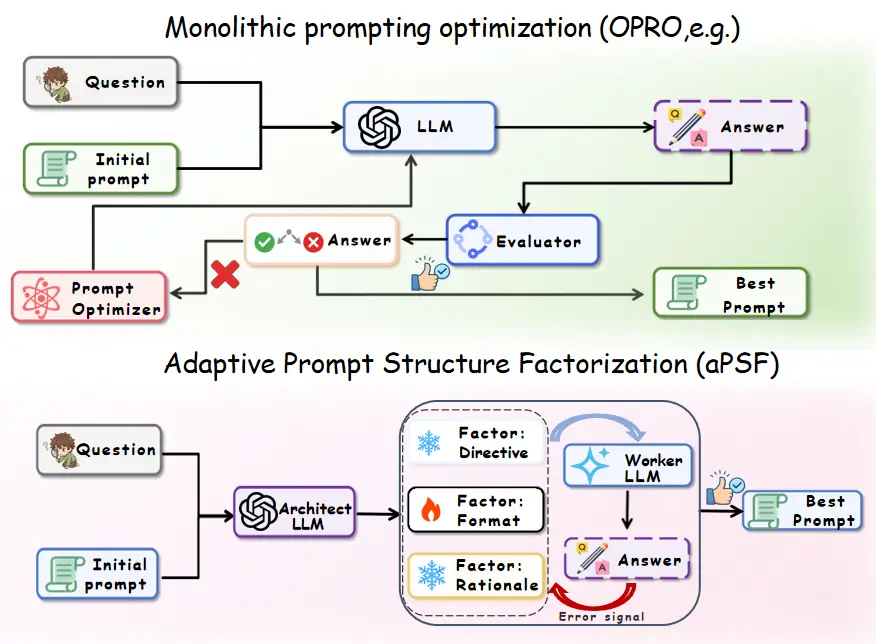
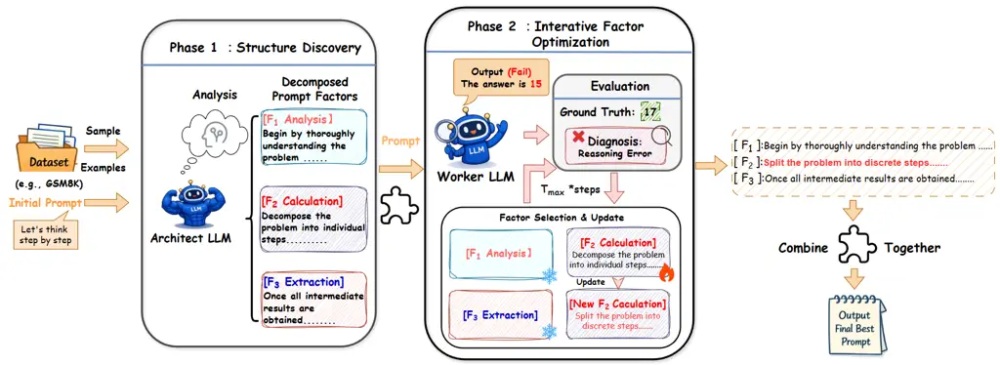
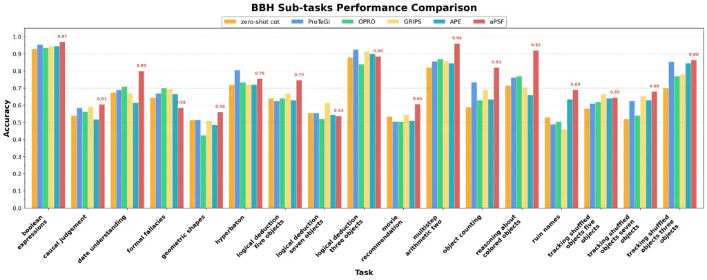
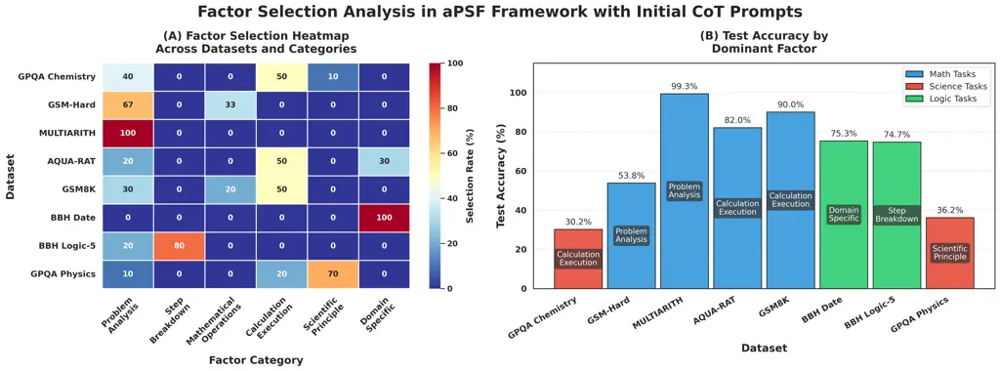
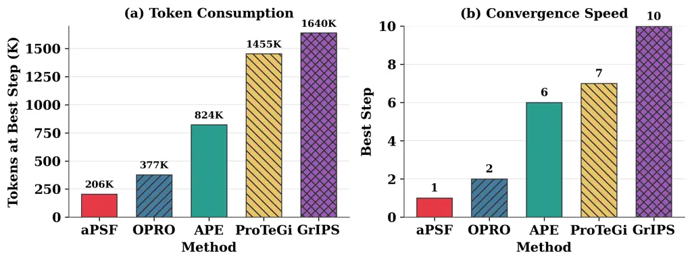
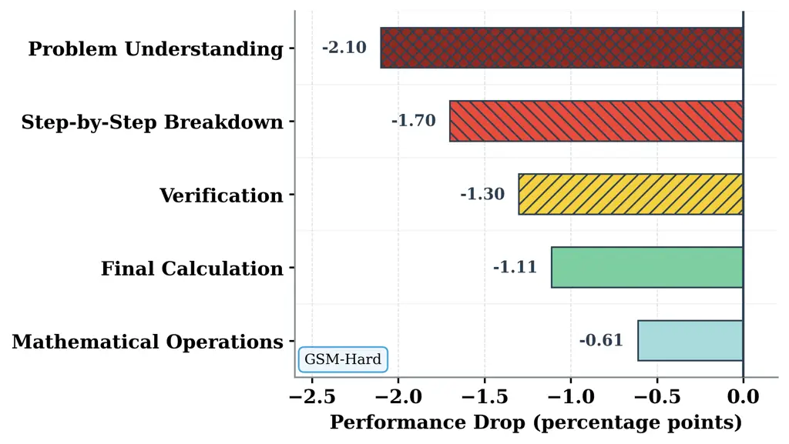
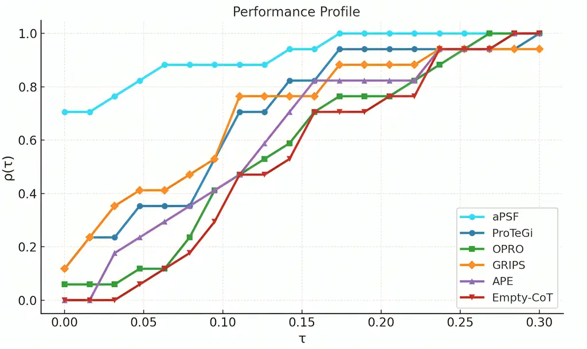
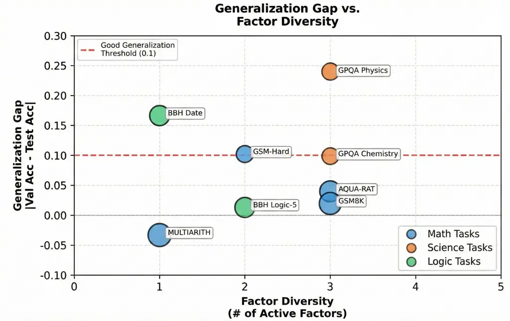
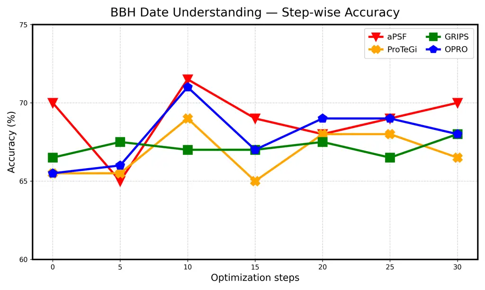

# Adaptive Prompt Structure Factorization: A Framework for Self-Discovering and Optimizing Compositional Prompt Programs

Haoyue Liu Affiliation: The Chinese University of Hong Kong, Shenzhen
Email: [haoyueliu@link.cuhk.edu.cn](mailto:)    Zhichao Wang
Affiliation: The Chinese University of Hong Kong, Shenzhen
Email: [zhichaowang@link.cuhk.edu.cn](mailto:)    Yongxin Guo
Affiliation: Taobao and Tmall Group
Email: [haoranshou@link.cuhk.edu.cn](mailto:)    Haoran Shou
Affiliation: The Chinese University of Hong Kong, Shenzhen
Email: [guoyongxin.gyx@taobao.com](mailto:)    Xiaoying Tang
Email: [tangxiaoying@cuhk.edu.cn](mailto:)

###### Abstract

Automated prompt optimization is crucial for eliciting reliable
reasoning from large language models (LLMs), yet most API-only prompt
optimizers iteratively edit monolithic prompts, coupling components and
obscuring credit assignment, limiting controllability, and wasting
tokens. We propose Adaptive Prompt Structure Factorization (aPSF), an
API-only framework (prompt-in/text-out; no access to model internals)
that uses an _Architect_ model to discover task-specific prompt
structures as semantic factors. aPSF then performs interventional,
single-factor updates: _interventional factor-level scoring_ estimates
each factor’s marginal contribution via validation-performance changes,
and _error-guided factor selection_ routes updates to the current
dominant failure source for more sample-efficient optimization. Across
multiple advanced reasoning benchmarks, aPSF outperforms strong
baselines including principle-aware optimizers, improving accuracy by up
to +2.16 percentage points on average, and reduces optimization cost by
45–87% tokens on MultiArith while reaching peak validation in 1 step.

¹¹footnotetext: Corresponding author.²²footnotetext: Code available at
[https://github.com/luckyboyLiu/aPSF](https://github.com/luckyboyLiu/aPSF)

## 1 Introduction



Figure 1: Monolithic prompt optimization vs. aPSF. Top: monolithic
API-only prompt optimizers iteratively edit a single prompt. Bottom:
aPSF decomposes the prompt into semantic factors and updates selected
factors while freezing the rest.

Large language models (LLMs) exhibit strong capabilities in reasoning,
coding, and complex generation (Achiam et al., 2023; Wei et al., 2022;
Kojima et al., 2022; Wang et al., 2022; Brown et al., 2020), yet their
performance is highly sensitive to prompt design (Zhao et al., 2021; Liu
et al., 2023). Under API-only (query-only) access, prompt optimizers
typically improve performance by iteratively editing a prompt and
selecting candidates by validation score (Zhou et al., 2022; Yang
et al., 2023; Pryzant et al., 2023; Fernando et al., 2023; Guo et al.,
2023; Deng et al., 2022; Tang et al., 2025). Early approaches such as
APE (Zhou et al., 2022) and OPRO (Yang et al., 2023) treat the prompt as
a holistic, indivisible string, proposing and selecting entirely new
prompts at each iteration. Figure 1 contrasts monolithic prompt editing
with aPSF’s factor-wise optimization. However, prompt-level edits to a
monolithic prompt have three limitations. First, coupled edits obscure
which prompt component caused an improvement, complicating credit
assignment. Second, monolithic prompts offer weak controllability,
preventing selective freezing of constraint-critical parts such as
output schemas. Third, because a single mutation often perturbs multiple
functional roles at once, many trials are confounded and rejected for
unrelated reasons, wasting query budget and slowing convergence.

In practice, effective prompts often behave like _compositional
programs_ with semantic factors (e.g., task interpretation, reasoning
procedure, output format, verification) (White, 2023). Edit-based
optimizers such as ProTeGi (Pryzant et al., 2023) and GrIPS (Prasad
et al., 2023) partially address this by applying localized mutations.
However, without an explicit, persistent factorization, their
optimization and selection still operate at the level of the full
prompt, leaving credit assignment implicit and limiting selective
freezing. These limitations motivate our central question: _Can we
automatically induce a task-specific prompt factorization and optimize
factors independently, enabling explicit credit assignment and adaptive
allocation of the query budget?_

To bridge this gap, we introduce _Adaptive Prompt Structure
Factorization (aPSF)_, a two-phase framework for API-only prompt
optimization that incorporates: (1) adaptive structure discovery, where
an Architect LLM induces a task-specific factor schema and initializes
factor contents (optionally conditioned on a user-provided initial
prompt); and (2) interventional factor optimization, where we edit one
factor at a time and use error-guided factor selection to route updates
to the current bottleneck factor.

##### Contributions.

Building on this framework, our contributions are fourfold. (1) We first
decompose prompts into task-specific semantic factors, enabling precise,
surgical single-factor edits while freezing the remaining factors. Under
strictly API-only access, this factorization enables factor-level
meta-attribution, effectively opening the black box of prompt
engineering. (2) We propose _interventional factor-level scoring_ to
quantify the marginal contribution of each component, transforming
prompt optimization into a traceable diagnostic process that directly
maps refinement decisions to observed validation failures. (3) We
develop an _error-guided factor selection_ strategy that adaptively
routes the black-box query budget to identified bottleneck factors,
thereby maximizing sample efficiency and optimization stability. (4)
Across six reasoning benchmarks, aPSF consistently outperforms strong
baselines and yields more stable and interpretable optimization
trajectories.

## 2 Related Work

##### API-only prompt optimization.

Gradient-based methods such as AutoPrompt (Shin et al., 2020), Prompt
Tuning (Lester et al., 2021), and Prefix-Tuning (Li and Liang, 2021)
require white-box access and thus are unsuitable for API-based models.
API-only optimizers therefore rely on prompt-level search and editing,
e.g., APE (Zhou et al., 2022), OPRO (Yang et al., 2023),
ProTeGi (Pryzant et al., 2023), and GrIPS (Prasad et al., 2023). While
candidate generation can be holistic or localized, these methods
typically operate on a monolithic prompt and select candidates at the
whole-prompt level, leaving component-level credit assignment implicit
and limiting controllability. Recent principle-aware methods such as
CriSPO (He et al., 2025) and ZERA (Yi et al., 2025) improve upon
monolithic editing by generating structured critiques or evolving
principles to guide prompt refinement. However, these principles serve
as _evaluation criteria_ for feedback generation rather than an explicit
_edit space_: the optimization still proposes and selects whole-prompt
candidates, limiting factor-level attribution and selective freezing. To
address these limitations without changing the API-only setting, aPSF
introduces an explicit factorized representation and optimizes via
interventional, single-factor substitutions, making improvements
attributable and controllable, even under tight query budgets.

##### Programmatic prompting and modular pipelines.

Frameworks such as DSPy (Khattab et al., 2024) and SAMMO (Schnabel and
Neville, 2024) optimize prompts and demonstrations within a
user-specified program scaffold, while modularization/faceting work
studies decomposition under predefined taxonomies or rules (Yao et al.,
2023; Juneja et al., 2025). These approaches improve prompts within a
designer-provided scaffold, but optimization and selection remain
end-to-end at the program level, yielding limited component-wise
attribution under query-only feedback. In contrast, aPSF automatically
induces the scaffold as semantic factors and optimizes via single-factor
interventions with explicit attribution, enabling selective freezing
(e.g., output format).

##### Related optimization techniques.

Bandit-style allocation (Auer et al., 2002) and self-refinement
methods (Madaan et al., 2023; Shinn et al., 2023; Chen et al., 2024)
motivate adaptive routing and iterative improvement. However, most prior
approaches treat the prompt/output as the unit of action, making it
difficult to localize which component should be revised under query-only
signals. aPSF instead routes updates over _prompt factors_ via
error-guided selection and applies interventional single-factor edits.

## 3 Adaptive Prompt Structure Factorization

We now detail aPSF’s factorized prompt representation and optimization
procedure (Figure 2); pseudocode for Phase 2 is provided in Algorithm 1
(Appendix A).



Figure 2: Overview of aPSF. Given a dataset of sampled examples and an
optional initial prompt, aPSF proceeds in two phases. (1) Structure
Discovery: the Architect LLM analyzes the task and decomposes the prompt
into $`K`$ semantic factors $`\{F_{k}\}_{k=1}^{K}`$ (task-specific
factorization, rather than a fixed scaffold). (2) Iterative Factor
Optimization: the Worker LLM executes the composed prompt; an evaluator
returns scores and representative failure cases, which are summarized
into an error diagnosis (e.g., _reasoning error_: 15 vs 17). Conditioned
on the diagnosis, the architect model selects a bottleneck factor for a
_single-factor_ update while freezing the remaining factors, yielding
attributable, interventional prompt edits and returning the
best-performing prompt within $`T_{\max}`$ steps.

### 3.1 Problem Setup and Notation

Let $`\mathcal{D}_{\mathrm{val}}`$ and $`\mathcal{D}_{\mathrm{test}}`$
denote the validation and test sets, where each example is a pair
$`(q,y)`$ of query $`q`$ and ground-truth answer $`y`$. We denote by
$`p`$ a prompt, by $`M_{W}(q;p)`$ the Worker LLM’s output on $`q`$ under
$`p`$, and by $`s(\cdot,\cdot)`$ a task-specific scoring function. We
denote by $`T`$ the task description and by $`\mathcal{X}`$ optional
exemplars.

##### Standard objective.

Most API-only prompt optimizers cast prompt search as maximizing a
validation score. We define the empirical score of prompt $`p`$ on
dataset $`\mathcal{D}`$ as

```math
\hat{S}(p,\mathcal{D})\triangleq\frac{1}{|\mathcal{D}|}\sum_{(q,y)\in\mathcal{D}}s(M_{W}(q;p),y). \tag{1}
```

We optimize prompts on $`\mathcal{D}_{\mathrm{val}}`$ via query-only
evaluation and report results on the held-out
$`\mathcal{D}_{\mathrm{test}}`$:

```math
p^{\star}=\argmax_{p}\;\hat{S}(p,\mathcal{D}_{\mathrm{val}}). \tag{2}
```

##### Traditional monolithic optimization and limitations.

Existing API-only prompt optimizers typically treat $`p`$ as a single
string and apply global edits (Zhou et al., 2022; Yang et al., 2023;
Pryzant et al., 2023; Prasad et al., 2023). At step $`t`$,
$`\mathrm{Edit}(p^{(t)};T,\mathcal{X})`$ proposes candidates
$`\mathcal{C}^{(t)}`$ and updates
$`p^{(t{+}1)}=\argmax_{c\in\mathcal{C}^{(t)}}\hat{S}(c,\mathcal{D}_{\mathrm{val}})`$.
This design has two limitations: (1) global edits couple semantic
components, obscuring credit assignment; (2) coupling prevents
selectively freezing components (e.g., output format) and induces a
large, unstructured search space.

##### Addressing the limitations via factorization.

To address the above limitations, we represent a prompt $`p`$ as an
ordered list of $`K`$ (task-adaptive) semantic factors. Let
$`\mathcal{G}=(\mathcal{F}_{1},\ldots,\mathcal{F}_{K})`$ denote the
ordered factor schema, where each $`\mathcal{F}_{k}`$ specifies one
factor role, and let $`B=(f_{1},\ldots,f_{K})`$ be the corresponding
factor texts. We assemble $`p`$ by concatenation in schema order:

```math
p=\mathrm{Assemble}(B)\triangleq\mathrm{concat}(f_{1},f_{2},\ldots,f_{K}), \tag{3}
```

where $`\mathrm{concat}(\cdot)`$ joins the text blocks with newline
delimiters.

##### Inducing task-specific factors.

Instead of committing to a fixed taxonomy, we use an Architect LLM
$`M_{A}`$ to induce task-specific semantic factors from
$`(T,\mathcal{X})`$. In principle, factorized prompt optimization
jointly chooses schema $`\mathcal{G}`$ and contents $`B`$:

```math
\mathcal{G}^{*},B^{*}=\argmax_{\mathcal{G},B}\hat{S}(\mathrm{Assemble}(B),\mathcal{D}_{\mathrm{val}}). \tag{4}
```

This joint search is intractable; we instead obtain an initialization
$`(\mathcal{G},B^{(0)})`$ via one-pass meta-prompted generation from
$`M_{A}`$ (Appendix C).

### 3.2 Phase 1: Adaptive Structure Discovery

In Phase 1, the Architect LLM induces an ordered factor schema
$`\mathcal{G}`$ and initializes the factor contents $`B^{(0)}`$. We
support two operational modes for structure discovery:

##### From-scratch mode.

Given task description $`T`$ and optional exemplars $`\mathcal{X}`$, the
Architect LLM $`M_{A}`$ autonomously proposes a factor schema
$`\mathcal{G}`$ (defining roles and sequence) and initial content
$`B^{(0)}`$:

```math
\displaystyle\mathcal{G} \displaystyle=M_{A}(p_{\mathrm{struct}}^{\mathrm{meta}};T,\mathcal{X}), \tag{5}
```

```math
\displaystyle B^{(0)} \displaystyle=M_{A}(p_{\mathrm{factorinit}}^{\mathrm{meta}};\mathcal{G},T,\mathcal{X}). \tag{6}
```

We denote by $`p_{\mathrm{struct}}^{\mathrm{meta}}`$ and
$`p_{\mathrm{factorinit}}^{\mathrm{meta}}`$ the meta-prompts for schema
induction and factor initialization (Appendix C).

##### Initial-prompt mode.

Let $`p_{\mathrm{init}}`$ denote an initial prompt provided by the user
(e.g., “Let’s think step by step”). aPSF analyzes its core reasoning
approach and generates a task-specific extension. The Architect
receives:

```math
\mathcal{G},B^{(0)}=M_{A}(p_{\mathrm{analyze}}^{\mathrm{meta}};p_{\mathrm{init}},T,\mathcal{X}), \tag{7}
```

where $`p_{\mathrm{analyze}}^{\mathrm{meta}}`$ instructs the architect
to: (1) understand the core reasoning approach of $`p_{\mathrm{init}}`$,
(2) generate a complete task-specific instruction embodying and
extending this approach, and (3) decompose it into independently
optimizable factors.

The meta-prompt additionally encourages preserving the initial prompt’s
reasoning style while producing a fluent, compact factorization
(Appendix C).

### 3.3 Phase 2: Interventional Factor Optimization

#### 3.3.1 Interventional Single-Factor Updates

##### Interventional factor-wise updates.

aPSF performs coordinate-style updates by performing a single-factor
edit while freezing the others, and evaluates candidates via controlled
substitutions.

Formally, let $`B^{(t)}`$ denote the factor contents at iteration $`t`$,
and $`p^{(t)}=\mathrm{Assemble}(B^{(t)})`$ be the current prompt. To
optimize factor $`\mathcal{F}_{k}`$, the Architect LLM $`M_{A}`$
proposes $`N`$ candidate edits
$`\mathcal{C}_{k}^{(t)}=\{c_{k}^{(j)}\}_{j=1}^{N}`$. We isolate each
candidate’s context-conditioned marginal contribution via contrastive
evaluation. Let $`B^{(t)}[k\leftarrow c]`$ replace factor $`k`$ by
$`c`$:

```math
\displaystyle p^{(t)}_{k\leftarrow c} \displaystyle=\mathrm{Assemble}(B^{(t)}[k\leftarrow c]), \tag{8}
```

```math
\displaystyle\mathrm{Score}(c) \displaystyle=\hat{S}(p^{(t)}_{k\leftarrow c},\mathcal{D}_{\mathrm{val}}), \tag{9}
```

where all other factors are held fixed. Let
$`\Delta\hat{S}(c)=\mathrm{Score}(c)-\hat{S}(p^{(t)},\mathcal{D}_{\mathrm{val}})`$
denote the validation-score gain of candidate $`c`$, and select the best
candidate edit
$`\hat{c}_{k}=\argmax_{c\in\mathcal{C}_{k}^{(t)}}\Delta\hat{S}(c)`$. We
accept the update if $`\Delta\hat{S}(\hat{c}_{k})\geq\delta`$ and run
for at most $`T_{\max}`$ steps, returning the best-performing prompt on
$`\mathcal{D}_{\mathrm{val}}`$. The complete procedure is detailed in
Algorithm 1 (Appendix A).

#### 3.3.2 Error-Guided Factor Selection

After a warm-start pass that optimizes each factor once, at each step
$`t`$ we evaluate the current prompt on $`\mathcal{D}_{\mathrm{val}}`$
and collect representative failure cases. We then summarize errors into
a lightweight error profile and provide it to the Architect $`M_{A}`$ to
select the bottleneck factor for the next update (e.g., Rationale for
reasoning failures, Format for formatting errors). Concretely, we use
$`M_{A}`$ with a fixed, task-agnostic meta-prompt to produce
_open-ended_ diagnoses for each failure (Appendix C.4); for reporting we
summarize the diagnoses into a lightweight error profile, while factor
selection conditions on representative samples and the full diagnosis.
This error-guided routing makes the optimization _adaptive_: the update
budget is dynamically reallocated to whichever factor is most
responsible for current failures. If the same factor is repeatedly
selected without improvement, $`M_{A}`$ may explore alternative factors
to avoid local optima. We stop early once
$`\hat{S}(p^{(t)},\mathcal{D}_{\mathrm{val}})=1`$; Figure 15 (Appendix)
provides an execution trace.

|                          |                              |                  |                  |                  |                |                                |                  |                  |                  |                |
| ------------------------ | ---------------------------- | ---------------- | ---------------- | ---------------- | -------------- | ------------------------------ | ---------------- | ---------------- | ---------------- | -------------- |
| Methods                  | Qwen2.5-7B-Instruct (Worker) |                  |                  |                  |                | Llama-3.1-8B-Instruct (Worker) |                  |                  |                  |                |
|                          | GSM8K                        | AQUA             | Multi            | Hard             | Avg            | GSM8K                          | AQUA             | Multi            | Hard             | Avg            |
| Zero-shot CoT            | 86.22$`\pm`$0.00             | 81.50$`\pm`$0.00 | 96.46$`\pm`$0.00 | 53.79$`\pm`$0.00 | 79.49          | 82.81$`\pm`$0.00               | 68.00$`\pm`$0.00 | 95.21$`\pm`$0.00 | 33.60$`\pm`$0.00 | 69.91          |
| Architect = Qwen3-8B     |                              |                  |                  |                  |                |                                |                  |                  |                  |                |
| OPRO                     | 87.63$`\pm`$1.85             | 77.00$`\pm`$3.42 | 98.75$`\pm`$0.38 | 53.60$`\pm`$2.91 | 79.25          | 84.95$`\pm`$1.67               | 64.50$`\pm`$4.23 | 96.46$`\pm`$0.52 | 33.62$`\pm`$3.58 | 69.88          |
| APE                      | 88.83$`\pm`$0.92             | 81.50$`\pm`$2.76 | 98.54$`\pm`$0.61 | 51.70$`\pm`$3.84 | 80.14          | 83.48$`\pm`$2.13               | 66.00$`\pm`$3.15 | 96.67$`\pm`$0.73 | 33.05$`\pm`$4.12 | 69.80          |
| ProTeGi                  | 88.43$`\pm`$1.53             | 79.50$`\pm`$3.89 | 98.54$`\pm`$0.44 | 53.88$`\pm`$2.36 | 80.09          | 81.07$`\pm`$2.78               | 62.50$`\pm`$4.51 | 96.46$`\pm`$0.68 | 33.52$`\pm`$3.27 | 68.39          |
| GrIPS                    | 88.16$`\pm`$2.14             | 80.50$`\pm`$2.93 | 98.54$`\pm`$0.57 | 52.56$`\pm`$3.45 | 79.94          | 83.55$`\pm`$1.89               | 69.00$`\pm`$3.67 | 96.67$`\pm`$0.49 | 32.86$`\pm`$4.38 | 70.52          |
| ZERA                     | 89.98$`\pm`$0.63             | 81.36$`\pm`$0.75 | 98.42$`\pm`$0.43 | 53.22$`\pm`$0.94 | 80.75          | 84.15$`\pm`$0.80               | 65.95$`\pm`$0.95 | 98.22$`\pm`$0.38 | 34.58$`\pm`$0.89 | 70.73          |
| CriSPO                   | 89.40$`\pm`$0.69             | 81.48$`\pm`$0.97 | 98.94$`\pm`$0.58 | 55.94$`\pm`$0.98 | 81.44          | 89.49$`\pm`$0.83               | 65.86$`\pm`$0.68 | 96.49$`\pm`$0.65 | 34.94$`\pm`$0.51 | 71.70          |
| aPSF                     | 90.03$`\pm`$0.71             | 82.50$`\pm`$1.83 | 99.30$`\pm`$0.32 | 54.77$`\pm`$1.94 | 81.65\_(+0.21) | 85.62$`\pm`$0.85               | 71.50$`\pm`$2.36 | 98.33$`\pm`$0.41 | 35.98$`\pm`$2.47 | 72.86\_(+1.16) |
| Architect = gpt-oss-120b |                              |                  |                  |                  |                |                                |                  |                  |                  |                |
| OPRO                     | 88.70$`\pm`$1.42             | 78.50$`\pm`$3.68 | 97.29$`\pm`$0.83 | 51.69$`\pm`$3.21 | 79.05          | 85.25$`\pm`$1.56               | 67.50$`\pm`$3.94 | 95.21$`\pm`$0.91 | 34.47$`\pm`$3.82 | 70.61          |
| APE                      | 87.36$`\pm`$2.31             | 80.00$`\pm`$2.84 | 86.46$`\pm`$2.15 | 54.55$`\pm`$2.67 | 77.09          | 80.20$`\pm`$2.45               | 64.00$`\pm`$4.27 | 96.88$`\pm`$0.64 | 31.07$`\pm`$4.53 | 68.04          |
| ProTeGi                  | 89.70$`\pm`$1.18             | 80.50$`\pm`$3.25 | 98.12$`\pm`$0.56 | 55.59$`\pm`$2.83 | 80.98          | 84.48$`\pm`$1.73               | 53.00$`\pm`$4.86 | 97.50$`\pm`$0.52 | 35.88$`\pm`$3.14 | 67.72          |
| GrIPS                    | 90.80$`\pm`$1.76             | 82.00$`\pm`$2.51 | 98.54$`\pm`$0.48 | 53.41$`\pm`$3.57 | 81.19          | 84.28$`\pm`$2.08               | 68.00$`\pm`$3.42 | 96.88$`\pm`$0.71 | 32.95$`\pm`$3.96 | 70.53          |
| ZERA                     | 89.55$`\pm`$0.60             | 80.31$`\pm`$0.75 | 99.59$`\pm`$0.89 | 52.63$`\pm`$0.85 | 80.52          | 89.69$`\pm`$0.21               | 68.43$`\pm`$0.51 | 98.15$`\pm`$0.78 | 34.70$`\pm`$0.84 | 72.74          |
| CriSPO                   | 90.11$`\pm`$0.73             | 80.99$`\pm`$0.65 | 99.35$`\pm`$0.51 | 51.25$`\pm`$0.53 | 80.43          | 90.13$`\pm`$0.89               | 65.13$`\pm`$0.84 | 97.90$`\pm`$1.10 | 35.16$`\pm`$1.15 | 72.08          |
| aPSF                     | 90.87$`\pm`$0.63             | 83.00$`\pm`$1.52 | 99.53$`\pm`$0.29 | 55.86$`\pm`$1.68 | 82.32\_(+1.13) | 86.22$`\pm`$0.78               | 72.50$`\pm`$2.18 | 97.92$`\pm`$0.36 | 42.96$`\pm`$2.31 | 74.90\_(+2.16) |

Table 1: Test accuracy (%) on math reasoning benchmarks
(mean$`{}_{\pm\text{std}}`$ over 5 runs; ). Multi = MultiArith; Hard =
GSM-Hard. All methods start from the same seed prompt (“Let’s think step
by step”). Bold = best; underline = second best. Light blue rows
highlight aPSF with gains in green.

## 4 Experiments

##### Experimental questions.

In this section, we conduct experiments to address the following
questions:

- •
  Q1: Can aPSF achieve competitive performance compared to strong
  API-only prompt optimizers under identical experimental conditions?
  See Section 4.2.
- •
  Q2: Does aPSF provide interpretable optimization behavior and
  component-level insights? See Section 4.3.1 and Section 4.3.
- •
  Q3: Does aPSF improve optimization efficiency, measured by total
  optimization tokens and steps to reach peak validation accuracy? See
  Section 4.4.
- •
  Q4: Can aPSF generalize across tasks and transfer prompts across
  related datasets? See Section 4.5.

### 4.1 Experimental Setup and Protocol

##### Benchmarks and baselines.

We evaluate on GSM8K (Cobbe et al., 2021), AQUA-RAT (Ling et al., 2017),
MultiArith (Roy and Roth, 2015), GSM-Hard (Gao et al., 2022),
BBH (Srivastava et al., 2023; Suzgun et al., 2023) (17 representative
sub-tasks), and MMLU (Hendrycks et al., 2020). We compare against
state-of-the-art API-only prompt optimizers: OPRO (Yang et al., 2023),
ProTeGi (Pryzant et al., 2023), APE (Zhou et al., 2022), GrIPS (Prasad
et al., 2023), ZERA (Yi et al., 2025), CriSPO (He et al., 2025), and the
unoptimized initial prompt baseline (Zero-shot CoT, i.e., using
$`p_{\mathrm{init}}`$ without optimization). All methods share the same
Worker model, optimization budget, and fixed 50-example validation
slice, and start from the same initial prompt $`p_{\mathrm{init}}`$; for
aPSF, the initial factorization step is included in $`T_{\max}`$. We
report final metrics on held-out test sets. Additional results on
Competition Mathematics (Hendrycks et al., 2021) and GPQA (Rein et al., 2024) are in Appendix G.



Figure 3: Per-task accuracy on BBH benchmarks. aPSF (red) achieves
dominant performance on arithmetic and symbolic reasoning tasks, such as
Multistep Arithmetic (0.96) and Boolean Expressions (0.97).

##### Models and hyperparameters.

We use Qwen2.5-7B-Instruct (Team et al., 2024) as the default Worker LLM
and Qwen3-8B (Yang et al., 2025) as the Architect LLM. We additionally
evaluate with Llama-3.1-8B-Instruct (Dubey et al., 2024) as Worker and
gpt-oss-120b (OpenAI, 2025) as Architect to test generalization.
Architect quality can affect optimization; we report results with
multiple Architects (Table 1). Throughout, we restrict ourselves to
query-only access (prompt in, text out), without using model internals
(e.g., gradients or logits). We run the Worker with temperature=0 for
deterministic scoring and set the Architect temperature to 0.7 to
encourage diverse candidate generation. Unless otherwise specified, we
use $`N{=}4`$ candidates per update (Appendix H), an acceptance
threshold $`\delta{=}1/|\mathcal{D}_{\mathrm{val}}|`$ (requiring at
least one additional correct validation example), and cap optimization
at $`T_{\max}{=}10`$ steps. We also instruct the Architect to prefer
concise factorizations to avoid over-fragmentation. The factorization is
induced by the Architect per task (Section 3.2). Due to stochasticity in
candidate generation, we run the full optimization pipeline 5 times and
report average test accuracy; all methods use the same protocol.
Complete configurations are provided in Appendix N.

### 4.2 Q1: aPSF Achieves the Best Accuracy Under Matched Budgets

We evaluate aPSF under matched API-only settings on (i) mathematical
reasoning benchmarks (Table 1), (ii) diverse BBH reasoning sub-tasks
(Figure 3), and (iii) a budget-matched comparison to programmatic
prompting (DSPy; Table 2). Additional results on MMLU are reported in
Appendix F. As shown in Table 1, Figure 3, and Table 2, we observe that:

|            |       |       |          |       |
| ---------- | ----- | ----- | -------- | ----- |
| Method     | GSM8K | AQUA  | GSM-Hard | MATH  |
| DSPy       | 89.83 | 81.00 | 51.59    | 52.80 |
| aPSF       | 90.03 | 82.50 | 54.77    | 56.00 |
| $`\Delta`$ | +0.20 | +1.50 | +3.18    | +3.20 |

Table 2: Comparison with DSPy under matched settings. MATH = Competition
Mathematics (Hendrycks et al., 2021).

1.  1.  Matched-performance: aPSF achieves the best Avg in all
        Worker/Architect settings on different benchmarks (Table 1),
        improving over the strongest baseline (including principle-aware
        methods CriSPO and ZERA) by up to +2.16pp and reaching 74.90% (vs
        72.74%) in the strongest setting.
2.  2.  Broad coverage: on BBH, aPSF shows consistent improvements across
        diverse reasoning patterns, with particularly strong margins on
        long-context, state-tracking tasks.
3.  3.  Programmatic baselines: under a controlled, budget-matched setup,
        aPSF outperforms DSPy across all datasets reported, suggesting
        advantages from task-adaptive factorization and error-guided updates
        beyond fixed program scaffolds.

#### 4.2.1 Q1-BBH: Complex Reasoning

We evaluate aPSF on 17 representative BBH sub-tasks covering arithmetic,
symbolic, logical, and temporal reasoning. Figure 3 reports per-task
accuracies against baselines.

aPSF delivers the largest gains on Multistep Arithmetic Two (+9.0pp vs
OPRO) and Reasoning about Colored Objects (+15.0pp), consistent with
improved long-context state tracking from factorizing the prompt into
separable components (e.g., step-wise reasoning and consistency checks).
Beyond these extremes, aPSF achieves high absolute accuracy on symbolic
and state-tracking tasks such as Boolean Expressions (0.97), Web of Lies
(0.905), and Tracking Shuffled Objects Three (0.86). It also improves
logical deduction (e.g., +4.5pp on Logical Deduction Three Objects).
This robustness is further reflected in the performance profile: within
10% of the best method ($`\tau{=}0.1`$), aPSF succeeds on 76% of BBH
tasks vs. 65% for OPRO (Figure 12).

#### 4.2.2 Q1-DSPy: Comparison to Programmatic Prompting



Figure 4: Factor selection patterns and performance. (A) Selection rate
heatmap grouped by semantic category (original names in Appendix K).
(B) Test accuracy and dominant factors per task (color indicates
domain).

We compare aPSF with DSPy (Khattab et al., 2024), a programmatic
prompting framework that compiles prompts and demonstrations for a
fixed, user-specified program scaffold. For a budget-matched setup, we
use a single ChainOfThought module and compile it with
BootstrapFewShotWithRandomSearch, running 10 trials ($`T_{\max}{=}10`$)
on the same validation slice, without finetuning or external data. Both
methods use the same Worker (Qwen2.5-7B-Instruct) and the same
compiler/optimizer LLM (Qwen3-8B) for prompt proposal/compilation. As
shown in Table 2, aPSF outperforms DSPy on all reported datasets, which
we attribute to task-adaptive factorization and error-guided updates
rather than DSPy’s fixed single-module scaffold. Programmatic systems
(e.g., SAMMO) and task-faceting methods (Juneja et al., 2025) are
discussed in Related Work but are not evaluated, as their interfaces and
scaffold assumptions conflict with our query-only setting.

|                      |       |             |                     |
| -------------------- | ----- | ----------- | ------------------- |
| Task                 | aPSF  | NoStructure | Gain ($`\uparrow`$) |
| GSM8K                | 90.03 | 89.55       | +0.48               |
| AQUA-RAT             | 82.50 | 79.50       | +3.00               |
| Date Understanding   | 80.00 | 74.00       | +6.00               |
| Web of Lies          | 90.50 | 85.30       | +5.20               |
| Movie Recommendation | 60.72 | 58.67       | +2.05               |
| Average              | 80.75 | 77.40       | +3.35               |

Table 3: System-level ablation. Task-specific factorization is critical
for logical reasoning tasks (e.g., Date Understanding), yielding
significant gains (+6.00pp) over fixed templates.

### 4.3 Q2: Routing Is Interpretable and Structure Matters

We analyze optimization behavior via routing patterns across tasks and
controlled ablations of structure, scheduling, and factor freezing
(Figure 4, Table 3, Figure 6, Table 4, Table 6). As shown, we observe
that:

1.  1.  Interpretable routing: error-guided factor selection yields
        task-adaptive factor usage aligned with domain needs (e.g., math
        emphasizes Problem Analysis/Calculation Execution; science
        emphasizes Scientific Principle), and the dominant factors correlate
        with strong per-task accuracy (Figure 4).
2.  2.  Structure matters: removing task-specific factorization
        (NoStructure) causes a sizable average drop (3.35pp) and
        disproportionately hurts format-sensitive BBH tasks, indicating
        generic templates miss critical procedural structure (Table 3).

    |              |           |           |                |
    | ------------ | --------- | --------- | -------------- |
    | Method       | GSM8K     | AQUA      | Average        |
    | Error-Guided | $`90.03`$ | 82.50     | 86.27\_(+1.53) |
    | Thompson     | 90.57     | $`78.00`$ | $`84.29`$      |
    | Round-robin  | $`90.03`$ | $`79.00`$ | $`84.52`$      |
    | Greedy       | $`89.97`$ | $`79.50`$ | $`84.74`$      |
    | Random       | $`89.80`$ | $`79.50`$ | $`84.65`$      |

    Table 4: Scheduler ablation on GSM8K and AQUA (Accuracy %).
    Error-Guided achieves the best average, while Thompson sampling
    shows higher variance across datasets.

3.  3.  Actionable components: factor-level knock-outs identify which
        components are bottlenecks (Figure 6), and scheduler ablations show
        error-guided factor selection improves stability and average
        accuracy versus alternative update strategies (Table 4).
4.  4.  Single-factor updates: unfrozen multi-factor edits degrade accuracy
        by an average of 1.03pp, confirming that freezing non-target factors
        improves credit assignment and optimization stability (Table 6).

#### 4.3.1 Q2-Routing: Adaptive Patterns Across Tasks

We analyze how error-guided factor selection allocates optimization
effort across tasks (Figure 4).

##### Task-adaptive optimization.

Figure 4 shows task-specific routing patterns: math concentrates on
Problem Analysis/Calculation Execution, logic relies on Step Breakdown
or Domain Specific factors, and science emphasizes Scientific Principle.
Dominant factors align with stronger test accuracy, indicating
domain-specific factor priorities. Discovered schemas and trajectories
are in Appendix K (Tables 13 and 14) and Appendix S (Figures 14 and 15).

#### 4.3.2 Q2-Ablations: Component Knock-Outs

We analyze component importance via system-level structure and
factor-level sensitivity.

|            |                |       |            |          |       |
| ---------- | -------------- | ----- | ---------- | -------- | ----- |
| Source     | Target Dataset |       |            |          |       |
|            | GSM8K          | AQUA  | MultiArith | GSM-Hard | MATH  |
| MultiArith | 89.76          | 81.50 | –          | 52.98    | 52.80 |
| GSM8K      | –              | 82.00 | 99.30      | 54.08    | 51.60 |
| GSM-Hard   | 89.27          | 80.50 | 99.30      | –        | 51.00 |
| AQUA       | 90.31          | –     | 99.30      | 53.78    | 52.20 |
| Same-task  | 90.03          | 82.50 | 99.30      | 54.77    | 56.00 |

Table 5: Cross-task transfer results. Prompts optimized on source tasks,
evaluated on targets. Last row: same-task baseline. MATH = Competition
Mathematics (Hendrycks et al., 2021).

##### System-level: Impact of Structure.

We compare against NoStructure, a fixed template without task-specific
factorization. As shown in Table 3, accuracy drops by 3.35pp on average:
the effect is small on GSM8K ($`-0.48`$pp) but larger on
format-sensitive BBH tasks (e.g., Date Understanding: 80.0$`\to`$74.0,
$`-6.0`$pp), indicating generic templates miss procedural structure.

##### Factor-level: Fine-grained Sensitivity.

Fig. 6 masks individual factors on GSM-Hard. Removing _Problem
Understanding_ causes the largest drop ($`-2.10`$pp), while
_Mathematical Operations_ has a smaller effect ($`-0.61`$pp), suggesting
the Worker handles much of the arithmetic internally.

#### 4.3.3 Q2-Scheduler: Ablations

We compare error-guided factor selection with Round-robin, Thompson
Sampling, and Greedy under identical settings (Table 4). Error-Guided
achieves the best average across GSM8K and AQUA (86.27%), while Thompson
sampling attains the highest GSM8K score but degrades on AQUA,
indicating higher variance. This supports the claim that adaptive factor
selection based on step-level error analysis improves stability without
sacrificing overall quality.

#### 4.3.4 Q2-Freezing: Single-Factor vs. Multi-Factor Updates

To validate the single-factor update mechanism, we compare aPSF’s
default frozen single-factor updates against an unfrozen variant that
allows edits to modify multiple factors per step. Under the same budget
($`T_{\max}{=}10`$), Worker/Architect setup, and evaluation protocol,
the unfrozen variant consistently underperforms (Table 6).

|                    |        |          |                     |
| ------------------ | ------ | -------- | ------------------- |
| Dataset            | Frozen | Unfrozen | Gain ($`\uparrow`$) |
| AQUA-RAT           | 82.50  | 81.50    | +1.00               |
| MultiArith         | 99.30  | 97.08    | +2.22               |
| GSM-Hard           | 54.77  | 54.36    | +0.41               |
| Date Understanding | 80.00  | 79.50    | +0.50               |
| Average            | 79.14  | 78.11    | +1.03               |

Table 6: Frozen (single-factor) vs. unfrozen (multi-factor) updates.
Freezing non-target factors yields higher accuracy by preventing
credit-assignment noise from coupled edits.

When factors are unfrozen, edits spill over to adjacent factors,
confounding credit assignment and producing noisier trajectories. This
confirms that single-factor interventions improve stability and
attribution, corroborating the coordinate-descent design in
Section 3.3.1.

### 4.4 Q3: aPSF Reaches Peak Validation in 1 Step with 45–87% Fewer Tokens

We analyze efficiency on MultiArith (Figure 5) along two axes: _total
optimization tokens_ and _steps-to-best_ (the number of optimization
iterations until the run attains its maximum validation accuracy). Total
optimization tokens include both Architect generation (structure
discovery and candidate proposals) and Worker evaluation (validation
inference) across all steps. As shown in Figure 5, we observe that:

1.  1.  Token efficiency: aPSF reaches peak validation accuracy with 206K
        tokens (45–87% fewer than baselines).
2.  2.  Convergence speed: aPSF reaches peak validation accuracy at step 1
        (vs. 6–10 steps for others).
3.  3.  Generalization: This efficiency advantage generalizes across
        datasets; on GSM8K, AQUA, and GSM-Hard, aPSF consistently reaches
        peak validation earlier with 36–55% fewer tokens than OPRO and ZERA
        (Appendix R.5).



Figure 5: Optimization efficiency on MultiArith. (a) Token consumption;
(b) Convergence steps (lower is better).



Figure 6: Factor-level ablation on GSM-Hard. Bars show performance drop
when each factor is removed.

### 4.5 Q4: Prompts Transfer Across Related Arithmetic Tasks

Table 5 evaluates cross-task transfer by applying prompts optimized on a
source dataset to other targets. As shown in Table 5, we observe that:

1.  1.  Transfer is strong among related arithmetic tasks, sometimes
        matching or slightly exceeding same-task baselines.
2.  2.  More distant or harder targets exhibit larger drops, indicating
        task-specific bottlenecks remain.

## 5 Conclusion

We introduce Adaptive Prompt Structure Factorization (aPSF), which
automatically discovers a task-specific prompt factorization and
optimizes it via single-factor interventions and error-guided factor
selection. Across mathematical and logical reasoning benchmarks, aPSF
delivers consistent gains and improves controllability and factor-level
attribution over monolithic prompt editing.

## 6 Limitations

Our framework has three main limitations. First, the quality of
structure discovery and error diagnosis relies on the capabilities of
the Architect LLM; weaker models may induce suboptimal factorizations.
Second, our interventional factor-level scoring assumes partial
independence between factors. While this isolates marginal contributions
for clean credit assignment, it may underestimate complex synergies
between coupled factors (as discussed in Section 4.3.2). Finally, our
evaluation is currently limited to text-based reasoning benchmarks,
leaving multimodal or tool-augmented scenarios for future exploration.

## 7 Ethical Considerations

aPSF is a general prompt-optimization framework and could be misused to
optimize prompts for harmful or policy-violating objectives, depending
on the underlying model and usage context. Our study focuses on
established public reasoning benchmarks and does not collect new user
data or involve human subjects. In practice, responsible use should
follow applicable platform policies and safety filters, and any released
code or prompts should include usage guidelines that discourage harmful
applications.

## References

- Achiam et al. (2023) Josh Achiam, Steven Adler, Sandhini Agarwal, Lama
  Ahmad, Ilge Akkaya, Florencia Leoni Aleman, Diogo Almeida, Janko
  Altenschmidt, Sam Altman, Shyamal Anadkat, et al. 2023. Gpt-4
  technical report. _arXiv preprint arXiv:2303.08774_.
- Auer et al. (2002) Peter Auer, Nicolo Cesa-Bianchi, and Paul
  Fischer. 2002. Finite-time analysis of the multiarmed bandit problem.
  _Machine learning_, 47(2):235–256.
- Brown et al. (2020) Tom Brown, Benjamin Mann, Nick Ryder, Melanie
  Subbiah, Jared D Kaplan, Prafulla Dhariwal, Arvind Neelakantan, Pranav
  Shyam, Girish Sastry, Amanda Askell, et al. 2020. Language models are
  few-shot learners. _Advances in neural information processing
  systems_, 33:1877–1901.
- Chen et al. (2024) Yongchao Chen, Jacob Arkin, Yilun Hao, Yang Zhang,
  Nicholas Roy, and Chuchu Fan. 2024. Prompt optimization in multi-step
  tasks (promst): Integrating human feedback and heuristic-based
  sampling. _arXiv preprint arXiv:2402.08702_.
- Cobbe et al. (2021) Karl Cobbe, Vineet Kosaraju, Mohammad Bavarian,
  Mark Chen, Heewoo Jun, Lukasz Kaiser, Matthias Plappert, Jerry Tworek,
  Jacob Hilton, Reiichiro Nakano, et al. 2021. Training verifiers to
  solve math word problems. _arXiv preprint arXiv:2110.14168_.
- Deng et al. (2022) Mingkai Deng, Jianyu Wang, Cheng-Ping Hsieh, Yihan
  Wang, Han Guo, Tianmin Shu, Meng Song, Eric Xing, and Zhiting
  Hu. 2022. Rlprompt: Optimizing discrete text prompts with
  reinforcement learning. In _Proceedings of the 2022 Conference on
  Empirical Methods in Natural Language Processing_, pages 3369–3391.
- Dubey et al. (2024) Abhimanyu Dubey, Abhinav Jauhri, Abhinav Pandey,
  Abhishek Kadian, Ahmad Al-Dahle, Aiesha Letman, Akhil Mathur, Alan
  Schelten, Amy Yang, Angela Fan, et al. 2024. The llama 3 herd of
  models. _arXiv preprint arXiv:2407.21783_.
- Fernando et al. (2023) Chrisantha Fernando, Dylan Banarse, Henryk
  Michalewski, Simon Osindero, and Tim Rocktäschel. 2023. Promptbreeder:
  Self-referential self-improvement via prompt evolution. _arXiv
  preprint arXiv:2309.16797_.
- Gao et al. (2022) Luyu Gao, Aman Madaan, Shuyan Zhou, Uri Alon,
  Pengfei Liu, Yiming Yang, Jamie Callan, and Graham Neubig. 2022. Pal:
  Program-aided language models. _arXiv preprint arXiv:2211.10435_.
- Guo et al. (2023) Qingyan Guo, Rui Wang, Junliang Guo, Bei Li, Kaitao
  Song, Xu Tan, Guoqing Liu, Jiang Bian, and Yujiu Yang. 2023.
  Connecting large language models with evolutionary algorithms yields
  powerful prompt optimizers. _arXiv preprint arXiv:2309.08532_.
- He et al. (2025) Han He, Qianchu Liu, Lei Xu, Chaitanya Shivade,
  Yi Zhang, Sundararajan Srinivasan, and Katrin Kirchhoff. 2025. Crispo:
  Multi-aspect critique-suggestion-guided automatic prompt optimization
  for text generation. In _Proceedings of the AAAI Conference on
  Artificial Intelligence_, volume 39, pages 24014–24022.
- Hendrycks et al. (2020) Dan Hendrycks, Collin Burns, Steven Basart,
  Andy Zou, Mantas Mazeika, Dawn Song, and Jacob Steinhardt. 2020.
  Measuring massive multitask language understanding. _arXiv preprint
  arXiv:2009.03300_.
- Hendrycks et al. (2021) Dan Hendrycks, Collin Burns, Saurav Kadavath,
  Akul Arora, Steven Basart, Eric Tang, Dawn Song, and Jacob
  Steinhardt. 2021. Measuring mathematical problem solving with the math
  dataset. _arXiv preprint arXiv:2103.03874_.
- Juneja et al. (2025) Gurusha Juneja, Gautam Jajoo, Hua Li, Jian Jiao,
  Nagarajan Natarajan, and Amit Sharma. 2025. Task facet learning: A
  structured approach to prompt optimization. In _Findings of the
  Association for Computational Linguistics: ACL 2025_, pages
  23473–23496.
- Khattab et al. (2024) Omar Khattab, Arnav Singhvi, Paridhi Maheshwari,
  Zhiyuan Zhang, Keshav Santhanam, Saiful Haq, Ashutosh Sharma, Thomas T
  Joshi, Hanna Moazam, Heather Miller, et al. 2024. Dspy: Compiling
  declarative language model calls into state-of-the-art pipelines. In
  _The Twelfth International Conference on Learning Representations_.
- Kojima et al. (2022) Takeshi Kojima, Shixiang Shane Gu, Machel Reid,
  Yutaka Matsuo, and Yusuke Iwasawa. 2022. Large language models are
  zero-shot reasoners. _Advances in neural information processing
  systems_, 35:22199–22213.
- Lester et al. (2021) Brian Lester, Rami Al-Rfou, and Noah
  Constant. 2021. The power of scale for parameter-efficient prompt
  tuning. _arXiv preprint arXiv:2104.08691_.
- Li and Liang (2021) Xiang Lisa Li and Percy Liang. 2021.
  Prefix-tuning: Optimizing continuous prompts for generation. _arXiv
  preprint arXiv:2101.00190_.
- Ling et al. (2017) Wang Ling, Dani Yogatama, Chris Dyer, and Phil
  Blunsom. 2017. Program induction by rationale generation: Learning to
  solve and explain algebraic word problems. _arXiv preprint
  arXiv:1705.04146_.
- Liu et al. (2023) Pengfei Liu, Weizhe Yuan, Jinlan Fu, Zhengbao Jiang,
  Hiroaki Hayashi, and Graham Neubig. 2023. Pre-train, prompt, and
  predict: A systematic survey of prompting methods in natural language
  processing. _ACM computing surveys_, 55(9):1–35.
- Madaan et al. (2023) Aman Madaan, Niket Tandon, Prakhar Gupta, Skyler
  Hallinan, Luyu Gao, Sarah Wiegreffe, Uri Alon, Nouha Dziri, Shrimai
  Prabhumoye, Yiming Yang, Shashank Gupta, Bodhisattwa Prasad Majumder,
  Katherine Hermann, Sean Welleck, Amir Yazdanbakhsh, and Peter
  Clark. 2023. [Self-refine: Iterative refinement with
  self-feedback](http://arxiv.org/abs/2303.17651).
- OpenAI (2025) OpenAI. 2025. [gpt-oss-120b & gpt-oss-20b model
  card](http://arxiv.org/abs/2508.10925).
- Prasad et al. (2023) Archiki Prasad, Peter Hase, Xiang Zhou, and Mohit
  Bansal. 2023. Grips: Gradient-free, edit-based instruction search for
  prompting large language models. In _Proceedings of the 17th
  Conference of the European Chapter of the Association for
  Computational Linguistics_, pages 3845–3864.
- Pryzant et al. (2023) Reid Pryzant, Dan Iter, Jerry Li, Yin Tat Lee,
  Chenguang Zhu, and Michael Zeng. 2023. Automatic prompt optimization
  with" gradient descent" and beam search. _arXiv preprint
  arXiv:2305.03495_.
- Rein et al. (2024) David Rein, Betty Li Hou, Asa Cooper Stickland,
  Jackson Petty, Richard Yuanzhe Pang, Julien Dirani, Julian Michael,
  and Samuel R Bowman. 2024. Gpqa: A graduate-level google-proof q&a
  benchmark. In _First Conference on Language Modeling_.
- Roy and Roth (2015) Subhro Roy and Dan Roth. 2015. Solving general
  arithmetic word problems. In _Proceedings of the 2015 conference on
  empirical methods in natural language processing_, pages 1743–1752.
- Schnabel and Neville (2024) Tobias Schnabel and Jennifer
  Neville. 2024. Prompts as programs: A structure-aware approach to
  efficient compile-time prompt optimization. _arXiv preprint
  arXiv:2404.02319_.
- Shin et al. (2020) Taylor Shin, Yasaman Razeghi, Robert L Logan IV,
  Eric Wallace, and Sameer Singh. 2020. Autoprompt: Eliciting knowledge
  from language models with automatically generated prompts. _arXiv
  preprint arXiv:2010.15980_.
- Shinn et al. (2023) Noah Shinn, Federico Cassano, Ashwin Gopinath,
  Karthik Narasimhan, and Shunyu Yao. 2023. Reflexion: Language agents
  with verbal reinforcement learning. _Advances in Neural Information
  Processing Systems_, 36:8634–8652.
- Srivastava et al. (2023) Aarohi Srivastava, Abhinav Rastogi, Abhishek
  Rao, Abu Awal Md Shoeb, Abubakar Abid, Adam Fisch, Adam R Brown, Adam
  Santoro, Aditya Gupta, Adrià Garriga-Alonso, et al. 2023. Beyond the
  imitation game: Quantifying and extrapolating the capabilities of
  language models. _Transactions on machine learning research_.
- Suzgun et al. (2023) Mirac Suzgun, Nathan Scales, Nathanael Schärli,
  Sebastian Gehrmann, Yi Tay, Hyung Won Chung, Aakanksha Chowdhery, Quoc
  Le, Ed Chi, Denny Zhou, et al. 2023. Challenging big-bench tasks and
  whether chain-of-thought can solve them. In _Findings of the
  Association for Computational Linguistics: ACL 2023_, pages
  13003–13051.
- Tang et al. (2025) Xinyu Tang, Xiaolei Wang, Wayne Xin Zhao, Siyuan
  Lu, Yaliang Li, and Ji-Rong Wen. 2025. Unleashing the potential of
  large language models as prompt optimizers: Analogical analysis with
  gradient-based model optimizers. In _Proceedings of the AAAI
  Conference on Artificial Intelligence_, volume 39, pages 25264–25272.
- Team et al. (2024) Qwen Team et al. 2024. Qwen2 technical report.
  _arXiv preprint arXiv:2407.10671_, 2(3).
- Wang et al. (2022) Xuezhi Wang, Jason Wei, Dale Schuurmans, Quoc Le,
  Ed Chi, Sharan Narang, Aakanksha Chowdhery, and Denny Zhou. 2022.
  Self-consistency improves chain of thought reasoning in language
  models. _arXiv preprint arXiv:2203.11171_.
- Wei et al. (2022) Jason Wei, Xuezhi Wang, Dale Schuurmans, Maarten
  Bosma, Fei Xia, Ed Chi, Quoc V Le, Denny Zhou, et al. 2022.
  Chain-of-thought prompting elicits reasoning in large language models.
  _Advances in neural information processing systems_, 35:24824–24837.
- White (2023) J White. 2023. A prompt pattern catalog to enhance prompt
  engineering with chatgpt. _arXiv preprint arXiv:2302.11382_.
- Yang et al. (2025) An Yang, Anfeng Li, Baosong Yang, Beichen Zhang,
  Binyuan Hui, Bo Zheng, Bowen Yu, Chang Gao, Chengen Huang, Chenxu Lv,
  et al. 2025. Qwen3 technical report. _arXiv preprint
  arXiv:2505.09388_.
- Yang et al. (2023) Chengrun Yang, Xuezhi Wang, Yifeng Lu, Hanxiao Liu,
  Quoc V Le, Denny Zhou, and Xinyun Chen. 2023. Large language models as
  optimizers. In _The Twelfth International Conference on Learning
  Representations_.
- Yao et al. (2023) Shunyu Yao, Dian Yu, Jeffrey Zhao, Izhak Shafran,
  Tom Griffiths, Yuan Cao, and Karthik Narasimhan. 2023. Tree of
  thoughts: Deliberate problem solving with large language models.
  _Advances in neural information processing systems_, 36:11809–11822.
- Yi et al. (2025) Seungyoun Yi, Minsoo Khang, and Sungrae Park. 2025.
  Zera: Zero-init instruction evolving refinement agent–from zero
  instructions to structured prompts via principle-based optimization.
  In _Proceedings of the 2025 Conference on Empirical Methods in Natural
  Language Processing_, pages 23334–23348.
- Zhao et al. (2021) Zihao Zhao, Eric Wallace, Shi Feng, Dan Klein, and
  Sameer Singh. 2021. Calibrate before use: Improving few-shot
  performance of language models. In _International conference on
  machine learning_, pages 12697–12706. PMLR.
- Zhou et al. (2022) Yongchao Zhou, Andrei Ioan Muresanu, Ziwen Han,
  Keiran Paster, Silviu Pitis, Harris Chan, and Jimmy Ba. 2022. Large
  language models are human-level prompt engineers. In _The eleventh
  international conference on learning representations_.

## Appendix A Detailed Algorithms

Phase 2 algorithm follows.

1: Input: Factor schema $`\mathcal{G}`$, initial content $`B^{(0)}`$,
validation set $`\mathcal{D}_{\mathrm{val}}`$

2: Hyperparams: $`N`$, $`T_{\max}`$, $`\delta`$ (acceptance threshold),
$`P`$ (patience)

3: Let $`K\leftarrow|\mathcal{G}|`$;
$`\text{best\_B}\leftarrow B^{(0)}`$;
$`\text{best\_score}\leftarrow\hat{S}(\mathrm{Assemble}(B^{(0)}),\mathcal{D}_{\mathrm{val}})`$;
$`u\leftarrow 0`$. $`\triangleright`$ $`u`$: no-improve counter

4: for $`t=0,1,\ldots,T_{\max}-1`$ do

5:   if $`t<K`$ then

6:    $`k\leftarrow t+1`$ $`\triangleright`$ Warm-start: optimize each
factor once sequentially

7:   else

8:    Collect errors on $`\mathcal{D}_{\mathrm{val}}`$ using current
prompt $`p^{(t)}=\mathrm{Assemble}(B^{(t)})`$

9:    Use $`M_{A}`$ to produce open-ended diagnoses for representative
failures and summarize them into a lightweight error profile

10:
   $`k\leftarrow M_{A}(p_{\mathrm{diagnose}}^{\mathrm{meta}};\{\text{errors}\},\mathcal{G},p^{(t)})`$
$`\triangleright`$ Error-guided factor selection (conditions on
diagnoses + samples)

11:   end if

12:
  $`\mathcal{C}_{k}^{(t)}\leftarrow M_{A}(p_{\mathrm{edit}}^{\mathrm{meta}};f_{k}^{(t)},\mathcal{G})`$
$`\triangleright`$ Architect proposes candidates

13:   for each $`c\in\mathcal{C}_{k}^{(t)}`$ do

14:
   $`p^{(t)}_{k\leftarrow c}\leftarrow\mathrm{Assemble}(B^{(t)}[k\leftarrow c])`$
$`\triangleright`$ Substitute factor $`k`$

15:
   $`\Delta\hat{S}(c)\leftarrow\hat{S}(p^{(t)}_{k\leftarrow c},\mathcal{D}_{\mathrm{val}})-\hat{S}(\mathrm{Assemble}(B^{(t)}),\mathcal{D}_{\mathrm{val}})`$

16:   end for

17:
  $`\hat{c}\leftarrow\argmax_{c\in\mathcal{C}_{k}^{(t)}}\Delta\hat{S}(c)`$; $`r\leftarrow\Delta\hat{S}(\hat{c})`$

18:   if $`r\geq\delta`$ then

19:    $`B^{(t{+}1)}\leftarrow B^{(t)}[k\leftarrow\hat{c}]`$
$`\triangleright`$ Accept edit if gain $`\geq\delta`$

20:   else

21:    $`B^{(t{+}1)}\leftarrow B^{(t)}`$ $`\triangleright`$ Keep current

22:   end if

23:
  $`s\leftarrow\hat{S}(\mathrm{Assemble}(B^{(t{+}1)}),\mathcal{D}_{\mathrm{val}})`$

24:   if $`s>\text{best\_score}`$: $`\text{best\_score}\leftarrow s`$,
$`\text{best\_B}\leftarrow B^{(t{+}1)}`$, $`u\leftarrow 0`$; else
$`u\leftarrow u+1`$

25:   if $`s=1`$ or $`u\geq P`$ then break $`\triangleright`$ Perfect
val or early stop

26: end for

27: return best_B

Algorithm 1 Phase 2: Factor-wise Optimization (Error-Guided Factor
Selection)

## Appendix B Reproducibility Checklist

We provide comprehensive experimental details to ensure full
reproducibility of our results:

- •
  Datasets: All benchmark names, sources, and official split information
  are provided in Appendix Q. Validation and test splits are fixed
  across all methods and random seeds. We provide exact indices used for
  validation/test partitioning.
- •
  Model Configurations: Complete model specifications are detailed in
  Appendix N. Worker and Architect LLM configurations remain identical
  across all experiments unless explicitly noted otherwise.
- •
  Evaluation Protocol: All methods use identical worker models,
  validation slice size (50 examples), decoding settings (see
  Appendix N), and candidate count $`N{=}4`$. Complete protocol details
  in Appendix O.
- •
  Meta-Prompts: Full meta-prompts for structure discovery (both
  from-scratch and initial-prompt modes), factor-wise editing,
  open-ended error diagnosis, and factor selection are provided in
  Appendix C.
- •
  Hyperparameters: All hyperparameters with sensitivity analysis:
  candidates per update $`N{=}4`$, acceptance threshold
  $`\delta{=}1/|\mathcal{D}_{\mathrm{val}}|`$; maximum iterations
  $`T_{\max}{=}10`$. Sensitivity analysis in Appendix H.
- •
  Random Seeds: Due to Architect stochasticity (temperature=0.7), we run
  5 independent optimization runs and report mean test accuracy. Worker
  inference is deterministic (temperature=0.0). Fixed seed 42 for data
  splits.
- •
  Computational Resources: Hardware and software stack specifications
  (GPU/CPU/RAM/OS) in Appendix P.
- •
  Use of AI Assistants: We used an AI assistant solely for English
  proofreading and stylistic polishing. All technical content,
  experiments, and conclusions were produced and verified by the
  authors.
- •
  Code and Artifacts Release: Code and artifacts are publicly available
  at
  [https://github.com/luckyboyLiu/aPSF](https://github.com/luckyboyLiu/aPSF)
  under the MIT license, including: (1) complete source code with
  documentation, (2) data loaders for all benchmarks, (3) unified
  evaluation and scoring pipeline, (4) checkpoint-based resume support,
  and (5) configuration for multiple LLM backends (OpenAI-compatible,
  Ollama, vLLM).

## Appendix C Meta-Prompts

This section presents the complete meta-prompts used for structure
discovery, factor-wise optimization, and error-guided factor selection.
All meta-prompts are designed to be model-agnostic.

### C.1 Structure Discovery (From-Scratch Mode)

This meta-prompt instructs the Architect LLM to autonomously discover
task-specific factor structures.


Figure 7: Meta-prompt for From-Scratch Structure Discovery. It enforces
a strict four-section output format to ensure reliable parsing of the
factor structure.

### C.2 Initial-Prompt Analysis and Extension

This meta-prompt enables aPSF to start from a user-provided initial
prompt and systematically extend it.


Figure 8: Meta-prompt for Initial-Prompt Analysis. It guides the
Architect to preserve the core reasoning style of the user’s input while
expanding it into a full factorized program.

### C.3 Factor-Wise Edit Generation

This meta-prompt guides the Architect LLM to generate diverse candidate
edits while avoiding overfitting to specific errors.


Figure 9: Meta-prompt for Factor-Wise Editing. It provides error
analysis as reference while explicitly preventing overfitting through
general-purpose constraints.


Figure 10: Meta-prompt for Step 1: Open-Ended Error Diagnosis. It
enables unbiased identification of root causes and failure mechanisms
prior to targeted prompt optimization.


Figure 11: Meta-prompt for Step 2: Factor Selection. It maps diagnosed
errors to specific factors, with history-aware recommendations to
encourage balanced exploration when a single factor is repeatedly
selected.

### C.4 Error Diagnosis and Factor Selection

aPSF uses a two-stage error analysis pipeline: (1) open-ended error
diagnosis and (2) diagnosis-conditioned factor selection. See Figures 10
and 11 for the complete meta-prompts.

### C.5 Meta-Prompt Design Principles

Our meta-prompts follow these design principles:

##### Clarity and specificity.

Each meta-prompt clearly defines the task, provides explicit formatting
requirements, and includes concrete examples where helpful.

##### Constraint specification.

We specify both positive requirements (what to do) and negative
constraints (what to avoid), reducing ambiguity in LLM responses.

##### Structured output.

All meta-prompts enforce structured output formats using delimiters
(e.g., ===, ---), enabling reliable parsing.

##### Few-shot guidance.

Initial-prompt analysis includes a concrete example showing the
input-output transformation, improving Architect LLM performance.

##### Factor-type awareness.

Edit meta-prompt provides type-specific guidance for different factor
types (Instruction, Examples, Rationale, etc.), tailoring optimization
strategies.

## Appendix D Detailed BBH Results

Table 7 highlights five sub-tasks where aPSF achieves exceptional
performance (accuracy $`\geq`$ 86%) and significant margins over the
strongest baselines. Notably, on Multistep Arithmetic Two, aPSF achieves
96.0% accuracy compared to 87.0% for OPRO, demonstrating the power of
separating calculation from formatting.

|                                 |      |         |      |       |      |               |
| ------------------------------- | ---- | ------- | ---- | ----- | ---- | ------------- |
| BBH Sub-task                    | aPSF | ProTeGi | OPRO | GrIPS | APE  | Zero-shot CoT |
| boolean_expressions             | 97.0 | 95.5    | 93.5 | 94.5  | 94.5 | 93.0          |
| multistep_arithmetic_two        | 96.0 | 86.0    | 87.0 | 86.0  | 84.0 | 81.0          |
| reasoning_about_colored_objects | 92.0 | 76.0    | 77.0 | 71.0  | 66.0 | 72.0          |
| web_of_lies                     | 90.5 | 85.0    | 84.0 | 86.0  | 85.5 | 81.5          |
| tracking_shuffled_objects_three | 86.0 | 85.0    | 77.0 | 78.0  | 84.0 | 70.0          |
| Average (Top-5)                 | 92.3 | 85.5    | 83.7 | 83.1  | 82.8 | 79.5          |

Table 7: Top-performing BBH sub-tasks. aPSF demonstrates decisive
advantages on arithmetic, boolean logic, and object tracking tasks,
validating the efficacy of the Format and Rationale factors.

## Appendix E Performance Profile Analysis



Figure 12: Performance profile on BBH sub-tasks. aPSF (red) exhibits the
steepest curve and highest plateau, indicating it most frequently
achieves near-optimal performance across tasks. At $`\tau{=}0.1`$
(within 10% of best), aPSF succeeds on 76% of tasks vs. 65% for OPRO.
Empty-CoT denotes the initial prompt baseline without prompt
optimization.

Figure 12 shows performance profiles across the 17 BBH sub-tasks we
evaluate. The performance profile plots the fraction of tasks where each
method achieves accuracy within a factor $`\tau`$ of the best method.
aPSF exhibits the steepest curve and highest plateau, indicating it most
frequently achieves near-optimal performance. At $`\tau{=}0.1`$ (within
10% of best), aPSF succeeds on 76% of tasks compared to 65% for OPRO,
demonstrating superior robustness across diverse reasoning categories.

## Appendix F MMLU Results

To evaluate aPSF on knowledge-intensive tasks, we test on
MMLU (Hendrycks et al., 2020) (5-shot, 57 subjects). Table 8 shows aPSF
achieves the best overall average (76.29%), with strongest improvement
on Humanities (+6.18pp) and Other (+1.10pp), though it does not lead in
Social Sciences or STEM categories.

MMLU Results

|                 |       |       |       |         |       |               |                             |
| --------------- | ----- | ----- | ----- | ------- | ----- | ------------- | --------------------------- |
| Category        | aPSF  | OPRO  | GrIPS | ProTeGi | APE   | Zero-shot CoT | $`\Delta`$ vs Best Baseline |
| Humanities      | 67.98 | 61.80 | 60.91 | 60.84   | 59.31 | 55.25         | +6.18                       |
| Social Sciences | 80.04 | 80.70 | 81.19 | 80.34   | 79.94 | 70.83         | -1.15                       |
| STEM            | 76.75 | 77.80 | 77.54 | 77.12   | 75.98 | 66.42         | -1.05                       |
| Other           | 80.37 | 78.60 | 78.35 | 79.27   | 77.08 | 68.91         | +1.10                       |
| Overall Avg.    | 76.29 | 74.72 | 74.50 | 74.39   | 73.08 | 65.35         | +1.57                       |

Table 8: MMLU accuracy (%) across four disciplinary categories. aPSF
achieves best overall average (76.29%) with strongest gains on
Humanities (+6.18pp) and Other (+1.10pp), though trailing in Social
Sciences and STEM. $`\Delta`$ vs Best Baseline = aPSF’s difference from
the strongest non-aPSF baseline in each category (green=aPSF wins,
red=aPSF loses). Light blue highlights indicate category winners; purple
row emphasizes overall average.

## Appendix G Additional Benchmark Results: GPQA and Competition Math

We further evaluate aPSF on scientific reasoning (GPQA (Rein et al.,
2024)) and advanced mathematical reasoning (Competition
Mathematics (Hendrycks et al., 2021), 500 test samples). Table 9 shows
aPSF achieves consistent improvements on these challenging benchmarks.

|            |      |      |      |         |       |
| ---------- | ---- | ---- | ---- | ------- | ----- |
|            | aPSF | OPRO | APE  | ProTeGi | GrIPS |
| Comp. Math | 56.0 | 51.6 | 54.0 | 54.0    | 55.0  |
| GPQA-Chem  | 30.2 | 23.8 | 20.6 | 19.1    | 28.6  |
| GPQA-Phys  | 45.9 | 44.3 | 41.0 | 39.3    | 39.3  |

Table 9: Test accuracy (%) on Competition Math and GPQA. Comp. Math =
Competition Mathematics; Chem = Chemistry; Phys = Physics. aPSF achieves
best on all benchmarks.

## Appendix H Hyperparameter Sensitivity Analysis

We evaluate aPSF’s sensitivity to the candidate count $`N`$ per factor
update on the challenging GSM-Hard benchmark. As shown in Table 10,
performance does not increase monotonically with $`N`$.

|               |              |                     |
| ------------- | ------------ | ------------------- |
| Count ($`N`$) | GSM-Hard (%) | Trend               |
| 2             | 52.78        | Under-exploration   |
| 4             | 54.77        | Optimal Balance     |
| 6             | 53.88        | Diminishing Returns |
| 8             | 50.80        | Overfitting / Noise |

Table 10: Sensitivity to candidate count $`N`$ on GSM-Hard. Performance
peaks at $`N=4`$, while larger $`N`$ degrades performance.

Analysis:

- •
  Under-exploration ($`N=2`$): Limited candidates fail to uncover
  effective local edits, resulting in suboptimal performance (52.78%).
- •
  Optimal Balance ($`N=4`$): This setting achieves the peak accuracy
  (54.77%), effectively balancing exploration width with selection
  stability.
- •
  Overfitting Risk ($`N\geq 6`$): Contrary to the intuition that “more
  is better,” increasing $`N`$ to 8 causes a significant drop to 50.80%.
  We hypothesize that a larger candidate pool increases the likelihood
  of finding “false positives” prompts that exploit artifacts in the
  small validation slice (50 examples) but fail to generalize to the
  test set. Thus, we adopt $`N=4`$ as the robust default.

## Appendix I From-Scratch Capability (No Initial Prompt)

Our main results use _initial-prompt mode_ (Section 4). Here we evaluate
aPSF in _from-scratch mode_, where the Architect discovers a factorized
prompt without any user-provided seed.

Table 11 compares the two aPSF modes directly.

|            |                |                |              |
| ---------- | -------------- | -------------- | ------------ |
| Benchmark  | aPSF (Initial) | aPSF (Scratch) | $`\Delta`$   |
| GSM-Hard   | 54.77          | 54.67          | $`-0.10`$    |
| AQUA-RAT   | 82.50          | 83.00          | $`+0.50`$    |
| MultiArith | 99.30          | 99.30          | $`\pm 0.00`$ |

Table 11: Comparison of aPSF in Initial-Prompt mode (“Let’s think step
by step”) vs. From-Scratch mode. Performance is comparable, confirming
that aPSF’s gains stem from the factorization mechanism rather than the
initial prompt.

##### Key findings.

- •
  Comparable performance: The two modes achieve nearly identical results
  across all three benchmarks, with differences within 0.5pp. This
  confirms that aPSF’s structure discovery is robust regardless of
  initialization.
- •
  From-scratch can match or exceed: On AQUA-RAT, from-scratch mode
  slightly outperforms initial-prompt mode (+0.50pp), suggesting that
  autonomously discovered structures can be as effective as human-guided
  ones.
- •
  Gains not solely from seed: These results confirm that aPSF’s
  improvements stem from the factorization and optimization mechanism
  itself, not merely from a privileged starting point.

## Appendix J Complete Factor Selection Statistics

Table 12 presents comprehensive factor selection statistics across all
evaluated tasks. The test accuracy figures align with the main results
reported in Section 4.2.

|                              |              |          |         |                       |                |
| ---------------------------- | ------------ | -------- | ------- | --------------------- | -------------- |
| Task                         | Test Acc (%) | Val Gain | Gen Gap | Dominant Factor       | Selection Rate |
| Mathematical Reasoning:      |              |          |         |                       |                |
| GSM8K                        | 90.03        | +0.0%    | 0.020   | Result Aggregation    | 50%            |
| AQUA-RAT                     | 82.50        | +10.3%   | 0.035   | Calculation Execution | 50%            |
| GSM-Hard                     | 54.77        | +10.3%   | 0.102   | Problem Understanding | 67%            |
| MultiArith                   | 99.30        | +0.0%    | -0.033  | Problem Analysis      | 100%           |
| Logical Reasoning (BBH):     |              |          |         |                       |                |
| Date Understanding           | 80.00        | +12.2%   | 0.167   | Time Difference Calc  | 100%           |
| Logical Deduction            | 75.00        | +8.6%    | 0.013   | Establishing Order    | 80%            |
| Scientific Reasoning (GPQA): |              |          |         |                       |                |
| Chemistry                    | 30.16        | +100%    | 0.098   | Reagent Evaluation    | 50%            |
| Physics                      | 45.90        | +200%    | 0.166   | Principle Application | 70%            |
| Biology                      | 50.00        | +0.0%    | 0.250   | Sci. Principle App.   | 50%            |
| High-Complexity Tasks:       |              |          |         |                       |                |
| AIME-2025                    | 8.33         | +100%    | 0.250   | Parse Problem         | 50%            |

Table 12: Complete factor selection statistics across all tasks. Test
Acc matches the main results using the default configuration
(Qwen2.5-7B-Instruct Worker + Qwen3-8B Architect). Val Gain = validation
improvement from initial to best; Gen Gap = difference between
validation and test accuracy.

##### Key observations from factor selection patterns.

- •
  Task-specific adaptation: Error-guided selection identifies
  domain-appropriate factors—mathematical tasks often prioritize
  Calculation or Problem Understanding, logic tasks focus on
  Step-by-Step reasoning, and scientific tasks emphasize Principle
  Application.
- •
  Selection Concentration: Tasks with 100% selection on a single factor
  indicate two distinct states: saturation (e.g., MultiArith, +0.0%
  gain) where the initial prompt is already optimal, or critical
  bottlenecking (e.g., BBH-Date, +12.2% gain) where one specific skill
  dictates performance.

  
  Figure 13: Generalization Gap vs. Factor Diversity. Visualizing the
  relationship between factor count and generalization gap (data from
  Table 12). Robust tasks (e.g., GSM8K, AQUA) maintain low gaps
  ($`<0.05`$) with balanced factors. High gaps in complex tasks (e.g.,
  GPQA) reflect intrinsic difficulty rather than optimization
  overfitting.

- •
  Generalization quality: As visualized in Figure 13, tasks with
  balanced factor distributions (20–50% each) exhibit lower
  generalization gaps (GSM8K: 0.020, AQUA: 0.035), whereas concentrated
  or high-complexity tasks correlate with higher gaps (AIME: 0.250).
- •
  Validation-test alignment: High validation gains (+100–200%) on
  challenging tasks (GPQA-Physics, AIME) indicate effective
  optimization, confirming that the framework can exploit headroom even
  when absolute accuracy remains limited by task difficulty.

## Appendix K Detailed Factor Names by Task

Table 13 presents the original, task-specific factor names discovered by
aPSF’s Architect LLM.

|                              |                                                                                                          |                                  |
| ---------------------------- | -------------------------------------------------------------------------------------------------------- | -------------------------------- |
| Task                         | Discovered Factor Names (Original)                                                                       | Top Factor (Rate)                |
| Mathematical Reasoning:      |                                                                                                          |                                  |
| GSM8K                        | StepByStepDecomposition, ComponentAnalysis, CalculationExecution, ResultAggregation                      | ResultAggregation (50%)          |
| AQUA-RAT                     | StepByStepReasoning, ProblemAnalysis, StepBreakdown, CalculationExecution, Verification, AnswerSelection | CalculationExecution (50%)       |
| GSM-Hard                     | ProblemUnderstanding, StepByStepBreakdown, MathematicalOperations, FinalCalculation, Verification        | ProblemUnderstanding (67%)       |
| MultiArith                   | StepByStepApproach, ProblemAnalysis, SequentialExecution, ResultValidation                               | ProblemAnalysis (100%)           |
| Logical Reasoning (BBH):     |                                                                                                          |                                  |
| Date Understanding           | StepByStepApproach, DateParsing, TimeDifferenceCalculation, CalendarRuleApplication, OptionVerification  | TimeDifferenceCalculation (100%) |
| Logical Deduction            | ParsingStatements, EstablishingOrder, EvaluatingOptions                                                  | EstablishingOrder (80%)          |
| Scientific Reasoning (GPQA): |                                                                                                          |                                  |
| Chemistry                    | ReactionAnalysis, ReagentEvaluation, ProductStability, StereochemistryConsideration, OptionElimination   | ReagentEvaluation (50%)          |
| Physics                      | ContextAnalysis, ParameterExtraction, PrincipleApplication, CalculationExecution, ValidationCheck        | PrincipleApplication (70%)       |
| Biology                      | ContextualInterpretation, ScientificPrincipleApplication, OptionEvaluation, Elimination&Justification    | Sci. Principle App. (50%)        |
| High-Complexity Tasks:       |                                                                                                          |                                  |
| AIME-2025                    | ParseProblem, IdentifyConcepts, BreakSubproblems, StepwiseReasoning, ValidateSteps, SynthesizeResults    | ParseProblem (50%)               |

Table 13: Original factor names autonomously discovered by aPSF. The
terminology adapts to the domain (e.g., Stereochemistry in Chemistry,
CalculationExecution in AQUA). Top Factor indicates the component most
frequently selected by the error-guided scheduler.

##### Semantic grouping for cross-task analysis.

For the heatmap visualization in Figure 4 (main text), we semantically
group task-specific factors into six general categories to enable
cross-task pattern comparison: (i) Problem Understanding (e.g.,
ProblemAnalysis, ComponentAnalysis, ParsingStatements),
(ii) Step-by-Step Breakdown (e.g., EstablishingOrder,
StepByStepBreakdown), (iii) Mathematical Operations (e.g.,
MathematicalOperations, FormulaUsage), (iv) Calculation Execution (e.g.,
CalculationExecution, TimeDifferenceCalculation), (v) Verification &
Validation (e.g., Verification, ResultValidation), and (vi) Result
Aggregation (e.g., ResultAggregation, AnswerSelection,
LogicalDeduction). This grouping preserves semantic intent while
enabling macro-level pattern analysis across diverse task domains.

## Appendix L Factor Discovery Examples

This section provides concrete examples of discovered factor structures
and illustrates the prompt transformation process.

#### L.0.1 Initial-Prompt Mode Extension Example

Starting from the baseline “Let’s think step by step” on GSM8K, the
Architect LLM analyzes the reasoning style and generates the following
extension:

> Extended Instruction: “Let’s think step by step, carefully analyzing
> the problem’s components and their relationships, performing each
> calculation with clear intermediate steps, and logically combining all
> results to arrive at the final answer.”

The system then decomposes this into independently optimizable factors:

- •
  $`\mathcal{F}_{1}`$-StepByStepDecomposition: “Let’s think step by
  step”
- •
  $`\mathcal{F}_{2}`$-ComponentAnalysis: “carefully analyzing the
  problem’s components and their relationships”
- •
  $`\mathcal{F}_{3}`$-CalculationExecution: “performing each calculation
  with clear intermediate steps”
- •
  $`\mathcal{F}_{4}`$-ResultAggregation: “logically combining all
  results to arrive at the final answer”

This demonstrates how aPSF preserves the core reasoning style while
injecting task-specific procedural guidance, enabling subsequent
factor-wise optimization.

#### L.0.2 BBH–Logical Deduction: A Complete Optimization Trace

We present a complete example on BBH–Logical Deduction (Five Objects), a
task requiring constraint parsing, order establishment, and option
verification. Starting from the same initial prompt baseline
(Zero-shot):

> Initial Prompt: “Let’s think step by step.”

The Architect LLM analyzes the task requirements (parsing comparative
statements like “A is before B”, building a global ordering chain) and
generates:

> Extended Instruction: “Carefully read the given statements and
> identify all comparative relationships between the items. Use these
> relationships to create a logical order of the items from highest to
> lowest. Then, evaluate each option against this order to determine
> which one is correct. When establishing the order, build the sequence
> incrementally by validating each comparative relationship against the
> current order and explicitly confirming chains of relationships (e.g.,
> A \< B \< C) step by step to prevent logical gaps.”

The system decomposes this into three semantic factors:

- •
  $`\mathcal{F}_{1}`$-ParsingStatements: “Carefully read the given
  statements and identify all comparative relationships between the
  items.”
- •
  $`\mathcal{F}_{2}`$-EstablishingOrder: “Use these relationships to
  create a logical order… build the sequence incrementally by validating
  each comparative relationship…”
- •
  $`\mathcal{F}_{3}`$-EvaluatingOptions: “Evaluate each option against
  this order to determine which one is correct.”

##### Error-guided optimization results.

During optimization, error analysis reveals that 80% of failures stem
from incorrect order establishment (e.g., missing transitive
relationships, premature chain termination). The error-guided selector
consequently prioritizes $`\mathcal{F}_{2}`$-EstablishingOrder across 8
of 10 optimization rounds. Key metrics:

|                             |                         |
| --------------------------- | ----------------------- |
| Metric                      | Value                   |
| Initial validation accuracy | 70.0%                   |
| Best validation accuracy    | 76.0%                   |
| Final test accuracy         | 74.67%                  |
| Validation improvement      | +8.6%                   |
| Generalization gap          | 0.013 (excellent)       |
| Dominant factor             | EstablishingOrder (80%) |

This example illustrates how aPSF automatically identifies task-specific
bottlenecks and focuses optimization effort accordingly.

#### L.0.3 Discovered Factor Structures by Task Type

Table 14 presents concrete factor structures autonomously discovered by
aPSF for diverse task types, illustrating adaptive factorization based
on task complexity. Note that factor names align with the terminology
identified in Table 13.

[TABLE]

Table 14: Factor structures discovered by aPSF. The factor names (e.g.,
ComponentAnalysis, CalculationExecution) correspond to the
domain-specific terminology cataloged in Appendix K.

## Appendix M Theoretical Analysis

We provide a formal intuition for why aPSF’s error-guided factor
selection outperforms fixed schedules, focusing on regret minimization
under non-stationary rewards.

### M.1 Problem Formulation

We view prompt optimization as a sequential decision process. At step
$`t`$, the Architect chooses a factor $`k\in\{1,\dots,K\}`$ to optimize.
Let $`\mu_{k}^{(t)}`$ be the potential improvement gain of factor $`k`$
at time $`t`$. The cumulative regret after $`T_{\max}`$ steps is:

```math
R(T_{\max})=\sum_{t=1}^{T_{\max}}\max_{k}(\mu_{k}^{(t)})-\sum_{t=1}^{T_{\max}}\mu_{k_{t}}^{(t)}, \tag{10}
```

where $`\max_{k}(\mu_{k}^{(t)})`$ is the gain of the optimal action
(Oracle).

### M.2 Why Error-Guided Factor Selection Wins

##### Fixed policies (Round-robin).

A round-robin policy selects $`k`$ uniformly, ignoring the current
state. If factor potentials are heterogeneous (e.g., Format is broken
while Instruction is perfect), fixed policies waste $`1-1/K`$ of the
budget on saturated factors, leading to linear regret.

##### Error-Guided Factor Selection as Contextual Bandits.

Our Error-Guided factor selection policy $`\pi`$ observes the current
error distribution $`\mathcal{E}^{(t)}`$ (Context) to select action
$`k`$. Under the assumption that the Architect’s diagnosis accuracy is
$`\rho>1/K`$, the policy prioritizes high-potential factors (e.g.,
fixing Format when format errors are high). This effectively creates a
shortcut to convergence:

```math
\mathbb{E}_{\pi}[\text{gain}]\approx\rho\cdot\mu_{\text{bottleneck}}^{(t)}+(1-\rho)\cdot\bar{\mu}^{(t)}. \tag{11}
```

By focusing on the bottleneck, $`R(T_{\max})`$ is minimized
significantly faster than round-robin, consistent with the rapid
convergence observed in the trajectory analysis (Figure 14 in
Appendix S).

### M.3 Independence Assumption and Complexity

aPSF optimizes factors iteratively (Coordinate Descent), assuming
partial independence: $`\hat{S}(A\cup B)\approx\hat{S}(A)+\hat{S}(B)`$.
While subtle factor interactions naturally exist (e.g., between
reasoning steps and formatting constraints), modeling the full joint
distribution would result in an exponential search space $`O(C^{K})`$
(where $`C`$ is the candidate count). By adopting the independence
assumption, aPSF reduces the complexity to linear
$`O(C\cdot K\cdot T_{\max})`$. This trade-off makes optimization
tractable for LLMs, as demonstrated by the strong empirical results
across diverse benchmarks.

### M.4 Convergence Properties Under Interventional Updates

Note: This section provides informal convergence arguments rather than
rigorous proofs.

Let $`B^{(t)}`$ denote the factor contents at iteration $`t`$, and
$`\hat{S}^{(t)}=\hat{S}(\mathrm{Assemble}(B^{(t)}),\mathcal{D}_{\mathrm{val}})`$
be the validation accuracy. aPSF’s update rule is:

```math
f_{k}^{(t+1)}=\begin{cases}\hat{c}_{k}&\text{if }\Delta\hat{S}(\hat{c}_{k})\geq\delta\\
f_{k}^{(t)}&\text{otherwise}\end{cases}, \tag{12}
```

where $`\hat{c}_{k}`$ is the best candidate proposed by the Architect
$`M_{A}`$, and $`\delta>0`$ is the acceptance threshold.

##### Monotonicity.

By construction, $`\hat{S}^{(t+1)}\geq\hat{S}^{(t)}`$ (non-decreasing
accuracy). Unlike non-contrastive methods that evaluate the whole prompt
blindly, aPSF accepts updates only if the isolated marginal contribution
$`\Delta\hat{S}\geq\delta`$. This strictly prevents regressions caused
by noisy edits.

##### Convergence Intuition.

Assuming a bounded factor space and a capable Architect $`M_{A}`$ that
generates diverse candidates, the system performs a hill-climbing search
(Coordinate Descent). Since the objective function is bounded
($`\hat{S}\in[0,1]`$) and the sequence is non-decreasing, the
optimization is expected to converge to a local maximum where no
single-factor edit yields improvement $`\geq\delta`$.

### M.5 Information-Theoretic Justification

Let $`\mathcal{E}^{(t)}`$ denote the distribution of validation errors
at step $`t`$ (e.g., 40% Arithmetic, 10% Format).

##### Information-Theoretic Intuition.

Ideally, we want to select the factor $`k`$ whose edits are most
informative about (and most likely to reduce) the current error modes.
Formally, this corresponds to maximizing mutual information
$`I(\mathcal{F}_{k};\mathcal{E}^{(t)})`$ between factor $`k`$ and the
error distribution. We do not estimate mutual information explicitly;
instead, our Error-Guided Factor Selection approximates this criterion
by using the Architect LLM to diagnose which factor is causally linked
to the dominant error types.

##### Connection to Contextual Bandits.

Standard prompt optimizers (like OPRO) often behave like Multi-Armed
Bandits (MAB), exploring factors to maximize reward. However, standard
MAB assumes stationary rewards. In prompt engineering, rewards are
non-stationary (fixing the Instruction changes the utility of fixing
Examples). aPSF treats this as a Contextual Bandit problem:

- •
  Context: Current error distribution $`\mathcal{E}^{(t)}`$.
- •
  Action: Select factor $`k`$.
- •
  Policy: The Architect maps context (e.g., "Format Error") to action
  (e.g., "Fix Factor 4").

This contextual awareness allows aPSF to "exploit" known bottlenecks
immediately, rather than wasting steps "exploring" saturated factors.
This explains the rapid convergence observed in the trajectory analysis
(Figure 14 in Appendix S).

## Appendix N Model Configurations

### N.1 LLM Specifications

To ensure reproducibility and accessibility, we primarily utilize
high-performance open-weight models. We distinguish between two roles:

##### Worker Models ($`M_{W}`$).

The worker executes the task based on the assembled prompt. We evaluate
two families:

- •
  Qwen2.5-7B-Instruct: This is a 7B parameter instruction-tuned model,
  context window up to 32K tokens, quantization: FP16.
- •
  Llama-3.1-8B-Instruct: This is an 8B parameter instruction-tuned
  model, context window up to 128K tokens, quantization: FP16.

##### Architect LLM ($`M_{A}`$).

The architect handles structure discovery, factor editing, and error
diagnosis. We employ stronger models for these meta-reasoning tasks:

- •
  Qwen3-8B: Used as the default Architect for most experiments due to
  its strong instruction-following capability.
- •
  gpt-oss-120b: A large-scale open-source model used in ablation studies
  to verify scalability. Accessed via API with temperature=0.7.

### N.2 Decoding Hyperparameters

All inference uses the settings detailed in Table 15, unless explicitly
varied.

|                          |                     |
| ------------------------ | ------------------- |
| Parameter                | Value               |
| Temperature              | 0.0 (deterministic) |
| Top-p (nucleus sampling) | 1.0 (disabled)      |
| Top-k                    | Not applied         |
| Max output tokens        | 8192                |
| Repetition penalty       | 1.0 (disabled)      |
| Stop sequences           | \["\n\n", "---"\]   |

Table 15: Decoding hyperparameters for Worker model inference
($`M_{W}`$). These settings apply to both prompt selection on
$`\mathcal{D}_{\mathrm{val}}`$ and final test evaluation.

For the Architect LLM ($`M_{A}`$) generating meta-level content (e.g.,
structure proposals, factor edits), we use temperature=0.7 to encourage
diversity while maintaining coherence.

##### Summary of Temperature Settings.

Worker ($`M_{W}`$): temperature=0.0 (deterministic) for all inference,
including both prompt selection and final test evaluation. Architect
($`M_{A}`$): temperature=0.7 to encourage diverse structure proposals.

## Appendix O Evaluation Protocol

### O.1 Data Splitting

For each benchmark, we utilize a small, fixed validation slice
($`|\mathcal{D}_{\mathrm{val}}|=50`$ examples) for prompt optimization
and a held-out test set for final evaluation, as detailed in Table 16:

|                |                  |           |
| -------------- | ---------------- | --------- |
| Dataset        | Validation Slice | Test Size |
| GSM8K          | 50               | 1,319     |
| AQUA-RAT       | 50               | 254       |
| MultiArith     | 50               | 180       |
| GSM-Hard       | 50               | 1006      |
| BBH (per task) | 50               | Variable  |

Table 16: Dataset splits. We use a fixed validation slice of 50 examples
per task for prompt optimization. Test sets follow official benchmarks
where available.

### O.2 Scoring Functions

##### Math benchmarks (GSM8K, AQUA, MultiArith, GSM-Hard).

We use exact-match accuracy: extract the final numerical answer using
regex patterns (e.g., “The answer is \d+”), normalize to remove
commas/units, and compare string equality with ground truth.

##### BBH and complex reasoning benchmarks.

For tasks with diverse answer formats (e.g., Yes/No, multiple choice
A–E, or free-form text), we use LLM-based answer extraction: a
lightweight LLM extracts the final answer from model outputs, which is
then compared against ground truth for exact-match accuracy. This
approach handles varied response formats more robustly than regex
patterns.

## Appendix P Computational Resources

All experiments run on the following infrastructure:

- •
  GPUs: 2$`\times`$ NVIDIA A100 80GB GPUs for worker inference
- •
  CPU: 64-core AMD EPYC 7763 @ 2.45GHz
- •
  RAM: 512GB DDR4
- •
  OS: Ubuntu 20.04 LTS, CUDA 11.8, PyTorch 2.0.1

## Appendix Q Datasets and Licenses

We summarize the benchmarks, task types, split sources, and license
details in Table 17. and include the following information for
reproducibility:

- •
  Download URLs: Provided in code release README.
- •
  Preprocessing: Scripts for answer normalization and format extraction
  are included in the supplementary material.
- •
  Version Control: Pinned commit hashes are used to ensure
  reproducibility.

|            |                                 |                         |
| ---------- | ------------------------------- | ----------------------- |
| Dataset    | Task Type                       | Reference               |
| GSM8K      | Math word problems              | Cobbe et al. (2021)     |
| AQUA-RAT   | Math multiple-choice questions  | Ling et al. (2017)      |
| MultiArith | Multi-step arithmetic reasoning | Roy and Roth (2015)     |
| GSM-Hard   | Hard math with large numbers    | Gao et al. (2022)       |
| MATH       | Competition mathematics         | Hendrycks et al. (2021) |
| BBH        | Diverse reasoning (17 tasks)    | Suzgun et al. (2023)    |
| GPQA       | Graduate-level science QA       | Rein et al. (2024)      |
| MMLU       | General knowledge (57 subjects) | Hendrycks et al. (2020) |

Table 17: Summary of evaluation benchmarks. All datasets are publicly
available.

## Appendix R Implementation Details

### R.1 Prompt Assembly

Factors are concatenated in the specified order via the
$`\mathrm{Assemble}`$ operation (Eq. 3), separated by newlines for
readability. Total prompt length is implicitly bounded by the worker
LLM’s context window (up to 32K tokens for Qwen2.5 per official
configuration); in practice, generated prompts rarely approach this
limit.

### R.2 Validation Slice Design

We use a fixed per-task validation slice for prompt optimization
(Appendix O).

### R.3 Stopping Criteria

aPSF terminates when: (i) $`T_{\max}`$ iterations are reached, or
(ii) validation performance has not improved for 3 consecutive
iterations (early stopping).

### R.4 Prompt Length Sensitivity Analysis

Prior work has shown that smaller language models are sensitive to
prompt length (Wei et al., 2022). To validate this, we conducted
ablation studies on prompt length using Llama-3.1-8B-Instruct (to test
generalization beyond our default Qwen model). Table 18 shows a clear
inverse relationship between prompt length and accuracy on GSM8K.

|                        |              |
| ---------------------- | ------------ |
| Prompt Length (tokens) | Accuracy (%) |
| 362                    | 89.62        |
| 500                    | 83.50        |
| 653                    | 80.55        |
| 1260                   | 76.47        |

Table 18: Impact of prompt length on Llama-3.1-8B-Instruct performance
(GSM8K). Accuracy degrades significantly as prompts exceed 500 tokens.

These findings suggest that prompt conciseness is particularly important
for smaller models. In our main experiments, we do not impose explicit
length constraints in the meta-prompts, allowing the Architect LLM to
generate prompts of varying lengths; the factor-wise optimization
naturally tends to retain concise, effective phrasings through
performance-based selection.

### R.5 Extended Efficiency Analysis

We extend the efficiency analysis from MultiArith (Section 4.4) to four
datasets. Table 19 reports the token consumption at the best validation
step and the step number itself, under the default setup (Worker:
Qwen2.5-7B-Instruct; Architect: Qwen3-8B).

|         |                         |       |      |          |
| ------- | ----------------------- | ----- | ---- | -------- |
| Method  | Tokens at Best Step (K) |       |      |          |
|         | MultiArith              | GSM8K | AQUA | GSM-Hard |
| ProTeGi | 1455                    | 2143  | 1896 | 2850     |
| GrIPS   | 1640                    | 1932  | 1968 | 2378     |
| CriSPO  | 1050                    | 1612  | 1644 | 2268     |
| APE     | 824                     | 1206  | 948  | 1445     |
| ZERA    | 460                     | 910   | 529  | 1148     |
| OPRO    | 377                     | 850   | 593  | 1110     |
| aPSF    | 206                     | 491   | 336  | 648      |

|         |                            |       |      |          |
| ------- | -------------------------- | ----- | ---- | -------- |
| Method  | Best Step ($`\downarrow`$) |       |      |          |
|         | MultiArith                 | GSM8K | AQUA | GSM-Hard |
| GrIPS   | 10                         | 9     | 10   | 10       |
| ProTeGi | 7                          | 8     | 8    | 10       |
| CriSPO  | 5                          | 6     | 7    | 8        |
| APE     | 6                          | 7     | 6    | 8        |
| ZERA    | 3                          | 5     | 3    | 6        |
| OPRO    | 2                          | 4     | 3    | 5        |
| aPSF    | 1                          | 3     | 2    | 4        |

Table 19: Extended efficiency analysis across four datasets. Top: Token
consumption (K) at the best validation step. Bottom: Best step number
(lower = faster convergence). aPSF consistently reaches peak validation
with the fewest tokens and earliest steps.

aPSF reaches peak validation with 36–55% fewer tokens than OPRO and ZERA
across all datasets, confirming that the efficiency gains observed on
MultiArith generalize broadly.

## Appendix S Optimization Trajectory Analysis

We analyze the step-wise optimization process on the BBH Date
Understanding task. Figure 14 illustrates the validation accuracy
trajectory over 30 steps.



Figure 14: Step-wise optimization trajectory on BBH Date Understanding.
aPSF (red) achieves the highest peak accuracy ($`>`$71% at Step 10) and
maintains a leading position by Step 30. In contrast, monolithic methods
like OPRO (blue) and ProTeGi (orange) exhibit higher volatility or lower
convergence ceilings. Extended-budget analysis (30 steps) for
visualization only; main results use $`T_{\max}=10`$. All methods use
the same extended budget.

Key Observation: aPSF demonstrates rapid convergence, reaching its peak
performance early (Step 10). The acceptance threshold $`\delta`$ ensures
monotonic progress on validation accuracy—rejected candidates cause
plateau periods (e.g., Steps 5–8) rather than regressions. The
error-guided mechanism then identifies productive factors to resume
improvement, ultimately stabilizing at a higher accuracy level than
baselines like GrIPS (Green) or ProTeGi.

Step 1: Error Diagnosis (Snapshot) The Architect analyzes validation
failures and maps them to specific factors. \[Sample 7\] Error:
Misinterpreted algebraic expression. $`\to`$ Factor1_UnderstandProblem
(Conf: 0.92) \[Sample 11\] Error: Incorrect probability independence
assumption. $`\to`$ Factor2_SolveProblem (Conf: 0.92) \[Sample 31\]
Error: Output lengthy explanation instead of single letter. $`\to`$
Factor4_OutputAnswer (Conf: 0.93) \[Sample 43\] Error: Used incorrect
LCM method for rate problem. $`\to`$ Factor2_SolveProblem (Conf: 0.93) …
(analyzed 15 error samples in total)  Step 2: Aggregation & Selection
The system aggregates error counts to identify the critical bottleneck.
• Factor1_UnderstandProblem: 3 errors (20.0%) • Factor2_SolveProblem: 6
errors (40.0%) $`\leftarrow`$ SELECTED BOTTLENECK •
Factor3_SelectChoice: 3 errors (20.0%) • Factor4_OutputAnswer: 3 errors
(20.0%) Decision: Prioritize optimizing Factor2_SolveProblem due to
highest error frequency.  Step 3: Candidate Generation The Architect
generates targeted refinements for Factor 2. Old Factor 2: "Solve the
problem step by step." New Candidates: 1. "Work through the problem
methodically, applying relevant concepts and checking equations…" 2.
"Solve the problem by clearly stating the needed formulas, performing
calculation…" 3. "Break the question into parts, apply appropriate
reasoning, compute intermediate…" 4. "Use step-by-step deduction:
identify givens, apply relevant rules, simplify, and…"

Figure 15: Real-world execution trace of the Error-Guided Factor
Selection mechanism. The system identifies that 40% of errors stem from
reasoning flaws (SolveProblem), correctly prioritizing it over format or
understanding issues for this iteration.

## Appendix T Qualitative Analysis: Success and Failure Cases

Case 1: Integer Constraints on Quadratics (Sample 48) \[Success\]
Demonstrates rigorous algebraic manipulation and case enumeration.
Question: For how many integer values of $`a`$ does the equation
$`x^{2}+ax+5a=0`$ have integer solutions for $`x`$? aPSF Derivation
(Summary): 1. Applied Vieta’s formulas: $`p+q=-a,pq=5a`$. 2. Derived the
factorization equation: $`pq+5p+5q+25=25\implies(p+5)(q+5)=25`$. 3.
Enumerated all factor pairs of 25:
$`(1,25),(-1,-25),(5,5),(-5,-5),(25,1),(-25,-1)`$. 4. Solved for $`a`$
in each case and filtered distinct values: $`\{-16,36,0,20\}`$. aPSF
Answer:

```math
4
```

 Ground Truth: 4 ✓ Analysis: The structured prompt successfully guided
the model to perform a variable transformation and exhaustive
enumeration without hallucinating invalid pairs.  Case 2: Complex Roots
of Unity (Sample 49) \[Success\] Demonstrates handling of complex number
properties and polynomial coefficients. Question: Let
$`\omega^{7}=1,\omega\neq 1`$. $`\alpha=\omega+\omega^{2}+\omega^{4}`$,
$`\beta=\omega^{3}+\omega^{5}+\omega^{6}`$. Find $`(a,b)`$ for
$`x^{2}+ax+b=0`$. aPSF Derivation (Summary): 1. Identified property
$`\sum_{k=0}^{6}\omega^{k}=0\implies\sum_{k=1}^{6}\omega^{k}=-1`$. 2.
Calculated sum:
$`\alpha+\beta=\sum_{k=1}^{6}\omega^{k}=-1\implies a=-(\text{sum})=1`$. 3. Calculated product:
$`\alpha\beta=(\omega+\omega^{2}+\omega^{4})(\omega^{3}+\omega^{5}+\omega^{6})`$.
Expanded terms and simplified using $`\omega^{7}=1`$ to find
$`\alpha\beta=2\implies b=2`$. aPSF Answer:

```math
(1,2)
```

 Ground Truth: (1, 2) ✓ Analysis: The decomposition allowed the model to
maintain clarity during the complex expansion of $`\alpha\beta`$,
correctly identifying it as a sum of specific roots plus an integer. 
Case 3: Nested Complex Functions (Sample 47) \[Failure\] Demonstrates
limitation in handling high-complexity functional composition. Question:
Let $`f(z)=\frac{z+a}{z+b},|a|=1`$. If $`g(z)=f(f(z))`$ and
$`g(g(z))=z`$, find the difference between max and min values of
$`|b|`$. aPSF Derivation (Summary): 1. Correctly attempted to expand
$`g(z)=f(f(z))`$ and $`g(g(z))`$. 2. The algebraic expansion of the
fourth-order composition $`g(g(z))`$ became overly complex. 3.
Incorrectly simplified the condition to a rotation argument ($`f(z)`$
must be a rotation by $`\pm\pi/2`$), concluding $`|b|=1`$ and difference
is 0. aPSF Answer:

```math
0
```

 Ground Truth: $`\sqrt{3}-1`$ ✗ Analysis: While the prompt structure
enforced step-by-step derivation, the sheer algebraic complexity of
expanding a nested Möbius transformation overwhelmed the model’s context
tracking, leading to a hallucinatory simplification. This suggests a
need for a specialized ToolUse factor (e.g., SymPy) for such tasks.

Figure 16: Qualitative comparison of reasoning traces. Cases 1 & 2 show
aPSF’s ability to handle structured algebraic and number-theoretic
reasoning. Case 3 highlights a failure mode where extreme algebraic
complexity leads to incorrect simplification, pointing to future
directions for tool-augmented factors.

We analyze three representative samples (two successes, one failure)
from the evaluation logs to illustrate the reasoning capabilities and
limitations of aPSF. Figure 16 presents the detailed breakdown.

## Appendix U Limitations and Future Work

### U.1 Current Limitations

##### Architect quality dependency.

aPSF’s factorization quality depends on the Architect LLM’s capability.
Weaker architects may:

- •
  Propose redundant factors (e.g., separate “Instruction” and “Task
  Description”)
- •
  Under-discover useful factors (missing Format/Verifier on structured
  tasks)
- •
  Create overlapping factor boundaries (non-orthogonal decomposition)

Changing the Architect model can affect performance (Table 1).

##### Interventional scoring underestimates synergy.

By isolating single-factor updates, interventional factor-level scoring
may miss joint improvements where two factors help only in combination
(e.g., synergy between Examples and Rationale). Future work could
explore block-wise joint edits for factor pairs with high interaction.

##### LLM-based error diagnosis.

Error-Guided selection relies on an LLM to analyze step-level errors and
map them to factors. While empirically effective (Table 4), diagnostic
quality depends on the LLM’s reasoning capability and may introduce
noise or bias. Future work could explore hybrid approaches combining
error-pattern matching with learned factor-error associations.

##### Hyperparameter sensitivity.

Performance can vary with the acceptance threshold $`\delta`$ and
candidate count $`N`$; we use
$`\delta{=}1/|\mathcal{D}_{\mathrm{val}}|`$ and $`N{=}4`$ by default
(see Section 4). Sensitivity analysis is provided in Appendix H.

##### Text-only reasoning benchmarks.

Our evaluation focuses on math and logical reasoning tasks with textual
I/O. Generalization to:

- •
  Multimodal tasks: Vision-language tasks may require different factor
  types (e.g., ImageGuidance)
- •
  Tool-augmented settings: Code execution or API calls may need
  ToolSelection and ErrorHandling factors
- •
  Long-context tasks: Summarization/QA over long documents may benefit
  from ChunkingStrategy factors

### U.2 Future Directions

##### Adaptive candidate count.

Currently $`N{=}4`$ candidates per update for all factors. Future work
could adjust $`N`$ based on factor type (e.g., $`N{=}8`$ for Examples,
$`N{=}2`$ for Format) or factor saturation (reduce $`N`$ after error
analysis indicates diminishing returns).

##### Hierarchical factorization.

Complex tasks may benefit from hierarchical factor structures (e.g.,
Rationale $`\to`$ {PlanningStep, ExecutionStep, VerificationStep}).
Extending aPSF to multi-level factorization is an interesting direction.

##### Human-in-the-loop refinement.

Allow practitioners to inspect discovered factors, manually adjust
boundaries, or freeze critical factors (e.g., compliance-sensitive
Verifier).

##### Improved error diagnosis models.

Develop specialized models for mapping error patterns to factors,
potentially fine-tuned on factor-error association data. This could
improve selection accuracy beyond generic LLM-based diagnosis.
