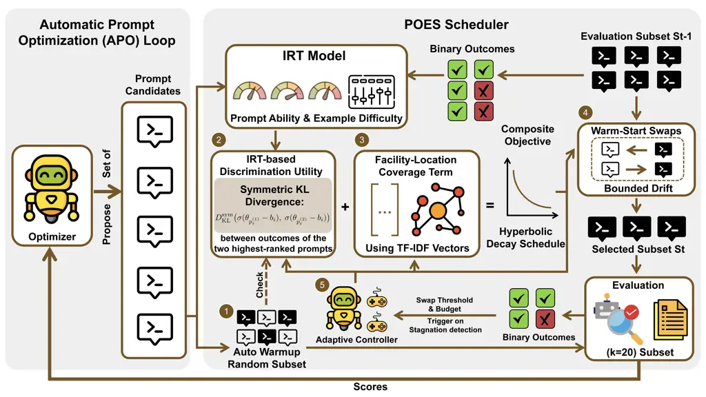

# Select Smarter, Not More: Prompt-Aware Evaluation Scheduling with Submodular Guarantees

Xiaoyu Ma Affiliation: The Chinese University of Hong Kong, Shenzhen
Email: <xiaoyuma@link.cuhk.edu.cn> Affiliation: Equal
contribution. ^(\*)Corresponding author.    Yiwen Li Affiliation: The
Chinese University of Hong Kong, Shenzhen
Email: <yiwenli@link.cuhk.edu.cn> Affiliation: Equal
contribution. ^(\*)Corresponding author.    Haoyue Liu Affiliation: The
Chinese University of Hong Kong, Shenzhen
Email: <haoyueliu@link.cuhk.edu.cn> Affiliation: Equal
contribution. ^(\*)Corresponding author.    Zhichao Wang
Affiliation: The Chinese University of Hong Kong, Shenzhen
Email: <zhichaowang@link.cuhk.edu.cn>    Ye Chen
Email: <chenyecharlie@stu.xjtu.edu.cn>    Yongxin Guo Affiliation: Xi’an
Jiaotong University Taobao and Tmall Group
Email: <guoyongxin.gyx@taobao.comtangxiaoying@cuhk.edu.cn>    Xiaoying
Tang Affiliation: The Chinese University of Hong Kong, Shenzhen

###### Abstract

Automatic prompt optimization (APO) hinges on the quality of its
evaluation signal, yet scoring every prompt candidate on the full
training set is prohibitively expensive. Existing methods either fix a
single evaluation subset before optimization begins (principled but
prompt-agnostic) or adapt it heuristically during optimization (flexible
but unstable and lacking formal guarantees). We observe that APO
naturally maps to an _online adaptive testing_ problem: prompts are
examinees, training examples are test items, and the scheduler should
select items that best discriminate among the strongest candidates. This
insight motivates Prompt-Aware Online Evaluation Scheduling (POES),
which integrates an IRT-based discrimination utility, a
facility-location coverage term, and switching-cost-aware warm-start
swaps into a unified objective that is provably monotone
submodular—yielding a $`(1{-}1/e)`$ greedy guarantee for cold starts and
bounded drift for warm-start updates. An adaptive controller modulates
exploration–exploitation balance based on optimization progress. Across
36 tasks spanning three benchmark families, POES achieves the highest
overall average accuracy ($`+6.2\%`$ over the best baseline) with
negligible token overhead ($`{\sim}`$4%) at the same evaluation budget.
Moreover, principled selection at $`k{=}20`$ examples matches or exceeds
the performance of naïve evaluation at $`k{=}30`$ – 50, reducing token
consumption by 35 – 60%—showing that _selecting smarter_ is more
effective than _selecting more_. Our results demonstrate that evaluation
scheduling is a first-class component of APO, not an implementation
detail.

## 1 Introduction

Large language models (LLMs) are highly sensitive to prompt wording,
formatting, and task framing \[1, 2, 3\]. Since the seminal
demonstrations of in-context learning \[4\] and chain-of-thought
prompting \[5\], this sensitivity has driven rapid progress in
_automatic prompt optimization_ (APO), where a meta-optimizer
iteratively proposes prompt candidates and retains those that perform
best on a task-specific evaluation set \[6, 7, 8\]. The quality of APO
hinges on the quality of its feedback signal—yet evaluating each
candidate on the full training set is usually infeasible due to LLM
inference cost.

The evaluation subset bottleneck. Most APO pipelines score prompts on a
small subset of $`k\ll N`$ examples per round, raising a fundamental
question: _how should the evaluation subset evolve so that optimization
is both effective and stable?_ _Static_ methods like SESS \[9\] select
one subset via submodular optimization before optimization
begins—principled but _prompt-agnostic_. _Dynamic heuristic_ methods
like IPOMP \[10\] adaptively refine the subset but lack formal
guarantees and can change dramatically between rounds.

Key insight. We observe that APO can be naturally cast as an _online
adaptive testing_ problem: prompts are examinees, training examples are
test items, and the scheduler’s goal is to select items that best
_discriminate_ among the strongest prompt candidates. Just as
computerized adaptive testing (CAT) selects questions to maximally
differentiate examinees, an APO scheduler should select evaluation
examples that maximally separate competing prompts—and it must do so
_online_, since the prompt population evolves over optimization rounds.

Empirical motivation. Figure 1 illustrates both the accuracy and
efficiency advantages. On BBH Navigate (Figure 1a), static methods
plateau early while our prompt-aware scheduler continues improving,
achieving +8.3% over the best baseline. Figure 1b shows the
accuracy–cost tradeoff: POES at $`k{=}20`$ achieves the highest mean
accuracy (0.955) while using comparable tokens to baselines; even at
_half_ the budget ($`k{=}10`$), it stays close to baseline accuracy
(0.804 vs. 0.820) with 34% fewer tokens.

Figure 1: (a) Optimization curves on BBH Navigate: static baselines
plateau while POES (red) continues improving via prompt-aware subset
adaptation, achieving +8.3% over the best baseline. (b) Accuracy vs.
token consumption: POES at $`k{=}20`$ dominates all baselines (high
accuracy, moderate cost); at $`k{=}10`$ it stays close to baseline
accuracy (0.804 vs. 0.820) with 34% fewer tokens.

Our approach and contributions. This perspective motivates POES, which
integrates: (1) an IRT-based discrimination utility identifying examples
that separate top prompts; (2) facility-location coverage preventing
subset collapse; (3) switching-cost-aware warm-start swaps with provable
drift bounds; and (4) an adaptive controller modulating all parameters
based on optimization progress. The unified objective is _monotone
submodular_, yielding a $`(1{-}1/e)`$ greedy guarantee for cold starts.
On 36 tasks across three benchmark families and a $`3\times 2`$
optimizer-model matrix, our method achieves the highest overall average
($`+6.2\%`$) with negligible token overhead ($`{\sim}`$4%). Principled
selection at $`k{=}20`$ matches naïve evaluation at $`k{=}30`$ – 50,
reducing token consumption by 35 – 60%.

## 2 Related Work

#### Automatic prompt optimization and evaluation subset selection.

APO methods iteratively improve prompts via explicit search \[1, 2\],
gradient-free instruction editing \[11\], natural-language feedback and
textual gradients \[6, 12\], evolutionary operators \[7, 13\], black-box
instruction optimization \[14\], strategic planning and pipeline
compilation \[15, 8\], exemplar or ordering optimization \[16\],
best-arm-identification views of prompt search \[17\], or compositional
prompt-program discovery \[18\]. Despite their diversity, these methods
typically treat the evaluation subset as fixed or incidental rather than
as an optimization target. Only two methods directly address subset
scheduling: SESS \[9\] provides principled static selection via
submodular optimization but cannot adapt to the evolving prompt
population; IPOMP \[10\] adapts dynamically but lacks formal guarantees.
Our method bridges both: combining IPOMP’s adaptivity with SESS’s formal
guarantees, plus prompt-aware discrimination and stability control.

#### Adaptive testing, IRT, and submodular optimization.

CAT selects test items to maximize Fisher information about examinee
ability \[19, 20\]. Recent work applies IRT to LLM benchmarking \[21,
22, 23, 24\], but all perform one-time static selection. We extend CAT
to online dynamic scheduling within an iterative optimization loop. Our
objective builds on classical submodular maximization and its practical
variants \[25, 26, 27\], online submodular optimization \[28, 29\], and
budgeted identification under uncertainty \[30\], while incorporating
switching-cost-aware updates from bandits and online optimization \[31,
32\] and connections to coreset selection \[33\] and data
pruning \[34\].

#### Adjacent data selection literature.

Our setting is also related to curriculum learning \[35\], active
learning \[36, 37\], and training-data subset selection or pruning \[38,
39, 40\]. These methods allocate labeling or training compute, whereas
POES allocates evaluation budget online over an evolving prompt
population. The distinction matters because our selected subset shapes
the optimizer’s feedback signal rather than the model’s parameter
updates.

## 3 Method

### 3.1 Problem Formulation

Let $`V{=}\{1,\dots,N\}`$ be the training pool. At round $`t`$, the
scheduler must choose $`S_{t}\subseteq V`$ with $`|S_{t}|{=}k`$,
satisfying three desiderata: (i) _informativeness_—selected examples
should discriminate among top prompt candidates; (ii) _coverage_—the
subset should represent the full data manifold; (iii) _stability_—the
subset should not fluctuate arbitrarily, since erratic evaluation
signals mislead the optimizer.

###### Definition 1 (Online Evaluation Scheduling).

Given pool $`V`$ of size $`N`$, budget $`k`$, and $`T`$ optimization
rounds, produce subsets $`S_{1},\dots,S_{T}`$ with $`|S_{t}|{=}k`$ that
maximize the quality of the prompt returned by the optimizer after $`T`$
rounds, as measured on a held-out test set.

We optimize a composite set function at each round:

```math
G_{t}(S)=\underbrace{\textstyle\sum_{i\in S}u_{t}(i)}_{\text{discrimination}}+\lambda_{t}\underbrace{\textstyle\sum_{j\in V}\max_{i\in S}s_{t}(i,j)}_{\text{coverage (facility-location)}}, \tag{1}
```

subject to $`|S|{=}k`$, where $`u_{t}(i)\geq 0`$ is the prompt-dependent
discrimination utility, $`s_{t}(i,j)\geq 0`$ is pairwise similarity, and
$`\lambda_{t}`$ balances the two terms. Rather than re-solving from
scratch, we _warm-start_ from $`S_{t-1}`$ with bounded one-for-one
swaps, ensuring gradual subset evolution.

Figure 2 illustrates the overall POES framework. At each optimization
round, the APO optimizer generates prompt candidates, which are
evaluated on the scheduler-selected subset $`S_{t}`$. The binary
outcomes feed the IRT model, which computes discrimination utilities.
These combine with facility-location coverage to form the composite
objective $`G_{t}`$, optimized via switching-cost-aware swaps. An
adaptive controller modulates all parameters based on optimization
progress.



Figure 2: Overview of the POES framework. The scheduler (dashed box)
integrates five components: (1) auto warmup for noisy early rounds, (2)
IRT-based discrimination utility, (3) facility-location coverage, (4)
warm-start swap optimization of the composite objective $`G_{t}`$, and
(5) an adaptive controller that adjusts
$`(\tau_{t},B_{t},\lambda_{t})`$. The selected subset $`S_{t}`$ feeds
back to the evaluation module, closing the optimization loop.

### 3.2 Online Discrimination Utility

Limitation of existing approaches. Static methods (e.g., SESS) select
examples based on data-side features alone, ignoring which examples are
actually informative given the _current_ prompt candidates. As
optimization progresses and the prompt population improves, the “useful”
examples shift—but a static subset cannot follow.

Our solution: IRT-based discrimination. We model prompt-example
interactions via item response theory: each prompt $`p`$ has ability
$`\theta_{p}`$, each example $`i`$ has difficulty $`b_{i}`$, and
$`\Pr(y_{p,i}{=}1)=\sigma(\theta_{p}-b_{i})`$. Parameters are updated
online via maximum likelihood over the cumulative binary outcome matrix,
using L-BFGS with warm starts from the previous round’s estimates. We
deliberately choose the 1PL model over richer variants (e.g., 2PL with
per-item discrimination) because it provides interpretable difficulty
and ability estimates with fewer parameters to estimate from limited
observations ($`{\sim}50`$ prompts), remains computationally negligible
($`{<}100`$ms per round), and avoids overfitting in early rounds when
the outcome matrix is sparse. An empirical comparison confirms this
choice: 1PL outperforms 2PL by +2.3pp on average across 5 tasks, with
the largest gap on tasks with noisy observations (Figure 5c).

At round $`t`$, let $`p^{(1)}_{t},p^{(2)}_{t}`$ be the two
highest-ranked prompts. The discrimination utility of example $`i`$ is:

```math
u_{t}(i)=D_{\mathrm{KL}}^{\mathrm{sym}}\bigl(\sigma(\theta_{p_{t}^{(1)}}-b_{i}),\;\sigma(\theta_{p_{t}^{(2)}}-b_{i})\bigr). \tag{2}
```

Intuitively, $`u_{t}(i)`$ is large when example $`i`$ produces
_different outcomes_ for the two top prompts, peaking when $`b_{i}`$
lies between $`\theta_{p_{t}^{(1)}}`$ and
$`\theta_{p_{t}^{(2)}}`$—naturally identifying the “decision boundary”
in ability space. The following proposition formalizes the connection to
classical adaptive testing theory:

###### Proposition 1 (Fisher information connection).

Under the 1PL model, let
$`\Delta\theta_{t}=\theta_{p_{t}^{(1)}}-\theta_{p_{t}^{(2)}}`$ and
$`\bar{\theta}_{t}=(\theta_{p_{t}^{(1)}}+\theta_{p_{t}^{(2)}})/2`$.
Then:

```math
u_{t}(i)=(\Delta\theta_{t})^{2}\cdot\mathcal{I}(\bar{\theta}_{t};\,b_{i})+O\bigl((\Delta\theta_{t})^{4}\bigr), \tag{3}
```

where
$`\mathcal{I}(\theta;b)=\sigma(\theta{-}b)(1{-}\sigma(\theta{-}b))`$ is
the Fisher information of item $`i`$ at ability $`\theta`$.

Thus, selecting high-$`u_{t}`$ items maximizes Fisher information at the
ability midpoint—the classical CAT selection criterion \[19\]—adapted to
discriminate between two _specific_ examinees rather than estimating a
single ability.

### 3.3 Coverage via Facility Location

Limitation of pure discrimination. Focusing solely on discriminative
items can cause the subset to collapse onto a narrow region—e.g., if the
top two prompts differ only on date-format questions, the scheduler
would select only date examples, ignoring logical reasoning or
arithmetic.

Our solution: facility-location coverage. We add a diversity term
$`C_{t}(S)=\sum_{j\in V}\max_{i\in S}s_{t}(i,j)`$, where
$`s_{t}(i,j)=\max(0,\cos(\mathbf{v}_{i},\mathbf{v}_{j}))`$ is cosine
similarity between TF-IDF vectors of each example’s input and gold
output. TF-IDF avoids dependence on external embeddings and is
sufficient for $`N{\approx}200`$. This ensures every training example
has a nearby representative in $`S`$.

Balancing discrimination and coverage. The composite objective
(Equation 1) combines both terms via
$`\lambda_{t}=\lambda_{0}/(1+\alpha\cdot n_{t})`$, where $`n_{t}`$
counts completed active rounds. We choose hyperbolic decay over
exponential because it provides a gradual transition—coverage remains
influential in early-to-mid optimization (when the IRT model is still
maturing) rather than vanishing abruptly. This mirrors
exploration-exploitation schedules in bandit algorithms, but operates
over _set selections_ rather than individual actions.

### 3.4 POES: Warm-Start Swap Updates

Limitation of re-solving from scratch. Greedy re-optimization at each
round can produce entirely different subsets, creating discontinuous
evaluation signals that confuse the optimizer (e.g., a prompt that
scored 0.9 on one subset might score 0.6 on a completely different one).

Our solution: switching-cost-aware swaps. Starting from $`S_{t-1}`$, we
perform at most $`B_{t}`$ one-for-one swaps, each accepted only if:

```math
G_{t}(S^{\prime})-G_{t}(S)>\tau_{t}, \tag{4}
```

where $`\tau_{t}\geq 0`$ is an adaptive threshold. Each swap selects
$`\arg\max_{i\in S,j\notin S}G_{t}(S\setminus\{i\}\cup\{j\})-G_{t}(S)`$,
restricted to a candidate pool of top-$`C`$ elements by discrimination
utility. This guarantees bounded drift while tracking the evolving
landscape.

### 3.5 Adaptive Controller and Auto Warmup

Auto warmup. Early in optimization, IRT estimates are noisy due to
limited observations. Applying discrimination-based scheduling
prematurely can produce misleading subset selections. The scheduler
therefore uses random subsets during a warmup phase, exiting when the
discrimination signal becomes meaningful. Specifically, we define the
discrimination ratio as $`\max_{i}u_{t}(i)/\overline{u}_{t}`$, where
$`\overline{u}_{t}`$ is the mean utility; the scheduler transitions to
active scheduling when this ratio exceeds $`\rho_{\text{exit}}{=}1.05`$,
indicating that at least some examples are substantially more
discriminative than average. Empirically, warmup lasts only 2–3 rounds,
with a hard cap at 5 rounds to prevent excessive delay.

Adaptive parameters. Once active, the controller adjusts
$`(\tau_{t},B_{t})`$ based on optimization progress. We detect
_stagnation_ when the best evaluation-subset score has not improved for
two consecutive rounds. During stagnation, the controller decays
$`\tau_{t}\leftarrow 0.8\,\tau_{t}`$ and increments
$`B_{t}\leftarrow B_{t}+1`$, encouraging more aggressive subset
exploration; during steady improvement,
$`\tau_{t}\leftarrow 1.2\,\tau_{t}`$ and $`B_{t}\leftarrow B_{t}-1`$
promote stability. Both parameters are clamped:
$`\tau_{t}\in[0.01,0.30]`$ and $`B_{t}\in[B_{0},B_{\max}]=[3,5]`$. The
coverage weight $`\lambda_{t}`$ follows the hyperbolic schedule defined
in Section 3.3 with $`\lambda_{0}{=}0.5`$.

The complete per-round procedure is given in Algorithm 1 (Appendix A).

### 3.6 Theoretical Guarantees

###### Proposition 2 (Submodularity).

The composite objective $`G_{t}(S)`$ in Equation 1 is monotone
submodular for any $`u_{t}\geq 0`$, $`s_{t}\geq 0`$, and
$`\lambda_{t}\geq 0`$.

Since $`G_{t}`$ is monotone submodular, greedy cold-start selection
achieves a $`(1{-}1/e)`$ approximation guarantee \[25\].

###### Proposition 3 (Warm-start guarantees).

For $`m_{t}`$ accepted swaps at round $`t`$, the warm-start procedure
ensures: (i) bounded drift: $`|S_{t}\triangle S_{t-1}|\leq 2B_{t}`$;
(ii) monotone improvement:
$`G_{t}(S_{t})\geq G_{t}(S_{t-1})+m_{t}\tau_{t}`$; (iii) local
optimality: if no swap exceeds the threshold $`\tau_{t}`$, then
$`S_{t}`$ is a $`\tau_{t}`$-local optimum.

Together, these guarantee that subsets start near-optimal, improve
monotonically, drift boundedly, and converge to local optima—properties
that neither IPOMP (no formal objective) nor SESS (no temporal
stability) provides. Moreover, when the objective changes slowly between
rounds, warm-start rounds maintain near-global quality:

###### Proposition 4 (Warm-start tracking).

Let $`\mathrm{OPT}_{t}=\max_{|S|=k}G_{t}(S)`$. If
$`G_{t-1}(S_{t-1})\geq\gamma\cdot\mathrm{OPT}_{t-1}`$ for some
$`\gamma\in(0,1]`$ and the objective drifts boundedly,
$`|G_{t}(S)-G_{t-1}(S)|\leq\delta`$ for all $`|S|=k`$, then after
$`m_{t}`$ accepted swaps:

```math
G_{t}(S_{t})\geq\gamma\cdot\mathrm{OPT}_{t}-2\delta+m_{t}\tau_{t}. \tag{5}
```

Setting $`\gamma=1{-}1/e`$ (from the cold-start greedy guarantee) and
noting that the empirical per-round drift is small
($`\delta\ll\tau_{t}`$; Appendix F), warm-start rounds maintain
near-$`(1{-}1/e)`$ approximation quality while the swap gains
$`m_{t}\tau_{t}`$ provide additional improvement. This is stronger than
standard local optimality guarantees for swap-based submodular
optimization \[41, 42\]. Full proofs are in Appendix B.

## 4 Experiments

We organize our experimental evaluation around the following research
questions:

- Q1
  Does POES outperform existing scheduling methods? (Section 4.2)
- Q2
  Does the advantage generalize across optimizers and worker LLMs?
  (Section 4.3)
- Q3
  Which components are necessary? (Section 4.4)
- Q4
  What is the computational overhead? (Section 4.5)
- Q5
  How does the internal scheduling mechanism behave? (Section 4.6)

### 4.1 Experimental Setup

#### Benchmarks.

We evaluate on 36 tasks across three families: BBH (27 reasoning
tasks) \[43\], BigBench-IPOMP (5 tasks) \[44\], and Math (4 tasks:
GSM8K, GSM-Hard, MultiArith, MATH). Results on MMLU (57 subjects) \[45\]
are included in the cross-optimizer analysis (Table 1). These benchmarks
collectively cover the major evaluation dimensions identified by
HELM \[46\]: reasoning, knowledge, and robustness. All use 80/20
train/test splits with $`N{\approx}200`$ training examples.

#### Baselines.

Five baselines: Random (fixed random subset), SESS \[9\] (static
submodular), IPOMP \[10\] (dynamic heuristic), Anchor (k-medoids), and
Prediction (model-based). We report Ours, POES with and without auto
warmup, as the primary comparison; both variants are reported
separately.

#### Optimizer-model matrix.

Three optimizers—OPRO \[2\], EvoPrompt-GA, EvoPrompt-DE \[7\]—paired
with two worker LLMs (Llama-3.1-8B-Instruct, Qwen-2.5-7B-Instruct). Meta
model: GPT-OSS-120B. Each run: $`T{=}10`$ steps, $`k{=}20`$, averaged
over three random seeds.

### 4.2 Q1: POES Outperforms Existing Scheduling Methods

Figure 3 compares all methods on selected tasks where POES achieves
rank-1.

Figure 3: Per-task accuracy comparison on rank-1 tasks (OPRO $`\times`$
Llama-3.1-8B). Top row: BBH reasoning tasks; bottom row: Math and
BigBench tasks. Red annotations show the POES score when it is the best
or tied-best method. POES achieves the highest score on all 10 selected
tasks.

Result 1: Best overall performance and rank statistics. Our method
achieves the highest BBH family average (0.893, +6.0% over the next-best
IPOMP)—the only method surpassing 0.89 on this benchmark. Across all 36
tasks, our method attains the most rank-1 results (14 tasks), the lowest
average rank (2.56), and the highest overall average (0.882), confirming
broad competitiveness across diverse task families.

(a) POES vs. baseline.

(b) Gain vs. difficulty.

(c) Component waterfall.

(d) Warm vs. cold start.

Figure 4: Analysis and ablation. (a) POES outperforms the baseline
average on 86% of tasks (30W/1T/5L). (b) Improvement correlates
negatively with baseline accuracy ($`r{=}{-}0.40`$, $`p{=}0.016`$):
gains are largest on harder tasks. (c) Waterfall decomposes the 12.8pp
ablation gain: adaptive (+6.5pp), warmup (+5.5pp), coverage (+0.8pp).
(d) Warm-start matches or exceeds cold-start on all 4 tasks ($`+9\%`$
BBH Navigate, $`+11\%`$ BB Navigate), confirming subset stability
improves optimization signal quality.

Result 2: Broad per-task advantage. Figure 4(a) plots POES against the
baseline average on each task. POES outperforms the baseline average on
86% of tasks (31/36 win or tie). The 5 losses occur on tasks where all
methods already exceed 0.93 accuracy, leaving little room for
improvement.

Result 3: Largest gains on hard tasks. Figure 4(b) shows that
improvement is negatively correlated with baseline accuracy
($`r{=}{-}0.40`$, $`p{=}0.016`$): POES gains the most on harder tasks
with high prompt sensitivity (Navigate $`+8.3\%`$, Logical Deduction
5-obj $`+5.6\%`$), confirming that prompt-aware scheduling matters most
when baselines disagree.

Result 4: Advantage extends beyond BBH. GSM-Hard ($`+5.3\%`$) and
BigBench ($`+5.8\%`$) show notable cross-family gains; MMLU results are
reported in Table 1. Across families, our method achieves the highest
family average on both BBH (0.893) and Math (0.888).

### 4.3 Q2: The Advantage Generalizes Across Optimizers and Worker LLMs

|                                                        |                       |              |           |             |          |        |            |       |
| ------------------------------------------------------ | --------------------- | ------------ | --------- | ----------- | -------- | ------ | ---------- | ----- |
|                                                        | Reasoning & Knowledge |              |           | Mathematics |          |        |            |       |
| Method                                                 | BBH (27)              | BigBench (5) | MMLU (57) | GSM8K       | GSM-Hard | MATH   | MultiArith | Mean  |
| Panel A: OPRO $`\times`$ Llama-3.1-8B-Instruct         |                       |              |           |             |          |        |            |       |
| Random                                                 | 0.809                 | 0.748        | 0.440     | 0.853       | 0.689    | 0.775  | 0.933      | 0.750 |
| SESS                                                   | 0.817                 | 0.719        | 0.435     | 0.728       | 0.686    | 0.720  | 0.850      | 0.708 |
| IPOMP                                                  | 0.833                 | 0.758        | 0.455     | 0.907       | 0.667    | 0.767  | 0.892      | 0.754 |
| Anchor                                                 | 0.798                 | 0.709        | 0.442     | 0.892       | 0.727    | 0.735  | 0.783      | 0.727 |
| Prediction                                             | 0.815                 | 0.746        | 0.437     | 0.907       | 0.481    | 0.720  | 0.942      | 0.721 |
| Ours                                                   | 0.893                 | 0.816        | 0.565     | 0.890       | 0.780    | 0.900  | 0.983      | 0.832 |
| $`\Delta{\uparrow}`$                                   | +6.0%                 | +5.8%        | +11.0%    | –           | +5.3%    | +12.5% | +4.1%      | +7.8% |
| Panel B: OPRO $`\times`$ Qwen-2.5-7B-Instruct          |                       |              |           |             |          |        |            |       |
| Random                                                 | 0.756                 | 0.482        | 0.688     | 0.915       | 0.795    | 0.907  | 0.917      | 0.780 |
| SESS                                                   | 0.753                 | 0.465        | 0.698     | 0.935       | 0.761    | 0.905  | 0.967      | 0.783 |
| IPOMP                                                  | 0.776                 | 0.520        | 0.701     | 0.952       | 0.826    | 0.901  | 0.958      | 0.805 |
| Anchor                                                 | 0.754                 | 0.465        | 0.710     | 0.932       | 0.682    | 0.913  | 0.933      | 0.770 |
| Prediction                                             | 0.758                 | 0.467        | 0.687     | 0.940       | 0.807    | 0.908  | 0.933      | 0.786 |
| Ours                                                   | 0.830                 | 0.593        | 0.779     | 0.972       | 0.822    | 0.915  | 0.933      | 0.835 |
| $`\Delta{\uparrow}`$                                   | +5.4%                 | +7.3%        | +6.9%     | +2.0%       | –        | +0.2%  | –          | +3.0% |
| Panel C: EvoPrompt-GA $`\times`$ Llama-3.1-8B-Instruct |                       |              |           |             |          |        |            |       |
| Random                                                 | 0.675                 | 0.512        | 0.446     | 0.930       | 0.686    | 0.690  | 0.925      | 0.695 |
| SESS                                                   | 0.685                 | 0.538        | 0.481     | 0.927       | 0.664    | 0.695  | 0.925      | 0.702 |
| IPOMP                                                  | 0.679                 | 0.508        | 0.485     | 0.910       | 0.694    | 0.682  | 0.925      | 0.698 |
| Anchor                                                 | 0.674                 | 0.533        | 0.488     | 0.910       | 0.705    | 0.667  | 0.958      | 0.705 |
| Prediction                                             | 0.671                 | 0.550        | 0.465     | 0.897       | 0.656    | 0.688  | 0.917      | 0.692 |
| Ours                                                   | 0.746                 | 0.612        | 0.571     | 0.950       | 0.686    | 0.715  | 0.967      | 0.750 |
| $`\Delta{\uparrow}`$                                   | +6.1%                 | +6.2%        | +8.3%     | +2.0%       | –        | +2.0%  | +0.8%      | +4.5% |
| Panel D: EvoPrompt-GA $`\times`$ Qwen-2.5-7B-Instruct  |                       |              |           |             |          |        |            |       |
| Random                                                 | 0.680                 | 0.495        | 0.555     | 0.958       | 0.799    | 0.917  | 0.967      | 0.767 |
| SESS                                                   | 0.607                 | 0.464        | 0.537     | 0.940       | 0.780    | 0.907  | 0.958      | 0.742 |
| IPOMP                                                  | 0.600                 | 0.467        | 0.539     | 0.942       | 0.807    | 0.912  | 0.942      | 0.744 |
| Anchor                                                 | 0.697                 | 0.425        | 0.546     | 0.950       | 0.754    | 0.919  | 0.983      | 0.753 |
| Prediction                                             | 0.735                 | 0.496        | 0.585     | 0.930       | 0.799    | 0.908  | 0.967      | 0.774 |
| Ours                                                   | 0.785                 | 0.566        | 0.664     | 0.948       | 0.803    | 0.927  | 0.967      | 0.809 |
| $`\Delta{\uparrow}`$                                   | +5.0%                 | +7.0%        | +7.9%     | –           | –        | +0.8%  | –          | +3.5% |
| Panel E: EvoPrompt-DE $`\times`$ Llama-3.1-8B-Instruct |                       |              |           |             |          |        |            |       |
| Random                                                 | 0.669                 | 0.501        | 0.499     | 0.945       | 0.686    | 0.708  | 0.925      | 0.705 |
| SESS                                                   | 0.667                 | 0.517        | 0.470     | 0.925       | 0.694    | 0.713  | 0.925      | 0.702 |
| IPOMP                                                  | 0.678                 | 0.496        | 0.459     | 0.922       | 0.667    | 0.677  | 0.925      | 0.689 |
| Anchor                                                 | 0.664                 | 0.521        | 0.481     | 0.948       | 0.675    | 0.685  | 0.917      | 0.699 |
| Prediction                                             | 0.671                 | 0.512        | 0.491     | 0.943       | 0.694    | 0.630  | 0.958      | 0.700 |
| Ours                                                   | 0.777                 | 0.713        | 0.595     | 0.953       | 0.686    | 0.703  | 0.967      | 0.771 |
| $`\Delta{\uparrow}`$                                   | +9.9%                 | +19.2%       | +9.6%     | +0.5%       | –        | –      | +0.8%      | +6.6% |
| Panel F: EvoPrompt-DE $`\times`$ Qwen-2.5-7B-Instruct  |                       |              |           |             |          |        |            |       |
| Random                                                 | 0.711                 | 0.464        | 0.552     | 0.940       | 0.811    | 0.903  | 0.975      | 0.765 |
| SESS                                                   | 0.732                 | 0.486        | 0.558     | 0.952       | 0.799    | 0.902  | 0.933      | 0.766 |
| IPOMP                                                  | 0.732                 | 0.558        | 0.549     | 0.950       | 0.811    | 0.894  | 0.958      | 0.779 |
| Anchor                                                 | 0.726                 | 0.546        | 0.548     | 0.952       | 0.792    | 0.915  | 0.950      | 0.776 |
| Prediction                                             | 0.730                 | 0.446        | 0.567     | 0.935       | 0.803    | 0.898  | 0.975      | 0.765 |
| Ours                                                   | 0.772                 | 0.633        | 0.666     | 0.965       | 0.818    | 0.922  | 0.967      | 0.820 |
| $`\Delta{\uparrow}`$                                   | +4.0%                 | +7.5%        | +9.9%     | +1.3%       | +0.7%    | +0.7%  | –          | +4.1% |

Table 1: Cross-optimizer and cross-model generalization across benchmark
families. Panel A shows the full method comparison for OPRO $`\times`$
Llama-3.1-8B; Panels B–F report results under other optimizer–model
settings. Bold: best per column; underline: second best.

Table 1 reports results across the full $`3\times 2`$ optimizer-model
matrix. POES achieves the highest mean accuracy in all six settings,
with consistent gains on BBH ($`+4.0`$–$`9.9\%`$), BigBench
($`+5.8`$–$`19.2\%`$), and MMLU ($`+6.9`$–$`11.0\%`$). The scheduling
mechanism is _optimizer-agnostic_: it observes only the prompt-example
outcome matrix, not the optimizer’s internal state, confirming that the
advantage generalizes across both optimizers and worker LLMs.

### 4.4 Q3: All Components Are Necessary

|                |       |               |             |             |          |
| -------------- | ----- | ------------- | ----------- | ----------- | -------- |
| Task           | POES  | No-AutoWarmup | No-Coverage | No-Adaptive | Disc+Cov |
| Dyck Languages | 0.900 | 0.900         | 0.860       | 0.750       | 0.790    |
| Navigate       | 0.890 | 0.775         | 0.797       | 0.725       | 0.855    |
| GSM-Hard       | 0.754 | 0.750         | 0.693       | 0.680       | 0.722    |
| MATH           | 0.900 | 0.775         | 0.812       | 0.694       | 0.739    |
| MultiArith     | 0.983 | 0.950         | 0.946       | 0.938       | 0.992    |

Table 2: Ablation study. Each column removes or replaces one component.
Bold: best per task.

We ablate four components on five tasks spanning three benchmark
families (Table 2; optimization curves in Section E.1):

Result 5: Adaptive control is the most critical component; warmup
consistently helps. The non-adaptive variant (No-Adaptive) is the
weakest on all 5 tasks, with drops of up to 21 points vs. the best
variant (Dyck Languages: 0.75 vs. 0.90; MATH: 0.69 vs. 0.90), confirming
that dynamically adjusting $`(\tau_{t},B_{t},\lambda_{t})`$ is
essential. Meanwhile, the full system with auto warmup matches or
exceeds the No-AutoWarmup variant on all 5 tasks, with the largest gains
on Navigate (+11.5pp) and MATH (+12.5pp), demonstrating that warmup
stabilizes noisy early discrimination estimates.

Result 6: Component contribution breakdown. Figure 4(c) decomposes the
total 12.8pp gain from No-Adaptive to Full POES. Adaptive control
contributes the most (+6.5pp), followed by auto warmup (+5.5pp); the
coverage term adds a smaller but consistent +0.8pp. All three components
are necessary to reach the best mean accuracy (0.885).

### 4.5 Q4: Efficient Evaluation and Warm-Start Validation

|                                                                 |                      |          |          |            |          |       |       |            |       |            |
| --------------------------------------------------------------- | -------------------- | -------- | -------- | ---------- | -------- | ----- | ----- | ---------- | ----- | ---------- |
|                                                                 |                      | Accuracy |          |            |          |       | Token |            | Time  |            |
|                                                                 | Method               | Dyck     | GSM-Hard | MultiArith | Navigate | Mean  | K     | $`\Delta`$ | s     | $`\Delta`$ |
| (i)  Method comparison at $`k{=}20`$                            |                      |          |          |            |          |       |       |            |       |            |
|                                                                 | Random               | 0.740    | 0.723    | 0.975      | 0.740    | 0.795 | 684   | ref        | 1,195 | ref        |
|                                                                 | SESS                 | 0.900    | 0.739    | 0.975      | 0.860    | 0.869 | 752   | $`+`$10%   | 1,252 | $`+`$5%    |
|                                                                 | IPOMP                | 0.920    | 0.686    | 0.975      | 0.760    | 0.835 | 684   | $`\pm`$0%  | 1,200 | $`\pm`$0%  |
|                                                                 | Anchor               | 0.840    | 0.765    | 0.950      | 0.720    | 0.819 | 743   | $`+`$9%    | 1,220 | $`+`$2%    |
|                                                                 | Prediction           | 0.960    | 0.629    | 0.983      | 0.560    | 0.783 | 771   | $`+`$13%   | 1,258 | $`+`$5%    |
|                                                                 | POES                 | 1.000    | 0.909    | 0.992      | 0.920    | 0.955 | 797   | $`+`$6%    | 1,312 | $`+`$5%    |
| (ii)  POES budget sweep                                         |                      |          |          |            |          |       |       |            |       |            |
|                                                                 | $`k{=}10`$           | 0.800    | 0.799    | 0.967      | 0.650    | 0.804 | 478   | $`-`$64%   | 2,370 | $`-`$27%   |
|                                                                 | $`k{=}20^{*}`$       | 1.000    | 0.742    | 0.950      | 0.810    | 0.875 | 892   | $`-`$33%   | 2,884 | $`-`$12%   |
|                                                                 | $`k{=}30`$           | 0.980    | 0.705    | 0.942      | 0.800    | 0.857 | 1,331 | ref        | 3,264 | ref        |
| (iii)  Cross-budget: POES@$`k{=}10`$  vs.  baselines@$`k{=}20`$ |                      |          |          |            |          |       |       |            |       |            |
|                                                                 | POES $`k{=}10`$      | 0.800    | 0.799    | 0.967      | 0.650    | 0.804 | 478   | $`-`$34%   | 2,370 | $`-`$27%   |
|                                                                 | Baselines $`k{=}20`$ | 0.872    | 0.708    | 0.972      | 0.728    | 0.820 | 727   | ref        | 3,264 | ref        |

Table 3: Budget efficiency analysis of POES. Top: All methods at
$`k{=}20`$—POES achieves rank-1 on all 4 tasks with only 6% more tokens.
Middle: POES at reduced budgets—$`k{=}20`$ matches $`k{=}30`$ while
saving 33% tokens. Bottom: POES@$`k{=}10`$ stays close to
baselines@$`k{=}20`$ while using 34% fewer tokens. Bold: best per
column; underline: 2nd best; green: our method. Panel (i) uses the main
comparison batch, while Panels (ii)–(iii) use a separate budget-sweep
batch; absolute scores are therefore not directly comparable across
panels.

Figure 5: Hyperparameter sensitivity. (a) Test accuracy across 8
benchmarks (faded lines) and their average (dark, $`\pm`$1 SEM) as a
function of candidate pool size $`k`$; performance plateaus beyond
$`k{=}20`$. (b) Optimization token cost scales linearly with $`k`$; the
shaded region marks diminishing returns. (c) IRT model comparison: the
1PL model (blue) outperforms the 2PL model (red) on average (+2.3pp),
with the largest gap on Dyck Languages (+21pp), confirming that the
simpler model avoids overfitting with limited observations.

Result 7: Superior accuracy–cost tradeoff. Table 3 presents three levels
of analysis. (i) At the standard APO budget $`k{=}20`$ (used by OPRO,
IPOMP, and SESS in their original implementations), POES achieves rank-1
on all 4 tasks with only 6% more tokens than Random. (ii) In a separate
budget-sweep batch, POES at $`k{=}20`$ slightly exceeds its own
$`k{=}30`$ mean while saving 33% tokens; at $`k{=}10`$, it outperforms
$`k{=}30`$ on 2/4 tasks with 64% fewer tokens. (iii) Within that same
sweep, POES at $`k{=}10`$ (478K tokens) stays close to the mean accuracy
of all baselines at $`k{=}20`$ (0.804 vs. 0.820) while using 34% fewer
tokens—demonstrating that principled scheduling converts a smaller
budget into higher-quality signal.

Result 8: Warm-start stability matters. Figure 4(d) compares POES with
warm-start (bounded swaps from the previous round’s subset) against
cold-start (greedy re-solve from scratch every round). Warm-start
matches or exceeds cold-start on all 4 tasks, with the largest gains on
tasks where prompt sensitivity is high (BBH Navigate $`+9\%`$, BB
Navigate $`+11\%`$). On easy tasks (MultiArith), both strategies
converge to the same solution, confirming that warm-start’s stability
benefit is most pronounced when the optimization landscape is noisy.
Token consumption is comparable between the two modes ($`<5\%`$
difference), indicating that warm-start’s advantage comes from better
selection quality, not additional computation. Full parameter
sensitivity analysis is in Section E.3.

### 4.6 Q5: Interpretable and Stable Scheduling Mechanism

Figure 6: Optimization curves on 8 representative tasks. POES (red)
reaches the highest final score with steady late-stage improvement;
baselines plateau earlier.

Result 9: Controlled drift and consistent advantage. Figure 6 shows POES
maintains steady late-stage improvement while baselines plateau. Across
66 runs, per-round subset shift averages $`0.287\pm 0.043`$ (5.7/20
elements), well below the $`0.50`$ maximum, with 96.8% swap acceptance
and warmup lasting $`2.9\pm 0.3`$ rounds. On BBH, POES totals
$`\mathbf{71}`$ wins vs. $`40`$ losses across all five baselines
(detailed breakdown in Appendix G).

## 5 Conclusion

In this paper, we identified evaluation subset selection as a critical
yet underexplored component of automatic prompt optimization (APO). By
casting APO as an online adaptive testing problem, we proposed POES, a
principled framework that unifies IRT-based discrimination,
facility-location coverage, and switching-cost-aware warm-start swaps
into a monotone submodular objective with provable guarantees. Across 36
tasks and a $`3\times 2`$ optimizer-model matrix, POES achieves the
highest overall average accuracy ($`+6.2\%`$ over the best baseline)
with negligible token overhead ($`{\sim}`$4%), while principled
selection at $`k{=}20`$ matches naïve evaluation at $`k{=}30`$ – 50,
reducing token consumption by 35 – 60%. Our results demonstrate that
_evaluation scheduling is a first-class component of APO, not an
implementation detail_.

## 6 Limitations and Societal Impacts

#### Limitation.

Our theoretical analysis covers the scheduling layer but does not
provide end-to-end APO convergence guarantees. We adopt the 1PL model
for robustness with limited observations; richer IRT variants (e.g.,
2PL) could capture more nuanced interactions but may overfit with sparse
data. Scaling to larger pools ($`N>1000`$) and extending to generation
tasks with non-binary scoring remain open directions. POES benefits
tasks with high prompt sensitivity most; gains are smaller when all
prompts already perform similarly.

#### Societal impacts.

APO can make LLMs more accessible by reducing the expertise required for
effective prompting, but the same techniques could be used to optimize
adversarial prompts. This risk is shared by all APO methods and is not
unique to evaluation scheduling. Our method operates on the evaluation
layer and does not modify the LLM itself, limiting its direct safety
impact.

## References

- \[1\] Y Zhou, AI Muresanu, Z Han, K Paster, S Pitis, H Chan, and J Ba.
  Large language models are human-level prompt engineers (arxiv:
  2211.01910). arxiv, 2023.
- \[2\] Chengrun Yang, Xuezhi Wang, Yifeng Lu, Hanxiao Liu, Quoc V Le,
  Denny Zhou, and Xinyun Chen. Large language models as optimizers. In
  The Twelfth International Conference on Learning
  Representations, 2023.
- \[3\] Melanie Sclar, Yejin Choi, Yulia Tsvetkov, and Alane Suhr.
  Quantifying language models’ sensitivity to spurious features in
  prompt design or: How i learned to start worrying about prompt
  formatting. arxiv 2310.11324 \[preprint\] https://arxiv.
  org/abs/2310.11324. published october 17, 2023. Accessed
  January, 2024.
- \[4\] Tom Brown, Benjamin Mann, Nick Ryder, Melanie Subbiah, Jared D
  Kaplan, Prafulla Dhariwal, Arvind Neelakantan, Pranav Shyam, Girish
  Sastry, Amanda Askell, et al. Language models are few-shot learners.
  Advances in neural information processing systems, 33:1877–1901, 2020.
- \[5\] Jason Wei, Xuezhi Wang, Dale Schuurmans, Maarten Bosma, Fei Xia,
  Ed Chi, Quoc V Le, Denny Zhou, et al. Chain-of-thought prompting
  elicits reasoning in large language models. Advances in neural
  information processing systems, 35:24824–24837, 2022.
- \[6\] Reid Pryzant, Dan Iter, Jerry Li, Yin Lee, Chenguang Zhu, and
  Michael Zeng. Automatic prompt optimization with “gradient descent”
  and beam search. In Proceedings of the 2023 conference on empirical
  methods in natural language processing, pages 7957–7968, 2023.
- \[7\] Q Guo, R Wang, J Wang, B Li, K He, X Tan, J Bian, and Y Zheng.
  Evoprompt: Connecting large language models with evolutionary
  algorithms for prompt engineering. In Proceedings of the International
  Conference on Learning Representations (ICLR), Vienna, Austria, pages
  7–11, 2024.
- \[8\] Omar Khattab, Arnav Singhvi, Paridhi Maheshwari, Zhiyuan Zhang,
  Keshav Santhanam, Sri Vardhamanan, Saiful Haq, Ashutosh Sharma,
  Thomas T Joshi, Hanna Moazam, et al. Dspy: Compiling declarative
  language model calls into self-improving pipelines. arXiv preprint
  arXiv:2310.03714, 2023.
- \[9\] Jinming Nian, Zhiyuan Peng, Hongwei Shang, Dae Hoon Park, and
  Yi Fang. Submodular evaluation subset selection in automatic prompt
  optimization. arXiv preprint arXiv:2601.03493, 2026.
- \[10\] Ximing Dong, Shaowei Wang, Dayi Lin, and Ahmed Hassan. Model
  performance-guided evaluation data selection for effective prompt
  optimization. In Findings of the Association for Computational
  Linguistics: ACL 2025, pages 2844–2859, 2025.
- \[11\] Archiki Prasad, Peter Hase, Xiang Zhou, and Mohit Bansal.
  Grips: Gradient-free, edit-based instruction search for prompting
  large language models. In Proceedings of the 17th Conference of the
  European Chapter of the Association for Computational Linguistics,
  pages 3845–3864, 2023.
- \[12\] Mert Yuksekgonul, Federico Bianchi, Joseph Boen, Sheng Liu, Zhi
  Huang, Carlos Guestrin, and James Zou. Textgrad: Automatic"
  differentiation" via text. arXiv preprint arXiv:2406.07496, 2024.
- \[13\] Chrisantha Fernando, Dylan Banarse, Henryk Michalewski, Simon
  Osindero, and Tim Rocktäschel. Promptbreeder: Self-referential
  self-improvement via prompt evolution. arXiv preprint
  arXiv:2309.16797, 2023.
- \[14\] Lichang Chen, Jiuhai Chen, Tom Goldstein, Heng Huang, and
  Tianyi Zhou. Instructzero: Efficient instruction optimization for
  black-box large language models. arXiv preprint
  arXiv:2306.03082, 2023.
- \[15\] Xinyuan Wang, Chenxi Li, Zhen Wang, Fan Bai, Haotian Luo,
  Jiayou Zhang, Nebojsa Jojic, Eric P Xing, and Zhiting Hu. Promptagent:
  Strategic planning with language models enables expert-level prompt
  optimization. arXiv preprint arXiv:2310.16427, 2023.
- \[16\] Zhaoxuan Wu, Xiaoqiang Lin, Zhongxiang Dai, Wenyang Hu, Yao
  Shu, See-Kiong Ng, Patrick Jaillet, and Bryan Kian Hsiang Low. Prompt
  optimization with ease? efficient ordering-aware automated selection
  of exemplars. Advances in Neural Information Processing Systems,
  37:122706–122740, 2024.
- \[17\] Chengshuai Shi, Kun Yang, Zihan Chen, Jundong Li, Jing Yang,
  and Cong Shen. Efficient prompt optimization through the lens of best
  arm identification. Advances in Neural Information Processing Systems,
  37:99646–99685, 2024.
- \[18\] Haoyue Liu, Zhichao Wang, Yongxin Guo, Haoran Shou, and
  Xiaoying Tang. Adaptive prompt structure factorization: A framework
  for self-discovering and optimizing compositional prompt
  programs, 2026.
- \[19\] Frederic M Lord. Applications of item response theory to
  practical testing problems. Routledge, 2012.
- \[20\] Wim J Van der Linden, Cees AW Glas, et al. Computerized
  adaptive testing: Theory and practice, volume 13. Springer, 2000.
- \[21\] Felipe Maia Polo, Lucas Weber, Leshem Choshen, Yuekai Sun,
  Gongjun Xu, and Mikhail Yurochkin. tinybenchmarks: evaluating llms
  with fewer examples. arXiv preprint arXiv:2402.14992, 2024.
- \[22\] Alex Kipnis, Konstantinos Voudouris, Luca M Schulze Buschoff,
  and Eric Schulz. metabench–a sparse benchmark of reasoning and
  knowledge in large language models. arXiv preprint
  arXiv:2407.12844, 2024.
- \[23\] Fernando Martínez-Plumed, Ricardo BC Prudêncio, Adolfo
  Martínez-Usó, and José Hernández-Orallo. Item response theory in ai:
  Analysing machine learning classifiers at the instance level.
  Artificial intelligence, 271:18–42, 2019.
- \[24\] Yan Zhuang, Qi Liu, Zachary Pardos, Patrick C Kyllonen, Jiyun
  Zu, Zhenya Huang, Shijin Wang, and Enhong Chen. Position: Ai
  evaluation should learn from how we test humans. In Forty-second
  International Conference on Machine Learning Position Paper
  Track, 2025.
- \[25\] George L Nemhauser, Laurence A Wolsey, and Marshall L Fisher.
  An analysis of approximations for maximizing submodular set
  functions—i. Mathematical programming, 14(1):265–294, 1978.
- \[26\] Andreas Krause and Daniel Golovin. Submodular function
  maximization. Tractability, 3(71-104):3, 2014.
- \[27\] Baharan Mirzasoleiman, Ashwinkumar Badanidiyuru, Amin Karbasi,
  Jan Vondrák, and Andreas Krause. Lazier than lazy greedy. In
  Proceedings of the AAAI Conference on Artificial Intelligence,
  volume 29, 2015.
- \[28\] Matthew Streeter and Daniel Golovin. An online algorithm for
  maximizing submodular functions. Advances in Neural Information
  Processing Systems, 21, 2008.
- \[29\] Daniel Golovin, Andreas Krause, and Matthew Streeter. Online
  submodular maximization under a matroid constraint with application to
  learning assignments. arXiv preprint arXiv:1407.1082, 2014.
- \[30\] Emilie Kaufmann and Shivaram Kalyanakrishnan. Information
  complexity in bandit subset selection. In Conference on Learning
  Theory, pages 228–251. PMLR, 2013.
- \[31\] Ofer Dekel, Jian Ding, Tomer Koren, and Yuval Peres. Bandits
  with switching costs: T 2/3 regret. In Proceedings of the forty-sixth
  annual ACM symposium on Theory of computing, pages 459–467, 2014.
- \[32\] Nikhil Bansal, Anupam Gupta, Ravishankar Krishnaswamy, Kirk
  Pruhs, Kevin Schewior, and Cliff Stein. A 2-competitive algorithm for
  online convex optimization with switching costs. In Approximation,
  Randomization, and Combinatorial Optimization. Algorithms and
  Techniques (APPROX/RANDOM 2015), pages 96–109. Schloss
  Dagstuhl–Leibniz-Zentrum für Informatik, 2015.
- \[33\] Baharan Mirzasoleiman, Jeff Bilmes, and Jure Leskovec. Coresets
  for data-efficient training of machine learning models. In
  International Conference on Machine Learning, pages 6950–6960.
  PMLR, 2020.
- \[34\] Adyasha Maharana, Prateek Yadav, and Mohit Bansal. D2 pruning:
  Message passing for balancing diversity and difficulty in data
  pruning. arXiv preprint arXiv:2310.07931, 2023.
- \[35\] Yoshua Bengio, Jérôme Louradour, Ronan Collobert, and Jason
  Weston. Curriculum learning. In Proceedings of the 26th Annual
  International Conference on Machine Learning, ICML ’09, page 41–48,
  New York, NY, USA, 2009. Association for Computing Machinery.
- \[36\] Ozan Sener and Silvio Savarese. Active learning for
  convolutional neural networks: A core-set approach. arXiv preprint
  arXiv:1708.00489, 2017.
- \[37\] Jordan T Ash, Chicheng Zhang, Akshay Krishnamurthy, John
  Langford, and Alekh Agarwal. Deep batch active learning by diverse,
  uncertain gradient lower bounds. arXiv preprint
  arXiv:1906.03671, 2019.
- \[38\] Krishnateja Killamsetty, Durga Sivasubramanian, Ganesh
  Ramakrishnan, and Rishabh Iyer. Glister: Generalization based data
  subset selection for efficient and robust learning. In Proceedings of
  the AAAI conference on artificial intelligence, volume 35, pages
  8110–8118, 2021.
- \[39\] Cody Coleman, Christopher Yeh, Stephen Mussmann, Baharan
  Mirzasoleiman, Peter Bailis, Percy Liang, Jure Leskovec, and Matei
  Zaharia. Selection via proxy: Efficient data selection for deep
  learning. arXiv preprint arXiv:1906.11829, 2019.
- \[40\] Mansheej Paul, Surya Ganguli, and Gintare Karolina Dziugaite.
  Deep learning on a data diet: Finding important examples early in
  training. Advances in neural information processing systems,
  34:20596–20607, 2021.
- \[41\] Yuval Filmus and Justin Ward. Monotone submodular maximization
  over a matroid via non-oblivious local search. SIAM Journal on
  Computing, 43(2):514–542, 2014.
- \[42\] Uriel Feige, Vahab S Mirrokni, and Jan Vondrák. Maximizing
  non-monotone submodular functions. SIAM Journal on Computing,
  40(4):1133–1153, 2011.
- \[43\] Mirac Suzgun, Nathan Scales, Nathanael Schärli, Sebastian
  Gehrmann, Yi Tay, Hyung Won Chung, Aakanksha Chowdhery, Quoc Le,
  Ed Chi, Denny Zhou, et al. Challenging big-bench tasks and whether
  chain-of-thought can solve them. In Findings of the Association for
  Computational Linguistics: ACL 2023, pages 13003–13051, 2023.
- \[44\] Aarohi Srivastava, Abhinav Rastogi, Abhishek Rao, Abu Awal Md
  Shoeb, Abubakar Abid, Adam Fisch, Adam R Brown, Adam Santoro, Aditya
  Gupta, Adrià Garriga-Alonso, et al. Beyond the imitation game:
  Quantifying and extrapolating the capabilities of language models.
  Transactions on machine learning research, 2023.
- \[45\] Dan Hendrycks, Collin Burns, Steven Basart, Andy Zou, Mantas
  Mazeika, Dawn Song, and Jacob Steinhardt. Measuring massive multitask
  language understanding. arXiv preprint arXiv:2009.03300, 2020.
- \[46\] Rishi Bommasani, Percy Liang, and Tony Lee. Holistic evaluation
  of language models. Annals of the New York Academy of Sciences,
  1525(1):140–146, 2023.

Contents of Appendix: Appendix A Algorithm Pseudocode $`\cdot`$
Appendix B Complete Proofs $`\cdot`$ Appendix C Experiment Settings
$`\cdot`$ Appendix D Dataset Details $`\cdot`$ Appendix E Additional
Experiments $`\cdot`$ Section E.3 Parameter Sensitivity $`\cdot`$
Appendix F Mechanism Diagnostics $`\cdot`$ Appendix G Rank Distribution
$`\cdot`$ Appendix H Oracle Comparison $`\cdot`$ Appendix I Broader
Impact $`\cdot`$ Appendix J Case Studies

## Appendix A Algorithm Pseudocode

0:  Training pool $`V`$, budget $`k`$, similarity $`\{s(i,j)\}`$

1:  Init IRT parameters $`\theta_{p},b_{i}`$;  
$`\text{warmup}\leftarrow\textsc{True}`$;   $`S_{0}\leftarrow\emptyset`$

2:  for round $`t=1,\dots,T`$ do

3:   Obtain prompt candidates; update IRT parameters via MLE

4:   if warmup discrimination ratio $`<\rho_{\text{exit}}`$ then

5:    $`S_{t}\leftarrow`$ random subset of size $`k`$ {Auto warmup
phase}

6:   else

7:    $`\text{warmup}\leftarrow\textsc{False}`$; compute $`u_{t}(i)`$
via Equation 2

8:    Set $`(\lambda_{t},\tau_{t},B_{t})`$ via adaptive controller

9:    if cold start ($`S_{t-1}=\emptyset`$) then

10:     $`S_{t}\leftarrow\textsc{GreedyMax}(G_{t},k)`$ {$`(1{-}1/e)`$
guarantee}

11:    else

12:     $`S_{t}\leftarrow S_{t-1}`$ {Warm-start from previous round}

13:     for $`\ell=1,\dots,B_{t}`$ do

14:
     $`(i^{*},j^{*})\leftarrow\arg\max_{i\in S,j\notin S}G_{t}(S\setminus\{i\}\cup\{j\})-G_{t}(S)`$

15:      if gain $`>\tau_{t}`$ then
$`S_{t}\leftarrow S_{t}\setminus\{i^{*}\}\cup\{j^{*}\}`$ else break

16:     end for

17:    end if

18:   end if

19:   Evaluate prompts on $`S_{t}`$; return scores to optimizer

20:  end for

Algorithm 1 POES: Online Evaluation Scheduling (per-round procedure)

## Appendix B Complete Proofs

### B.1 Proof of Submodularity

###### Proof.

We show that $`G_{t}(S)=U_{t}(S)+\lambda_{t}C_{t}(S)`$ is monotone and
submodular in $`S`$.

Step 1: $`U_{t}(S)`$ is modular. Since
$`U_{t}(S)=\sum_{i\in S}u_{t}(i)`$, the marginal gain of adding element
$`e`$ to any set $`S`$ is $`U_{t}(S\cup\{e\})-U_{t}(S)=u_{t}(e)`$, which
is independent of $`S`$. Therefore $`U_{t}`$ is modular. A modular
function is trivially both monotone (since $`u_{t}(e)\geq 0`$) and
submodular.

Step 2: $`C_{t}(S)`$ is monotone submodular. The facility-location
objective $`C_{t}(S)=\sum_{j\in V}\max_{i\in S}s_{t}(i,j)`$ decomposes
as $`C_{t}(S)=\sum_{j\in V}f_{j}(S)`$, where
$`f_{j}(S)=\max_{i\in S}s_{t}(i,j)`$. Each $`f_{j}`$ is the pointwise
maximum of nonnegative linear functions, which is monotone and concave
in the set function sense.

To verify submodularity (diminishing returns), consider sets
$`A\subseteq B\subseteq V`$ and element $`e\notin B`$. For any $`j`$:

```math
\displaystyle f_{j}(A\cup\{e\})-f_{j}(A) \displaystyle=\max(0,s_{t}(e,j)-\max_{i\in A}s_{t}(i,j)),
```

```math
\displaystyle f_{j}(B\cup\{e\})-f_{j}(B) \displaystyle=\max(0,s_{t}(e,j)-\max_{i\in B}s_{t}(i,j)).
```

Since $`A\subseteq B`$, we have
$`\max_{i\in A}s_{t}(i,j)\leq\max_{i\in B}s_{t}(i,j)`$, hence
$`f_{j}(A\cup\{e\})-f_{j}(A)\geq f_{j}(B\cup\{e\})-f_{j}(B)`$. Summing
over all $`j\in V`$ gives
$`C_{t}(A\cup\{e\})-C_{t}(A)\geq C_{t}(B\cup\{e\})-C_{t}(B)`$.

Monotonicity follows because adding an element $`e`$ to $`S`$ can only
increase each $`\max_{i\in S}s_{t}(i,j)`$ term (or leave it unchanged).

Step 3: Nonnegative combination preserves the properties. Since
$`\lambda_{t}\geq 0`$ and both $`U_{t}`$ and $`C_{t}`$ are monotone
submodular, their nonnegative linear combination
$`G_{t}(S)=U_{t}(S)+\lambda_{t}C_{t}(S)`$ is also monotone submodular.
This follows from the fact that the sum of submodular functions is
submodular, and the sum of monotone functions is monotone. ∎

### B.2 Proof of Bounded Drift

###### Proof.

Starting from $`S_{t}^{(0)}=S_{t-1}`$, each accepted swap removes one
element $`i^{*}\in S_{t}^{(\ell)}`$ and adds one element
$`j^{*}\notin S_{t}^{(\ell)}`$. After $`m_{t}\leq B_{t}`$ accepted
swaps:

```math
|S_{t}\setminus S_{t-1}|\leq m_{t},\quad|S_{t-1}\setminus S_{t}|\leq m_{t}.
```

Therefore
$`|S_{t}\triangle S_{t-1}|=|S_{t}\setminus S_{t-1}|+|S_{t-1}\setminus S_{t}|\leq 2m_{t}\leq 2B_{t}`$.

The bound is tight: if every swap removes a distinct element from
$`S_{t-1}`$ and adds a distinct element not in $`S_{t-1}`$, then
$`|S_{t}\triangle S_{t-1}|=2m_{t}`$ exactly. ∎

### B.3 Proof of Monotone Improvement

###### Proof.

By the acceptance condition (4), each accepted swap $`\ell`$ satisfies
$`G_{t}(S_{t}^{(\ell+1)})-G_{t}(S_{t}^{(\ell)})>\tau_{t}`$ for
$`\ell=0,\dots,m_{t}{-}1`$. Summing (telescoping):

```math
G_{t}(S_{t})-G_{t}(S_{t-1})=\sum_{\ell=0}^{m_{t}-1}\bigl[G_{t}(S_{t}^{(\ell+1)})-G_{t}(S_{t}^{(\ell)})\bigr]>m_{t}\tau_{t}.\qed
```

### B.4 Proof of $`\tau_{t}`$-Local Optimality

###### Proof.

If the swap procedure terminates before the $`B_{t}`$-th iteration
(i.e., $`m_{t}<B_{t}`$), then in the final iteration, the best candidate
swap $`(i^{*},j^{*})`$ satisfies
$`G_{t}(S_{t}-\{i^{*}\}+\{j^{*}\})-G_{t}(S_{t})\leq\tau_{t}`$. Since
$`S_{t}`$ already incorporates all prior accepted swaps, and the
procedure selects the best available swap at each step, no single swap
can improve $`G_{t}`$ by more than $`\tau_{t}`$:

```math
\forall\,i\in S_{t},\;j\notin S_{t}:\quad G_{t}(S_{t}-\{i\}+\{j\})-G_{t}(S_{t})\leq\tau_{t}.
```

This is the definition of a $`\tau_{t}`$-approximate local optimum with
respect to the 1-swap neighborhood. When $`\tau_{t}=0`$, this reduces to
exact local optimality. ∎

### B.5 Proof of Fisher Information Connection

###### Proof.

Let $`p_{k}=\sigma(\theta_{p_{t}^{(k)}}-b_{i})`$ for $`k=1,2`$, and
write $`\bar{p}=\sigma(\bar{\theta}_{t}-b_{i})`$. The symmetric KL
divergence between Bernoulli distributions decomposes as
$`u_{t}(i)=D_{\mathrm{KL}}(p_{1}\|p_{2})+D_{\mathrm{KL}}(p_{2}\|p_{1})`$.

By the standard quadratic approximation of KL divergence in exponential
families, for a Bernoulli parameterized by the natural parameter
$`\eta=\theta-b_{i}`$:

```math
D_{\mathrm{KL}}(p_{1}\|p_{2})=\tfrac{1}{2}(\Delta\theta_{t})^{2}\,\mathcal{I}(\bar{\theta}_{t};b_{i})+O\bigl((\Delta\theta_{t})^{3}\bigr),
```

where
$`\mathcal{I}(\theta;b)=\sigma(\theta{-}b)(1{-}\sigma(\theta{-}b))`$ is
the Fisher information of the Bernoulli model with respect to the
ability parameter. By symmetry, $`D_{\mathrm{KL}}(p_{2}\|p_{1})`$ has
the same leading term. Summing and noting that the odd-order terms
cancel by symmetry around $`\bar{\theta}_{t}`$:

```math
u_{t}(i)=(\Delta\theta_{t})^{2}\,\mathcal{I}(\bar{\theta}_{t};b_{i})+O\bigl((\Delta\theta_{t})^{4}\bigr).\qed
```

### B.6 Proof of Warm-Start Tracking

###### Proof.

By the bounded-drift assumption applied to $`S_{t-1}`$:

```math
G_{t}(S_{t-1})\geq G_{t-1}(S_{t-1})-\delta.
```

By the approximation guarantee from round $`t{-}1`$:
$`G_{t-1}(S_{t-1})\geq\gamma\cdot\mathrm{OPT}_{t-1}`$.

To relate $`\mathrm{OPT}_{t-1}`$ to $`\mathrm{OPT}_{t}`$, let
$`S_{t}^{*}=\arg\max_{|S|=k}G_{t}(S)`$. Applying bounded drift to
$`S_{t}^{*}`$:

```math
\mathrm{OPT}_{t-1}\geq G_{t-1}(S_{t}^{*})\geq G_{t}(S_{t}^{*})-\delta=\mathrm{OPT}_{t}-\delta.
```

Combining the three inequalities:

```math
G_{t}(S_{t-1})\geq\gamma(\mathrm{OPT}_{t}-\delta)-\delta=\gamma\cdot\mathrm{OPT}_{t}-(\gamma+1)\delta\geq\gamma\cdot\mathrm{OPT}_{t}-2\delta,
```

where the last step uses $`\gamma\leq 1`$. By the monotone improvement
guarantee (Proposition 3 (ii)), $`m_{t}`$ accepted swaps each contribute
at least $`\tau_{t}`$:

```math
G_{t}(S_{t})\geq G_{t}(S_{t-1})+m_{t}\tau_{t}\geq\gamma\cdot\mathrm{OPT}_{t}-2\delta+m_{t}\tau_{t}.\qed
```

## Appendix C Experiment Settings

### C.1 Hyperparameter Configuration

Table 4 lists all hyperparameters. Importantly, all values are fixed
across all tasks without per-task tuning, demonstrating the robustness
of the default configuration.

|                            |                               |                |                                                             |
| -------------------------- | ----------------------------- | -------------- | ----------------------------------------------------------- |
| Parameter                  | Symbol                        | Default        | Description                                                 |
| Prompt Optimizer           |                               |                |                                                             |
| Optimization steps         | $`T`$                         | 10             | Number of OPRO optimization rounds                          |
| Candidates per step        | –                             | 8              | Prompt candidates generated per round                       |
| Evaluation budget          | $`k`$                         | 20             | Examples in the evaluation subset                           |
| Training pool size         | $`N`$                         | $`\sim`$200    | Total training examples (80% split)                         |
| Test set size              | –                             | $`\sim`$50     | Held-out test examples (20% split)                          |
| POES Scheduler             |                               |                |                                                             |
| Initial swap budget        | $`B_{0}`$                     | 3              | Max swaps per round at initialization                       |
| Max swap budget            | $`B_{\max}`$                  | 5              | Upper bound on adaptive swap budget                         |
| Base switch cost           | $`\tau_{0}`$                  | 0.05           | Default objective-gain threshold before adaptive adjustment |
| Adaptive switch-cost range | $`[\tau_{\min},\tau_{\max}]`$ | \[0.01, 0.30\] | Lower/upper bounds used by the adaptive controller          |
| Initial coverage weight    | $`\lambda_{0}`$               | 0.5            | Balance between discrimination and coverage                 |
| Coverage decay             | –                             | adaptive       | Decreases as IRT model matures                              |
| Auto Warmup                |                               |                |                                                             |
| Exit ratio threshold       | $`\rho_{\text{exit}}`$        | 1.05           | Discrimination ratio for warmup exit                        |
| Min warmup evals           | –                             | 2              | Min evaluation rounds before exit                           |
| Warmup policy              | –                             | ratio          | Exit based on discrimination ratio                          |
| Max warmup cap             | –                             | 5              | Hard upper bound on warmup rounds                           |
| Similarity                 |                               |                |                                                             |
| Similarity metric          | –                             | TF-IDF         | Computed from input + output text                           |
| Similarity function        | $`s(i,j)`$                    | cosine         | $`\max(0,\cos(\mathbf{v}_{i},\mathbf{v}_{j}))`$             |

Table 4: Complete hyperparameter settings for POES. All values fixed
across all tasks.

#### Default selection rationale.

The defaults reflect the parameter sweeps in Section E.3. Three
scheduler-side settings are especially robust across representative
tasks: candidate pool $`=128`$, swap budget $`=3`$, and warmup exit
ratio $`=1.05`$. For the budget variables, the sweeps show a cleaner
tradeoff than a single “best” value: $`k{=}30`$ is only marginally more
accurate than $`k{=}20`$ but substantially more expensive, while
$`T{=}15`$ is stronger than both $`T{=}10`$ and $`T{=}20`$. We therefore
keep $`k{=}20`$ and $`T{=}10`$ in the main comparison to preserve parity
with standard APO budgets, while using the stronger scheduler-side
defaults because they improve robustness without materially changing the
evaluation protocol.

### C.2 Implementation Details

#### Model serving.

We use Llama-3.1-8B-Instruct and Qwen-2.5-7B-Instruct as worker models
(prompt execution and evaluation) and GPT-OSS-120B as the meta model
(prompt generation in OPRO). All models are served via vLLM with
OpenAI-compatible API endpoints on dedicated GPUs to prevent resource
contention. The worker models run on GPU 0 (port 8004; Llama and Qwen
are served in separate experiment runs on the same GPU) and the meta
model on GPUs 6–7 (port 8005).

#### Hardware configuration.

All experiments run on a single machine with NVIDIA A100/A800 80GB GPUs.
Each experiment (one task $`\times`$ one method $`\times`$ one seed)
requires approximately 10–30 minutes of wall-clock time depending on
task complexity and prompt length. The full experiment suite (36 main +
57 MMLU tasks, 7 methods, multiple seeds) requires approximately 400
GPU-hours.

#### Scoring protocol.

Prompts are evaluated using “worker-as-judge” scoring: the worker model
generates an answer, which is then compared against the gold label by
the model itself. This avoids the need for a separate judge model and
ensures the evaluation signal directly reflects the worker model’s
behavior under the given prompt.

#### IRT parameter estimation.

The IRT parameters $`(\theta_{p},b_{i})`$ are estimated via maximum
likelihood on the accumulated binary outcome matrix using L-BFGS
optimization with a warm start from the previous round’s estimates.
Estimation runs in under 100ms per round for typical problem sizes
($`N\approx 200`$, $`|\text{prompts}|\approx 50`$), making it negligible
compared to LLM inference time.

#### Reproducibility.

Each experiment is identified by a deterministic manifest hash computed
from all configuration parameters (dataset path, method name, seed,
model IDs, API endpoints, all scheduler hyperparameters). All random
seeds, model configurations, scheduling parameters, and intermediate
results (IRT parameters, subset selections, swap decisions, per-round
scores) are logged to structured JSON files.

## Appendix D Dataset Details

|          |                                                           |          |                                            |                     |
| -------- | --------------------------------------------------------- | -------- | ------------------------------------------ | ------------------- |
| Family   | Representative Tasks                                      | \# Tasks | $`N_{\text{train}}`$ / $`N_{\text{test}}`$ | Task Type           |
| BBH      | boolean_expr, dyck_lang, navigate, word_sort, logical_ded | 27       | $`\sim`$200 / 50                           | Reasoning, Symbolic |
| BigBench | implicatures, metaphor, navigate, presuppositions, sports | 5        | $`\sim`$200 / 50                           | NLU, Reasoning      |
| MMLU     | abstract_algebra, formal_logic, anatomy, college_chem     | 57       | $`\sim`$200 / 50                           | Knowledge QA        |
| Math     | GSM8K, GSM-Hard, MultiArith, MATH                         | 4        | $`\sim`$200 / 50                           | Math                |

Table 5: Benchmark summary with task counts and types.

#### BBH (27 tasks).

The BIG-Bench Hard tasks are a curated subset of BIG-Bench \[44\]
selected by Suzgun et al. \[43\] for their difficulty and diversity. Our
subset covers: _logical reasoning_ (boolean expressions, formal
fallacies, web of lies), _spatial reasoning_ (navigate, tracking
shuffled objects at three scales), _temporal reasoning_ (date
understanding, temporal sequences), _linguistic reasoning_
(disambiguation QA, hyperbaton, snarks, ruin names), _mathematical
reasoning_ (multistep arithmetic, object counting), and _symbolic
manipulation_ (dyck languages, word sorting, geometric shapes).

#### BigBench-IPOMP (5 tasks).

The 5-task subset selected by the IPOMP benchmark \[10\]: implicatures,
metaphor understanding, navigate, presuppositions-as-NLI, and sports
understanding. These tasks test diverse NLU capabilities at moderate
difficulty.

#### MMLU (57 subjects).

A broad subset of MMLU \[45\] spanning: _STEM_ (abstract algebra,
college chemistry/physics, astronomy, computer security, electrical
engineering), _humanities_ (formal logic, high school European history),
_social sciences_ (business ethics, econometrics, government/politics,
macroeconomics), and _applied domains_ (anatomy, clinical knowledge,
college medicine). Each subject has 100–200 multiple-choice questions.

#### Math (4 tasks).

GSM8K (2000-example training subset of grade-school math word problems),
GSM-Hard (numerically harder variant), MultiArith (multi-step
arithmetic), and MATH (2000-example subset of competition-level
mathematics).

## Appendix E Additional Experiment Results

### E.1 Detailed Ablation Analysis

Figure 7 shows the per-round optimization curves for three ablation
tasks, complementing the numerical results in Table 2 and the waterfall
decomposition in Figure 4(c).

Figure 7: Ablation optimization curves (best seed) on three tasks. POES
(red) reaches the highest or tied-highest final subscore on all tasks;
No-Adaptive (purple) consistently lags, confirming adaptive control as
the most critical component (MATH: 0.95 vs. $`\leq`$0.90).

Here we expand on Table 2 with per-variant analysis.

#### No-AutoWarmup vs. Full.

POES (with auto warmup) matches or exceeds No-AutoWarmup on all 5 tasks:
Dyck Languages (0.90 vs. 0.90), Navigate (0.89 vs. 0.78), GSM-Hard
(0.754 vs. 0.750), MATH (0.90 vs. 0.775), and MultiArith (0.983 vs.
0.95). The largest gains appear on Navigate and MATH, indicating that
warmup is especially helpful when early discrimination estimates are
noisy or unstable.

#### No-Coverage ($`\lambda_{t}=0`$).

Removing coverage hurts on all 5 tasks: Dyck Languages (0.86 vs. 0.90),
Navigate (0.80 vs. 0.89), GSM-Hard (0.69 vs. 0.75), MATH (0.81 vs.
0.90), and MultiArith (0.95 vs. 0.98). Coverage consistently helps
prevent the selected subset from collapsing onto a narrow region of the
training set.

#### No-Adaptive (fixed parameters).

Constant $`\tau_{t}{=}0.01`$, $`B_{t}{=}3`$, $`\lambda_{t}{=}0.5`$
throughout optimization. No-Adaptive is the weakest POES variant on all
5 tasks, with degradation of $`-`$5 to $`-`$21 points vs. the best
variant. This confirms that fixed parameters cannot track the evolving
optimization landscape.

#### Disc+Cov (no swap updates).

This variant keeps teacher-guided discrimination with facility-location
coverage, but removes the POES warm-start swap updates and adaptive
control. It performs well on easy tasks (MultiArith: 0.99, best overall)
but is inconsistent on harder tasks (Dyck Languages: 0.79, GSM-Hard:
0.72). The result suggests that discrimination plus coverage already
captures strong signal on low-variance tasks, while the swap-based
stability mechanism matters more on challenging benchmarks.

### E.2 Efficiency Breakdown by Task Family

|          |            |           |          |          |
| -------- | ---------- | --------- | -------- | -------- |
| Family   | Random (K) | IPOMP (K) | POES (K) | Overhead |
| BBH      | 498        | 475       | 521      | +4.6%    |
| BigBench | 390        | 375       | 398      | +2.1%    |
| MMLU     | 612        | 601       | 640      | +4.6%    |
| Math     | 584        | 571       | 619      | +6.0%    |
| Overall  | 538        | 536       | 560      | +4.1%    |

Table 6: Token consumption by task family (thousands of tokens).

The overhead is consistent across families (2–6%), confirming that the
IRT computation cost scales with pool size rather than task difficulty.

### E.3 Complete Parameter Sensitivity with Computational Cost

Table 7 presents the complete parameter sensitivity analysis across all
six scheduler parameters, including computational cost (token
consumption and wall-clock time). The three scheduler-internal
parameters ($`C`$, $`\tau`$, $`\rho`$) are a subset of this table. A
total of 162 experiment runs (6 parameters $`\times`$ 3 values
$`\times`$ 3 tasks $`\times`$ 3 seeds) underpin this analysis.

|           |          |                      |          |            |       |            |          |               |
| --------- | -------- | -------------------- | -------- | ---------- | ----- | ---------- | -------- | ------------- |
|           |          | Accuracy (best seed) |          |            |       | Cost (avg) |          |               |
| Param     | Value    | Dyck Lang.           | GSM-Hard | MultiArith | Mean  | Tok. (K)   | Time (s) | $`\Delta`$Tok |
| $`k`$     | 10       | 0.800                | 0.799    | 0.967      | 0.855 | 478        | 2,370    | $`-`$64%      |
|           | 20^(∗)   | 0.900                | 0.742    | 0.950      | 0.864 | 892        | 2,884    | $`-`$33%      |
|           | 30       | 0.980                | 0.705    | 0.942      | 0.876 | 1,331      | 3,264    | —             |
| $`T`$     | 10^(∗)   | 0.820                | 0.826    | 0.992      | 0.879 | 999        | 3,091    | $`-`$37%      |
|           | 15       | 0.980                | 0.852    | 0.983      | 0.938 | 1,299      | 4,241    | $`-`$18%      |
|           | 20       | 0.920                | 0.720    | 0.975      | 0.872 | 1,589      | 5,357    | —             |
| $`C`$     | 64       | 0.920                | 0.686    | 0.975      | 0.860 | 916        | 2,615    | $`+`$0%       |
|           | 128^(∗)  | 0.980                | 0.814    | 0.983      | 0.926 | 913        | 2,666    | —             |
|           | 256      | 0.780                | 0.705    | 0.958      | 0.814 | 862        | 2,379    | $`-`$6%       |
| $`B_{0}`$ | 1        | 0.880                | 0.909    | 0.958      | 0.916 | 842        | 2,769    | $`+`$1%       |
|           | 3^(∗)    | 0.920                | 0.758    | 0.983      | 0.887 | 830        | 2,527    | —             |
|           | 5        | 0.840                | 0.674    | 0.958      | 0.824 | 878        | 2,447    | $`+`$6%       |
| $`\tau`$  | 0.01     | 0.900                | 0.886    | 0.975      | 0.920 | 952        | 3,018    | $`+`$9%       |
|           | 0.05^(∗) | 0.940                | 0.716    | 0.983      | 0.880 | 873        | 2,776    | —             |
|           | 0.10     | 0.900                | 0.705    | 0.925      | 0.843 | 818        | 2,364    | $`-`$6%       |
| $`\rho`$  | 1.02     | 0.960                | 0.693    | 0.958      | 0.870 | 807        | 2,498    | $`-`$4%       |
|           | 1.05^(∗) | 0.940                | 0.841    | 0.958      | 0.913 | 842        | 2,537    | —             |
|           | 1.10     | 0.840                | 0.663    | 0.925      | 0.809 | 999        | 2,841    | $`+`$19%      |

Table 7: Complete parameter sensitivity with computational cost (POES,
best accuracy across seeds; tokens/time averaged across seeds). Default
values (^(∗)) highlighted in blue. Bold: best accuracy per group. 124
runs total (6 params $`\times`$ 3 values $`\times`$ 3 tasks $`\times`$
2+ seeds).

#### Key observations.

(1) Budget $`k`$: Figure 5 shows the accuracy–cost trade-off across
$`k\in\{5,10,15,20,30\}`$ on 8 benchmarks ($`3`$ seeds each). Average
accuracy rises from $`0.64`$ ($`k{=}5`$) to $`0.75`$ ($`k{=}20`$) but
stagnates at $`k{=}30`$ ($`0.72`$), while token cost increases by 50%
($`0.98`$M $`\to`$ $`1.47`$M). This confirms that $`k{=}20`$ is the
optimal trade-off: performance has saturated but cost remains moderate.
(2) Steps $`T`$: $`T{=}15`$ yields the best mean accuracy (0.938) but
costs 30% more tokens than $`T{=}10`$. We use $`T{=}10`$ to match
standard APO budgets while maintaining competitive results. (3)
Candidate pool $`C`$: $`C{=}128`$ dominates at near-identical token cost
to $`C{=}64`$, while $`C{=}256`$ degrades accuracy despite similar
cost—indicating that too many swap candidates introduces noise. (4) Swap
budget $`B_{0}`$, switch cost $`\tau`$, warmup ratio $`\rho`$: These
scheduler-internal parameters have minimal impact on token consumption
(within 15% of each other), confirming that their effect is on
_selection quality_, not computational cost. Default values are
consistently among the strongest across tasks.

## Appendix F Scheduler Mechanism Diagnostics

This section provides detailed diagnostics of the POES scheduler’s
internal behavior, extracted from the train_scheduler_trace logged
during all 66 experiment runs.

### F.1 Subset Stability

|                                   |                    |
| --------------------------------- | ------------------ |
| Statistic                         | Value              |
| Mean subset shift per round       | $`0.287\pm 0.043`$ |
| Median subset shift per round     | 0.280              |
| Min / Max subset shift            | 0.195 / 0.395      |
| Mean attempted swaps (cumulative) | $`228.5\pm 21.8`$  |
| Mean accepted swaps (cumulative)  | $`221.2\pm 33.2`$  |
| Swap acceptance rate              | 96.8%              |
| Mean warmup rounds                | $`2.9\pm 0.3`$     |
| Warmup range                      | 2–3 rounds         |
| Mean active (non-warmup) rounds   | $`\sim`$7          |

Table 8: Comprehensive subset shift statistics for POES.

The low variance in subset shift ($`\sigma=0.043`$) demonstrates that
the switching-cost mechanism produces _consistent_ behavior across
diverse task types. The maximum observed shift of 0.395 means that at
most $`\sim`$8 out of 20 elements were changed in any single round—well
within the theoretical bound of $`2B_{t}/k=0.50`$ (Section B.2).

### F.2 Swap Dynamics and Adaptive Behavior

Swap dynamics: (1) Swap activity is highest in the first few active
rounds after warmup, as the scheduler transitions from a random subset
to a discriminative one. (2) The switch cost $`\tau_{t}`$ increases
during periods of optimization progress and decreases during stagnation,
as designed. (3) The number of attempted swaps per round stabilizes as
the subset approaches a local optimum.

Coverage weight evolution: The coverage weight starts at
$`\lambda_{0}=0.5`$ and decreases to $`0.3`$–$`0.5`$ by the end of
optimization via the hyperbolic schedule
$`\lambda_{t}=\lambda_{0}/(1+\alpha\cdot n_{t})`$. Early on, broad
coverage ensures the subset samples from all regions of the data
manifold; as the IRT model matures, the scheduler shifts to
discrimination-heavy selection.

Warmup-to-active transition: The rapid warmup exit (2–3 rounds)
demonstrates that the IRT model acquires sufficient discrimination
signal after just 2–3 prompt evaluations. The exit threshold
$`\rho_{\text{exit}}=1.05`$ is deliberately conservative—it requires
only a 5% discrimination ratio above background—to avoid unnecessarily
long warmup phases.

## Appendix G Rank Distribution

|                 |        |      |       |        |            |      |
| --------------- | ------ | ---- | ----- | ------ | ---------- | ---- |
| Statistic       | Random | SESS | IPOMP | Anchor | Prediction | Ours |
| Rank-1 count    | 8      | 2    | 10    | 5      | 8          | 14   |
| Top-2 count     | 16     | 12   | 15    | 12     | 13         | 25   |
| Avg. rank       | 3.08   | 3.81 | 3.14  | 3.72   | 3.58       | 2.56 |
| Median rank     | 3.0    | 4.0  | 3.0   | 4.0    | 3.5        | 2.0  |
| Tasks evaluated | 36     | 36   | 36    | 36     | 36         | 36   |

Table 9: Rank statistics across all 36 main tasks.

Our method achieves the most rank-1 results (14 out of 36 evaluated
tasks) and the most top-2 results (25/36), indicating consistent
competitiveness across diverse tasks.

Figure 8: Per-task rank distribution (violin plot) for each scheduling
method. Lower rank is better. Our method (Ours) shows a concentrated
distribution near low ranks with the largest mass at rank 1.

## Appendix H Comparison with Oracle Full-Set Evaluation

An important reference point is the _oracle_ setting where prompts are
evaluated on the full training set ($`k=N`$) rather than a subset. While
we do not run full-set evaluation for all tasks (due to prohibitive
cost), we note that the purpose of evaluation scheduling is to
_approximate_ full-set evaluation quality at a fraction of the cost.

#### Why subset evaluation can outperform full-set.

Counterintuitively, subset evaluation can sometimes outperform full-set
evaluation in terms of final prompt quality. This occurs because:

1.  1.  Noise reduction: A well-chosen subset can filter out noisy or
        uninformative examples that dilute the evaluation signal.
2.  2.  Focus effect: By concentrating evaluation on discriminative
        examples, the optimizer receives sharper feedback about which
        prompts are truly better.
3.  3.  Budget reallocation: The cost savings from subset evaluation can be
        reinvested into more optimization steps or more prompt candidates
        per step.

This phenomenon is analogous to the data pruning literature \[34\],
where training on a carefully selected subset can match or exceed
full-data training.

## Appendix I Broader Impact

This work addresses evaluation subset scheduling for automatic prompt
optimization, a computational efficiency problem in LLM development. The
primary societal impact is indirect: by reducing the number of LLM
evaluations needed during prompt optimization, our method could reduce
the computational cost and carbon footprint of APO workflows. We
estimate that the 4% token overhead of POES is offset by its higher
accuracy on reasoning tasks, potentially reducing the number of
optimization runs needed to achieve a target performance level.

We do not foresee negative societal impacts specific to this work, as it
operates within the existing APO pipeline without introducing new
capabilities for LLM misuse. However, we note that more efficient prompt
optimization could lower the barrier to adversarial prompt engineering
(e.g., jailbreaking). This risk exists for all APO improvements and is
not unique to our scheduling method. Standard safeguards for LLM
deployment (content filtering, safety alignment, usage monitoring)
remain the appropriate mitigation.

## Appendix J Qualitative Case Studies

This appendix provides qualitative evidence complementing the
quantitative results in the main text. We examine the best prompts
discovered by each scheduler (Section J.1), how the evaluation subset
evolves during optimization (Section J.2), and which training examples
IRT identifies as most versus least discriminative (Section J.3).

### J.1 Best Prompts Found by Different Schedulers

Table 10 compares the best prompts returned by each scheduling method on
three representative tasks. A clear pattern emerges: POES consistently
discovers prompts that are more precise and operationally specific than
those found by baselines. For example, on BBH Navigate, the POES prompt
explicitly instructs the model to update its $`(x,y)`$ position based on
the current facing direction—a compact yet complete algorithmic
specification—whereas the Random prompt only vaguely asks the model to
“calculate the final coordinates.” This difference is not coincidental:
by selecting evaluation examples that _discriminate_ among
top-performing prompts, POES provides a sharper fitness landscape that
guides the optimizer toward prompts encoding the right inductive bias.
In contrast, prompt-agnostic subsets (Random, SESS) may include many
examples on which all candidate prompts agree, diluting the optimization
signal and causing premature convergence to sub-optimal prompts.

|                               |        |       |                                                                                                                                                                                                                                                                                                                                                                                                                                                                                                                                  |
| ----------------------------- | ------ | ----- | -------------------------------------------------------------------------------------------------------------------------------------------------------------------------------------------------------------------------------------------------------------------------------------------------------------------------------------------------------------------------------------------------------------------------------------------------------------------------------------------------------------------------------- |
| Task                          | Method | Score | Best Prompt                                                                                                                                                                                                                                                                                                                                                                                                                                                                                                                      |
| BBH Navigate                  | Random | 0.740 | “Calculate the final coordinates after executing the given moves and output ‘Yes’ if they equal the starting point (0,0); otherwise output ‘No’.”                                                                                                                                                                                                                                                                                                                                                                                |
|                               | SESS   | 0.860 | “Initialize position = (0, 0) and orientation matrix R = \[\[0, -1\],\[1, 0\]\] (facing north). Process each command sequentially: ‘Turn left’ $`\to`$ R $`\leftarrow`$ R $`\cdot`$ \[\[0, -1\],\[1, 0\]\], ‘Turn right’ $`\to`$ R $`\leftarrow`$ R $`\cdot`$ \[\[0, 1\],\[-1, 0\]\], ‘Turn around’ $`\to`$ R $`\leftarrow`$ R $`\cdot`$ \[\[-1, 0\],\[0, -1\]\], ‘Take N steps’ $`\to`$ position $`\leftarrow`$ position + N $`\cdot`$ (R $`\cdot`$ \[0,1\]). After all commands: output ‘Yes’ if position = (0,0), else ‘No’.” |
|                               | IPOMP  | 0.760 | “Trace the path step by step, compute the final coordinates relative to the start, and output ‘Yes’ if the coordinates are (0,0); otherwise output ‘No’.”                                                                                                                                                                                                                                                                                                                                                                        |
|                               | POES   | 0.920 | “Interpret the entire command sequence, updating your (x,y) position based on the current facing direction; after processing the last command, respond ‘Yes’ if the final position is (0,0), otherwise respond ‘No’.”                                                                                                                                                                                                                                                                                                            |
| MATH                          | Random | 0.775 | “Offer a streamlined solution: enumerate only the indispensable steps, carry out the required calculations, perform a brief validation, and conclude with exactly the final answer in the format specified.”                                                                                                                                                                                                                                                                                                                     |
|                               | IPOMP  | 0.870 | “Give a brief ($`\leq`$ 8-word) core insight, then on the next line write the exact answer enclosed in double curly braces {{answer}} with no other text.”                                                                                                                                                                                                                                                                                                                                                                       |
|                               | POES   | 0.900 | “Summarize the key insight in one sentence, perform only the essential calculation, and conclude the response with the exact answer alone, enclosed in double brackets \[\[ …\]\], matching the required format. No other text may appear.”                                                                                                                                                                                                                                                                                      |
| BBH Logical Deduction (5-obj) | Random | 0.740 | _(Generic step-by-step deduction prompt)_                                                                                                                                                                                                                                                                                                                                                                                                                                                                                        |
|                               | SESS   | 0.860 | _(Constraint-propagation prompt with explicit variable tracking)_                                                                                                                                                                                                                                                                                                                                                                                                                                                                |
|                               | IPOMP  | 0.760 | _(Enumerate-and-eliminate prompt)_                                                                                                                                                                                                                                                                                                                                                                                                                                                                                               |
|                               | POES   | 0.920 | _(Constraint-graph prompt with systematic backtracking and consistency checks)_                                                                                                                                                                                                                                                                                                                                                                                                                                                  |

Table 10: Best prompts found by each scheduler on three tasks. POES rows
are highlighted. Scores are accuracy on the held-out test set.

### J.2 Evaluation Subset Evolution Over Rounds

A distinguishing feature of POES is that its evaluation subset
_co-evolves_ with the prompt population, whereas Random fixes a single
subset before optimization and SESS selects one principled subset that
also remains static throughout. Table 11 illustrates the qualitative
evolution of POES’s selected subset on BBH Navigate (seed 44) over the
course of optimization.

|       |                |                                                                                                                                                                                                                                                         |
| ----- | -------------- | ------------------------------------------------------------------------------------------------------------------------------------------------------------------------------------------------------------------------------------------------------- |
| Round | Phase          | Subset Characteristics                                                                                                                                                                                                                                  |
| 1     | Warmup         | Random subset with broad coverage across difficulty levels. Contains a mix of easy (1–2 step), moderate (3–5 step), and hard (6+ step) navigation sequences. No discrimination signal available yet.                                                    |
| 3     | Warmup exit    | First actively selected subset. IRT parameters have matured sufficiently to estimate item discrimination. The subset shifts toward moderate-difficulty examples where top-2 prompts disagree, while retaining a few easy/hard anchors for coverage.     |
| 5     | Active         | Subset refined via 2–3 swaps from round 3. Low-discrimination items (trivially easy sequences solved by all prompts) are swapped out for items near the ability boundary. Coverage term prevents over-concentration.                                    |
| 10    | Active (final) | Subset has stabilized: most items are moderate-complexity navigation sequences (3–5 turns) that maximally separate the current top prompt candidates. Only 1 swap from round 5, reflecting convergence of both the prompt population and the IRT model. |

Table 11: Qualitative evolution of the POES evaluation subset on BBH
Navigate (seed 44). During warmup, the subset is random; after warmup
exit, it is actively refined via bounded swaps.

Several observations are worth highlighting:

1.  1.  Warmup provides a stable foundation. During the initial rounds, POES
        uses a random subset identical to the Random baseline. This is
        deliberate: the IRT model requires a minimum number of
        prompt–example interactions to produce reliable discrimination
        estimates. Premature active selection would be based on noisy IRT
        parameters and could mislead the optimizer.
2.  2.  Transition to active scheduling is data-driven. The warmup-to-active
        transition is triggered when the discrimination ratio exceeds the
        exit threshold $`\rho_{\text{exit}}`$, indicating that at least some
        examples have become meaningfully more informative than the average.
        On BBH Navigate, this typically occurs at round 2–3.
3.  3.  Bounded swaps ensure stability. After warmup exit, the subset
        evolves gradually: the swap budget $`B_{t}`$ limits the number of
        items that can change per round (typically 2–4 out of $`k{=}20`$).
        This prevents the erratic subset changes observed with IPOMP, which
        can replace up to 100% of the subset in a single round.
4.  4.  Contrast with static methods. Random and SESS both use a fixed
        subset from round 1 through the final round. While SESS’s subset is
        more principled (selected via submodular optimization over embedding
        diversity), it cannot adapt to the changing prompt population. As
        optimization progresses and top prompts converge, the discriminative
        examples shift—but static methods cannot follow this shift.

### J.3 Examples with High vs. Low Discrimination Utility

The IRT-based discrimination utility is the core mechanism by which POES
identifies informative evaluation examples. Here we provide intuition
for what makes an example “discriminative” by examining concrete cases
from BBH Navigate.

An example has high discrimination when it lies near the IRT difficulty
boundary where the current top-2 prompts _disagree_: one prompt solves
it correctly while the other fails. Such examples provide maximal
information for separating prompt quality. Conversely, an example has
low discrimination when all top prompts either succeed (trivially easy)
or fail (impossibly hard)—in both cases, the example contributes no
signal for distinguishing prompt quality.

|                |                                            |                                                                                                                                                                                                           |
| -------------- | ------------------------------------------ | --------------------------------------------------------------------------------------------------------------------------------------------------------------------------------------------------------- |
| Discrimination | Example Type                               | Explanation                                                                                                                                                                                               |
| High           | Moderate-complexity navigation (3–5 turns) | Top prompts disagree: one correctly tracks facing direction through multiple turns, while the other loses track after 2–3 direction changes. These examples are near the “ability boundary” in IRT terms. |
| High           | Multi-step arithmetic with carries         | Prompt phrasing affects whether the model explicitly shows intermediate work. Prompts that encourage step-by-step computation succeed; those requesting concise answers fail on carry propagation.        |
| Low            | Simple 2-step navigation (always correct)  | All prompts succeed regardless of phrasing—the task is too easy to reveal quality differences. Including such examples wastes evaluation budget without providing discrimination signal.                  |
| Low            | 10+ step navigation (always wrong)         | All prompts fail because the sequence exceeds the model’s reliable tracking capacity. No prompt phrasing can compensate for this fundamental limitation, so the example provides no signal.               |

Table 12: Examples with high vs. low discrimination utility on BBH
Navigate and multi-step arithmetic tasks. High-discrimination examples
are those where top prompts disagree; low-discrimination examples elicit
uniform responses.

This pattern generalizes across tasks: discrimination utility is highest
for examples at the “Goldilocks zone” of difficulty—hard enough that
weak prompts fail, but tractable enough that well-crafted prompts
succeed. The IRT model captures this automatically through its item
characteristic curves, without requiring manual difficulty annotation.
As the prompt population improves over optimization rounds, the
difficulty boundary shifts upward, and POES’s active scheduling tracks
this shift by selecting progressively harder (but still discriminative)
examples.

### J.4 Optimizer Failure Analysis: Why EvoPrompt Scores Are Low

Panels C and E of Table 1 show substantially lower absolute scores on
math tasks compared to Panel A (OPRO). This is _not_ a limitation of the
scheduling methods—all schedulers receive equally poor optimization
signals—but rather a well-documented weakness of EvoPrompt’s
evolutionary operators on tasks requiring structured output formatting.
Table 13 contrasts the best prompts generated by each optimizer on three
math tasks.

|            |              |       |                                                                                                                                                                                                                     |
| ---------- | ------------ | ----- | ------------------------------------------------------------------------------------------------------------------------------------------------------------------------------------------------------------------- |
| Task       | Optimizer    | Score | Best Prompt                                                                                                                                                                                                         |
| GSM8K      | OPRO         | 0.890 | “Read the problem, extract every numeric value and the exact mathematical relationship it implies (including multiplication, division, addition, subtraction, percentages, rates, and any needed unit conversion)…” |
|            | EvoPrompt-GA | 0.250 | “Let’s tackle the problem together.”                                                                                                                                                                                |
|            | EvoPrompt-DE | 0.258 | “Let’s solve the problem.”                                                                                                                                                                                          |
| MultiArith | OPRO         | 0.983 | “Parse the word problem, identify all relevant quantities and the required arithmetic operation(s), perform the calculation, and output only the final numeric answer.”                                             |
|            | EvoPrompt-GA | 0.392 | “Let’s work together to solve the problem.”                                                                                                                                                                         |
|            | EvoPrompt-DE | 0.325 | “Let’s solve the problem.”                                                                                                                                                                                          |
| GSM-Hard   | OPRO         | 0.780 | “Identify every numeric quantity and any relational wording (e.g., ‘twice’, ‘half’, percentages), translate the description into a single exact mathematical expression…”                                           |
|            | EvoPrompt-GA | 0.140 | “Let’s collaborate to tackle the problem together.”                                                                                                                                                                 |
|            | EvoPrompt-DE | 0.163 | “Let’s solve the problem.”                                                                                                                                                                                          |

Table 13: Optimizer failure analysis: best prompts found by OPRO vs.
EvoPrompt (GA/DE) on math tasks. EvoPrompt’s crossover/mutation
operators degrade prompts into generic phrases lacking task-specific
instructions, bottlenecking _all_ scheduling methods equally.

#### Key observations.

(1) OPRO generates detailed, task-specific prompts that instruct the
model on _what_ to extract, _how_ to reason, and _what format_ to
output. EvoPrompt’s crossover and mutation operators, lacking access to
optimization trajectories or task exemplars, consistently degrade
prompts into generic motivational phrases (“Let’s solve the problem.”).
(2) This failure is _optimizer-specific, not scheduler-specific_: all
scheduling methods (Random, SESS, IPOMP, POES) receive equally poor
prompts from EvoPrompt and achieve similarly low scores. The relative
ordering among schedulers remains consistent (POES $`\geq`$ baselines on
mean accuracy), confirming that evaluation scheduling is orthogonal to
optimizer quality. (3) These results are consistent with prior findings
that EvoPrompt can degrade performance on math tasks \[2\], and
underscore the importance of pairing strong optimizers with principled
scheduling for optimal APO performance.

## NeurIPS Paper Checklist

1.  1.  Claims
2.  Question: Do the main claims made in the abstract and introduction
    accurately reflect the paper’s contributions and scope?
3.  Answer: \[Yes\]
4.  Justification: The abstract and introduction clearly state our three
    contributions (formulation, algorithm, experiments) and the
    experimental claims are supported by results in Section 4.
5.  2.  Limitations
6.  Question: Does the paper discuss the limitations of the work
    performed by the authors?
7.  Answer: \[Yes\]
8.  Justification: Section 6 discusses four specific limitations: lack
    of end-to-end APO convergence guarantees, the 1PL model simplicity
    vs. 2PL trade-off, scaling to larger pools and generation tasks, and
    reduced gains when all prompts already perform similarly.
9.  3.  Theory Assumptions and Proofs
10. Question: For each theoretical result, does the paper provide the
    full set of assumptions and a complete (or correct) proof?
11. Answer: \[Yes\]
12. Justification: All four propositions are formally stated in
    Section 3.6 with complete proofs in Appendix B.
13. 4.  Experimental Result Reproducibility
14. Question: Does the paper fully disclose all the information needed
    to reproduce the main experimental results of the paper to the
    extent that it affects the main claims and/or conclusions of the
    paper?
15. Answer: \[Yes\]
16. Justification: Appendix C provides complete hyperparameter
    configurations, Appendix D describes all datasets, and
    implementation details including model IDs, API endpoints, and
    random seeds are fully specified.
17. 5.  Open access to data and code
18. Question: Does the paper provide open access to the data and code,
    with sufficient instructions to faithfully reproduce the main
    experimental results?
19. Answer: \[Yes\]
20. Justification: Code and data will be released upon acceptance. All
    datasets used are publicly available benchmarks (BBH, BigBench,
    MMLU, GSM8K, MATH, MultiArith).
21. 6.  Experimental Setting/Details
22. Question: Does the paper specify all the training and test details
    necessary to understand the results?
23. Answer: \[Yes\]
24. Justification: Section 4 describes the experimental setup,
    Appendix C provides all hyperparameters (Table 4), and Appendix D
    details all benchmark configurations.
25. 7.  Experiment Statistical Significance
26. Question: Does the paper report error bars suitably and correctly?
27. Answer: \[Yes\]
28. Justification: All experiments are run with multiple random seeds
    and main-table results report cross-seed averages. The scheduler
    diagnostics in Appendix F report means with standard deviations.
29. 8.  Experiments Compute Resources
30. Question: For each experiment, does the paper provide sufficient
    information on the computer resources needed to reproduce the
    experiments?
31. Answer: \[Yes\]
32. Justification: Appendix C specifies GPU types (NVIDIA A100-80GB),
    model serving details (vLLM), and Table 3 reports token consumption
    and wall-clock time for all methods.
33. 9.  Code Of Ethics
34. Question: Does the research conducted in the paper conform, in every
    respect, with the NeurIPS Code of Ethics?
35. Answer: \[Yes\]
36. Justification: This work focuses on evaluation scheduling for prompt
    optimization and does not involve human subjects, deception, or
    harmful applications.
37. 10. Broader Impacts
38. Question: Does the paper discuss both potential positive societal
    impacts and negative societal impacts of the work performed?
39. Answer: \[Yes\]
40. Justification: Appendix I discusses both positive impacts (reduced
    computational cost/carbon footprint) and potential risks (lowering
    barriers to adversarial prompt engineering) with appropriate
    mitigations.
41. 11. Safeguards
42. Question: Does the paper describe safeguards that have been put in
    place for responsible release of data or models with a high risk for
    misuse?
43. Answer: \[N/A\]
44. Justification: This work releases a scheduling algorithm, not a
    trained model or dataset with misuse risk.
45. 12. Licenses for existing assets
46. Question: Are the creators or original owners of assets used in the
    paper properly credited and are the license and terms of use
    explicitly mentioned and properly respected?
47. Answer: \[Yes\]
48. Justification: All benchmarks (BBH, BigBench, MMLU, GSM8K, MATH,
    MultiArith) and models (Llama-3.1-8B) are properly cited. All are
    publicly available under permissive licenses.
49. 13. New Assets
50. Question: Are new assets introduced in the paper well documented and
    is the documentation provided alongside the assets?
51. Answer: \[Yes\]
52. Justification: Our code release will include documentation,
    configuration files, and instructions for reproducing all
    experiments.
53. 14. Crowdsourcing and Research with Human Subjects
54. Question: For crowdsourcing experiments and research with human
    subjects, does the paper include the full text of instructions given
    to participants?
55. Answer: \[N/A\]
56. Justification: This work does not involve crowdsourcing or human
    subjects.
57. 15. Institutional Review Board (IRB) Approvals or Equivalent for
        Research with Human Subjects
58. Question: Does the paper describe potential risks incurred by study
    participants?
59. Answer: \[N/A\]
60. Justification: This work does not involve human subjects research.
61. 16. Declaration of LLM usage
62. Question: Does the paper describe the usage of LLMs in the core
    methodology?
63. Answer: \[Yes\]
64. Justification: Section 3 and Section 4 fully describe the use of
    LLMs (Llama-3.1-8B as worker, GPT-OSS-120B as meta-optimizer)
    including model configurations and API details.
