# PR-MaGIC: Prompt Refinement Via Mask Decoder Gradient Flow For In-Context Segmentation

Minjae Lee ^(†)^(†)thanks: Equal contribution.      Sungwoo
Hur¹¹footnotemark: 1      Soojin Hwang      Won Hwa Kim
Affiliation: Pohang University of Science and Technology, Pohang, South
Korea
Email: [{lalswo010,hursungwoo,soojin0622,wonhwa}@postech.ac.kr](mailto:)
Affiliation: [https://postech-minjaelee.github.io/PR-MaGIC/](https://postech-minjaelee.github.io/PR-MaGIC/)

###### Abstract

Visual Foundation Models (VFMs) such as the Segment Anything Model (SAM)
have significantly advanced broad use of image segmentation. However,
SAM and its variants necessitate substantial manual effort for prompt
generation and additional training for specific applications. Recent
approaches address these limitations by integrating SAM into in-context
(one/few shot) segmentation, enabling auto-prompting through semantic
alignment between query and support images. Despite these efforts, they
still generate sub-optimal prompts that degrade segmentation quality due
to visual inconsistencies between support and query images. To tackle
this limitation, we introduce PR-MaGIC (Prompt Refinement via Mask
Decoder Gradient Flow for In-Context Segmentation), a training-free
test-time framework that refines prompts via gradient flow derived from
SAM’s mask decoder. PR-MaGIC seamlessly integrates into in-context
segmentation frameworks, being theoretically grounded yet practically
stabilized through a simple top-1 selection strategy that ensures robust
performance across samples. Extensive evaluations demonstrate that
PR-MaGIC consistently improves segmentation quality across various
benchmarks, effectively mitigating inadequate prompts without requiring
additional training or architectural modifications.

## 1 Introduction

Large models have paved a new era of foundation models, e.g., Large
Language Models (LLMs) \[29, 27, 2\], demonstrating exceptional
versatility and generality across various tasks. In computer vision,
Visual Foundation Models (VFMs) are transforming tasks such as image
classification \[7, 26\], object detection \[3, 15\], and segmentation
\[6, 23\] by leveraging large-scale data and advanced architectures.
Specifically in segmentation, the Segment Anything Model (SAM) \[11\]
addresses the challenges of segmenting objects with diverse appearance
by taking prompts such as points, bounding boxes, and coarse masks.

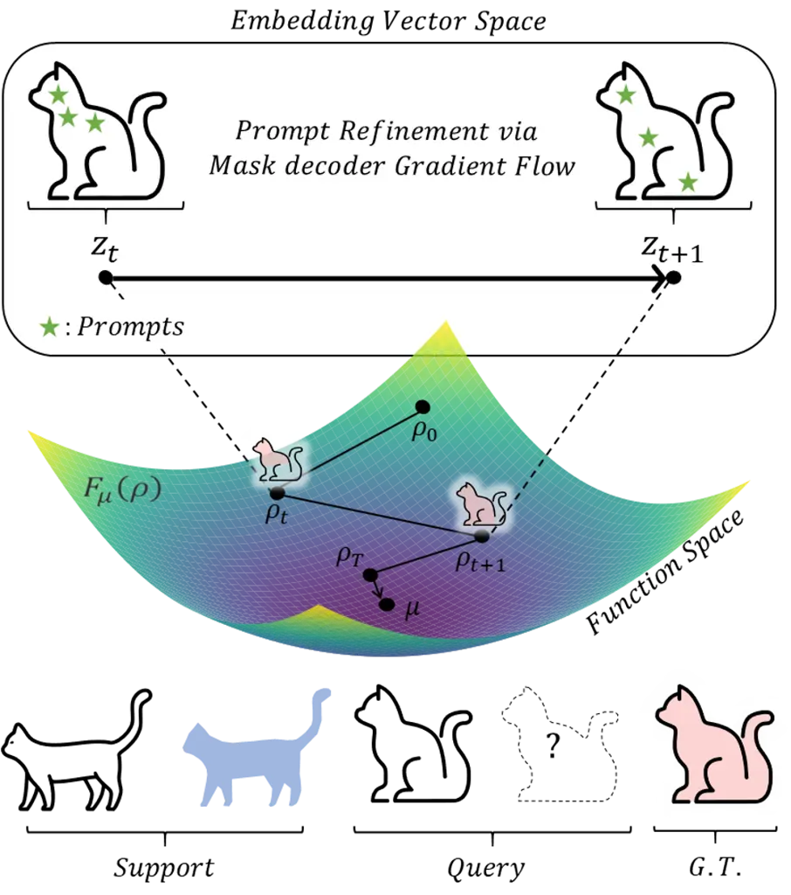

Figure 1: Illustration of PR-MaGIC. PR-MaGIC iteratively refines prompts
for segmentation by updating the embedding vector distribution
$`\rho_{t}`$ with mask decoder gradient flow. This process minimizes the
KL divergence between $`\rho_{t}`$ and the target embedding vector
distribution $`\mu`$ from the ground truth mask. At each iteration
$`t`$, given an initial set of prompts and their corresponding
segmentation masks, the embedding vector $`z_{t}`$ is updated along the
gradient flow derived from the mask decoder, which in turn updates
$`\rho_{t}`$.


(a) Support Image


(b) PerSAM-F

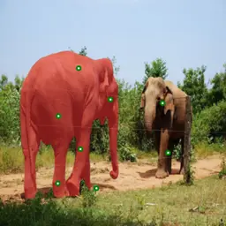

(c) Matcher

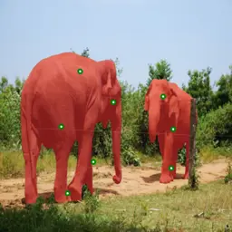

(d) PR-MaGIC


(e) Ground Truth

Figure 2: Example of prompts (green dots) and segmentation results (red
masks). (a) Support Image (elephant), (b) and (c) Misaligned prompts and
segmentation results from PerSAM-F and Matcher, (d) Result from Matcher
refined by PR-MaGIC, (e) Ground Truth.

While SAM is highly versatile, it often produces imprecise boundaries
and small holes under complex conditions, as it was trained for general
object segmentation at relatively low resolution. Initial efforts
fine-tuned SAM to improve segmentation precision across various
scenarios \[4, 10, 28\]. However, these methods still substantially
depend on additional parameters, extra curated data, and manual effort
to obtain suitable prompts. Recent works integrate VFMs into
one/few-shot (in-context) segmentation to enable auto-prompting via
support–query semantic alignment. PerSAM \[32\] uses a single support
image with a rough mask to build similarity-based prompts, and
PerSAM-F \[32\] further fine-tunes SAM to linearly combine hierarchical
masks to reduce ambiguity. Matcher \[14\] assembles existing VFMs with
sophisticated prompt sampling to solve one/few-shot segmentation without
extra training.

Although the methods mentioned above have been successful, variations in
appearance (e.g., color, viewpoint, and shape) between query and support
images often lead to misleading similarity maps. This causes
auto-prompting segmentation frameworks (e.g., PerSAM-F \[32\] and
Matcher \[14\]) to generate inadequate prompts, e.g., false-positive,
semantically ambiguous, or semantically insufficient prompts, that
confuse the SAM’s decoder in capturing the target object, thereby
compromising the quality of the segmentation mask.

This challenge motivates us to explore a refinement strategy that
updates the initial suboptimal prompts produced by existing
auto-prompting segmentation frameworks using mask decoder gradient flow.
Such an approach leverages the rich information embedded in the decoder,
which has been jointly trained with the encoder during SAM’s large-scale
pretraining. In this regime, we propose Prompt Refinement via Mask
Decoder Gradient Flow for In-Context Segmentation (PR-MaGIC). PR-MaGIC
is a _training-free_, inference-time framework that updates the query
embedding via a mask–decoder–driven gradient flow, resamples prompts,
and thereby improves the segmentation quality. The update is motivated
by finding the distribution that yields the highest mask quality under
the VFM’s mask decoder, which aligns the query embedding with the target
object’s semantics during inference. Fig. 1 overviews the gradient flow,
where the query embedding distribution is progressively refined.

Our theoretical analysis shows exponential convergence of the gradient
flow _under a proximity assumption_: the initial embedding distribution
lies near a decoder-optimal neighborhood. For the initial auto-prompts
that do not comply with the assumption, we explore multiple refinement
steps and adaptively select the most reliable mask to achieve stable
performance across samples. The key contributions of this work are as
follows:

- •
  Training-free test-time refinement via gradient flow. We introduce a
  novel, training-free refinement method that updates the query
  embedding with a mask–decoder–driven gradient flow and resamples
  prompts, improving segmentation quality without learnable parameters,
  architectural changes, or extra data.
- •
  Segmentation mask selection for robustness. We generate candidate
  masks across $`T`$ iterations and propose a simple top-1 support–query
  similarity selection to choose the final mask, which safeguards
  against step-size sensitivity and sample-dependent instability.
- •
  Convergence analysis under a proximity assumption. We provide a
  theoretical analysis showing that, _when the initial embedding
  distribution is near a decoder-optimal neighborhood_, the
  entropy-regularized KL gradient flow drives exponential convergence of
  the query embeddings. We further complement this with a sensitivity
  study indicating that the assumption can be fragile in practice,
  motivating our segmentation mask selection step.

We validate PR-MaGIC on six datasets and two tasks (semantic and part
segmentation), demonstrating consistent gains as a plug-and-play module,
particularly when the semantic gap between support and query is not
excessive. A comparative exemplar result is given in Fig. 2, which
illustrates that PR-MaGIC produces better prompts and more precise masks
successfully capturing the complete target objects, unlike PerSAM-F and
Matcher which tend to yield less effective prompts.

## 2 Related Works

### 2.1 One/Few-shot segmentation

Few-shot segmentation aims to develop models capable of segmenting new
classes using only a few annotated samples \[22\], making it
particularly useful in scenarios where acquiring large annotated data is
difficult. Typically, these models use a pre-trained feature extractor
to process both support and query images, combining information from
support images to perform segmentation \[31, 9\].

Recently, several approaches leveraging SAM as a pre-trained model have
been proposed. PerSAM relies solely on one-shot data, comprising a
support image and a rough mask of the target object. It utilizes a
similarity map between a query and target object embeddings to locate
the target object precisely, facilitating prompt generation. However,
PerSAM faces challenges when there is large visual ambiguity, such as
objects with visually distinct subparts or hierarchical structures
\[32\]. PerSAM-F, fine-tuning variant of PerSAM, addresses this problem
by introducing learnable parameters to fine-tune SAM, producing a linear
combination of potential segmentation masks of different hierarchical
levels to resolve ambiguity \[32\]. This approach improves segmentation
accuracy and prevents overfitting on one-shot data, demonstrating
enhanced performance in challenging scenarios. Similarly, Matcher
\[14\], effectively combines pre-existing VFMs to tackle one/few-shot
segmentation tasks without additional training. Matcher utilizes DINOv2
\[17\] as an encoder to compute a similarity map with semantic
understanding to accurately identify the location of a target object in
the query image. It then employs SAM as a segmenter to obtain
segmentation masks, benefiting from the zero-shot segmentation
performance of the SAM.

### 2.2 Fine-tuning variants of SAM

For efficient adaptation of SAM to various downstream tasks, a range of
fine-tuning variants has emerged. HQ-SAM \[10\], for instance, adds a
high-quality output token and trains on the HQSeg-44K dataset to improve
mask precision. VRP-SAM \[25\] implements a visual reference prompt
encoder, requiring specific reference images and detailed training.
SAM-Adapter \[4\] modifies the architecture by adding lightweight
adapter layers while keeping most of SAM’s original parameters frozen,
reducing training effort. MobileSAM \[30\] replaces the heavy ViT-H
encoder with Tiny-ViT, reducing the model size and complexity while
still requiring adaptation.

All of these methods, however, necessitate additional training data and
structural changes to the model architecture. These fine-tuning
strategies still heavily depend on manual prompts, with training
datasets requiring carefully crafted prompt annotations alongside
segmentation data. This reliance on curated prompts limits their
applicability in real-world settings, where obtaining accurate prompts
and consistent user interaction may be challenging.

## 3 Method

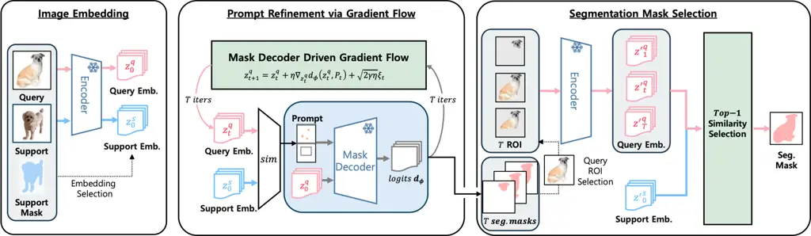

Figure 3: Overview of PR-MaGIC. _Encoder_ box denotes image encoder
($`E_{\theta}`$), _sim_ box denotes similarity computing module, and
_Mask Decoder_ box denotes SAM’s mask decoder. SAM’s prompt encoder is
omitted here to show the clear flow of our method, and green boxes
denote our core method. 1) Image Embedding: _Encoder_ maps the support
and query images to embeddings $`\mathbf{z}^{s}_{0}`$ and
$`\mathbf{z}^{q}_{0}`$, with $`\mathbf{z}^{s}_{0}`$ selected using the
given support mask. 2) Prompt Refinement via Gradient Flow: Using _Mask
Decoder_’s logit $`d_{\phi}`$, we update the query embeddings by the
mask decoder driven gradient flow, resample prompts $`P_{t+1}`$ from
$`S_{t+1}`$, and iterate for $`t{=}0{\ldots}T{-}1`$ to form a candidate
set of masks $`\{\hat{\mathbf{m}}_{t}\}_{t=1}^{T}`$. 3) Segmentation
Mask Selection (Top-1 similarity selection): Among the generated masks,
we select the one whose mask-aware query embedding $`z^{\prime q}_{t}`$
exhibits the highest similarity to the support embedding
$`z^{\prime s}`$.

This section presents PR-MaGIC, a training-free, test-time refinement
framework for promptable segmentation. Starting from support and query
embeddings, we run a _mask-decoder–driven gradient flow_ that
iteratively updates the query embedding and resamples prompts to produce
a set of candidate masks; we then apply _Segmentation Mask Selection_
via Top-1 support–query similarity to choose the final mask (Fig. 3).

Below, we introduce the entropy-regularized KL gradient flow, detail the
refinement with the segmentation mask decoder and the segmentation mask
selection, and conclude with the motivation grounded in a convergence
analysis.

### 3.1 Gradient flow of entropy-regularized KL-divergences

This subsection briefly describes the construction of the gradient flow
of entropy-regularized KL-divergences for mask decoder-driven gradient
flow. More details can be found in the overview in \[21\] and
discriminator gradient flow \[1\] that forms the basis of our research.

Let $`\mathbf{v}`$ be a vector of interest (e.g., a latent vector of a
query image), and let $`\rho(\mathbf{v})`$ and $`\mu(\mathbf{v})`$ be
the candidate and target (ideal) probability density functions (pdf)
over $`\mathbf{v}`$, respectively, assuming that the optimal
segmentation mask is distributed over $`\mu`$ in the latent space. For
simplicity, we restrict our discussion to pdfs defined on $`\mathbf{v}`$
that belongs to the 2-Wasserstein space $`\mathcal{W}_{2}`$.

We now employ the gradient flow to update $`\mathbf{v}`$ in order to
make the candidate distribution $`\rho`$ approximate the target
distribution $`\mu`$. Specifically, our focus lies in minimizing the
entropy-regularized KL-divergence $`\mathrm{F}_{\mu}(\rho)`$ between the
target distribution $`\mu`$ and its candidate distribution $`\rho`$ as:

```math
\displaystyle\begin{split}\min_{\rho}\mathrm{F}_{\mu}(\rho)&=\min_{\rho}\Bigl\{\mathrm{KL}(\mu\|\rho)-\gamma\,\mathrm{H}(\rho)\Bigr\}\\
&=\min_{\mathbf{v}}\left\{\begin{aligned} &\int\log\!\Bigl(\frac{\mu(\mathbf{v})}{\rho(\mathbf{v})}\Bigr)\mu(\mathbf{v})\,d\mathbf{v}\\
&\quad+\gamma\int\rho(\mathbf{v})\log\bigl(\rho(\mathbf{v})\bigr)\,d\mathbf{v}\end{aligned}\right\},\end{split} \tag{1}
```

where $`\mathrm{KL}(\mu\|\rho)`$ represents the KL-divergence between
two distributions $`\mu`$ and $`\rho`$, $`\mathrm{H}(\cdot)`$ denotes
the entropy function, and $`\gamma>0`$ is a hyperparmeter that controls
the strength of the entropy regularization. Then, the gradient flow of
the functional $`\mathrm{F}_{\mu}(\rho)`$ is given by:

```math
\displaystyle\begin{split}\frac{\partial\rho}{\partial t}=-\nabla\mathrm{F}_{\mu}(\rho_{t}),\end{split} \tag{2}
```

where the subscript $`t`$ refers to the time (iteration) index
throughout this work. Equivalently, Eq. 1 follows a partial differential
equation as:

```math
\displaystyle\begin{split}\partial_{t}\rho_{t}(\textbf{v})&-\nabla_{\textbf{v}}\cdot\left(\rho_{t}(\textbf{v})\nabla_{\textbf{v}}\log(\rho_{t}(\textbf{v})/\mu(\textbf{v}))\right)\\
&-\gamma\Delta_{\textbf{v}\textbf{v}}\rho_{t}(\textbf{v})=0,\end{split} \tag{3}
```

where $`\nabla_{\textbf{v}}`$ and $`\Delta_{\textbf{v}\textbf{v}}`$
denote the divergence and the Laplace operators, respectively \[1\]. The
Eq. 3, which is a type of Fokker-Plank equation \[20\], can be rewritten
as an equivalent stochastic differential equation (SDE) defined as:

```math
\displaystyle\begin{split}d\textbf{v}_{t}=-\nabla_{\textbf{v}}\log(\rho_{t}(\textbf{v})/\mu(\textbf{v}))dt+\sqrt{2\gamma}d\textbf{w}_{t},\end{split} \tag{4}
```

where $`\textbf{w}_{t}`$ follows a standard Wiener process \[20\].

We can simulate a sample $`\textbf{v}_{0}\sim\rho_{0}=\rho`$ using Eq. 4
to obtain a sample close to $`\mu`$. In practice, this simulation is
approximated using the Euler-Maruyama method \[12\]:

```math
\displaystyle\begin{split}\textbf{v}_{t+1}=\textbf{v}_{t}-\eta\nabla_{\textbf{v}}\log(\rho_{t}(\textbf{v})/\mu(\textbf{v}))+\sqrt{2\gamma\eta}\mathbf{\xi}_{t},\end{split} \tag{5}
```

where $`\eta>0`$ is the step size,
$`\mathbf{\xi}_{t}\sim\mathcal{N}(\textbf{0},\textbf{I})`$, and
$`t\in\left[0,T\right]`$ for the predefined number of iterations $`T`$.
Furthermore, we can address intractability of $`\mu(\mathbf{v})`$ in
Eq. 5 by approximating the density ratio
$`\frac{\rho_{t}(\textbf{v})}{\mu(\textbf{v})}`$ as
$`\frac{\rho_{0}\textbf{v})}{\mu(\textbf{v})}`$, as
$`\frac{\rho_{t}(\textbf{v})}{\mu(\textbf{v})}\approx\frac{\rho_{0}(\textbf{v})}{\mu(\textbf{v})}`$
for small $`t`$ and $`\eta\to 0`$. Given a prediction head
$`D_{\phi}(\textbf{v})`$ (e.g., mask decoder parameterized by $`\phi`$)
that represents the conditional probability of v being a sample from
$`\mu`$, the following expression provides an approximation for the
density ratio \[24\]:

```math
\displaystyle\begin{split}\frac{\rho_{0}(\textbf{v})}{\mu(\textbf{v})}&=\frac{1-D_{\phi}(\textbf{{v}})}{D_{\phi}(\textbf{v})}=\exp{(-d_{\phi}(\textbf{v}))}.\end{split} \tag{6}
```

Substituting Eq. 6 into Eq. 5 yields the following results:

```math
\displaystyle\begin{split}\textbf{v}_{t+1}&=\textbf{v}_{t}-\eta\nabla_{\textbf{v}}\log\left(\frac{1-D_{\phi}(\textbf{{v}})}{D_{\phi}(\textbf{v})}\right)+\sqrt{2\gamma\eta}\mathbf{\xi}_{t}\\
&=\textbf{v}_{t}+\eta\nabla_{\textbf{v}}d_{\phi}(\textbf{v})+\sqrt{2\gamma\eta}\mathbf{\xi}_{t},\end{split} \tag{7}
```

where $`d_{\phi}(\textbf{v})=-\log((1-D_{\phi})/D_{\phi})`$ is the logit
output of the predictor $`D_{\phi}`$¹¹ 1 Although the $`D_{\phi}`$ takes
prompts such as bounding boxes and prompt points as inputs in addition
to v, we omitted them in Eq. 6 and Eq. 7 for clarity..

In this work, $`\rho`$ and $`\mu`$ denote the distributions of query
embeddings from the VFM encoder and optimal embeddings for the mask
decoder, respectively, with $`D_{\phi}`$ representing SAM’s mask decoder
(a pixel-wise classifier). While a dedicated discriminator would be more
principled for $`D_{\phi}`$, we employ this lightweight proxy to enable
a training-free framework.

### 3.2 Prompt refinement via gradient flow

In this section, we elaborate how gradient flow can be adopted for
refining predicted masks. We describe the general framework of few-shot
segmentation using promptable segmentation models, and then discuss our
method for improving mask quality using mask decoder gradient flow. As
illustrated in Fig. 3, the first step is to extract image embeddings of
a support image $`\textbf{I}^{s}`$ and a query image $`\textbf{I}^{q}`$
by an image encoder $`E_{\theta}`$ as

```math
\displaystyle\begin{split}\textbf{z}_{0}^{s}=E_{\theta}(\textbf{I}^{s})\ ,\quad\textbf{z}_{0}^{q}=E_{\theta}(\textbf{I}^{q}),\end{split} \tag{8}
```

where $`\textbf{z}_{0}^{s}`$ and $`\textbf{z}_{0}^{q}`$ are initial
image embeddings of $`\textbf{I}^{s}`$ and $`\textbf{I}^{q}`$,
respectively. Across the two images, Eq. 8 yields two embedding sets,
$`\{\mathbf{z}^{s}_{0,i}\}_{i=1}^{N_{s}}`$ and
$`\{\mathbf{z}^{q}_{0,j}\}_{j=1}^{N}`$, where $`N_{s}`$ is the number of
pixels within the support mask and $`N`$ is the total number of pixels
in the embedding space. Then, we compute the initial similarity matrix
$`S_{0}`$ between the query embeddings and the support embeddings. The
i-$`{th}`$ row and j-$`{th}`$ column of the $`S_{0}`$ is computed as:

```math
\displaystyle\begin{split}S_{0}[i,j]=\textit{sim}(\textbf{z}_{0,i}^{s},\textbf{z}_{0,j}^{q}),\end{split} \tag{9}
```

where $`sim(\cdot,\cdot)`$ denotes a similarity function between the two
vectors, representing the similarity computation module of the few-shot
segmentation model. Finally, we sample prompts $`P_{0}`$ representing
the position of the target object, and obtain an initially predicted
mask $`\hat{\textbf{m}}_{0}`$ using a mask decoder $`D_{\phi}^{bin}`$:

```math
\displaystyle\begin{split}P_{0}&=\textit{prompt\_sampler}(S_{0}),\end{split} \tag{10}
```

```math
\displaystyle\begin{split}\hat{\textbf{m}}_{0}&=D_{\phi}^{bin}(\textbf{z}_{0}^{q};P_{0}),\end{split} \tag{11}
```


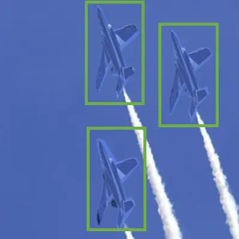

(a) Source


(b) Baseline


(c) $`t=1`$


(d) $`t=5`$


(e) GT

Figure 4: Refinement process of PR-MaGIC. Curated illustrations of
refinement process with PerSAM-F as the baseline. a) Target objects in
the support images with blue masks (bear (top) and airplane (bottom)),
b) Segmentation results from PerSAM-F with point prompts in green dots.
c), d) Refined prompt and segmentation after one and five iterations, e)
Ground truth (G.T.).

where $`P_{0}`$ is a set of prompts obtained from the similarity map
$`S_{0}`$, and examples of prompt*sampler include top-$`k`$ sampling
\[32\] and robust sampler \[14\]. During this process, some prompts in
the set $`P*{0}`$ may be false positives or semantically confusing, and
several methods have been proposed to address this issue, such as
cascaded refinement, mask filtering, and robust sampling \[32, 14\].
While these approaches yield reasonably refined masks, the results still
remain suboptimal (see Fig. 2).

Thus, we propose our process for aligning prompts $`P_{t}`$ with the
query image semantics $`z^{q}_{t}`$ using the gradient flow derived from
the mask decoder using Eq. 7. In particular, we seek to enhance mask
quality by iteratively updating the query embeddings, encouraging that
predicted masks are more closely aligned with samples from the true mask
distribution. Formally, we have the following process in the embedding
space:

```math
\displaystyle\begin{split}\textbf{z}^{q}_{t+1}&=\textbf{z}^{q}_{t}+\eta\nabla_{\textbf{z}^{q}_{t}}d_{\phi}(\textbf{z}^{q}_{t},P_{t})+\sqrt{2\gamma\eta}\mathbf{\xi}_{t},\end{split} \tag{12}
```

```math
\displaystyle\begin{split}S_{t+1}[i,j]&=\textit{sim}(\textbf{z}_{0,i}^{s},\textbf{z}_{t+1,j}^{q}),\end{split} \tag{13}
```

```math
\displaystyle\begin{split}P_{t+1}&=\textit{prompt\_sampler}(S_{t+1}),\end{split} \tag{14}
```

```math
\displaystyle\begin{split}\hat{\textbf{m}}_{t+1}&=D_{\phi}^{bin}(\textbf{z}_{0}^{q};P_{t+1}).\end{split} \tag{15}
```

At the $`t`$-th iteration, we refine the query embedding
$`\mathbf{z}_{t}^{q}`$ via the mask-decoder driven gradient flow in
Eq. 12, update the similarity $`S_{t+1}`$ as in Eq. 13, and resample
prompts $`P_{t+1}`$ from $`S_{t+1}`$ per Eq. 14. We then decode a
candidate segmentation mask $`\hat{\mathbf{m}}_{t+1}`$ using
$`D_{\phi}^{bin}`$ as in Eq. 15. Repeating this procedure for
$`t=0,\ldots,T\!-\!1`$ yields a set of candidates
$`\mathcal{M}=\{\hat{\mathbf{m}}_{t}\}_{t=0}^{T}`$.

Restricting the refinement to the prompt space preserves the generality
of our method across different visual-prompt frameworks, where
feature-level updates could easily depend on architecture-specific
representations. Furthermore, the near-optimal assumption of the
embedding space does not necessarily hold in practice, and direct
modifications of the embedding may introduce instability. To achieve a
balanced trade-off between robustness and adaptability, we use the
refined embedding $`z^{q}_{t}`$ only for prompt resampling, while
decoding is performed with the stable representation $`z^{q}_{0}`$.

image encoder $`E_{\theta}`$, mask decoder $`D_{\phi}`$, similarity sim,
prompt sampler, iterations $`T`$

Init: Encode support/query $`\rightarrow`$
$`(\mathbf{z}^{s}_{0},\mathbf{z}^{q}_{0})`$; compute $`S_{0}`$; sample
$`P_{0}`$.

Initialize candidate masks $`\mathcal{M}\leftarrow\emptyset`$, scores
$`\mathcal{S}\leftarrow\emptyset`$.

for $`t=0`$ to $`T-1`$ do

  Gradient Flow: update query embedding (Eq. 12).

  Recompute similarity $`S_{t+1}`$; resample prompts $`P_{t+1}`$.

  Decode mask
$`\hat{\mathbf{m}}_{t+1}\leftarrow D^{bin}_{\phi}(\mathbf{z}^{q}_{0};P_{t+1})`$.

  Append $`\hat{\mathbf{m}}_{t+1}`$ to $`\mathcal{M}`$.

  Score
$`s_{t+1}\leftarrow\textit{sim}(\text{support},\,\text{query masked by }\hat{\mathbf{m}}_{t+1})`$.

  Append $`s_{t+1}`$ to $`\mathcal{S}`$.

end for

Best Mask Selection: $`t^{\star}\leftarrow\arg\max s_{t}`$;

return
$`\hat{\mathbf{m}}^{\star}\leftarrow\hat{\mathbf{m}}_{t^{\star}}`$

Algorithm 1 PR-MaGIC: Gradient-Flow Prompt Refinement with Top-1
Similarity Selection

### 3.3 Segmentation mask selection

For selecting the best segmentation mask, we compute a similarity score
$`s_{t}`$ between the support embedding and the query embedding
aggregated inside $`\hat{\mathbf{m}}_{t}`$ (e.g., masked average
pooling), and choose the final mask by top-1 similarity.

Let $`\mathbf{m}^{s}\in\{0,1\}^{N}`$ be the given support mask and
$`\hat{\mathbf{m}}_{t}\in\{0,1\}^{N}`$ be the candidate mask at
iteration $`t`$. We obtain embeddings inside a mask,
$`\mathbf{z}^{\prime s}`$ and $`\mathbf{z}^{\prime q}`$, using

```math
\displaystyle\begin{split}\mathbf{z}^{\prime s}=E_{\theta}(\mathbf{I}^{s}\odot m^{s}),\quad\mathbf{z}^{\prime q}_{t}=E_{\theta}(\mathbf{I}^{q}\odot\hat{m_{t}}).\end{split} \tag{16}
```

We then form the support and query representatives

```math
\displaystyle\begin{split}\bar{\mathbf{z}}^{\prime s}\;=\;{{1}\over{|N|}}\sum_{i=1}^{N}\mathbf{z}^{\prime s},\quad\bar{\mathbf{z}}^{\prime q}_{t}\;=\;{{1}\over{|N|}}\sum_{i=1}^{N}\mathbf{z}^{\prime q}_{t}.\end{split} \tag{17}
```

Given a similarity function $`sim(\cdot,\cdot)`$, e.g., cosine
similarity, we score each candidate by

```math
\displaystyle\begin{split}s_{t}\;=\;sim\!\left(\bar{\mathbf{z}}^{\prime s},\,\bar{\mathbf{z}}^{\prime q}_{t}\right),\quad t=0,\dots,T.\end{split} \tag{18}
```

Finally, we select the best iteration $`t^{*}`$ via top-1 similarity:

```math
\displaystyle t^{\star}\;=\;{\arg\max}_{t\in\{0,\dots,T\}}s_{t}. \tag{19}
```

Accordingly, the final mask $`\hat{\mathbf{m}}^{\star}`$ is obtained as
$`\hat{\mathbf{m}}^{\star}=\hat{\mathbf{m}}_{t^{\star}}`$. Our overall
algorithm is summarized in Alg. 1, and Fig. 4 illustrates the
progressive refinement process where the points located at the same
position are pruned.

### 3.4 Motivation for the gradient flow and top-1 similarity selection

Our goal is to refine prompts by updating the query embedding via a
gradient flow, and then to select a reliable mask among the candidates
generated across iterations. The design is motivated by a convergence
perspective.

Motivation for gradient-flow updates. First of all, we demonstrate
theoretical convergence of PR-MaGIC in the following proposition, whose
proof is given in Appendix A.

###### Proposition 1.

Let $`\rho_{t}`$ be a candidate pdf in 2-Wasserstein space
$`\mathcal{W}_{2}`$ being updated according to the gradient flow of the
entropy-regularized KL-divergence $`F_{\mu}(\rho)`$ with local minimum
$`\mu^{*}`$. If the initial pdf $`\rho_{0}`$ lies in a neighborhood of
$`\mu^{*}`$, then $`\rho_{t}`$ converges to $`\mu^{*}`$ exponentially as
$`t\to\infty`$.

Now let $`\rho_{t}`$ denote the distribution of query embeddings at
iteration $`t`$ and let $`\mu^{\star}`$ be a (local) optimum that is
most consistent with the mask decoder. Under the proximity assumption
that the initial embedding distribution $`\rho_{0}`$ lies in a
neighborhood of $`\mu^{\star}`$ (which is a plausible scenario for a
pre-trained VFM), the entropy-regularized KL gradient flow drives
$`\rho_{t}`$ toward $`\mu^{\star}`$ at an exponential rate
(Proposition 2). Hence, even a small number of iterations improves the
mask quality, which justifies our use of gradient flow refinement.

Motivation for top-1 similarity selection. The proximity assumption does
not always hold in practice (Sec. 4.4). We empirically observe cases
where $`\rho_{0}`$ is not sufficiently close to $`\mu^{\star}`$, leading
to suboptimal or unstable refinements. To cope with such violations, we
record a set of candidate masks over $`T`$ iterations and introduce a
simple yet effective top-1 similarity selection: among the candidates,
we choose the mask whose corresponding query embedding is most similar
to the support embedding. This selection step acts as a practical
safeguard, retaining gains when the assumption holds while improving
robustness when it does not (see sensitivity analysis and convergence
failure cases in  Sec. 4.3 and  Sec. 4.4, respectively).

## 4 Experiments

We evaluate PR-MaGIC across six benchmark datasets for two separate
segmentation tasks. All experiments are conducted under identical
protocols to assess segmentation quality and generalization.


Support Image


Baseline


Refined (Ours)


Ground Truth

(f) Semantic Segmentation

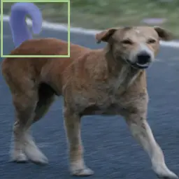

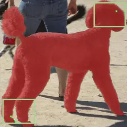

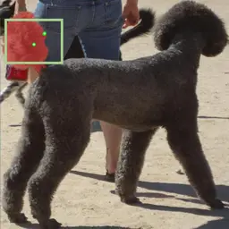


Support Image

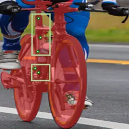

Baseline

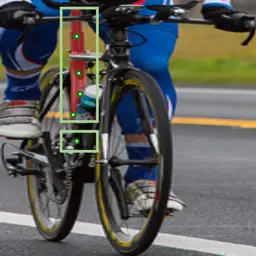

Refined (Ours)


Ground Truth

(g) Part Segmentation

Figure 5: Qualitative results for semantic and part segmentation.
Baselines from top to bottom: PerSAM-F, Matcher. a): Semantic
segmentation. Target objects in support images are highlighted with blue
masks, and point prompts are denoted by green dots. b): Part
segmentation. Here, target objects are highlighted with blue masks in
green boxes, and point prompts are similarly marked and emphasized.
Refinement with PR-MaGIC (3$`rd`$ columns) improves the segmentation
over the baselines (2$`nd`$ columns).

|                 |              |           |           |           |       |           |           |       |           |                         |       |           |           |       |           |           |       |           |
| --------------- | ------------ | --------- | --------- | --------- | ----- | --------- | --------- | ----- | --------- | ----------------------- | ----- | --------- | --------- | ----- | --------- | --------- | ----- | --------- |
|                 | (a) Semantic |           |           |           |       |           |           |       |           | (b) Part / Fine-grained |       |           |           |       |           |           |       |           |
|                 | FSS          |           |           | COCO      |       |           | LVIS      |       |           | PACO                    |       |           | Pascal    |       |           | DIS       |       |           |
| Method          | B            | T         | O^(∗)     | B         | T     | O^(∗)     | B         | T     | O^(∗)     | B                       | T     | O^(∗)     | B         | T     | O^(∗)     | B         | T     | O^(∗)     |
| PerSAM-F        | $`85.85`$    | 87.26     | $`91.88`$ | $`53.36`$ | 55.96 | $`63.89`$ | $`47.62`$ | 50.76 | $`56.09`$ | $`45.21`$               | 48.17 | $`54.20`$ | $`48.43`$ | 51.69 | $`57.08`$ | $`60.90`$ | 64.66 | $`71.98`$ |
| Matcher(1-shot) | $`92.08`$    | $`92.06`$ | $`93.55`$ | $`69.53`$ | 71.23 | $`76.14`$ | $`59.39`$ | 61.52 | $`64.75`$ | $`50.27`$               | 54.08 | $`56.71`$ | $`54.76`$ | 58.28 | $`61.13`$ | $`46.65`$ | 55.08 | $`58.10`$ |
| Matcher(5-shot) | $`93.26`$    | 93.41     | $`94.32`$ | $`67.69`$ | 70.74 | $`74.88`$ | $`57.14`$ | 60.79 | $`63.88`$ | $`48.66`$               | 53.15 | $`55.30`$ | $`54.54`$ | 59.27 | $`61.55`$ | –         | –     | –         |

Table 1: mIoU (%) on six datasets. B = baseline, O = PR-MaGIC with
Oracle selection (^(∗)), T = PR-MaGIC with Top-1 selection. Bold
indicates T values that improve over baseline.

### 4.1 Experiment setup

Datasets. We evaluated PR-MaGIC through two tasks: 1) semantic
segmentation to assess overall object understanding, and 2) part
segmentation to evaluate detailed context understanding. Semantic
segmentation performance was assessed on three datasets: FSS-1000
\[13\], LVIS-92^(i) \[14\] and COCO-20^(i) \[16\]. For part
segmentation, we used another three datasets: PASCAL-Part \[8, 5, 13\],
PACO-Part \[14, 19\], and DIS5K \[18\]. We strictly followed the data
preprocessing and evaluation protocols outlined in \[14\].

Baselines. We utilize PerSAM-F and Matcher as our baseline methods and
demonstrate that PR-MaGIC enhances the segmentation mask quality for
both methods. PerSAM-F uses SAM as its backbone model, fully leveraging
it to capture visual clues of target objects in the support images. In
contrast, Matcher employs DINOv2 \[17\] with the ViT-L/14 architecture
\[7\] as an image encoder to extract embeddings from both query and
support images, and uses SAM’s decoder as the segmenter.

Evaluation. To assess the refinement procedure, we report both top-1
selection and oracle mean Intersection over Union (mIoU) gain of
PR-MaGIC over baselines. Oracle results are achieved by selecting the
most accurate segmentation mask among $`T`$$`=`$$`5`$ refinement steps.
The oracle selection is structurally similar to test-time refinement,
providing a meaningful upper bound that highlights the capacity of
PR-MaGIC. We provide one-shot segmentation performance and additionally
provide few-shot (5-shot) results. To further justify our result, we
conducted sensitivity analysis on hyperparameters $`\eta`$ and $`T`$ in
Sec. 4.3.

Setup of PR-MaGIC. Across all the datasets, we set the number of
iterations $`T=5`$. The $`\gamma`$ for entropy regularization was set as
0.1 without any tuning, and the $`\eta`$ for semantic segmentation was
0.001, and that of part segmentation was 0.0001. These $`\eta`$ were
determined from 10 randomly sampled images from left-aside validation
sets of COCO-20^(i) and PACO-part. The number of points for each method
was empirically chosen: For semantic segmentation, Matcher used 8 points
and PerSAM-F extracted 5 points as prompts. For part segmentation, the
number of points was set to 5 for the Matcher and to 3 for the PerSAM-F,
so that they better localize smaller objects. The similarity function
$`\textit{sim}()`$ for Eq. 14 was adopted according to individual
baselines \[32, 14\]. Finally, the gradients from PR-MaGIC were clipped
to ensure stability throughout the overall process. All experiments were
conducted with an NVIDIA RTX 6000 ada generation.

### 4.2 Experiment results

We present experiments on semantic and part segmentation, sensitivity
analysis with respect to step size and iteration count, and a
sample-wise analysis of optimal step variability. To evaluate the
effectiveness of our iterative refinement process, we report three types
of results: the baseline (B), PR-MaGIC with Top-1 similarity selection
(T), and PR-MaGIC with Oracle selection (O). The oracle provides the
best achievable mIoU across all iterations of PR-MaGIC, serving as an
empirical upper bound of our model. Due to space limitations, the
average mIoU progression with a fixed number of iterations is shown in
Appendix B and 1-shot segmentation results across random seeds are
provided in Appendix C. Furthermore, qualitative results are provided in
Appendix D and E.

#### 4.2.1 Semantic segmentation

The semantic segmentation results evaluate how effectively our
refinement process enhances object-level segmentation quality across
different datasets. As summarized in  Tab. 1, our method consistently
improves mIoU on COCO-20^(i), FSS-1000, and LVIS-92^(i). The PR-MaGIC
improves the baseline by +8.8%p on FSS, +2.2%p on COCO, and +2.1%p on
LVIS for PerSAM-F, confirming that the refinement process effectively
boosts segmentation accuracy at the object level. A small gain observed
on FSS-1000 for Matcher(1-shot) is mainly due to its already saturated
baseline performance. In contrast, the refinement yields a pronounced
gain for PerSAM-F, showing that our method provides substantial benefits
when the initial prediction is less optimal.

Qualitative results in  Fig. 5(a) show that baseline predictions often
miss object regions or include background noise (e.g., the fire hydrant
($`1`$st row) or cupcakes ($`2`$nd row)). After refinement, our method
captures more precise boundaries and complete object shapes,
demonstrating that the proposed refinement process provides consistent
improvements without additional training or supervision.

#### 4.2.2 Part segmentation

Part segmentation focuses on assessing whether the refinement process
can capture fine-grained object structures and precisely delineate
relatively small but semantic parts of objects. Unlike semantic
segmentation, which evaluates holistic object understanding, this task
emphasizes local boundaries and subtle structural variations within a
single object, which is a more sensitive measure of effectiveness of
refinement process with PR-MaGIC.

As shown in the right columns of  Tab. 1, our method produces consistent
and often larger improvements compared to the baseline results. The
PR-MaGIC improves the baseline by +3.8%p on PACO and +8.4%p on DIS for
Matcher(1-shot), and by +1.1%p, +1.2%p, and +3.2%p on PACO, Pascal, and
DIS for PerSAM-F, respectively. These gains indicate improved recovery
of fine, part-level regions by our refinement method, especially when
baseline predictions lack fine structure or show local fragmentation.

Qualitative results in Fig. 5(b) support these observations. When
baseline outputs are misaligned or partially miss object parts (e.g.,
the wheels or handles of a bicycle ($`1`$st row) and the tail of a
poodle ($`2`$nd row)), the refined predictions yield accurate and
continuous part boundaries. Overall, the stronger relative improvement
in part and semantic segmentation suggests that the proposed iterative
updates preserve local spatial precision while maintaining global
consistency.

|                 |                   |                   |                   |                   |                   |                   |                   |                   |                   |                   |                   |                   |
| --------------- | ----------------- | ----------------- | ----------------- | ----------------- | ----------------- | ----------------- | ----------------- | ----------------- | ----------------- | ----------------- | ----------------- | ----------------- |
| Model           | FSS               |                   | COCO              |                   | LVIS              |                   | PACO-Part         |                   | Pascal-Part       |                   | DIS               |                   |
|                 | Oracle            | Top-1             | Oracle            | Top-1             | Oracle            | Top-1             | Oracle            | Top-1             | Oracle            | Top-1             | Oracle            | Top-1             |
| PerSAM          | 2.53 $`\pm`$ 1.71 | 2.61 $`\pm`$ 1.71 | 2.41 $`\pm`$ 1.72 | 2.51 $`\pm`$ 1.73 | 2.50 $`\pm`$ 1.71 | 2.48 $`\pm`$ 1.71 | 2.50 $`\pm`$ 1.72 | 2.48 $`\pm`$ 1.72 | 2.49 $`\pm`$ 1.72 | 2.48 $`\pm`$ 1.72 | 2.45 $`\pm`$ 1.72 | 2.49 $`\pm`$ 1.69 |
| Matcher (1shot) | 2.45 $`\pm`$ 1.72 | 2.55 $`\pm`$ 1.71 | 2.47 $`\pm`$ 1.74 | 2.47 $`\pm`$ 1.72 | 2.05 $`\pm`$ 1.80 | 2.05 $`\pm`$ 1.81 | 2.44 $`\pm`$ 1.73 | 2.46 $`\pm`$ 1.73 | 2.44 $`\pm`$ 1.73 | 2.42 $`\pm`$ 1.72 | 2.51 $`\pm`$ 1.73 | 2.52 $`\pm`$ 1.70 |
| Matcher (5shot) | 2.50 $`\pm`$ 1.72 | 2.50 $`\pm`$ 1.73 | 2.41 $`\pm`$ 1.71 | 2.45 $`\pm`$ 1.74 | 2.29 $`\pm`$ 1.77 | 2.29 $`\pm`$ 1.77 | 2.49 $`\pm`$ 1.71 | 2.48 $`\pm`$ 1.71 | 2.48 $`\pm`$ 1.72 | 2.47 $`\pm`$ 1.72 | –                 | –                 |

Table 2: Mean $`\pm`$ std of the optimal iterations in PR-MaGIC under
Oracle and Top-1 selection across various datasets and baselines.

### 4.3 Sensitivity analysis

We randomly sampled 100 examples from the set-aside dataset (COCO-20^(i)
training dataset) to conduct the sensitivity analysis on the step size
($`\eta`$) and the number of iterations ($`T`$). For the analysis, we
evaluated the mIoU over iterations, testing up to 30 iterations with
step sizes of $`10^{-2}`$, $`10^{-3}`$, $`10^{-4}`$, and $`10^{-5}`$.
Fig. 6 shows a moving average with a window size of 2 to better identify
overall trends.

Findings. The result demonstrates that the proximity assumption
$`\rho_{0}\!\approx\!\mu^{\star}`$ is not reliably met in realistic
conditions. If the initial embedding distribution $`\rho_{0}`$ were
consistently close to the decoder-optimal $`\mu^{\star}`$, performance
should improve monotonically with small $`T`$ (Proposition 2). However,
our sensitivity results reveal frequent dependency on $`\eta`$ and
$`T`$, and non-monotonic mIoU trajectories. For instance,

- •
  $`\eta\!=\!10^{-2}`$ yields rapid early gains but degrades with more
  iterations (instability),
- •
  $`\eta\!\in\!\{10^{-4},10^{-5}\}`$ converges slowly and often
  saturates below the best achievable mIoU (under-refinement).

Implication and design choice. Given this practical difficulty in
convergence, mask selection was introduced as in Sec. 3.3. We run the
flow for $`T`$ iterations, collect the mask from each step as a
candidate, and apply top-1 support–query similarity to choose the final
output. This selection preserves improvements when refinement helps and
mitigates degradation when the flow drifts (see Sec. 4.4).

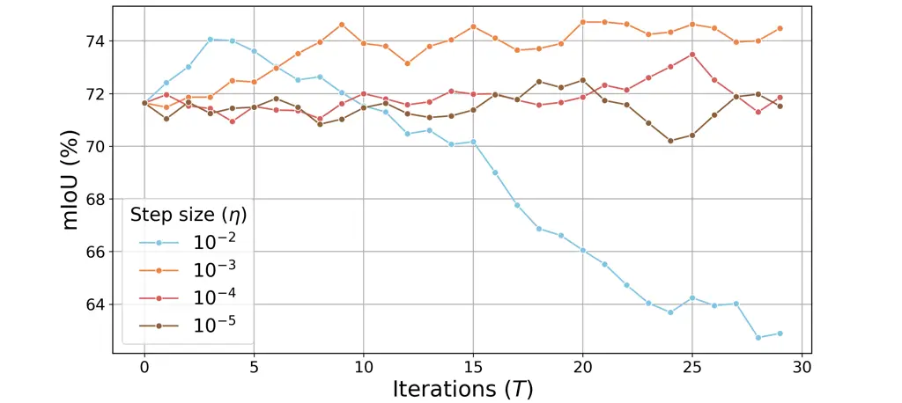

Figure 6: Sensitivity analysis on the step size $`\eta`$ and iterations
$`T`$ shows that the gradient flow can substantially improve
segmentation performance but may exhibit instability under certain
conditions, which motivates top-1 mask selection.

### 4.4 Sample-wise optimal step variability and convergence challenges

We analyze the refinement process by measuring the average iteration
(with corresponding standard deviation) at which the optimal performance
was achieved (Tab. 2) for both the oracle and top-1 results. The optimal
iteration typically occurred around the third refinement step,
suggesting that 5 iterations were sufficient to obtain refined outputs.
However, as shown by the relatively large standard deviations, the
optimal iteration varied considerably across samples. This variability
highlights the necessity of the top-1 selection step, which plays a
crucial role in stabilizing and enhancing the overall refinement
process.

Limitation. We also highlight challenging scenarios in which PR-MaGIC
struggles to converge. When the visual semantics of the support and
query images differ substantially (e.g., the $`1`$st and $`4`$th rows of
Fig. 7), prompt refinement becomes particularly difficult and often
leads to performance degradation. Convergence is also fragile when the
visual clues in the support image are ambiguous. As illustrated in
Fig. 7, PR-MaGIC fails to localize fine-grained parts of a bicycle
($`2`$nd row) and underperforms when the support shows a generic tray
while the query target is a specific boundary region ($`3`$rd row).
These observations collectively emphasize that the top-1 selection
serves as a practical safeguard against such convergence
failures—preserving the fully automatic advantage of PerSAM and Matcher
while enhancing robustness and bridging the gap between theoretical
convergence and real-world applicability.


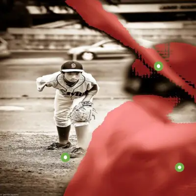


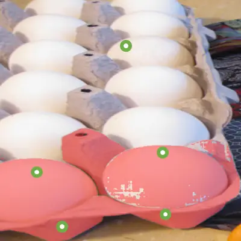


(a) Support

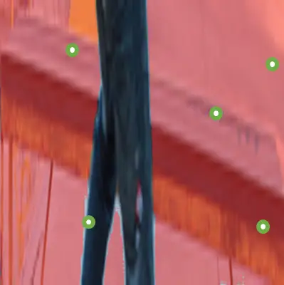

(b) Baseline

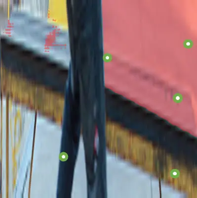

(c) $`t=1`$

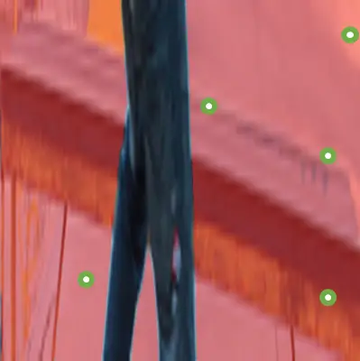

(d) $`t=5`$

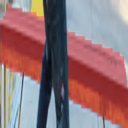

(e) GT

Figure 7: Convergence failure cases of PR-MaGIC. Each column represents:
(a) Support Image, (b) Baseline output, (c) PR-MaGIC ($`t=1`$), (d)
PR-MaGIC ($`t=5`$), and (e) Ground Truth. The top two rows compare
PR-MaGIC with PerSAM-F as the baseline, while the bottom two rows
compare PR-MaGIC with Matcher. In this case, PR-MaGIC selects the top-1
mask from the iterations.

## 5 Conclusion

We present a training-free refinement method that improves segmentation
quality using a promptable segmentation model, broadly applicable to
auto-prompting frameworks and validated by extensive quantitative and
qualitative studies. PR-MaGIC refines the visual clues for SAM’s mask
decoder via a gradient-flow update in the query embedding space,
enabling better alignment with target semantics. Our analysis shows
that, under a proximity assumption, the entropy-regularized KL gradient
flow yields rapid improvements with few iterations. While sensitivity
analyses suggest that our underlying assumption may be fragile in
certain cases, the proposed top-1 support–query similarity–based mask
selection effectively mitigates this limitation. Importantly, PR-MaGIC
remains fully training-free, introducing no learnable parameters,
architectural changes, or additional data requirements, yet it achieves
consistent improvements in segmentation quality with minimal
computational overhead.

Acknowledgment. This research was supported by RS-2025-02216257 (70%),
RS-2022-II220290 (20%), and RS-2019-II191906 (AI Graduate Program at
POSTECH, 10%).

## References

- \[1\] A. F. Ansari, M. L. Ang, and H. Soh (2021) Refining deep
  generative models via discriminator gradient flow. In International
  Conference on Learning Representations, Cited by: §3.1, §3.1.
- \[2\] T. Brown, B. Mann, N. Ryder, M. Subbiah, J. D. Kaplan, P.
  Dhariwal, A. Neelakantan, P. Shyam, G. Sastry, A. Askell, et
  al. (2020) Language models are few-shot learners. Advances in Neural
  Information Processing Systems 33, pp. 1877–1901. Cited by: §1.
- \[3\] N. Carion, F. Massa, G. Synnaeve, N. Usunier, A. Kirillov,
  and S. Zagoruyko (2020) End-to-end object detection with transformers.
  In European conference on computer vision, pp. 213–229. Cited by: §1.
- \[4\] T. Chen, L. Zhu, C. Deng, R. Cao, Y. Wang, S. Zhang, Z. Li, L.
  Sun, Y. Zang, and P. Mao (2023) Sam-adapter: adapting segment anything
  in underperformed scenes. In IEEE/CVF International Conference on
  Computer Vision, pp. 3367–3375. Cited by: §1, §2.2.
- \[5\] X. Chen, R. Mottaghi, X. Liu, S. Fidler, R. Urtasun, and A.
  Yuille (2014) Detect what you can: detecting and representing objects
  using holistic models and body parts. In IEEE conference on computer
  vision and pattern recognition, pp. 1971–1978. Cited by: §4.1.
- \[6\] B. Cheng, A. Schwing, and A. Kirillov (2021) Per-pixel
  classification is not all you need for semantic segmentation. Advances
  in Neural Information Processing Systems 34, pp. 17864–17875. Cited
  by: §1.
- \[7\] A. Dosovitskiy, L. Beyer, A. Kolesnikov, D. Weissenborn, X.
  Zhai, T. Unterthiner, M. Dehghani, M. Minderer, G. Heigold, S.
  Gelly, J. Uszkoreit, and N. Houlsby (2021) An image is worth 16x16
  words: transformers for image recognition at scale. External Links:
  2010.11929 Cited by: §1, §4.1.
- \[8\] M. Everingham, L. Van Gool, C. K. Williams, J. Winn, and A.
  Zisserman (2010) The pascal visual object classes (voc) challenge.
  International journal of computer vision 88, pp. 303–338. Cited by:
  §4.1.
- \[9\] S. Hong, S. Cho, J. Nam, S. Lin, and S. Kim (2022) Cost
  aggregation with 4d convolutional swin transformer for few-shot
  segmentation. In European Conference on Computer Vision, pp. 108–126.
  Cited by: §2.1.
- \[10\] L. Ke, M. Ye, M. Danelljan, Y. Tai, C. Tang, F. Yu, et
  al. (2024) Segment anything in high quality. Advances in Neural
  Information Processing Systems 36. Cited by: §1, §2.2.
- \[11\] A. Kirillov, E. Mintun, N. Ravi, H. Mao, C. Rolland, L.
  Gustafson, T. Xiao, S. Whitehead, A. C. Berg, W. Lo, et al. (2023)
  Segment anything. In IEEE/CVF International Conference on Computer
  Vision, pp. 4015–4026. Cited by: §1.
- \[12\] P. E. Kloeden, E. Platen, P. E. Kloeden, and E. Platen (1992)
  Stochastic differential equations. Springer. Cited by: §3.1.
- \[13\] X. Li, T. Wei, Y. P. Chen, Y. Tai, and C. Tang (2020) Fss-1000:
  a 1000-class dataset for few-shot segmentation. In IEEE/CVF conference
  on computer vision and pattern recognition, pp. 2869–2878. Cited by:
  §4.1.
- \[14\] Y. Liu, M. Zhu, H. Li, H. Chen, X. Wang, and C. Shen (2024)
  Matcher: segment anything with one shot using all-purpose feature
  matching. In International Conference on Learning Representations,
  Cited by: §1, §1, §2.1, §3.2, §4.1, §4.1.
- \[15\] Z. Liu, Y. Lin, Y. Cao, H. Hu, Y. Wei, Z. Zhang, S. Lin, and B.
  Guo (2021) Swin transformer: hierarchical vision transformer using
  shifted windows. In IEEE/CVF international conference on computer
  vision, pp. 10012–10022. Cited by: §1.
- \[16\] K. Nguyen and S. Todorovic (2019) Feature weighting and
  boosting for few-shot segmentation. In IEEE/CVF International
  Conference on Computer Vision, pp. 622–631. Cited by: §4.1.
- \[17\] M. Oquab, T. Darcet, T. Moutakanni, H. V. Vo, M. Szafraniec, V.
  Khalidov, P. Fernandez, D. Haziza, F. Massa, A. El-Nouby, R. Howes, P.
  Huang, H. Xu, V. Sharma, S. Li, W. Galuba, M. Rabbat, M. Assran, N.
  Ballas, G. Synnaeve, I. Misra, H. Jegou, J. Mairal, P. Labatut, A.
  Joulin, and P. Bojanowski (2023) DINOv2: learning robust visual
  features without supervision. Cited by: §2.1, §4.1.
- \[18\] X. Qin, H. Dai, X. Hu, D. Fan, L. Shao, and L. V. Gool (2022)
  Highly accurate dichotomous image segmentation. In ECCV, Cited by:
  §4.1.
- \[19\] V. Ramanathan, A. Kalia, V. Petrovic, Y. Wen, B. Zheng, B.
  Guo, R. Wang, A. Marquez, R. Kovvuri, A. Kadian, et al. (2023) Paco:
  parts and attributes of common objects. In IEEE/CVF Conference on
  Computer Vision and Pattern Recognition, pp. 7141–7151. Cited by:
  §4.1.
- \[20\] H. Risken (1996) The fokker-planck equation. Springer. Cited
  by: §3.1, §3.1.
- \[21\] F. Santambrogio (2017) $`\{`$euclidean, Metric, and
  wasserstein$`\}`$ gradient flows: an overview. Bulletin of
  Mathematical Sciences 7, pp. 87–154. Cited by: §3.1.
- \[22\] A. Shaban, S. Bansal, Z. Liu, I. Essa, and B. Boots (2017)
  One-shot learning for semantic segmentation. arXiv preprint
  arXiv:1709.03410. Cited by: §2.1.
- \[23\] R. Strudel, R. Garcia, I. Laptev, and C. Schmid (2021)
  Segmenter: transformer for semantic segmentation. In IEEE/CVF
  international conference on computer vision, pp. 7262–7272. Cited by:
  §1.
- \[24\] M. Sugiyama, T. Suzuki, and T. Kanamori (2012) Density ratio
  estimation in machine learning. Cambridge University Press. Cited by:
  §3.1.
- \[25\] Y. Sun, J. Chen, S. Zhang, X. Zhang, Q. Chen, G. Zhang, E.
  Ding, J. Wang, and Z. Li (2024) VRP-sam: sam with visual reference
  prompt. In IEEE/CVF Conference on Computer Vision and Pattern
  Recognition, pp. 23565–23574. Cited by: §2.2.
- \[26\] H. Touvron, M. Cord, M. Douze, F. Massa, A. Sablayrolles,
  and H. Jégou (2021) Training data-efficient image transformers &
  distillation through attention. In International conference on machine
  learning, pp. 10347–10357. Cited by: §1.
- \[27\] H. Touvron, T. Lavril, G. Izacard, X. Martinet, M. Lachaux, T.
  Lacroix, B. Rozière, N. Goyal, E. Hambro, F. Azhar, et al. (2023)
  Llama: open and efficient foundation language models. arXiv preprint
  arXiv:2302.13971. Cited by: §1.
- \[28\] J. Wu, W. Ji, Y. Liu, H. Fu, M. Xu, Y. Xu, and Y. Jin (2023)
  Medical sam adapter: adapting segment anything model for medical image
  segmentation. arXiv preprint arXiv:2304.12620. Cited by: §1.
- \[29\] A. Zeng, X. Liu, Z. Du, Z. Wang, H. Lai, M. Ding, Z. Yang, Y.
  Xu, W. Zheng, X. Xia, et al. (2022) Glm-130b: an open bilingual
  pre-trained model. arXiv preprint arXiv:2210.02414. Cited by: §1.
- \[30\] C. Zhang, D. Han, Y. Qiao, J. U. Kim, S. Bae, S. Lee, and C. S.
  Hong (2023) Faster segment anything: towards lightweight sam for
  mobile applications. arXiv preprint arXiv:2306.14289. Cited by: §2.2.
- \[31\] J. Zhang, Y. Sun, Y. Yang, and W. Chen (2022) Feature-proxy
  transformer for few-shot segmentation. In Advances in Neural
  Information Processing Systems, Cited by: §2.1.
- \[32\] R. Zhang, Z. Jiang, Z. Guo, S. Yan, J. Pan, H. Dong, Y.
  Qiao, P. Gao, and H. Li (2024) Personalize segment anything model with
  one shot. In International Conference on Learning Representations,
  Cited by: §1, §1, §2.1, §3.2, §4.1.

Supplementary Material

## Appendix A Proof of Proposition 1

###### Proposition 2.

Let $`\rho_{t}`$ be a candidate pdf in 2-Wasserstein space
$`\mathcal{W}_{2}`$ being updated according to the gradient flow of the
entropy-regularized KL-divergence $`F_{\mu}(\rho)`$ with local minimum
$`\mu^{*}`$. If the initial pdf $`\rho_{0}`$ lies in a neighborhood of
$`\mu^{*}`$, then $`\rho_{t}`$ converges to $`\mu^{*}`$ exponentially as
$`t\to\infty`$.

###### Proof.

To prove proposition Proposition 1, We begin by the assumption that
$`\rho_{0}`$ is a neighborhood of $`\mu^{*}`$, and approximate
$`F_{\mu}(\rho)`$ near $`\mu^{*}`$ by the second Taylor expansion as:

```math
\displaystyle\begin{split}F_{\mu}(\rho)&=F_{\mu}(\mu^{*})+\nabla F_{\mu}(\mu^{*})(\rho-\mu^{*})+\frac{1}{2}\left<F_{\mu}^{{}^{\prime\prime}}(\mu^{*})(\rho-\mu^{*}),\rho-\mu^{*}\right>+O\left(\|\rho_{t}-\mu^{*}\|^{3}\right)\\
&=F_{\mu}(\mu^{*})+\frac{1}{2}\left<F_{\mu}^{{}^{\prime\prime}}(\mu^{*})(\rho-\mu^{*}),\rho-\mu^{*}\right>,\end{split} \tag{20}
```

where $`\left<\;,\;\right>`$ is an inner product operator, $`O`$ is the
big-O notation, and the second line of Eq. 20 holds because $`\mu^{*}`$
is the minimizer of $`F_{\mu}`$ (i.e. $`\nabla F_{\mu}(\mu^{*})=0`$).
Furthermore, since $`\mu^{*}`$ is the minimizer of the functional
$`F_{\mu}`$, the Hessian $`F_{\mu}^{{}^{\prime\prime}}`$ is positive
definite.

Differentiating $`F_{\mu}(\rho_{t})`$ with respective to $`\rho_{t}`$ in
Eq. 20, we obtain the following approximation for
$`\nabla F_{\mu}(\rho_{t})`$:

```math
\displaystyle\begin{split}\nabla F_{\mu}(\rho_{t})\approx F_{\mu}^{{}^{\prime\prime}}(\mu^{*})(\rho_{t}-\mu^{*}).\end{split} \tag{21}
```

The above approximation reduces equation (2) to:

```math
\displaystyle\begin{split}\frac{\partial\rho_{t}}{\partial t}=-F_{\mu}^{{}^{\prime\prime}}(\mu^{*})(\rho_{t}-\mu^{*}).\end{split} \tag{22}
```

To show that Eq. 22 describes a linear system with exponential
convergence, consider the following differential equation:

```math
\displaystyle\begin{split}\frac{d}{dt}\|\rho_{\tau}-\mu^{*}\|^{2}=2\left<\rho_{\tau}-\mu^{*},\frac{\partial\rho_{\tau}}{\partial\tau}\right>=2\left<\rho_{\tau}-\mu^{*},-F_{\mu}^{{}^{\prime\prime}}(\mu^{*})(\rho_{\tau}-\mu^{*})\right>,\end{split} \tag{23}
```

where $`\tau\geq 0`$. The second line of the above equation holds by
Eq. 21. Using the positive definiteness of
$`F_{\mu}^{{}^{\prime\prime}}(\mu^{*})`$, the following equation holds
for the minimal eigenvalue $`\lambda_{min}`$ of
$`F_{\mu}^{{}^{\prime\prime}}(\mu^{*})`$,

```math
\displaystyle\begin{split}\left<\rho_{\tau}-\mu^{*},F_{\mu}^{{}^{\prime\prime}}(\mu^{*})(\rho_{\tau}-\mu^{*})\right>>\lambda_{min}\|\rho_{\tau}-\mu^{*}\|^{2}.\end{split} \tag{24}
```

Considering Eq. 23 and Eq. 24, we obtain:

```math
\displaystyle\begin{split}\frac{d}{dt}\|\rho_{\tau}-\mu^{*}\|^{2}<-2\lambda_{min}\|\rho_{\tau}-\mu^{*}\|^{2}.\end{split} \tag{25}
```

By dividing both sides of Eq. 24 by $`\|\rho_{\tau}-\mu^{*}\|^{2}`$ and
integrating from $`\tau=0`$ to $`\tau=t`$, we have:

```math
\displaystyle\begin{split}\log\|\rho_{t}-\mu^{*}\|^{2}<-2\lambda_{min}t+\log\|\rho_{0}-\mu^{*}\|^{2}.\end{split} \tag{26}
```

Exponentiating both sides yield:

```math
\displaystyle\begin{split}\|\rho_{t}-\mu^{*}\|^{2}<e^{-2\lambda_{min}t}\|\rho_{0}-\mu^{*}\|^{2},\end{split} \tag{27}
```

which implies that $`\rho_{t}`$ converges to $`\mu^{*}`$ exponentially
as $`t\rightarrow\infty`$ when $`\rho_{0}`$ is a neighborhood of
$`\mu^{*}`$. ∎

## Appendix B MIoU Progression

Tab. 3 reports how mIoU changes across refinement iterations and how
these results compare with the Top-1 and Oracle selections. When
examining the per-iteration gains, most datasets show only small
improvements at fixed iteration counts, and in several cases the
refinement even yields slight negative changes. For example, on COCO-20i
and LVIS-92i, both Matcher and PerSAM-F frequently exhibit mixed signs
across the five iterations, indicating that a fixed number of updates
does not reliably improve segmentation quality.

In contrast, Top-1 selection consistently improves upon the baselines
across nearly all settings. For instance, Top-1 gains reach +3.05%p for
Matcher 5-shot on COCO-20i, +8.78%p for PerSAM-F on FSS-1000, and
+8.43%p for Matcher on DIS5K. This improvement comes from selecting the
iteration with the highest similarity score for each query–support pair
and avoiding the negative effects occasionally introduced by later
steps.

The Oracle gains are substantially larger than the Top-1 gains across
all datasets, often exceeding +5%p and reaching up to +14.04%p for
PerSAM-F on FSS-1000. The gap between Top-1 and Oracle stems from the
limitation of using support–query similarity as a surrogate for true
mask quality. Because this similarity signal can be imperfect, Top-1
sometimes chooses suboptimal iterations even when a better refinement
step exists.

Overall, the table indicates three consistent patterns: (1) fixed
iteration counts provide inconsistent improvements, (2) Top-1 reliably
stabilizes performance across datasets by selecting favorable iterations
on a per-sample basis, and (3) Oracle results reveal substantial room
for improvement, suggesting that further gains may be achievable with
more accurate or robust refinement-selection strategies.

|             |                    |               |                            |       |       |       |       |             |            |
| ----------- | ------------------ | ------------- | -------------------------- | ----- | ----- | ----- | ----- | ----------- | ---------- |
| Dataset     | Baselines (#-shot) | Baseline mIoU | Iterations (PR-MaGIC Gain) |       |       |       |       | Oracle Gain | Top-1 Gain |
|             |                    |               | 1                          | 2     | 3     | 4     | 5     |             |            |
| COCO-20i    | Matcher (1shot)    | 69.53         | -0.15                      | 0.21  | 0.07  | 0.31  | 0.66  | +6.61       | +1.70      |
|             | Matcher (5shot)    | 67.69         | 0.17                       | -0.20 | -0.05 | 0.50  | 0.88  | +7.19       | +3.05      |
|             | PerSAM-F (1shot)   | 53.38         | +0.06                      | -0.11 | -0.04 | -0.27 | -0.43 | +10.53      | +2.60      |
| FSS-1000    | Matcher (1shot)    | 92.08         | -0.19                      | -0.10 | 0.02  | -0.05 | -0.05 | +1.47       | -0.02      |
|             | Matcher (5shot)    | 93.26         | 0.11                       | 0.01  | 0.09  | 0.00  | -0.01 | +1.06       | +0.15      |
|             | PerSAM-F (1shot)   | 85.90         | -0.08                      | -0.37 | -0.52 | -0.14 | -0.70 | +6.03       | +1.41      |
| LVIS-92i    | Matcher (1shot)    | 59.39         | -0.06                      | -0.24 | -0.12 | 0.31  | 0.40  | +5.36       | +2.13      |
|             | Matcher (5shot)    | 57.14         | -0.05                      | -0.04 | 0.17  | 0.54  | 0.97  | +6.74       | +3.65      |
|             | PerSAM-F (1shot)   | 47.59         | +0.03                      | +0.03 | -0.15 | -0.19 | -0.11 | +8.47       | +3.14      |
| PACO-Part   | Matcher (1shot)    | 50.27         | 0.07                       | 0.08  | -0.03 | -0.14 | -0.20 | +6.44       | +3.81      |
|             | Matcher (5shot)    | 48.66         | 0.07                       | 0.08  | -0.03 | -0.14 | -0.20 | +6.64       | +4.49      |
|             | PerSAM-F (1shot)   | 45.27         | -0.04                      | +0.01 | -0.09 | -0.12 | +0.01 | +8.99       | +2.96      |
| Pascal-Part | Matcher (1shot)    | 54.76         | 0.05                       | 0.00  | 0.30  | 0.04  | -0.04 | +6.37       | +3.52      |
|             | Matcher (5shot)    | 54.54         | -0.21                      | 0.17  | 0.04  | -0.08 | -0.26 | +7.01       | +4.73      |
|             | PerSAM-F (1shot)   | 48.40         | -0.15                      | -0.02 | -0.09 | -0.07 | -0.22 | +8.65       | +3.26      |
| DIS5K       | Matcher (1shot)    | 46.65         | -0.29                      | 0.14  | -0.19 | -0.23 | 0.14  | +11.45      | +8.43      |
|             | PerSAM-F (1shot)   | 60.32         | +1.06                      | +0.55 | +0.21 | -0.24 | +0.23 | +11.08      | +3.76      |

Table 3: Average mIoU progression and Oracle/Top-1 improvements across
datasets. Gains computed as (Metric - Baseline).

## Appendix C One-shot segmentation results across random seeds

Due to space limitations, we provide additional results across random
seeds in the appendix. Tab. 4 reports the 1-shot segmentation results
when PerSAM-F is fixed as the baseline across all evaluated datasets. As
shown in the Top-1 row, PR-MaGIC consistently improves the mean mIoU
over the baseline on every dataset, while maintaining a level of
variability comparable to that of the baseline. This indicates that the
performance gains of PR-MaGIC are achieved in a stable and reliable
manner, without introducing substantial seed sensitivity. Tab. 5 further
examines this behavior on the DIS5K dataset using two different
baselines, PerSAM-F and Matcher. In both cases, PR-MaGIC consistently
improves performance over the corresponding baseline, showing that its
effectiveness is not tied to a particular baseline method. Overall,
these results demonstrate that PR-MaGIC provides stable gains across
random seeds and generalizes well across different 1-shot segmentation
settings.

|          |                            |                            |                            |                            |                            |                            |
| -------- | -------------------------- | -------------------------- | -------------------------- | -------------------------- | -------------------------- | -------------------------- |
|          | FSS                        | COCO                       | LVIS                       | PACO-Part                  | Pascal-Part                | DIS5K                      |
| Baseline | 85.85 $`\pm`$ 0.12         | 53.36 $`\pm`$ 0.14         | 47.62 $`\pm`$ 0.07         | 45.21 $`\pm`$ 0.09         | 48.43 $`\pm`$ 0.05         | 60.90 $`\pm`$ 0.35         |
| Top-1    | $`\mathbf{87.26\pm 0.09}`$ | $`\mathbf{55.96\pm 0.25}`$ | $`\mathbf{50.76\pm 0.06}`$ | $`\mathbf{48.17\pm 0.09}`$ | $`\mathbf{51.69\pm 0.06}`$ | $`\mathbf{64.66\pm 0.25}`$ |
| Oracle   | 91.88 $`\pm`$ 0.07         | 63.89 $`\pm`$ 0.12         | 56.09 $`\pm`$ 0.04         | 54.20 $`\pm`$ 0.02         | 57.08 $`\pm`$ 0.11         | 71.98 $`\pm`$ 0.13         |

Table 4: Variance of mIoU for PerSAM-F + PR-MaGIC across datasets.

|                     |                    |                            |                    |
| ------------------- | ------------------ | -------------------------- | ------------------ |
|                     | Baseline           | Top-1                      | Oracle             |
| PerSAM-F + PR-MaGIC | 60.90 $`\pm`$ 0.35 | $`\mathbf{64.66\pm 0.25}`$ | 71.98 $`\pm`$ 0.13 |
| Matcher + PR-MaGIC  | 47.82 $`\pm`$ 0.85 | $`\mathbf{55.82\pm 0.64}`$ | 59.28 $`\pm`$ 0.86 |

Table 5: Variance of mIoU for DIS5K dataset (1-shot segmentation)

## Appendix D Qualitative results for top-1 selection

### D.1 Top-1 selection of PR-MaGIC (Matcher)

|                                                              |                                                              |                                                              |                                                              |
| ------------------------------------------------------------ | ------------------------------------------------------------ | ------------------------------------------------------------ | ------------------------------------------------------------ |
|  | 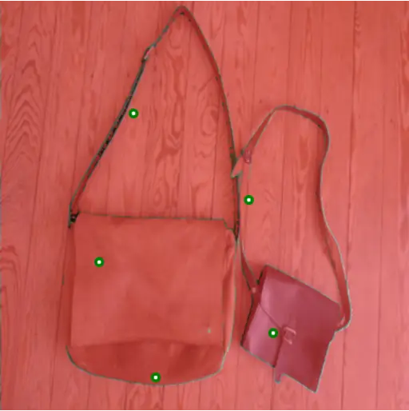 | 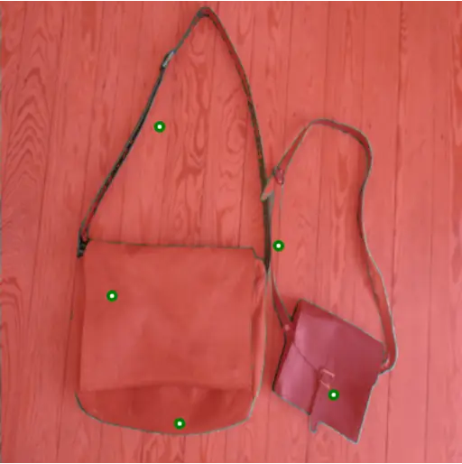 | 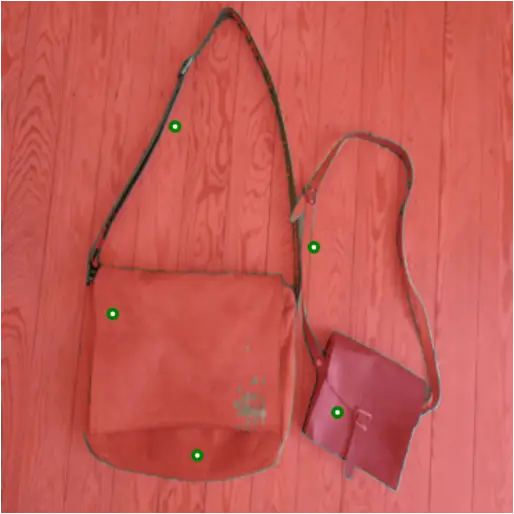 |
| Support Image                                                | 0                                                            | 1                                                            | 2                                                            |
| 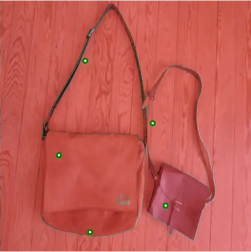 | 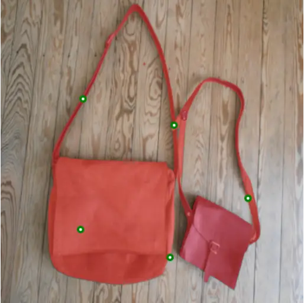 | 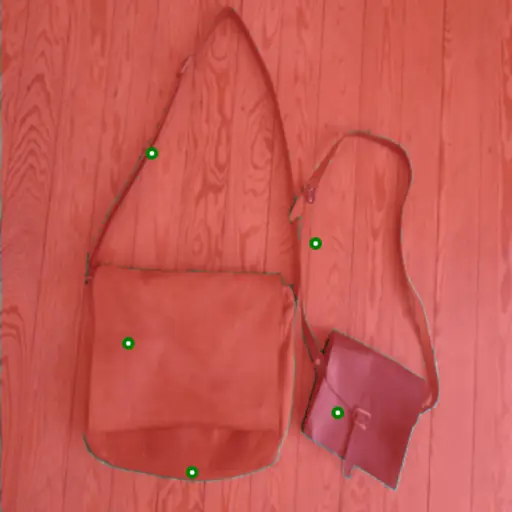 |  |
| 3                                                            | 4 (Top-1, Oracle)                                            | 5                                                            | Ground Truth                                                 |

|                                                              |                                                              |                                                              |                                                              |
| ------------------------------------------------------------ | ------------------------------------------------------------ | ------------------------------------------------------------ | ------------------------------------------------------------ |
|  |  |  |  |
| Support Image                                                | 0                                                            | 1                                                            | 2                                                            |
|  |  |  |  |
| 3                                                            | 4 (Top-1)                                                    | 5 (Oracle)                                                   | Ground Truth                                                 |

|                                                              |                                                              |                                                              |                                                              |
| ------------------------------------------------------------ | ------------------------------------------------------------ | ------------------------------------------------------------ | ------------------------------------------------------------ |
|  |  | 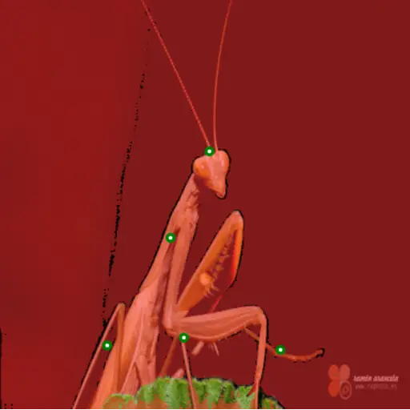 |  |
| Support Image                                                | 0                                                            | 1                                                            | 2 (Top-1, Oracle)                                            |
|  | 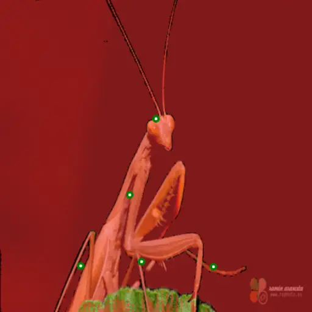 | 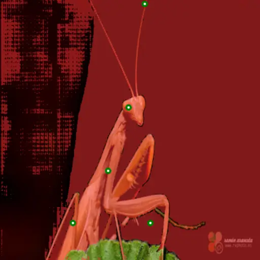 |  |
| 3                                                            | 4                                                            | 5                                                            | Ground Truth                                                 |

Figure 8: Iterative refinement behavior of PR-MaGIC for Matcher. Each
example shows the support image, refinement outputs from iterations
0(baseline) – 5, and the ground truth. The blue-boxed output denotes the
step selected by our top-1 selection module. Although the selection is
not guaranteed to be globally optimal, it prevents degradation by
choosing the final step when refinement converges and an earlier, more
stable step when it becomes unstable.

### D.2 Top-1 selection of PR-MaGIC (PerSAM-F)

|                                                              |                                                              |                                                              |                                                              |
| ------------------------------------------------------------ | ------------------------------------------------------------ | ------------------------------------------------------------ | ------------------------------------------------------------ |
|  |  | 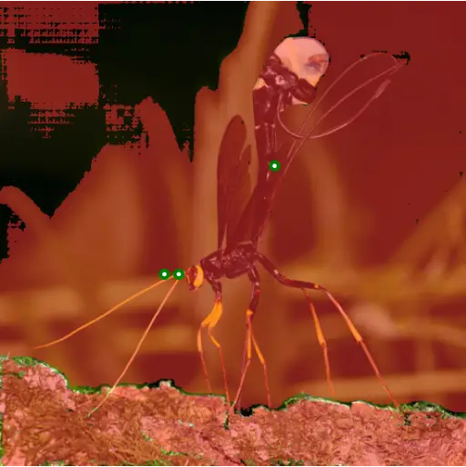 |  |
| Support Image                                                | 0                                                            | 1                                                            | 2                                                            |
|  |  |  |  |
| 3                                                            | 4                                                            | 5 (Top-1, Oracle)                                            | Ground Truth                                                 |

|                                                              |                                                              |                                                              |                                                              |
| ------------------------------------------------------------ | ------------------------------------------------------------ | ------------------------------------------------------------ | ------------------------------------------------------------ |
|  | 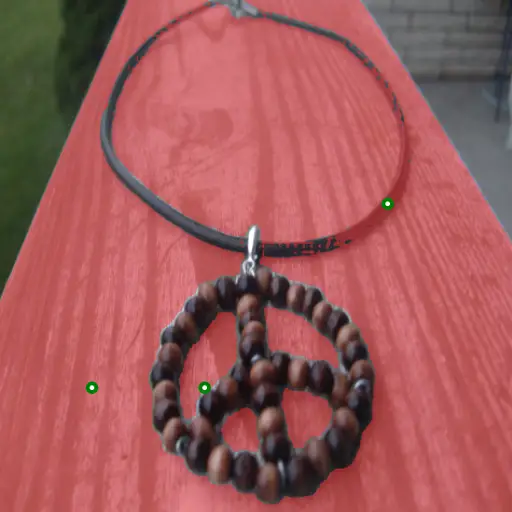 | 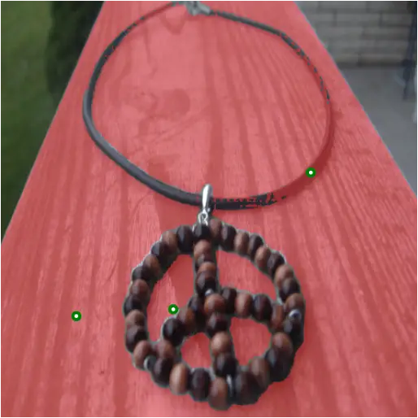 |  |
| Support Image                                                | 0                                                            | 1                                                            | 2                                                            |
| 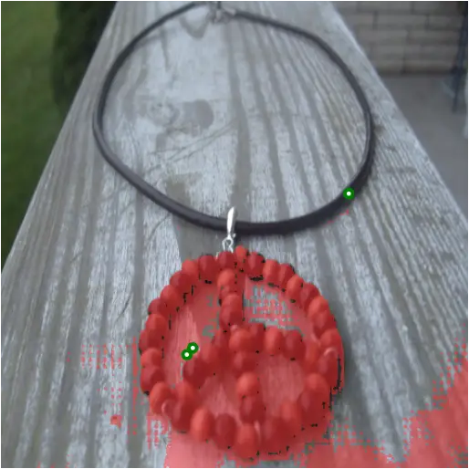 | 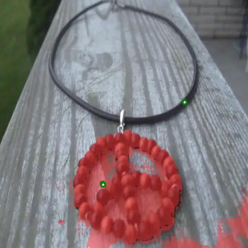 | 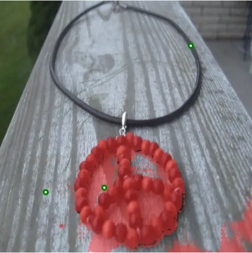 |  |
| 3                                                            | 4                                                            | 5 (Top-1, Oracle)                                            | Ground Truth                                                 |

|                                                              |                                                               |                                                               |                                                               |
| ------------------------------------------------------------ | ------------------------------------------------------------- | ------------------------------------------------------------- | ------------------------------------------------------------- |
| 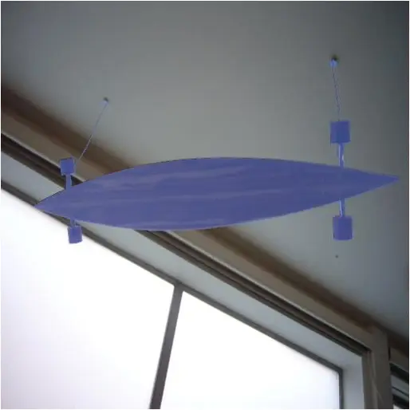 |   |   |   |
| Support Image                                                | 0                                                             | 1                                                             | 2 (Top-1)                                                     |
|  |  |  |  |
| 3 (Oracle)                                                   | 4                                                             | 5                                                             | Ground Truth                                                  |

Figure 9: Iterative refinement behavior of PR-MaGIC for PerSAM. Each
example shows the support image, refinement outputs from iterations
0(baseline) – 5, and the ground truth. The blue-boxed output denotes the
step selected by our top-1 selection module. Although the selection is
not guaranteed to be globally optimal, it prevents degradation by
choosing the final step when refinement converges and an earlier, more
stable step when it becomes unstable.

## Appendix E Additional Qualitative Results

### E.1 One shot semantic segmentation


(a) Support Image


(b) Baseline


(c) Refined (Ours)


(d) Ground Truth

Figure 10: Qualitative result of PR-MaGIC with PerSAM-F in semantic
segmentation.


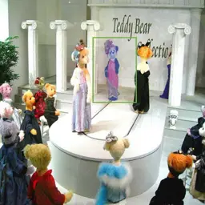

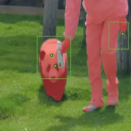

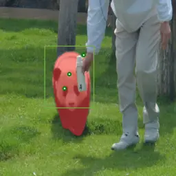


(a) Support Image


(b) Baseline


(c) Refined (Ours)


(d) Ground Truth

Figure 11: Qualitative result of PR-MaGIC with Matcher in semantic
segmentation.

### E.2 One shot part segmentation


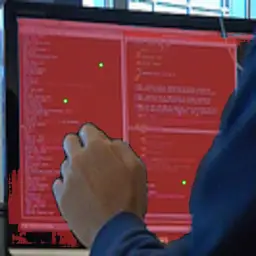


(a) Support Image


(b) Baseline


(c) Refined (Ours)


(d) Ground Truth

Figure 12: Qualitative result of PR-MaGIC with PerSAM-F in part
segmentation.


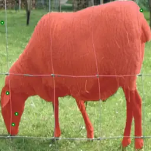

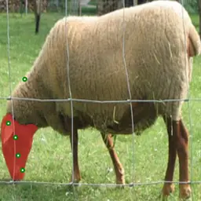


(a) Support Image


(b) Baseline


(c) Refined (Ours)


(d) Ground Truth

Figure 13: Qualitative result of PR-MaGIC with Matcher in part
segmentation.

### E.3 Five shot semantic segmentation (Matcher)


 

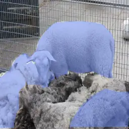


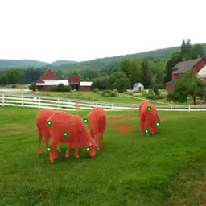


 


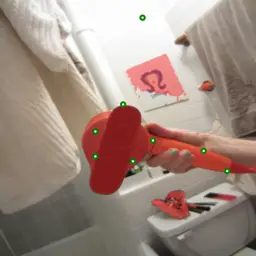


Figure 14: Qualitative result of five shot semantic segmentation
(Matcher). The test samples are separated by dividers. For each sample,
the upper row shows the support images, while the lower row displays,
from left to right, the baseline result, the result of PR-MaGIC across
iterations, and the ground truth.

### E.4 Five shot part segmentation (Matcher)


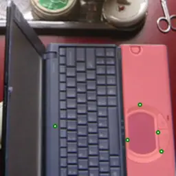

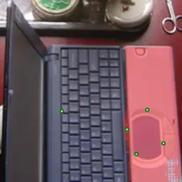

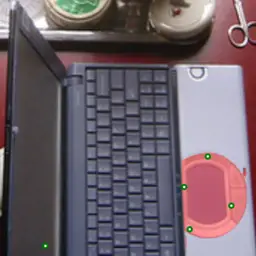


 


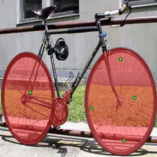


 


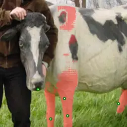

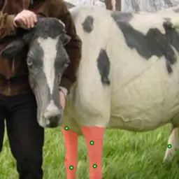

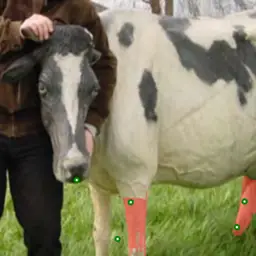

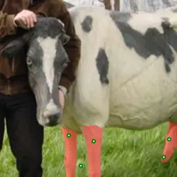


Figure 15: Qualitative result of five shot part segmentation (Matcher).
The test samples are separated by dividers. For each sample, the upper
row shows the support images, while the lower row displays, from left to
right, the baseline result, the result of PR-MaGIC across iterations,
and the ground truth.

### E.5 Comparison of the effects of PR-MaGIC across different baselines.

Comparing the impact of PR-MaGIC across different baselines on the same
image, as shown in Fig. 16, provides a more comprehensive understanding
of our method’s effectiveness. For PerSAM-F (Figs. 16(b) and 16(e)),
prompts are selected by top-k sampling. PR-MaGIC addresses the issue of
congested prompts, resolving object ambiguity. For Matcher (Figs. 16(c)
and 16(f)), the robust sampler distributes the prompts more widely.
However, PR-MaGIC further fine-tunes them, enhancing precision and
producing more accurate segmentation masks.


(a) Support Image


(b) PerSAM-F


(c) Matcher


(d) Ground Truth


(e) PerSAM-F+PR-MaGIC


(f) Matcher+PR-MaGIC

Figure 16: Illustration of prompt refinement of PR-MaGIC

## Appendix F Sensitivity analysis of $`\gamma`$ and $`\eta`$ across object categories.

|                                                                                                                    |        |          |                      |                |                |                      |                |                |                      |                |                |
| ------------------------------------------------------------------------------------------------------------------ | ------ | -------- | -------------------- | -------------- | -------------- | -------------------- | -------------- | -------------- | -------------------- | -------------- | -------------- |
|                                                                                                                    |        |          | $`\eta_{1}=1e^{-2}`$ |                |                | $`\eta_{2}=1e^{-3}`$ |                |                | $`\eta_{3}=1e^{-4}`$ |                |                |
| $`c_{i}`$                                                                                                          | Metric | Base^(∗) | $`\gamma_{1}`$       | $`\gamma_{2}`$ | $`\gamma_{3}`$ | $`\gamma_{1}`$       | $`\gamma_{2}`$ | $`\gamma_{3}`$ | $`\gamma_{1}`$       | $`\gamma_{2}`$ | $`\gamma_{3}`$ |
| $`c_{1}`$                                                                                                          | Mean   | 55.02    | 58.64                | 70.32          | 64.18          | 65.20                | 62.88          | 63.77          | 62.90                | 63.77          | 58.48          |
|                                                                                                                    | Std    | (30.65)  | (24.37)              | (27.82)        | (28.14)        | (26.94)              | (27.90)        | (27.89)        | (27.87)              | (27.89)        | (27.51)        |
| $`c_{2}`$                                                                                                          | Mean   | 40.34    | 52.95                | 56.67          | 50.19          | 50.13                | 46.96          | 45.62          | 46.96                | 48.54          | 48.64          |
|                                                                                                                    | Std    | (38.56)  | (33.21)              | (37.06)        | (37.36)        | (34.19)              | (36.87)        | (37.56)        | (36.87)              | (38.20)        | (38.26)        |
| $`c_{3}`$                                                                                                          | Mean   | 45.89    | 79.55                | 70.07          | 57.45          | 69.37                | 56.56          | 54.41          | 54.47                | 54.41          | 53.90          |
|                                                                                                                    | Std    | (33.48)  | (24.49)              | (28.62)        | (29.46)        | (28.16)              | (31.82)        | (31.94)        | (32.49)              | (31.94)        | (32.83)        |
| $`c_{4}`$                                                                                                          | Mean   | 64.14    | 74.22                | 71.94          | 67.82          | 72.86                | 67.63          | 68.55          | 67.49                | 68.55          | 70.68          |
|                                                                                                                    | Std    | (29.81)  | (23.77)              | (27.50)        | (24.99)        | (24.41)              | (24.80)        | (26.26)        | (24.73)              | (26.26)        | (25.00)        |
| $`c_{5}`$                                                                                                          | Mean   | 73.16    | 73.74                | 80.14          | 74.46          | 74.24                | 74.23          | 84.07          | 74.25                | 74.88          | 78.56          |
|                                                                                                                    | Std    | (27.60)  | (25.10)              | (24.29)        | (22.70)        | (26.55)              | (26.46)        | (17.85)        | (26.46)              | (20.93)        | (22.42)        |
| $`c_{6}`$                                                                                                          | Mean   | 92.51    | 89.62                | 95.99          | 89.70          | 95.99                | 89.70          | 90.39          | 89.71                | 90.39          | 90.76          |
|                                                                                                                    | Std    | (10.59)  | (19.79)              | (0.97)         | (13.40)        | (0.97)               | (13.40)        | (17.28)        | (13.41)              | (17.28)        | (16.02)        |
| $`c_{7}`$                                                                                                          | Mean   | 35.94    | 72.44                | 72.82          | 59.56          | 74.76                | 63.74          | 46.88          | 63.74                | 49.13          | 47.00          |
|                                                                                                                    | Std    | (31.90)  | (28.90)              | (23.68)        | (29.49)        | (20.44)              | (20.72)        | (26.31)        | (20.73)              | (25.40)        | (28.95)        |
| $`c_{8}`$                                                                                                          | Mean   | 49.35    | 72.80                | 71.34          | 66.13          | 71.34                | 70.63          | 65.43          | 70.63                | 64.04          | 53.30          |
|                                                                                                                    | Std    | (27.27)  | (21.90)              | (22.20)        | (25.94)        | (22.20)              | (22.83)        | (28.07)        | (22.83)              | (28.15)        | (27.41)        |
| $`c_{9}`$                                                                                                          | Mean   | 72.78    | 77.23                | 69.07          | 74.76          | 67.77                | 75.48          | 64.41          | 74.85                | 64.42          | 64.48          |
|                                                                                                                    | Std    | (33.33)  | (31.84)              | (34.11)        | (31.18)        | (35.45)              | (31.19)        | (36.73)        | (31.06)              | (36.73)        | (36.62)        |
| $`\gamma`$-Avg (avg. over $`\eta`$ and classes):  $`\gamma_{1}{=}70.29,\;\gamma_{2}{=}68.31,\;\gamma_{3}{=}64.95`$ |        |          |                      |                |                |                      |                |                |                      |                |                |
| $`\eta`$-Avg (avg. over $`\gamma`$ and classes):  $`\eta_{1}{=}70.88,\;\eta_{2}{=}67.89,\;\eta_{3}{=}64.78`$       |        |          |                      |                |                |                      |                |                |                      |                |                |

Table 6: Overall mIoU(%) results of PR-MaGIC across $`\eta`$, $`\gamma`$
and classes ($`c_{i}`$) configurations. Base^(∗): PerSAM-F. Each
$`c_{i}`$ includes 10 samples per class:
$`\{\texttt{gas\_pump},\texttt{indian\_cobra},\texttt{cocktail\_shaker},\texttt{golfcart},\texttt{teddy},\texttt{garbage\_truck},\texttt{stapler},\texttt{children\_slide},\texttt{studio\_couch}\}`$.
$`\gamma_{1}=1`$, $`\gamma_{2}=10^{-1}`$, $`\gamma_{3}=10^{-2}`$.

As shown in Tab. 6, sensitivity analysis on $`\gamma`$ and $`\eta`$
across randomly selected 9 classes was conducted. PR-MaGIC consistently
improves mIoU across most classes regardless of hyperparameter settings,
demonstrating class-agnostic gains despite minor exceptions in $`c_{6}`$
and $`c_{9}`$. The $`\eta`$-averaged results
($`\eta_{1}{=}70.88>\eta_{2}{=}67.89>\eta_{3}{=}64.78`$) show that
larger step sizes generally lead to better performance, suggesting that
the refinement gradients are well aligned with the intended update
direction. Likewise, the $`\gamma`$-averaged trend
($`\gamma_{1}{=}70.29>\gamma_{2}{=}68.31>\gamma_{3}{=}64.95`$) indicates
that stronger entropy regularization results in more robust refinement
behavior.

As our method targets test-time scaling, we adopt a conservative and
minimal hyperparameter tuning strategy to assess overall performance
gains. While the additional analysis in this appendix is conducted on a
limited subset, the configuration used in our main experiments already
achieves strong and consistent results, with other settings yielding
even higher performance in some cases. We expect that this class-wise
tuning would be valuable for practical deployment.
