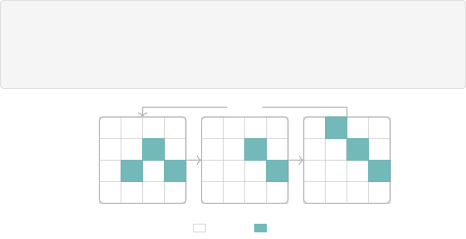
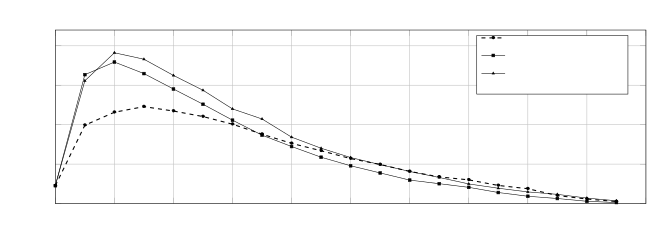
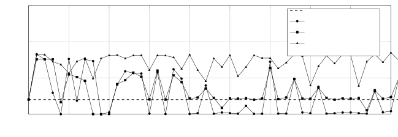
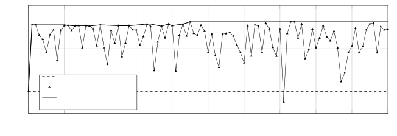

# LLM-Guided Prompt Evolution for Password Guessing Warning: This paper contains potentially harmful content generated by LLMs.

Vladimir A. Mazin Affiliation: AXXX    Mikhail A. Zorin
Affiliation: MTUCI    Dmitrii S. Korzh Affiliation: AXXX    Elvir Z.
Karimov Affiliation: Applied AI Center    Dmitrii A. Bolokhov
Affiliation: MTUCI    Oleg Y. Rogov Affiliation: AXXX
Affiliation: Applied AI Center

###### Abstract

Passwords still remain a dominant authentication method, yet their
security is routinely subverted by predictable user choices and
large-scale credential leaks. Automated password guessing is a key tool
for stress-testing password policies and modeling attacker behavior.
This paper applies LLM-driven evolutionary computation to automatically
optimize prompts for the LLM password guessing framework. Using
OpenEvolve, an open-source system combining MAP-Elites quality-diversity
search with an island population model we evolve prompts that maximize
cracking rate on a RockYou-derived test set. We evaluate three
configurations: a local setup with Qwen3 8B, a single compact cloud
model Gemini-2.5 Flash, and a two-model ensemble of frontier LLMs. The
approach raises the cracking rates from 2.02% to 8.48%. Character
distribution analysis further confirms how evolved prompts produce
statistically more realistic passwords. Automated prompt evolution is a
low-barrier yet effective way to strengthen LLM-based password auditing
and underlining how attack pipelines show tendency via automated
improvements.

## 1 Introduction

Although increasingly complex methods of identity verification are
emerging, passwords remain the primary means of authentication for the
vast majority of internet users and corporate systems \[2\]. Large-scale
data leaks involving access credentials are becoming increasingly
common: the RockYou hack alone exposed 32 million passwords in plain
text, and subsequent data leaks such as Collection#1 exposed over a
billion unique login credentials \[11\]. These data leaks directly
facilitate offline attacks using dictionaries and rule-based cracking
attacks, as many users choose predictable passwords and reuse
credentials for different services.

In this context, automated password guessing tools serve a dual purpose:
they help security experts verify password policies and identify weak
credentials before attackers do, while also capturing the increasing
sophistication of real-world attackers—a tension familiar from surveys
of LLMs in cybersecurity \[26\] and from holistic treatments of model
misuse and safety \[21\]. Classic approaches – dictionary attacks,
Markov models \[15\] and probabilistic context-free grammars
(PCFG) \[24\] – are effective, but cannot be generalised beyond their
training distribution. Neural network methods, including RNN-based
guessers \[13\] and GANs \[10\], capture richer structural patterns, but
their fixed architectures limit their adaptability to new contexts.

The introduction of PassLLM \[29\] marked a qualitative shift: large
language models (LLMs) fine-tuned on leaked password corpora via LoRA
outperform all previous methods in both mass (trawling) and targeted
guessing scenarios. However, PassLLM’s behaviour during inference is
entirely controlled by a short text prompt, whereas that study reports
that “the content of the prompt has minimal impact on the results of the
guessing task”—a claim we directly challenge in this work.

The manual creation of prompts for security tasks is both time-consuming
and domain-sensitive: the optimal prompt for a password-generating LLM
is not obvious and is highly sensitive to wording, structural cues, and
contextual constraints. We therefore ask the question: Can _automated,
evolutionary_ optimization of the prompt reliably improve PassLLM beyond
what a manually crafted prompt achieves?

We answer this question in the affirmative by integrating PassLLM with
OpenEvolve \[19\], an open-source LLM-driven evolutionary framework that
combines MAP-Elites \[14\] quality-diversity search with a multi-island
population model.

#### Research questions.

We structure our investigation as follows.

RQ1 (Prompt Sensitivity)  
Does the content of the inference prompt significantly influence the
cracking rate of PassLLM, contradicting the claim of \[29\] that prompt
content has minimal impact?

RQ2 (Effectiveness)  
Can LLM-driven evolutionary optimization reliably improve PassLLM’s
cracking rate beyond a manually crafted baseline prompt within a fixed
budget of 100 evolutionary iterations?

RQ3 (Resource Efficiency)  
Does a locally constrained configuration (single 24 GB GPU, 8B-parameter
model) achieve competitive cracking rates compared to cloud-based
frontier-model ensembles?

RQ4 (Distribution Realism)  
Do evolved prompts produce password populations whose
character-frequency distributions are statistically closer to real-world
corpora, as measured by the per-symbol F-score AUC metric?

The rest of the paper is organized as follows. Section 2 provides an
overview of related work, including LLM safety and misuse (Section 2.4).
Section 3 introduces the threat model. Section 4 describes the
integrated pipeline. Section 5 describes the experimental setup in
detail. Section 6 presents the results, explicitly mapping each finding
to the research questions in Section 1. Section 7 contains an in-depth
analysis and discussion. Section 8 states limitations and ethical
considerations. Section 9 contains the conclusion.

## 2 Related Work

### 2.1 Password guessing: classical methods

Early automated password cracking methods were based on offline
dictionary attacks and rule-based engines such as John the Ripper \[16\]
and Hashcat \[8\], which are still widely used due to their efficiency
on commercially available hardware. Probabilistic context-free grammars
(PCFG) were introduced \[24\] to model the structural decomposition of
passwords, thereby significantly improving coverage over pure dictionary
methods. Markov chains applied to time-space trade-offs help achieving
fast, high-quality guessing \[15\]. In subsequent work, PCFG was
extended by incorporating semantic structures and signals about user
behaviour \[23\].

### 2.2 Neural and generative approaches

Recurrent neural networks (RNNs) trained on leaked corpora can model the
sequential structure of passwords and offer competitive coverage with
low memory requirements \[13\]. PassGAN \[10\] applies generative
adversarial networks to password synthesis; although training GANs is
difficult to stabilise \[18\], PassGAN demonstrated that adversarial
generation can discover passwords not included in the training
dictionary. More recent Transformer-based approaches such as
PassBERT \[25\] use bi-directional transformers with a
pre-training/fine-tuning paradigm to improve real-world password
guessing attacks, including conditional, targeted, and adaptive
rule-based guessing.

### 2.3 LLM-based password guessing

PassLLM \[29\] applies LoRA-based fine-tuning to models from the Llama,
Mistral, and Qwen families on the RockYou dataset. PassLLM outperforms
all previous methods in terms of trawling, PII-based (personally
identifiable information), and password reuse attack scenarios. However,
that work treats prompt selection as a minor implementation detail and
claims that sensitivity to prompt content is minimal—a premise we
experimentally refute.

### 2.4 LLM safety and misuse

Integration of LLMs into authentication-related research sits at the
intersection of defensive evaluation and dual-capability tooling \[21\].
Systematic reviews of LLM applications in cybersecurity catalog both
protective uses and assisted offensive workflows \[26\]. Fine-tuning on
security-oriented instruction data can improve task accuracy while
sharply degrading robustness to prompt-based attacks \[4\], and
post-alignment adaptation does not reliably preserve refusal
behaviour \[17\]. Beyond weight updates, natural-language context is
itself a powerful control surface: indirect prompt injection shows how
untrusted text can override intended instructions in integrated
systems \[7\], and narrow in-context demonstrations can induce broadly
misaligned outputs on unrelated queries \[1\]. Mechanistic interventions
are similarly ambiguous—activation steering, though often motivated as
interpretable control, can systematically weaken safeguards \[12\].
Gradient-free search over short text strings can discover transferable
adversarial suffixes for aligned chat models \[28\], foreshadowing
automated prompt optimisation for specialised generative tasks such as
password guessing. Frameworks for evaluating frontier models for extreme
risks explicitly include offensive cyber capabilities among the hazards
warranting structured assessment \[20\].

### 2.5 Evolutionary and LLM-driven optimization

Evolutionary computation has a long history in combinatorial
optimization, and its combination with LLMs is a new and rapidly
evolving paradigm. The OpenEvolve framework \[19\] implements
MAP-Elites \[14\] quality-diversity search with LLM-guided mutations and
achieves remarkable results in code optimization and mathematical
discovery. Its architecture is formally analyzed in \[3\].
LoongFlow \[22\] extends this paradigm with a cognitive
plan-execute-summarize loop and demonstrates improved convergence. In
the field of NLP, automatic prompt optimization has been explored in the
context of the Automatic Prompt Engineer (APE) framework \[27\] and
gradient-free methods such as PromptBreeder \[5\]. The proposed pipeline
is the first to apply LLM-driven quality-diversity evolution
specifically to the field of cybersecurity in password guessing.

## 3 Threat Model

We use the following setting in our experimental setup.

### 3.1 Attacker’s Goals and Scenario

We consider a trawling attack (mass attack) in which an attacker targets
many accounts in order to compromise as many accounts as possible within
a fixed budget of $`B=20,000`$ attempts per account. This is the
standard threat scenario evaluated by PassLLM \[29\] and strength
metrics based on guesses \[9\].

### 3.2 Attacker’s capabilities

The attacker works offline with a hacked, hashed password database.
Guesses are made locally under GPU time and memory constraints. The
attacker has access to public datasets (RockYou, LinkedIn, Collection#1)
for training and white-box control over PassLLM, including prompts. For
prompt engineering, the attacker can use cloud APIs (e.g., OpenRouter)
or local open-weight models (e.g., Ollama). We assume a modest budget –
an NVIDIA GPU with 24 GB VRAM and up to 100 evolution iterations –
reflecting a cost-conscious adversary.

### 3.3 Attacker’s knowledge

The attacker knows the architecture and weights of PassLLM (including
LoRA and Qwen2.5-0.5B-Instruct) and has a small set of target passwords
(e.g., previously compromised hashes). Knowledge of users’ personal
data, hash functions, or website policies is not necessary, as they are
irrelevant to offline trawling. Protective measures such as password
policies, rate limiting, and hashing methods are beyond the attacker’s
control.

### 3.4 Implications for defence

This model highlights two defensive insights. First: strict password
policies, e.g., blocking leaked passwords worsen the attacker’s fitness
signal and slow down development \[6\]. Second: defenders may not rely
on static tools, as the proposed method improves cracking rates in just
1–10 iterations, in line with broader evidence that model behaviour can
shift rapidly under optimised context \[28, 1\]. Adaptive rate limiting
and anomaly detection remain crucial.

## 4 System Description

This section describes the integrated PassLLM and OpenEvolve pipeline
and formalises the evolutionary process for optimising prompts. An
overview of the pipeline is shown in Fig. 1.

### 4.1 The LLM guessing model

We focus on the trawling variant of PassLLM \[29\], which is based on
Qwen2.5-0.5B-Instruct and was fine-tuned via LoRA on the publicly
available RockYou split of the PassLLM. Inference employs a
breadth-first search over the model’s token lattice to efficiently
enumerate the most probable strings. The model’s generation behaviour is
completely determined by a single command input $`\mathbf{p}`$; this is
the optimization target of the proposed evolutionary procedure.

Figure 1: The proposed OpenEvolve-based pipeline. An initial prompt is
fed to the evolutionary controller, which iteratively samples parent
prompts from the MAP-Elites archive, requests improved variants from the
LLM ensemble, runs LLM and updates the archive based on the cracked-rate
fitness signal.

### 4.2 Target function

Given an input $`\mathbf{p}`$, LLM generates a multiset of password
candidates $`\mathcal{G}(\mathbf{p})=\{g_{1},\ldots,g_{B}\}`$ where B is
under $`2\times 10^{4}`$. The cracked rate (CR) is selected as the
primary fitness function:

```math
\mathrm{CR}(\mathbf{p})=\frac{|\mathcal{G}(\mathbf{p})\cap\mathcal{T}|}{|\mathcal{T}|}, \tag{1}
```

where $`\mathcal{T}`$ denotes a fixed holdout test set of passwords from
the RockYou database. $`|\mathcal{G}(\mathbf{p})\cap\mathcal{T}|`$
counts exact matches of character strings, taking case sensitivity into
account. This metric directly quantifies the attacker’s success rate
under a model with limited attempts.

### 4.3 Complementary metrics

CR alone does not provide any information about why a prompt is
effective. To gain deeper insight into the distribution properties of
the generated passwords at the character level, we introduce a
supplementary F-score metric per symbol. For each character $`c`$ in the
printable ASCII alphabet, $`f_{c}^{\mathrm{gen}}`$ and
$`f_{c}^{\mathrm{real}}`$ denote its normalised frequency in the
generated and real password sets, respectively. We define a binary ‘hit’
for the character $`c`$ at a threshold value $`\tau`$ as
$`\mathbf{1}[f_{c}^{\mathrm{gen}}\geq\tau\cdot f_{c}^{\mathrm{real}}]`$
and calculate the macro-averaged F-score across all characters:

```math
\mathrm{F}_{\tau}(\mathbf{p})=\frac{2\cdot\mathrm{Prec}_{\tau}(\mathbf{p})\cdot\mathrm{Rec}_{\tau}(\mathbf{p})}{\mathrm{Prec}_{\tau}(\mathbf{p})+\mathrm{Rec}_{\tau}(\mathbf{p})}, \tag{2}
```

where precision and recall are computed over the set of characters above
the frequency threshold $`\tau`$. By sweeping $`\tau\in[0,1]`$ we obtain
an F-score curve analogous to a precision-recall curve, and we summarize
it with the area under the curve.

### 4.4 Evolutionary framework: OpenEvolve

Prompt evolution is carried out with OpenEvolve \[19\], an open-source
framework that combines two complementary mechanisms. OpenEvolve uses a
MAP-Elites \[14\] grid ($`10^{2}`$ cells per island) to store the
prompts with the highest fitness for combinations of three features:
complexity (number of tokens), diversity (Levenshtein distance to the
reference), and prompt length. This maintains quality diversity across
the entire feature space. Three independent islands each run MAP-Elites
and exchange 10% of the elite prompts every 10 iterations in a ring
topology. Instead of random character changes, an LLM performs semantic
mutation: starting from parent prompts and a meta-prompt describing the
goal, it generates variants. This allows for both fine-tuning and
structural rewrites, helping to avoid local optima. The selection of
parents at each generation is based on a three-part mixture:

- •
  Elite selection (ratio 0.1) - highest fitness prompts from the
  archive;
- •
  Exploration (ratio 0.2) - random samples from the current island
  population;
- •
  Exploitation (ratio 0.7) - samples from archive cells weighted by
  fitness.

The heavy exploitation bias is appropriate for proposed setting, where
evaluation cost (PassLLM inference) is high and we wish to maximize
fitness efficiently. Algorithm 1 describes the evolutionary prompt
optimization pipeline.

Require : Initial prompt $`\mathbf{p}_{0}`$, test set $`\mathcal{T}`$,
budget $`B`$, max iterations $`T`$, islands $`K`$, migration interval
$`\Delta`$, migration rate $`\mu`$, LLM ensemble $`\mathcal{M}`$

Ensure : Best prompt $`\mathbf{p}^{*}`$ maximising
$`\mathrm{CR}(\mathbf{p})`$

1 Initialize MAP-Elites archive $`\mathcal{A}_{k}\leftarrow\emptyset`$
for $`k=1,\ldots,K`$

2 $`s_{0}\leftarrow\textnormal{{CR}}(\mathbf{p}_{0})`$ //
$`s_{0}=2.02\%`$ in the proposed setting

3 Insert $`\mathbf{p}_{0}`$ into $`\mathcal{A}_{k}`$ for all $`k`$

4 for _$`t\leftarrow 1`$ to $`T`$_ do

    5 for _each island $`k=1,\ldots,K`$_ do (parallel)

       6
$`\mathbf{p}_{\mathrm{par}}\leftarrow\textnormal{{Select}}(\mathcal{A}_{k})`$
// elite, explore, exploit, mixture

       7
$`\mathbf{p}_{\mathrm{new}}\leftarrow\textnormal{{LLMMutate}}(\mathbf{p}_{\mathrm{par}},\,\mathcal{M})`$

       8
$`s_{\mathrm{new}}\leftarrow\textnormal{{CR}}(\mathbf{p}_{\mathrm{new}})`$
// run PassLLM, count matches vs. $`\mathcal{T}`$

       9
$`\phi\leftarrow\textnormal{{FeatureVec}}(\mathbf{p}_{\mathrm{new}})`$

       10
$`\textnormal{{UpdateArchive}}(\mathcal{A}_{k},\,\mathbf{p}_{\mathrm{new}},\,s_{\mathrm{new}},\,\phi)`$

    11 end

    12 if _$`t\bmod\Delta=0`$_ then

       13 Migrate elites between
islands: $`\mathcal{A}_{k}\overset{\mu}{\longleftrightarrow}\mathcal{A}_{(k+1)\bmod K}`$

    14 end if

15 end for

16
$`\mathbf{p}^{*}\leftarrow\displaystyle\arg\max_{\mathbf{p}\,\in\,\bigcup_{k}\mathcal{A}_{k}}\mathrm{CR}(\mathbf{p})`$

17 return _$`\mathbf{p}^{_}`$\*

Algorithm 1 Evolutionary Prompt Optimization for PassLLM

### 4.5 Models for prompt generation

Various LLMs served as mutation operators. All models were accessed
either locally via Ollama or via a cloud service with a fixed
OpenAI-compatible API. The generation parameters were set: temperature
$`=0.4`$ and max_tokens $`=16000`$ for all experiments to ensure
comparability. Three configurations were evaluated:

1.  1.  Local (Ollama): qwen3:8b for both generation and evaluation. Single
        24 GB GPU. 100 evolutionary iterations.
2.  2.  Cloud, single model: gemini-2.5-flash-lite-preview-09-2025 for
        generation; qwen3-max for evaluation. 100 iterations.
3.  3.  Cloud, ensemble: Weighted mixture of qwen3-235b-a22b-2507
        (weight 0.5) and gemini-3-flash-preview (weight 0.5) for generation;
        qwen3-max for evaluation. 100 iterations.

Separating the generation and evaluation of LLMs reduces systematic
biases caused by a single model architecture and provides a more
objective fitness signal.

The complete hyperparameter settings are listed in Table 1.

## 5 Experimental Setup

### 5.1 Dataset and evaluation protocol

All experiments use the publicly available RockYou password data set in
the train/test split, provided by the PassLLM authors \[29\]. The test
set contains passwords that were not seen during the LoRA fine-tuning of
PassLLM. The cracked rate (Equation 1) is the primary evaluation metric;
the F-score per symbol (Equation 2) is calculated for the best prompt of
each experiment on the same test set. For each evolution run, PassLLM
generates up to $`B=20000`$ candidate passwords per evaluation, with
beam search batch sizes ranging from 256 to 512 to fit the 24 GB vRAM
budget. All experiments are conducted with a single nVidia A100 GPU.

PassLLM \[29\] was selected as the baseline for the experiments with its
_original, unmodified_ prompt:

‘‘As a trawling password guessing model, your task is to generate
passwords. {password}.’’

Expermental parameters are specified in Open Evolve YAML configuration
file and will be included in the GitHub repository alongside the code
for the reproducibility. The most important parameters are presented in
the Table 1.



Figure 2: MAP-Elites archive and island model. Three islands each
maintain an independent
$`\texttt{prompt\_length}\times\texttt{complexity}`$ grid. Filled green
cells indicate occupied elites. Ring-topology migration occurs at fixed
intervals.

| Parameter                     | Exp. 1 (Ollama)       | Exp. 2 (Gemini)       | Exp. 3 (Ensemble)                      |
| ----------------------------- | --------------------- | --------------------- | -------------------------------------- |
| LLM (generation)              | qwen3:8b              | gemini-2.5-flash-lite | qwen3-235b (0.5), gemini-3-flash (0.5) |
| Evaluator LLM                 | qwen3:8b              | qwen3-max             | qwen3-max                              |
| Temperature                   | 0.4                   | 0.4                   | 0.4                                    |
| Max tokens                    | 16 000                | 16 000                | 16 000                                 |
| Population size               | 100                   | 1000                  | 1000                                   |
| Archive size                  | 20                    | 100                   | 100                                    |
| Islands ($`K`$)               | 3                     | 3                     | 3                                      |
| Migration interval $`\Delta`$ | 10                    | 10                    | 10                                     |
| Migration rate $`\mu`$        | 0.1                   | 0.1                   | 0.1                                    |
| Feature dimensions            | diversity, complexity | diversity, complexity | prompt_length, complexity              |
| Feature bins                  | 10                    | 10                    | 10                                     |
| Elite / explor. / exploit.    | 0.1 / 0.2 / 0.7       | 0.1 / 0.2 / 0.7       | 0.1 / 0.2 / 0.7                        |
| Random seed                   | 42                    | 42                    | 42                                     |
| Max iterations $`T`$          | 100                   | 100                   | 100                                    |
| Best CR                       | 8.28%                 | 7.58%                 | 8.48%                                  |

Table 1: OpenEvolve hyperparameter settings. CR: best cracked rate
achieved.

## 6 Results

To answer RQ1 (prompt sensitivity), we compare the original PassLLM
instruction against evolved prompts under identical inference and
evaluation protocols. The baseline cracked rate remains at 2.02% on the
hold-out set, whereas all three evolved configurations achieve
substantially higher peak rates (Table 2), demonstrating that prompt
content strongly conditions guessing performance.

To answer RQ2 (effectiveness of evolution), we run OpenEvolve for up to
100 iterations per configuration and record the best cracked rate (CR)
in each run. Table 2 shows improvements of $`3.75\times`$–$`4.2\times`$
over the baseline; Fig. 4 and Fig. 5 show that large gains can appear
within the first iterations, before the archive stabilises.

To answer RQ3 (resource efficiency), we contrast the local single-GPU
setup (Experiment 1, qwen3:8b) with cloud frontier ensembles
(Experiment 3). The local configuration reaches 8.28% best CR versus
8.48% for the ensemble—a gap of 0.20 percentage points, smaller than the
per-iteration standard deviation of the ensemble run—supporting the
claim that competitive prompts can be discovered without exclusive
reliance on large cloud models.

Table 2 presents per-run descriptive statistics. The high standard
deviation in all evolved runs ($`\geq 1.4`$ percentage points) reflects
the stochastic nature of both LLM-driven mutation and PassLLM inference.
Notably, the ensemble run maintains a mean cracked rate of $`6.89\%`$ –
already $`3.4\times`$ the baseline – throughout the full 100-iteration
run, indicating that even non-peak prompts are substantially superior to
the original.

| Run               | $`n`$ | Mean CR | SD    | Min CR | Best CR | $`\boldsymbol{\Delta}`$CR |
| ----------------- | ----- | ------- | ----- | ------ | ------- | ------------------------- |
| Baseline          | –     | 2.02%   | –     | –      | 2.02%   | –                         |
| Exp. 1 (Ollama)   | 100   | 4.13%   | 3.51% | 0.00%  | 8.28%   | $`+`$4.1$`\times`$        |
| Exp. 2 (Gemini)   | 100   | 3.79%   | 3.15% | 0.00%  | 7.58%   | $`+`$3.75$`\times`$       |
| Exp. 3 (Ensemble) | 100   | 6.89%   | 1.48% | 1.07%  | 8.48%   | $`+`$4.2$`\times`$        |

Table 2: Descriptive statistics for each experimental run (excluding
iteration 0). $`n`$: number of evaluated prompts; Mean, SD: mean and
standard deviation of per-iteration cracked rate; Best CR: peak cracked
rate; $`\Delta`$CR: improvement over baseline.

Per-iteration CRs for all three runs alongside the baseline are shown in
Fig. 4. The ensemble achieves $`\mathrm{CR}\geq 8\%`$ at iteration 1,
confirming that a single LLM-driven mutation can already produce a
substantial improvement. The Ollama runs also reach 8.28% within 10
iterations budget, demonstrating remarkable efficiency.

The complete 100 iteration trajectory for the ensemble experiment in
given in the Fig. 5. The archive best (running maximum) plateaus after
iteration 45, consistent with population convergence following the
migration event at iteration 34. The per-iteration trace shown high
variance throughout with $`\sigma=1.48\%`$, reflecting the stochastic
nature of LLM mutation. However, iterations above 8% remain frequent as
30 out of 101 iterations achieve $`\mathrm{CR}\geq 8\%`$, thus
confirming that the archive reliably captures strong prompts.

### 6.1 Per-symbol F-score analysis

To answer RQ4 (distribution realism), we evaluate the best prompt from
each configuration using the per-symbol F-score curves and AUC defined
in Section 4.3. Fig. 3 shows the per-symbol F-score curves (Eq. 2) for
the best prompts of the baseline, Experiment 2 (Gemini), and
Experiment 3 (Ensemble) evaluated at thresholds $`\tau\in[0,0.95]`$.
Table 3 summarizes the AUC values and peak scores.



Figure 3: Per-symbol F-score curves for the baseline and best evolved
prompts. Higher AUC indicates better alignment of the generated
password’s character-frequency distribution with that of real passwords.
The ensemble prompt achieves the best AUC (0.074), while the baseline
(0.059) has a flat profile indicating poor character-level coverage.

|                                            |              |               |            |
| ------------------------------------------ | ------------ | ------------- | ---------- |
| Configuration                              | Peak F-score | Opt. $`\tau`$ | AUC-F      |
| Baseline                                   | 0.1229       | 0.15          | 0.0589     |
| Exp. 2 (Gemini)                            | 0.1794       | 0.10          | 0.0654     |
| Exp. 3 (Ensemble)                          | 0.1912       | 0.10          | 0.0745     |
| Relative gain (Baseline $`\to`$ Ensemble): |              |               | $`+`$26.3% |

Table 3: Per-symbol F-score performance. Peak values of the F-score,
optimal threshold and AUC.

The ensemble prompt achieves a peak F-score of 0.191 at $`\tau=0.10`$ –
a 65% improvement over the baseline peak of 0.123 (at $`\tau=0.15`$).
Two observations stand out. First, the baseline’s lower optimal
threshold ($`\tau=0.15`$) indicates that the original prompt produces
passwords with a coarser frequency distribution, only matching the most
dominant characters. Second, both evolved prompts peak at $`\tau=0.10`$,
suggesting that they better represent mid-frequency characters (those
appearing moderately in real passwords), which are precisely the
characters that discriminate real passwords from naive guesses.

The AUC-F improvement from 0.059 (baseline) to 0.074 (ensemble)
represents a 26% gain, confirming that the higher cracked rate of
evolved prompts is not merely due to over-generating highly common
passwords, but reflects a genuine improvement in character-distribution
coverage.

## 7 Discussion

Experimental results firstly underline the improvement rapidity. The
ensemble achieves $`\mathrm{CR}\geq 8\%`$ already at first iteration,
confirming that even a single LLM-backed mutation of the original prompt
produces qualitatively better instructions. This gain reflects the
sub-optimal nature of the baseline, which provides limited task-specific
guidance by design. Methodologically, the baseline contradicts the
conclusions of the work in \[29\] where prompt content has minimal
impact on guessing performance. We attribute the baseline limitations
primarily to manual search of prompts with similar specificity levels,
whereas the proposed evolution procedure enables explorations beyond the
baseline setup.

The choice of MAP-Elites feature dimensions proves consequential.
Substituting prompt_length for diversity in Experiment 3 yielded the
best result, suggesting that effective prompts occupy a characteristic
length range specific enough to conduct attack strategies, yet concise
enough to remain syntactically coherent, and that this range is captured
more faithfully by a length-based grid than by a diversity-based one.
Convergence behavior further support the value of the islands model. The
archive-best improved from 8.27% to 8.48% immediately after the
migration, consistent with the cross-island exchange. After more
iterations the archive gains stability and shows that 100 iterations are
insufficient to escape the resulting basin. Longer runs or a larger
island counts ($`K\geq 5`$) may push the bound even further.

The near-parity between the local qwen3:8b with 8.28% and the cloud
ensemble with 8.48% is practically significant. The 0.20 point gap is
acceptable within one standard deviation of the ensemble run at a
$`\sigma=1.48\%`$. This confirms that the method is viable in
self-hosted, air-gapped deployments, which is an important consideration
for organizations with privacy constraints like banks or healthcare
institutions. From an LLM-safety perspective, evolutionary prompt
optimisation parallels evidence that context manipulation and short
textual interventions can substantially redirect model outputs \[1,
28\], motivating hazard-aware release practices for auditing
tooling \[20\]. Scope, threats to validity, and ethical constraints are
summarised in Section 8. Future work includes testing on additional
password distributions, extending to PII-based and password-reuse
scenarios \[29\], exploring richer island constructions, and
investigating transfer of evolved prompts across corpora without
re-optimisation. A defensive inversion is to employ the same framework
to evolve password policies that minimise attacker CR, reinforcing
existing password security protocols.

## 8 Limitations and Ethics

### 8.1 Limitations

This study is a proof of concept that contains multiple constraints.

- •
  Attack scenario. In this evaluation, the focus is on the trawling
  setting from PassLLM \[29\]. It does not include targeted modes where
  a person uses PII to guess a password. If future work occurs,
  researchers can test if the optimization of prompts through evolution
  creates a gain that stays the same during targeted configurations.
- •
  Evolutionary stack and models. There is a reliance on
  OpenEvolve \[19\] for all evolutionary runs while the set of mutator
  and evaluator models is constant. As researchers use alternative
  quality-diversity algorithms, the outcomes are likely to change. By
  substituting other instruction-tuned models for the local mutators,
  the performance will also vary.
- •
  Generalisation and robustness. For this data, the results come from a
  single RockYou-derived split. There is a high variance in the CR for
  each iteration because the mutations from the LLM happen by chance. On
  a single seed the study shows 100 iterations—but it is not clear how
  often the same high rates occur when a person uses other corpora.
- •
  Stable gains. To show that the improvements are reliable, a person
  needs to use broader hyperparameter grids. For the MAP-Elites, the
  feature maps are also limited. Due to the current computational
  budgets, the stability of those gains is a topic for future work.

### 8.2 Ethics

We study behaviours that could lower the cost of offline guessing if
misused. Experiments use only public leaked-password research artefacts
(RockYou split) and do not involve live accounts. The contribution is
methodological: we do not publish raw evolved prompts or turnkey guess
lists, so reproducing peak numbers requires re-running the pipeline with
non-trivial compute and domain setup. The upfront warning on the title
page flags LLM-generated harmful text that may appear in mutation logs.
We align dual-use reporting with norms in password research \[6\]:
informing defenders about attacker capability trajectories outweighs
withholding aggregate evidence, provided release minimises operational
enablement.

## 9 Conclusion

We proposed a methodology for automated evolutionary inference prompts
optimization for the LLM password guessing task through integration of
the PassLLM core with the OpenEvolve framework. The proposed threat
model situates the adversary among offline password-guessing scenarios
discussed in the password-research literature \[6\] and among
LLM-supported security workflows surveyed more broadly \[26\].

Experiments with three configurations of locally inferred 8B models,
cloud models and ensembles show increase from 3.75 to 4.20$`\times`$
improvements in CR surpassing the baseline (2.02% to up to 8.48%). With
the local-only setup the setup achieves 8.28% in as few as up to 10
iterations. Additional per-symbol F-scoring confirms that evolved
prompts not only found more correct passwords, they produced character
frequency distributions that are substantially close to real-world
scenarios as experiments show with a 26% increase in terms of AUC.

Taken together, the evidence in Section 6 answers RQ1–RQ4 from Section 1
affirmatively within the scope and caveats of Section 8.

Therefore, prompt evolving frameworks matter more than assumed as the
original PassLLM prompts are showing sub-optimal performance, while
evolution procedures rapidly discover better approaches.

From a defensive standpoint, adaptive password policies embedded into
authentication systems alongside mandatory secondary factors complement
ongoing efforts to characterise LLM misuse and safety trade-offs \[21\]
and remain a practical line of defence as attack pipelines gain
automated optimisation \[20\].

## References

- \[1\] Nikita Afonin, Nikita Andriyanov, Vahagn Hovhannisyan, Nikhil
  Bageshpura, Kyle Liu, Kevin Zhu, Sunishchal Dev, Ashwinee Panda, Oleg
  Rogov, Elena Tutubalina, Alexander Panchenko, and Mikhail
  Seleznyov. 2026. [Emergent misalignment via in-context learning:
  Narrow in-context examples can produce broadly misaligned
  LLMs](https://arxiv.org/abs/2510.11288). _Preprint_, arXiv:2510.11288.
- \[2\] Joseph Bonneau, Cormac Herley, Paul C. van Oorschot, and Frank
  Stajano. 2012. [The quest to replace passwords: A framework for
  comparative evaluation of web authentication
  schemes](https://doi.org/10.1109/SP.2012.44). In _2012 IEEE Symposium
  on Security and Privacy_, pages 553–567.
- \[3\] Davis Brown, Jesse He, Helen Jenne, Henry Kvinge, and Max
  Vargas. 2025. [Even with ai, bijection discovery is still hard: The
  opportunities and challenges of openevolve for novel bijection
  construction](https://arxiv.org/abs/2511.20987). _Preprint_,
  arXiv:2511.20987.
- \[4\] Adel ElZemity, Budi Arief, and Shujun Li. 2025.
  [CyberLLMInstruct: A pseudo-malicious dataset revealing
  safety-performance trade-offs in cyber security LLM
  fine-tuning](https://arxiv.org/abs/2503.09334). _Preprint_,
  arXiv:2503.09334.
- \[5\] Chrisantha Fernando, Dylan Banarse, Henryk Michalewski, Simon
  Osindero, and Tim Rocktäschel. 2023. [Promptbreeder: Self-referential
  self-improvement via prompt
  evolution](https://arxiv.org/abs/2309.16797). _Preprint_,
  arXiv:2309.16797.
- \[6\] Dinei Florêncio, Cormac Herley, and Paul C. Van Oorschot. 2014.
  An administrator’s guide to internet password research. In
  _Proceedings of the 28th USENIX Conference on Large Installation
  System Administration_, LISA’14, pages 35–52, USA. USENIX Association.
- \[7\] Kai Greshake, Sahar Abdelnabi, Shailesh Mishra, Christoph
  Endres, Thorsten Holz, and Mario Fritz. 2023. [Not what you’ve signed
  up for: Compromising real-world LLM-integrated applications with
  indirect prompt injection](https://arxiv.org/abs/2302.12173).
  _Preprint_, arXiv:2302.12173.
- \[8\] Hashcat. 2025. [Hashcat](https://hashcat.net/hashcat/).
- \[9\] Cormac Herley and Paul Van Oorschot. 2012. [A research agenda
  acknowledging the persistence of
  passwords](https://doi.org/10.1109/MSP.2011.150). _IEEE Security and
  Privacy_, 10(1):28–36.
- \[10\] Briland Hitaj, Paolo Gasti, Giuseppe Ateniese, and Fernando
  Perez-Cruz. 2019. [Passgan: A deep learning approach for password
  guessing](https://arxiv.org/abs/1709.00440). _Preprint_,
  arXiv:1709.00440.
- \[11\] Troy Hunt. 2019. [The 773 million record "collection \#1" data
  breach](https://www.troyhunt.com/the-773-million-record-collection-1-data-reach/).
  Troy Hunt’s Blog.
- \[12\] Anton Korznikov, Andrey Galichin, Alexey Dontsov, Oleg Y.
  Rogov, Ivan Oseledets, and Elena Tutubalina. 2026. [The rogue scalpel:
  Activation steering compromises LLM
  safety](https://arxiv.org/abs/2509.22067). _Preprint_,
  arXiv:2509.22067.
- \[13\] William Melicher, Blase Ur, Sean M. Segreti, Saranga Komanduri,
  Lujo Bauer, Nicolas Christin, and Lorrie Faith Cranor. 2016. Fast,
  lean, and accurate: modeling password guessability using neural
  networks. In _Proceedings of the 25th USENIX Conference on Security
  Symposium_, SEC’16, pages 175–191, USA. USENIX Association.
- \[14\] Jean-Baptiste Mouret and Jeff Clune. 2015. [Illuminating search
  spaces by mapping elites](https://arxiv.org/abs/1504.04909).
  _Preprint_, arXiv:1504.04909.
- \[15\] Arvind Narayanan and Vitaly Shmatikov. 2005. [Fast dictionary
  attacks on passwords using time-space
  tradeoff](https://doi.org/10.1145/1102120.1102168). In _Proceedings of
  the 12th ACM Conference on Computer and Communications Security_, CCS
  ’05, pages 364–372, New York, NY, USA. Association for Computing
  Machinery.
- \[16\] Openwall. 2025. [John the
  ripper](https://www.openwall.com/john/).
- \[17\] Xiangyu Qi, Yi Zeng, Ting Xie, Pin-Yu Chen, Ruoxi Jia, Prateek
  Mittal, and Peter Henderson. 2024. [Fine-tuning aligned language
  models compromises safety, even when users do not intend
  to!](https://openreview.net/forum?id=hTEGyKf0dZ) In _The Twelfth
  International Conference on Learning Representations_.
- \[18\] Divya Saxena and Jiannong Cao. 2021. [Generative adversarial
  networks (gans): Challenges, solutions, and future
  directions](https://doi.org/10.1145/3446374). _ACM Comput. Surv._,
  54(3).
- \[19\] Asankhaya Sharma. 2025. [Openevolve: an open-source
  evolutionary coding
  agent](https://github.com/algorithmicsuperintelligence/openevolve).
- \[20\] Toby Shevlane, Sebastian Farquhar, Ben Garfinkel, Mary Phuong,
  Jade Whittlestone, Jade Leung, and Daniel Kokotajlo. 2023. [Model
  evaluation for extreme risks](https://arxiv.org/abs/2305.15324).
  _Preprint_, arXiv:2305.15324.
- \[21\] Dan Shi, Tianhao Shen, Yufei Huang, Zhigen Li, Yongqi Leng,
  Renren Jin, Chuang Liu, Xinwei Wu, Zishan Guo, Linhao Yu, Ling Shi,
  Bojian Jiang, and Deyi Xiong. 2024. [Large language model safety: A
  holistic survey](https://arxiv.org/abs/2412.17686). _Preprint_,
  arXiv:2412.17686.
- \[22\] Chunhui Wan, Xunan Dai, Zhuo Wang, Minglei Li, Yanpeng Wang,
  Yinan Mao, Yu Lan, and Zhiwen Xiao. 2025. [Loongflow: Directed
  evolutionary search via a cognitive plan-execute-summarize
  paradigm](https://arxiv.org/abs/2512.24077). _Preprint_,
  arXiv:2512.24077.
- \[23\] Yangde Wang, Weidong Qiu, Peng Tang, Hao Tian, and Shujun
  Li. 2025. [Se#pcfg: Semantically enhanced pcfg for password analysis
  and cracking](https://doi.org/10.1109/tdsc.2025.3547773). _IEEE
  Transactions on Dependable and Secure Computing_, 22(4):4428–4441.
- \[24\] Matt Weir, Sudhir Aggarwal, Breno de Medeiros, and Bill
  Glodek. 2009. [Password cracking using probabilistic context-free
  grammars](https://doi.org/10.1109/SP.2009.8). In _2009 30th IEEE
  Symposium on Security and Privacy_, pages 391–405.
- \[25\] Ming Xu, Jitao Yu, Xinyi Zhang, Chuanwang Wang, Shenghao Zhang,
  Haoqi Wu, and Weili Han. 2023. [Improving real-world password guessing
  attacks via bi-directional
  transformers](https://www.usenix.org/conference/usenixsecurity23/presentation/xu-ming).
  In _32nd USENIX Security Symposium (USENIX Security 23)_, pages
  1001–1018, Anaheim, CA. USENIX Association.
- \[26\] Jie Zhang, Haoyu Bu, Hui Wen, Yongji Liu, Haiqiang Fei,
  Rongrong Xi, Lun Li, Yun Yang, Hongsong Zhu, and Dan Meng. 2025. [When
  LLMs meet cybersecurity: a systematic literature
  review](https://doi.org/10.1186/s42400-025-00361-w). _Cybersecurity_,
  8(1):55.
- \[27\] Yongchao Zhou, Andrei Ioan Muresanu, Ziwen Han, Keiran Paster,
  Silviu Pitis, Harris Chan, and Jimmy Ba. 2023. [Large language models
  are human-level prompt engineers](https://arxiv.org/abs/2211.01910).
  _Preprint_, arXiv:2211.01910.
- \[28\] Andy Zou, Zifan Wang, Nicholas Carlini, Milad Nasr, J. Zico
  Kolter, and Matt Fredrikson. 2023. [Universal and transferable
  adversarial attacks on aligned language
  models](https://arxiv.org/abs/2307.15043). _Preprint_,
  arXiv:2307.15043.
- \[29\] Yunkai Zou, Maoxiang An, and Ding Wang. 2025. Password guessing
  using large language models. In _Proceedings of the 34th USENIX
  Conference on Security Symposium_, SEC ’25, USA. USENIX Association.

## Appendix A Per-iteration cracked rate

This appendix presents detailed per-iteration cracked rates for the
three evolved configurations (Ollama, Gemini, Ensemble) and the baseline
across the first 45 iterations (Figure 4), as well as the full
100-iteration ensemble run (Figure 5).



Figure 4: Per-iteration cracked rate (first 45 iterations). Baseline:
PassLLM with the original prompt (2.02%). All three evolved runs rapidly
exceed the baseline; the ensemble first attains 8.48% at iteration 45.



Figure 5: Full 100-iteration ensemble run. Teal: per-iteration cracked
rate; red: running archive best (best CR seen up to each iteration).
Migrations occurred at iterations 10, 34, 64, and 94; the migration at
iteration 34 is associated with the step from 8.27% to 8.48%.

As shown, the maximum cracked rate of 8.48% is achieved by the ensemble
at iteration 45, after which the archive best does not exceed this
value, indicating convergence.
