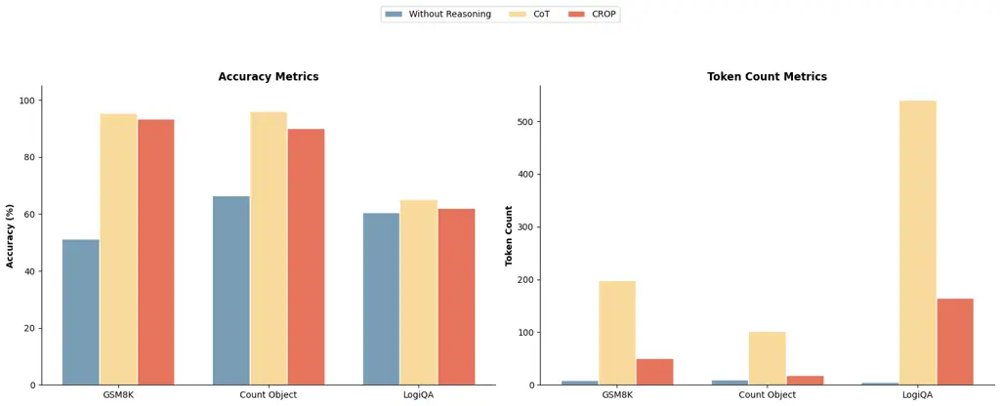

# CROP: Token-Efficient Reasoning in Large Language Models via Regularized Prompt Optimization

Deep Shah Affiliation: Google LLC    Sanket Badhe Affiliation: Google
LLC    Nehal Kathrotia Affiliation: Google LLC    Priyanka Tiwari
Affiliation: Purdue University

###### Abstract

Large Language Models utilizing reasoning techniques improve task
performance but incur significant latency and token costs due to verbose
generation. Existing automatic prompt optimization(APO) frameworks
target task accuracy exclusively at the expense of generating long
reasoning traces. We propose Cost-Regularized Optimization of Prompts
(CROP), an APO method that introduces regularization on response length
by generating textual feedback in addition to standard accuracy
feedback. This forces the optimization process to produce prompts that
elicit concise responses containing only critical information and
reasoning. We evaluate our approach on complex reasoning datasets,
specifically GSM8K, LogiQA and BIG-Bench Hard. We achieved an 80.6%
reduction in token consumption while maintaining competitive accuracy,
seeing only a nominal decline in performance. This presents a pragmatic
solution for deploying token-efficient and cost-effective agentic AI
systems in production pipelines.

## 1 Introduction

Large Language Models (LLMs) have achieved unprecedented
state-of-the-art capabilities in complex reasoning tasks primarily
through step-by-step generation strategies like Chain of Thought Wei et
al. (2022); Kojima et al. (2022); Wang et al. (2023). By prompting
models to decompose intricate problems into intermediate logical steps
prior to outputting a final answer, researchers have significantly
improved performance across mathematical, logical, and commonsense
reasoning benchmarks Nye et al. (2021); Zelikman et al. (2022); Cobbe et
al. (2021). Reasoning capabilities are an indispensable requirement for
deploying foundation models across diverse and critical domains,
including financial analysis, algorithmic ranking, medical diagnosis,
and legal reasoning Wu et al. (2023); Cui et al. (2023); Badhe et al.
(2026); Shah et al. (2026). This paradigm encourages models to mimic
structured human deliberation Yao et al. (2023); Besta et al. (2024).
Consequently, step-by-step rationale generation has become the standard
operational mode for extracting high-fidelity reasoning from large-scale
foundation models Lightman et al. (2024).

Despite these performance gains, the reliance on verbose intermediate
reasoning introduces a critical deployment hurdle for real-world
production environments. The generation of thousands of intermediate
tokens incurs massive inference latency and exorbitant financial costs
Pope et al. (2022); Aminabadi et al. (2022); Kwon et al. (2023). Recent
empirical analyses reveal that modern reasoning models exhibit
substantial verbosity compensation, often producing excessively lengthy
explanations that provide little additional logical value Patel et al.
(2024); Xu and others (2025). This extensive token consumption thus
presents a severe liability that restricts the practical viability of
deploying complex reasoning pipelines Renze and Guven (2024); Li et al.
(2024); Jiang et al. (2023).

To optimize these systems, the field has increasingly adopted automated
prompt engineering frameworks that leverage LLMs as meta-optimizers Zhou
et al. (2023); Yang et al. (2024); Pryzant et al. (2023). Tools such as
DSPy remove the need for manual human trial and error by refining
prompts through systematic search Khattab et al. (2024). Recent
frameworks extend this paradigm by automating the optimization workflow,
utilizing meta-learning and combinatorial search to systematically
refine instructions and prompting strategies without human intervention
Spiess et al. (2025); Murthy et al. (2025); Xu et al. (2025). However,
these existing tools suffer from a critical flaw in that they optimize
almost exclusively for task accuracy, often at the expense of generating
excessively verbose intermediate reasoning traces. By continuously
adding edge-case instructions and logic corrections to the prompt, the
optimizer inadvertently maximizes the verbosity tax, producing bloated
system prompts that force the target model to generate even longer and
more exhaustive reasoning traces.

This inherent tendency toward verbosity exposes a fundamental missing
mathematical constraint in the current paradigm of textual optimization.
In standard machine learning optimization, loss functions routinely
incorporate regularization techniques (such as L1 or L2 penalties) to
constrain model weights and prevent overly complex architectures from
overfitting Goodfellow et al. (2016); Bishop and Nasrabadi (2006). Yet,
textual prompt optimization lacks a true analog to a length penalty.

To solve this structural deficiency, we propose CROP, an applied
methodology that introduces an output-biased textual regularizer
directly into the prompt optimization loop. CROP builds upon the
multi-objective capabilities of textual differentiation to treat output
token count as a first-class optimization constraint alongside task
accuracy. By computing a continuous length-penalty gradient that
functions independently of the task loss, the regularizer explicitly
penalizes the target model whenever its output exceeds a minimal
threshold. This feedback is then aggregated with traditional accuracy
gradients using textual summation. Consequently, CROP forces the
meta-optimizer to rewrite system instructions that explicitly constrain
verbosity without sacrificing the underlying logical steps necessary for
correct inference.

Through this regularized feedback mechanism, CROP successfully forces
the discovery of concise reasoning paths. Our empirical evaluations
demonstrate that this approach effectively shrinks the output
distribution, minimizing both output length and overall inference
latency. We evaluate CROP on complex reasoning benchmarks, specifically
GSM8K Cobbe et al. (2021), LogiQA Liu et al. (2020), and BIG-Bench Hard
Suzgun et al. (2023); Srivastava et al. (2023). The results show that
our cost-aware optimization method yields a dramatic reduction in output
token consumption by 80.6% reduction in token consumption while
maintaining competitive accuracy. By establishing a continuous textual
penalty for verbosity, CROP provides a pragmatic and highly effective
solution for deploying token-efficient compound AI systems in strict
production pipelines.

### 1.1 Main Contributions

In summary, our primary contributions are as follows:

- •
  Cost-Aware Prompt Optimization (CROP): We propose CROP, a novel
  token-efficient automatic prompt optimization framework. By
  introducing an response adaptive textual length penalty, CROP
  successfully decouples reasoning accuracy from generation verbosity
  during the prompt discovery phase.
- •
  Massive Inference Efficiency: We empirically demonstrate that CROP
  reduces output token consumption by up to 80.6% on complex reasoning
  benchmarks (GSM8K, LogiQA and BIG-Bench Hard) while strictly
  preserving the task accuracy of unconstrained Chain-of-Thought
  prompting.
- •
  Autonomous Discovery of Symbolic Reasoning: We show that our
  regularized textual gradients automatically force the target LLM to
  adopt highly compressed, symbolic reasoning structures. This emergent
  behavior conceptually mirrors human-engineered strategies (e.g.,
  “Chain-of-Draft”) without requiring manual prompt design.

## 2 Related Work

### 2.1 Automatic Prompt Optimization

The optimization of natural language prompts has evolved from discrete
vocabulary search Shin et al. (2020); Deng et al. (2022); Prasad et al.
(2023); Guo et al. (2023); Chen and others (2024); Badhe and Shah (2026)
to utilizing large language models as meta-optimizers Zhou et al.
(2023); Yang et al. (2024); Pryzant et al. (2023); Wang and others
(2023). Frameworks such as DSPy and TextGrad Khattab et al. (2024);
Yuksekgonul et al. (2024) have formalized this into comprehensive
computation graphs, enabling automated textual backpropagation capable
of optimizing user-defined metrics and rewards. However, when applied to
complex reasoning tasks, textual optimization exposes a fundamental
generative bias: because evaluators diagnose logic errors via natural
language critiques, they inherently resolve failures by prescribing
additive logic and expanded instructions. This accumulation of
instructional leads to unchecked increase of reasoning leading to
verbosity. Recognizing this computational bottleneck, recent frameworks
such as Promptomatix and AutoPDL Pan and others (2025); Murthy et al.
(2025) have introduced cost-aware objectives to balance efficiency with
performance, alongside discrete evolutionary algorithms like CAPO and
ParetoPrompt Wen (2025); Authors (2025); Zehle et al. (2025). Building
upon this critical shift, CROP introduces a continuous, dual-objective
textual optimization landscape. By applying an unconditional,
output-biased regularizer alongside task gradients, CROP exerts
continuous downward pressure on token bloat, forcing the meta-optimizer
to systematically balance logical correctness with generative brevity in
a way that purely additive textual gradients cannot.

### 2.2 Inference-Time Scaling and Self-Correction

Alternative approaches improve reasoning by scaling compute during
inference. Methodologies ranging from Self-Consistency Wang et al.
(2023) to iterative self-correction frameworks like Reflexion and
Self-Refine Shinn et al. (2023); Madaan et al. (2023) allow models to
critique and repeatedly refine their intermediate outputs. While
yielding substantial accuracy gains, these pipelines inherently multiply
the token consumption and latency of the system with every additional
trial. In contrast to these methods that severely compound inference
overhead, CROP shifts the iterative refinement burden entirely to an
offline prompt optimization phase, ultimately producing a single, highly
efficient system prompt that elicits compressed reasoning trajectories
in a single forward pass.

### 2.3 Cost-Aware Systems and Verbosity Control

To mitigate computational overhead Pope et al. (2022); Kwon et al.
(2023), researchers have developed system-level routing protocols Chen
et al. (2023); Ong and others (2024); Aggarwal and others (2024); Jian
and others (2023), and inference-time early exiting or truncation
strategies Mao et al. (2025); Jiang et al. (2023); Wu and others (2025).
Furthermore, recent literature focuses on explicitly compressing
reasoning traces via continuous latent projections Hao and others
(2024); Shen and others (2025); Wei et al. (2025), conditioned textual
pruning Kang et al. (2024); Xia (2025); Wang (2025). However, these
approaches introduce severe operational trade-offs. Methods relying on
continuous latent projections or explicit fine-tuning are
computationally prohibitive and alter foundation weights. Conversely,
structured static prompting remains notoriously brittle, while dynamic
token-pruning and step-skipping often require specialized decoding
mechanisms or architectural interventions. Unlike approaches that demand
expensive weight updates, custom decoding algorithms, or fragile
hardcoded constraints, CROP operates entirely in the natural language
optimization space. It dynamically modulates verbosity at the prompt
level, systematically discovering optimal, token-efficient reasoning
pathways through regularized textual feedback.

Figure 1: Overview of CROP optimization pipeline. A meta-optimizer
updates the system prompt by aggregating textual gradients for both task
accuracy ($`g_{task}`$) and response brevity ($`g_{reg}`$),
systematically enforcing token-efficient reasoning.

## 3 Methodology

In this section, we formalize CROP, a framework that extends the
automatic prompt optimization (APO) paradigm to resource-constrained
environments. We first briefly review the preliminary formulation of
textual differentiation, and subsequently detail our novel textual
regularization objective.

### 3.1 Preliminaries: Textual Differentiation

Let $`\mathcal{V}^{*}`$ denote the space of all possible natural
language strings. In a standard LLM-based computation graph, we define a
system prompt $`p\in\mathcal{V}^{*}`$ as a learnable parameter, an input
query $`x\in\mathcal{V}^{*}`$, and a target model $`\mathcal{M}`$. The
forward pass generates an output $`\hat{y}=\mathcal{M}(x;p)`$.

Given a ground-truth label $`y`$, a textual loss function
$`\mathcal{L}_{\text{task}}`$ evaluates the prediction. Instead of
yielding a scalar gradient, textual backpropagation queries a secondary
evaluator LLM $`\mathcal{E}`$, to generate a textual gradient
$`g_{\text{task}}\in\mathcal{V}^{*}`$. This gradient is a natural
language critique detailing the logical flaws in $`\hat{y}`$ and
suggesting semantic updates to $`p`$:

```math
g_{\text{task}}=\mathcal{E}_{\text{task}}(p,x,\hat{y},y) \tag{1}
```

An optimizer LLM, $`\mathcal{O}`$, then acts as the parameter update
function, synthesizing the batch of gradients to perform a discrete step
in the prompt space:
$`p_{t+1}=\mathcal{O}(p_{t},\{g_{\text{task}}^{(i)}\}_{i=1}^{B})`$,
where $`B`$ is the batch size.

### 3.2 Verbose Reasoning

While $`\mathcal{L}_{\text{task}}`$ effectively maximizes reasoning
accuracy, it is agnostic to computational efficiency. Consequently, the
meta-optimizer $`\mathcal{O}`$ inherently gravitates toward system
prompts that trigger useful but overly verbose Chain-of-Thought (CoT)
bloat in $`\hat{y}`$. In production systems, the length of $`\hat{y}`$
directly influences the inference latency and compute requirements.

Require: Initial system prompt $`p_{0}`$, Target LLM $`\mathcal{M}`$,
Meta-Optimizer LLM $`\mathcal{O}`$  
Require: Task Evaluator $`\mathcal{E}_{\text{task}}`$, Brevity Evaluator
$`\mathcal{E}_{\text{reg}}`$  
Require: Dataset $`\mathcal{D}`$, Batch size $`B`$, Max iterations $`T`$

1: $`p\leftarrow p_{0}`$

2: for $`t=1`$ to $`T`$ do

3:   Sample batch $`\{(x_{i},y_{i})\}_{i=1}^{B}\sim\mathcal{D}`$

4:   $`G_{\text{batch}}\leftarrow\emptyset`$ $`\triangleright`$
Initialize empty batch gradient list

5:   for $`i=1`$ to $`B`$ do

6:    $`\hat{y}_{i}\leftarrow\mathcal{M}(x_{i};p)`$ $`\triangleright`$
Forward Pass

7:
   $`g_{\text{task}}^{(i)}\leftarrow\mathcal{E}_{\text{task}}(p,x_{i},\hat{y}_{i},y_{i})`$
$`\triangleright`$ Compute Task Accuracy Gradient

8:
   $`g_{\text{reg}}^{(i)}\leftarrow\mathcal{E}_{\text{reg}}(p,\hat{y}_{i})`$
$`\triangleright`$ Compute Textual Regularization Gradient

9:
   $`g_{\text{total}}^{(i)}\leftarrow g_{\text{task}}^{(i)}\oplus\text{``\textbackslash n''}\oplus g_{\text{reg}}^{(i)}`$
$`\triangleright`$ Aggregate Gradients via Concatenation

10:
   $`G_{\text{batch}}\leftarrow G_{\text{batch}}\cup\{g_{\text{total}}^{(i)}\}`$

11:   end for

12:   $`\text{Accuracy}_{t}\leftarrow C_{\text{correct}}/B`$

13:   $`\text{AvgLength}_{t}\leftarrow L_{\text{total}}/B`$

14:
  $`S_{t}\leftarrow\text{Accuracy}_{t}-\lambda\cdot L_{\text{norm}}(t)`$
$`\triangleright`$ Evaluate trade-off score

15:   if $`S_{t}>S_{\text{best}}`$ then $`\triangleright`$ Update best
prompt if score improves

16:    $`S_{\text{best}}\leftarrow S_{t}`$

17:    $`p^{*}\leftarrow p`$

18:   end if

19:   $`p\leftarrow\mathcal{O}(p,G_{\text{batch}})`$ $`\triangleright`$
Meta-Optimizer computes discrete prompt update

20: end for

21: return $`p^{*}`$ $`\triangleright`$ Optimized token-efficient prompt

Algorithm 1 CROP: Cost-Regularized Optimization of Prompts

### 3.3 Textual Regularization

CROP applies $`\mathcal{L}_{\text{reg}}`$ across the entire batch,
asserting a constant downward pressure on token consumption. We define a
secondary evaluator prompt, $`\mathcal{E}_{\text{reg}}`$, which receives
the generated output and computes a textual brevity gradient:

```math
g_{\text{reg}}=\mathcal{E}_{\text{reg}}(p,\hat{y}) \tag{2}
```

The resulting gradient $`g_{\text{reg}}`$ explicitly instructs the
optimizer to inject brevity constraints into $`p`$. The regularization
gradient is computed only when $`\|\hat{y}\|`$ exceeds a predefined
threshold, preventing the penalization of already token-efficient
reasoning. To maintain optimization stability and prevent destructively
large steps in the prompt space—which frequently induce catastrophic
forgetting of the underlying logic—$`\mathcal{E}_{\text{reg}}`$ is
constrained to enforce only a gradual, incremental reduction in output
length per iteration. Furthermore, the evaluator is explicitly directed
to target peripheral narrative elements and conversational filler,
strictly preserving the tokens associated with critical computational
steps.

### 3.4 Gradient Aggregation and Multi-Objective Optimize

To perform the parameter update, CROP treats prompt optimization as a
formal multi-objective problem. We leverage the concatenation properties
of textual autograd engines to compute the total gradient. For a single
instance, the combined textual gradient $`g_{\text{total}}`$ is defined
via the string concatenation operator $`\oplus`$:

```math
g_{\text{total}}=g_{\text{task}}\oplus\text{``\textbackslash n''}\oplus g_{\text{reg}} \tag{3}
```

During the batched optimization step, the meta-optimizer $`\mathcal{O}`$
receives the aggregated sets of both task gradients and regularization
gradients and performs the update step
$`p_{t+1}=\mathcal{O}(p_{t},\mathbf{g}_{\text{total}})`$.

Rather than naively returning the prompt from the final iteration, CROP
employs a structured selection criterion to identify the optimal prompt
$`p^{*}`$ discovered during the optimization trajectory. We define a
composite score $`S`$ for each candidate prompt:

```math
S(p)=\text{Accuracy}(p)-\lambda\cdot L_{\text{norm}}(p) \tag{4}
```

where $`L_{\text{norm}}(p)`$ represents the generated token count
normalized by the average COT output token length, and $`\lambda`$ is a
tunable regularization coefficient. The magnitude of $`\lambda`$
dictates the explicit trade-off between task performance and token
consumption. We selected $`\lambda`$ through an empirical grid search on
the validation set over the range of $`0.01`$ to $`0.5`$. We identified
$`\lambda=0.2`$ as the optimal configuration, as it provided the maximum
reduction in reasoning verbosity without inducing a statistically
significant degradation in task accuracy.

## 4 Experiment Setup

### 4.1 Model Setup

We assign specific Large Language Models to the distinct roles of
evaluation, optimization, and inference. We utilize Gemini 2.0 Flash as
the dual-evaluator ($`\mathcal{E}_{\text{task}}`$ and
$`\mathcal{E}_{\text{reg}}`$) to compute task accuracy critiques and
regularized verbosity gradients. For the parameter update step, we
deploy Gemini 3.1 Pro (with Thinking enabled) as the meta-optimizer
($`\mathcal{O}`$). A high-capacity model is critical here, as
synthesizing multi-objective, conflicting textual gradients requires an
extended context window and advanced deductive reasoning (ablated in
Section 5).

For forward-pass inference ($`\mathcal{M}`$), we evaluated two models:
Gemini 2.0 Flash and Qwen 2.5 7B.

### 4.2 Baselines

We benchmark CROP against zero-shot prompting, chain-of-thoughts,
concise induced prompting and automatic prompt optimization method
TextGrad. We intentionally omit static length-constrained prompts, which
are brittle and degrade reasoning; furthermore, the model was unable to
follow explicit token-limit instructions and frequently exceeded the
given limits.

- •
  Standard Zero-Shot (Direct Prompting): Prohibits intermediate
  reasoning steps to output the final answer directly. This establishes
  our empirical lower bound for token consumption, though typically at
  the severe expense of task accuracy.
- •
  Chain-of-Thought (CoT): Appends a standard step-by-step reasoning
  directive. This serves as our upper bound for baseline accuracy,
  simultaneously representing the widely used but verbosity prompting
  technique.
- •
  Conciseness inducing prompts: We used different prompts which
  encourages concise reasoning via prompting Lee et al. (2025). (See
  prompts in Appendix A.1)
- •
  TextGrad: An automatic prompt optimization framework that utilizes
  textual gradients to maximize task accuracy without penalizing verbose
  reasoning during the optimization loop.



Figure 2: Performance and efficiency comparison across three datasets
using the Gemini 2.0 Flash model.

### 4.3 Datasets

To evaluate CROP across diverse cognitive domains, we selected three
challenging reasoning benchmarks. Because these tasks inherently
necessitate intermediate logic, they intrinsically incentivize
unconstrained LLMs to generate highly verbose Chain-of-Thought (CoT)
traces, providing an optimal testbed for our compression framework. To
prevent data leakage, we utilize the official train, validation, and
test splits provided by the dataset authors wherever available. For the
BBH Object Counting task, which lacks standard splits, we manually
partition the data into a 25/25/50 split for training, validation, and
testing, respectively.

- •
  GSM8K Cobbe et al. (2021): A benchmark of linguistically diverse
  grade-school math word problems. This dataset requires accurate
  multi-step arithmetic reasoning, which frequently induces
  unconstrained LLMs to produce excessively long textual explanations
  for basic algebraic steps.
- •
  Object Counting (BIG-Bench Hard) Suzgun et al. (2023): An algorithmic
  reasoning task requiring the model to determine the total count of a
  specific semantic class from a natural-language collection of items.
  This tests symbolic tracking, where standard CoT prompts typically
  trigger exhaustive, token-heavy item enumeration.
- •
  LogiQA Liu et al. (2020): A challenging machine reading comprehension
  dataset sourced from expert logical examinations. It requires complex
  deductive inference (e.g., categorical, conditional, and disjunctive
  reasoning), assessing CROP’s ability to maintain the structural
  integrity of formal logical arguments under aggressive token
  compression.

| Method           | Core Instruction                                                                                                                                                      |
| ---------------- | --------------------------------------------------------------------------------------------------------------------------------------------------------------------- |
| No Reasoning     | Output ONLY the final answer without reasoning or thinking.                                                                                                           |
| Chain-of-Thought | Think step by step.                                                                                                                                                   |
| CROP (Ours)      | \[…\] concisely, showing the combined essential calculations leading directly to the final numerical answer. Omit intermediate labels. Focus on chained calculations. |

Table 1: Comparison of core system instructions across prompting
baselines for the GSM8K dataset. Standard prefix formulations and output
formatting constraints have been omitted to highlight the distinct
reasoning directives.


Table 2: Reasoning comparison on the GSM8K dataset.

| Model          | Dataset      | CoT          | w/o Reasoning | CROP         | TextGrad     | Be Concise   | Only Number  | Use Abbrev   |
| -------------- | ------------ | ------------ | ------------- | ------------ | ------------ | ------------ | ------------ | ------------ |
| Gemini 2 Flash | GSM8K        | 95.3 (198.4) | 51.2 (9.2)    | 93.4 (50.0)  | 95.5 (185.5) | 96.2 (120.8) | 91.4 (113.0) | 95.1 (145.7) |
|                | Count Object | 96.0 (101.2) | 66.4 (9.4)    | 94.8 (19.6)  | 90.5 (24.5)  | 96.0 (59.0)  | 92.5 (55.0)  | 95.0 (92.0)  |
|                | LogiQA       | 65.2 (540.5) | 60.4 (5.1)    | 64.2 (181.0) | 66.4 (663.0) | 65.1 (301.0) | 61.9 (423.0) | 65.3 (422.0) |
| Qwen2.5 7B     | GSM8K        | 90.2 (123.4) | 54.9 (3.4)    | 87.8 (21.3)  | 89.8 (101.2) | 90.4 (82.3)  | 85.1 (31.1)  | 88.2 (72.4)  |
|                | Count Object | 92.1 (56.3)  | 67.8 (3.8)    | 90.1 (12.1)  | 88.8 (32.7)  | 92.7 (46.6)  | 81.5 (16.2)  | 90.2 (39.7)  |
|                | LogiQA       | 61.2 (287.0) | 54.0 (3.4)    | 59.3 (84.2)  | 60.1 (212.3) | 61.1 (152.3) | 50.8 (32.8)  | 54.7 (212.0) |

Table 3: Model Performance Across Prompting Methods. Cells display
Accuracy (%) with Average Token Count in parentheses.

## 5 Results and Analysis

We evaluate CROP’s capacity to eliminate the computational redundancy
inherent in unconstrained Chain-of-Thought (CoT) reasoning. By
integrating a continuous brevity gradient into the optimization loop,
CROP explicitly optimizes for reasoning density alongside task
performance. As detailed in Table 3, our framework compresses output
token consumption by up to 80.6% without degrading exact-match accuracy.
These results establish that high-fidelity inference can be sustained at
a fraction of the standard computational cost.

### 5.1 Significant Reductions in Token Consumption

CROP consistently achieved state-of-the-art token efficiency while
preserving the logical integrity required for complex problem-solving.
On mathematical arithmetic (GSM8K), algorithmic tasks (Object Counting),
and LogiQA, the framework reduced output token consumption by 74.8%,
80.6%, and 66.5% respectively while retaining reasoning leading to
comparable accuracy for Gemini 2.0 Flash. Similar token-efficiency was
observed for Qwen 2.5 7B as well. This starkly contrasts with the Direct
Prompting (Without Reasoning) baseline, which collapses entirely on
these tasks. This divergence confirms that while intermediate
computation is strictly necessary for accuracy, the narrative verbosity
of that computation is highly compressible via regularized feedback.

### 5.2 Emergent Symbolic Reasoning

A qualitative examination of the optimized prompts (Table 1) and
generated outputs (Table 2) reveals that CROP discovered prompts
fundamentally shifts how the target model structures its intermediate
logic. Rather than generating conversational heuristics (e.g., “First,
let us observe that…”), the regularized prompts elicit a dense, symbolic
syntax. On GSM8K, the model spontaneously adopts a mathematical
shorthand analogous to the recently proposed “Chain-of-Draft” Xu and
others (2025) methodology. However, whereas prior works rely on manual
human engineering to elicit this behavior, CROP discovers this optimal
reasoning syntax entirely autonomously.

[TABLE]

Table 4: Comparison of optimized system prompts generated by different
meta-optimizers for the BBH Object Counting task. While the
lower-capacity model (Gemini 2.0 Flash) defaults to a blunt truncation
directive, the high-capacity model (Gemini 3.1 Pro) successfully
synthesizes multi-faceted constraints targeting specific vectors of
verbosity.

[TABLE]

Table 5: Qualitative ablation of discovered system prompts under
different optimization constraints for the BBH dataset. Only the optimal
configuration (high capacity, large batch) successfully balances extreme
conciseness with the preservation of reasoning.

### 5.3 Role of Optimizer Scale in Generalization

The meta-optimizer ($`\mathcal{O}`$) is responsible for synthesizing
batched textual accuracy and regularization gradients into a coherent,
updated system prompt. In early iterations, deploying a lower-capacity
model (Gemini 2.0 Flash) as the meta-optimizer resulted in a severe
degradation of prompt quality. The optimizer consistently overfit to
idiosyncratic errors from isolated batch examples rather than deriving
generalizable instructional updates. Extensive tuning of the
meta-optimizer’s system prompt failed to mitigate this limitation.

Ultimately, scaling the meta-optimizer to a frontier reasoning
model—specifically Gemini 3.1 Pro with thinking capabilities
enabled—resolved these issues and produced highly robust system prompts
(See table 4). We hypothesize that synthesizing complex, multi-objective
textual feedback requires both the extended context window and the
advanced deductive reasoning capabilities inherent to this larger model.

### 5.4 Gradient Stability and Batch Dynamics

In standard deep learning, gradient variance is inversely proportional
to batch size. We observe an analogous phenomenon in regularized textual
differentiation. As demonstrated in Table 5, ablation experiments
utilizing stochastic updates (batch size of 1) yield extreme variance in
the textual gradients. When evaluating an isolated example, the
meta-optimizer frequently overfits to the length penalty, prioritizing
output compression over task accuracy and aggressively stripping away
critical cognitive instructions. This results in prompt collapse: the
generation of degenerate directives that entirely eliminate intermediate
reasoning capacity. Conversely, scaling to a batch size of 128
stabilizes the multi-objective feedback. By providing the meta-optimizer
with a statistically representative sample of both reasoning failures
and excess verbosity, large batches prevent regularization-induced
collapse and ensure stable, convergent trajectories during prompt
optimization.

## 6 Conclusion

The deployment of Large Language Models in complex reasoning pipelines
has historically been bottlenecked by the severe latency and financial
costs associated with verbose Chain-of-Thought generation. In this work,
we introduced CROP, a novel multi-objective automatic prompt
optimization framework. By integrating a continuous textual
regularization penalty directly into the prompt optimization loop, CROP
forces the meta-optimizer to navigate the Pareto frontier of accuracy
and token-consumption.

Our empirical evaluations demonstrate that intermediate reasoning is
highly compressible. CROP successfully reduces output token consumption
by up to 80.6% on rigorous reasoning benchmarks (GSM8K, BIG-Bench Hard,
and LogiQA) while maintaining comparable accuracy compared to
unconstrained CoT and automatic prompt optimization baselines.
Furthermore, our analysis reveals that this dual-objective optimization
automatically elicits highly efficient, symbolic reasoning structures,
conceptually mirroring manual “Chain-of-Draft” prompting without
requiring human intervention. Through systematic ablations, we also
identified that successful multi-objective textual optimization requires
frontier-level model capacity and large batch sizes to stabilize
gradient variance and prevent the collapse of intermediate logic.

Ultimately, CROP provides a highly practical, deployment-ready
methodology. By systematically excising computational redundancy at the
prompt level rather than altering foundational weights, it enables the
scalable and cost-effective integration of high-fidelity reasoning
models into strict, real-world production and agentic environments.

## Limitations

While CROP significantly reduces inference-time overhead, we acknowledge
two primary limitations regarding its current operational scope.

One limitation of our current evaluation is that we do not explicitly
consider input token length or cost. In modern production environments,
prompt caching (or prefix caching) is a default feature that
automatically stores and reuses the initial segments of instructions.
Because our framework produces a single, static system prompt that
remains identical across all user queries, it perfectly leverages this
caching mechanism. By reusing this prior computational work, prefix
caching reduces time-to-first-token latency by up to 80% and decreases
input token costs by up to 90% OpenAI (2024). Consequently, the
financial impact of a slightly longer optimized system prompt is
effectively marginalized. This justifies our exclusive focus on
constraining the verbosity of the generated output, which remains the
primary driver of unmitigated inference costs.

Second, the optimization phase of CROP necessitates access to
high-capacity reasoning models (e.g., Gemini 3.1 Pro with Thinking). We
observe that such model is required to effectively synthesize and
balance conflicting objectives between task accuracy and textual
regularization. Consequently, the efficacy of using smaller, mid-tier
models as meta-optimizers for this dual-objective task has not yet been
established.

## References

- Aggarwal et al. (2024) A. Aggarwal et al. AutoMix: automatically
  mixing language models. arXiv preprint arXiv:2310.12963. Cited by:
  §2.3.
- Aminabadi et al. (2022) R. Y. Aminabadi, S. Rajbhandari, A. A.
  Awan, C. Li, D. Li, E. Zheng, O. Ruwase, S. Smith, M. Zhang, J.
  Rasley, et al. Deepspeed-inference: enabling efficient inference of
  transformer models at unprecedented scale. In SC22: International
  Conference for High Performance Computing, Networking, Storage and
  Analysis, pp. 1–15. Cited by: §1.
- Authors (2025) M. Authors MOPO: multi-objective prompt optimization
  for affective text generation. In Proceedings of the 31st
  International Conference on Computational Linguistics, Cited by: §2.1.
- Badhe et al. (2026) S. Badhe, D. Shah, and N. Kathrotia Long-tail
  knowledge in large language models: taxonomy, mechanisms,
  interventions and implications. arXiv preprint arXiv:2602.16201. Cited
  by: §1.
- Badhe and Shah (2026) S. Badhe and D. Shah Prompt-level distillation:
  a non-parametric alternative to model fine-tuning for efficient
  reasoning. arXiv preprint arXiv:2602.21103. Cited by: §2.1.
- Besta et al. (2024) M. Besta, N. Blatter, L. Dragos, J. Lin, O.
  Krause, et al. Graph of thoughts: solving elaborate problems with
  large language models. In International Conference on Learning
  Representations, Cited by: §1.
- Bishop and Nasrabadi (2006) C. M. Bishop and N. M. Nasrabadi Pattern
  recognition and machine learning. Springer. Cited by: §1.
- Chen et al. (2024) J. Chen et al. EvoPrompt: evolutionary prompt
  optimization for large language models. In International Conference on
  Learning Representations, Cited by: §2.1.
- Chen et al. (2023) L. Chen, M. Zaharia, and J. Zou FrugalGPT: how to
  use large language models while reducing cost and improving
  performance. In Advances in Neural Information Processing Systems,
  Cited by: §2.3.
- Cobbe et al. (2021) K. Cobbe, V. Kosaraju, M. Bavarian, M. Chen, H.
  Jun, L. Kaiser, M. Plappert, J. Tworek, J. Hilton, R. Nakano, et al.
  Training verifiers to solve math word problems. arXiv preprint
  arXiv:2110.14168. Cited by: §1, §1, 1st item.
- Cui et al. (2023) J. Cui, Z. Li, Y. Yan, B. Chen, and L. Yuan ChatLaw:
  open-source legal large language model with integrated external
  knowledge bases. arXiv preprint arXiv:2306.16092. Cited by: §1.
- Deng et al. (2022) M. Deng, J. Wang, C. Hsieh, Y. Wang, H. Guo, T.
  Shu, M. Song, E. P. Xing, and Z. Hu RLPrompt: optimizing discrete text
  prompts with reinforcement learning. In Proceedings of the 2022
  Conference on Empirical Methods in Natural Language Processing, Cited
  by: §2.1.
- Goodfellow et al. (2016) I. Goodfellow, Y. Bengio, and A. Courville
  Deep learning. MIT press. Cited by: §1.
- Guo et al. (2023) Q. Guo, R. Wang, J. Guo, B. Li, K. Song, X. Tan, G.
  Liu, K. Jiang, J. Yao, M. Zhang, et al. Connecting large language
  models with evolutionary algorithms yields powerful prompt optimizers.
  arXiv preprint arXiv:2309.08532. Cited by: §2.1.
- Hao et al. (2024) S. Hao et al. Training large language models to
  reason in a continuous latent space. arXiv preprint arXiv:2412.00000.
  Cited by: §2.3.
- Jian et al. (2023) Y. Jian et al. EcoAssistant: using llm assistant
  more affordably and accurately. In Advances in Neural Information
  Processing Systems, Cited by: §2.3.
- Jiang et al. (2023) H. Jiang, Q. Wu, C. Lin, Y. Yang, and L. Qiu
  LLMLingua: compressing prompts for accelerated inference of large
  language models. In Proceedings of the 2023 Conference on Empirical
  Methods in Natural Language Processing, Cited by: §1, §2.3.
- Kang et al. (2024) Y. Kang, X. Sun, L. Chen, and W. Zou C3oT:
  generating shorter chain-of-thought without compromising
  effectiveness. arXiv preprint arXiv:2412.11664. Cited by: §2.3.
- Khattab et al. (2024) O. Khattab, A. Singhvi, P. Maheshwari, Z.
  Zhang, K. Santhanam, S. Vardhamanan, S. Haq, A. Sharma, T. T.
  Joshi, H. Moazam, et al. DSPy: compiling declarative language model
  calls into state-of-the-art pipelines. In International Conference on
  Learning Representations, Cited by: §1, §2.1.
- Kojima et al. (2022) T. Kojima, S. S. Gu, M. Reid, Y. Matsuo, and Y.
  Iwasawa Large language models are zero-shot reasoners. In Advances in
  Neural Information Processing Systems, Cited by: §1.
- Kwon et al. (2023) W. Kwon, Z. Li, S. Zhuang, Y. Sheng, L.
  Zheng, C. H. Yu, J. E. Gonzalez, H. Zhang, and J. Jin Efficient memory
  management for large language model serving with pagedattention. In
  Proceedings of the 29th Symposium on Operating Systems Principles,
  Cited by: §1, §2.3.
- Lee et al. (2025) A. Lee, E. Che, and T. Peng How well do llms
  compress their own chain-of-thought? a token complexity approach.
  arXiv preprint arXiv:2503.01141. Cited by: 3rd item.
- Li et al. (2024) Z. Li, Y. Su, and N. Collier 500xCompressor:
  generalized prompt compression for large language models. arXiv
  preprint arXiv:2408.03094. Cited by: §1.
- Lightman et al. (2024) H. Lightman, V. Kosaraju, Y. Burda, H.
  Edwards, B. Baker, et al. Let’s verify step by step. In International
  Conference on Learning Representations, Cited by: §1.
- Liu et al. (2020) J. Liu, L. Cui, H. Liu, D. Huang, Y. Wang, and Y.
  Zhang Logiqa: a challenge dataset for machine reading comprehension
  with logical reasoning. In Proceedings of the Twenty-Ninth
  International Joint Conference on Artificial Intelligence, Cited by:
  §1, 3rd item.
- Madaan et al. (2023) A. Madaan, N. Tandon, P. Gupta, S. Hallinan, L.
  Gao, S. Wiegreffe, U. Alon, N. Dziri, S. Prabhumoye, Y. Yang, et al.
  Self-refine: iterative refinement with self-feedback. In Advances in
  Neural Information Processing Systems, Cited by: §2.2.
- Mao et al. (2025) M. Mao, B. Yin, Y. Zhu, and X. Fang Early stopping
  chain-of-thoughts in large language models. arXiv preprint
  arXiv:2509.14004. Cited by: §2.3.
- Murthy et al. (2025) R. Murthy, M. Zhu, L. Yang, J. Qiu, J. Tan, S.
  Heinecke, S. Savarese, C. Xiong, and H. Wang Promptomatix: an
  automatic prompt optimization framework for large language models.
  arXiv preprint arXiv:2507.14241. Cited by: §1, §2.1.
- Nye et al. (2021) M. Nye, A. J. Andreassen, G. Gur-Ari, A. L.
  Henry, V. Mansinghka, V. Mikulik, and N. Schärli Show your work:
  scratchpads for intermediate computation with language models. In
  Advances in Neural Information Processing Systems, Cited by: §1.
- Ong et al. (2024) I. Ong et al. RouteLLM: learning to route llms with
  preference data. In Proceedings of the 2024 Conference on Empirical
  Methods in Natural Language Processing, Cited by: §2.3.
- OpenAI (2024) OpenAI Prompt caching. Note: Accessed: 2026-03-17
  External Links:
  [Link](https://developers.openai.com/api/docs/guides/prompt-caching)
  Cited by: Limitations.
- Pan et al. (2025) X. Pan et al. AutoPDL: automatic prompt optimization
  for llm agents. arXiv preprint arXiv:2504.04365. Cited by: §2.1.
- Patel et al. (2024) R. Patel, K. Sharma, and A. Gupta Verbosity
  $`\neq`$ veracity: demystify verbosity compensation behavior of large
  language models. arXiv preprint arXiv:2411.07858. Cited by: §1.
- Pope et al. (2022) R. Pope, S. Douglas, A. Chowdhery, J. Devlin, J.
  Bradbury, et al. Efficiently scaling transformer inference. arXiv
  preprint arXiv:2211.05102. Cited by: §1, §2.3.
- Prasad et al. (2023) A. Prasad, P. Hase, X. Zhou, and M. Bansal GrIPS:
  gradient-free, edit-based instruction search for prompting large
  language models. In Proceedings of the 17th Conference of the European
  Chapter of the Association for Computational Linguistics, Cited by:
  §2.1.
- Pryzant et al. (2023) R. Pryzant D. iterative et al. Automatic prompt
  optimization with gradient descent and beam search. In Proceedings of
  the 2023 Conference on Empirical Methods in Natural Language
  Processing, Cited by: §1, §2.1.
- Renze and Guven (2024) M. Renze and E. Guven The benefits of a concise
  chain of thought on problem-solving in large language models. arXiv
  preprint arXiv:2401.05618. Cited by: §1.
- Shah et al. (2026) D. Shah, S. Badhe, and N. Kathrotia Taxonomy of the
  retrieval system framework: pitfalls and paradigms. arXiv preprint
  arXiv:2601.20131. Cited by: §1.
- Shen et al. (2025) Y. Shen et al. CODI: compressing chain-of-thought
  into continuous space via self-distillation. In Proceedings of the
  2025 Conference on Empirical Methods in Natural Language Processing,
  Cited by: §2.3.
- Shin et al. (2020) T. Shin, Y. Razeghi, R. L. Logan IV, E. Wallace,
  and S. Singh AutoPrompt: eliciting knowledge from language models with
  automatically generated prompts. In Proceedings of the 2020 Conference
  on Empirical Methods in Natural Language Processing, Cited by: §2.1.
- Shinn et al. (2023) N. Shinn, F. Cassano, A. Gopinath, K. Narasimhan,
  and S. Yao Reflexion: language agents with verbal reinforcement
  learning. In Advances in Neural Information Processing Systems, Cited
  by: §2.2.
- Spiess et al. (2025) C. Spiess, M. Vaziri, L. Mandel, and M. Hirzel
  AutoPDL: automatic prompt optimization for llm agents. arXiv preprint
  arXiv:2504.04365. Cited by: §1.
- Srivastava et al. (2023) A. Srivastava, A. Rastogi, A. Rao, A. A. M.
  Shoeb, A. Abid, A. Fisch, A. R. Brown, A. Santoro, A. Gupta, A.
  Garriga-Alonso, et al. Beyond the imitation game: quantifying and
  extrapolating the capabilities of language models. Transactions on
  Machine Learning Research. Cited by: §1.
- Suzgun et al. (2023) M. Suzgun, N. Scales, N. Schärli, S. Gehrmann, Y.
  Tay, H. W. Chung, A. Chowdhery, Q. V. Le, E. H. Chi, D. Zhou, et al.
  Challenging big-bench tasks and whether chain-of-thought can solve
  them. In Findings of the Association for Computational Linguistics:
  ACL 2023, Cited by: §1, 2nd item.
- Wang et al. (2023) C. Wang et al. InstructZero: efficient instruction
  optimization for black-box large language models. In Advances in
  Neural Information Processing Systems, Cited by: §2.1.
- Wang (2025) e. al. Wang Compressing chain-of-thought in llms via step
  entropy. arXiv preprint arXiv:2508.03346. Cited by: §2.3.
- Wang et al. (2023) X. Wang, J. Wei, D. Schuurmans, Q. V. Le, E. H.
  Chi, S. Narang, A. Chowdhery, and D. Zhou Self-consistency improves
  chain of thought reasoning in language models. In International
  Conference on Learning Representations, Cited by: §1, §2.2.
- Wei et al. (2022) J. Wei, X. Wang, D. Schuurmans, M. Bosma, F. Xia, E.
  Chi, Q. V. Le, and D. Zhou Chain-of-thought prompting elicits
  reasoning in large language models. In Advances in Neural Information
  Processing Systems, Cited by: §1.
- Wei et al. (2025) X. Wei, X. Liu, Y. Zang, X. Dong, Y. Cao, J.
  Wang, X. Qiu, and D. Lin SIM-cot: supervised implicit
  chain-of-thought. arXiv preprint arXiv:2509.20317. Cited by: §2.3.
- Wen (2025) e. al. Wen Pareto prompt optimization. In International
  Conference on Learning Representations, Cited by: §2.1.
- Wu et al. (2023) S. Wu, O. Irsoy, S. Lu, V. Dabravolski, M. Dredze, S.
  Gehrmann, P. Kambadur, D. Rosenberg, and G. Mann BloombergGPT: a large
  language model for finance. arXiv preprint arXiv:2303.17564. Cited by:
  §1.
- Wu et al. (2025) Z. Wu et al. An empirical study on prompt compression
  for large language models. arXiv preprint arXiv:2505.00019. Cited by:
  §2.3.
- Xia (2025) e. al. Xia TokenSkip: controllable chain-of-thought
  compression in llms. In Proceedings of the 2025 Conference on
  Empirical Methods in Natural Language Processing, Cited by: §2.3.
- Xu et al. (2025) G. Xu, M. Yuksekgonul, C. Guestrin, and J. Zou
  MetaTextGrad: automatically optimizing language model optimizers.
  arXiv preprint arXiv:2505.18524. Cited by: §1.
- Xu et al. (2025) S. Xu et al. Chain of draft: thinking faster by
  writing less. arXiv preprint arXiv:2502.18600. Cited by: §1, §5.2.
- Yang et al. (2024) C. Yang, X. Wang, Y. Lu, H. Liu, Q. V. Le, D. Zhou,
  and X. Chen Large language models as optimizers. In International
  Conference on Learning Representations, Cited by: §1, §2.1.
- Yao et al. (2023) S. Yao, D. Yu, J. Zhao, I. Shafran, T. L.
  Griffiths, Y. Cao, and K. Narasimhan Tree of thoughts: deliberate
  problem solving with large language models. In Advances in Neural
  Information Processing Systems, Cited by: §1.
- Yuksekgonul et al. (2024) M. Yuksekgonul, F. Bianchi, D. Boiko, et al.
  TextGrad: automatic differentiation via text. arXiv preprint
  arXiv:2406.07496. Cited by: §2.1.
- Zehle et al. (2025) T. Zehle, M. Schlager, T. Heiß, and M. Feurer
  CAPO: cost-aware prompt optimization. arXiv preprint arXiv:2504.16005.
  Cited by: §2.1.
- Zelikman et al. (2022) E. Zelikman, Y. Wu, J. Mu, and N. D. Goodman
  STaR: bootstrapping reasoning with reasoning. In Advances in Neural
  Information Processing Systems, Cited by: §1.
- Zhou et al. (2023) Y. Zhou, A. I. Muresanu, Z. Zi, K. Tucker, et al.
  Large language models are human-level prompt engineers. In
  International Conference on Learning Representations, Cited by: §1,
  §2.1.

## Appendix A Example Appendix

### A.1 Baseline prompts


### A.2 Initial prompts


### A.3 TextGrad Learnt Prompts


### A.4 CROP Prompts


### A.5 Gradient Prompts


### A.6 Optimizer prompt


