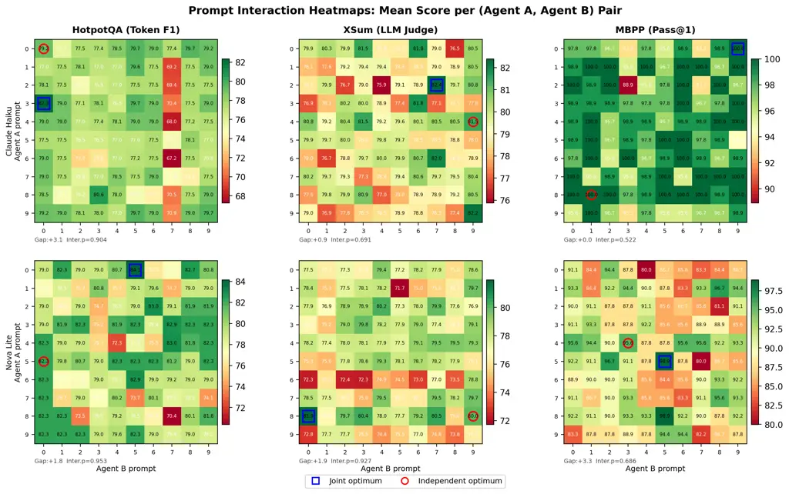

# Prompt Optimization Is a Coin Flip: Diagnosing When It Helps in Compound AI Systems

Xing Zhang Affiliation: AWS Generative AI Innovation Center    Guanghui
Wang Affiliation: AWS Generative AI Innovation Center    Yanwei Cui
Affiliation: AWS Generative AI Innovation Center    Wei Qiu
Affiliation: HSBC Holdings Plc., HSBC Technology Center, China    Ziyuan
Li Affiliation: HSBC Holdings Plc., HSBC Technology Center, China   
Bing Zhu Affiliation: HSBC Holdings Plc., HSBC Technology Center, China
   Peiyang He Affiliation: AWS Generative AI Innovation Center
Correspondence to: <peiyan@amazon.com>

###### Abstract

Prompt optimization in compound AI systems is statistically
indistinguishable from a coin flip: across 72 optimization runs on
Claude Haiku 4.5 (6 methods $`\times`$ 4 tasks $`\times`$ 3 repeats),
49% score _below_ zero-shot; on Amazon Nova Lite, the failure rate is
even higher. Yet on one task, _all_ six methods improve over zero-shot
by up to $`+6.8`$ points. What distinguishes success from failure? We
investigate with 18,000 grid evaluations and 144 optimization runs,
testing two assumptions behind end-to-end optimization tools like
TextGrad and DSPy, in the order they must be answered: (A) agent prompts
interact, requiring joint rather than independent optimization, and
(B) individual prompts are worth optimizing at all. Interaction effects
are never significant ($`p>0.52`$, all $`F<1.0`$), and optimization
helps only when the task has _exploitable output structure_: a format
the model can produce but does not default to. We further give a
mechanistic account: instruction-tuning compresses input phrasing into a
narrow output distribution, eliminating the very phrasing-sensitivity
that joint optimization assumes. We provide a two-stage diagnostic: an
\$80 ANOVA pre-test for agent coupling, and a 10-minute headroom test
that predicts whether optimization is worthwhile, turning a coin flip
into an informed decision.

###### Keywords: 

compound AI systems, prompt optimization, multi-agent, ANOVA,
interaction effects, model specificity, evaluation methodology

## 1 Introduction

Compound AI systems (pipelines of multiple LLM calls where each agent
handles a specialized subtask) have become the dominant architecture for
complex applications (Chase, 2022; Wu et al., 2023). A natural question
arises: _how should we optimize the prompts in these systems?_

Recent work strongly favors end-to-end joint optimization. TextGrad
(Yuksekgonul et al., 2025) propagates textual gradients through
multi-component systems. DSPy (Khattab et al., 2023) compiles LLM
programs with end-to-end optimization. GPTSwarm (Zhuge et al., 2024)
treats agent graphs as optimizable structures. These methods implicitly
rely on two assumptions:

- •
  Assumption A (coupling): Agent prompts interact, so the optimal prompt
  for one agent depends on the prompt of another, requiring joint rather
  than independent optimization.
- •
  Assumption B (worth optimizing): Individual agent prompts are worth
  optimizing, in that changing a prompt meaningfully affects system
  output, even at realistic training budgets.

If Assumption A fails, independent per-agent optimization suffices. If
Assumption B also fails, even per-agent optimization is unnecessary.
Surprisingly, neither assumption has been empirically tested.

We provide controlled measurements of both, in the order they must be
answered, and identify the conditions that separate the 49% failure rate
from the cases where optimization delivers real gains. Study 1 (§3)
tests Assumption A via exhaustive grid evaluation of two-agent pipelines
with ANOVA decomposition: _do we even need joint optimization?_ Study 2
(§4) tests Assumption B by benchmarking six optimization methods against
zero-shot baselines under equal compute budgets: _given that joint
optimization is unnecessary, does individual optimization help?_ We then
analyze _why_ it works when it does (§4.3).

#### Key findings.

1.  1.  Agents don’t interact. The $`A\times B`$ interaction term is
        non-significant in all six model$`\times`$task conditions
        ($`p>0.52`$, all $`F<1.0`$); joint optimization is unnecessary (§3).
        §7 explains why this is mechanistically expected from
        instruction-tuning.
2.  2.  Optimization helps only when exploitable structure exists. The sole
        task where all methods succeed requires structured rubrics and JSON
        formatting, a format the model _can_ produce but does not default
        to. The other three tasks lack this gap (§4.3).
3.  3.  Model specificity dominates. Which agents matter, which tasks
        benefit, and which methods work all change with the executor model
        (§5).
4.  4.  A 10-minute test predicts optimization-worthiness. Generate 10–20
        candidate prompts; when the best candidate gains $`<`$2 pts over
        zero-shot, the landscape is flat and none of the six methods we
        tested reliably help. The 2-pt threshold is calibrated to our setup;
        the qualitative principle (flat landscape implies no useful
        headroom) is general (§6).

Figure 1 summarizes both studies; we distill the findings into a
two-stage diagnostic framework: an \$80 ANOVA pre-test for coupling, and
a headroom test for optimization-worthiness (§6).

_Important caveat:_ our findings do not imply that compound AI systems
are ineffective, nor that prompt optimization is universally useless.
They show that, in our setup, we cannot reject the hypothesis that
optimization performs no better than random; the practical implication
is that optimization must be targeted at the right conditions, and that
expensive joint optimization is unnecessary. More broadly, our
ANOVA-based methodology offers a principled evaluation protocol for
measuring whether capabilities compose in multi-agent systems: a
structured alternative to ad hoc benchmarking.

## 2 Related Work

#### Compound AI optimization.

TextGrad (Yuksekgonul et al., 2025), DSPy (Khattab et al., 2023), and
GPTSwarm (Zhuge et al., 2024) assume components interact enough to
justify joint optimization; we provide the first empirical test of this
assumption. Helix (Zhu et al., 2026) co-evolves prompts and queries, a
joint optimization approach whose premise our Study 1 calls into
question. A recent survey (Yue et al., 2026) systematizes agentic
workflow optimization into static and dynamic paradigms but does not
empirically test whether the inter-agent coupling that motivates these
methods exists. Single-call prompt optimization (APE (Zhou et al.,
2023), OPRO (Yang et al., 2024), PromptBreeder (Fernando et al., 2024),
ProTeGi (Pryzant et al., 2023), EvoPrompt (Guo et al., 2023)) does not
address inter-agent dependencies. Multi-agent architectures (Wu et al.,
2023; Wang et al., 2024a; Hu et al., 2024) and iterative
self-refinement (Shinn et al., 2023) propose increasingly sophisticated
designs; our work measures whether the inter-agent coupling these
architectures create is strong enough to require joint optimization.

#### Prompt optimization benchmarks.

Prior comparisons evaluate methods on different tasks with different
budgets. To our knowledge, no existing comparison uses strictly equal
compute budgets across six methods with two executor models and tests
whether gains are model-specific.

## 3 Study 1: Measuring Agent Coupling via ANOVA

Figure 1: Overview. (a) Variance decomposition across 6
model$`\times`$task conditions (Study 1, §3). Interaction (orange)
accounts for only 0.18–2.15% of total variance; all $`F<1.0`$.
(b) Average gain of optimization methods over zero-shot (Study 2, §4).
Only HelpSteer2 shows positive gains; it is the sole task with
exploitable output structure (§4.3). On the other 3 tasks, average gains
are negative; 49% of 72 Haiku runs score below zero-shot (binomial
$`p=0.91`$).

### 3.1 Method

We study two-agent pipelines
($`\text{Agent A}\rightarrow\text{Agent B}`$) where Agent A processes
the input and Agent B produces the final output using Agent A’s
response. For each of three tasks, we generate $`K{=}10`$ diverse
candidate system prompts per agent (varying strategy, tone, and
structure) and exhaustively evaluate all $`10\times 10=100`$ prompt
combinations on $`n{=}30`$ benchmark samples, yielding a score tensor
$`Y_{ijk}`$.

#### Tasks.

We deliberately select tasks with varying _a priori_ expected coupling:
HotpotQA (Yang et al., 2018) (multi-hop QA; expected: tight coupling),
MBPP (Austin et al., 2021) (code generation; expected: medium), XSum
(Narayan et al., 2018) (summarization; expected: loose).

#### Models.

Claude Haiku 4.5 (mid-tier) and Amazon Nova Lite (budget-tier) as
executors; Claude Sonnet 4.6 as judge.

#### Analysis.

Two-way ANOVA with question blocking decomposes total variance into five
sources: question difficulty, Agent A main effect, Agent B main effect,
$`A{\times}B`$ interaction, and residual. The interaction $`F`$-test
directly answers: _does the optimal prompt for one agent depend on the
other?_

### 3.2 Results: Interaction Is Never Significant

| Model | Task     | Q    | A             | B             | A$`\times`$B | Err  |
| ----- | -------- | ---- | ------------- | ------------- | ------------ | ---- |
| Haiku | HotpotQA | 91.3 | 0.05^(\*)     | 0.37^(\*\*\*) | 0.18         | 8.1  |
|       | XSum     | 80.3 | 0.09          | 0.09          | 0.49         | 19.0 |
|       | MBPP     | 19.3 | 0.60^(\*\*)   | 0.59^(\*\*)   | 2.15         | 77.4 |
| Nova  | HotpotQA | 75.1 | 0.12          | 0.08          | 0.51         | 24.2 |
|       | XSum     | 58.4 | 0.77^(\*\*\*) | 0.22          | 0.87         | 39.7 |
|       | MBPP     | 39.9 | 0.45^(\*\*)   | 0.16          | 1.50         | 58.0 |

^(\*)$`p{<}0.05`$, ^(\*\*)$`p{<}0.01`$, ^(\*\*\*)$`p{<}0.001`$.
Interaction $`p>0.52`$ in all conditions; all $`F<1.0`$.

Table 1: Variance decomposition (% of total sum of squares) for the
two-agent pipeline grid ($`10{\times}10`$ Agent A $`\times`$ Agent B
prompts, $`n{=}30`$ questions per cell). Columns: Q = question
difficulty (block effect); A = Agent A main effect; B = Agent B main
effect; A$`\times`$B = interaction (the term joint optimization assumes
is large); Err = residual. The interaction term is never statistically
significant and never exceeds the residual mean square; all $`F<1.0`$.

Table 1 presents the central finding: the $`A\times B`$ interaction term
is non-significant in every condition, accounting for 0.18–2.15% of
total variance with all $`F<1.0`$. The interaction mean square does not
exceed the residual mean square in any condition.

#### Expert predictions were wrong.

HotpotQA was expected to be tightly coupled, since multi-hop reasoning
seemingly requires Agent B to build on Agent A’s specific decomposition.
It shows the _smallest_ interaction (0.18% on Haiku). Even practitioners
cannot predict coupling, making empirical measurement essential. We
return to why the absence of coupling is mechanistically expected
(rather than an accident of our task selection) in §7.

#### Question difficulty dominates.

Question difficulty explains 19–91% of total variance, far more than any
prompt effect. Evaluation noise from question sampling may overwhelm
real optimization signals.

#### Visual evidence: additive structure.

Figure 2 shows the score matrices for all six model$`\times`$task
conditions. The dominant pattern is _row and column banding_: good
Agent A prompts produce consistently good rows, and good Agent B prompts
produce consistently good columns. There is no off-diagonal structure:
no prompt pair works synergistically beyond the sum of its parts. This
additive pattern is the visual signature of near-zero interaction. The
joint optimum (blue square) and independent optimum (red circle) are
adjacent or identical in every condition.



Figure 2: Score matrices for all 6 model$`\times`$task conditions
($`10\times 10`$ Agent A $`\times`$ Agent B prompt grid; cell color =
mean score over $`n{=}30`$ questions). Row/column banding dominates,
with no off-diagonal synergy: the visual signature of near-zero
$`A{\times}B`$ interaction (Table 1). Blue square = joint optimum; red
circle = independent optimum (best row $`\times`$ best column). The two
are adjacent or identical in every condition; gap 0.0–3.3 pts.

#### Joint vs. independent optimum.

The gap between the jointly-optimal prompt pair (best cell in the grid)
and the independently-optimal pair (best row $`\times`$ best column)
ranges from 0.0 to 3.3 points: an upper bound that real methods would
not reach. Budget-equalized simulations (1,000 trials) confirm that
independent search matches joint search at all budget levels.

#### The interaction residual is structurally random.

Beyond the $`F`$-test, we examine the residual landscape after
subtracting additive row/column effects: the part that any joint
optimizer would have to exploit. Neighbor autocorrelation in this
residual is near zero ($`\rho\in[-0.12,+0.05]`$ across the six
conditions), indicating the surface is statistically indistinguishable
from random noise rather than a smooth gradient. This directly
undermines the assumption underlying gradient-based joint optimization
(e.g., TextGrad): there is no smooth signal to propagate. We discuss the
mechanistic explanation in §7.

## 4 Study 2: When Does Individual Optimization Help?

If joint optimization is unnecessary (Study 1), perhaps independent
per-agent optimization suffices? We test this on four single-agent tasks
chosen for diversity in output format and evaluation metric. Study 2
isolates single-agent optimization to test Assumption B without
confounding pipeline effects; XSum appears in both studies, providing a
direct bridge.

### 4.1 Method

We compare six methods (APE (Zhou et al., 2023), OPRO (Yang et al.,
2024), EvoPrompt (Guo et al., 2023), PromptBreeder (Fernando et al.,
2024), DSPy-style bootstrap (Khattab et al., 2023), and PROSE¹¹ 1 PROSE
(PRompt Optimization via Structured Evolution) is our own method that
adds risk-aware selection to evolutionary prompt search. We include it
to test whether explicit risk-aware selection helps; it does not
(Appendix C), reinforcing our main finding.) against zero-shot and
manual baselines. All methods evaluate $`{\sim}`$100 candidate prompts
(equal compute budget). Four tasks: Feedback-Bench (Kim et al., 2024),
HelpSteer2 (Wang et al., 2024b), WildBench (Lin et al., 2024), and XSum
(Narayan et al., 2018). Training: 20 questions; test: 100 held-out
questions; 3 repeats per condition. Two executor models: Claude
Haiku 4.5 and Amazon Nova Lite.

### 4.2 Results: Optimization Is a Coin Flip

| Method        | FB   | HS2  | WB   | XSum |
| ------------- | ---- | ---- | ---- | ---- |
| Zero-Shot     | 82.4 | 68.0 | 68.9 | 76.0 |
| APE           | 82.3 | 69.3 | 68.0 | 76.6 |
| OPRO          | 81.4 | 73.8 | 69.0 | 74.7 |
| EvoPrompt     | 82.0 | 74.8 | 68.3 | 75.6 |
| PromptBreeder | 83.5 | 74.6 | 68.5 | 76.0 |
| DSPy-style    | 81.9 | 69.8 | 65.1 | 76.2 |
| PROSE         | 82.1 | 74.4 | 69.6 | 75.9 |

Table 2: Held-out test scores on Claude Haiku 4.5 (mean over 3 repeats;
100 test questions per task; LLM-judge scale 0–100). Tasks:
FB = Feedback-Bench, HS2 = HelpSteer2, WB = WildBench, XSum = XSum
summarization. Bold = best method per task. HS2 is the only task where
every optimizer beats zero-shot; on the other three, average gain is
negative or near zero.

Table 2 shows the results. On Haiku, 49% of 72 runs (6 methods
$`\times`$ 4 tasks $`\times`$ 3 repeats) score _below_ zero-shot. We
cannot reject the null hypothesis that gain over zero-shot is symmetric
around zero (binomial $`p=0.91`$): in our setup, optimization is
statistically indistinguishable from random selection at the binomial
level. On Nova Lite, the picture is worse: 14 of 24 method$`\times`$task
means fall below zero-shot (Table 4 in Appendix B). On three of four
tasks, the average gain across all methods is _negative_: $`-0.20`$
(FB), $`-0.82`$ (WB), $`-0.17`$ (XSum).

#### Why optimization usually fails.

Two factors compound: with only 20 training questions, per-candidate
scores are too noisy for reliable selection, and iterative methods
overfit (train-test gaps up to $`+5.6`$ pts; APE, being non-iterative,
shows none). This aligns with broader evidence: Nie et al. (2026) report
that only 9% of surveyed agents use any automated optimization,
attributing low adoption to hidden design choices that compound the
noise problem we observe.

### 4.3 When Does Optimization Work?

The aggregate coin-flip statistic conceals a striking exception: on
HelpSteer2, _all_ six methods beat zero-shot on Haiku (best
$`\Delta=+6.8`$ pts from EvoPrompt), and all methods reaching $`\geq`$74
pts independently discover the same structure. Understanding _why_ this
task succeeds is more actionable than the aggregate failure rate. We
caution that the “exploitable structure” explanation we develop next is
a hypothesis derived from a single positive case (HelpSteer2): it
explains the present results but has not been validated on held-out
tasks. Our 10-minute headroom test (§6) is the operational form of this
hypothesis, applied prospectively rather than retrospectively.

#### The “can but doesn’t” pattern.

HelpSteer2 requires structured rubric-based evaluation with
JSON-formatted output. Haiku _can_ produce this format (when prompted
correctly, scores jump from 68.0 to 74.8), but its zero-shot default is
unstructured prose. The optimization landscape has a clear feature to
exploit: a specific output format the model knows but does not default
to. We hypothesize this pattern generalizes to tasks requiring specific
output schemas (JSON, XML), domain-specific formatting conventions, or
structured reasoning templates: any setting where the model has latent
capability that a well-chosen prompt can unlock.

#### Why the other tasks fail.

Feedback-Bench, WildBench, and XSum accept free-form natural language
output. The model’s zero-shot behavior is already near-optimal for the
format these tasks require; there is no latent capability gap for
optimization to unlock. Gains over zero-shot confirm this: HelpSteer2’s
best method gains $`+6.8`$ pts, while the best methods on
Feedback-Bench, WildBench, and XSum gain only $`+1.1`$, $`+0.7`$, and
$`+0.6`$ pts respectively, within the noise floor of 20-question
evaluation.

#### Diagnostic: the headroom test.

This analysis suggests a fast, cheap diagnostic for
optimization-worthiness: generate 10–20 candidate prompts and compare
their best score to zero-shot on 20 held-out questions. In our data, a
$`>`$2 pt gain cleanly separates the one successful task from the three
failures, while a $`<`$2 pt gain reliably indicates a flat landscape
where no method we tested helps. The test takes $`{\sim}`$10 minutes and
$`{\sim}`$\$5. We stress that the specific 2-point threshold is
calibrated to our setup (two mid-tier executor models, 20-question
training sets, six optimizers, and an LLM-judge metric on a 0–100
scale), and practitioners should re-calibrate against their own
zero-shot noise floor before treating it as a hard cutoff. The
qualitative claim that we expect to generalize is the underlying signal:
_on a flat landscape, modest random search already exposes the ceiling_.

## 5 The Dominant Factor Is Model, Not Prompt

Both studies reveal the same meta-finding: _everything changes when the
model changes_.

#### Study 1: which agent matters flips.

On Haiku, Agent B (synthesizer) dominates HotpotQA ($`p<0.001`$); on
Nova, neither agent is significant. On XSum, Agent A (extractor) matters
on Nova ($`p<0.001`$) but not Haiku. The bottleneck agent depends on the
model, not the task architecture.

#### Study 2: which task is optimizable reverses.

On HelpSteer2, all 6 methods beat zero-shot on Haiku (Table 2, best
$`\Delta=+6.8`$); on Nova Lite, only 1 of 6 does (Table 4, best
$`\Delta=+2.1`$). The same task moves from highly optimizable to flat by
changing the executor model alone. Meanwhile, Feedback-Bench goes from
1/6 on Haiku to 4/6 on Nova: a complete reversal.

#### Implication.

Neither coupling structure nor optimization headroom can be determined
_a priori_; both are empirical properties of the specific model–task
combination. This is precisely why a cheap diagnostic is valuable:
rather than assuming optimization will help (or won’t), measure it for
your specific setting.

## 6 Practitioner Framework

We distill our findings into a two-stage diagnostic protocol (Figure 3).

Figure 3: Practitioner decision framework. Stage 1 (\$80, 1 day): ANOVA
grid (Table 1); if interaction $`F<1`$, agents are decoupled. Stage 2
(\$5, 10 min): generate 10–20 candidates; if best gain $`>`$2 pts over
zero-shot, optimize with APE-style generate-and-rank, else use
zero-shot. Cost comparison vs. DSPy/TextGrad: Table 3.

Prerequisite: Model selection. Choose the right model first; model
selection dominates all prompt-level optimization in our data. Always
re-run the following stages after model updates.

Stage 1: Coupling test (\$80, 1 day). Run the ANOVA grid
($`10{\times}10`$ prompts, $`n{=}30`$ samples) to measure agent
interaction. If $`F<1`$, agents are decoupled; optimize independently.
Use main effects to identify the bottleneck agent.

Stage 2: Headroom test (\$5, 10 min). For the bottleneck agent, generate
10–20 candidate prompts. If the best candidate gains $`>`$2 pts over
zero-shot, look for the “can but doesn’t” pattern (§4.3) and optimize
with APE-style generate-and-rank (no overfitting risk). If the gain is
$`<`$2 pts, the landscape is flat; use zero-shot.

#### Cost-benefit comparison.

Table 3 contextualizes the framework. The two-stage diagnostic costs
$`{\sim}`$\$85 total and takes 1–2 days; if it reveals no coupling and
no headroom (as in 3 of our 4 tasks), teams avoid committing
\$1,000–10,000+ to optimization methods that assume otherwise.

|                              |                |                             |                                                     |
| ---------------------------- | -------------- | --------------------------- | --------------------------------------------------- |
| Approach                     | Cost           | What you learn              | When to use                                         |
| Stage 1: ANOVA coupling test | $`{\sim}`$\$80 | Do agents interact?         | Always; rules out joint optimization if $`F<1`$     |
| Stage 2: Headroom test       | $`{\sim}`$\$5  | Is optimization worthwhile? | After Stage 1; checks if landscape is flat          |
|    + APE generate-and-rank   | $`{\sim}`$\$20 | Best single-agent prompt    | Optional extension if Stage 2 finds headroom        |
| DSPy compilation             | \$1–5K         | Compiled pipeline           | Only if coupling test shows significant interaction |
| TextGrad end-to-end          | \$5–10K        | Joint-optimized prompts     | Only if coupling test shows significant interaction |

Table 3: Cost comparison of optimization approaches. The Stage 1 and
Stage 2 figures are measured on our experiments (mid-tier models, 3
tasks, $`n{=}30`$); the DSPy and TextGrad rows are _order-of-magnitude_
estimates extrapolated from each tool’s reported per-iteration call
counts and current Bedrock/API list prices, and should be read as
relative magnitudes rather than precise quotes. Actual cost will vary
with task length, iteration count, and judge-model choice.

## 7 Discussion

#### Why are interactions weak?

Instruction-tuning and RLHF train models to produce consistent outputs
across diverse input phrasings, effectively compressing a wide range of
input styles into a narrow output distribution. In a two-agent pipeline,
this means Agent B’s output variance is dominated by the _semantic
content_ of Agent A’s response (which is determined by the question),
not by Agent A’s _stylistic variation_ (which is what prompt changes
affect). The pipeline behaves as a composition of independently-robust
functions: coupling requires agents to depend on each other’s phrasing,
but instruction-tuning specifically eliminates phrasing sensitivity.

#### The interaction landscape is noise (recap).

§3 reported neighbor autocorrelation $`\rho\in[-0.12,+0.05]`$ on the
residual landscape. Combined with the instruction-tuning argument above,
this gives both a statistical and a mechanistic reason to expect the
additive structure: the residual is random because the underlying agent
functions, post instruction-tuning, are independently robust to
phrasing.

#### Realistic practitioner budgets.

One might argue that 20 training questions is too few for optimization,
and that this stacks the deck against iterative methods which spend most
of their budget chasing noise. We agree this is a real constraint, but
it is the constraint most practitioners face. If prompt optimization
requires hundreds of labeled examples to work reliably, this is itself
an important negative result: the methods are not practical under the
budgets they implicitly target. We expect that with substantially larger
training sets the iterative methods would close some of the gap to APE,
and we leave a budget-sweep ablation to future work; what our results do
establish is that under realistic-budget conditions, the gap to
zero-shot is what dominates, and that gap is structural (the “can but
doesn’t” pattern), not a function of training-set size.

#### Model specificity has growing consequences.

In a landscape where frontier models update quarterly, our finding that
optimization effects are model-specific is arguably more consequential
than the independence result itself: any prompt optimization strategy
has a shelf life shorter than the model release cycle. Teams that invest
\$10K in TextGrad-optimized prompts for Model X face re-optimization
costs when Model X+1 arrives, and our data shows that which agents
matter, which tasks benefit, and which methods work may all reverse.
This does not mean tools like DSPy or TextGrad are methodologically
wrong; rather, the base models are rapidly absorbing the very tricks
these tools were designed to discover. Scaffold techniques that once
required careful prompt engineering (chain-of-thought decomposition,
structured output formatting, ReAct-style tool use) are increasingly
built into model capabilities through RL training, shrinking the
optimization headroom that external tools can exploit. Our diagnostic
framework is cheap enough to re-run after every model update, tracking
this shrinking headroom over time.

#### When might independence break?

Our study covers two-agent feed-forward pipelines with mid-tier models.
We predict coupling may emerge when: (1) agents share mutable state
(e.g., a common database or scratchpad); (2) Agent B’s input format
depends on Agent A’s output schema; (3) pipelines have feedback loops
(Agent B’s output feeds back to Agent A); (4) deeper pipelines (3+
agents) accumulate interaction opportunities; or (5) agents communicate
via structured data (JSON schemas, code) rather than natural language,
where format sensitivity may amplify coupling. Architectures combining
several of these properties, such as VMAO’s verification-driven
replanning over shared DAG state (Zhang et al., 2026), are natural
candidates for coupling measurement. Critically, our \$80 ANOVA pre-test
generalizes to any of these architectures: practitioners should run it
on _their_ pipeline rather than rely on our results or their intuitions,
which we have shown to be unreliable.

#### Toward structured evaluation of compound AI.

Our ANOVA decomposition produces falsifiable predictions that can be
tested on any architecture: if a pipeline’s interaction $`F>1`$, joint
optimization is warranted; if $`F<1`$, it is not. This contrasts with
typical compound AI evaluation, which reports aggregate task scores
without decomposing _why_ a pipeline succeeds or fails. We hope the
methodology generalizes beyond prompt optimization to any setting where
practitioners need to measure whether components of a compound system
compose or operate independently.

#### Limitations.

Our grid uses $`K{=}10`$ whole-prompt substitutions; finer-grained edits
(single-constraint flips, structured component substitutions) could in
principle expose interaction patterns that whole-prompt swaps mask, and
we view the present result as evidence against _coarse_ prompt-level
coupling specifically. Both executor models (Claude Haiku 4.5, Amazon
Nova Lite) are mid-tier; a frontier-tier executor would strengthen the
model-specificity finding by triangulating the trend. Study 2 uses 20
training questions, reflecting practitioner reality but potentially
limiting iterative methods, and Study 2’s optimization tasks
(FB/HS2/WB/XSum) overlap with Study 1 only on XSum; running optimization
on the HotpotQA and MBPP pipelines would directly test whether the
single-agent vs. two-agent design itself shifts optimization-worthiness,
which we leave to future work. Both studies use a single two-agent,
feed-forward architecture; the hypotheses enumerated above about
three-agent pipelines, shared scratchpads, feedback loops, and
structured-data communication are plausible but untested here.

## 8 Conclusion

Prompt optimization in compound AI systems is not universally futile,
but it is highly conditional. We tested the two core assumptions
underlying end-to-end optimization and found that agents do not interact
(all $`F<1.0`$ across 18,000 evaluations) and that individual
optimization helps only when the task has exploitable output structure:
the “can but doesn’t” pattern. On the one task with this pattern, all
six methods succeed; aggregating across all four tasks, 49% of runs
score below zero-shot.

The key contribution is not the negative result, but the evaluation
methodology: ANOVA variance decomposition provides a principled,
falsifiable test for compositional behavior in multi-agent systems, and
the headroom test diagnoses optimization-worthiness before committing
resources. Together, they turn a coin flip into an informed decision:

#### Recommendations.

1.  1.  Test for coupling (\$80, 1 day). Run the ANOVA grid on your
        pipeline. If $`F<1`$ for the interaction term, optimize agents
        independently and do not invest in joint optimization.
2.  2.  Test for headroom (\$5, 10 min). Generate 10–20 candidate prompts.
        If the best gains $`<`$2 pts over zero-shot, the landscape is flat;
        use zero-shot. If the gain is $`>`$2 pts, look for the “can but
        doesn’t” pattern: a specific output format or structure the model
        knows but does not default to.
3.  3.  Re-test after every model update. Which agents matter, which tasks
        benefit, and which methods work all change with the model. Budget
        optimization as recurring, not one-time.

## Impact Statement

This paper presents work whose goal is to advance the field of compound
AI system optimization. Our diagnostic framework helps practitioners
avoid wasted computation on ineffective prompt optimization, reducing
both cost and environmental impact. We find no ethical concerns specific
to this work beyond those generally associated with advancing prompt
engineering capabilities.

## References

- Austin et al. (2021) Austin, J., Odena, A., Nye, M., Bosma, M.,
  Michalewski, H., Dohan, D., Jiang, E., Cai, C., Terry, M., Le, Q., and
  Sutton, C. Program synthesis with large language models. _arXiv
  preprint arXiv:2108.07732_, 2021.
- Chase (2022) Chase, H. Langchain. 2022.
  [https://github.com/langchain-ai/langchain](https://github.com/langchain-ai/langchain).
- Fernando et al. (2024) Fernando, C., Banarse, D., Michalewski, H.,
  Osindero, S., and Rocktäschel, T. Promptbreeder: Self-referential
  self-improvement via prompt evolution. _arXiv preprint
  arXiv:2309.16797_, 2024.
- Guo et al. (2023) Guo, Q., Wang, R., Guo, J., Li, B., Song, K., Tan,
  X., Liu, G., Bian, J., and Yang, Y. EvoPrompt: Connecting large
  language models with evolutionary algorithms yields powerful prompt
  optimizers. _arXiv preprint arXiv:2309.08532_, 2023.
- Hu et al. (2024) Hu, S., Lu, C., and Clune, J. Automated design of
  agentic systems. _arXiv preprint arXiv:2408.08435_, 2024.
- Khattab et al. (2023) Khattab, O., Singhvi, A., Maheshwari, P., Zhang,
  Z., Santhanam, K., Vardhamanan, S., Haq, S., Sharma, A., Joshi, T. T.,
  Moazam, H., et al. Dspy: Compiling declarative language model calls
  into self-improving pipelines. _arXiv preprint
  arXiv:2310.03714_, 2023.
- Kim et al. (2024) Kim, S., Suk, J., Longpre, S., Lin, B. Y., Shin, J.,
  Welleck, S., Neubig, G., Lee, M., Lee, K., and Seo, M. Prometheus 2:
  An open source language model specialized in evaluating other language
  models. _arXiv preprint arXiv:2405.01535_, 2024.
- Lin et al. (2024) Lin, B. Y., Deng, Y., Chandu, K., Brahman, F.,
  Ravichander, A., Pyatkin, V., Dziri, N., Le Bras, R., and Choi, Y.
  WildBench: Benchmarking LLMs with challenging tasks from real users in
  the wild. _arXiv preprint arXiv:2406.04770_, 2024.
- Narayan et al. (2018) Narayan, S., Cohen, S. B., and Lapata, M. Don’t
  give me the details, just the summary! topic-aware convolutional
  neural networks for extreme summarization. In _Conference on Empirical
  Methods in Natural Language Processing_, pp. 1797–1807, 2018.
- Nie et al. (2026) Nie, A., Daull, X., Kuang, Z., Akkiraju, A.,
  Chaudhuri, A., Piasevoli, M., Rong, R., Yuan, Y., Choudhary, P., Xiao,
  S., Fakoor, R., Swaminathan, A., and Cheng, C.-A. Understanding the
  challenges in iterative generative optimization with LLMs. _arXiv
  preprint arXiv:2603.23994_, 2026.
- Pryzant et al. (2023) Pryzant, R., Iter, D., Li, J., Lee, Y. T., Zhu,
  C., and Zeng, M. Automatic prompt optimization with “gradient descent”
  and beam search. _arXiv preprint arXiv:2305.03495_, 2023.
- Shinn et al. (2023) Shinn, N., Cassano, F., Berman, E., Gopinath, A.,
  Narasimhan, K., and Yao, S. Reflexion: Language agents with verbal
  reinforcement learning. _Advances in Neural Information Processing
  Systems_, 2023.
- Wang et al. (2024a) Wang, J., Wang, J., Athiwaratkun, B., Zhang, C.,
  and Zou, J. Mixture-of-agents enhances large language model
  capabilities. _arXiv preprint arXiv:2406.04692_, 2024a.
- Wang et al. (2024b) Wang, Z., Dong, Y., Delalleau, O., Zeng, J., Shen,
  G., Egert, D., Zhang, J. J., Sreedhar, M. N., and Kuchaiev, O.
  HelpSteer2: Open-source dataset for training top-performing reward
  models. _arXiv preprint arXiv:2406.08673_, 2024b.
- Wu et al. (2023) Wu, Q., Bansal, G., Zhang, J., Wu, Y., Li, B., Zhu,
  E., Jiang, L., Zhang, X., Zhang, S., Liu, J., et al. Autogen: Enabling
  next-gen LLM applications via multi-agent conversation. _arXiv
  preprint arXiv:2308.08155_, 2023.
- Yang et al. (2024) Yang, C., Wang, X., Lu, Y., Liu, H., Le, Q. V.,
  Zhou, D., and Chen, X. Large language models as optimizers. _arXiv
  preprint arXiv:2309.03409_, 2024.
- Yang et al. (2018) Yang, Z., Qi, P., Zhang, S., Bengio, Y., Cohen, W.,
  Salakhutdinov, R., and Manning, C. D. Hotpotqa: A dataset for diverse,
  explainable multi-hop question answering. In _Conference on Empirical
  Methods in Natural Language Processing_, pp. 2369–2380, 2018.
- Yue et al. (2026) Yue, L., Bhandari, K. R., Ko, C.-Y., Patel, D., Lin,
  S., Zhou, N., Gao, J., Chen, P.-Y., and Pan, S. From static templates
  to dynamic runtime graphs: A survey of workflow optimization for LLM
  agents. _arXiv preprint arXiv:2603.22386_, 2026.
- Yuksekgonul et al. (2025) Yuksekgonul, M., Bianchi, F., Boen, J., Liu,
  S., Lu, P., Huang, Z., Guestrin, C., and Zou, J. Optimizing generative
  AI by backpropagating language model feedback. _Nature_,
  639:609–616, 2025.
- Zhang et al. (2026) Zhang, X., Cui, Y., Wang, G., Qiu, W., Li, Z.,
  Han, F., Huang, Y., Qiu, H., Zhu, B., and He, P. Verified multi-agent
  orchestration: A plan-execute-verify-replan framework for complex
  query resolution. _arXiv preprint arXiv:2603.11445_, 2026.
- Zhou et al. (2023) Zhou, Y., Muresanu, A. I., Han, Z., Paster, K.,
  Pitis, S., Chan, H., and Ba, J. Large language models are human-level
  prompt engineers. _arXiv preprint arXiv:2211.01910_, 2023.
- Zhu et al. (2026) Zhu, K., Yi, L., Zhao, Z., Li, X., and Hu, Q. Helix:
  A dual-helix co-evolutionary multi-agent system for prompt
  optimization and question reformulation. _arXiv preprint
  arXiv:2603.19732_, 2026.
- Zhuge et al. (2024) Zhuge, M., Wang, W., Kirsch, L., Faccio, F.,
  Khizbullin, D., and Schmidhuber, J. GPTSwarm: Language agents as
  optimizable graphs. In _Proceedings of the 41st International
  Conference on Machine Learning_, 2024.

## Appendix A ANOVA Formulas

Let $`Y_{ijk}`$ denote the score for Agent A prompt $`i`$, Agent B
prompt $`j`$, and question $`k`$. We subtract question means to obtain
$`\tilde{Y}_{ijk}=Y_{ijk}-\bar{Y}_{\cdot\cdot k}`$, then decompose:

```math
\displaystyle\text{SS}_{A} \displaystyle=nK_{B}\sum_{i}(\tilde{\bar{Y}}_{i\cdot\cdot}-\tilde{\bar{Y}}_{\cdot\cdot\cdot})^{2} \tag{1}
```

```math
\displaystyle\text{SS}_{B} \displaystyle=nK_{A}\sum_{j}(\tilde{\bar{Y}}_{\cdot j\cdot}-\tilde{\bar{Y}}_{\cdot\cdot\cdot})^{2} \tag{2}
```

```math
\displaystyle\text{SS}_{A\times B} \displaystyle=n\sum_{i,j}(\tilde{\bar{Y}}_{ij\cdot}-\tilde{\bar{Y}}_{i\cdot\cdot}-\tilde{\bar{Y}}_{\cdot j\cdot}+\tilde{\bar{Y}}_{\cdot\cdot\cdot})^{2} \tag{3}
```

The interaction has $`(K_{A}{-}1)(K_{B}{-}1)=81`$ degrees of freedom,
vs. 9 for each main effect. This is why 2% of total variance can be
non-significant: $`\text{MS}_{A\times B}=2\%/81`$ per df, while
$`\text{MS}_{A}=0.6\%/9`$ per df yields a larger $`F`$.

## Appendix B Nova Lite Optimization Results

| Method        | FB   | HS2  | WB   | XSum |
| ------------- | ---- | ---- | ---- | ---- |
| Zero-Shot     | 80.4 | 70.7 | 64.6 | 73.5 |
| APE           | 81.1 | 69.4 | 64.4 | 73.9 |
| OPRO          | 81.9 | 70.0 | 64.2 | 73.5 |
| EvoPrompt     | 81.0 | 69.7 | 62.9 | 71.8 |
| PromptBreeder | 80.2 | 72.8 | 65.6 | 72.9 |
| DSPy-style    | 81.0 | 69.1 | 60.2 | 73.3 |
| PROSE         | 80.4 | 70.0 | 64.6 | 72.8 |

Table 4: Held-out test scores on Amazon Nova Lite (mean over 3 repeats;
100 test questions; LLM-judge scale 0–100; same task acronyms as
Table 2). 14 of 24 method$`\times`$task means fall below zero-shot;
HelpSteer2 collapses from 6/6 (Haiku) to 1/6 here, illustrating §5.

## Appendix C PROSE Method Details

PROSE (PRompt Optimization via Structured Evolution) decomposes each
prompt into five semantic components (role, task, constraints, examples,
format), enabling targeted modification of individual components while
preserving others.

#### Seed generation.

20 diverse candidates are generated using varied temperatures and
prompting strategies, including a _flat-then-decompose_ approach. The
top 10 seeds (by training score) form the initial population.

#### Operators.

Six operators with adaptive weights: targeted mutation (25%), LLM
crossover (20%), random mutation (20%), exploration (15%),
simplification (15%), and random generation (5%). Weights shift toward
operators whose offspring score higher (blend rate 0.3).

#### Selection.

Candidates are ranked by a risk-adjusted fitness:

```math
\text{Fitness}(p)=0.70\cdot\bar{s}_{p}+0.15\cdot\widehat{\text{SR}}(p)+0.15\cdot\widehat{\text{DRO}}(p) \tag{4}
```

where $`\bar{s}_{p}`$ is mean score, $`\widehat{\text{SR}}`$ is
normalized Sharpe ratio, and $`\widehat{\text{DRO}}`$ penalizes
worst-case failures. Population size is 20 (elite 5), with early
stopping after 4 generations without improvement (minimum 5
generations).

Despite this explicit risk-aware design, PROSE shows no measurable
robustness advantage over simpler methods, consistent with our main
finding that optimization gains are fragile and model-specific.
