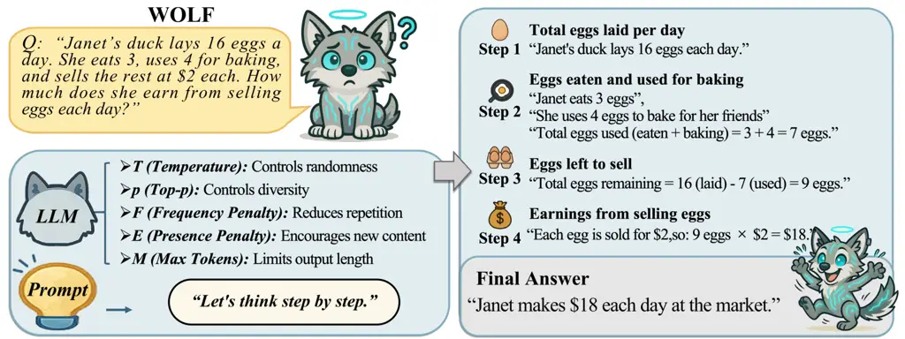
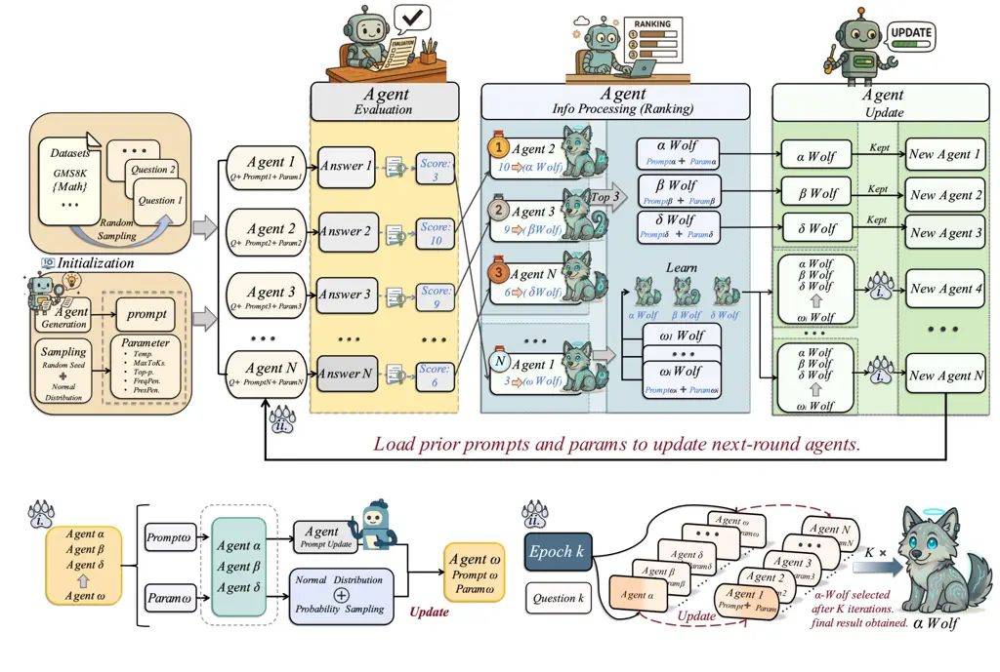
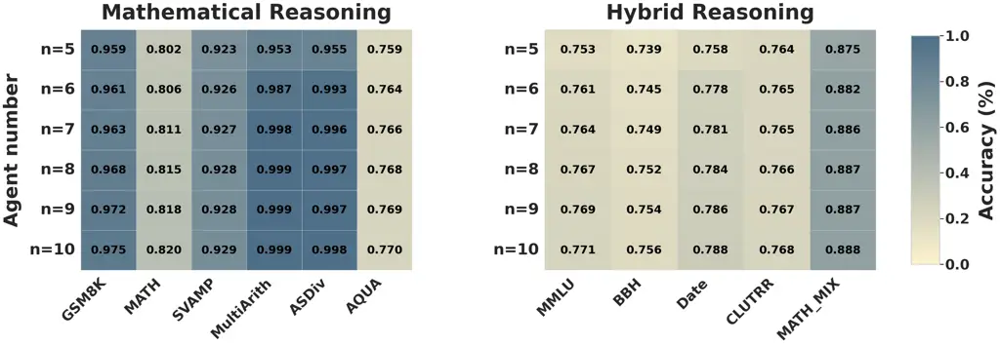
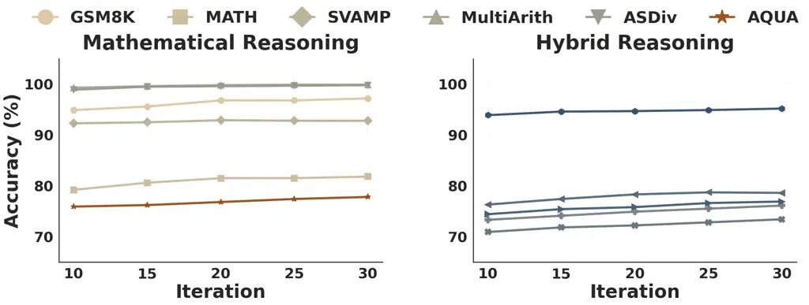
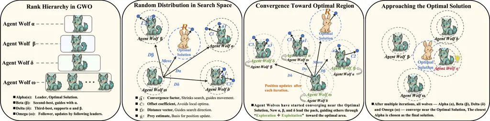

# Agent-GWO: Collaborative Agents for Dynamic Prompt Optimization in Large Language Models

Xudong Wang Affiliation: Kyung Hee University    Chaoning Zhang   
Chenghao Li Affiliation: University of Electronic Science and Technology
of China    Shuxu Chen Affiliation: Kyung Hee University    Qigan Sun
Affiliation: Kyung Hee University    Jiaquan Zhang
Affiliation: University of Electronic Science and Technology of China   
Fachrina Dewi Puspitasari Affiliation: University of Electronic Science
and Technology of China    Tae-Ho Kim Affiliation: Nota Inc.    Jiwei
Wei Affiliation: University of Electronic Science and Technology of
China    Malu Zhang Affiliation: University of Electronic Science and
Technology of China    Guoqing Wang Affiliation: University of
Electronic Science and Technology of China    Yang Yang
Affiliation: University of Electronic Science and Technology of China   
and Heng Tao Shen Affiliation:  Tongji Universitywangcurry33@gmail.com
🖂chaoningzhang1990@gmail.com

###### Abstract

Large Language Models (LLMs) have demonstrated strong capabilities in
complex reasoning tasks, while recent prompting strategies such as
Chain-of-Thought (CoT) have further elevated their performance in
handling complex logical problems. Despite these advances, high-quality
reasoning remains heavily reliant on manual static prompts and is
sensitive to decoding configurations and task distributions, leading to
performance fluctuations and limited transferability. Existing automatic
prompt optimization methods typically adopt single-agent local search,
failing to simultaneously optimize prompts and decoding hyperparameters
within a unified framework to achieve stable global improvements. To
address this limitation, we propose Agent-GWO, a dynamic prompt
optimization framework for complex reasoning. Specifically, we unify
prompt templates and decoding hyperparameters as inheritable agent
configurations. By leveraging the leader-follower mechanism of the Grey
Wolf Optimizer (GWO), we automatically select three leader agents
($`\alpha`$, $`\beta`$, and $`\delta`$) to guide the collaborative
updates of the remaining agents, enabling iterative convergence toward
robust optimal reasoning configurations that can be seamlessly
integrated for inference. Extensive experiments on multiple mathematical
and hybrid reasoning benchmarks across diverse LLM backbones show that
Agent-GWO consistently improves accuracy and stability over existing
prompt optimization methods. The code will be released publicly.

## 1 Introduction

LLMs have recently achieved substantial progress across a range of
reasoning tasks, particularly when leveraged with prompting strategies
such as Chain-of-Thought (CoT) that elicit step-by-step reasoning  Wei
et al. (2022); Kojima et al. (2022). Despite these gains, strong average
performance does not necessarily translate into reliable reasoning
behavior. As problems become longer and more complex, accuracy often
degrades significantly  Cao et al. (2024); Li et al. (2025a). More
critically, performance remains highly sensitive to prompt wording,
exemplar ordering, and contextual perturbations: minor edits or
re-orderings that leave the underlying task unchanged can nonetheless
precipitate large swings in performance  Chatterjee et al. (2024);
Ariyani et al. (2025); Madani et al. (2026). This prompt’s fragility
makes it difficult to distinguish genuinely robust reasoning steps from
those that are merely accidentally correct. Furthermore, early
deviations in the reasoning chain can cascade through subsequent steps,
severely compromising the reliability of multi-step solutions  Yue et
al. (2023); He et al. (2025); Wang et al. (2025).



Figure 1: GWO abstracts each LLM agent as a “wolf” which is
characterized by hyperparameters & reasoning prompt. These two guide the
behavior of the LLMs during the optimization process.

To address the above reliability challenge, prior work has proposed a
range of inference-time enhancement strategies that improve the
robustness of single-pass decoding primarily through trajectory
generation and search, such as self-consistency sampling, multi-path
exploration, and tree/graph-structured reasoning Madaan et al. (2023);
Zhang et al. (2024b); Teng et al. (2025); Zhang et al. (2026a); Zhang et
al. (2026d); Huang et al. (2026). Although these methods often deliver
gains without additional training, they are typically built upon
manually crafted static prompts. As a result, performance can still
fluctuate markedly under task transfer, contextual perturbations, or
minor prompt rewrites, leaving prompt brittleness and poor reusability
largely unresolvedJin et al. (2024). Moreover, repeated sampling and
structured search commonly introduce extra inference cost and system
complexity, which limit their applicability in resource-constrained or
low-latency settings Yue et al. (2023); He et al. (2025). In contrast,
training-based adaptation can offer more systematic improvements, but
usually requires extra data, training iterations, and engineering
effort, making it less suitable as a lightweight, general-purpose
inference-stage solution Lester et al. (2021); Hu et al. (2022).
Overall, existing work largely improves reasoning trajectories under
fixed prompts, rather than providing a reproducible and scalable
mechanism that can automatically optimize both the prompting strategy
and the decoding behavior at inference time.

Motivated by this gap, we ask a key question: at inference time, can we
reduce reliance on manual prompt trial-and-error and automatically
discover prompt-configuration pairs that are more stable and better
aligned with task requirements? Our core observation is that, for a
given frozen model, reasoning quality is mainly governed by two
controllable factors: the prompt template (how the reasoning process is
organized and constrained) and the decoding configuration (e.g.,
stochasticity, repetition penalties, and length budgets). Systematically
exploring this joint space via population-based search offers the
potential to uncover reasoning strategies that are both more stable and
more task-adaptive.

To this end, we propose Agent-GWO, a dynamic prompt optimization
framework for complex reasoning. As illustrated in Figure 1, each agent
is defined by a reasoning prompt template together with a decoding
configuration, and a population of such agents is optimized
collaboratively in an iterative manner. At each iteration, multiple
agents generate reasoning traces in parallel and are ranked according to
task-level performance. We then design a hierarchical collaborative
update mechanism that enables structured information sharing among
agents. By exploiting leader–follower dynamics inspired by the Grey Wolf
Optimizer, this mechanism allows top-performing agents to guide
population-level updates and steer the evolution of the remaining
agents. This design preserves population diversity to encourage
exploration while ensuring stable and controllable convergence toward
high-quality reasoning configurations. The resulting optimized
configuration can be directly reused at inference time without any
additional training.

Our contributions are summarized as follows:

- •
  We propose an automated inference-time adaptation paradigm that
  jointly optimizes prompt templates and decoding parameters at test
  time, improving both accuracy and stability without additional
  training.
- •
  We design a hierarchical leader–follower swarm mechanism inspired by
  GWO to stabilize multi-agent prompt search and reduce sensitivity to
  prompt variants.
- •
  Extensive experiments on mathematical and hybrid reasoning benchmarks
  across diverse LLM backbones show consistent gains under controllable
  inference budgets over strong manual baselines and prior prompt
  optimization methods.

## 2 Related Work

### 2.1 Prompt Engineering and Static Chain-of-Thought Methods

Prompting is a widely used approach for adapting LLMs in zero- and
few-shot settings Brown et al. (2020). Chain-of-Thought (CoT)
prompting Wei et al. (2022) elicits step-by-step reasoning and has
inspired extensions such as self-consistency Wang et al. (2022),
least-to-most decomposition Zhou et al. (2022), and structured variants
including Self-Ask Press et al. (2022), Program-of-Thoughts Chen et al.
(2022), and Graph-of-Thoughts Liu et al. (2023).

Despite their success, these methods still rely heavily on task-specific
prompt design Zhang et al. (2022) and can be sensitive to prompt
phrasing and exemplar ordering Lu et al. (2022). Moreover, long
reasoning traces and multi-sample strategies often increase inference
cost Zhou et al. (2022); Zheng et al. (2025); Cao et al. (2026); Zheng
et al. (2026b); Zhang et al. (2026c). Recent work therefore studies
automatic prompt optimization to reduce manual trial-and-error and
improve transferability, e.g., via evolutionary or gradient-free search
and feedback-driven refinement. Our work follows this direction but
focuses on population-based, leader-guided optimization over both prompt
templates and decoding configurations under frozen model weights.

### 2.2 Collaborative Reasoning with Multi-Agent LLMs

Multi-Agent Systems (MAS) provide a natural framework for collaborative
reasoning through coordination and role specialization Wooldridge and
Jennings (1995); Ferber and Weiss (1999). With LLMs, MAS has been used
for planning and reasoning via agent communication and iterative
interaction Naveed et al. (2023); Kumar (2024); Xi et al. (2025), with
representative frameworks such as AutoGen Wu et al. (2023) and Chain of
Agents Zhang et al. (2024c). Prior work explores modular agent
designs Liu et al. (2025); Zhang et al. (2026b), debate-style
aggregation Du et al. (2023); Xu et al. (2026), and
communication/coordination protocols Fioretto et al. (2018); Fipa
(2002); Jiang and Lu (2018); Yang et al. (2026b); Yang et al. (2026a),
and applies them to diverse domains Park et al. (2023); Zhang et al.
(2024a); Lim et al. (2024); Li et al. (2023); Zheng et al. (2026a); Wang
et al. (2026).

Complementary to this line, we cast multi-agent collaboration as an
explicit iterative optimization process, where strong agents guide the
update of others to improve task-specific prompting and decoding
behaviors.



Figure 2: The overall Agent-GWO framework operates by having each agent
process a dataset, Prompt, and parameters to produce outputs, which are
then scored. Only the top-3 agents ($`\alpha`$, $`\beta`$, and
$`\delta`$) are differentiated, while the rest (i.e., $`\omega`$) are
updated using the prompt and parameters from the previous round. This
iterative ranking and update process continues until termination, after
which the final agent is set as the top-ranked $`\alpha`$ from the last
iteration. Note: The left-bottom subfigure illustrates the learning
process of each agent at each iteration and the right-bottom subfigure
illustrates the optimization process.

## 3 Method

### 3.1 Theoretical Background and Problem Formulation

Grey Wolf Optimizer (GWO). GWO Mirjalili et al. (2014) is a
population-based metaheuristic that maintains $`N`$ candidate solutions
(“wolves”) and updates them using a leader–follower hierarchy. At each
iteration, the top three solutions are treated as leaders ($`\alpha`$,
$`\beta`$, $`\delta`$), and other wolves ($`\omega`$) are guided toward
them. For a wolf $`\mathbf{X}_{i}`$ in a $`D`$-dimensional space, the
standard GWO update averages the three leader-guided positions:

```math
\mathbf{X}_{i}(t+1)=\tfrac{\mathbf{X}_{i}^{(\alpha)}(t+1)+\mathbf{X}_{i}^{(\beta)}(t+1)+\mathbf{X}_{i}^{(\delta)}(t+1)}{3} \tag{1}
```

where $`\mathbf{X}_{i}^{j}(t{+}1)`$ denotes the leader-guided update
induced by leader $`j\in\{\alpha,\beta,\delta\}`$ using the encircling
rule (Appendix A.1).

Agent Structure and Definition. Suppose there are $`n`$ agents. The
$`j`$-th agent, denoted as $`\text{Agent}_{j}`$, consists of a large
language model $`\text{LLM}_{j}`$ and a prompt template
$`\text{prompt}_{j}`$, i.e.,
$`\text{Agent}_{j}=\{\text{LLM}_{j},\text{prompt}_{j}\}`$. The language
model $`\text{LLM}_{j}`$ contains a shared model parameter set
$`\boldsymbol{\theta}`$ and an agent-specific hyperparameter set
$`\boldsymbol{\eta}_{j}=\{T_{j},p_{j},F_{j},E_{j},M_{j}\}`$, which
represent temperature, top-$`p`$ threshold, frequency penalty, presence
penalty, and maximum token length, respectively. Therefore,
$`\text{LLM}_{j}=\{\boldsymbol{\eta}_{j},\boldsymbol{\theta}\}`$, and
$`\text{Agent}_{j}=\left\{\left\{\boldsymbol{\eta}_{j},\boldsymbol{\theta}\right\},\text{prompt}_{j}\right\}`$.

Hyperparameter Sampling. To ensure diversity and stability in agent
behavior, we design a hyperparameter sampling strategy for the set
$`\boldsymbol{\eta}_{j}=\{t_{j},p_{j},f_{j},e_{j},m_{j}\}`$, where a
clipping function $`\text{clip}(x,[a,b])=\max(a,\min(x,b))`$ constrains
sampled values within valid ranges, thereby maintaining controlled and
consistent generation. Specifically, the temperature $`t_{j}`$ and the
top-$`p`$ threshold $`p_{j}`$ are independently drawn from normal
distributions $`\mathcal{N}(\mu_{t},\sigma_{t}^{2})`$ and
$`\mathcal{N}(\mu_{p},\sigma_{p}^{2})`$, then clipped to intervals
$`[a_{t},b_{t}]`$ and $`[a_{p},b_{p}]`$, respectively. These parameters
regulate the generation distribution: higher values enhance creativity
and diversity, while lower values promote predictability and stability.
The frequency penalty $`f_{j}`$, sampled from
$`\mathcal{N}(\mu_{f},\sigma_{f}^{2})`$ and clipped to
$`[a_{f},b_{f}]`$, mitigates repetitiveness by penalizing tokens
proportionally to their prior frequency. The presence penalty $`e_{j}`$,
sampled from $`\mathcal{N}(\mu_{e},\sigma_{e}^{2})`$ and clipped to
$`[a_{e},b_{e}]`$, encourages novelty by uniformly penalizing any
previously generated token, thus fostering the introduction of new words
or concepts. Finally, the maximum token length $`m_{j}`$ is set to a
fixed constant $`c_{m}`$ for tasks requiring predetermined length, while
for adaptive-length tasks, it is uniformly drawn from a discrete set
$`\mathcal{M}`$, i.e., $`m_{j}\sim\text{Uniform}(\mathcal{M})`$.

This sampling approach uses normal or uniform distributions to introduce
controlled variability, while clipping ensures hyperparameters remain
within reasonable bounds, optimizing creativity, stability, and content
quality.

Problem Formulation. We denote the reasoning task dataset as
$`\mathcal{D}=\{q_{1},q_{2},\dots,q_{N}\}`$, where each element
$`q_{i}`$ represents a specific question. The dataset consists of $`N`$
question samples in total. During the reasoning process, given any
question $`q\in\mathcal{D}`$, a specific agent, denoted as
$`\text{Agent}_{j}`$, processes the question and outputs two components:
first, a detailed chain of thought (denoted as $`\text{CoT}_{j}`$),
which illustrates the step-by-step reasoning process taken by the agent;
and second, a final answer (denoted as $`\text{Answer}_{j}`$) that the
agent derives based on the chain of thought. This reasoning process can
be formally expressed as a function:

```math
f(\text{Agent}_{j},q)=(\text{CoT}_{j},\text{Answer}_{j}),\quad q\in\mathcal{D} \tag{2}
```

##### Evaluation Function.

For verifiable reasoning benchmarks with gold labels, we define the
fitness of agent $`j`$ as the exact-match accuracy on a validation batch
$`D_{\mathrm{val}}`$:

```math
\mathrm{FITNESS}_{j}=\frac{1}{\lvert D_{\mathrm{val}}\rvert}\sum_{q\in D_{\mathrm{val}}}\mathbb{1}\!\left[\mathrm{Answer}_{j}(q)=y(q)\right]. \tag{3}
```

To stabilize leader selection, we compute auxiliary scores
$`\bigl(s^{\mathrm{logic}},\,s^{\mathrm{creativity}},\,s^{\mathrm{complete}}\bigr)`$
using a fixed LLM-judge prompt (Appendix A.2). These auxiliary scores
are not used to replace accuracy, but only to rank agents when
accuracies are tied. For non-verifiable tasks, we use the same judge to
define

```math
\mathrm{FITNESS}_{j}=w_{1}s^{\mathrm{logic}}+w_{2}s^{\mathrm{creativity}}+w_{3}s^{\mathrm{complete}}, \tag{4}
```

where the weights are calibrated on 200 human-labeled samples. We set
the calibrated weights to $`(w_{1}=0.5,\,w_{2}=0.2,\,w_{3}=0.3)`$,
reflecting the higher importance of logical correctness. All judge-based
scores are averaged over three independent judge seeds.

### 3.2 Multi-Agent Grey Wolf Optimizer Framework

As illustrated in Figure 2, we adapt the GWO to optimize LLM agent
configurations by modeling each agent as a “wolf” in a population. Each
agent $`\mathrm{Agent}_{j}=(\boldsymbol{\eta}_{j},\mathrm{prompt}_{j})`$
corresponds to a candidate solution, defined by its decoding
hyperparameters and prompt template. The overall procedure follows GWO’s
leader–follower hierarchy, where the top-performing agents ($`\alpha`$,
$`\beta`$, $`\delta`$) guide the updates of the remaining agents over
multiple iterations. The full pseudocode is provided in Appendix A.3.

Initialization. The algorithm initializes a population $`\mathcal{A}`$
of n agents. For each agent $`\text{Agent}_{j}`$, hyperparameters
$`\boldsymbol{\eta}_{j}`$ are randomly sampled from predefined ranges
(e.g., temperature $`\in[0,1]`$, top-p $`\in[0,1]`$) using a normal
distribution. Similarly, the prompt $`\text{prompt}_{j}`$ is sampled
from a set of predefined CoT prompt templates or generated via a
template generation function. This diverse initialization ensures broad
exploration of the search space.

Optimization Loop. The optimization phase iterates $`K`$ times, with
each iteration evaluating and updating the agent population. For each
agent $`\textit{Agent}_{j}`$, a question $`q`$ is sampled from
$`\mathcal{D}`$, and the LLM generates a CoT trace and answer using the
agent’s configuration. The fitness of the answer is computed using a
carefully designed evaluation function, which assesses the response
based on three crucial dimensions: the logical consistency of the
reasoning process, the ingenuity of the reasoning approach, and the
comprehensiveness of the reasoning content. This multi-dimensional
evaluation ensures a thorough and accurate assessment of the answer’s
quality. The top three agents, denoted $`\alpha`$, $`\beta`$, and
$`\delta`$, are selected based on their fitness scores, representing the
best, second-best, and third-best solutions, respectively.

Non-elite agents ($`\mathcal{A}\setminus\{\alpha,\beta,\delta\}`$) are
updated to converge toward the top performers. For each hyperparameter
$`\eta_{j}^{(k)}`$ in agent $`\textit{Agent}_{j}`$, new values are
sampled from normal distributions centered at the top agents:
$`\ X_{r}\sim\mathcal{N}(\eta_{r}^{(k)},\sigma^{2}),\quad\text{for }r\in\{\alpha,\beta,\delta\},`$
and combined as a weighted average:
$`\eta_{j}^{(k)}=w_{\alpha}X_{\alpha}+w_{\beta}X_{\beta}+w_{\delta}X_{\delta},`$
with weights satisfying $`w_{\alpha}>w_{\beta}>w_{\delta}`$ and
$`w_{\alpha}+w_{\beta}+w_{\delta}=1`$. This prioritizes the influence of
the best-performing agent ($`\alpha`$) while maintaining diversity. The
prompt is adapted by a structured LLM-driven update function
$`\mathrm{PromptAdaptation}(\cdot)`$. Formally,
$`P_{j}^{(k+1)}=\mathrm{PromptAdaptation}(P_{j}^{(k)},P_{\alpha},P_{\beta},P_{\delta},\mathcal{I})`$,
where $`P_{j}^{(k)}`$ denotes the current prompt of agent $`j`$,
$`P_{\alpha},P_{\beta},P_{\delta}`$ are the prompts of the top-three
elite agents, and $`\mathcal{I}`$ is a fixed system instruction. Under
$`\mathcal{I}`$, the LLM performs lightweight edits on $`P_{j}^{(k)}`$
while preserving the task objective and evaluation criteria. The allowed
edits are limited to step re-ordering, semantically equivalent
paraphrasing, and formatting or constraint adjustments.

Overall procedure. Each iteration consists of generation, evaluation,
ranking, and update, repeated for $`K`$ rounds until returning the final
leader configuration.

|                           |                      |       |       |            |       |       |                        |       |       |        |          |       |
| ------------------------- | -------------------- | ----- | ----- | ---------- | ----- | ----- | ---------------------- | ----- | ----- | ------ | -------- | ----- |
| Model                     | Math Reasoning Tasks |       |       |            |       |       | Hybrid Reasoning Tasks |       |       |        |          | Avg   |
|                           | GSM8K                | MATH  | SVAMP | MultiArith | ASDiv | AQUA  | MMLU                   | BBH   | Date  | CLUTRR | MATH_MIX |       |
| GPT-4o-mini               |                      |       |       |            |       |       |                        |       |       |        |          |       |
| CoT                       | 85.4%                | 74.8% | 84.7% | 89.5%      | 92.3% | 65.3% | 63.4%                  | 66.6% | 52.1% | 66.2%  | 80.1%    | 74.6% |
| CoT-SC/n=5                | 89.9%                | 76.3% | 85.8% | 89.7%      | 93.3% | 70.7% | 67.1%                  | 69.0% | 54.7% | 72.2%  | 81.6%    | 77.3% |
| Self-Refine               | 88.9%                | 75.1% | 85.0% | 89.9%      | 92.2% | 67.8% | 64.8%                  | 67.5% | 53.0% | 68.4%  | 83.8%    | 76.0% |
| AFlow                     | 93.5%                | 78.9% | 88.7% | 91.9%      | 93.4% | 72.0% | 69.5%                  | 68.0% | 66.0% | 72.8%  | 85.3%    | 80.0% |
| ToT                       | 94.9%                | 77.8% | 89.6% | 89.8%      | 93.6% | 72.4% | 71.6%                  | 69.9% | 69.2% | 73.6%  | 85.6%    | 80.7% |
| GoT                       | 93.2%                | 78.6% | 89.2% | 91.0%      | 94.2% | 73.3% | 71.3%                  | 70.1% | 65.2% | 74.2%  | 84.4%    | 80.4% |
| AoT                       | 95.0%                | 83.6% | 91.5% | 92.6%      | 94.1% | 75.1% | 74.7%                  | 72.4% | 74.7% | 75.2%  | 86.9%    | 83.3% |
| Agent-GWO                 | 95.9%                | 80.2% | 92.3% | 95.3%      | 95.5% | 75.9% | 75.3%                  | 73.9% | 75.8% | 76.4%  | 87.5%    | 84.0% |
| Qwen2.5-Coder-7B-Instruct |                      |       |       |            |       |       |                        |       |       |        |          |       |
| CoT                       | 77.5%                | 65.8% | 82.7% | 84.6%      | 87.3% | 60.9% | 55.4%                  | 47.4% | 31.3% | 20.4%  | 70.4%    | 62.2% |
| CoT-SC/n=5                | 80.0%                | 67.3% | 83.9% | 86.8%      | 89.8% | 62.0% | 56.1%                  | 49.1% | 32.7% | 20.8%  | 73.9%    | 63.9% |
| Self-Refine               | 79.0%                | 70.4% | 83.3% | 86.4%      | 87.6% | 61.2% | 55.8%                  | 48.6% | 31.9% | 20.8%  | 74.6%    | 63.6% |
| AFlow                     | 84.0%                | 71.9% | 86.0% | 86.8%      | 90.1% | 61.8% | 56.5%                  | 52.5% | 34.0% | 22.7%  | 77.0%    | 65.8% |
| ToT                       | 83.6%                | 71.3% | 85.6% | 83.0%      | 89.8% | 61.5% | 56.9%                  | 55.0% | 34.5% | 23.0%  | 77.8%    | 65.6% |
| GoT                       | 84.8%                | 71.7% | 87.5% | 85.1%      | 92.5% | 62.9% | 56.8%                  | 53.4% | 34.7% | 23.8%  | 76.8%    | 66.4% |
| AoT                       | 88.5%                | 72.0% | 90.0% | 88.4%      | 94.1% | 63.0% | 56.8%                  | 57.0% | 36.2% | 26.4%  | 78.8%    | 68.3% |
| Agent-GWO                 | 89.1%                | 74.1% | 90.1% | 93.3%      | 93.3% | 63.3% | 58.3%                  | 58.8% | 37.1% | 27.8%  | 83.5%    | 69.9% |
| Gemma-3-12b-it            |                      |       |       |            |       |       |                        |       |       |        |          |       |
| CoT                       | 83.5%                | 72.8% | 79.3% | 82.7%      | 91.0% | 69.2% | 68.4%                  | 64.9% | 78.0% | 49.3%  | 75.1%    | 74.0% |
| CoT-SC/n=5                | 85.9%                | 74.6% | 80.8% | 85.1%      | 93.2% | 71.5% | 70.4%                  | 66.5% | 80.0% | 52.0%  | 77.0%    | 76.1% |
| Self-Refine               | 84.6%                | 77.6% | 80.3% | 87.5%      | 89.2% | 70.2% | 69.1%                  | 65.2% | 79.2% | 50.6%  | 79.6%    | 75.7% |
| AFlow                     | 89.0%                | 79.0% | 85.2% | 89.0%      | 92.2% | 73.8% | 70.8%                  | 66.0% | 81.3% | 53.0%  | 82.6%    | 78.4% |
| ToT                       | 88.4%                | 79.5% | 83.9% | 88.2%      | 91.8% | 72.6% | 70.6%                  | 68.4% | 81.0% | 52.6%  | 83.5%    | 78.2% |
| GoT                       | 89.2%                | 80.3% | 86.8% | 86.8%      | 93.9% | 74.5% | 71.6%                  | 68.0% | 81.5% | 53.7%  | 82.4%    | 79.0% |
| AoT                       | 91.4%                | 79.6% | 91.8% | 87.5%      | 93.5% | 76.7% | 71.9%                  | 68.7% | 82.0% | 54.8%  | 84.0%    | 80.2% |
| Agent-GWO                 | 92.8%                | 82.1% | 90.9% | 95.9%      | 94.2% | 78.5% | 72.7%                  | 70.4% | 84.5% | 56.9%  | 88.0%    | 82.4% |

Table 1: Performance comparison of Agent-GWO against baselines across
math and hybrid reasoning tasks. Bold indicates the best result, and
underlined indicates the second-best result.

## 4 Experiments

In this section, we conduct a systematic evaluation of the proposed
Agent-GWO framework to verify its effectiveness on complex reasoning
tasks. Our evaluation covers the reasoning performance (Sec 4.2),
adaptability performance to CoT (Sec 4.3), and ablation study (Sec 4.5).

### 4.1 Experimental Setup

#### 4.1.1 Datasets

We evaluate the proposed Agent-GWO framework on a comprehensive suite of
11 benchmarks spanning two complementary categories: mathematical
reasoning and hybrid reasoning. The mathematical reasoning set includes
GSM8K Cobbe et al. (2021), MATH Hendrycks et al. (2021), SVAMP Patel et
al. (2021), MultiArith Roy and Roth (2015), and ASDiv Miao et al.
(2020). The hybrid reasoning set includes AQUA Ling et al. (2017),
MMLU Hendrycks et al. (2021), BBH Suzgun et al. (2023), Date Suzgun et
al. (2023), CLUTRR Sinha et al. (2019), and MATH_MIX. Collectively,
these benchmarks span numerical computation (arithmetic, algebra,
geometry, and combinatorics) and broader reasoning skills, including
logical inference, knowledge/commonsense recall, temporal reasoning, and
multi-step relational chaining. This diversity provides a robust testbed
for evaluating GWO on multi-hop, cross-domain, and constraint-heavy
reasoning tasks.

#### 4.1.2 Baselines

We compare Agent-GWO with seven representative reasoning-enhancement
baselines that can be evaluated under the same backbone setting for a
fair comparison: Chain-of-Thought prompting (CoT) Wei et al. (2022), its
self-consistency variant CoT-SC with $`n{=}5`$ samples Wang et al.
(2022), iterative self-feedback refinement (Self-Refine) Madaan et al.
(2023), the feedback-driven workflow method AFlow Zhang et al. (2024b),
and structured reasoning paradigms including Tree-of-Thought (ToT) Yao
et al. (2023), Graph-of-Thought (GoT) Besta et al. (2024), and
Atom-of-Thought (AoT) Teng et al. (2025). To assess robustness and
generalization across model families and scales, we conduct experiments
with five LLM backbones: GPT-4o-mini, GPT-4.1-mini, GPT-4.1-nano,
Qwen2.5-Coder-7B-Instruct, and Gemma-3-12b-it.

#### 4.1.3 Implementation Details

Following established practices in workflow optimization and
inference-time search Zhang et al. (2024b); Saad-Falcon et al. (2024);
Hu et al. (2024), we adopt a strict optimization–evaluation separation
protocol. For benchmarks with official splits, including GSM8K, SVAMP,
MultiArith, ASDiv, AQUA, MMLU, and CLUTRR, optimization is performed
exclusively on the training/dev side to compute exact-match fitness and
update prompt–configuration pairs, while the test split is used only for
the final evaluation. For MATH, we follow Hong et al. (2025) and
evaluate on 617 Level-5 problems across four representative categories;
optimization follows the same protocol using labeled data from the
official training side, ensuring that no test labels are used for
feedback. For benchmarks without official train/dev splits, including
BBH, Date, and MATH_MIX, we follow prior workflow-optimization
practice Zhang et al. (2024b); Saad-Falcon et al. (2024); Hu et al.
(2024) and perform a fixed-seed random hold-out split, where the
validation and test portions are constructed in a 1:4 ratio. The
validation portion serves as the optimization pool for fitness
computation, while the test portion is strictly held out for final
evaluation.

Unless otherwise specified, we use the default GWO configuration with
$`n=5`$ agents and $`K=10`$ optimization iterations. This setting
provides a practical trade-off between computational budget and
performance gains, and is applied consistently across datasets and
backbones to ensure fair comparison. Empirical support for this
configuration is provided in the ablation study (Section 4.5).

|                           |                      |       |       |            |       |       |                        |       |       |        |          |                    |
| ------------------------- | -------------------- | ----- | ----- | ---------- | ----- | ----- | ---------------------- | ----- | ----- | ------ | -------- | ------------------ |
| Model / Method            | Math Reasoning Tasks |       |       |            |       |       | Hybrid Reasoning Tasks |       |       |        |          | Avg. Increase      |
|                           | GSM8K                | MATH  | SVAMP | MultiArith | ASDiv | AQUA  | MMLU                   | BBH   | Date  | CLUTRR | MATH_MIX |                    |
| GPT-4o-mini               |                      |       |       |            |       |       |                        |       |       |        |          |                    |
| CoT                       | 85.4%                | 74.8% | 84.7% | 89.5%      | 92.3% | 65.3% | 63.4%                  | 66.6% | 52.1% | 66.2%  | 80.1%    | \-                 |
| CoT+GWO/n=5               | 95.1%                | 79.9% | 92.4% | 99.5%      | 93.8% | 76.1% | 73.7%                  | 71.3% | 77.1% | 74.9%  | 85.0%    | $`\uparrow`$ 8.9%  |
| CoT+GWO/n=6               | 96.5%                | 81.5% | 92.9% | 99.8%      | 94.5% | 76.8% | 74.9%                  | 72.2% | 78.3% | 75.8%  | 95.1%    | $`\uparrow`$ 10.7% |
| GPT-4.1-mini              |                      |       |       |            |       |       |                        |       |       |        |          |                    |
| CoT                       | 88.2%                | 79.8% | 86.1% | 99.0%      | 91.7% | 67.5% | 66.9%                  | 69.5% | 54.9% | 71.2%  | 82.5%    | \-                 |
| CoT+GWO/n=5               | 97.2%                | 83.6% | 93.6% | 99.8%      | 94.2% | 79.3% | 78.9%                  | 77.2% | 79.3% | 78.8%  | 85.0%    | $`\uparrow`$ 8.1%  |
| CoT+GWO/n=6               | 98.3%                | 84.3% | 94.8% | 99.9%      | 94.8% | 80.4% | 79.8%                  | 78.3% | 80.5% | 79.5%  | 97.4%    | $`\uparrow`$ 10.1% |
| GPT-4.1-nano              |                      |       |       |            |       |       |                        |       |       |        |          |                    |
| CoT                       | 83.8%                | 74.3% | 81.1% | 98.8%      | 89.6% | 64.7% | 61.3%                  | 65.7% | 52.1% | 64.2%  | 80.0%    | \-                 |
| CoT+GWO/n=5               | 93.1%                | 80.1% | 92.3% | 99.4%      | 93.1% | 77.1% | 74.1%                  | 70.3% | 77.8% | 72.3%  | 83.0%    | $`\uparrow`$ 8.8%  |
| CoT+GWO/n=6               | 94.2%                | 81.2% | 93.8% | 99.7%      | 94.0% | 78.2% | 75.1%                  | 71.2% | 79.3% | 73.5%  | 93.5%    | $`\uparrow`$ 10.7% |
| Qwen2.5-Coder-7B-Instruct |                      |       |       |            |       |       |                        |       |       |        |          |                    |
| CoT                       | 77.5%                | 65.8% | 82.7% | 84.6%      | 87.3% | 60.9% | 55.4%                  | 47.4% | 31.3% | 20.4%  | 70.4%    | \-                 |
| CoT+GWO/n=5               | 89.7%                | 72.8% | 90.6% | 97.7%      | 90.5% | 62.5% | 58.5%                  | 54.8% | 37.7% | 28.1%  | 75.5%    | $`\uparrow`$ 6.8%  |
| CoT+GWO/n=6               | 90.6%                | 73.8% | 91.5% | 98.1%      | 92.0% | 63.1% | 59.1%                  | 55.6% | 39.2% | 26.1%  | 90.2%    | $`\uparrow`$ 8.7%  |
| Gemma-3-12b-it            |                      |       |       |            |       |       |                        |       |       |        |          |                    |
| CoT                       | 83.5%                | 72.8% | 79.3% | 82.7%      | 91.0% | 69.2% | 68.4%                  | 64.9% | 78.0% | 49.3%  | 75.1%    | \-                 |
| CoT+GWO/n=5               | 93.4%                | 80.7% | 91.3% | 96.2%      | 92.1% | 79.3% | 73.1%                  | 68.1% | 85.3% | 53.5%  | 81.5%    | $`\uparrow`$ 7.3%  |
| CoT+GWO/n=6               | 94.3%                | 81.3% | 92.4% | 96.8%      | 93.1% | 80.5% | 74.2%                  | 68.8% | 86.7% | 54.4%  | 94.3%    | $`\uparrow`$ 9.3%  |

Table 2: Combined evaluation of adaptability of GWO to CoT on math and
hybrid reasoning tasks.

### 4.2 Performance Evaluation

Table 1 reports a systematic comparison of Agent-GWO against seven
representative reasoning-enhancement baselines (CoT, CoT-SC,
Self-Refine, AFlow, ToT, GoT, and AoT) across eleven benchmarks under
three LLM backbones. Overall, Agent-GWO achieves the best average
performance (Avg) on all backbones, and attains the best or second-best
results on most individual tasks, demonstrating consistent stability and
strong competitiveness across settings. In contrast, methods such as CoT
and Self-Refine yield more limited overall gains on complex mathematical
and hybrid reasoning benchmarks, and their effectiveness is more
sensitive to the specific task and backbone configuration, leading to
larger performance fluctuations. These results also highlight the
benefit of Agent-GWO’s collaborative optimization: by leveraging dynamic
multi-agent interactions to iteratively calibrate and consolidate the
reasoning process, it mitigates error accumulation in long-chain
inference and improves robustness and generalization in challenging
reasoning scenarios. More details of the evaluation pipeline are
provided in Appendix A.4.

### 4.3 Adaptability Evaluation

To further assess the adaptability and generalization of Agent-GWO, we
integrate it with the mainstream reasoning paradigm CoT and evaluate the
combined method across a broad set of mathematical and hybrid reasoning
benchmarks. Specifically, we treat standard CoT prompting as the
baseline and measure the accuracy gains obtained by incorporating
Agent-GWO into the CoT pipeline. All runs are conducted independently,
and accuracy is computed on the official validation sets of each
benchmark. The aggregated results are reported in Table 2.

Across six math and five hybrid reasoning benchmarks, CoT+GWO yields
consistent and monotonic gains over vanilla CoT for all evaluated
backbones, with larger improvements as the iteration budget $`n`$
increases. For GPT-4o-mini, CoT+GWO boosts GSM8K/MATH/AQUA from
85.4/74.8/65.3 to 95.1/79.9/76.1 with $`n{=}5`$, and further to
96.5/81.5/76.8 with $`n{=}6`$. When averaging over all 11 benchmarks,
this corresponds to an absolute accuracy improvement of 8.9 percentage
points for $`n{=}5`$ and 10.7 percentage points for $`n{=}6`$ relative
to CoT. This consistent trend extends across various model families and
scales, including Gemma and Qwen, as well as hybrid reasoning tasks. The
gains are particularly pronounced on the MATH_MIX benchmark, where
Qwen2.5-Coder-7B-Instruct achieved a substantial accuracy increase from
70.4% to 90.2%.

Overall, Table 2 shows that integrating Agent-GWO with CoT consistently
improves reasoning performance across diverse benchmarks and model
architectures, spanning mathematical, logical, temporal, and
mixed-domain tasks. The consistent gains observed on both lightweight
and stronger backbones highlight the generality and transferability of
the proposed inference-time optimization framework, positioning
Agent-GWO as an effective complement to standard CoT prompting for
enhancing reasoning robustness and task alignment.



Figure 3: Accuracy over varying number of agents on mathematical (right)
and hybrid (left) reasoning tasks.



Figure 4: Accuracy over iteration for math (left) and hybrid (right)
reasoning tasks (fixed five agents).

### 4.4 Hyper-parameter Sensitivity Analysis

To systematically evaluate the robustness and stability of Agent-GWO
under decoding-level configurations, we conduct a sensitivity analysis
on five key agent-level hyperparameters: temperature $`t_{j}`$,
top-$`p`$ threshold $`p_{j}`$, frequency penalty $`f_{j}`$, presence
penalty $`e_{j}`$, and maximum generation length $`m_{j}`$. These
hyperparameters regulate the stochasticity, diversity, repetition,
novelty, and reasoning budget of LLM-based agents, and collectively
shape agent behaviors during the optimization process. For continuous
decoding parameters ($`t_{j},p_{j},f_{j},e_{j}`$), each agent samples
its configuration from a normal distribution
$`\mathcal{N}(\mu,\sigma^{2})`$, followed by clipping to a valid range.
This strategy introduces controlled variability across agents while
preventing unstable or degenerate decoding settings. The maximum
generation length $`m_{j}`$ is treated separately and sampled uniformly
from predefined intervals, enabling explicit control over the available
reasoning budget and inference cost.

| Parameter | Sampling Rule | Perf.(%)               | Cost (\$)           |
| --------- | ------------- | ---------------------- | ------------------- |
| $`t_{j}`$ | (0.2, 0.1)    | $`\downarrow`$1.0–1.5% | $`\downarrow`$3–5%  |
|           | (0.4, 0.1)    | $`\downarrow`$0.3–0.6% | $`\downarrow`$1–2%  |
|           | (0.6, 0.1)    | baseline               | baseline            |
|           | (0.8, 0.1)    | $`\downarrow`$0.5–1.0% | $`\uparrow`$4–7%    |
| $`p_{j}`$ | (0.2, 0.1)    | $`\downarrow`$0.8–1.3% | $`\downarrow`$2–4%  |
|           | (0.4, 0.1)    | $`\downarrow`$0.2–0.5% | $`\downarrow`$1–2%  |
|           | (0.6, 0.1)    | baseline               | baseline            |
|           | (0.8, 0.1)    | $`\uparrow`$0–0.3%     | $`\uparrow`$2–4%    |
| $`f_{j}`$ | (0.0, 0.1)    | $`\downarrow`$0.6–1.0% | $`\uparrow`$4–6%    |
|           | (0.4, 0.1)    | $`\downarrow`$0.2–0.4% | $`\uparrow`$1–2%    |
|           | (0.6, 0.1)    | baseline               | baseline            |
|           | (0.8, 0.1)    | $`\pm`$0–1%            | $`\downarrow`$1–3%  |
| $`e_{j}`$ | (0.0, 0.1)    | $`\downarrow`$0.4–0.8% | $`\uparrow`$2–4%    |
|           | (0.4, 0.1)    | $`\downarrow`$0.1–0.3% | $`\uparrow`$1–2%    |
|           | (0.6, 0.1)    | baseline               | baseline            |
|           | (0.8, 0.1)    | $`\downarrow`$0.5–1.0% | $`\uparrow`$3–6%    |
| $`m_{j}`$ | \[1024,1274\] | $`\downarrow`$0.5–1.5% | $`\downarrow`$5–12% |
|           | \[1274,1524\] | baseline               | baseline            |
|           | \[1524,1774\] | $`\uparrow`$0–0.4%     | $`\uparrow`$3–8%    |
|           | \[1774,2024\] | $`\uparrow`$0–0.8%     | $`\uparrow`$6–15%   |

Table 3: Sensitivity analysis of agent-level decoding hyperparameters.
Entries report relative performance and cost changes compared to the
baseline configuration used in our framework.

Table 3 reports the relative changes in task performance and inference
cost under different decoding hyperparameter settings, normalized to the
default configuration. All sensitivity experiments are conducted on the
gpt-4o-mini model using the GSM8K dataset. Empirical results show that
Agent-GWO is largely insensitive to moderate variations in decoding
hyperparameters. Across a wide range of $`(\mu,\sigma)`$ settings and
token-length intervals, performance fluctuations remain limited,
typically within $`\pm 1.5\%`$. Moderate values of $`t_{j}`$ and
$`p_{j}`$ consistently yield stable performance, while extreme settings
tend to degrade accuracy due to insufficient diversity or excessive
randomness. The penalty terms $`f_{j}`$ and $`e_{j}`$ mainly affect
output redundancy and repetition, with limited influence on accuracy but
observable impact on inference cost. Among all parameters, $`m_{j}`$
exhibits the most direct trade-off between performance and computational
cost.

Overall, this analysis suggests that Agent-GWO does not rely on delicate
hyperparameter tuning to achieve stable performance, supporting its
practical reliability and reproducibility across different decoding
configurations.

### 4.5 Ablation Study

##### Impact of Agent Population and Iteration.

To analyze the contribution of the number of agents and iterations in
the GWO framework, we conduct an ablation study on GPT-4o-mini across
multiple datasets. We first examine the effect of varying the number of
agents, with $`n\in\{5,6,7,8,9,10\}`$. As shown in Figure 4, accuracy on
both mathematical (GSM8K, MATH, SVAMP, MultiArith, ASDiv, AQUA) and
hybrid reasoning benchmarks (MMLU, BBH, Date, CLUTRR, MATH_MIX)
generally improves as the number of agents increases. For example, GSM8K
accuracy rises from 95.9% at $`n=5`$ to 97.5% at $`n=10`$, while MMLU
improves from 75.3% to 77.1%. The gains, however, are non-linear and
diminish as $`n`$ grows, indicating that moderate increases in agent
count yield limited additional benefits and should be weighed against
computational cost.

We further study the effect of the number of optimization iterations
while fixing the number of agents at $`n=5`$. As illustrated in
Figure 4, increasing the number of iterations from 10 to 30 consistently
improves performance across both mathematical and hybrid reasoning
tasks. This trend suggests that additional iterations enable more
thorough exploration of the solution space and progressive refinement of
reasoning strategies, leading to more stable convergence. At the dataset
level, most benchmarks exhibit monotonic or near-monotonic improvements
as the iteration count increases, underscoring the importance of
iterative optimization in GWO.

| Elite Size | Elite                                         | GSM8K | MATH | MMLU |
| ---------- | --------------------------------------------- | ----- | ---- | ---- |
| $`m=1`$    | $`\alpha`$                                    | 92.4  | 76.8 | 72.0 |
| $`m=2`$    | $`\alpha,\beta`$                              | 94.8  | 79.1 | 74.2 |
| $`m=3`$    | $`\alpha,\beta,\delta`$                       | 95.9  | 80.2 | 75.3 |
| $`m=4`$    | $`\alpha,\beta,\delta,\omega_{1}`$            | 95.0  | 79.4 | 74.6 |
| $`m=5`$    | $`\alpha,\beta,\delta,\omega_{1},\omega_{2}`$ | 94.1  | 78.5 | 73.8 |

Table 4: Ablation on Elite Set Size. Results under different elite set
sizes $`m`$. $`\alpha`$, $`\beta`$, and $`\delta`$ denote the top three
leaders in standard GWO, while $`\omega_{1}`$ and $`\omega_{2}`$ denote
the 4th- and 5th-ranked agents by fitness, respectively.

##### Impact of the Number of Elite Agents.

To understand how the diversity of the guidance signal affects the
search process, we investigate the sensitivity of our method to the
number of elite agents, denoted as $`m`$. In standard GWO, the search is
guided by the top-three leaders ($`\alpha`$, $`\beta`$, and $`\delta`$).
To verify if this configuration is optimal for our discrete search
space, we vary $`m`$ from $`1`$ to $`5`$. As illustrated in Table 4, we
observe a clear inverted U-shaped trend across the GSM8K, MATH, and MMLU
benchmarks. Increasing $`m`$ from $`1`$ to $`3`$ steadily improves
performance, as the added leader diversity helps the algorithm avoid
premature convergence. However, when $`m>3`$, the inclusion of
lower-ranked agents (e.g., $`\omega_{1}`$ and $`\omega_{2}`$) mixes
sub-optimal prompts into the update step. This dilutes the strong
guidance signal from the top leaders and reduces the overall selection
pressure, leading to a slight drop in accuracy. Consequently, we
maintain $`m=3`$ as the default configuration.

Overall, the number of agents, iterations, and elite set size all affect
the effectiveness of GWO. Increasing the agent population enhances
global exploration, while additional iterations improve convergence
stability and reduce variance, and a proper elite set size helps balance
guidance diversity and selection pressure. Together, these factors
support the scalability of the GWO framework, enabling it to better
leverage the reasoning potential of large models across various tasks.

## 5 Conclusion

In this paper, we propose Agent-GWO, a dynamic prompt optimization
framework tailored for complex reasoning tasks. By unifying prompt
templates and decoding configurations into iteratively optimizable agent
states, we design a hierarchical collaborative mechanism that enables
agents to progressively refine strategies through mutual learning over
multiple iterations. This swarm-based perspective facilitates stable
convergence while effectively maintaining exploration capabilities,
allowing for the automatic discovery of robust, task-aligned reasoning
configurations that are directly deployable for inference. Extensive
experiments across diverse reasoning benchmarks and varying
computational budgets demonstrate that Agent-GWO consistently
outperforms both static prompting baselines and existing automatic
prompt optimization methods in terms of accuracy and stability.

## Limitations

Agent-GWO relies on parallel exploration with multiple agents and
iterative updates at test time; accordingly, it incurs a higher
inference-time compute budget than single-pass prompting and should be
configured with appropriate $`(n,K)`$ under practical compute and
latency constraints. In addition, our empirical study primarily focuses
on mathematical and hybrid reasoning benchmarks. While the proposed
framework is broadly applicable in form, further evaluations on a wider
range of domain-specific and real-world tasks are needed to more fully
characterize its effectiveness and operating boundaries.

In future work, we will further improve the efficiency and
generalization of the framework. One important direction is to develop
more compute-aware agent scheduling and adaptive update strategies to
reduce the cost of multi-agent exploration while maintaining
optimization quality. Another direction is to extend Agent-GWO to
broader application scenarios, including domain-specific reasoning tasks
and open-ended real-world tasks, so as to more comprehensively evaluate
its robustness and transferability.

## Acknowledgments

This work was supported by the National Natural Science Foundation of
China (NSFC) under the General Program (Grant No. 62572104).

## References

- Ariyani et al. (2025) N. F. Ariyani, Z. Bouraoui, R. Booth, and S.
  Schockaert There’s no such thing as simple reasoning for llms. In
  Findings of the Association for Computational Linguistics: ACL 2025,
  pp. 4503–4514. Cited by: §1.
- Besta et al. (2024) M. Besta, N. Blach, A. Kubicek, R.
  Gerstenberger, M. Podstawski, L. Gianinazzi, J. Gajda, T. Lehmann, H.
  Niewiadomski, P. Nyczyk, et al. Graph of thoughts: solving elaborate
  problems with large language models. In Proceedings of the AAAI
  conference on artificial intelligence, Vol. 38, pp. 17682–17690. Cited
  by: §4.1.2.
- Brown et al. (2020) T. Brown, B. Mann, N. Ryder, M. Subbiah, J. D.
  Kaplan, P. Dhariwal, A. Neelakantan, P. Shyam, G. Sastry, A. Askell,
  et al. Language models are few-shot learners. Advances in neural
  information processing systems 33, pp. 1877–1901. Cited by: §2.1.
- Cao et al. (2024) B. Cao, D. Cai, Z. Zhang, Y. Zou, and W. Lam On the
  worst prompt performance of large language models. Advances in Neural
  Information Processing Systems 37, pp. 69022–69042. Cited by: §1.
- Cao et al. (2026) S. Cao, J. Zhang, P. Zheng, J. Yan, C. Qin, Y.
  Ye, W. Dong, P. Wang, Y. Yang, and C. Zhang Language-guided token
  compression with reinforcement learning in large vision-language
  models. arXiv preprint arXiv:2603.13394. Cited by: §2.1.
- Chatterjee et al. (2024) A. Chatterjee, H. K. Renduchintala, S.
  Bhatia, and T. Chakraborty Posix: a prompt sensitivity index for large
  language models. arXiv preprint arXiv:2410.02185. Cited by: §1.
- Chen et al. (2022) X. Chen, J. Tworek, H. Jun, Q. Yuan, M. Bosma, Y.
  Luan, D. Zhou, Q. V. Le, and L. Zettlemoyer Program-of-thoughts
  prompting: disentangling computation from reasoning for numerical
  reasoning tasks. In Advances in Neural Information Processing Systems,
  Vol. 35, pp. 24842–24857. Cited by: §2.1.
- Cobbe et al. (2021) K. Cobbe, V. Kosaraju, M. Bavarian, M. Chen, H.
  Jun, L. Kaiser, M. Plappert, J. Tworek, J. Hilton, R. Nakano, et al.
  Training verifiers to solve math word problems. arXiv preprint
  arXiv:2110.14168. Cited by: §4.1.1.
- Du et al. (2023) Y. Du, S. Li, A. Torralba, J. B. Tenenbaum, and I.
  Mordatch Improving factuality and reasoning in language models through
  multiagent debate. In Forty-first International Conference on Machine
  Learning, Cited by: §2.2.
- Ferber and Weiss (1999) J. Ferber and G. Weiss Multi-agent systems: an
  introduction to distributed artificial intelligence. Vol. 1,
  Addison-wesley Reading. Cited by: §2.2.
- Fioretto et al. (2018) F. Fioretto, E. Pontelli, and W. Yeoh
  Distributed constraint optimization problems and applications: a
  survey. Journal of Artificial Intelligence Research 61, pp. 623–698.
  Cited by: §2.2.
- Fipa (2002) A. Fipa Fipa acl message structure specification.
  Foundation for Intelligent Physical Agents, http://www. fipa.
  org/specs/fipa00061/SC00061G. html (30.6. 2004). Cited by: §2.2.
- He et al. (2025) Y. He, S. Li, J. Liu, W. Wang, X. Bu, G. Zhang, Z.
  Peng, Z. Zhang, Z. Zheng, W. Su, et al. Can large language models
  detect errors in long chain-of-thought reasoning?. In Proceedings of
  the 63rd Annual Meeting of the Association for Computational
  Linguistics (Volume 1: Long Papers), pp. 18468–18489. Cited by: §1,
  §1.
- Hendrycks et al. (2021) D. Hendrycks, C. Burns, S. Kadavath, A.
  Arora, S. Basart, E. Tang, D. Song, and J. Steinhardt Measuring
  mathematical problem solving with the math dataset. arXiv preprint
  arXiv:2103.03874. Cited by: §4.1.1.
- Hong et al. (2025) S. Hong, Y. Lin, B. Liu, B. Liu, B. Wu, C.
  Zhang, D. Li, J. Chen, J. Zhang, J. Wang, et al. Data interpreter: an
  llm agent for data science. In Findings of the Association for
  Computational Linguistics: ACL 2025, pp. 19796–19821. Cited by:
  §4.1.3.
- Hu et al. (2022) E. J. Hu, Y. Shen, P. Wallis, Z. Allen-Zhu, Y. Li, S.
  Wang, L. Wang, W. Chen, et al. Lora: low-rank adaptation of large
  language models.. ICLR 1 (2), pp. 3. Cited by: §1.
- Hu et al. (2024) S. Hu, C. Lu, and J. Clune Automated design of
  agentic systems. arXiv preprint arXiv:2408.08435. Cited by: §4.1.3.
- Huang et al. (2026) F. Huang, G. Huang, X. Fan, Y. He, X. Liang, X.
  Chen, Q. Jiang, F. N. Khan, J. Jiang, and Z. Wang Semantic-space
  exploration and exploitation in rlvr for llm reasoning. External
  Links: 2509.23808, [Link](https://arxiv.org/abs/2509.23808) Cited by:
  §1.
- Imani et al. (2023) S. Imani, L. Du, and H. Shrivastava Mathprompter:
  mathematical reasoning using large language models. In Proceedings of
  the 61st Annual Meeting of the Association for Computational
  Linguistics (Volume 5: Industry Track), pp. 37–42. Cited by: Table 5.
- Jiang and Lu (2018) J. Jiang and Z. Lu Learning attentional
  communication for multi-agent cooperation. Advances in neural
  information processing systems 31. Cited by: §2.2.
- Jin et al. (2024) M. Jin, Q. Yu, D. Shu, H. Zhao, W. Hua, Y. Meng, Y.
  Zhang, and M. Du The impact of reasoning step length on large language
  models. arXiv preprint arXiv:2401.04925. Cited by: §1.
- Kojima et al. (2022) T. Kojima, S. S. Gu, M. Reid, Y. Matsuo, and Y.
  Iwasawa Large language models are zero-shot reasoners. Advances in
  neural information processing systems 35, pp. 22199–22213. Cited by:
  §1.
- Kumar (2024) P. Kumar Large language models (llms): survey, technical
  frameworks, and future challenges. Artificial Intelligence Review 57
  (10), pp. 260. Cited by: §2.2.
- Leang et al. (2025) J. O. J. Leang, A. P. Gema, and S. B. Cohen Comat:
  chain of mathematically annotated thought improves mathematical
  reasoning. In Proceedings of the 2025 Conference on Empirical Methods
  in Natural Language Processing, pp. 20256–20285. Cited by: Table 5.
- Lester et al. (2021) B. Lester, R. Al-Rfou, and N. Constant The power
  of scale for parameter-efficient prompt tuning. arXiv preprint
  arXiv:2104.08691. Cited by: §1.
- Li et al. (2025a) C. Li, W. Wang, T. Zheng, and Y. Song Patterns over
  principles: the fragility of inductive reasoning in llms under noisy
  observations. arXiv preprint arXiv:2502.16169. Cited by: §1.
- Li et al. (2025b) J. Li, D. Guo, D. Yang, R. Xu, Y. Wu, and J. He
  Codei/o: condensing reasoning patterns via code input-output
  prediction. arXiv preprint arXiv:2502.07316. Cited by: Table 6, Table
  6, Table 6, Table 6, Table 6, Table 6, Table 6, Table 6.
- Li et al. (2023) N. Li, C. Gao, M. Li, Y. Li, and Q. Liao Econagent:
  large language model-empowered agents for simulating macroeconomic
  activities. arXiv preprint arXiv:2310.10436. Cited by: §2.2.
- Lim et al. (2024) J. Lim, B. Vogel-Heuser, and I. Kovalenko Large
  language model-enabled multi-agent manufacturing systems. In 2024 IEEE
  20th International Conference on Automation Science and Engineering
  (CASE), pp. 3940–3946. Cited by: §2.2.
- Ling et al. (2017) W. Ling, D. Yogatama, C. Dyer, and P. Blunsom
  Program induction by rationale generation: learning to solve and
  explain algebraic word problems. Note:
  [https://github.com/google-deepmind/AQuA](https://github.com/google-deepmind/AQuA)NeurIPS
  Datasets Track Reference Cited by: §4.1.1.
- Liu et al. (2025) B. Liu, X. Li, J. Zhang, J. Wang, T. He, S. Hong, H.
  Liu, S. Zhang, K. Song, K. Zhu, et al. Advances and challenges in
  foundation agents: from brain-inspired intelligence to evolutionary,
  collaborative, and safe systems. arXiv preprint arXiv:2504.01990.
  Cited by: §2.2.
- Liu et al. (2023) Y. Liu, X. Chen, J. Tworek, Q. Yuan, M. Bosma, Y.
  Luan, D. Zhou, Q. V. Le, and L. Zettlemoyer Graph-of-thought
  prompting: structuring reasoning as dependency graphs. In Advances in
  Neural Information Processing Systems, Vol. 36, pp. 10243–10257. Cited
  by: §2.1.
- Lu et al. (2022) X. Lu, X. Li, D. He, J. Gao, and L. Deng
  Fantastically ordered prompts and where to find them. In Proceedings
  of the 60th Annual Meeting of the Association for Computational
  Linguistics, Vol. 1, pp. 8000–8011. Cited by: §2.1.
- Lyu et al. (2023) Q. Lyu, S. Havaldar, A. Stein, L. Zhang, D. Rao, E.
  Wong, M. Apidianaki, and C. Callison-Burch Faithful chain-of-thought
  reasoning. In The 13th International Joint Conference on Natural
  Language Processing and the 3rd Conference of the Asia-Pacific Chapter
  of the Association for Computational Linguistics (IJCNLP-AACL 2023),
  Cited by: Table 5.
- Madaan et al. (2023) A. Madaan, N. Tandon, P. Gupta, S. Hallinan, L.
  Gao, S. Wiegreffe, U. Alon, N. Dziri, S. Prabhumoye, Y. Yang, et al.
  Self-refine: iterative refinement with self-feedback. Advances in
  Neural Information Processing Systems 36, pp. 46534–46594. Cited by:
  §1, §4.1.2.
- Madani et al. (2026) M. R. G. Madani, S. C. Han, S. Yang, and J. H.
  Lau Inclusion-of-thoughts: mitigating preference instability via
  purifying the decision space. arXiv preprint arXiv:2604.04944. Cited
  by: §1.
- Miao et al. (2020) S. Miao, C. Liang, and K. Su A diverse corpus for
  evaluating and developing english math word problem solvers. In
  Proceedings of the 58th annual meeting of the Association for
  Computational Linguistics, pp. 975–984. Cited by: §4.1.1.
- Mirjalili et al. (2014) S. Mirjalili, S. M. Mirjalili, and A. Lewis
  Grey wolf optimizer. Advances in engineering software 69, pp. 46–61.
  Cited by: §3.1.
- Naveed et al. (2023) H. Naveed, A. U. Khan, S. Qiu, M. Saqib, S.
  Anwar, M. Usman, N. Akhtar, N. Barnes, and A. Mian A comprehensive
  overview of large language models. arXiv preprint arXiv:2307.06435.
  Cited by: §2.2.
- Park et al. (2023) J. S. Park, J. O’Brien, C. J. Cai, M. R. Morris, P.
  Liang, and M. S. Bernstein Generative agents: interactive simulacra of
  human behavior. In Proceedings of the 36th annual acm symposium on
  user interface software and technology, pp. 1–22. Cited by: §2.2.
- Patel et al. (2021) A. Patel, S. Bhattamishra, and N. Goyal Are nlp
  models really able to solve simple math word problems?. In Proceedings
  of the 2021 conference of the North American chapter of the
  association for computational linguistics: human language
  technologies, pp. 2080–2094. Cited by: §4.1.1.
- Press et al. (2022) O. Press, M. L. Lee, and L. Zettlemoyer Self-ask
  with search: bootstrapping reasoning with chain-of-thought. In
  Advances in Neural Information Processing Systems, Vol. 35,
  pp. 24804–24817. Cited by: §2.1.
- Radford et al. (2018) A. Radford, K. Narasimhan, T. Salimans, I.
  Sutskever, et al. Improving language understanding by generative
  pre-training. Cited by: Table 5.
- Roy and Roth (2015) S. Roy and D. Roth Solving general arithmetic word
  problems. In Proceedings of the 2015 conference on empirical methods
  in natural language processing, pp. 1743–1752. Cited by: §4.1.1.
- Saad-Falcon et al. (2024) J. Saad-Falcon, A. G. Lafuente, S.
  Natarajan, N. Maru, H. Todorov, E. Guha, E. K. Buchanan, M. Chen, N.
  Guha, C. Ré, et al. Archon: an architecture search framework for
  inference-time techniques. arXiv preprint arXiv:2409.15254. Cited by:
  §4.1.3.
- Sinha et al. (2019) K. Sinha, S. Sodhani, J. Dong, J. Pineau,
  and W. L. Hamilton CLUTRR: a diagnostic benchmark for inductive
  reasoning from text. In Proceedings of the 2019 Conference on
  Empirical Methods in Natural Language Processing and the 9th
  International Joint Conference on Natural Language Processing
  (EMNLP-IJCNLP), pp. 4506–4515. Cited by: §4.1.1.
- Srivastava and Gandhi (2024) S. S. Srivastava and A. Gandhi
  Mathdivide: improved mathematical reasoning by large language models.
  arXiv preprint arXiv:2405.13004. Cited by: Table 5.
- Suzgun et al. (2023) M. Suzgun, N. Scales, N. Schärli, S. Gehrmann, Y.
  Tay, H. W. Chung, A. Chowdhery, Q. Le, E. Chi, D. Zhou, et al.
  Challenging big-bench tasks and whether chain-of-thought can solve
  them. In Findings of the Association for Computational Linguistics:
  ACL 2023, pp. 13003–13051. Cited by: §4.1.1.
- Teng et al. (2025) F. Teng, Z. Yu, Q. Shi, J. Zhang, C. Wu, and Y. Luo
  Atom of thoughts for markov llm test-time scaling. arXiv preprint
  arXiv:2502.12018. Cited by: §1, §4.1.2.
- Wang et al. (2025) C. Wang, Y. Zhang, W. Wang, X. Zhao, F. Feng, X.
  He, and T. Chua Think-while-generating: on-the-fly reasoning for
  personalized long-form generation. arXiv preprint arXiv:2512.06690.
  Cited by: §1.
- Wang et al. (2026) J. Wang, T. Sun, J. Zhu, J. Li, H. Xu, Z. Wen, X.
  Hu, Z. Li, and L. Zhang StreamMeCo: long-term agent memory compression
  for efficient streaming video understanding. External Links:
  2604.09000, [Link](https://arxiv.org/abs/2604.09000) Cited by: §2.2.
- Wang et al. (2022) X. Wang, J. Wei, D. Schuurmans, Q. Le, E. Chi, S.
  Narang, A. Chowdhery, and D. Zhou Self-consistency improves chain of
  thought reasoning in language models. arXiv preprint arXiv:2203.11171.
  Cited by: §2.1, §4.1.2.
- Wei et al. (2022) J. Wei, X. Wang, D. Schuurmans, M. Bosma, F. Xia, E.
  Chi, Q. V. Le, D. Zhou, et al. Chain-of-thought prompting elicits
  reasoning in large language models. Advances in neural information
  processing systems 35, pp. 24824–24837. Cited by: Table 5, §1, §2.1,
  §4.1.2.
- Wooldridge and Jennings (1995) M. Wooldridge and N. R. Jennings
  Intelligent agents: theory and practice. The knowledge engineering
  review 10 (2), pp. 115–152. Cited by: §2.2.
- Wu et al. (2023) Q. Wu, G. Bansal, J. Zhang, Y. Wu, B. Li, E. Zhu, L.
  Jiang, X. Zhang, S. Zhang, J. Liu, et al. Autogen: enabling next-gen
  llm applications via multi-agent conversation. arXiv preprint
  arXiv:2308.08155. Cited by: §2.2.
- Xi et al. (2025) Z. Xi, W. Chen, X. Guo, W. He, Y. Ding, B. Hong, M.
  Zhang, J. Wang, S. Jin, E. Zhou, et al. The rise and potential of
  large language model based agents: a survey. Science China Information
  Sciences 68 (2), pp. 121101. Cited by: §2.2.
- Xu et al. (2026) S. Xu, Y. Wang, X. Jia, Z. Wu, K. Liu, and A. X. Dong
  RCBSF: a multi-agent framework for automated contract revision via
  stackelberg game. External Links: 2604.10740,
  [Link](https://arxiv.org/abs/2604.10740) Cited by: §2.2.
- Yang et al. (2026a) S. Yang, S. C. Han, Y. Ding, S. Wang, and E. Hoy
  ToolTree: efficient llm agent tool planning via dual-feedback monte
  carlo tree search and bidirectional pruning. arXiv preprint
  arXiv:2603.12740. Cited by: §2.2.
- Yang et al. (2026b) S. Yang, S. C. Han, X. Ma, Y. Li, M. R. G. Madani,
  and E. Hovy Evotool: self-evolving tool-use policy optimization in llm
  agents via blame-aware mutation and diversity-aware selection. arXiv
  preprint arXiv:2603.04900. Cited by: §2.2.
- Yao et al. (2023) S. Yao, D. Yu, J. Zhao, I. Shafran, T. Griffiths, Y.
  Cao, and K. Narasimhan Tree of thoughts: deliberate problem solving
  with large language models. Advances in neural information processing
  systems 36, pp. 11809–11822. Cited by: §4.1.2.
- Yue et al. (2023) M. Yue, J. Zhao, M. Zhang, L. Du, and Z. Yao Large
  language model cascades with mixture of thoughts representations for
  cost-efficient reasoning. arXiv preprint arXiv:2310.03094. Cited by:
  §1, §1.
- Zhang et al. (2024a) A. Zhang, Y. Chen, L. Sheng, X. Wang, and T. Chua
  On generative agents in recommendation. In Proceedings of the 47th
  international ACM SIGIR conference on research and development in
  Information Retrieval, pp. 1807–1817. Cited by: §2.2.
- Zhang et al. (2026a) J. Zhang, Q. Sun, C. Zhang, X. Wang, Z. Huang, Y.
  Zhou, P. Zheng, C. A. Tai, S. Bae, Z. Ma, et al. TDA-rc: task-driven
  alignment for knowledge-based reasoning chains in large language
  models. arXiv preprint arXiv:2604.04942. Cited by: §1.
- Zhang et al. (2026b) J. Zhang, C. Zhang, S. Chen, Z. Huang, P.
  Zheng, Z. Wang, P. Guo, F. Mo, S. Bae, J. Zou, J. Wei, and Y. Yang
  Lightweight llm agent memory with small language models. External
  Links: 2604.07798, [Link](https://arxiv.org/abs/2604.07798) Cited by:
  §2.2.
- Zhang et al. (2026c) J. Zhang, C. Zhang, S. Chen, Y. Liu, C. Li, Q.
  Sun, S. Yuan, F. D. Puspitasari, D. Han, G. Wang, et al. Text
  summarization via global structure awareness. arXiv preprint
  arXiv:2602.09821. Cited by: §2.1.
- Zhang et al. (2026d) J. Zhang, C. Zhang, S. Chen, X. Wang, Z.
  Huang, P. Zheng, S. Yuan, S. Zheng, Q. Sun, J. Zou, et al. Learning
  global hypothesis space for enhancing synergistic reasoning chain.
  arXiv preprint arXiv:2602.09794. Cited by: §1.
- Zhang et al. (2024b) J. Zhang, J. Xiang, Z. Yu, F. Teng, X. Chen, J.
  Chen, M. Zhuge, X. Cheng, S. Hong, J. Wang, et al. Aflow: automating
  agentic workflow generation. arXiv preprint arXiv:2410.10762. Cited
  by: §1, §4.1.2, §4.1.3.
- Zhang et al. (2024c) Y. Zhang, R. Sun, Y. Chen, T. Pfister, R. Zhang,
  and S. Arik Chain of agents: large language models collaborating on
  long-context tasks. Advances in Neural Information Processing Systems
  37, pp. 132208–132237. Cited by: §2.2.
- Zhang et al. (2022) Z. Zhang, A. Zhang, M. Li, and A. Smola Automatic
  chain of thought prompting in large language models. arXiv preprint
  arXiv:2210.03493. Cited by: §2.1.
- Zheng et al. (2025) P. Zheng, X. Pu, K. Chen, J. Huang, M. Yang, B.
  Feng, Y. Ren, J. Jiang, C. Zhang, Y. Yang, et al. Joint lossless
  compression and steganography for medical images via large language
  models. arXiv preprint arXiv:2508.01782. Cited by: §2.1.
- Zheng et al. (2026a) P. Zheng, C. Zhang, M. Cui, G. Chen, Q. Sun, J.
  Huang, J. Zhang, T. Kim, C. Qin, Y. Ren, et al. Towards visual
  chain-of-thought reasoning: a comprehensive survey. Cited by: §2.2.
- Zheng et al. (2026b) P. Zheng, C. Zhang, J. Mo, G. Li, J. Zhang, J.
  Zhang, S. Cao, S. Zheng, C. Qin, G. Wang, et al. LLaVA-fa: learning
  fourier approximation for compressing large multimodal models. arXiv
  preprint arXiv:2602.00135. Cited by: §2.1.
- Zhou et al. (2022) D. Zhou, D. Schuurmans, Q. V. Le, E. H. Chi, and J.
  Wei Least-to-most prompting enables complex reasoning in large
  language models. In Advances in Neural Information Processing Systems,
  Vol. 35, pp. 24770–24782. Cited by: §2.1, §2.1.

## Appendix A Appendix

### A.1 Preliminary Knowledge for Grey Wolf Optimizer



Figure 5: Illustration of GWO algorithm.

Grey Wolf Optimizer. GWO is a population-based metaheuristic inspired by
the social hierarchy and hunting behavior of grey wolves. Designed for
solving continuous optimization problems, GWO is characterized by its
simplicity and minimal reliance on hyperparameters. In this algorithm, a
population of $`N`$ wolves is maintained, where each wolf represents a
candidate solution
$`\mathbf{X}_{i}=(x_{i}^{1},x_{i}^{2},\dots,x_{i}^{D})`$ in a
$`D`$-dimensional search space. The objective is to optimize a target
function $`f(\mathbf{X})`$. GWO mimics the hierarchical structure of
grey wolves, dividing the population into four roles: $`\alpha`$
(leader), $`\beta`$ (second-in-command), $`\delta`$ (subordinate), and
$`\omega`$ (follower). During the optimization process, the $`\alpha`$,
$`\beta`$, and $`\delta`$ wolves correspond to the top three solutions
and are responsible for guiding the remaining $`\omega`$ wolves toward
promising regions in the search space, as illustrated in Figure 5.

The core mechanism of the GWO is inspired by the encircling behavior
exhibited during hunting. In each iteration, wolves estimate their
distance from the prey (i.e., the current best solution) as
$`\mathbf{D}(t)=\left|\mathbf{C}(t)\odot\mathbf{X}_{p}(t)-\mathbf{X}_{i}(t)\right|`$,
where $`\mathbf{X}_{p}(t)`$ denotes the position of the prey at
iteration $`t`$, $`\mathbf{C}(t)=2\mathbf{r}_{1}(t)`$, and
$`\mathbf{r}_{1}(t)\in[0,1]^{D}`$ is a uniformly distributed random
vector.

Based on $`\mathbf{D}(t)`$, the position of each wolf is updated by
$`\mathbf{X}_{i}(t+1)=\mathbf{X}_{p}(t)-\mathbf{A}(t)\odot\mathbf{D}(t)`$,
where
$`\mathbf{A}(t)=2\,\mathbf{a}(t)\odot\mathbf{r}_{2}(t)-\mathbf{a}(t)`$
and $`\mathbf{r}_{2}(t)\in[0,1]^{D}`$ is another random vector. The
parameter decreases linearly with iterations as
$`\mathbf{a}(t)=2-2\cdot\tfrac{t}{T_{\max}}`$, where $`T_{\max}`$ is the
maximum number of iterations. This design allows the algorithm to
balance exploration in early stages and exploitation in later stages.

Each $`\omega`$ wolf also updates its position by referring to the three
leading wolves $`\alpha`$, $`\beta`$, and $`\delta`$. The distances are
computed as
$`\mathbf{D}_{j}(t)=\left|\mathbf{C}_{j}(t)\odot\mathbf{X}_{j}(t)-\mathbf{X}_{i}(t)\right|`$,
$`j\in\{\alpha,\beta,\delta\}`$, and the corresponding candidate updates
are
$`\mathbf{X}_{i}^{(j)}(t+1)=\mathbf{X}_{j}(t)-\mathbf{A}_{j}(t)\odot\mathbf{D}_{j}(t)`$.
Finally, the new position of wolf $`i`$ is obtained by averaging the
three guided positions:

```math
\mathbf{X}_{i}(t+1)=\tfrac{\mathbf{X}_{i}^{(\alpha)}(t+1)+\mathbf{X}_{i}^{(\beta)}(t+1)+\mathbf{X}_{i}^{(\delta)}(t+1)}{3} \tag{5}
```

By integrating leader-based guidance with stochastic exploration, the
GWO effectively achieves a balance between global search and local
exploitation. As iterations progress, the decreasing parameter
$`\mathbf{a}(t)`$ ensures a smooth transition from exploration to
exploitation, enhancing convergence toward the global optimum.

### A.2 LLM-as-a-Judge Protocol

We adopt a controlled _LLM-as-a-Judge_ protocol as an auxiliary
evaluation mechanism to assess the quality of intermediate reasoning
states and state transitions, particularly in settings where explicit
gold answers are unavailable.

##### Evaluation Setup.

A fixed large language model is used as the judge across all
experiments. The judge model, prompt, and decoding configuration are
kept identical throughout training and evaluation. The prompt is frozen
prior to experimentation and is not adapted based on agent outputs or
historical performance, preventing self-referential evaluation.

For each transition, the judge is provided with the current state
$`Q_{i}`$, the candidate next state $`Q_{i+1}`$, and their corresponding
reasoning trajectories. The judge evaluates whether the transition
preserves the original reasoning objective while offering improved
reasoning utility.

##### Evaluation Criteria.

The judge produces three normalized scores in $`[0,1]`$:

```math
\bigl(s^{\mathrm{logic}},\;s^{\mathrm{creativity}},\;s^{\mathrm{complete}}\bigr),
```

corresponding to logical consistency, structural novelty introduced by
the transition, and coverage of required reasoning elements,
respectively. The judge is explicitly instructed not to rely on
superficial cues such as verbosity or stylistic features.

##### Usage in Different Settings.

For verifiable benchmarks with gold answers, exact-match accuracy
remains the primary fitness signal. Judge-based scores are used only as
tie-breakers when multiple agents achieve identical accuracy. For
non-verifiable tasks, agent fitness is computed as a weighted sum of
judge scores:

```math
\mathrm{FITNESS}_{j}=w_{1}s^{\mathrm{logic}}+w_{2}s^{\mathrm{creativity}}+w_{3}s^{\mathrm{complete}},
```

with weights $`(w_{1},w_{2},w_{3})=(0.5,0.2,0.3)`$ calibrated on 200
human-labeled samples.

##### Stability.

All judge-based scores are averaged over three independent runs with
different random seeds to reduce variance and improve ranking stability.

### A.3 Pseudocode

1: Population size $`N`$, dimension $`D`$, objective $`\mathcal{F}`$,
max iterations $`T_{\max}`$

2: Best solution $`\mathbf{X}^{\star}`$

3: Initialization

4: Initialize population
$`\{\mathbf{X}_{i}\}_{i=1}^{N}\subset\mathbb{R}^{D}`$ within bounds

5: $`a\leftarrow 2`$

6:
$`\mathbf{X}^{\star}\leftarrow\arg\min_{\mathbf{X}_{i}}\,\mathcal{F}(\mathbf{X}_{i})`$

7: Iterative Optimization

8: for $`t=1`$ to $`T_{\max}`$ do

9:   Evaluate $`\mathcal{F}(\mathbf{X}_{i})`$ for all $`i`$

10:   Identify leader wolves $`\alpha,\beta,\delta`$ (top-3 by fitness)

11:   $`a\leftarrow 2-2t/T_{\max}`$

12:   for all $`\mathbf{X}_{i}`$ do

13:    for all $`\ell\in\{\alpha,\beta,\delta\}`$ do

14:      Sample
$`\mathbf{r}_{1},\mathbf{r}_{2}\sim\mathcal{U}(0,1)^{D}`$

15:      $`\mathbf{A}_{\ell}\leftarrow 2a\mathbf{r}_{1}-a`$

16:      $`\mathbf{C}_{\ell}\leftarrow 2\mathbf{r}_{2}`$

17:
     $`\mathbf{D}_{\ell}\leftarrow\lvert\mathbf{C}_{\ell}\odot\mathbf{X}_{\ell}-\mathbf{X}_{i}\rvert`$

18:
     $`\mathbf{X}^{\prime}_{\ell}\leftarrow\mathbf{X}_{\ell}-\mathbf{A}_{\ell}\odot\mathbf{D}_{\ell}`$

19:    end for

20:
   $`\mathbf{X}_{i}\leftarrow\frac{1}{3}(\mathbf{X}^{\prime}_{\alpha}+\mathbf{X}^{\prime}_{\beta}+\mathbf{X}^{\prime}_{\delta})`$

21:    Project $`\mathbf{X}_{i}`$ to feasible bounds

22:   end for

23:   Update $`\mathbf{X}^{\star}`$ if improved

24: end for

25: return $`\mathbf{X}^{\star}`$

Algorithm 1 Grey Wolf Optimizer (GWO)

1: Dataset $`\mathcal{D}`$, number of agents $`n`$, iterations $`K`$

2: Optimal agent configuration
$`(\boldsymbol{\eta}^{*},\textit{prompt}^{*})`$

3: Initialization

4: Initialize empty agent set $`\mathcal{A}\leftarrow\emptyset`$

5: for $`j=1`$ to $`n`$ do

6:   Sample hyperparameters
$`\boldsymbol{\eta}_{j}\sim\mathcal{N}(\boldsymbol{\mu},\boldsymbol{\sigma}^{2})`$

7:
  $`\boldsymbol{\eta}_{j}\leftarrow\mathrm{Clip}(\boldsymbol{\eta}_{j})`$

8:   Sample prompt template $`\textit{prompt}_{j}`$

9:
  $`\mathcal{A}\leftarrow\mathcal{A}\cup\{(\boldsymbol{\eta}_{j},\textit{prompt}_{j})\}`$

10: end for

11: Iterative Optimization

12: for $`k=1`$ to $`K`$ do

13:   for all
$`(\boldsymbol{\eta}_{j},\textit{prompt}_{j})\in\mathcal{A}`$ do

14:    Sample question $`q\sim\mathcal{D}`$

15:
   $`(\textit{CoT}_{j},\textit{Ans}_{j})\leftarrow\mathrm{LLM}(\boldsymbol{\eta}_{j},\textit{prompt}_{j},q)`$

16:
   $`\textit{Fitness}_{j}\leftarrow\mathrm{Evaluate}(\textit{Ans}_{j},q)`$

17:   end for

18:   Select leader agents $`(\alpha,\beta,\delta)`$ by fitness

19:   Define sampling weights
$`\mathbf{w}=(w_{\alpha},w_{\beta},w_{\delta})`$, $`\sum w=1`$

20:   for all
$`(\boldsymbol{\eta}_{j},\textit{prompt}_{j})\in\mathcal{A}\setminus\{\alpha,\beta,\delta\}`$
do

21:    Sample leader $`r\sim\{\alpha,\beta,\delta\}`$ according to
$`\mathbf{w}`$

22:
   $`\boldsymbol{\eta}_{j}\leftarrow\mathrm{Clip}(\mathcal{N}(\boldsymbol{\eta}_{r},\sigma^{2}))`$

23:
   $`\textit{prompt}_{j}\leftarrow\mathrm{PromptAdaptation}(\textit{prompt}_{j},\{\textit{prompt}_{\alpha},\textit{prompt}_{\beta},\textit{prompt}_{\delta}\})`$

24:   end for

25: end for

26: Output

27: Extract best agent
$`(\boldsymbol{\eta}^{*},\textit{prompt}^{*})\leftarrow(\boldsymbol{\eta}_{\alpha},\textit{prompt}_{\alpha})`$

28: return $`(\boldsymbol{\eta}^{*},\textit{prompt}^{*})`$

Algorithm 2 Agent-Level Iterative Optimization via GWO

Algorithm 1 presents the standard GWO: evaluate all candidates, select
the top three leaders $`(\alpha,\beta,\delta)`$, update the rest by
aggregating leader-guided proposals with annealed coefficients, project
to bounds, and track the best $`\mathbf{X}^{\star}`$.

Algorithm 2 instantiates GWO for our setting, where each agent is
$`(\boldsymbol{\eta}_{j},\textit{prompt}_{j})`$. Each iteration scores
agents on sampled questions, selects leaders, and updates non-leaders by
following leader hyperparameters (perturb + clip) and adapting prompts
via $`\mathrm{PromptAdaptation}(\cdot)`$, returning the best leader
$`(\boldsymbol{\eta}^{*},\textit{prompt}^{*})`$.

### A.4 More Experimental Results

To further evaluate the effectiveness of our GWO-based prompt
optimization, we conduct benchmarks on two standard math reasoning
datasets, GSM8K and MATH, using Qwen2.5-Coder-7B-Instruct as the primary
backbone. Table 6 reports accuracy (%) for representative prompt
optimization and reasoning baselines. Compared to vanilla CoT and CoT
with self-consistency sampling (CoT-SC), GWO yields a substantial
improvement, reaching 89.1% on GSM8K and 72.1% on MATH. When combined
with CoT, the performance is further strengthened, and our best setting
(GWO/$`n`$=6 + CoT) achieves 90.6% on GSM8K and 73.8% on MATH,
outperforming the listed strong baselines under the same backbone.

In addition, we compare against widely-used GPT-4 prompting/optimization
baselines on GSM8K to contextualize the strength of the resulting
configuration. As shown in Table 5, GWO/$`n`$=6 + CoT with GPT-4o-mini
attains 96.5% accuracy on GSM8K, which is competitive with multiple
optimized prompting methods reported for GPT-4. Overall, these results
indicate that GWO consistently improves upon CoT-style prompting across
backbones and datasets, and its combination with CoT is complementary,
providing a simple yet effective way to obtain stronger and more stable
reasoning performance.

| Method                                  | Model       | GSM8K |
| --------------------------------------- | ----------- | ----- |
| CoMAT Leang et al. (2025)               | GPT-4       | 93.7  |
| CoT Wei et al. (2022)                   | GPT-4       | 94.5  |
| FCoT Lyu et al. (2023)                  | GPT-4       | 95.0  |
| MathPrompter Imani et al. (2023)        | GPT-4       | 95.6  |
| QuaSAR Radford et al. (2018)            | GPT-4       | 96.5  |
| MathDivide Srivastava and Gandhi (2024) | GPT-4       | 96.8  |
| GWO/n=6+CoT                             | GPT-4o-mini | 96.5  |

Table 5: Accuracy on GSM8K comparing GPT-4 and GPT-4o-mini.

| Method                        | Base    | GSM8K | MATH |
| ----------------------------- | ------- | ----- | ---- |
| OMI2 Li et al. (2025b)        | Qwen2.5 | 84.1  | 72.3 |
| CODEI/O++ Li et al. (2025b)   | Qwen2.5 | 85.7  | 72.1 |
| PyEdu Li et al. (2025b)       | Qwen2.5 | 85.8  | 71.4 |
| CODEI/O Li et al. (2025b)     | Qwen2.5 | 86.4  | 71.9 |
| OC-SFT-1 Li et al. (2025b)    | Qwen2.5 | 86.7  | 70.9 |
| WI Li et al. (2025b)          | Qwen2.5 | 87.0  | 71.4 |
| WI (Full) Li et al. (2025b)   | Qwen2.5 | 87.0  | 71.1 |
| OMI2 (Full) Li et al. (2025b) | Qwen2.5 | 88.5  | 73.2 |
| CoT                           | Qwen2.5 | 77.3  | 69.7 |
| CoT-SC/n=5                    | Qwen2.5 | 80.1  | 71.2 |
| GWO                           | Qwen2.5 | 89.1  | 72.1 |
| GWO+CoT                       | Qwen2.5 | 89.7  | 72.8 |
| GWO/n=6+CoT                   | Qwen2.5 | 90.6  | 73.8 |

Table 6: Accuracy (%) on GSM8K and MATH using Qwen2.5-Coder-7B.

### A.5 Notation

|                                                 |                                                                                                                                  |
| ----------------------------------------------- | -------------------------------------------------------------------------------------------------------------------------------- | -------------------------------------------------- | ----------------------------------- |
| Symbol                                          | Definition                                                                                                                       |
| Grey Wolf Optimizer (GWO) Symbols               |                                                                                                                                  |
| $`N`$                                           | Population size (number of wolves/solutions)                                                                                     |
| $`D`$                                           | Search space dimensionality                                                                                                      |
| $`\mathbf{X}_{i}`$                              | Position of the $`i`$-th wolf: $`\mathbf{X}_{i}=(x_{i}^{1},x_{i}^{2},\dots,x_{i}^{D})`$                                          |
| $`f(\mathbf{X})`$                               | Objective function to be optimized                                                                                               |
| $`T_{\max}`$                                    | Maximum number of iterations                                                                                                     |
| $`t`$                                           | Current iteration number                                                                                                         |
| $`\mathbf{X}_{p}(t)`$                           | Prey position at iteration $`t`$ (current best solution)                                                                         |
| $`\mathbf{C}`$                                  | Coefficient vector, $`\mathbf{C}=2\mathbf{r}_{1}`$, $`\mathbf{r}_{1}\sim\mathcal{U}(0,1)^{D}`$                                   |
| $`\mathbf{D}`$                                  | Distance vector, $`\mathbf{D}=                                                                                                   | \mathbf{C}\cdot\mathbf{X}_{p}(t)-\mathbf{X}_{i}(t) | `$                                  |
| $`\mathbf{A}`$                                  | Adaptive coefficient, $`\mathbf{A}=2\mathbf{a}\cdot\mathbf{r}_{2}-\mathbf{a}`$, $`\mathbf{r}_{2}\sim\mathcal{U}(0,1)^{D}`$       |
| $`\mathbf{a}`$                                  | Linearly decreasing parameter, $`\mathbf{a}=2-2\cdot\frac{t}{T_{\max}}`$                                                         |
| $`\alpha,\beta,\delta`$                         | The top three wolves (leaders) in GWO                                                                                            |
| $`\omega`$                                      | The remaining wolves (followers)                                                                                                 |
| $`\mathbf{D}_{j}`$                              | Distance from wolf $`i`$ to leader $`j`$: $`\mathbf{D}\_{j}=                                                                     | \mathbf{C}_{j}\cdot\mathbf{X}_{j}-\mathbf{X}\_{i}  | `$, $`j\in\{\alpha,\beta,\delta\}`$ |
| $`\mathbf{A}_{j},\mathbf{C}_{j}`$               | Adaptive/random coefficients for leader $`j`$                                                                                    |
| $`\mathbf{X}_{j}^{\prime}`$                     | Updated position guided by leader $`j`$                                                                                          |
| $`\mathcal{F}`$                                 | Fitness function                                                                                                                 |
| Agent Symbols                                   |                                                                                                                                  |
| $`n`$                                           | Number of agents                                                                                                                 |
| $`\text{Agent}_{j}`$                            | The $`j`$-th agent, $`\text{Agent}_{j}=\{\text{LLM}_{j},\text{prompt}_{j}\}`$                                                    |
| $`\text{LLM}_{j}`$                              | Large language model of agent $`j`$, $`\text{LLM}_{j}=\{\boldsymbol{\eta}_{j},\boldsymbol{\theta}\}`$                            |
| $`\boldsymbol{\theta}`$                         | Shared model parameter set of LLMs                                                                                               |
| $`\boldsymbol{\eta}_{j}`$                       | Agent-specific hyperparameter set: $`\{T_{j},p_{j},F_{j},E_{j},M_{j}\}`$                                                         |
| $`T_{j}`$                                       | Temperature hyperparameter for agent $`j`$                                                                                       |
| $`p_{j}`$                                       | Top-$`p`$ threshold for agent $`j`$                                                                                              |
| $`F_{j}`$                                       | Frequency penalty for agent $`j`$                                                                                                |
| $`E_{j}`$                                       | Presence penalty for agent $`j`$                                                                                                 |
| $`M_{j}`$                                       | Maximum token length for agent $`j`$                                                                                             |
| $`\text{clip}(x,[a,b])`$                        | Clipping function: $`\max(a,\min(x,b))`$                                                                                         |
| $`\mathcal{N}(\mu,\sigma^{2})`$                 | Normal distribution with mean $`\mu`$ and variance $`\sigma^{2}`$                                                                |
| $`\mathcal{U}(a,b)`$                            | Uniform distribution over $`[a,b]`$                                                                                              |
| $`\mathcal{M}`$                                 | Discrete set of possible maximum token lengths                                                                                   |
| $`c_{M}`$                                       | Constant value for maximum token length (fixed-length tasks)                                                                     |
| Data and Task Symbols                           |                                                                                                                                  |
| $`\mathcal{D}`$                                 | Reasoning problem dataset, $`\mathcal{D}=\{q_{1},q_{2},\dots,q_{N}\}`$                                                           |
| $`q`$                                           | A single question from dataset $`\mathcal{D}`$                                                                                   |
| $`\text{CoT}_{j}`$                              | Chain of Thought generated by agent $`j`$                                                                                        |
| $`\text{Answer}_{j}`$                           | Final answer generated by agent $`j`$                                                                                            |
| $`f(\text{Agent}_{j},q)`$                       | Output of agent $`j`$ on $`q`$: $`(\text{CoT}_{j},\text{Answer}_{j})`$                                                           |
| Optimization Process Symbols                    |                                                                                                                                  |
| $`K`$                                           | Number of optimization iterations in multi-agent GWO                                                                             |
| $`\mathcal{A}`$                                 | Population set of agents                                                                                                         |
| $`\mathbf{w}`$                                  | Weight vector for leaders: $`\mathbf{w}=\{w_{\alpha},w_{\beta},w_{\delta}\}`$, $`w_{\alpha}>w_{\beta}>w_{\delta}`$, $`\sum w=1`$ |
| promptAdaptation                                | prompt template adaptation function                                                                                              |
| $`(\boldsymbol{\eta}^{*},\textit{prompt}^{*})`$ | Optimal hyperparameters and prompt template found                                                                                |

### A.6 Training Examples

#### A.6.1 Forward Inference Examples

This example presents a math word problem about recycling cans. The
problem describes that Tiffany was collecting cans for recycling. On
Monday, she had 3 bags of cans, and the next day she found 7 more bags
of cans and 44 bags of bottles. The question asks how many bags of cans
she had altogether. The answer given in the image is 10 bags. By adding
the number of bags of cans found on both days, we can conclude that
Tiffany had a total of 10 bags of cans. This problem tests the ability
to understand information from the question and perform simple addition.


This example demonstrates the parameter settings, systematic
problem-solving approach, and the beginning of the answer provided by
the first agent when tackling a mathematical word problem. The focus is
on the standardized process of problem-solving, emphasizing a complete
workflow from understanding the question to checking the final answer.


This example provides a detailed demonstration of how the first agent
systematically solves a mathematical word problem using a five-step
approach (understanding the problem, extracting data, determining the
operation, step-by-step calculation, and checking the answer),
ultimately arriving at a clear and accurate solution.


This example demonstrates how the second agent generates and solves a
simple math word problem following a standardized process. It covers all
key steps, including problem design, information extraction,
mathematical operations, step-by-step calculation, and explanation of
the result. The example also specifically clarifies the scope of the
problem (counting only bags of cans, not bottles), which helps the agent
understand the problem requirements and the solution approach.


Agent 3 focuses on generating simple and straightforward arithmetic word
problems, usually centered on addition or subtraction, with scenarios
drawn from everyday life for easy understanding. The problems and
solutions are very concise, typically containing only key information
without extra explanations or reasoning steps. This approach is suitable
for foundational arithmetic instruction or quick practice, emphasizing
the calculation itself rather than the problem-solving process.


Agent 4’s prompts emphasize problem generation that incorporates
real-life scenarios, encouraging mathematical reasoning and the
filtering of relevant information. Its answers are usually broken down
into steps, highlighting the problem-solving approach and information
extraction, but do not directly provide the final answer, focusing more
on guiding the Agent to think independently. The overall style leans
towards instructional guidance, helping the Agent understand the problem
and develop independent problem-solving skills.


Agent 5’s prompts cover a variety of operations, including addition,
subtraction, multiplication, and division, with a strong emphasis on
information integration and analytical skills. Its solutions are very
detailed, systematically presenting the problem-solving process step by
step, including formulas, substitution, calculation, and conclusion,
with formal and well-organized language.

#### A.6.2 Evaluating Examples

This section systematically evaluates the performance of the agent
during a specific task iteration. The evaluation process adopts a
structured scoring system, conducting detailed analysis and scoring
across three core dimensions: logic, ingenuity, and completeness,
ultimately resulting in a comprehensive total score.


Specifically, the evaluator first reviews the agent’s solution process
to determine whether it follows clear logical steps, including
understanding the problem, extracting key data points, and performing
correct mathematical calculations; based on this, a score is given for
the logic dimension. Next, the evaluator examines whether the agent
demonstrates unique or innovative approaches in problem-solving, or
simply relies on conventional methods, and assigns a score for ingenuity
accordingly. Finally, the evaluator checks whether the answer fully
addresses all aspects of the problem, including data identification,
calculation, and result verification, as well as whether the
significance of the result is summarized, thus determining the
completeness score. Each dimension is accompanied by a brief written
assessment highlighting strengths and weaknesses, and a comprehensive
total score is calculated based on an overall consideration. This
evaluation method provides a holistic reflection of the agent’s
problem-solving performance and offers concrete references for
subsequent optimization and improvement.


#### A.6.3 Optimizing Examples

This section illustrates the process of parameter updating during a
particular iteration. Specifically, the system first ranks the agents
participating in the current round of tasks and selects the top three
performers. Next, the system updates the parameters of a certain agent
(usually one that performed well or needs improvement). The parameter
update involves adjusting key hyperparameters such as temperature,
top_p, frequency_penalty, and presence_penalty, all of which directly
affect the diversity, creativity, and accuracy of the agent’s generated
responses. The system records the specific values of these parameters
before and after the update, and provides a task prompt to clarify the
type of problem the agent needs to solve and any important
considerations.


This entire process embodies an automated
“evaluation–selection–fine-tuning–re-evaluation” optimization loop,
aiming to continuously improve the agent’s performance on specific types
of problems through iterative trial and adjustment.

## Appendix B Responsible Use Statement

Reproducibility and transparency. We are committed to the full
reproducibility of this work. The proposed Grey Wolf Optimizer
(GWO)-based multi-agent collaboration framework, along with its core
algorithms and iterative optimization procedure, is fully described with
pseudocode in the Appendix to ensure that researchers can directly
reproduce and extend our study. Our experimental setup is detailed in
Section  4. We evaluate the framework on both mathematical reasoning and
hybrid reasoning benchmarks. These publicly available datasets cover
arithmetic, algebra, geometry, logic, and interdisciplinary reasoning,
thereby ensuring diverse experimental validation. For model selection,
we employ several mainstream large language models to verify the
robustness of our method across different scales and architectures. To
guarantee transparency, the algorithm pseudocode (including the standard
GWO and the agent-based iterative optimization process) is provided in
Appendix A, while experimental results, ablation studies, and additional
performance comparisons are presented in Appendix A.4 and A.5. All
experiments are implemented in a Python environment and executed on a
multi-GPU system to ensure efficiency in both inference and training. We
will release the complete source code and configuration files upon
publication, enabling other researchers to directly verify and extend
our results.

THE USE OF LARGE LANGUAGE MODELS (LLMS) The authors utilized OpenAI’s
GPT-5 to improve the grammar, clarity, and conciseness of the text. All
scientific contributions, methodology design, experiments, and analyses
are the original work of the authors, who take full responsibility for
the paper’s content.
