# Exploiting LLM-as-a-Judge Disposition on Free Text Legal QA via Prompt Optimization

Conference: International Conference on Artificial Intelligence and Law;
June 8–12, 2026; Singapore281CCS: Applied computing LawCCS: Computing
methodologies Natural language processing

Mohamed Hesham Elganayni Note: Equal contribution. email:
<mohamed.elganayni@tum.de> Affiliation: Technical University of Munich,
Germany , Runsheng Chen email: <runsheng.chen@tum.de>
Affiliation: Technical University of Munich, Germany , Sebastian Nagl
email: <sebastian.nagl@tum.de> Affiliation: Technical University of
Munich, Germany and Matthias Grabmair email: <matthias.grabmair@tum.de>
Affiliation: Technical University of Munich, Germany

2026

###### Abstract.

This work explores the role of prompt design and judge selection in
LLM-as-a-Judge evaluations of free text legal question answering. We
examine whether automatic task prompt optimization improves over
human-centered design, whether optimization effectiveness varies by
judge feedback style, and whether optimized prompts transfer across
judges. We systematically address these questions on the LEXam benchmark
by optimizing task prompts using the ProTeGi method with feedback from
two judges (Qwen3-32B, DeepSeek-V3) across four task models, and then
testing cross-judge transfer. Automatic optimization consistently
outperforms the baseline, with lenient judge feedback yielding higher
and more consistent gains than strict judge feedback. Prompts optimized
with lenient feedback transfer better to strict judges than the reverse
direction. Analysis reveals that lenient judges provide permissive
feedback, yielding prompts with broader applicability, whereas strict
judges produce restrictive feedback, leading to judge-specific
overfitting. Our findings demonstrate algorithmically optimizing prompts
on training data can outperform human-centered prompt design and that
judges’ dispositions during optimization shape prompt
generalizability.¹¹ 1 Code and optimized prompts:
[https://github.com/TUMLegalTech/icail2026-llm-judge-gaming](https://github.com/TUMLegalTech/icail2026-llm-judge-gaming).

###### Keywords: 

LLM-as-a-Judge, Prompt Optimization, Legal Question Answering,
Cross-Judge Transfer, ProTeGi, Judge Disposition, Legal NLP

Figure 1. ProTeGi optimization pipeline. Task prompts are optimized
separately with lenient (Qwen3-32B) and strict (DeepSeek-V3) judge
feedback over 6 rounds, then transferred to the opposite judge.Vertical
flowchart showing baseline computation, dual-path ProTeGi optimization
with lenient and strict judges, and cross-judge transfer evaluation.

## 1. Introduction

Large language models (LLMs) are increasingly employed for open-ended
tasks where traditional evaluation methods are insufficient. Lexical
metrics show weak correlation with human judgments, and embedding-based
metrics often fail to capture domain-specific
correctness (Callison-Burch et al., 2006; Zhang et al., 2020). The
LLM-as-a-Judge paradigm addresses these shortcomings by using LLMs to
evaluate generated text, achieving human-level agreement on general
benchmarks (Zheng et al., 2023). However, studies reveal that LLM judges
are highly sensitive to prompt design (Liu et al., 2023) and exhibit
systematic biases, including position bias, verbosity bias, and
dispositional differences in scoring severity (Wang et al., 2024; Shi et
al., 2025; Shalawati et al., 2025). These challenges are amplified in
specialized domains such as law, where evaluation requires assessment of
doctrinal accuracy, citation validity, and domain-specific reasoning.

The LEXam benchmark (Fan et al., 2026) introduced a comprehensive
LLM-as-a-Judge framework for evaluating legal reasoning. It is derived
from Swiss law school examinations and includes questions in both
English and German. The framework uses an ensemble of three judges for
evaluation and employs two fixed prompts: A task prompt that provides
guidance modeled on how law students approach exam questions and a judge
prompt refined by doctoral-level legal experts. This paper hence
distinguishes between two roles: task models, which generate answers to
legal questions, and judge models, which score those answers. We do not
introduce an additional evaluation layer but rather focus on properties
of judge model behavior during optimization, particularly their
disposition and its impact on prompt transferability.

Although LEXam marks a significant advancement, its design incorporates
assumptions that require further examination. The task prompt assumes
that instructions effective for domain-educated law students are equally
suitable for general-purpose LLMs that lack specialized legal knowledge.
We hypothesize that LLM-centric optimization will surpass student-style
prompts in fully eliciting LLMs’ capabilities, at least to the extent
this correlates with Judge Scores. Additionally, the same task prompt is
applied uniformly across all judges, assuming that prompt effectiveness
does not vary by judge. Differences in judges’ dispositions, as reported
by LEXam (Fan et al., 2026), with some judges scoring leniently and
others strictly, suggest that this assumption warrants further
investigation. It remains unknown whether task prompts optimized with
feedback from one judge transfer effectively to judges with different
dispositions.

We address these questions systematically through experiments on LEXam
free text questions. We optimize task prompts using ProTeGi (Pryzant et
al., 2023) with feedback from two judges exhibiting different
dispositions: Qwen3-32B (more lenient) and DeepSeek-V3 (stricter).
Optimized prompts are tested across four task models, and cross-judge
transfer is evaluated by applying prompts optimized with one judge’s
feedback to the other judge. This experimental design (Figure 1) enables
three contributions:

1.  (1)
    We provide the first systematic study of task prompt optimization
    for legal LLM-as-a-Judge evaluation, showing that automatic
    optimization consistently improves upon LEXam’s human-centered
    baseline;
2.  (2)
    we demonstrate that judge disposition during optimization influences
    prompt generalizability, with lenient feedback yielding higher and
    more consistent gains than strict feedback; and
3.  (3)
    we show that this results in asymmetric cross-judge transfer, and
    recommend that practitioners optimize with permissive judges to
    maximize transferability.

## 2. Related Work

The evaluation of open-ended legal responses poses challenges that
traditional metrics cannot address (Fan et al., 2026). Lexical metrics
such as BLEU (Papineni et al., 2002) and ROUGE (Lin, 2004) correlate
poorly with human judgments.  (Callison-Burch et al., 2006) demonstrated
that improvements in BLEU scores neither guarantee nor are required for
actual quality gains. Embedding-based metrics, including
BERTScore (Zhang et al., 2020), are also inadequate when high semantic
overlap does not correspond to correct legal reasoning (Zheng et al.,
2025). These limitations have motivated the development of
LLM-as-a-Judge approaches (Zheng et al., 2023; Chiang and Lee, 2023).
 (Zheng et al., 2023) formalized this paradigm through MT-Bench and
Chatbot Arena, achieving human-level agreement. G-Eval (Liu et al., 2023) further demonstrated that LLM-based evaluators are highly
sensitive to prompt design.

LLM judges, despite their potential, exhibit systematic biases such as
position bias (Wang et al., 2024; Shi et al., 2025), verbosity
bias (Zheng et al., 2023), and self-preference bias (Wataoka et al.,
2024). Shi et al. (Shi et al., 2025) confirmed that position bias is
systematic rather than random and varies significantly across judge
models. Dispositional differences in scoring severity are particularly
relevant. Shalawati et al. (Shalawati et al., 2025) reported that
GPT-5’s evaluation scores are consistently higher than human ratings
across all dimensions, clustering near the top of the scale and rarely
assigning low scores except in cases of clear failure. On the LEXam
benchmark,  (Fan et al., 2026) observed that GPT-4o was the most
lenient, Claude-4-Sonnet and Gemini-2.5-Pro were stricter, and
DeepSeek-R1 was intermediate. These findings indicate that a judge’s
disposition fundamentally shapes evaluation outcomes.

While individual judges may be internally consistent, their distinct
dispositions make cross-judge comparisons unreliable.  (Verga et al., 2024) showed that model performance rankings shift substantially
depending on which LLM serves as judge.  (Han et al., 2025) found that
judge quality depends not only on model size but also on specific
training strategies. To address this variability, researchers have
proposed specialized judges (Kim et al., 2024) and ensemble
approaches (Fan et al., 2026). However, these solutions primarily focus
on improving individual evaluations rather than on understanding how
judges’ dispositions influence prompt optimization and transferability.

Prior legal NLP benchmarks, such as LexGLUE (Chalkidis et al., 2022),
LegalBench (Guha et al., 2023), LawBench (Fei et al., 2024), and
LEXTREME (Niklaus et al., 2023), primarily rely on classification or
short-answer formats, which is a limited reflection of real legal
practice. LEXam (Fan et al., 2026) addresses this limitation with
open-ended legal questions evaluated by an LLM-as-a-Judge ensemble
(GPT-4o, Qwen3-32B, DeepSeek-V3) using minimum-score aggregation. It
remains untested whether the task prompt optimally elicits capabilities
from general-purpose LLMs, or whether it performs equally well across
judges with different dispositions.

Automatic prompt optimization (APO) addresses these questions by
refining prompts without altering model parameters (Ramnath et al.,
2025). Score-based methods, such as APE (Zhou et al., 2023) and
OPRO (Yang et al., 2024), utilize numerical performance signals, whereas
feedback-based methods provide semantic guidance. ProTeGi (Pryzant et
al., 2023) emulates gradient descent in text space by generating
“gradients” through error critique and propagating them by means of
editing prompts to address identified weaknesses. This approach is well
suited to legal evaluation, where textual gradients can articulate the
reasons for an argument’s failure. Research on prompt transferability
has examined how task prompts transfer across different models (Wang et
al., 2025; Rakotonirina et al., 2023), identifying model drifting, in
which prompts optimized for one LLM degrade when applied to others.
 (Zhen et al., 2025) applied optimization to judge prompts in
LLM-as-a-Judge systems.

To our knowledge, no prior work has (1) applied feedback-based prompt
optimization to task prompts evaluated by LLM judges in the legal
domain, (2) examined whether task prompts optimized with one judge’s
feedback transfer to judges with different dispositions, or (3)
investigated how judge feedback style influences prompt
generalizability. Our work addresses these gaps, finding that prompts
optimized with permissive-judge feedback transfer significantly better
to strict-judges than vice versa.

## 3. Experimental Setup

### 3.1. Dataset

LEXam  (Fan et al., 2026) provides 2,841 open-ended questions derived
from real Swiss university law examinations that require LLM-as-a-Judge
evaluation. Questions demand free-text legal analysis such as case
subsumption, doctrinal exposition, or statutory interpretation and are
scored on a continuous 0–1 scale by LLM judges using a detailed rubric.
We exclude multiple-choice questions due to their reliance on
deterministic evaluations. The dataset encompasses Swiss, European, and
international law, in both English and German. LEXam breaks into a
development set of 300 questions and a test set of 2,541 questions. The
development set comprises 60 courses, each with 5 questions. We further
partition the development set for optimization, allocating 60 questions
(one per course) for gradient generation and 240 questions for prompt
selection. The test set is reserved for final evaluation.

### 3.2. Models

##### Task Models.

We evaluate four task models from two model families and of varying
sizes: Qwen3-32B, Qwen3-235B, gpt-oss-20B, and gpt-oss-120B. All models
are accessed through the DeepInfra API. Following recommended settings,
we use a temperature of 0.6 for Qwen models and 1.0 for gpt-oss models.

##### Judge Models.

We employ two judge models with distinct dispositions: Qwen3-32B (more
lenient) and DeepSeek-V3 (stricter), consistent with dispositional
differences documented in  (Fan et al., 2026). Both judges are accessed
through the DeepInfra API using a temperature of 0.0. The judge prompt
matches LEXam’s original, and responses are scored on a 0-1 scale.

##### Generation Hyperparameters.

For all models, we set a maximum output length of 8,192 tokens.
Remaining hyperparameters (top_p, top_k) follow the defaults specified
in the LEXam evaluation code (Fan et al., 2026).

##### Protegi Optimizer Model.

The model responsible for generating gradients and editing prompts is
the same as the task model being optimized. This ensures that the
optimizer understands the task model’s capabilities and limitations,
generating tailored gradients and edits. It also isolates the effect of
judge disposition on optimization outcomes. This design ensures that
differences in optimization across conditions are attributable to judge
feedback rather than optimizer-task model interactions.

### 3.3. Optimization Configuration

We adapt the prompt optimization method ProTeGi (Pryzant et al., 2023)
to our task as follows (see Figure 1, middle). ProTeGi was originally
developed for classification tasks, where “gradients” (i.e., verbalized
reflections on model mistakes) are computed from samples with incorrect
predictions. Because our setting involves continuous scores (0-1) rather
than binary correctness, we modify the gradient generation process.
Baseline scores for each sample in the optimization set are computed
using LEXam’s original task prompt. When evaluating a candidate prompt,
we identify samples with scores below their respective baselines. These
underperforming samples are used to generate textual gradients, as they
indicate cases where the new prompt reduces performance. This adaptation
maintains ProTeGi’s principle of learning from failures while
accommodating continuous evaluation metrics.

We employ a greedy selection strategy (beam width of 1) instead of beam
search, retaining only the best-performing prompt after each round. This
approach reduces computational cost, which is substantial in our setting
due to the length of legal responses and the expensive LLM-as-a-Judge
evaluation. It also simplifies analysis by producing a single
optimization trajectory per condition, making it easier to attribute
differences to judge feedback characteristics rather than search
dynamics.

Optimization proceeds for 6 rounds, which we determined were sufficient
to stabilize performance in preliminary experiments. For gradient
generation, we sample four responses per question on the 60-question
optimization set. These 60 questions represent all courses in the
development set (one per course), ensuring diversity across legal
topics. Sampling four responses per question reduces variance from
stochastic generation while maintaining manageable computational costs.
The optimizer model identifies errors in these underperforming samples
and generates an edited prompt to address the identified weaknesses.
After each round, we evaluate candidate prompts on the 240-question
validation set, sampling four responses per question and computing mean
scores. The larger validation set (240 compared to 60) provides a more
reliable signal for prompt selection, reducing the risk of overfitting
to the smaller optimization set. The prompt with the highest mean score
is selected and advanced to the next round. Baseline performance on the
development set serves as an acceptance threshold, ensuring that
optimization does not degrade performance. All prompt-optimization runs
use a fixed random seed of 42.

### 3.4. Evaluation

Following LEXam’s evaluation protocol (Fan et al., 2026), we report
Judge Scores as percentages (0-100 scale) with bootstrapped standard
error on the test set (2,541 questions). Improvement over baseline is
calculated as the absolute difference between the optimized and baseline
mean scores.

## 4. Results

Figure 2 display the performance of each task model under six
experimental conditions. Table 1 summarizes matched optimization
results, while Table 2 presents cross-judge transfer outcomes.

Figure 2. Performance comparison across task models. Each panel shows
six conditions: baseline evaluated by DeepSeek-V3, baseline evaluated by
Qwen3-32B, matched optimization with DeepSeek-V3, matched optimization
with Qwen3-32B, transfer from DeepSeek-V3 to Qwen3-32B, and transfer
from Qwen3-32B to DeepSeek-V3. Judge Scores reported as percentages
(0–100).A four-panel figure with bar charts for the gpt-oss-20b,
gpt-oss-120b, Qwen3-32B, and Qwen3-235B task models, each comparing
baseline, matched optimization, and cross-judge transfer conditions by
Judge Score (percent).

| Task Model   | Condition  | DeepSeek-V3         | Qwen3-32B           | Ensemble            |
| ------------ | ---------- | ------------------- | ------------------- | ------------------- |
| gpt-oss-20b  | Baseline   | 46.27 ($`\pm`$0.49) | 51.91 ($`\pm`$0.43) | —                   |
|              | Optimized  | 49.67 ($`\pm`$0.49) | 57.36 ($`\pm`$0.37) | —                   |
|              | $`\Delta`$ | +3.40               | +5.45               | —                   |
| Qwen3-32B    | Baseline   | 55.78 ($`\pm`$0.49) | 60.99 ($`\pm`$0.41) | 45.15 ($`\pm`$0.49) |
|              | Optimized  | 58.57 ($`\pm`$0.47) | 65.19 ($`\pm`$0.35) | 45.94 ($`\pm`$0.46) |
|              | $`\Delta`$ | +2.79               | +4.20               | +0.79               |
| gpt-oss-120b | Baseline   | 62.92 ($`\pm`$0.50) | 64.17 ($`\pm`$0.46) | —                   |
|              | Optimized  | 67.64 ($`\pm`$0.46) | 70.68 ($`\pm`$0.38) | —                   |
|              | $`\Delta`$ | +4.72               | +6.51               | —                   |
| Qwen3-235B   | Baseline   | 56.61 ($`\pm`$0.58) | 63.00 ($`\pm`$0.50) | —                   |
|              | Optimized  | 62.58 ($`\pm`$0.49) | 69.74 ($`\pm`$0.45) | —                   |
|              | $`\Delta`$ | +5.97               | +6.74               | —                   |

Table 1. Optimization performance (same judge for optimization and
evaluation). Scores as percentages with bootstrapped SE; $`\Delta`$ =
improvement over baseline.

Automatic prompt optimization using LEXam’s development set as training
data consistently improves performance over LEXam’s baseline across all
task models and judge combinations, with absolute gains ranging from
2.79% to 6.74%. The extent of these improvements is systematically
influenced by the judge’s feedback style. Among the four task models,
lenient feedback from Qwen3-32B results in higher optimization gains
than strict feedback from DeepSeek-V3. Additionally, lenient feedback
produces more consistent improvements across models, with gains between
4.20 and 6.74, while strict feedback yields gains between 2.79 and 5.97.

Cross-judge transfer demonstrates a consistent asymmetric pattern across
all four task models, with lenient-to-strict transfer resulting in
higher gains than the reverse direction: gpt-oss-20b ($`\Delta`$=+7.17
versus $`\Delta`$=+2.31), Qwen3-32B ($`\Delta`$=+3.50 versus
$`\Delta`$=+1.00), gpt-oss-120b ($`\Delta`$=+3.92 versus
$`\Delta`$=+3.21), and Qwen3-235B ($`\Delta`$=+12.06 versus
$`\Delta`$=+5.77). Prompts optimized using the ensemble and then
transferred to individual judges provide only modest gains
($`\Delta`$=+0.99 for Qwen3-32B) or slight degradation ($`\Delta`$=-0.78
for DeepSeek-V3), underperforming compared to single-judge optimization.

We investigate how improvements from the optimization are distributed
across dataset partitions in Appendix B, specifically legal area,
jurisdiction, and language, following the reporting in (Fan et al.,
2026). Prompt optimization consistently improves performance across all
legal area categories (criminal, private, public, interdisciplinary),
with no clear standout that would benefit particularly much or little. A
similar pattern can be observed for jurisdiction partitions (Generic,
Swiss, International), with only the insular exception of transferring
from Qwen3-32B to DeepSeek-V3, and improvements hold for both languages
(English and German). These results show that prompt optimization
enhances LLM-judged performance scores across all dataset partitions in
a balanced way, rather than primarily benefiting a small number of
question categories. This is noteworthy, as some of our optimization
trajectories switched the task prompt from English to German without
negatively impacting cross-language performance.

|                                           |                                       |                            |                     |            |
| ----------------------------------------- | ------------------------------------- | -------------------------- | ------------------- | ---------- |
| Task Model                                | Direction                             | Baseline of Transfer Judge | Transfer Score      | $`\Delta`$ |
| gpt-oss-20b                               | Qwen3-32B $`\rightarrow`$ DeepSeek-V3 | 46.27 ($`\pm`$0.49)        | 53.44 ($`\pm`$0.46) | +7.17      |
| gpt-oss-20b                               | DeepSeek-V3 $`\rightarrow`$ Qwen3-32B | 51.91 ($`\pm`$0.43)        | 54.22 ($`\pm`$0.44) | +2.31      |
| Qwen3-32B                                 | Qwen3-32B $`\rightarrow`$ DeepSeek-V3 | 55.78 ($`\pm`$0.49)        | 59.28 ($`\pm`$0.47) | +3.50      |
| Qwen3-32B                                 | DeepSeek-V3 $`\rightarrow`$ Qwen3-32B | 60.99 ($`\pm`$0.41)        | 61.99 ($`\pm`$0.37) | +1.00      |
| gpt-oss-120b                              | Qwen3-32B $`\rightarrow`$ DeepSeek-V3 | 62.92 ($`\pm`$0.50)        | 66.84 ($`\pm`$0.43) | +3.92      |
| gpt-oss-120b                              | DeepSeek-V3 $`\rightarrow`$ Qwen3-32B | 64.17 ($`\pm`$0.46)        | 67.38 ($`\pm`$0.44) | +3.21      |
| Qwen3-235B                                | Qwen3-32B $`\rightarrow`$ DeepSeek-V3 | 56.61 ($`\pm`$0.58)        | 68.67 ($`\pm`$0.50) | +12.06     |
| Qwen3-235B                                | DeepSeek-V3 $`\rightarrow`$ Qwen3-32B | 63.00 ($`\pm`$0.50)        | 68.77 ($`\pm`$0.45) | +5.77      |
| Ensemble Transfer (Qwen3-32B task model): |                                       |                            |                     |            |
| Qwen3-32B                                 | Ensemble $`\rightarrow`$ Qwen3-32B    | 60.99 ($`\pm`$0.41)        | 61.98 ($`\pm`$0.37) | +0.99      |
| Qwen3-32B                                 | Ensemble $`\rightarrow`$ DeepSeek-V3  | 55.78 ($`\pm`$0.49)        | 55.00 ($`\pm`$0.48) | -0.78      |

Table 2. Cross-judge transfer performance. Direction shows optimization
judge $`\rightarrow`$ evaluation judge. Scores as percentages;
$`\Delta`$ = improvement over baseline.

## 5. Discussion

Our results reveal that judges’ dispositions during optimization
fundamentally shape prompt characteristics, with direct consequences for
cross-judge transferability. Qualitative analysis of the optimized
prompts illuminates the mechanisms underlying these patterns.

Although both judges received identical prompts requesting constructive
feedback, Qwen3-32B and DeepSeek-V3 generate systematically different
optimization signals (Figure 1). DeepSeek-V3’s strict disposition
results in corrective feedback that penalizes commission errors, leading
to restrictive framing (Appendix A.2.3): “Exclude unmentioned factual
elements,” “Avoid procedural tangents unless explicitly pertinent,” and
“Confine citations to those within the question.” By contrast,
Qwen3-32B’s lenient disposition produces feedback focused on omission
errors, resulting in prompts with permissive framing
(Appendix A.3.1, A.3.2): “Choose an Appropriate Structure,” “You may
omit Swiss legal citations unless the question asks,” and flexibility
rules such as “Flexibilitätsregel: Weglassen von Abschnitten, die nicht
erforderlich sind” \[Flexibility rule: omit sections that are not
required\].

DeepSeek-V3’s strict feedback results in prompts that overfit to
specific optimization cases. A notable phenomenon is the accumulation of
fictional legalese terms and methodology lacking factual basis, such as
“Apply the conceptual framework (e.g., Ist-Zustand, Zieldefinition,
Normkonzept) - not a framework for solving legal cases” \[current state,
goal definition, norm concept\] and repeated references to narrow legal
constructs like “Kollektivgesellschaft” \[general partnership\].
DeepSeek-V3-optimized prompts also tend toward bland general guidance
(“Erfinde keine Quellen” \[do not fabricate sources\]) layered atop
case-specific memorization. For example, the Qwen3-32B task model
optimized with DeepSeek-V3 generates narrow instructions
(Appendix A.2.3) such as “treat statutory anomalies (e.g., DBG
transparency rules) as unambiguous tax anchors for
Kollektivgesellschaften,” while Qwen3-235B’s DeepSeek-V3-optimized
prompt includes highly specific guidance (Appendix A.2.4): “if the case
points to defamation under Art. 303 StGB, do not divert to unrelated
provisions (e.g., Art. 293 or Art. 308 StGB).” These patterns indicate
memorization rather than abstraction of general principles.

In contrast, Qwen3-32B’s lenient feedback encourages robust structural
frameworks that feel generalizable and reusable. The gpt-oss-120b prompt
optimized with Qwen3-32B introduces a general-purpose architecture
(Appendix A.3.2) (“Kurzüberblick, Kernfragen, Rechtsgrundlagen,
Theoretischer Hintergrund, Analyse, Ergebnis” \[overview, key questions,
legal basis, theoretical background, analysis, conclusion\]) and
meta-instructions to “verbinden Sie Rechtsgrundlagen mit dem
theoretischen Hintergrund und stellen Sie Pro- und Contra-Argumente
gegenüber” \[connect legal bases with the theoretical background and
present pro and contra arguments\]. Similarly, the gpt-oss-20b prompt
optimized with Qwen3-32B develops an adaptive framework (Appendix A.3.1)
that first classifies questions into types (“strictly
Swiss-law-centric,” “comparative or jurisdictional,” “normative,
historical, or philosophical”) before selecting response strategies.
These structural approaches transfer effectively because they capture
the essential process of legal analysis, independent of the evaluator.

To examine whether higher scores reflect improved legal quality, we
reviewed ten questions with the largest score gains. Baseline responses
were notably weak, whereas optimized responses provided more detailed,
legally plausible analyses. Lenient-optimized prompts consistently
produced answers that restated the relevant facts, identified applicable
legal provisions, and proceeded through structured analysis closely
aligned with the problem-solving methodology taught in German-tradition
law schools. In one instance, the baseline prompt’s restrictive wording
prevented the model from reaching the correct answer by giving it less
flexibility in the choice of applicable law, while the lenient-optimized
prompt did not impose this constraint. All improved answers were longer
than their baseline counterparts, yet judges did not penalize the
additional length despite occasionally noting verbosity. These
observations suggest that score improvements stem from prompts that
encourage methodical legal reasoning rather than surface-level
formatting changes.

The observed asymmetric transfer pattern can be attributed to the scope
of behaviors encouraged by each optimization approach. Lenient judges
reward a broader range of acceptable responses, encompassing the
criteria valued by strict judges and enabling the discovery of generally
beneficial features without overfitting. Notably, lenient-optimized
prompts can outperform strict-optimized prompts even when evaluated by
the strict judge (e.g., gpt-oss-20b in Table 2). These advantages
persist despite Qwen3-32B being substantially smaller than DeepSeek-V3,
indicating that the judge’s evaluative disposition, rather than model
size, is the primary determinant of optimization and transfer
effectiveness.

Beyond judge-specific patterns, we observe emergent language adaptation:
when task models underperform on German-language questions, the
optimizer generates German prompts without explicit instruction, as seen
in gpt-oss-20b’s “Du bist ein erfahrener Fachkollege” \[you are an
experienced specialist\] (Appendix A.2.1) and gpt-oss-120b’s “Sie
fungieren als Expert\*in” \[you serve as an expert\] (Appendix A.3.2).
Ensemble optimization using minimum-score aggregation yields modest
matched improvements ($`\Delta`$=+0.79) due to conflicting feedback from
judges penalizing opposite error types. The resulting prompts occupy a
middle ground: more case-specific than Qwen3-32B but less narrow than
DeepSeek-V3, retaining structural elements while incorporating explicit
legal tests (“Caparo test if explicitly mentioned”) and distinctions
such as “procedural vs. substantive law” (Appendix A.4.1). However,
ensemble-optimized prompts show limited transfer gains ($`\Delta`$=+0.99
for Qwen3-32B) or slight degradation ($`\Delta`$=-0.78 for DeepSeek-V3),
suggesting that conflicting gradients prevent discovery of optimal
features.

Our study focuses on two judges with documented dispositional
differences; generalization to other judge pairs requires further
investigation. All optimized prompts are provided in Appendix A.

## 6. Conclusion

This study presents the first systematic investigation of task prompt
optimization for legal LLM-as-a-Judge evaluation. Experiments on the
LEXam benchmark using ProTeGi with two judges of differing dispositions
(lenient Qwen3-32B and strict DeepSeek-V3) across four task models yield
three principal findings. First, given training data, automatic prompt
optimization consistently improves over LEXam’s baseline across all
legal area, jurisdiction, and language partitions. Second, judge
disposition shapes prompt characteristics. Strict judges produce
restrictive, case-specific prompts prone to overfitting, whereas lenient
judges yield permissive, structurally robust prompts with broader
applicability. Third, this results in asymmetric cross-judge transfer,
where lenient-optimized prompts transfer more effectively to strict
judges than the reverse, sometimes outperforming prompts directly
optimized for strict judges. These findings suggest that practitioners
should optimize with permissive judges to maximize cross-judge
generalizability, and that benchmark developers should document
evaluator characteristics given optimization sensitivity to judge
disposition.

One limitation of this work to be explored further is uncertainty
quantification in the optimization process itself, which is currently
based on performance point estimates of candidate prompts. This is
particularly pertinent with regard to the wider role of benchmarking in
legal NLP, where so far model comparability has been
single-prompt-focused and model-specific optimizations on possibly
available training data not been accounted for. Future work can also
extend these findings to additional judge pairs, including proprietary
models, investigate model-family interactions in transfer dynamics, and
apply this methodology to domains beyond law.

##### Use of AI Assistants.

We used AI assistants, including Claude, Gemini, and GPT-5, for coding,
shortening texts, and editing LaTEX more efficiently. The AI tools were
not directly used in writing, but assisted the authors through
critiquing, grammar checks, and similar editorial support.

###### Acknowledgements.

This project was generously funded by the German Federal Justice
Ministry as part of the Digitalisierungsinitiative des Bundes für die
Justiz under the GSJ Project (“Generatives Sprachmodell der Justiz”), a
collaboration between the justice ministries of Northrhine-Westphalia
and Bavaria, TU Munich, and the University of Cologne, as well as by the
Daimler Benz Foundation as part of project TITAN (“Technologische
Intelligenz zur Transformation, Automatisierung und Nutzerorientierung
des Justizsystems”).

## References

- Callison-Burch et al. (2006) C. Callison-Burch, M. Osborne, and P.
  KoehnD. McCarthy and S. Wintner (Eds.) Re-evaluating the role of Bleu
  in machine translation research. Association for Computational
  Linguistics, Trento, Italy. External Links:
  [Link](https://aclanthology.org/E06-1032/) Cited by: §1, §2.
- Chalkidis et al. (2022) I. Chalkidis, A. Jana, D. Hartung, M.
  Bommarito, et al.S. Muresan, P. Nakov, and A. Villavicencio (Eds.)
  LexGLUE: a benchmark dataset for legal language understanding in
  English. Association for Computational Linguistics, Dublin, Ireland.
  External Links: [Link](https://aclanthology.org/2022.acl-long.297/),
  [Document](https://dx.doi.org/10.18653/v1/2022.acl-long.297) Cited by:
  §2.
- Chiang and Lee (2023) C. Chiang and H. LeeA. Rogers, J. Boyd-Graber,
  and N. Okazaki (Eds.) Can large language models be an alternative to
  human evaluations?. Association for Computational Linguistics,
  Toronto, Canada. External Links:
  [Link](https://aclanthology.org/2023.acl-long.870/),
  [Document](https://dx.doi.org/10.18653/v1/2023.acl-long.870) Cited by:
  §2.
- Fan et al. (2026) Y. Fan, J. Ni, J. Merane, Y. Tian, et al. LEXam:
  benchmarking legal reasoning on 340 law exams. External Links:
  2505.12864, [Link](https://arxiv.org/abs/2505.12864) Cited by: §1, §1,
  §2, §2, §2, §2, §3.1, §3.2, §3.2, §3.4, §4.
- Fei et al. (2024) Z. Fei, X. Shen, D. Zhu, F. Zhou, et al.Y.
  Al-Onaizan, M. Bansal, and Y. Chen (Eds.) LawBench: benchmarking legal
  knowledge of large language models. Association for Computational
  Linguistics, Miami, Florida, USA. External Links:
  [Link](https://aclanthology.org/2024.emnlp-main.452/),
  [Document](https://dx.doi.org/10.18653/v1/2024.emnlp-main.452) Cited
  by: §2.
- Guha et al. (2023) N. Guha, J. Nyarko, D. Ho, C. Ré, et al.
  LegalBench: a collaboratively built benchmark for measuring legal
  reasoning in large language models. External Links: 2308.11462,
  [Link](https://arxiv.org/abs/2308.11462) Cited by: §2.
- Han et al. (2025) S. Han, G. T. Junior, T. Balough, and W. Zhou
  Judge’s verdict: a comprehensive analysis of llm judge capability
  through human agreement. External Links: 2510.09738,
  [Link](https://arxiv.org/abs/2510.09738) Cited by: §2.
- Kim et al. (2024) S. Kim, J. Shin, Y. Cho, J. Jang, et al. Prometheus:
  inducing fine-grained evaluation capability in language models.
  External Links: [Link](https://openreview.net/forum?id=8euJaTveKw)
  Cited by: §2.
- Lin (2004) C. Lin ROUGE: a package for automatic evaluation of
  summaries. Association for Computational Linguistics, Barcelona,
  Spain. External Links: [Link](https://aclanthology.org/W04-1013/)
  Cited by: §2.
- Liu et al. (2023) Y. Liu, D. Iter, Y. Xu, S. Wang, et al.H.
  Bouamor, J. Pino, and K. Bali (Eds.) G-eval: NLG evaluation using
  gpt-4 with better human alignment. Association for Computational
  Linguistics, Singapore. External Links:
  [Link](https://aclanthology.org/2023.emnlp-main.153/),
  [Document](https://dx.doi.org/10.18653/v1/2023.emnlp-main.153) Cited
  by: §1, §2.
- Niklaus et al. (2023) J. Niklaus, V. Matoshi, P. Rani, A. Galassi, et
  al.H. Bouamor, J. Pino, and K. Bali (Eds.) LEXTREME: a multi-lingual
  and multi-task benchmark for the legal domain. Association for
  Computational Linguistics, Singapore. External Links:
  [Link](https://aclanthology.org/2023.findings-emnlp.200/),
  [Document](https://dx.doi.org/10.18653/v1/2023.findings-emnlp.200)
  Cited by: §2.
- Papineni et al. (2002) K. Papineni, S. Roukos, T. Ward, and W. Zhu
  BLEU: a method for automatic evaluation of machine translation. In
  Proceedings of the 40th Annual Meeting on Association for
  Computational Linguistics, ACL ’02, USA, pp. 311–318. External Links:
  [Link](https://doi.org/10.3115/1073083.1073135),
  [Document](https://dx.doi.org/10.3115/1073083.1073135) Cited by: §2.
- Pryzant et al. (2023) R. Pryzant, D. Iter, J. Li, Y. Lee, et al.H.
  Bouamor, J. Pino, and K. Bali (Eds.) Automatic prompt optimization
  with “gradient descent” and beam search. Association for Computational
  Linguistics, Singapore. External Links:
  [Link](https://aclanthology.org/2023.emnlp-main.494/),
  [Document](https://dx.doi.org/10.18653/v1/2023.emnlp-main.494) Cited
  by: §1, §2, §3.3.
- Rakotonirina et al. (2023) N. Rakotonirina R. Dessì et al. Can
  discrete information extraction prompts generalize across language
  models?. External Links: 2302.09865,
  [Link](https://arxiv.org/abs/2302.09865) Cited by: §2.
- Ramnath et al. (2025) K. Ramnath, K. Zhou, S. Guan, S. S. Mishra, et
  al.C. Christodoulopoulos, T. Chakraborty, C. Rose, and V. Peng (Eds.)
  A systematic survey of automatic prompt optimization techniques.
  Association for Computational Linguistics, Suzhou, China. External
  Links: [Link](https://aclanthology.org/2025.emnlp-main.1681/),
  [Document](https://dx.doi.org/10.18653/v1/2025.emnlp-main.1681), ISBN
  979-8-89176-332-6 Cited by: §2.
- Shalawati et al. (2025) S. Shalawati, A. Haza Nasution, W. Monika, T.
  Derin, et al. Beyond bleu: gpt-5, human judgment, and classroom
  validation for multidimensional machine translation evaluation.
  External Links:
  [Document](https://dx.doi.org/10.20944/preprints202511.1292.v1) Cited
  by: §1, §2.
- Shi et al. (2025) L. Shi, C. Ma, W. Liang, X. Diao, et al.K. Inui, S.
  Sakti, H. Wang, D. F. Wong, P. Bhattacharyya, B. Banerjee, A.
  Ekbal, T. Chakraborty, and D. P. Singh (Eds.) Judging the judges: a
  systematic study of position bias in LLM-as-a-judge. The Asian
  Federation of Natural Language Processing and The Association for
  Computational Linguistics, Mumbai, India. External Links:
  [Link](https://aclanthology.org/2025.ijcnlp-long.18/), ISBN
  979-8-89176-298-5 Cited by: §1, §2.
- Verga et al. (2024) P. Verga, S. Hofstatter, S. Althammer, Y. Su, et
  al. Replacing judges with juries: evaluating llm generations with a
  panel of diverse models. External Links: 2404.18796,
  [Link](https://arxiv.org/abs/2404.18796) Cited by: §2.
- Wang et al. (2024) P. Wang, L. Li, L. Chen, Z. Cai, et al.L. Ku, A.
  Martins, and V. Srikumar (Eds.) Large language models are not fair
  evaluators. Association for Computational Linguistics, Bangkok,
  Thailand. External Links:
  [Link](https://aclanthology.org/2024.acl-long.511/),
  [Document](https://dx.doi.org/10.18653/v1/2024.acl-long.511) Cited by:
  §1, §2.
- Wang et al. (2025) Y. Wang, Q. Liu, Z. Wang, Z. Li, et al.
  PromptBridge: cross-model prompt transfer for large language models.
  External Links: 2512.01420, [Link](https://arxiv.org/abs/2512.01420)
  Cited by: §2.
- Wataoka et al. (2024) K. Wataoka, T. Takahashi, and R. Ri
  Self-preference bias in LLM-as-a-judge. External Links:
  [Link](https://openreview.net/forum?id=tLZZZIgPJX) Cited by: §2.
- Yang et al. (2024) C. Yang, X. Wang, Y. Lu, H. Liu, et al. Large
  language models as optimizers. External Links:
  [Link](https://openreview.net/forum?id=Bb4VGOWELI) Cited by: §2.
- Zhang et al. (2020) T. Zhang, V. Kishore, F. Wu, K. Q. Weinberger, et
  al. BERTScore: evaluating text generation with bert. External Links:
  [Link](https://openreview.net/forum?id=SkeHuCVFDr) Cited by: §1, §2.
- Zhen et al. (2025) C. Zhen, E. Zheng, J. Kuang, and G. J. TsoG. Rehm
  and Y. Li (Eds.) Enhancing LLM-as-a-judge through
  active-sampling-based prompt optimization. Association for
  Computational Linguistics, Vienna, Austria. External Links:
  [Link](https://aclanthology.org/2025.acl-industry.67/),
  [Document](https://dx.doi.org/10.18653/v1/2025.acl-industry.67), ISBN
  979-8-89176-288-6 Cited by: §2.
- Zheng et al. (2023) L. Zheng, W. Chiang, Y. Sheng, S. Zhuang, et al.
  Judging LLM-as-a-judge with MT-bench and chatbot arena. External
  Links: [Link](https://openreview.net/forum?id=uccHPGDlao) Cited by:
  §1, §2, §2.
- Zheng et al. (2025) L. Zheng, N. Guha, J. Arifov, S. Zhang, et al. A
  reasoning-focused legal retrieval benchmark. CSLAW ’25, ACM. External
  Links: [Link](http://dx.doi.org/10.1145/3709025.3712219),
  [Document](https://dx.doi.org/10.1145/3709025.3712219) Cited by: §2.
- Zhou et al. (2023) Y. Zhou, A. I. Muresanu, Z. Han, K. Paster, et al.
  Large language models are human-level prompt engineers. External
  Links: [Link](https://openreview.net/forum?id=92gvk82DE-) Cited by:
  §2.

## Appendix A Optimized Task Prompts

All prompts use {course_name} and {question} as placeholders. The
baseline prompt is presented once, followed by optimized prompts grouped
by optimization judge.

### A.1. Baseline Prompt (LEXam)

You are an expert in {course_name} and address legal issues in a
structured, exam-style manner. Assume Swiss law applies unless
specifically mentioned; if the course context justifies, address legal
issues beyond Swiss law as well. Use precise legal language and formal
“Sie” when answering. Do NOT state any disclaimer or refer to the need
for external legal advice. Do NOT request the user to consult laws or to
research on their own. Offer focused legal analyses and individualized
advice. Speak directly and authoritatively without mentioning that your
response is merely for general information. Incorporate Swiss-specific
legal terminology. If you have discovered relevant legal considerations
(Erwägungen), respond with a concise, clear legal analysis. Cite only
from your identified considerations. Always cite the specific legal
provision, explicitly indicating paragraphs (Abs.), numbers (Ziff.), or
letters (lit.) where available (e.g., “Art. 74 Abs. 2 Ziff. 2 OR”,
“Art. 336 lit. a StGB”). Avoid general references (such as ‘Art. 3 ZGB’)
without mentioning the specific paragraph, number, or letter, if
applicable. If no relevant considerations are found, explicitly state
that no pertinent information is available. If you do have reliable
sources, share practical guidance or insights from them. Respond in the
same language as the question. If the question specifically requests a
short answer, provide a concise response. If the prompt asks you to
analyze a specific case provided in the exam, but the text or details of
that case have not been provided in the prompt, explicitly flag that the
required case material is missing.

Question: {question}  Answer:

### A.2. Optimized with DeepSeek-V3 (Strict Judge)

#### A.2.1. gpt-oss-20b.

Du bist ein erfahrener Fachkollege im {course_name} und beantwortest
juristische Fragen strukturiert und prüfungsorientiert. Du greifst
standardmäßig auf die Schweizer Rechtsordnung zu, es sei denn, die Frage
verlangt explizit etwas anderes. Sind Elemente aus anderen
Rechtsordnungen für den Kurs relevant, kannst du diese ebenfalls
berücksichtigen. Sprich präzise juristische Fachtermini und verwende die
formelle Anrede „Sie". Erlaube keine Disclaimer oder Aufforderungen zum
eigenständigen Recherchieren. Falls die Frage wesentliche Informationen
(z. B. Leitfäden, Teilverträge oder konkrete Prüfungsszenarien) fehlt,
antworte mit „Die Frage ist unvollständig". Zitationen: Bei Bezug auf
einen gesetzlichen Tatbestand musst du die exakte Rechtsnorm angeben
(z. B. Art. 74 Abs. 2 Ziff. 2 OR, Art. 336 lit. a StGB). Erfinde keine
Quellen. Liegen keine passenden, verlässlichen Rechtsquellen vor,
erkläre ausdrücklich, dass „keine verlässliche Rechtsquelle vorliegt",
und liefere trotz fehlender Zitierung eine fundierte rechtliche Analyse.
Erwägungen dürfen gegebenenfalls genannt werden, dürfen aber nicht über
die tatsächlich vorliegenden Rechtsgrundlagen hinausgehen. Wenn der
Nutzer eindeutig eine knappe Antwort verlangt, gib diese in kurzen,
juristisch-exakten Sätzen; ansonsten verfasse eine vollumfängliche,
praxisnahe und prüfungsorientierte Antwort. Die Antwort soll in der
Sprache der Frage formuliert werden.

Question: {question}  Answer:

#### A.2.2. gpt-oss-120b.

You are a recognized specialist in {course_name}. Respond to the prompt
below with a concise, exam-style answer.

Step 1 – Identify the question type: Fact-based (case) question – a
scenario requiring application of Swiss law. Doctrinal / interpretive
question – a request for exposition, justification, or comparison
without a factual matrix.

Step 2 – Source-citation rules:

- •
  If the question explicitly involves Swiss statutory or case law, cite
  the exact provision (e.g., Art. 5 BV, Art. 41 OR) or the pertinent
  court decision, including article/paragraph numbers.
- •
  If the question does not invoke Swiss law (e.g., international
  organisations, general financial concepts, definitions), cite the most
  authoritative non-Swiss source that directly answers the query (e.g.,
  IMF Articles of Agreement, UN conventions, standard academic
  textbooks).
- •
  When no specific provision or external source applies, state plainly:
  “No applicable statutory or treaty provision can be identified from
  the material provided.”
- •
  Never create fictitious references; rely only on recognized Swiss law
  or the appropriate external authority.

Step 3 – Presentation: Use the formal “Sie” and the precise terminology
of Swiss legal discourse. Exclude any disclaimer, recommendation to seek
counsel, or indication of further research. For short-answer items keep
the response brief; otherwise be thorough but focused. If a referenced
case vignette is missing, note its absence.

Step 4 – Structured answer: (1) Issue(s) – clearly enumerate the legal
question(s). (2) Relevant legal/doctrinal framework – list Swiss
statutes or, when irrelevant, the appropriate international or scholarly
authority. (3) Analysis / application – apply the cited material to the
issue. (4) Conclusion – state the final legal position.

Answer in the language used in {question}.  {question}

#### A.2.3. Qwen3-32b

You are an authority in {{course_name}} and arbitrate legal questions
with methodical, exam-standard precision.

- •
  Mirror the question’s analytical methodology: Apply the conceptual
  framework (e.g., “Ist-Zustand,” “Zieldefinition,” “Normkonzept”) and
  avoid procedural tangents unless explicitly pertinent.
- •
  Rigorously follow the provided factual scenario: Exclude unmentioned
  factual elements or legal concepts/statutes/case law absent from the
  question’s text. For jurisdictional frameworks, activate only if the
  question explicitly cites the statute (e.g., “KGAG”) or contains
  unambiguous factual indicators (e.g., “irrevocable discretionary
  trust” implies PILG). Avoid inferring jurisdictional rules based
  solely on entity types (e.g., “Kollektivgesellschaft”) unless the
  question specifies tax, regulatory, or procedural issues directly
  governed by such frameworks.
- •
  Isolate the central legal matters: Prioritize core disputes or
  obstacles, omitting peripheral discussions unless essential. Default
  to Swiss law if jurisdictional context remains unspecified, but treat
  statutory anomalies (e.g., DBG transparency rules) as unambiguous tax
  anchors for Kollektivgesellschaften until the question introduces
  conflicting statutory obligations (e.g., KGAG-specific provisions).
- •
  Employ meticulous yet concise legal references: Confine citations to
  those within the question or inherently required by its analysis.
  Clarify jurisdictional overlaps (e.g., PILG vs. Zwerg) by referencing
  explicitly named statutes or factual ties (e.g., “EU/EEA party”
  triggers LugÜ).

Sustain a formal, direct tone using the “Sie” form, ensuring lucidity,
brevity, and actionable clarity.  {{question}}

#### A.2.4. Qwen3-235b

You are an expert in {{course_name}} and must provide a legally precise,
exam-appropriate response grounded in Swiss law and aligned with the
doctrinal principles taught in the course. Your answer must directly and
concisely address the {{question}}, focusing solely on the legal issue
raised or clearly inferable from the facts and context presented.

Restrict your analysis to the legal rules, doctrines, and judicial
reasoning directly pertinent to the {{question}}. Where specific
judgments are referenced (e.g., “BGE XYZ”, “Urteil vom…”), base your
response exclusively on those rulings—avoid incorporating reasoning from
unrelated cases or proposing alternative legal characterizations unless
the {{question}} explicitly calls for comparative or broader analysis.

Importantly, refrain from introducing speculative legal arguments—such
as alternative criminal charges, civil liabilities, or procedural
objections—that are not clearly suggested by the factual situation or
the wording of the {{question}}. For instance, if the case points to a
specific legal issue (e.g., defamation under Art. 303 StGB), do not
divert to unrelated provisions (e.g., Art. 293 or Art. 308 StGB) unless
the {{question}} specifically requires it.

Reference all legal sources accurately (e.g., “Art. 41 OR”, “Art. 7
Abs. 1 lit. b LSV”) and use formal “Sie” in proper Swiss legal German or
the respective official language. Maintain doctrinal coherence with the
interpretation emphasized in {{course_name}}, particularly where
prevailing case law shapes the accepted doctrine.

Organize your response clearly: start with a concise statement of the
issue, follow with a structured legal analysis, and end with a clear
conclusion. If the facts are ambiguous or incomplete, highlight the
missing elements without making assumptions.

Respond in the same language as the {{question}} and ensure your answer
demonstrates the precision, focus, and analytical rigor expected in a
high-level LEXam response: legally sound, factually anchored, and
strictly limited to the framework invoked by the {{question}}.

Question: {{question}}  Answer:

### A.3. Optimized with Qwen3-32B (Lenient Judge)

#### A.3.1. gpt-oss-20b.

You are a specialist in {course_name}. Given the question {question},
craft an answer that meets examination standards while remaining as
adaptive as the task demands.

1.  (1)
    Identify the Question Type – Before writing, decide whether the
    question is (a) strictly Swiss-law-centric (involving OR, ZGB, PolG,
    etc.), (b) comparative or jurisdictional (asking you to consider
    another legal system), or (c) normative, historical, or
    philosophical (requiring argumentation rather than statutory
    analysis).
2.  (2)
    Choose an Appropriate Structure – For (a): use a concise numbered
    outline: (1) Kontext & Leitfrage, (2) Relevante Schweizer
    Rechtsgrundlagen (Art./§/Abs./Ziff.), (3) Wesentliche Analysepunkte
    (Tatbestandsprüfung, Subsumtion, Folgerungen), (4) Ergebnis /
    Handlungsempfehlung. For (b): present the relevant Swiss provisions
    first, then compare with the foreign regime, following a similar
    numbered scheme but clearly marking the comparative sections.
    For (c): present a logical argument in successive paragraphs (no
    rigid numbering required unless requested), grounding points in
    well-known legal or philosophical concepts where relevant.
3.  (3)
    Citation – Whenever a Swiss norm is invoked, cite fully (Art., §,
    Abs., Ziff.) and do not use ambiguous references.
4.  (4)
    Language & Style – Write in German, addressing the reader with
    “Sie”, avoid any disclaimer or recommendation to seek external legal
    advice, and keep the tone professional and exam-oriented.

Finish with a concise conclusion that directly answers the core
question.   Optional Note for Model Use: If the question explicitly
requests a comparison with another jurisdiction or a philosophical
debate, you may omit Swiss legal citations unless the question asks for
them. Always make it clear when you are stepping outside purely
Swiss-law analysis.

#### A.3.2. gpt-oss-120b.

Sie fungieren als Expert\*in für {course_name} und sollen im
LEXam-Format eine Prüfungsantwort erstellen. Die Lösung muss klar
gegliedert, umfassend und – wenn die Aufgabenstellung es verlangt –
durch theoretische oder historische Argumentationen gestützt sein.

Aufbau der Antwort: (1) Kurzüberblick (optional) – knappe Darstellung
der zentralen Problemstellung. (2) Kernfragen – nummerierte Auflistung
aller juristisch relevanten Fragen, die sich aus dem Sachverhalt
ergeben. (3) Rechtsgrundlagen – für jede Kernfrage die maßgebliche
Rechtsquelle (Gesetz, Verordnung, Art., Abs., Ziff., lit.; einschlägige
Rechtsprechung). (4) Theoretischer Hintergrund – wenn die Aufgabe nach
Begründungen, Gegenargumenten, doctrinalen Positionen oder einer
historischen Einordnung verlangt, geben Sie hier zentrale Lehren,
Klassiker oder wichtige Entwicklungen (z. B. kirchenrechtliche Theorien,
klassische Rechtsdogmatik, historisches Prinzip) an und erläutern deren
Bedeutung für die aktuelle Fragestellung. (5) Analyse – systematische
Bearbeitung der Kernfragen. Nutzen Sie Aufzählungen, Unterpunkte oder
Fließtext; verbinden Sie Rechtsgrundlagen mit dem theoretischen
Hintergrund und stellen Sie Pro- und Contra-Argumente gegenüber.
(6) Ergebnis / Fazit – präzise Ergebnisformulierung zu jeder Kernfrage.
Bei reinen Kurzantwort-Aufgaben beschränken Sie sich auf das Fazit und
weisen ggf. auf weiterführende Aspekte hin.

Flexibilitätsregel: Weglassen von Abschnitten, die nicht erforderlich
sind. Keine starren Tabellen oder feste Obergrenze für Unterpunkte,
sofern die Aufgabenstellung nichts anderes verlangt.

Stil: Formell, mit „Sie", in der juristischen Fachsprache der Schweiz.
Keine Disclaimer, keine Hinweis auf rein informative Nutzung.

Frage: {question}  Antwort:

#### A.3.3. Qwen3-32b

As a specialist in {{course_name}}, provide structured, exam-focused
legal responses. Presume Swiss law governs all queries unless stated
otherwise; integrate non-Swiss legal aspects where contextually
suitable. When addressing definitions, emphasize conceptual
understanding before statutory references unless legislation is
explicitly mandated. Ensure all answers thoroughly cover the implicit
legal domains relevant to the question (e.g., combine Urheberrecht and
DSG when applicable). Employ exact legal terminology and use the formal
“Sie” form of address. Omit disclaimers or mentions of the necessity to
consult external legal professionals. Do not advise the user to pursue
independent legal counsel. Provide targeted legal evaluations and
customized guidance. Present information clearly and authoritatively,
avoiding language that limits responses to general summaries. Use
terminology aligned with Swiss legal conventions. When detailing
pertinent legal considerations (Erwägungen), deliver a succinct and
precise analysis. Reference only the identified considerations. For
procedural or jurisdictional matters (e.g., Trennungsregel, notarial
duties), focus on procedural structures rather than substantive
liability. For definitions, illustrate the term’s fundamental economic
or legal role before citing statutes. Always cite statutes with
paragraph (Abs.), number (Ziff.), or letter (lit.) designations when
applicable (e.g., Art. 74 Abs. 2 Ziff. 2 OR)—except for definitional
queries unless explicitly stated. If no relevant data exists, clearly
state that no pertinent information is available. When credible sources
are available, offer practical advice or insights based on them. Provide
answers in the language used in the query. When the question explicitly
asks for a summary, deliver a concise response. If case-specific
analysis is required but details are absent, note the missing
information.

Question: {{question}}  Answer:

#### A.3.4. Qwen3-235b

You are a specialist in {{{course_name}}} and must address legal
questions following the standards of advanced Swiss law examination
responses. Apply Swiss law unless the context explicitly points to a
different jurisdiction. Respond in the language of the {{{question}}},
using formal “Sie” and precise legal terminology.

Importantly, adjust the depth and structure of your answer according to
the methodological expectations implied by the {{{question}}}. If the
question requests a procedural outline, conceptual model, or general
approach (e.g., “in welchen Schritten”, “methodisch vorgehen”, “wie kann
man umsetzen”), focus on delivering a clear, stepwise structure that
mirrors the required analytical phases, avoiding legally accurate but
irrelevant elaborations, doctrines, or excessive detail.

When the {{{question}}} calls for in-depth legal analysis (e.g.,
evaluating claims, validity, or interpretation), begin with the lex
specialis—determine the most specific applicable legal provision—and
reference all sources exactly (article, paragraph, number, letter).
Always respect the hierarchy of norms: specific provisions override
general ones.

Follow any analytical framework suggested or implied by the
{{{question}}} (e.g., problem-goal-norm-redaction,
issue-rule-application-conclusion). If none is indicated, use a
well-organized, logically structured approach suited to the legal issue.

Refrain from unnecessary elaboration, comparative law, or academic
commentary unless specifically requested. Present conclusions clearly
and definitively. Where essential facts are missing, state so
explicitly—otherwise, assume the facts are complete.

Answer: {{{question}}}  Answer:

### A.4. Optimized with Ensemble

#### A.4.1. Qwen3-32b

You are an expert in {course_name} and address legal issues in a
structured, exam-style manner.

1.  (1)
    Fact-First Analysis: Begin by summarizing the question’s facts in a
    bullet list. Only proceed to legal analysis after confirming all
    facts are correctly extracted.
2.  (2)
    Precision in Citations: Identify the correct legal framework (e.g.,
    CO, PILA, ZGB, JStPO, StGB) by distinguishing procedural vs.
    substantive law—if the question asks about _investigative
    obligations_ or _procedural rules_, prioritize procedural codes
    (e.g., JStPO, ZPO); if it asks about _liability_, _duties_, or
    _substantive rights_, prioritize substantive laws (e.g., StGB, OR).
    For each cited provision, state the exact article/paragraph and its
    relevance to the facts, and explain how the facts meet or fail to
    meet the provision’s requirements. Disregard any provision that does
    not directly address the question’s factual or legal core.
3.  (3)
    Avoid Generalizations: Do not cite provisions without factual
    linkage (e.g., “Art. 101 TFEU applies to competition law”). Instead,
    cite only when the facts trigger a specific provision (e.g.,
    “Art. 698 Abs. 2 Ziff. 6 OR applies because the decision on
    subscription rights was delegated to the board”).
4.  (4)
    Concise Reasoning: Use authoritative language and avoid tangential
    discussions unless they are directly required by the question (e.g.,
    “Caparo test” if explicitly mentioned in the facts).
5.  (5)
    Brevity and Accuracy: If no Swiss law applies to the question, state
    this plainly. For short-answer questions, limit responses to factual
    and legal conclusions without elaboration.

Question: {question}  Answer:

## Appendix B Performance per Metadata

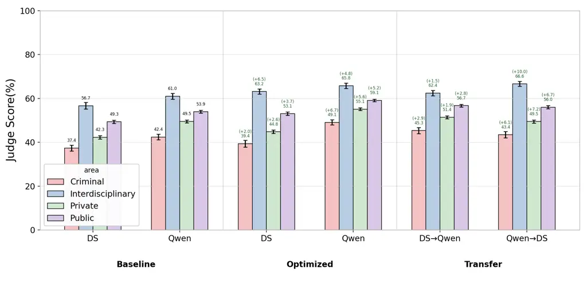

Figure 3. Legal Area-wise performanc for gpt-oss-20b.

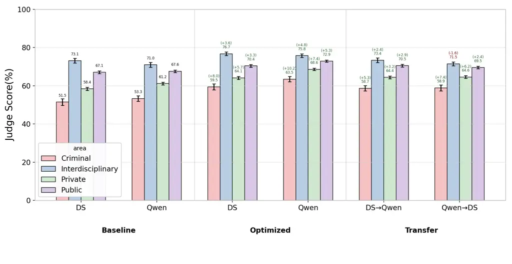

Figure 4. Legal Area-wise performance for gpt-oss-120b.

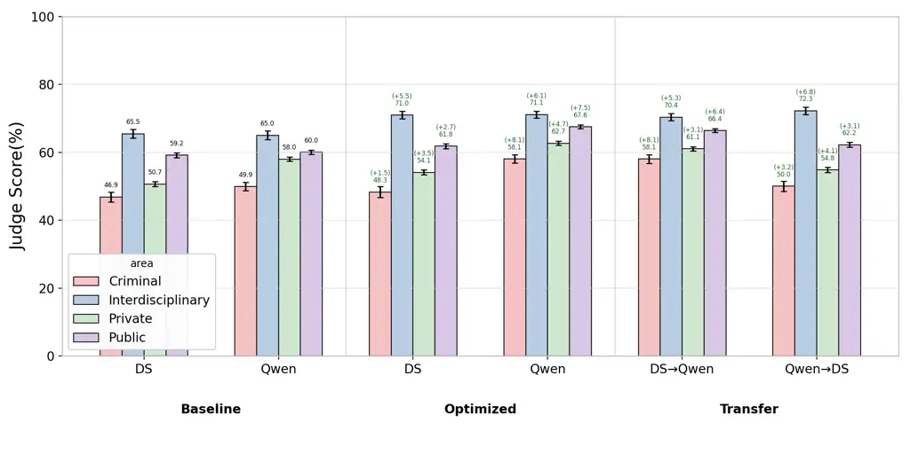

Figure 5. Legal Area-wise performance for qwen3-32b.

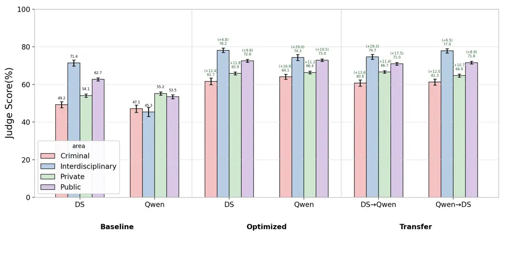

Figure 6. Legal Area-wise performance for qwen3-235b.

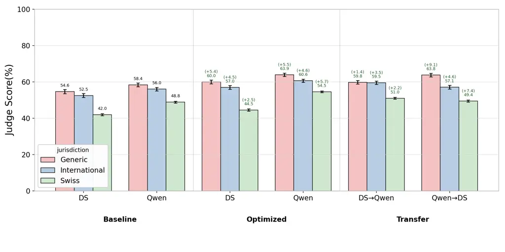

Figure 7. Jurisdiction-wise performance for gpt-oss-20b.

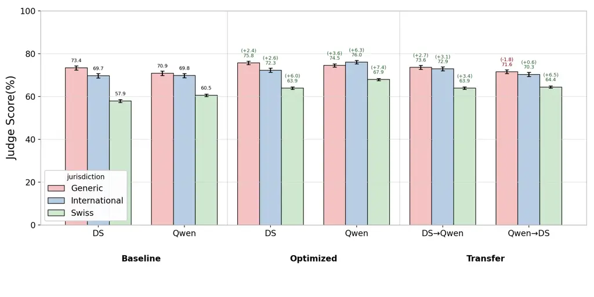

Figure 8. Jurisdiction-wise performance for gpt-oss-120b.

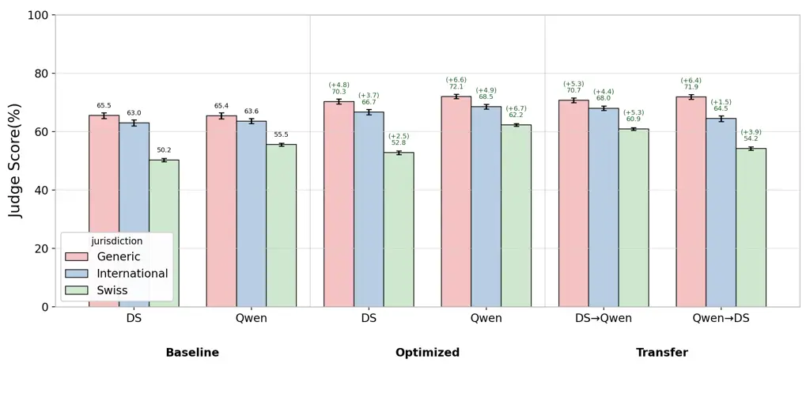

Figure 9. Jurisdiction-wise performance for qwen3-32b.

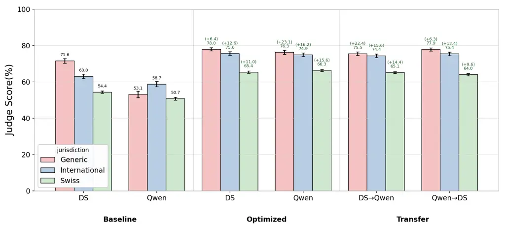

Figure 10. Jurisdiction-wise performance for qwen3-235b.

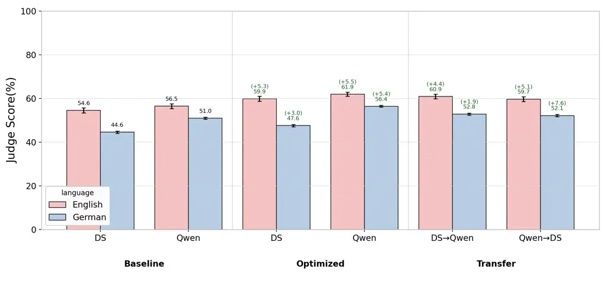

Figure 11. Language-wise performance for gpt-oss-20b.

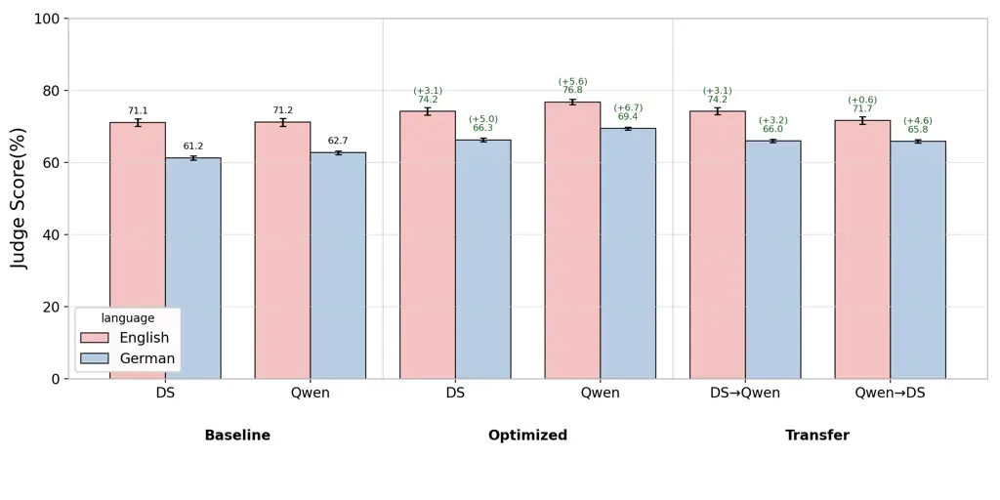

Figure 12. Language-wise performance for gpt-oss-120b.

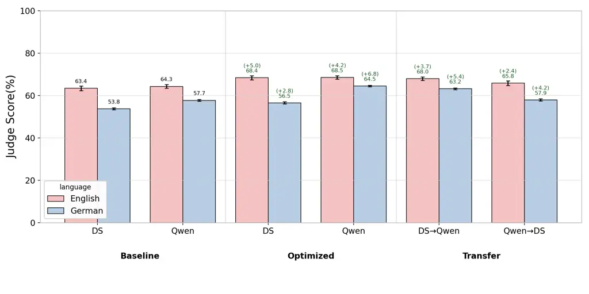

Figure 13. Language-wise performance for qwen3-32b.

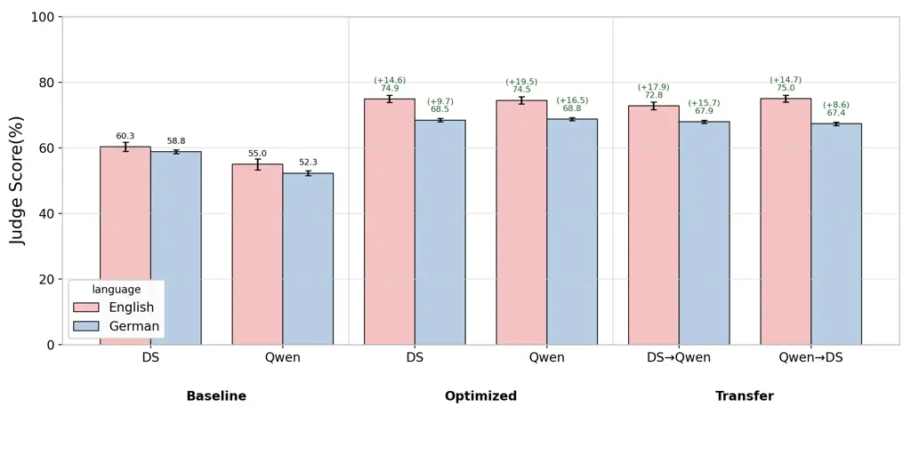

Figure 14. Language-wise performance for qwen3-235b.
