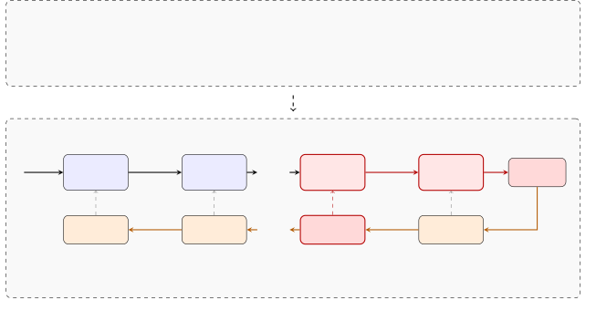
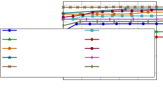
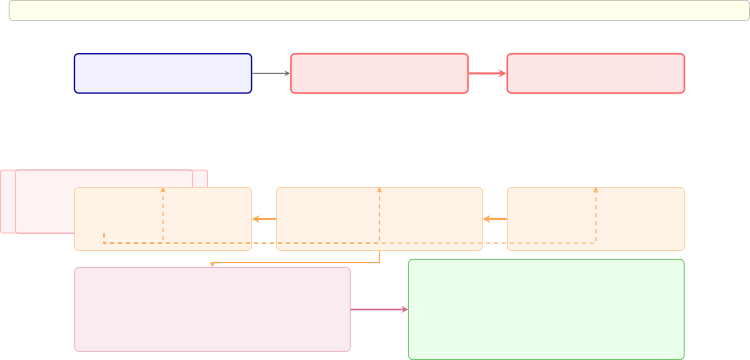

# FlowBot: Inducing LLM Workflows with Bilevel Optimization and Textual Gradients

Hongyeon Yu Affiliation: Naver Search US Correspondence to:
<hongyeon.yu@navercorp.com>    Young-Bum Kim Affiliation: Naver Search
US    Yoon Kim Affiliation: Massachusetts Institute of Technology

###### Abstract

LLM workflows, which coordinate structured calls to individual
LLMs/agents to achieve a particular goal, offer a promising path towards
building powerful AI systems that can tackle diverse tasks. However,
existing approaches for building such workflows generally rely on
human-crafted pipelines and prompts, which presents a substantial
bottleneck in real world deployment. How can we automatically induce
LLM-based agents and workflows in a data-driven way? This paper
describes a simple data-driven approach for automatically inducing
agents and LLM workflows. We formulate workflow induction as a bilevel
optimization problem: an outer loop which optimizes a high-level sketch
of the workflow (in particular how the LLM calls should be structured),
and an inner loop which optimizes each individual LLM call one-by one.
Both loops are optimized with “textual gradients” where for the inner
loop we optimize each component in a modular way through
“backpropagating” textual gradients layer-by-layer. We find that LLM
workflows discovered through our FlowBot (workflow induction through
bilevel optimization and textual gradients) approach performs
competitively against strong baselines that make use of human-crafted or
generated workflows.



Figure 1: Overview of our FlowBot approach. The outer loop optimizes the
workflow sketch $`\mathcal{W}`$ (the structure of LLM calls), while the
inner loop optimizes each prompt $`\theta_{i}`$ via layer-wise textual
backpropagation. Gradients $`g_{k}`$ are propagated backwards from the
loss, analogous to backpropagation in neural networks. Example gradient
snippets (in italics) are from a HotpotQA task where $`a_{K-1}`$
produced a hallucination that propagated to the final answer;.

## 1 Introduction

Large language models (LLMs) are increasingly deployed not just as
standalone models but as part of complex workflows: structured sequences
of calls to LLMs, augmented with tools and intermediate reasoning steps,
that collectively solve complex tasks. By orchestrating multiple LLM
calls with different instructions and tool access, these “compound AI
systems” (Zaharia et al., 2024) extend what a single prompted LLM can
do. However, existing approaches for building such workflows often rely
on human-crafted pipelines, which can be hard to scale across tasks and
domains.

How can we automatically induce and optimize LLM workflows in a
data-driven way? Recent works have approached this problem from the
perspective of prompt optimization (Khattab et al., 2024; Opsahl-Ong et
al., 2024; Cheng et al., 2024; Agrawal et al., 2025; Yin and Wang,
2025), wherein individual components of an LLM workflow are optimized to
improve the overall workflow performance. While various methods have
explored for prompt optimization within this context, these works
generally assume that the overall workflow structure is fixed. This work
describes a simple approach for learning both the workflow structure as
well as the individual components. We formulate LLM workflow induction
as a bilevel optimization problem, where the outer loop optimizes a
high-level _sketch_ of the workflow—how LLM calls are structured and
composed—while the inner loop optimizes each individual LLM call given a
fixed sketch. Both levels are optimized with “textual
gradients” (Pryzant et al., 2023; Yuksekgonul et al., 2025), i.e.,
natural language feedback generated by an LLM based on the input,
output, and the loss. In the inner loop, we treat the workflow as a
stack of modular layers and “backpropagate” textual gradients
layer-by-layer, updating each component while conditioning on the
behavior (and errors) of downstream components. In the outer loop, we
use textual gradients to refine the workflow sketch itself, deleting
existing calls, or adding new ones.

Our approach, dubbed FlowBot (workflow induction through bilevel
optimization and textual gradients), brings ideas from neural
architecture search (Zoph and Le, 2017; Liu et al., 2019; Pham et al.,
2018; Elsken et al., 2019) into the space of LLM systems. The inner loop
plays a role analogous to gradient-based parameter optimization within a
fixed network architecture, while the outer loop mirrors
architecture-level search over compositions of modules. Across multiple
tasks, we find that workflows discovered by FlowBot perform
competitively against strong baselines that optimize prompts within
human-crafted workflows such as GEPA (Agrawal et al., 2025), as well as
automated workflow generation approaches such as AFlow (Zhang et al.,
2025). Our method induces sensible workflow decompositions and component
behaviors, and ablations indicate that both the outer-loop structural
search and the inner-loop modular optimization are both crucial for
performance.

## 2 Methods

### 2.1 Problem Formulation

We define an LLM workflow as a chain $`\mathcal{W}=[a_{1},\dots,a_{K}]`$
consisting of invocations to individual LLM calls $`a_{i}`$. The chain
could consist of loops or conditional statements (e.g., $`a_{i}`$ could
go back to $`a_{j}`$ for $`j<i`$). We parameterize $`\mathcal{W}`$
directly in text space, and thus each $`a_{i}`$ is a high-level
description of the $`i`$-th LLM call (e.g., a retrieval step).¹¹ 1 We
freely go back and forth between the text representation of $`a_{i}`$
and its function representation, which takes in a text input $`z`$ and
produces a text output $`a_{i}(z)`$. Each LLM call $`a_{i}`$ is
associated with a detailed prompt $`\theta_{i}`$ that specifies its
instruction, including the tools it has access to. The workflow
$`\mathcal{W}`$ does not have access to the exact prompt $`\theta_{i}`$,
but only the high-level description $`a_{i}`$. Letting
$`a_{i}(z)=\texttt{LLM}(z;\theta_{i})`$ be the output of applying
$`a_{i}`$ with prompt $`\theta_{i}`$ to textual input $`z`$, the
workflow $`\mathcal{W}`$ takes an input $`x`$ and produces an output via

```math
f_{\mathcal{W}}(x)=(a_{K}\circ\dots\circ a_{1})(x).
```

Given a training set of input-output pairs $`(x,y)`$ from a distribution
$`\mathcal{D}`$, our goal is to optimize the workflow to minimize the
loss $`\mathcal{L}`$ (e.g., negative of accuracy, or feedback from
LLM-as-a-judge), i.e.,

```math
\displaystyle\min_{\mathcal{W},\{\theta_{i}\}_{i=1}^{K}}\,\mathbb{E}_{(x,y)\sim\mathcal{D}}[\mathcal{L}(f_{\mathcal{W}}(x),y)]
```

Making an analogy deep learning architectures and neural architecture
search (Zoph and Le, 2017; Liu et al., 2019; Elsken et al., 2019), we
can think of $`\mathcal{W}`$ as specifying the overall computation graph
(e.g., number and type of layers, nonlinearities, etc.), while $`a_{i}`$
specifies the actual layer itself with optimizable parameters
$`\theta_{i}`$.

### 2.2 Bilevel Optimization with Textual Gradients

We formulate the above as a bilevel optimization problem,

```math
\displaystyle\min_{\mathcal{W}}\,\min_{\{\theta_{i}\}_{i=1}^{K}}\,\mathbb{E}_{(x,y)\sim\mathcal{D}}[\mathcal{L}(f_{\mathcal{W}}(x),y)],
```

where we optimize the inner and outer loops in turn. See Figure 1 for a
high-level overview.

##### Inner loop.

Given the workflow structure $`\mathcal{W}`$, we optimize the prompt
$`\theta_{i}`$ associated with $`a_{i}`$ through backpropagating
“textual gradients” (Yuksekgonul et al., 2025). Let $`x_{0}`$ be the
input, and $`x_{i}=\texttt{LLM}(x_{i-1};\,\theta_{i})`$ be the output of
the $`i`$-th “layer” (so we have $`f_{\mathcal{W}}(x_{0})=x_{K}`$).
Further suppose we have run a forward pass through the workflow to
obtain $`\{x_{i}\}_{i=1}^{K}`$.

The final layer’s textual gradient is given by another LLM with prompt
$`\theta_{\text{grad-loss}}`$ that instructs it to provide feedback and
changes to $`\theta_{K}`$ given the output $`x_{K}`$, answer $`y`$, as
well as the loss $`\mathcal{L}(x_{K},y)`$:

```math
\displaystyle g_{K}={\texttt{LLM}}(x_{K},y,\mathcal{L}(x_{K},y);\,\theta_{\text{grad-loss}})
```

(See appendix A for the exact prompts used by all the LLMs.) For the
intermediate layer, we backpropagate the gradients by similarly
instructing an LLM with prompt $`\theta_{\text{grad-call}}`$ that
instructs it to provide feedback and necessary changes to $`a_{k}`$
given the current input $`x_{k}`$, the output $`x_{k+1}`$, and the next
layer’s gradient $`g_{k+1}`$:

```math
\displaystyle g_{k}={\texttt{LLM}}(x_{k},x_{k+1},g_{k+1};\,\theta_{\text{grad-call}})
```

Each gradient $`g_{k}`$ is a natural language description of how step
$`k`$’s output should change to benefit downstream steps. Given a batch
of $`B`$ samples $`\{x^{(j)},y^{(j)}\}_{j=1}^{B}`$, we run the above
procedure for each example in the batch to obtain textual gradients
$`\{g^{(j)}_{i}\}_{j=1}^{B}`$ for all layers $`i\in[K]`$. We then
perform an update for layer $`i`$ by instructing an LLM with prompt
$`\theta_{\text{optim-call}}`$ that asks it to find a new prompt for
$`a_{i}`$ given the current prompt $`\theta_{i}`$ and the gradients for
a given batch $`\{g^{(j)}_{i}\}_{j=1}^{B}`$:

```math
\displaystyle\theta_{i}\leftarrow\texttt{LLM}(\theta_{i},\{g^{(j)}_{i}\}_{j=1}^{B};\,\theta_{\text{optim-call}})
```

The above step results in an updated prompt $`\{\theta_{i}\}_{i=1}^{K}`$
for all LLM calls $`\{a_{i}\}_{i=1}^{K}`$. We also include the workflow
sketch in the grad/optim prompts.

##### Outer loop.

The outer loop optimizes the workflow sketch
$`\mathcal{W}=[a_{1},\dots,a_{K}]`$, again with textual gradients. We
feed the (text description of the) current workflow $`\mathcal{W}`$,
along with the intermediate steps $`\{x_{i}\}_{i=0}^{K}`$, output $`y`$,
and loss $`\mathcal{L}(x_{K},y)`$, to obtain suggested changes to the
current workflow,

```math
\displaystyle g_{\mathcal{W}}=\texttt{LLM}(\mathcal{W},\{x_{i}\}_{i=0}^{K},y,\mathcal{L}(x_{K},y);\,\theta_{\text{grad-workflow}}).
```

The suggested changes may include addition, removal, or merging of LLM
calls. We obtain the workflow gradients for a batch of $`B`$ examples
and update the workflow via an LLM with prompt
$`\theta_{\text{optim-workflow}}`$

```math
\displaystyle\mathcal{W}\leftarrow\texttt{LLM}(\mathcal{W},\{g^{(j)}_{\mathcal{W}}\}_{j=1}^{B};\,\theta_{\text{optim-workflow}}).
```

The inner/outer loops may be repeated multiple times for a given batch.

### 2.3 Initialization

Our optimization algorithm requires an initial workflow to optimize over
iteratively. For initialization, we first give a batch of examples to an
existing LLM and ask it to produce the output without any explicit
instructions. We then perform a textual gradient step with respect to
the workflow sketch (i.e., the outer loop) to obtain an initial sketch
$`[a_{1},\dots,a_{K}]`$. Then for each $`a_{i}`$, we have another LLM
generate an initial detailed instruction $`\theta_{i}`$ given the
high-level description $`a_{i}`$. The full prompt for the initialization
component is given in appendix A.3.

## 3 Empirical Study

We evaluate FlowBot across a diverse set of benchmarks to test whether
fully automated workflow induction improves LLM workflows consistently
across tasks.

### 3.1 Experimental Setup

We use the same setup for all datasets: one epoch of training with batch
size 5, where for each batch we run two bi-level optimization loops,
where one optimization loop itself consists of one outer loop step and 5
inner loop steps. We keep track of performance on the validation set
after each batch and pick the best performing workflow on based on the
validation set. We then run the best performing workflow on the test
set.

| Method                              | HotpotQA1 | IFBench | HoVer | PUPA  | Avg.  |
| ----------------------------------- | --------- | ------- | ----- | ----- | ----- |
| Baseline                            | 38.00     | 47.79   | 46.33 | 78.57 | 52.67 |
| Trace (Cheng et al., 2024)          | 60.33     | 51.19   | 46.00 | 74.18 | 57.93 |
| MIPROv2 (Opsahl-Ong et al., 2024)   | 58.00     | 49.15   | 48.33 | 83.37 | 59.71 |
| TextGrad (Yuksekgonul et al., 2025) | 62.33     | 48.64   | 47.67 | 85.68 | 61.08 |
| GEPA (Agrawal et al., 2025)         | 69.00     | 52.72   | 51.67 | 94.47 | 66.97 |
| GEPA+Merge (Agrawal et al., 2025)   | 65.67     | 55.95   | 56.67 | 96.46 | 68.69 |
| FlowBot (ours)                      | 72.80     | 52.51   | 63.20 | 90.67 | 69.80 |

Table 1: Performance of FlowBot against prompt optimization methods that
work within a fixed workflow. All methods use GPT-4.1 mini. Numbers from
baselines are from Agrawal et al. (2025).

##### Baselines.

Our main prompt optimization baseline is GEPA (Agrawal et al., 2025),
which performs evolutionary search to search for optimal prompts given a
workflow structure. GEPA itself outperforms strong prompt optimization
baselines such as Trace (Cheng et al., 2024), MIPROv2 (Opsahl-Ong et
al., 2024), and TextGrad (Yuksekgonul et al., 2025); we include numbers
from these other baselines for completeness. For baselines that perform
automatic workflow generation, we mainly compare against AFlow (Zhang et
al., 2025), which outperforms other workflow generation baselines such
as ADAS (Hu et al., 2024). Both workflow approaches search over workflow
structures described in program space (rather than text space, as in our
work), and moreover do not employ “backpropagation”-based modular
updates to individual components.

##### Datasets.

We evaluate on ten benchmarks, a union of those used in the original
GEPA/AFlow works: HotpotQA, IFBench, HoVer, PUPA, DROP, GSM8K, MATH,
HumanEval and MBPP. These benchmarks span multi-hop QA, instruction
following, multi-hop verification, privacy-conscious delegation, code
generation, and math reasoning. HotpotQA is evaluated in two formats and
we treat them as distinct benchmarks (Yang et al., 2018). HotpotQA1 is
tool-augmented (question-only with retrieval), whereas HotpotQA2 is
tool-free (question with provided context). We treat these separately
since GEPA used the tool-augmented version, while AFlow did not. IFBench
evaluates verifiable instruction following under explicit constraints
(Pyatkin et al., 2025). HoVer evaluates many-hop fact extraction and
claim verification over Wikipedia (Jiang et al., 2020). PUPA uses
PAPILLON to study privacy-conscious delegation (Li et al., 2025). DROP
is a reading comprehension benchmark requiring discrete reasoning over
paragraphs (Dua et al., 2019). GSM8K and MATH evaluate mathematical
reasoning with verifiable final answers (Cobbe et al., 2021; Hendrycks
et al., 2021). HumanEval and MBPP evaluate code generation via unit
tests (Chen et al., 2021; Austin et al., 2021). We follow the evaluation
protocol and metrics as used in the GEPA and AFlow papers.

### 3.2 Main Results

##### Learning.

To see whether our approach can learn from data, we show the “learning
curve” of our method for all datasets in Figure 2, where we plot the
performance of the best workflow seen so far (as measured by performance
on the validation set). We indeed find that our approach can leverage
data to find effective workflows. Our approach is moreover
data-efficient, which is an advantage (less API costs) but also
highlights the limitations—however, this kind of rapid ceiling hitting
is often observed in prompt/workflow optimization approaches (Agrawal et
al., 2025).



Figure 2: Validation performance of the best workflow seen so far across
a single training epoch.

##### Comparison against prompt optimization methods.

We compare against GEPA and same datasets used in the original work:
HotpotQA1, IFBench, HoVer, and PUPA. GEPA evolves prompts through
reflective edits guided by rollout-based feedback while GEPA+Merge
further merges complementary prompt updates across candidates. For a
controlled comparison, all methods (including ours) use GPT-4.1 mini for
all LLMs. Table 1 shows that our method improves upon GEPA on the
retrieval/verification-heavy benchmarks, while remaining competitive on
instruction- and privacy-centric tasks. This is despite the fact that
baselines start from hand-optimized workflows and prompts, while FlowBot
has to discover the workflow from scratch.

|           |           |         |          |         |
| --------- | --------- | ------- | -------- | ------- |
|           | API Calls |         | Cost     |         |
| Benchmark | AFlow     | FlowBot | AFlow    | FlowBot |
| HotpotQA  | 187K      | 18.8K   | \$87.26  | \$22.19 |
| DROP      | 132K      | 14.0K   | \$24.46  | \$6.97  |
| HumanEval | 5.8K      | 505     | \$1.49   | \$0.57  |
| MBPP      | 430       | 2.7K    | \$0.05   | \$2.99  |
| GSM8K     | 1.3K      | 14.3K   | \$0.42   | \$7.68  |
| MATH      | 11.9K     | 4.5K    | \$17.28  | \$7.26  |
| Total     | 338K      | 54.7K   | \$130.95 | \$47.67 |

Table 2: Comparison of number of API calls and cost until the best
validation performance is reached.

|                                                                                 |           |       |           |       |       |       |       |
| ------------------------------------------------------------------------------- | --------- | ----- | --------- | ----- | ----- | ----- | ----- |
| Method                                                                          | HotPotQA2 | DROP  | HumanEval | MBPP  | GSM8K | MATH  | Avg.  |
| Prompt-based methods (GPT-4o mini)                                              |           |       |           |       |       |       |       |
|      Direct IO prompting                                                        | 68.10     | 68.30 | 87.00     | 71.80 | 92.70 | 48.60 | 72.75 |
|      Chain-of-Thought (CoT)                                                     | 67.90     | 78.50 | 88.60     | 71.80 | 92.40 | 48.80 | 74.67 |
|      CoT + Self-Consistency                                                     | 68.90     | 78.80 | 91.60     | 73.60 | 92.70 | 50.40 | 76.00 |
|      MedPrompt (Nori et al., 2023)                                              | 68.30     | 78.00 | 91.60     | 73.60 | 90.00 | 50.00 | 75.25 |
|      MultiPersona (Wang et al., 2024)                                           | 69.20     | 74.40 | 89.30     | 73.60 | 92.80 | 50.80 | 75.02 |
|      Self Refine (Madaan et al., 2023)                                          | 60.80     | 70.20 | 87.80     | 69.80 | 89.60 | 46.10 | 70.72 |
| Workflow induction methods (Claude-3.5 Sonnet optimizer + GPT-4o mini executor) |           |       |           |       |       |       |       |
|      ADAS (Hu et al., 2024)                                                     | 64.50     | 76.60 | 82.40     | 53.40 | 90.80 | 35.40 | 67.18 |
|      AFlow (Zhang et al., 2025)                                                 | 73.50     | 80.60 | 94.70     | 83.40 | 93.50 | 56.20 | 80.32 |
| GPT-4.1 mini for optimizer and executor                                         |           |       |           |       |       |       |       |
|      AFlow (our reimplementation)                                               | 75.41     | 79.69 | 94.65     | 74.78 | 86.16 | 72.01 | 80.45 |
|      FlowBot (ours)                                                             | 80.19     | 92.28 | 93.74     | 73.84 | 96.01 | 72.71 | 84.80 |

Table 3: Comparison of FlowBot against automatic workflow generation
methods and prompting baselines. All numbers except the last two rows
are from Zhang et al. (2025).

##### Comparison against automatic workflow generation methods.

We follow prior end-to-end workflow optimization work and evaluate on
the same six benchmarks used in AFlow: HotpotQA2, DROP, HumanEval, MBPP,
GSM8K, and MATH. The original AFlow (Zhang et al., 2025) work used
Claude-3.5 Sonnet as their meta LLM optimizer and GPT-4o mini as the
executor LLM. For fair comparison, we reimplement AFlow using their
open-source code base with GPT-4.1 mini. The results are shown in
Table 3. Our method outperforms AFlow on four of the six benchmarks,
indicating that bilevel workflow induction yields consistent
improvements against AFlow when compared under the same model capacity.

| Benchmark | Method | Workflow Structure                                                                                                                                                                                                                                    | Steps |
| --------- | ------ | ----------------------------------------------------------------------------------------------------------------------------------------------------------------------------------------------------------------------------------------------------- | ----- |
| HotpotQA  | GEPA   | Retrieve passages (T) $`\rightarrow`$ Summarize passages $`\rightarrow`$ Generate hop-2 query $`\rightarrow`$ Retrieve passages (T) $`\rightarrow`$ Summarize with context $`\rightarrow`$ Generate final answer                                      | 6     |
|           | Ours   | Initial broad retrieval (T) $`\rightarrow`$ Entity extraction and query refinement $`\rightarrow`$ Focused retrieval (T) $`\rightarrow`$ Answer verification and validation $`\rightarrow`$ Generate final answer                                     | 5     |
| HoVer     | GEPA   | Retrieve passages (T) $`\rightarrow`$ Summarize passages $`\rightarrow`$ Generate hop-2 query $`\rightarrow`$ Retrieve passages (T) $`\rightarrow`$ Summarize with context $`\rightarrow`$ Generate hop-3 query $`\rightarrow`$ Retrieve passages (T) | 7     |
|           | Ours   | Entity extraction $`\rightarrow`$ Search query generation $`\rightarrow`$ Initial retrieval (T) $`\rightarrow`$ Document verification and filtering $`\rightarrow`$ Iterative gap-filling retrieval (T) $`\rightarrow`$ Aggregate final evidence      | 6     |
| IFBench   | GEPA   | Generate response $`\rightarrow`$ Self-correct response                                                                                                                                                                                               | 2     |
|           | Ours   | Constraint extraction $`\rightarrow`$ Conditional verbatim repetition $`\rightarrow`$ Answer content generation $`\rightarrow`$ Compliance verification $`\rightarrow`$ Feedback-based refinement $`\rightarrow`$ Format normalization                | 6     |
| PUPA      | GEPA   | Craft redacted request $`\rightarrow`$ External LLM generation $`\rightarrow`$ Synthesize final response                                                                                                                                              | 3     |
|           | Ours   | Requirement extraction $`\rightarrow`$ Targeted content generation $`\rightarrow`$ Verification and refinement $`\rightarrow`$ Privacy-preserving synthesis                                                                                           | 4     |

Table 4: Comparison against human-designed workflows from GEPA. Steps
marked with (T) use external tools.

##### Cost.

How costly is our approach compared to other workflow induction
approaches such as AFlow? For both AFlow and FlowBot, we compare the
number of API calls and the cost until the best validation performance
is reached for each task.²² 2 Running for full iterations for both
approaches would result in 803K calls and \$352.46 for AFlow, and 145K
calls \$165.39 for FlowBot. The cost is as of April 2026. We use GPT-4.1
mini for both approaches. The results are shown in Table 2. We find that
FlowBot generally requires fewer API calls and less cost.

### 3.3 Qualitative Analysis

##### Analysis of induced workflows.

We examine the workflow structures discovered by our method and compare
them against human-designed workflows from GEPA. Table 4 shows the
induced workflows. Our bilevel optimization discovers workflow
structures that are qualitatively similar to those designed by humans.
For example, for HotpotQA both workflows follow a multi-hop retrieval
pattern with intermediate processing steps. The induced workflow
includes explicit entity disambiguation and query planning, which the
human design handles implicitly through summarization. We show examples
of the individual LLM calls and prompts in Table 5 for HotpotQA. The
induced prompts are sensible, and when tools are available, the workflow
is able to make appropriate use of tools.

| Step 3: Focused retrieval ($`a_{3}`$)                  |                                                                                                                                                                                                                                                                                                                                                                                                                                                                                                                                                                                                                                                                                       |
| ------------------------------------------------------ | ------------------------------------------------------------------------------------------------------------------------------------------------------------------------------------------------------------------------------------------------------------------------------------------------------------------------------------------------------------------------------------------------------------------------------------------------------------------------------------------------------------------------------------------------------------------------------------------------------------------------------------------------------------------------------------- |
| Type                                                   | ToolExecutor                                                                                                                                                                                                                                                                                                                                                                                                                                                                                                                                                                                                                                                                          |
| Tools                                                  | wikipedia_search_topk                                                                                                                                                                                                                                                                                                                                                                                                                                                                                                                                                                                                                                                                 |
| Description                                            | Perform focused retrieval using the refined queries generated in Step 2 to obtain precise, authoritative passages about key entities and critical attributes relevant to the question.                                                                                                                                                                                                                                                                                                                                                                                                                                                                                                |
| Prompt ($`\theta_{3}`$)                                | You are given one or more key entities extracted from a user’s question, along with any critical quantitative, temporal, or contextual attributes relevant to the question. Your task is to perform focused retrievals to find precise, authoritative passages specifically about these entities and their key attributes. The goal is to gather comprehensive, relevant, and temporally contextualized information that supports accurately answering the original question, including clear evidence, explicit notes about the presence or absence of relevant information, and concise candidate extractions to facilitate downstream answer verification and consolidation. \[…\] |
| Step 4: Answer verification and validation ($`a_{4}`$) |                                                                                                                                                                                                                                                                                                                                                                                                                                                                                                                                                                                                                                                                                       |
| Type                                                   | LLMExecutor                                                                                                                                                                                                                                                                                                                                                                                                                                                                                                                                                                                                                                                                           |
| Tools                                                  | None                                                                                                                                                                                                                                                                                                                                                                                                                                                                                                                                                                                                                                                                                  |
| Description                                            | Verify, normalize, and rigorously validate candidate answers by cross-checking all evidence from initial and focused retrievals, applying confidence scoring, resolving ambiguities, and triggering iterative focused retrieval if evidence is insufficient or conflicting.                                                                                                                                                                                                                                                                                                                                                                                                           |
| Prompt ($`\theta_{4}`$)                                | You are an expert reasoning agent responsible for verifying, validating, and selecting the most accurate candidate answer(s) to a given question by rigorously cross-checking all provided evidence. Your goal is to ensure that final answers are well-supported, strictly grounded in the retrieved evidence, normalized to expected formats, and accompanied by transparent justifications and confidence assessments. Avoid assumptions or relying on external knowledge unless explicitly indicated as authoritative and supplementary. \[…\]                                                                                                                                    |

Table 5: Example of induced LLM call specifications from the HotpotQA
workflow. Step 3 ($`a_{3}`$) uses tools for focused retrieval, while
Step 4 ($`a_{4}`$) performs LLM-based answer verification.

##### Analysis of textual backpropagation.

Is our layer-wise backpropagation effective? Performing a systematic
analysis here is difficult here since we cannot manually verify each
textual gradient. We did however generally find them to be sensible, and
go through an example here during a training run of HotpotQA1. In this
example the model is given the following multi-hop question: “The
1905-1904 college basketball team lead by G.W. Leach represented a
university founded in what year?” The ground truth answer is 1846
(Bucknell University), but the workflow produced 1865. See Figure 3 for
an overview.

Forward pass. The workflow executed six steps. Step 1 (Wikipedia Search)
retrieved relevant passages including information about the Bucknell
Bison basketball team with G.W. Leach as captain. Step 2 (Entity
Disambiguation) correctly identified “Bucknell University” as the
primary entity. Step 3 (Targeted Retrieval) successfully retrieved
passages stating that Bucknell was founded in 1846. Step 4 (Answer
Extraction) correctly extracted “1846” from these passages. However,
Step 5 (Verification) introduced an error: despite receiving the correct
answer “1846” from upstream, the LLM hallucinated that “G.W. Leach is
historically known as a coach of the Kentucky Wildcats,” leading it to
reject the correct answer and substitute Kentucky’s founding year
(1865). This error propagated to Step 6 (Final Answer), which output the
incorrect “1865.”

Textual backpropagation. As shown in Figure 3, the gradient $`g_{6}`$
for the final step noted that the output format was correct but the
answer was wrong, attributing the error to upstream steps. The gradient
$`g_{5}`$ for the verification step pinpointed the root cause: “The main
issue is the inaccuracy of the foundational data: the step concludes
that 1865 is the correct founding year, but the ground truth is 1846.
This step needs to incorporate more robust verification mechanisms, such
as cross-checking multiple authoritative sources \[…\]” The gradient
$`g_{4}`$ for the extraction step confirmed that it “correctly extracts
and outputs ‘1846’,” but noted that the next step “identifies ‘1846’ as
inconsistent with authoritative historical data”—correctly diagnosing
that the error originated downstream of extraction. Gradients for Steps
1–3 similarly confirmed correct operation. See Appendix B for the full
gradient.

Prompt update. Based on the gradient feedback, the verification step’s
prompt was updated to address the identified hallucination issue. The
key changes included: (1) explicit instructions to check for
discrepancies among candidate answers, (2) a requirement to
cross-reference with common knowledge or authoritative sources, (3)
guidance to flag uncertainties and retain multiple plausible candidates
with confidence scores rather than prematurely committing to a single
answer, and (4) clarification that if uncertainty remains high, the
agent should indicate that no reliable answer could be determined. The
complete before-and-after prompts are provided in Appendix B.5.



Figure 3: Textual backpropagation example on HotpotQA during training.
Forward (top): Step 4 correctly extracts “1846” (Bucknell’s founding
year), but Step 5 hallucinates by incorrectly associating G.W. Leach
with Kentucky (founded 1865) instead of Bucknell, rejecting the correct
answer. Backward (middle): Textual gradients $`g_{6}\to g_{5}\to g_{4}`$
propagate error attribution via chain rule. Prompt Update (bottom):
Gradient $`g_{5}`$ updates the verification prompt $`\theta_{5}`$ to
cross-reference sources.

### 3.4 Ablations

We perform a series of ablations on HotPotQA1 and HotPotQA2, where we
average across 5 different runs for each ablation study.

##### Ablations on algorithmic components.

FlowBot formulates workflow induction as a bilevel optimization problem
and performs layer-by-layer backpropagation of textual gradients.³³ 3
While this layer-by-layer backpropagation approach was mentioned in
Yuksekgonul et al. (2025), all their experiments were in the “single
layer” case to the best of our knowledge. How important are these
components?

| Method                   | HotpotQA1 | HotpotQA2 |
| ------------------------ | --------- | --------- |
| FlowBot (ours)           | 72.80     | 80.19     |
| prompt optimization only | 60.07     | 72.06     |
| w/o bilevel optim        | 61.73     | 79.26     |
| w/o layerwise backprop   | 71.13     | 76.51     |

Table 6: Ablation study on algorithmic components

We first show a simple baseline that does just prompt optimization based
on the initial workflow from the first batch (Table 6: prompt
optimization only), and find that this does not perform well. We next
try removing the bilevel optimization formulation, treating the entire
workflow induction as a single layer that is optimized with textual
gradients. This underperforms the full approach (Table 6: w/o bilevel
optim). We finally try keeping the bilevel optimization formulation, but
performing the inner update in one go (Table 6: layerwise backprop).
That is, instead of backpropagating layer by layer we ask an LLM to
compute gradients for all steps $`\{g_{i}\}_{i=1}^{K}`$ in one go (and
similarly ask another LLM to update the prompts
$`\{\theta_{i}\}_{i=1}^{K}`$ in one go). We find that this approach
results in substantial degradations. Collectively, these results
indicate both bilevel optimization formulation and layer-by-layer
textual gradient backpropagation are crucial for performance.

| Model             | HotpotQA1 | HotpotQA2 |
| ----------------- | --------- | --------- |
| Qwen3.5-397B-A17B | 77.26     | 81.12     |
| GPT-OSS-120B      | 69.46     | 80.61     |
| GPT-OSS-20B       | 54.06     | 77.16     |

Table 7: Performance across models on HotpotQA1 and HotpotQA2 with
different LLMs.

|                   | HotPotQA1 |            |         | HotPotQA2 |            |         |
| ----------------- | --------- | ---------- | ------- | --------- | ---------- | ------- |
| Executor LLM      | No Opt    | Prompt Opt | FlowBot | No Opt    | Prompt Opt | FlowBot |
| Qwen3.5-4B        | 0.417     | 0.513      | 0.681   | 0.608     | 0.615      | 0.761   |
| Qwen3.5-9B        | 0.497     | 0.615      | 0.737   | 0.677     | 0.700      | 0.772   |
| Qwen3.5-27B       | 0.618     | 0.677      | 0.779   | 0.774     | 0.775      | 0.800   |
| Qwen3.5-122B-A10B | 0.670     | 0.667      | 0.746   | 0.771     | 0.730      | 0.817   |
| Qwen3.5-397B-A17B | 0.682     | 0.732      | 0.740   | 0.784     | 0.816      | 0.806   |

Table 8: Performance on HotPotQA1 and HotPotQA2 across executor models,
where the meta LLM for generating textual gradients and prompt updates
is fixed to be Qwen3.5-122B-A10B. No Opt is the result of ordinary
prompting. Prompt Opt optimizes the prompt only based on the initial
workflow.

##### Ablations with different LLMs.

We next test our approach with different open-weight LLMs. The results
are shown in Table 7. We find that FlowBot works well with other
open-weight models, with the Qwen3.5-397B model outperforming GPT-4.1
mini.

How does the performance vary as a function of the actual executor LLM
and the meta LLM that produces the gradients and the prompt updates?
Table 8 shows the results. We find that strong meta LLMs enable
significant improvements upon prompt-only optimization, which can enable
significant improvements with smaller Executor LLMs. The improvements
diminish with a larger executor LLM (i.e., Qwen3.5-397B), which makes
sense since the meta LLM’s job is more “difficult”. Since the actual
deployment will only involve the executor LLM, only requiring powerful
LLMs for the meta LLM component is a practical aspect of our approach.

### 3.5 Extension: Inducing a Unified Workflow

We conclude with a proof-of-concept experiment that highlights the
flexibility of FlowBot. Here, instead of having a separate workflow for
each task, we induce a _single_ unified workflow for all tasks. This
requires the workflow to have _input-dependent_ workflows where (for
example) certain steps are skipped if it is not relevant for the task.
We show the results in Table 9 with Qwen3.5-397B-A17B as both the
executor and the optimizer. While the unified workflow predictably
underperforms the task-specific workflows, we find that the unified
approach performs quite well for many tasks, as shown in Table 10. The
workflow is able to deduce that the 6 tasks can be split into 4 meta
tasks: reading comprehension, math, code generation, and general
conversion. It then uses the first step to route the question to these
meta tasks. While far from perfect, we see this as a promising extension
that could pave the path towards being able to induce more
general-purpose workflows.

| Benchmark | Separate Workflows | Unified Workflow |
| --------- | ------------------ | ---------------- |
| HotpotQA2 | 81.12              | 79.20            |
| DROP      | 92.14              | 92.00            |
| HumanEval | 97.40              | 84.40            |
| MBPP      | 78.89              | 63.60            |
| GSM8K     | 97.27              | 97.00            |
| MATH      | 80.25              | 66.70            |
| Average   | 87.85              | 80.48            |

Table 9: Performance comparison between inducing separate workflows and
a single unified workflow.

|      |                       |                               |
| ---- | --------------------- | ----------------------------- |
| Step | Type                  | Description                   |
| 0    | Cond. / LLM           | Classify task type and route  |
|      |                       | READ_COMP $`\rightarrow`$ 1–3 |
|      |                       | MATH $`\rightarrow`$ 4–6      |
|      |                       | CODE_GEN $`\rightarrow`$ 7–10 |
|      |                       | GENERAL $`\rightarrow`$ 10    |
|      | Reading Comprehension |                               |
| 1    | LLM                   | Evidence extraction           |
| 2    | Loop / LLM            | Answer + verification loop    |
| 3    | LLM                   | QA output                     |
|      | Math Problem          |                               |
| 4    | LLM                   | Problem analysis              |
| 5    | Loop / LLM            | Solve + verification loop     |
| 6    | LLM                   | Math output                   |
|      | Code Generation       |                               |
| 7    | LLM                   | Requirements analysis         |
| 8    | LLM                   | Code generation               |
| 9    | Loop / LLM            | Code verification loop        |
| 10   | LLM                   | Code output                   |
|      | General Conversation  |                               |
| 10   | LLM                   | General output                |

Table 10: Induced input-dependent conditional workflow for AFlow
benchmarks.

## 4 Discussion & Limitations

Our work has several limitations. For one, the optimization procedure
incurs nontrivial computational overhead, since both structure and
prompts are refined using LLM calls. This cost is particularly salient
for tasks where minimal workflows already perform well, and where
additional steps may introduce avoidable latency and complexity. More
generally, the framework trades optimization-time compute for reduced
reliance on manual workflow engineering. While our approach is
data-efficient, in some cases the model converges to the final workflow
and does not improve with more training data. This type of rapid
convergence is often seen in such prompt/workflow optimization
approaches. This suggests that more flexible learning mechanisms could
enable workflow induction algorithms that can better leverage data.

## 5 Related Work

##### LLM workflows and agentic systems.

LLMs are increasingly deployed inside structured workflows that combine
multiple model calls, tools, and retrieval steps rather than as
single-shot predictors. Early work on tool-augmented LLMs such as ReAct
(Yao et al., 2022) and Toolformer (Schick et al., 2023) showed that
interleaving reasoning traces with actions and API calls can
substantially extend the capabilities of LLMs. Frameworks such as
LangChain and LlamaIndex provide composable abstractions (chains,
graphs) for orchestrating multi-step LLM applications with tools and
external data sources. Across these lines of work, the workflow
structure—how many steps exist, how they are ordered, which tools each
can call, and how information is passed—is largely hand-designed and
manually maintained.

##### Prompt optimization.

Prompt engineering and optimization have become central to improving LLM
systems, and a large body of work now studies how to update prompts
automatically using data and feedback. For single-call prompts, methods
such as ProTeGi (Pryzant et al., 2023), OPRO (Yang et al., 2024), and
PromptBreeder (Fernando et al., 2023) iteratively generate and edit
candidate instructions using textual feedback or evolutionary search,
treating the LLM itself as an optimizer over discrete prompt strings.
DSPy (Khattab et al., 2024) introduces a programming model in which LLM
pipelines are parameterized modules in a text transformation graph.
MIPRO (Opsahl-Ong et al., 2024) builds on this view and directly targets
multi-stage “language model programs,” introducing meta-optimization
strategies. Works such as Trace (Cheng et al., 2024), GEPA (Agrawal et
al., 2025), and TextGrad (Yuksekgonul et al., 2025) push beyond scalar
losses, showing that execution traces and natural-language feedback can
be treated as generalized gradients. FlowBot shares with these
approaches the use of textual feedback to optimize prompts, but differs
in that it couples this inner prompt optimization with an outer loop
that edits the workflow sketch itself, rather than assuming the program
structure is fixed.

##### Automated design of workflows and agentic systems.

Most closely related to FlowBot are approaches that attempt to
_automatically_ design the structure of LLM workflows or agentic
systems, rather than only tuning their prompts. AFlow (Zhang et al., 2025) models agentic workflows directly as code-represented graphs and
applies Monte Carlo Tree Search over workflow edits to optimize such
graphs against task-specific metrics. ADAS (Hu et al., 2024) proposes a
broader research agenda of Automated Design of Agentic Systems, where a
meta-agent searches over the space of agent programs to invent novel
building blocks, control flows, and tool-use patterns. Recent
fully-automated frameworks such as AutoAgent (Tang et al., 2025)
similarly aim to construct and adapt agents and multi-agent workflows
from natural-language descriptions, relying on iterative code generation
and self-play to synthesize and refine agent graphs. Compared with these
approaches, FlowBot adopts a simpler search space—feedforward chains of
LLM calls—but couples workflow search and module learning tightly: the
outer loop edits the workflow sketch with textual gradients, while the
inner loop re-optimizes module behavior via layer-wise textual
backpropagation.

## 6 Conclusion

We introduced FlowBot, a simple bilevel optimization framework that
jointly induces the structure and behavior of LLM workflows. By treating
workflows as modular stacks of LLM calls and performing layer-wise
textual backpropagation in an inner loop, while using an outer loop to
refine the workflow sketch itself, FlowBot brings ideas from neural
architecture search into the space of LLM systems. Across multiple
tasks, our experiments show that FlowBot discovers sensible workflow
decompositions and achieves performance competitive with strong
baselines.

## Impact Statement

This paper presents work whose goal is to advance the field of Machine
Learning. There are many potential societal consequences of our work,
none which we feel must be specifically highlighted here.

## References

- Agrawal et al. (2025) L. A. Agrawal, S. Tan, D. Soylu, N. Ziems, R.
  Khare, K. Opsahl-Ong, A. Singhvi, H. Shandilya, M. J. Ryan, M. Jiang,
  et al. Gepa: reflective prompt evolution can outperform reinforcement
  learning. arXiv preprint arXiv:2507.19457. Cited by: §1, §1, §3.1,
  §3.2, Table 1, Table 1, Table 1, §5.
- Austin et al. (2021) J. Austin, A. Odena, M. I. Nye, M. Bosma, H.
  Michalewski, D. Dohan, E. Jiang, C. J. Cai, M. Terry, Q. V. Le, and C.
  Sutton Program synthesis with large language models. CoRR
  abs/2108.07732. External Links:
  [Link](https://arxiv.org/abs/2108.07732), 2108.07732 Cited by: §3.1.
- Chen et al. (2021) M. Chen, J. Tworek, H. Jun, Q. Yuan, H. P. de
  Oliveira Pinto, J. Kaplan, H. Edwards, Y. Burda, N. Joseph, G.
  Brockman, A. Ray, R. Puri, G. Krueger, M. Petrov, H. Khlaaf, G.
  Sastry, P. Mishkin, B. Chan, S. Gray, N. Ryder, M. Pavlov, A.
  Power, L. Kaiser, M. Bavarian, C. Winter, P. Tillet, F. P. Such, D.
  Cummings, M. Plappert, F. Chantzis, E. Barnes, A. Herbert-Voss, W. H.
  Guss, A. Nichol, A. Paino, N. Tezak, J. Tang, I. Babuschkin, S.
  Balaji, S. Jain, W. Saunders, C. Hesse, A. N. Carr, J. Leike, J.
  Achiam, V. Misra, E. Morikawa, A. Radford, M. Knight, M. Brundage, M.
  Murati, K. Mayer, P. Welinder, B. McGrew, D. Amodei, S. McCandlish, I.
  Sutskever, and W. Zaremba Evaluating large language models trained on
  code. External Links: 2107.03374,
  [Link](https://arxiv.org/abs/2107.03374) Cited by: §3.1.
- Cheng et al. (2024) C. Cheng, A. Nie, and A. Swaminathan Trace is the
  next autodiff: generative optimization with rich feedback, execution
  traces, and llms. Advances in Neural Information Processing Systems
  37, pp. 71596–71642. Cited by: §1, §3.1, Table 1, §5.
- Cobbe et al. (2021) K. Cobbe, V. Kosaraju, M. Bavarian, M. Chen, H.
  Jun, L. Kaiser, M. Plappert, J. Tworek, J. Hilton, R. Nakano, C.
  Hesse, and J. Schulman Training verifiers to solve math word problems.
  External Links: 2110.14168, [Link](https://arxiv.org/abs/2110.14168)
  Cited by: §3.1.
- Dua et al. (2019) D. Dua, Y. Wang, P. Dasigi, G. Stanovsky, S. Singh,
  and M. Gardner DROP: a reading comprehension benchmark requiring
  discrete reasoning over paragraphs. In Proceedings of the 2019
  Conference of the North American Chapter of the Association for
  Computational Linguistics: Human Language Technologies, Volume 1 (Long
  and Short Papers), J. Burstein, C. Doran, and T. Solorio (Eds.),
  Minneapolis, Minnesota, pp. 2368–2378. External Links:
  [Link](https://aclanthology.org/N19-1246/),
  [Document](https://dx.doi.org/10.18653/v1/N19-1246) Cited by: §3.1.
- Elsken et al. (2019) T. Elsken, J. H. Metzen, and F. Hutter Neural
  architecture search: a survey. Journal of Machine Learning Research 20
  (55), pp. 1–21. Cited by: §1, §2.1.
- Fernando et al. (2023) C. Fernando, D. Banarse, H. Michalewski, S.
  Osindero, and T. Rocktäschel Promptbreeder: self-referential
  self-improvement via prompt evolution. arXiv preprint
  arXiv:2309.16797. Cited by: §5.
- Hendrycks et al. (2021) D. Hendrycks, C. Burns, S. Kadavath, A.
  Arora, S. Basart, E. Tang, D. Song, and J. Steinhardt Measuring
  mathematical problem solving with the MATH dataset. CoRR
  abs/2103.03874. External Links:
  [Link](https://arxiv.org/abs/2103.03874), 2103.03874 Cited by: §3.1.
- Hu et al. (2024) S. Hu, C. Lu, and J. Clune Automated design of
  agentic systems. arXiv preprint arXiv:2408.08435. Cited by: §3.1,
  Table 3, §5.
- Jiang et al. (2020) Y. Jiang, S. Bordia, Z. Zhong, C. Dognin, M.
  Singh, and M. Bansal HoVer: a dataset for many-hop fact extraction and
  claim verification. In Findings of the Association for Computational
  Linguistics: EMNLP 2020, T. Cohn, Y. He, and Y. Liu (Eds.), Online,
  pp. 3441–3460. External Links:
  [Link](https://aclanthology.org/2020.findings-emnlp.309/),
  [Document](https://dx.doi.org/10.18653/v1/2020.findings-emnlp.309)
  Cited by: §3.1.
- Khattab et al. (2024) O. Khattab, A. Singhvi, P. Maheshwari, Z.
  Zhang, K. Santhanam, S. Vardhamanan, S. Haq, A. Sharma, T. T.
  Joshi, H. Moazam, et al. Dspy: compiling declarative language model
  calls into self-improving pipelines. In Proceedings of ICLR, Cited by:
  §1, §5.
- Li et al. (2025) S. Li, V. C. Raghuram, O. Khattab, J. Hirschberg,
  and Z. Yu PAPILLON: privacy preservation from Internet-based and local
  language model ensembles. In Proceedings of the 2025 Conference of the
  Nations of the Americas Chapter of the Association for Computational
  Linguistics: Human Language Technologies (Volume 1: Long Papers), L.
  Chiruzzo, A. Ritter, and L. Wang (Eds.), Albuquerque, New Mexico,
  pp. 3371–3390. External Links:
  [Link](https://aclanthology.org/2025.naacl-long.173/),
  [Document](https://dx.doi.org/10.18653/v1/2025.naacl-long.173), ISBN
  979-8-89176-189-6 Cited by: §3.1.
- Liu et al. (2019) H. Liu, K. Simonyan, and Y. Yang DARTS:
  differentiable architecture search. In International Conference on
  Learning Representations, Cited by: §1, §2.1.
- Madaan et al. (2023) A. Madaan, N. Tandon, P. Gupta, S. Hallinan, L.
  Gao, S. Wiegreffe, U. Alon, N. Dziri, S. Prabhumoye, Y. Yang, et al.
  Self-refine: iterative refinement with self-feedback. Advances in
  Neural Information Processing Systems 36, pp. 46534–46594. Cited by:
  Table 3.
- Nori et al. (2023) H. Nori, Y. T. Lee, S. Zhang, D. Carignan, R.
  Edgar, N. Fusi, N. King, J. Larson, Y. Li, W. Liu, et al. Can
  generalist foundation models outcompete special-purpose tuning? case
  study in medicine. arXiv preprint arXiv:2311.16452. Cited by: Table 3.
- Opsahl-Ong et al. (2024) K. Opsahl-Ong, M. J. Ryan, J. Purtell, D.
  Broman, C. Potts, M. Zaharia, and O. Khattab Optimizing instructions
  and demonstrations for multi-stage language model programs. In
  Proceedings of the 2024 Conference on Empirical Methods in Natural
  Language Processing, Y. Al-Onaizan, M. Bansal, and Y. Chen (Eds.),
  Miami, Florida, USA, pp. 9340–9366. External Links:
  [Link](https://aclanthology.org/2024.emnlp-main.525/),
  [Document](https://dx.doi.org/10.18653/v1/2024.emnlp-main.525) Cited
  by: §1, §3.1, Table 1, §5.
- Pham et al. (2018) H. Pham, M. Guan, B. Zoph, Q. Le, and J. Dean
  Efficient neural architecture search via parameters sharing. In
  International conference on machine learning, pp. 4095–4104. Cited by:
  §1.
- Pryzant et al. (2023) R. Pryzant, D. Iter, J. Li, Y. Lee, C. Zhu,
  and M. Zeng Automatic prompt optimization with “gradient descent” and
  beam search. In Proceedings of the 2023 Conference on Empirical
  Methods in Natural Language Processing, H. Bouamor, J. Pino, and K.
  Bali (Eds.), Singapore, pp. 7957–7968. External Links:
  [Link](https://aclanthology.org/2023.emnlp-main.494/),
  [Document](https://dx.doi.org/10.18653/v1/2023.emnlp-main.494) Cited
  by: §1, §5.
- Pyatkin et al. (2025) V. Pyatkin, S. Malik, V. Graf, H. Ivison, S.
  Huang, P. Dasigi, N. Lambert, and H. Hajishirzi Generalizing
  verifiable instruction following. External Links: 2507.02833,
  [Link](https://arxiv.org/abs/2507.02833) Cited by: §3.1.
- Schick et al. (2023) T. Schick, J. Dwivedi-Yu, R. Dessì, R.
  Raileanu, M. Lomeli, E. Hambro, L. Zettlemoyer, N. Cancedda, and T.
  Scialom Toolformer: language models can teach themselves to use tools.
  Advances in Neural Information Processing Systems 36, pp. 68539–68551.
  Cited by: §5.
- Tang et al. (2025) J. Tang, T. Fan, and C. Huang Autoagent: a
  fully-automated and zero-code framework for llm agents. arXiv preprint
  arXiv:2502.05957. Cited by: §5.
- Wang et al. (2024) Z. Wang, S. Mao, W. Wu, T. Ge, F. Wei, and H. Ji
  Unleashing the emergent cognitive synergy in large language models: a
  task-solving agent through multi-persona self-collaboration. In
  Proceedings of the 2024 Conference of the North American Chapter of
  the Association for Computational Linguistics: Human Language
  Technologies (Volume 1: Long Papers), pp. 257–279. Cited by: Table 3.
- Yang et al. (2024) C. Yang, X. Wang, Y. Lu, H. Liu, Q. V. Le, D. Zhou,
  and X. Chen Large language models as optimizers. In The Twelfth
  International Conference on Learning Representations, Cited by: §5.
- Yang et al. (2018) Z. Yang, P. Qi, S. Zhang, Y. Bengio, W. Cohen, R.
  Salakhutdinov, and C. D. Manning HotpotQA: a dataset for diverse,
  explainable multi-hop question answering. In Proceedings of the 2018
  Conference on Empirical Methods in Natural Language Processing, E.
  Riloff, D. Chiang, J. Hockenmaier, and J. Tsujii (Eds.), Brussels,
  Belgium, pp. 2369–2380. External Links:
  [Link](https://aclanthology.org/D18-1259/),
  [Document](https://dx.doi.org/10.18653/v1/D18-1259) Cited by: §3.1.
- Yao et al. (2022) S. Yao, J. Zhao, D. Yu, N. Du, I. Shafran, K. R.
  Narasimhan, and Y. Cao React: synergizing reasoning and acting in
  language models. In The eleventh international conference on learning
  representations, Cited by: §5.
- Yin and Wang (2025) L. Yin and Z. Wang LLM-autodiff:
  auto-differentiate any llm workflow. arXiv preprint arXiv:2501.16673.
  Cited by: §1.
- Yuksekgonul et al. (2025) M. Yuksekgonul, F. Bianchi, J. Boen, S.
  Liu, Z. Huang, P. Lu, C. Guestrin, and J. Zou Optimizing generative ai
  by backpropagating language model feedback. Nature 639, pp. 609–616.
  Cited by: §1, §2.2, §3.1, Table 1, §5, footnote 3.
- Zaharia et al. (2024) M. Zaharia, O. Khattab, L. Chen, J. Q. Davis, H.
  Miller, C. Potts, J. Zou, M. Carbin, J. Frankle, N. Rao, et al. The
  shift from models to compound ai systems. Cited by: §1.
- Zhang et al. (2025) J. Zhang, J. Xiang, Z. Yu, F. Teng, X. Chen, J.
  Chen, M. Zhuge, X. Cheng, S. Hong, J. Wang, B. Zheng, B. Liu, Y. Luo,
  and C. Wu AFlow: automating agentic workflow generation. In The
  Thirteenth International Conference on Learning Representations, Cited
  by: §1, §3.1, §3.2, Table 3, Table 3, §5.
- Zoph and Le (2017) B. Zoph and Q. V. Le Neural architecture search
  with reinforcement learning. In Proceedings of ICLR, Cited by: §1,
  §2.1.

## Appendix A Meta LLM Prompts

This appendix provides the complete system and user prompts used in our
optimization pipeline. Table 11 summarizes the notation for each
optimizer prompt.

|                                    |                                    |                                         |
| ---------------------------------- | ---------------------------------- | --------------------------------------- |
| Notation                           | Role                               | Output                                  |
| $`\theta_{\text{grad-workflow}}`$  | Workflow structure gradient        | $`g_{\mathcal{W}}`$                     |
| $`\theta_{\text{grad-loss}}`$      | Final step gradient                | $`g_{K}`$ from $`\mathcal{L}(x_{K},y)`$ |
| $`\theta_{\text{grad-backprop}}`$  | Chain rule gradient                | $`g_{k}`$ from $`g_{k+1}`$              |
| $`\theta_{\text{optim-workflow}}`$ | Workflow optimization (outer loop) | $`\mathcal{W}^{\prime}`$                |
| $`\theta_{\text{optim-call}}`$     | Prompt optimization (inner loop)   | $`\theta_{i}^{\prime}`$                 |
| –                                  | Executor initialization            | New $`\theta_{i}`$                      |

Table 11: Optimizer prompts and their roles in the bilevel optimization
pipeline.

### A.1 Textual Gradient Computation

These prompts implement textual backpropagation, computing natural
language gradients that describe how each component’s output should
change to improve task performance.

#### A.1.1 $`\theta_{\text{grad-workflow}}`$: Workflow Structure Gradient

This prompt computes the workflow-level gradient $`g_{\mathcal{W}}`$,
which identifies structural issues in the workflow itself rather than
individual step outputs. Given the complete execution trace
$`\{x_{1},\ldots,x_{K}\}`$, evaluation result, and available tools, it
analyzes whether the workflow structure (step ordering, missing steps,
tool usage) should be modified. This drives the outer loop of bilevel
optimization.


#### A.1.2 $`\theta_{\text{grad-loss}}`$: Final Step Gradient

This prompt computes the initial textual gradient $`g_{K}`$ for the
final step of the workflow. Given the workflow’s output $`x_{K}`$,
ground truth $`y`$, and evaluation result $`\mathcal{L}(x_{K},y)`$, it
generates natural language feedback describing what should change to
reduce the loss. This is analogous to computing
$`\partial\mathcal{L}/\partial x_{K}`$ in neural network
backpropagation.


#### A.1.3 $`\theta_{\text{grad-backprop}}`$: Chain Rule Gradient

This prompt propagates textual gradients backward through intermediate
steps using the chain rule. Given step $`k`$’s input $`x_{k-1}`$, output
$`x_{k}`$, the next step’s output $`x_{k+1}`$, and the downstream
gradient $`g_{k+1}`$, it computes $`g_{k}`$ describing how $`x_{k}`$
should change to improve downstream performance. This implements the
textual analog of $`g_{k}=f(x_{k},x_{k+1},g_{k+1})`$.


### A.2 Bilevel Optimization

These prompts apply the computed textual gradients to update the
workflow. The outer loop optimizes the workflow structure
$`\mathcal{W}`$, while the inner loop optimizes individual prompts
$`\theta_{i}`$.

#### A.2.1 $`\theta_{\text{optim-workflow}}`$: Workflow Sketch Optimization (Outer Loop)

This prompt implements the outer loop of bilevel optimization. Given the
current workflow structure $`\mathcal{W}`$, existing executor
specifications, and aggregated workflow gradients
$`\{g_{\mathcal{W}}^{(1)},\ldots,g_{\mathcal{W}}^{(B)}\}`$, it decides
whether to modify the workflow structure and produces an updated
execution plan $`\mathcal{W}^{\prime}`$. This enables adding, removing,
or reordering steps based on task requirements.


#### A.2.2 $`\theta_{\text{optim-call}}`$: Prompt Optimization (Inner Loop)

This prompt implements the inner loop of bilevel optimization. Given an
executor’s current prompt $`\theta_{i}`$ and aggregated textual
gradients $`\{g_{i}^{(1)},\ldots,g_{i}^{(B)}\}`$ from a batch of
samples, it produces an updated prompt $`\theta_{i}^{\prime}`$ that
addresses the identified issues while preserving working patterns. This
is analogous to gradient descent:
$`\theta\leftarrow\theta-\eta\nabla_{\theta}\mathcal{L}`$.


### A.3 Workflow Initialization

When the outer loop adds new steps to the workflow (with executor_type:
"new"), this module initializes prompts for the new agents. Given the
step description, available tools, and generation guidelines, it creates
an initial prompt that will be further refined through subsequent inner
loop iterations. This is analogous to initializing new layer parameters
when a neural network architecture changes.


## Appendix B Bilevel Optimization Example

We provide a detailed example of Bilevel Optimization from our HotpotQA
experiments. This example illustrates both workflow sketch optimization
and prompt optimization on a failing case.

### B.1 Task Information

- •
  Question: “The 1905-1904 college basketball team lead by G.W. Leach
  represented a university founded in what year?”
- •
  Ground Truth: 1846 (Bucknell University)
- •
  Prediction: 1865
- •
  Metric: Exact Match (em)

### B.2 Workflow Sketch Optimization

The workflow sketch $`\mathcal{W}`$ was updated from 4 steps (1 tool) to
6 steps (2 tools). Two new steps were added: an LLM step
($`a_{2}^{\prime}`$) for entity disambiguation and a tool step
($`a_{3}^{\prime}`$) for targeted attribute retrieval.

|                                                                                                                                       |                              |      |        |
| ------------------------------------------------------------------------------------------------------------------------------------- | ---------------------------- | ---- | ------ |
| Step                                                                                                                                  | Description                  | Type | Change |
| Before: $`\mathcal{W}=[a_{1},a_{2},a_{3},a_{4}]`$ (1 tool)                                                                            |                              |      |        |
| 1                                                                                                                                     | Wikipedia search             | Tool | –      |
| 2                                                                                                                                     | Answer extraction            | LLM  | –      |
| 3                                                                                                                                     | Verification                 | LLM  | –      |
| 4                                                                                                                                     | Final answer                 | LLM  | –      |
| After: $`\mathcal{W}^{\prime}=[a_{1}^{\prime},a_{2}^{\prime},a_{3}^{\prime},a_{4}^{\prime},a_{5}^{\prime},a_{6}^{\prime}]`$ (2 tools) |                              |      |        |
| 1                                                                                                                                     | Wikipedia search             | Tool | reuse  |
| 2                                                                                                                                     | Entity disambiguation        | LLM  | new    |
| 3                                                                                                                                     | Targeted attribute retrieval | Tool | new    |
| 4                                                                                                                                     | Answer extraction            | LLM  | reuse  |
| 5                                                                                                                                     | Verification                 | LLM  | reuse  |
| 6                                                                                                                                     | Final answer                 | LLM  | reuse  |

Table 12: Workflow sketch before and after optimization.

#### B.2.1 Workflow Gradient ($`g_{\mathcal{W}}`$)


### B.3 Prompt Optimization via Textual Backpropagation

The textual gradients are computed layer-by-layer using the chain rule,
propagating from the loss $`\mathcal{L}(x_{K},y)`$ backward through each
step to update prompts $`\theta_{1},\ldots,\theta_{K}`$.

#### B.3.1 $`g_{6}`$: Final Answer $`\rightarrow`$ Loss


#### B.3.2 $`g_{5}`$: Verification


#### B.3.3 $`g_{4}`$: Answer Extraction


#### B.3.4 $`g_{3}`$: Targeted Attribute Retrieval


#### B.3.5 $`g_{2}`$: Entity Disambiguation


#### B.3.6 $`g_{1}`$: Wikipedia search


### B.4 Error Analysis

This example reveals an interesting failure mode:

1.  1.  Step 3 (Targeted Retrieval): Correctly retrieved passages containing
        “Bucknell was founded in 1846”
2.  2.  Step 4 (Extraction): Correctly extracted “1846” from the passages
3.  3.  Step 5 (Verification): LLM Hallucination occurred
    - •
      The LLM incorrectly stated: “G.W. Leach is historically known as a
      coach of the Kentucky Wildcats”
    - •
      This caused the model to reject the correct answer (1846) and
      substitute 1865 (Kentucky’s founding year)

Here, while retrieval-augmented workflows provided correct evidence,
downstream LLM reasoning steps were incorrect.. The textual gradients
correctly identified this issue and suggested incorporating “more robust
verification mechanisms” and “cross-checking multiple authoritative
sources.”

### B.5 Prompt Update Example

Based on the textual gradients computed above, the verification step’s
prompt was updated to address the identified hallucination issue. We
show the complete prompt before and after the update.

#### B.5.1 Before Update ($`\theta_{5}`$)


#### B.5.2 After Update ($`\theta_{5}^{\prime}`$)


