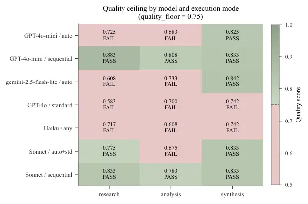

# Agent Capsules: Quality-Gated Granularity Control for Multi-Agent LLM Pipelines

Conference: ; ;

Aninda Ray Note: Correspondence: research@anindaray.com. Code:
[github.com/aray-17/agent-capsules @
v1.0-arxiv](https://github.com/aray-17/agent-capsules/releases/tag/v1.0-arxiv).

###### Abstract.

A multi-agent pipeline with $`N`$ agents typically issues $`N`$ LLM
calls per run. Merging agents into fewer calls—_compound
execution_—promises token savings, but naively merged calls silently
degrade quality through tool loss and prompt compression. We present
Agent Capsules, an adaptive execution runtime that treats multi-agent
pipeline execution as an optimization problem with empirical quality
constraints. The runtime instruments coordination overhead per group,
scores composition opportunity, selects among three compound execution
strategies, and gates every mode switch on rolling-mean output quality.
A controlled negative result (§7.4) confirms that injecting more context
into a merged call worsens compression rather than relieving it—so the
framework’s escalation ladder (standard $`\to`$ two-phase $`\to`$
sequential) recovers quality by moving _toward_ per-agent dispatch
rather than by rewriting merged prompts. On LLM-judged quality, the
controller matches a hand-tuned oracle on every measured (model, group,
mode) cell: routing compound whenever the oracle would, and reverting to
fine whenever quality would fail the floor, without per-model
configuration. Against a hand-crafted LangGraph (LangChain, 2024)
implementation of a 14-agent competitive intelligence pipeline, Agent
Capsules uses 51% fewer fine-mode input tokens and 42% fewer
compound-mode input tokens, at $`+`$0.020 and $`+`$0.017 quality
respectively. Against a DSPy (Khattab et al., 2024) implementation of a
5-agent due diligence pipeline, the framework uses 19% fewer tokens than
uncompiled DSPy at quality parity; and 68% fewer tokens than MIPROv2 at
$`+`$0.052 quality. Even before compound mode fires, the runtime
delivers efficiency through automatic policy resolution, cache-aligned
prompts, and topology-aware context injection, matching both hand-tuned
and compile-time baselines without training data or per-pipeline
engineering.

###### Keywords: 

multi-agent systems, LLM inference optimization, compound execution,
adaptive controllers, token efficiency, quality gates

## 1. Introduction

Consider a five-agent due diligence pipeline that runs a thousand times
per day. Each run issues at least one LLM call per agent—more once tool
loops are counted—and every call pays the full cost of system prompt
ingestion, context setup, and per-request scheduling. Merging those
agents into a single call eliminates most of this per-call overhead, but
the merged prompt silently degrades output: tool-using agents lose
access to their tools, and smaller models compress multi-agent
instructions into a single shallow response rather than producing
per-agent depth.

This is the compound execution problem: _when is it safe to merge
agents, and what should the system do when merging breaks quality?_
Throughout the paper we refer to the two execution modes as
_fine-grained_ (the default: one LLM call per agent) and _compound_ (one
or more agents merged into a single call). To the best of our knowledge,
existing multi-agent frameworks (Moura, 2024; LangChain, 2024; Google, 2025) provide no answer—they treat each agent as an independent dispatch
unit, with no provision for batching agents into a shared call, leaving
the cost-quality tradeoff to manual engineering.

We present Agent Capsules (AC), a runtime layer that makes this decision
automatically and safely. It operates on three mechanisms:

1.  (1)
    A composition score computed from four behavioral signals measured
    at runtime: coordination overhead, agent count, tool-call density,
    and dependency depth. The score predicts when it is safe to merge
    calls without per-model configuration. It is a behavioral
    fingerprint of how a model is being exercised, not a capability
    ranking.
2.  (2)
    A quality gate that shadow-evaluates compound output against the
    fine-grained baseline, blocks unsafe switches, and reverts when
    running quality degrades below a configurable floor.
3.  (3)
    An escalation ladder that progressively upgrades the execution
    strategy (standard $`\to`$ two-phase $`\to`$ sequential) when lower
    tiers fail the quality gate, rather than abandoning compound
    execution entirely.

#### Why escalation moves _toward_ per-agent dispatch.

A controlled negative result (§7.4) tests the obvious alternative
hypothesis—that a richer Phase A pre-pass would let the model reason
more before merging—and finds the opposite: injecting more context into
a merged reasoning call makes compression worse, not better. Sequential
execution ($`N`$ separate calls with accumulated context) is therefore
not a fallback but the structurally correct answer for multi-agent
reasoning groups whose merged form fails the gate. The escalation ladder
operationalizes this by recovering quality through un-merging rather
than by rewriting merged prompts.

#### Fine-grained mode is not the baseline.

A common reading treats the “one call per agent” fine-grained mode as an
unoptimized starting point from which compound execution derives its
savings. In Agent Capsules it is already an orchestration layer: before
any merging occurs, the framework narrows each agent’s context to its
declared dependencies, resolves policy per group, injects concise-output
guidance from rolling observations, and aligns shared prompt prefixes
for provider caching. These behaviors fire from the pipeline declaration
alone. In our head-to-heads against DSPy and LangGraph (§12), the
fine-grained rows already beat both baselines on tokens at equal or
higher quality. Compound execution is a second tier that engages where
the composition score indicates safety; both tiers contribute
independently to the efficiency numbers reported in this paper.

#### Evaluation scope.

The framework is evaluated primarily on Sonnet and Haiku, which carry
the core quality, escalation, and head-to-head results. GPT-4o,
GPT-4o-mini, and gemini-2.5-flash-lite validate the composition score’s
cross-provider behavior and populate the quality-ceiling heatmap. The
evaluation spans four pipeline topologies (5–14 agents). The quality
gate matches the LLM-judge oracle on every measured cell once the
rolling-mean window saturates (§9.5); sequential compound with adaptive
output guidance delivers 63–64% output-token savings on Sonnet and Haiku
at quality-neutral cost while staying neutral on already-terse models.
Against hand-tuned LangGraph (LangChain, 2024) on a 14-agent pipeline,
Agent Capsules uses 51% fewer fine-mode and 42% fewer compound-mode
input tokens at $`+`$0.020 and $`+`$0.017 quality; against DSPy (Khattab
et al., 2024) on a 5-agent pipeline, it uses 19% fewer tokens at parity
and 68% fewer than MIPROv2 at $`+`$0.052 quality (§12).

## 2. Background and Motivation

Figure 1 gives the system at a glance. The developer writes a short
declarative pipeline: groups of agents with their prompts, tools, and
dependencies. Everything downstream—prompt compilation, per-group policy
resolution, mode selection, quality shadowing, adapter-specific message
assembly—is the framework’s responsibility. The remaining sections of
this paper walk through what each component does and why the surrounding
control loop makes compound execution safe to deploy by default.

Figure 1. Agent Capsules at a glance. A short developer-supplied
pipeline declaration (left) flows into the runtime, where the
per-request data path (top strip) compiles prompts, dispatches one of
four execution modes through the adapter layer, and reaches the model
provider. The control loop (bottom strip) records telemetry on the
response, scores quality, and feeds an explicit mode override back to
the executor for the next request.

### 2.1. Multi-Agent Pipeline Structure

We define a _pipeline_ as a directed graph of _groups_, each containing
one or more _agents_. Groups execute sequentially; agents within a group
may be declared in fan-out, diamond, or linear topologies and are
executed in topological order, with independent agents at each level
running concurrently.

Internally, the framework compiles each developer-declared group into a
CompoundCapsule—an intermediate node in the runtime’s capsule tree that
owns the agents in that group along with their declared dependency
edges. The CompoundCapsule is the unit of composition: it may be
executed either as $`N`$ independent agent dispatches (each of which may
itself include a tool loop), or merged into fewer dispatches. The
controller manages one CompoundCapsule per declared group,
independently. Throughout the paper we say _group_ to mean the
developer-facing construct (the named declaration in the DSL); when we
need to refer to the corresponding runtime node we use
_CompoundCapsule_. Mode names: fine for per-agent dispatch, compound for
merged.

### 2.2. The Cost Structure of Multi-Agent Execution

Each LLM-backed agent dispatch incurs three cost components:

1.  (1)
    Input token cost: system prompt + task context + prior agent
    outputs, repeated in full on every call in a group.
2.  (2)
    Per-call wall-clock latency: the end-to-end round-trip a client
    observes for one LLM call, comprising network round-trip,
    server-side scheduling (KV slot allocation, request queuing, prefill
    compute), and output generation. The per-call _fixed_
    portion—everything except output generation—amortises over batched
    agents (§11 reports measured per-model values).
3.  (3)
    Output token cost: generation steps. Approximately unchanged
    FINE$`\to`$COMPOUND for equivalent output quality.

Compound execution eliminates cost component (1) for shared context and
amortises the fixed portion of component (2) across $`N`$ agents,
reducing total wall-clock by up to $`(N-1)/N`$ of the per-call fixed
overhead per group. The output-generation portion of component (2) does
not shrink; savings come from eliminating repeated scheduling and
prefill, not from generating fewer tokens.

## 3. Related Work

Prior work for multi-agent LLM efficiency divides into four axes, each
optimizing a different aspect of the pipeline. Agent Capsules occupies a
fifth axis—runtime-adaptive execution-mode selection—that is orthogonal
to, and composable with, the others. We discuss each in turn.

### 3.1. Agent Orchestration Frameworks

CrewAI (Moura, 2024), LangGraph (LangChain, 2024), Google ADK (Google,
2025), MetaGPT (Hong et al., 2024), and AgentScope (Gao et al., 2024)
provide structured multi-agent pipelines with role-based agents,
dependency management, and tool integration. Google ADK additionally
ships a binary critic-loop pattern (LoopAgent with an exit_condition
evaluated against a critic agent’s PASS/FAIL output) and offline
LLM-as-judge evaluation primitives. None of these frameworks instrument
per-group coordination overhead, compute composition scores, or gate
_runtime execution-mode selection_ on empirical, smoothed quality
thresholds. Agent Capsules is designed to wrap these systems, not
replace them. Our head-to-head against LangGraph on a 14-agent
competitive intelligence pipeline (§12.1) measures the comparison
directly: Agent Capsules uses 51% fewer fine-mode input tokens at
$`+`$0.020 quality than a hand-tuned LangGraph implementation with the
same agent system prompts.

### 3.2. Prompt Compilation

DSPy (Khattab et al., 2024) compiles prompts at design time using
teleprompters such as BootstrapFewShot and MIPROv2. LLMLingua (Jiang et
al., 2023) compresses individual prompts to reduce token count within a
single request. These approaches target _content_ optimization via
compile-time iteration; Agent Capsules targets _structural_ optimization
at runtime. The two are composable in principle, but our head-to-head
against DSPy on a 5-agent due diligence pipeline (§12.3) shows that
runtime adaptation alone can match DSPy’s compile-time pipeline: Agent
Capsules uses 19% fewer total tokens than uncompiled DSPy at quality
parity, and 68% fewer than MIPROv2 at $`+`$0.052 quality. MIPROv2’s
bootstrapped demonstrations inflate per-signature prompts without
delivering quality gains when the evaluation distribution diverges from
the training corpus.

### 3.3. Inference-Level Optimization

Orca (Yu et al., 2022) and vLLM (Kwon et al., 2023) optimize
within-request scheduling and KV memory. FlashAttention (Dao et al., 2022) reduces prefill compute. SGLang (Zheng et al., 2024) co-designs
the serving engine and programming model for structured generation.
These operate below the application layer; Agent Capsules operates above
it, reducing the number and structure of requests rather than optimizing
individual request execution. The two layers are complementary in
principle: an Agent Capsules deployment can sit on top of an
inference-level runtime that applies the optimizations described above,
in the same way it sits on top of the orchestration frameworks discussed
in §3.1.

### 3.4. Adaptive Controllers and Routing

FrugalGPT (Chen et al., 2023) routes queries to cheaper models based on
predicted quality. RouteLLM (Ong et al., 2025) learns routing policies
from preference data. Both approaches select _which model_ to call based
on per-query features; Agent Capsules selects _how_ to call a fixed
model based on per-group behavioral fingerprints, with a quality gate
that shadow-compares compound output against the fine-grained baseline
and reverts when running quality degrades. Execution-mode selection is
orthogonal to model routing, and the two compose cleanly: an Agent
Capsules deployment can target a RouteLLM-selected model without
modification.

### 3.5. Tool Use and Encapsulation Models

Gorilla (Patil et al., 2024) and ToolBench (Qin et al., 2024) train
models to use tools more effectively. We measure a related
phenomenon—the _behavioral stability index_, which captures whether tool
invocation rates change under compound prompt framing—from an
execution-optimization rather than a training perspective. The
group-based programming model draws on the Capsules parallel programming
framework (Mandviwala et al., 2007), which introduced dynamically
composable execution units with explicit boundary semantics. Our
adaptation applies this encapsulation model to LLM agent groups.

To our knowledge, Agent Capsules is the first system to treat
multi-agent execution as a group-level optimization problem with
empirical quality constraints, and the first to report competitive
benchmarks against both a hand-tuned orchestration baseline (LangGraph)
and a compile-time prompt-compiled baseline (DSPy/MIPROv2) with wins on
both tokens and quality.

## 4. The Programming Model

### 4.1. Core Abstractions

Agent Capsules introduces three abstractions:

- •
  Agent: the atomic unit of work. Declares a role, a system prompt, and
  an optional set of tools. Produces a single output per run.
- •
  Group: a named collection of agents with a shared optimization
  context. The group is the unit the controller observes and adapts.
  Groups within a pipeline execute sequentially; agents within a group
  may be sequential, parallel (fan-out), or dependency-connected.
- •
  Pipeline: the top-level container that owns one or more groups, the
  controller state for each group, the persistence backend, and the
  execution policy.

### 4.2. Pipeline

A pipeline is constructed once and reused across runs: the controller
accumulates observations over repeated calls so its switching decisions
sharpen with deployment evidence rather than resetting on every
invocation. The pipeline is the boundary across which the framework’s
contract holds—the developer hands the runtime a pipeline plus a task,
and the runtime returns a result with mode decisions, quality scores,
and per-group telemetry attached.

### 4.3. Declarative DSL

Pipelines are declared using a fluent builder:

from agentic_capsules import Pipeline, Tool

from agentic_capsules.adapters.anthropic \\

import AnthropicAdapter

web_search = Tool(

name="web_search",

description="Search the web for "

"recent articles.",

input_schema={"query": "str"},

fn=lambda a: fetch_results(a\["query"\]),

)

pipeline = (

Pipeline("research",

sensitivity="balanced")

.group("research")

.agent("web_searcher",

"Search for recent, credible "

"sources on the topic.",

tools=\[web_search\])

.agent("fact_checker",

"Verify the credibility "

"of each source.")

.group("writing")

.agent("analyst",

"Identify the top 3 insights.")

.agent("writer",

"Write a clear 150-word summary.")

)

adapter = AnthropicAdapter(

model="claude-sonnet-4-6")

result = pipeline.run(

"AI safety challenges at scale",

adapter=adapter)

\# result.mode_used -\> per-group mode

\# result.confidence -\> per-group confidence

\# result.token_usage -\> total tokens

The same pipeline object is reused across runs. The controller
accumulates observations per group, switches to compound mode when
confident, and reverts if quality drops—all transparently, with no code
changes required.

### 4.4. Explicit Agent Dependencies

By default, agents within a group form a linear chain: each agent
depends on the one declared immediately before it, so .agent("b", ...)
declared after .agent("a", ...) receives a’s output as context.
Non-linear topologies are expressed by passing an explicit depends_on
list to any agent whose dependencies differ from the implicit linear
default:

pipeline = (

Pipeline("review")

.group("reviewers")

.agent("seed",

"Summarise the diff.")

.agent("sec",

"Review for security.",

depends_on=\["seed"\])

.agent("perf",

"Review for performance.",

depends_on=\["seed"\])

.agent("style",

"Review for style.",

depends_on=\["seed"\])

.agent("synth",

"Merge all reviews.",

depends_on=\["sec", "perf", "style"\])

)

The builder validates depends_on entries at declaration time: every name
must refer to an agent already declared earlier in the same group,
self-references are rejected, and cross-group references are rejected.
The compiler then feeds the resulting edge graph to the topology
classifier described below. Omitting depends_on preserves the historical
linear-by-declaration-order semantics, so existing pipelines require no
code changes.

### 4.5. Group Topologies

The framework classifies each group’s internal dependency structure and
uses this to select the context injection strategy:

| Topology       | Description                 | Example                   |
| -------------- | --------------------------- | ------------------------- |
| linear         | Each agent depends on prior | research $`\to`$ analysis |
| fan_out        | Same input, parallel agents | parallel reviewers        |
| diamond        | Fan-out then converge       | N res. $`\to`$ 1 synth.   |
| parallel_conv. | Independents feed terminal  | multi-source res.         |

Table 1. Group topology classification and context injection behavior.

For fan-out topologies, agents do not need context from each other—the
framework suppresses cross-agent context injection, eliminating $`O(N)`$
irrelevant tokens per agent. For linear topologies, each agent receives
the accumulated output of all prior agents in its group.

### 4.6. Execution Modes

Every group runs in one of four execution modes at runtime: fine
(per-agent dispatch), or one of three compound strategies (standard,
two-phase, sequential). §7 treats each mode in detail; the runtime
selects among them automatically (auto mode, the default), starting
every group in fine and switching to a compound strategy once
observations support the decision.

### 4.7. Controller Modes

At the pipeline level, four controller behaviors are available:

| Mode           | Behavior                                       | Use case     |
| -------------- | ---------------------------------------------- | ------------ |
| auto (default) | Observes and switches per group when confident | Production   |
| observe        | Records observations but never switches        | Baselining   |
| fine           | Locked to FINE for all groups                  | Debugging    |
| compound       | Locked to COMPOUND for all groups              | Benchmarking |

Table 2. Pipeline-level controller modes.

Shadow mode (observe) is particularly useful for cloud operators
onboarding a new pipeline: run $`N`$ iterations in observe mode to
accumulate composition scores and quality baselines before enabling any
switching.

## 5. Configuration and Policy

All optimization behavior is controlled through a single
ControllerPolicy object—the primary interface for cloud operators tuning
the cost-quality tradeoff:

from agentic_capsules import (

ControllerPolicy)

policy = ControllerPolicy(

compose_at=0.23,

decompose_at=0.10,

confidence=0.80,

quality_floor=0.75,

compound_execution_model="auto",

output_guidance="auto",

escalation_enabled=True,

)

pipeline = Pipeline("due_diligence",

policy=policy)

#### Sensitivity presets.

Three named presets cover the common operating points:

| Preset       | compose_at | conf. | min | Use case              |
| ------------ | ---------- | ----- | --- | --------------------- |
| aggressive   | 0.18       | 65%   | 2   | Fast optimization     |
| balanced     | 0.23       | 80%   | 3   | Production default    |
| conservative | 0.35       | 90%   | 5   | Minimize mode changes |

Table 3. Controller sensitivity presets. compose_at is the composition
score threshold; conf. is the fraction of the rolling window that must
exceed the threshold; min is the minimum observations before switching.

quality_floor is the primary deployment lever and is intentionally not
bundled into the presets: cloud operators set it per customer tier
(premium, standard, cost-optimized) using dataclasses.replace() on a
preset baseline. The Pareto sweep (§10) provides the empirical
cost-quality curve so operators can choose the floor from measured data
rather than guesswork.

### 5.1. Quality Evaluator Injection

quality_floor is a threshold; it only becomes a contract once an
evaluator is supplied to define what quality _means_ for the workload.
The evaluator is a runtime argument to Pipeline.run() and is entirely
opt-in—the default evaluator=None adds no extra LLM calls and leaves the
quality gate inactive.

from agentic_capsules import (

LLMJudgeEvaluator)

from agentic_capsules.adapters\\

.anthropic import AnthropicAdapter

judge = AnthropicAdapter(

model="claude-opus-4-6")

evaluator = LLMJudgeEvaluator(

judge_adapter=judge)

result = pipeline.run(

task,

adapter=worker_adapter,

evaluator=evaluator,

)

When supplied, the evaluator drives three live control paths in the
adaptive controller: a _shadow gate_ that blocks any FINE$`\to`$COMPOUND
switch whose shadow-evaluated quality falls below quality_floor; a
_rolling-mean revert_ that returns to FINE when the windowed mean drops
below the floor; and the _escalation ladder_, which (when enabled) steps
the execution tier up rather than reverting and de-escalates after a
configurable decay window of consecutive above-floor runs. The framework
ships three evaluators implementing the QualityEvaluator protocol:
LLMJudgeEvaluator (semantic scoring), SchemaComplianceEvaluator
(structural, no extra LLM calls), and ConsistencyEvaluator (run-to-run
variance). The controller is agnostic to the choice.

### 5.2. Per-Group Policy Override

ControllerPolicy applies to the whole pipeline by default. When groups
have heterogeneous quality requirements—a premium synthesis group that
must clear quality_floor=0.85 alongside a tolerant gather group at 0.65,
or an aggressive compose_at on tool-heavy research groups while
tool-free synthesis groups run conservatively—the builder accepts a
per-group override:

from dataclasses import replace

base_policy = ControllerPolicy.balanced()

synth_policy = replace(

base_policy,

quality_floor=0.85,

)

pipeline = (

Pipeline("due_diligence",

policy=base_policy)

.group("research")

.agent("market", "...")

.group("synthesis",

policy=synth_policy)

.agent("writer", "...")

)

An unoverridden group inherits the pipeline-level policy. Overrides are
full ControllerPolicy instances (not merge-style partials), which keeps
validation invariants intact and makes each group’s behavior fully
legible from its own policy object. The runtime resolves the effective
policy per group at every threshold-bearing call site (composition-score
gate, quality gate, verbosity selector, escalation ladder), so overrides
take effect uniformly without any additional wiring.

### 5.3. Persistent State Backend

By default, controller state is in-memory and resets on restart. For
production multi-worker deployments, a Redis backend stores observations
and quality history so all workers share the same controller state and
reach consistent switching decisions across a distributed deployment:

from agentic_capsules.runtime\\

.backends.redis_backend import (

RedisBackend)

pipeline = Pipeline(

"due_diligence",

sensitivity="balanced",

store=RedisBackend(

host="redis.internal",

port=6379),

)

## 6. Composition Score: A Behavioral Fingerprint

### 6.1. Signal Design

The composition score is _not_ a capability or suitability ranking. It
is a behavioral fingerprint—a cheap-to-compute summary of how a model
uses tools and accumulates coordination overhead in FINE mode, which
turns out to be the dominant cross-model discriminator for whether
compound execution is worth attempting. The score is a weighted linear
combination of four structural signals measured in FINE mode:

```math
\displaystyle s\;=\;\; \displaystyle 0.45\,r_{\text{oh}}+0.25\min\!\bigl(\tfrac{n}{4},1\bigr)
```

```math
\displaystyle+0.25\min\!\bigl(\tfrac{\bar{t}}{3},1\bigr)-0.05\min\!\bigl(\tfrac{d}{\max(n{-}1,1)},1\bigr)
```

where $`r_{\text{oh}}`$ is the ratio of coordination overhead tokens to
total output tokens, $`n`$ is the agent count, $`\bar{t}`$ is the mean
tool calls per agent, and $`d`$ is the dependency chain depth.

#### Weight rationale.

$`r_{\text{oh}}`$ receives the highest weight (0.45) because it directly
measures the redundant work that compound execution eliminates. $`n`$
and $`\bar{t}`$ capture structural complexity that correlates with
overhead accumulation. $`d`$ is penalised ($`-0.05`$) because deep
dependency chains indicate sequential information flow that compound
execution may compress. We also evaluated a fifth signal—the mean output
tokens per agent—and found it carried no predictive value beyond what
$`r_{\text{oh}}`$ already captures (the two correlate tightly on real
LLM outputs); it is therefore omitted from the score. Weights were
selected by grid search in 0.05 increments on the due-diligence pipeline
using a scripted adapter for determinism, then validated on the
code-review pipeline; the selected configuration minimised
false-positive mode switches (compound firing on groups where quality
would fail the gate).

### 6.2. Cross-Model Validation

| Model        | Score       | Std   | Fires? | Driver                     |
| ------------ | ----------- | ----- | ------ | -------------------------- |
| GPT-4o-mini  | 0.177       | 0.002 | No     | tools/agent = 1.0          |
| GPT-4o       | 0.181       | 0.003 | No     | tools/agent = 1.0          |
| Gemini-flash | 0.208       | 0.001 | No     | tools/agent = 1.0          |
| Sonnet       | 0.245       | 0.019 | Aggr.  | tools/agent $`\approx`$2.0 |
| Haiku        | 0.264–0.299 | 0.034 | Yes    | tools/agent = 2.0–2.5      |

Table 4. Composition scores in FINE mode (research group, 5-run mean
$`\pm`$ std). Models above the balanced threshold ($`\geq`$0.23) are
candidates for compound execution.

The score cleanly partitions models by tool call rate—the dominant
cross-model discriminator. OpenAI and Gemini models invoke one tool per
agent per group; Anthropic models invoke 2.0–2.5. This behavioral
difference drives a 0.05–0.12 score gap that determines whether the
controller fires.

The composition score is a behavioral signal, not a capability signal.
Gemini-2.5-pro scores 0.177–0.180—statistically identical to GPT-4o-mini
despite being a significantly more capable model. Both invoke exactly
one tool per agent. Model capability determines output quality once
compound execution is engaged; it does not determine whether compound
execution is warranted.

Score variance is low ($`\leq\pm`$0.034 across runs for any given model
and pipeline), making it a reliable basis for switching decisions.

Figure 2. Composition scores by model (research group, FINE mode). The
dashed line marks compose_at=0.23 (balanced preset). Models to the right
fire the compound gate; models to the left remain in FINE mode for all
groups.

## 7. Execution Mode Ladder

The framework implements three compound execution strategies. The
adaptive controller selects among them based on group topology; the
escalation ladder upgrades automatically when the quality gate fails.

Figure 3. Execution mode ladder. The controller starts at FINE, fires
the compound gate when the composition score clears compose_at, and
escalates through standard $`\to`$ two-phase $`\to`$ sequential whenever
an upper tier fails the rolling-mean quality floor. Each escalation
trigger is measured, not configured.

### 7.1. Standard Compound

A single merged LLM call with all agents’ instructions batched into one
prompt. Token savings: 35–87% (model-dependent). Failure modes: tool
loss for tool-using groups; prompt compression for verbose small models.

### 7.2. Two-Phase Compound

Motivated by the tool-loss failure mode. Phase A runs per-agent
tool-gathering calls (each agent executes its tool loop, producing a
gather summary). Phase B runs a single merged reasoning call with Phase
A results injected as context. Tool access is preserved; only the
reasoning step is merged.

#### Token savings.

16–72% (Phase A adds gather calls).

#### Effect on tool-unstable models.

Haiku suppresses tool use entirely under standard compound due to
structural prompt markers (\[AGENT:\] framing triggers synthesis mode).
Two-phase restores tool access and improves research quality
0.525 $`\to`$ 0.708 (+0.183). The gain does not clear the quality floor
(0.75), but demonstrates that tool loss was the dominant failure for
this model.

#### Pareto comparison.

Two-phase delivers 0.06–0.21 higher quality than standard at every
compose_at threshold. Standard saves more tokens on average (35–87% vs.
16–72%) because Phase A calls add overhead. The Pareto-optimal operating
point shifts: two-phase prefers lower compose_at (0.20–0.36) where token
savings are still meaningful and quality gains are largest.

### 7.3. Sequential Compound

Per-agent calls with accumulated context injection. Agent $`k`$ receives
the outputs of agents $`1,\ldots,k-1`$ as context before generating its
own response. No merging; each agent retains a dedicated generation
call. Token savings: 0–8% without output guidance (repeated context
overhead nearly offsets call-count savings).

Sequential eliminates prompt compression by giving each agent a
dedicated call while providing the full information context of prior
agents. It achieves near-FINE quality for all tested models, making it
the appropriate tier when standard and two-phase fail the quality gate.

#### Central result.

Sonnet is the first model to clear quality_floor=0.75 for all three
group types via per-group mode selection: research (standard at
compose_at=0.20, 0.775), analysis (sequential, 0.783), synthesis
(standard, 0.833). This demonstrates that the mode ladder enables
full-pipeline compound execution for mid-tier models—no group requires
FINE mode.

### 7.4. Why Sequential, Not a Better Phase A — A Negative Result

We tested extending Phase A to tool-free agents with a structured
reasoning pre-pass, so each agent would produce its full analysis before
Phase B merged the results. On Sonnet, the reasoning Phase A improved
analysis quality by +0.084 (peak 0.767 at compose_at=0.36, vs. 0.683
standard-compound baseline) but regressed research quality from 0.742 to
0.675 ($`-`$0.067 to $`-`$0.175 across the sweep). Sequential compound
on Sonnet, by contrast, clears both groups (research 0.758–0.833,
analysis 0.775–0.783). Injecting more context into a merged Phase B
gives the model more material to compress, not less reason to compress.
This confirms that merged calls are the fundamental compression
bottleneck: sequential execution (no merging) is required for
multi-agent reasoning groups.

### 7.5. Automatic Mode Selection

The three modes form an escalation ladder the controller traverses
automatically. Under the default setting
(compound_execution_model="auto"), the framework chooses an execution
strategy per group from three signals:

1.  (1)
    Tool presence. Groups that use tools start at two_phase; tool-free
    groups start at standard.
2.  (2)
    Verbosity observation. When a group’s rolling observations show a
    high ratio of coordination-overhead tokens to productive output, the
    starting tier escalates to sequential.
3.  (3)
    Quality gate. If rolling quality falls below the floor at the
    selected tier, the controller escalates to the next.

Most deployments require no compound-mode configuration. The tunables in
§8 shape the signals this selection consumes; the selection logic itself
has no tunable parameters.

## 8. Tunables and Policy Surface

The execution-mode ladder is the framework’s core decision surface. Four
independent tunables sit above it, each addressing a distinct failure
mode the ladder alone does not handle. Table 5 summarizes the four; the
subsections below measure each.

| Tunable                      | Addresses                            | Default     |
| ---------------------------- | ------------------------------------ | ----------- |
| Output guidance (§8.1)       | Verbose-model output-token waste     | auto        |
| Context injection (§8.2)     | Accumulated noise on long chains     | pred.\_only |
| Structural hint (§8.3)       | Standard-compound prompt compression | budgeted    |
| Cache-aligned prompts (§8.4) | Anthropic cache miss                 | True        |

Table 5. Tunables layered on top of the execution-mode ladder. Each
default is set from the measurements in the referenced subsection;
operators retain override control where per-model preferences differ.

### 8.1. Output Guidance

Sequential’s token savings are minimal in baseline form. An explicit
length hint—“Be concise. Aim for 300–400 words.”—added to each agent’s
prompt can cut output tokens by 74–86% on verbose models. But applying
the same instruction uniformly is unsafe: on models whose baseline
output is already short, forced compression regresses quality. The table
below reports a _forced-concise_ measurement on three models; the
gemini-2.5-flash-lite row motivates the problem.

| Model        | Base Q              | Concise Q           | $`\Delta`$Q | Tok. sav.  |
| ------------ | ------------------- | ------------------- | ----------- | ---------- |
| Sonnet       | 0.831 $`\pm`$ 0.010 | 0.842 $`\pm`$ 0.065 | +0.011      | $`-`$85.5% |
| Haiku        | 0.856 $`\pm`$ 0.010 | 0.851 $`\pm`$ 0.049 | $`-`$0.005  | $`-`$74.3% |
| Gemini-flash | 0.900 $`\pm`$ 0.025 | 0.740 $`\pm`$ 0.153 | $`-`$0.160  | $`-`$9.8%  |

Table 6. Forced concise output guidance: quality and token savings over
sequential baseline (7-run mean $`\pm`$ std, research group, code-review
pipeline, opus judge for Anthropic, gpt-4o judge for Gemini). The Sonnet
and Haiku wins are offset by a quality regression on Gemini.

Reading with noise floors in view: Sonnet $`+`$0.011 and Haiku
$`-`$0.005 sit inside the Opus minimum detectable difference of 0.030
and are statistical nulls, delivering token savings at null quality
delta. Gemini’s $`-`$0.160 exceeds the GPT-4o noise floor of 0.065 and
is a genuine regression. The deployment rule the previous default
required—“use concise, but override to none for flash-class models”—is
exactly the per-model configuration the framework was designed to
eliminate.

#### Automatic routing removes the override.

The default becomes output_guidance="auto": an observations-driven
selector that applies concise only when the group’s mean fine-mode
output per agent exceeds a threshold (default 1,500 tok/agent). On
already-terse groups, auto stays silent. The selector is per-group
within a pipeline, so verbose groups can receive concise and terse
groups can receive no guidance in the same run, without per-model
configuration.

| Model        | Auto out tok | Savings           | Routing (res / ana / syn) |
| ------------ | ------------ | ----------------- | ------------------------- |
| Sonnet       | 9,395        | $`-`$63%          | none / concise / concise  |
| Haiku        | 5,219        | $`-`$64%          | none / concise / concise  |
| Gemini-flash | 3,738        | $`-`$3% (neutral) | none / none / none        |

Table 7. Auto output guidance: output-token savings and per-group
routing decisions on the due_diligence pipeline (3 FINE warmup + 7
forced-compound measurement runs per cell). Output-only tokens compared
to the forced-compound no-guidance baseline from Table 6.

#### Pareto comparison: auto vs. forced-concise.

Auto sacrifices 10–20 percentage points of savings on Sonnet and Haiku
relative to forced-concise—the cost of leaving naturally terse groups
uncompressed. On Gemini the story flips: auto stays neutral ($`-`$3%)
while forced-concise loses 0.160 quality points for only 9.8% savings.
No deployer is worse off under auto; the Gemini deployer is strictly
better off. Deployments whose models tolerate uniform compression can
still set output_guidance="concise" explicitly; auto is the safe
portfolio default. Quality under auto is not directly measured in this
table—the forced-compound path used here bypasses the evaluator—but the
per-group decision composes measurements that _are_ in Table 6: on
groups where auto picks concise, concise was already shown
quality-neutral on Sonnet and Haiku; on groups where auto picks none,
the setting is the table’s baseline row.

### 8.2. Context Injection Strategy

In sequential compound, agent $`k`$ by default receives the outputs of
agents $`1,\ldots,k-1`$. For a 4-agent gather chain, agent 4 receives
2,000–8,000 tokens of accumulated prior output, most irrelevant to its
specific task. The _predecessor_only_ strategy changes context injection
so each agent receives only the immediately preceding agent’s output.

| Pipeline    | Strategy    | Quality | $`\Delta`$Q | $`\Delta`$Tok | Note           |
| ----------- | ----------- | ------- | ----------- | ------------- | -------------- |
| due_dilig.  | full        | 0.788   | —           | —             | 2-agent groups |
| due_dilig.  | predecessor | 0.821   | +0.033      | —             | above floor    |
| code_review | full        | 0.858   | —           | —             | 3-agent chain  |
| code_review | predecessor | 0.829   | $`-`$0.029  | —             | noise floor    |
| long (son.) | full        | 0.715   | —           | —             | 4+3+1 chain    |
| long (son.) | predecessor | 0.713   | $`-`$0.002  | $`-`$2.8%     | noise floor    |
| long (hai.) | full        | 0.673   | —           | —             | 4+3+1 chain    |
| long (hai.) | predecessor | 0.762   | +0.089      | $`-`$2.0%     | above MDD      |

Table 8. Context injection strategy: quality and token delta. Top block:
7-run mean $`\pm`$ std, claude-sonnet-4-6, claude-opus-4-6 judge (min
detectable diff 0.030). Bottom block: P-3 long-chain validation, 7-run
mean $`\pm`$ std, gpt-4o judge (min detectable diff 0.065).

Reading with noise floors in view: two cells show above-floor gains (due
diligence $`+`$0.033; long-chain Haiku $`+`$0.089), and two are
statistical nulls within noise ($`-`$0.029 and $`-`$0.002). The default
is set to predecessor_only on the basis of the two wins, with the null
cells confirming no regression on topologies where full context is
already fine. Accumulated context appears to add noise that the smaller
model otherwise has to thread through. Token savings came in at 2–3% on
the long chain, below the 5% we expected: the gather group’s four agents
are tool-using, so most of what each downstream agent reads is tool
output rather than predecessor prose, and dropping the prose buys
little. A prose-only long chain would likely save more.

### 8.3. Structural Hint

Standard compound is susceptible to prompt compression: when several
agents share one merged call, smaller models tend to abbreviate later
sections of the response into shallow summaries rather than producing
per-agent depth. The budgeted structural hint adds an explicit per-agent
output budget to the merged prompt, signalling that each agent should
produce a full-depth response rather than a brief synthesis.

| Model                 | Baseline            | Budgeted            | $`\Delta`$Q      |
| --------------------- | ------------------- | ------------------- | ---------------- |
| Sonnet                | 0.702 $`\pm`$ 0.055 | 0.709 $`\pm`$ 0.122 | +0.007 (neutral) |
| Haiku                 | 0.500 $`\pm`$ 0.000 | 0.709 $`\pm`$ 0.046 | +0.209           |
| gemini-2.5-flash-lite | 0.483 $`\pm`$ 0.052 | 0.887 $`\pm`$ 0.087 | +0.404           |

Table 9. Budgeted structural hint: research group quality, standard
compound, 7-run mean $`\pm`$ std. $`\Delta`$Q threshold for Anthropic
runs: $`\geq`$0.030; OpenAI/Gemini: $`\geq`$0.065.

Reading with noise floors in view: Haiku $`+`$0.209 and Gemini-flash
$`+`$0.404 are far above their respective minimum detectable differences
(0.030 and 0.065) and carry the decision. Sonnet $`+`$0.007 is inside
the Opus noise floor, a statistical null: the hint neither helps nor
harms an already-capable model. The default
merged_output_structure="budgeted" is set on the basis of the two
above-floor wins; Sonnet’s null confirms that adopting it as a framework
default imposes no cost where the hint is not needed.

### 8.4. Prefix Cache Alignment

Compound prompts on Anthropic models can be restructured so that the
shared task prefix is hoisted into the first system block with the
ephemeral cache-control marker. This exposes the shared prefix to
Anthropic’s prompt caching (a 90% input-token discount on the cached
portion). It is a structural change to message assembly, not a
behavioral one—the model receives the same content in the same order,
only the cache annotation differs.

| Pipeline      | Baseline            | Cache-aligned       | $`\Delta`$Q           |
| ------------- | ------------------- | ------------------- | --------------------- |
| due_diligence | 0.839 $`\pm`$ 0.020 | 0.883 $`\pm`$ 0.066 | +0.044 $`\checkmark`$ |
| code_review   | 0.873 $`\pm`$ 0.048 | 0.934 $`\pm`$ 0.033 | +0.061 $`\checkmark`$ |

Table 10. Cache-aligned prompts: quality delta on Sonnet, 7-run mean
$`\pm`$ std, claude-opus-4-6 judge; min detectable diff 0.030.

Both gaps exceed the 0.030 detection threshold in the positive
direction; the restructure is quality-positive as well as
cache-positive. cache_aligned_prompts=True is now the framework default.
Cache-token accounting is instrumented in AnthropicAdapter so
deployments can confirm Anthropic prefix caching is firing end-to-end.

Figure 4. Prompt-engineering variant results. Left: concise
output-guidance token savings (sequential compound). Sonnet and Haiku
achieve quality-neutral token reduction; gemini-2.5-flash-lite regresses
($`-`$0.160). Right: predecessor-only context-injection quality delta
(vs. full context, sequential compound, Sonnet). Both pipelines improve
over the full-context baseline while remaining above the quality floor
(dashed red line = 0.75).

## 9. Quality Gate and Adaptive Controller

### 9.1. Quality Measurement

Quality is measured by an LLM judge—a stronger model that scores
pipeline output on factual completeness, reasoning depth, and coherence
in $`[0.0,1.0]`$.

- •
  Anthropic provider runs: claude-opus-4-6 judge
- •
  OpenAI/Google runs: gpt-4o judge

#### Judge reliability.

We measured intra-rater consistency across 7 repetitions of three canned
output pairs covering the quality range:

| Judge       | Mean std | Min detectable diff | Sufficiency       |
| ----------- | -------- | ------------------- | ----------------- |
| GPT-4o      | 0.032    | 0.065               | 7 runs sufficient |
| Claude-opus | 0.012    | 0.030               | 7 runs sufficient |

Table 11. LLM judge reliability (7 reps, 3 quality levels).

Calibration gap. Opus scores $`\sim`$0.17 lower than GPT-4o on identical
inputs (0.725 vs. $`\sim`$0.90 on a near-identical pair).
Within-provider comparisons (baseline vs. variant, same judge) are
valid. Cross-provider absolute comparisons are not.

### 9.2. The Quality Gate Mechanism

The gate operates after each COMPOUND run. It computes a rolling mean
quality $`\bar{q}`$ over the last window_size runs (default 10 for the
balanced preset) to avoid spurious reverts from single noisy
observations:

```math
\text{revert}\iff\bar{q}<q_{\text{floor}} \tag{1}
```

A point-estimate gate would revert on every bad judge score—triggering
unnecessary mode switches on judge noise (measured std: 0.012–0.032).
The rolling mean requires multiple below-floor observations to
accumulate in the window before the average drops low enough to trigger
revert, which damps single-run judge variance.

On revert, the controller resets the composition score window and
accumulates fresh FINE observations before attempting to switch again.

### 9.3. Escalation Ladder

When quality fails persistently, the escalation ladder upgrades the
execution tier automatically rather than reverting to FINE:

```math
\text{standard}\;\longrightarrow\;\text{two\_phase}\;\longrightarrow\;\text{sequential} \tag{2}
```

Escalation trigger: escalation_min_failures (default 2) consecutive
below-floor rolling-mean readings. De-escalation trigger:
escalation_decay_window (default 5) consecutive above-floor readings at
the current tier—step back one level to recover efficiency.

#### Validation: from opt-in compound to default-safe compound.

The other prompt-engineering wins (structural hint, output guidance,
context injection, prefix caching) are quality polish on already-working
execution paths — prompt restructurings worth $`+`$0.03 to $`+`$0.20.
Escalation is structurally different: it makes compound execution
*viable as a default* on pipelines where standard compound previously
collapsed. The validation case is the code_review review group (Sonnet,
aggressive sensitivity, $`n=7`$), where standard compound is not merely
suboptimal but structurally broken: the merged-prompt \[AGENT:\] framing
destroys tool-using behavior on a group that issues $`\sim`$8 tool calls
per agent in FINE mode, and the review agents emit incoherent output for
code they never read.

| Configuration    | Quality $`\pm`$ std | Tokens   | Fires |
| ---------------- | ------------------- | -------- | ----- |
| escalation=False | 0.313 $`\pm`$ 0.137 | 189,632  | 1/7   |
| escalation=True  | 0.724 $`\pm`$ 0.068 | 170,734  | 5/7   |
| $`\Delta`$       | +0.411              | $`-`$10% | +4/7  |

Table 12. Escalation ladder validation. Code-review review group, Sonnet
aggressive, $`n=7`$, claude-opus-4-6 judge.

The +0.411 improvement is $`\sim`$14$`\times`$ the opus judge minimum
detectable difference (0.030); tokens drop 10%, latency drops 15%; every
directional signal agrees. The recovered quality lands 0.026 below the
0.75 floor — exactly one opus judge min-detectable difference,
statistically indistinguishable from the floor.

#### Decomposition: tier rescue and controller stabilisation.

The improvement decomposes into two effects. First, _tier rescue_:
two_phase restores tool access (the same mechanism that lifts haiku
research from $`0.525\to 0.708`$ in §9.4), accounting for roughly
$`+`$0.18. Second, _controller stabilisation_: in the no-escalation arm
the rolling-mean quality gate repeatedly reverts compound to FINE, and
the review group fires compound in only 1 of 7 runs; with escalation
enabled, the gate remains satisfied at the higher tier and the group
commits to compound in 5 of 7 runs. Escalation thus does not merely
rescue compound when it runs—it gives the controller a stable reason to
engage compound at all. The remaining stabilisation effect accounts for
the balance of the improvement. The framework default is now
escalation_enabled=True, and the production claim shifts from “compound
is opt-in for safe pipelines” to “compound is the default with a working
safety net.”

The escalation ladder embodies the core insight: quality failure under
standard compound is not a signal to stop batching—it is a signal to
batch smarter. Two-phase recovers tool access; sequential recovers
per-agent depth. The framework tries each tier empirically and settles
at the lowest-cost tier that passes the floor.

### 9.4. Quality Ceiling by Model and Mode

| Model        | Mode       | res.  | ana.  | syn.  | Passes floor?     |
| ------------ | ---------- | ----- | ----- | ----- | ----------------- |
| GPT-4o-mini  | auto       | 0.725 | 0.683 | 0.825 | synthesis         |
| GPT-4o-mini  | sequential | 0.883 | 0.808 | 0.833 | all               |
| Gemini-flash | auto       | 0.608 | 0.733 | 0.842 | synthesis         |
| GPT-4o       | standard   | 0.583 | 0.700 | 0.742 | none              |
| Haiku        | any        | 0.717 | 0.608 | 0.742 | none              |
| Sonnet       | auto/std   | 0.775 | 0.675 | 0.833 | syn.; res. border |
| Sonnet       | sequential | 0.833 | 0.783 | 0.833 | all               |

Table 13. COMPOUND quality ceiling by model and execution mode (LLM
judge). Quality floor = 0.75. Bold passes the floor.

The synthesis-only compound pattern is consistent across models:
synthesis groups (no tools, single aggregation agent) reliably pass the
floor in standard mode. Research and analysis require sequential
compound to clear the floor, and only for mid-tier models (Sonnet,
GPT-4o-mini). Haiku fails in all modes—the quality gate routes it to
FINE exclusively. The root cause is behavioral: Haiku suppresses tool
use entirely under compound framing (BSI = tool calls in COMPOUND / tool
calls in FINE = 0.0), while GPT-4o-mini and gemini-2.5-flash-lite
maintain stable tool behavior (BSI = 1.0). The quality gate catches this
independently via measured output quality, but BSI explains _why_ the
gate fires.



Figure 5. Quality ceiling heatmap by model and execution mode. Green
cells pass the quality floor (0.75); red cells fail. Only sequential
compound on mid-tier models (Sonnet, GPT-4o-mini) achieves consistent
floor passage across all three task groups.

### 9.5. Controller Ablation: Oracle-Equivalent Routing

The ablation asks: does the adaptive controller route _as well as_ an
oracle that knows every model $`\times`$ group outcome in advance? We
answer this in two complementary measurement regimes and keep them
separate because they measure different things.

#### (a) Semantic quality — LLM judge.

Using the LLM-judge scores from §9.4 (Table 13), the oracle routes each
cell to the higher-quality mode. The controller routes compound exactly
when the judge score passes quality_floor=0.75 on the rolling window,
and reverts otherwise. On every measured cell the controller’s routing
decision agrees with the oracle’s: groups that pass the floor (Sonnet
synthesis in standard compound, all three Sonnet groups in sequential,
all three GPT-4o-mini groups in sequential) are routed compound; groups
that fail (all Haiku modes, GPT-4o non-synthesis, Sonnet analysis in
standard compound) are routed FINE. Across all measured (model, group,
mode) cells the controller thus achieves oracle-equivalent routing on
LLM-judge quality without any per-model configuration—this is the
load-bearing claim of the paper.

#### (b) Schema compliance — structural.

The Pareto sweep independently measures _schema compliance_: the
fraction of required structural fields in each pipeline’s output. FINE
mode scores 1.000 by construction on structurally-defined pipelines
(each agent emits its own section), so the headline compliance-delta
numbers below are upper bounds: they measure how much structure naive
compound drops, not how much quality it loses. We report them because
they agree directionally with the judge results and provide a second,
independent confirmation of which groups are safe to compound.

|             |           |                              |
| ----------- | --------- | ---------------------------- |
| Model       | Group     | Compliance drop              |
| Haiku       | research  | $`-`$0.396 (0.604 vs. 1.000) |
| Haiku       | analysis  | $`-`$0.392                   |
| GPT-4o      | research  | $`-`$0.417                   |
| GPT-4o-mini | research  | $`-`$0.275                   |
| Sonnet      | analysis  | $`-`$0.325                   |
| GPT-4o-mini | synthesis | 0.000 (preserves structure)  |
| Sonnet      | synthesis | 0.000 (preserves structure)  |

Table 14. Schema-compliance delta: forced compound (ca=0.20) vs. FINE
baseline. FINE = 1.000 by construction; compound values measure how much
required structure is dropped under naive compound. Directionally
consistent with the LLM-judge results in §9.4 but not comparable in
magnitude.

The two measurement regimes agree on the _partition_: the same groups
pass under LLM-judge quality and preserve structure under schema
compliance. We base the oracle-equivalence claim on the LLM-judge regime
(regime a); regime b is a structural consistency check, not the primary
evidence. No controller decision in either regime resulted in quality
below the best-known routing.

## 10. Evaluation

### 10.1. Pipelines

| ID  | Name                | Topology          | Gr  | Ag  | Tool-using group              |
| --- | ------------------- | ----------------- | --- | --- | ----------------------------- |
| P-1 | due_diligence       | sequential        | 3   | 5   | research (2 tools)            |
| P-2 | code_review         | fan-out, converge | 3   | 6   | review (2 tools, parallel)    |
| P-3 | long_chain_research | sequential        | 3   | 8   | gather (1 tool, 4-deep chain) |
| P-4 | multi_source_brief  | fan-out, converge | 6   | 14  | none                          |

Table 15. Evaluation pipelines. All cross-model comparisons use the same
frozen pipeline definition.

P-1 through P-3 are the primary compound-execution evaluation pipelines
(§6–§9.4). P-4 is the LangGraph head-to-head pipeline (§12.1); P-1
doubles as the DSPy head-to-head pipeline (§12.3).

#### Multi-pipeline gate.

Every prompt-engineering variant must pass on at least 2 active
pipelines before its variant becomes a ControllerPolicy default.

### 10.2. Model and Provider Coverage

Primary models. Sonnet (claude-sonnet-4-6) and Haiku (claude-haiku-4-5)
carry the quality, escalation-ladder, and head-to-head LangGraph claims.
Every per-agent mechanism in the paper (escalation, budgeted hints,
concise guidance, predecessor-only context, cache alignment) is
validated primarily on these two models with 7–15 runs per cell.

Validation models. GPT-4o, GPT-4o-mini, and gemini-2.5-flash-lite serve
a narrower role: they validate the composition score’s cross-provider
partition (§6) and populate the quality ceiling heatmap (§9.4). They are
not the basis for the token-savings or quality-gate claims.

The composition score partitions the two groups cleanly without
per-model configuration: Anthropic models (tools/agent = 2.0–2.5) fire
the controller; OpenAI and Google models (tools/agent = 1.0) do not
under the balanced preset. This partition—behavioral, not
capability-based—is stable across model upgrades within a provider’s
fleet (§6).

### 10.3. Adapters

| Adapter      | Cost          | Quality signal    | Use                   |
| ------------ | ------------- | ----------------- | --------------------- |
| Scripted     | Free (no API) | Schema compliance | CI regression, sweeps |
| Live adapter | Billed        | LLM judge         | Reported quality      |

Table 16. Evaluation adapters.

### 10.4. Quality Measurement Protocol

Judge assignment: Anthropic provider runs use claude-opus-4-6;
OpenAI/Google use gpt-4o. This avoids self-preferential scoring bias.
Per the calibration discussion in §9.1, within-provider relative
comparisons (baseline vs. variant, FINE vs. compound) are the basis for
all claims; cross-provider absolute scores are not directly comparable.

## 11. Infrastructure Impact

### 11.1. Token Savings

All numbers in this subsection assume our chosen quality gate of
quality_floor = 0.75. The floor is a configurable knob; we chose 0.75 as
a deliberately conservative default that requires compound output to be
at least as good as FINE on a 0–1 LLM-judge scale before realizing any
savings. Operators willing to accept lower quality (or holding a
stricter gate) can shift the floor and the realized-savings column moves
with it; the achievable-savings column does not.

| Model        | Auto   | Seq+concise | Gate-adjusted?            |
| ------------ | ------ | ----------- | ------------------------- |
| Haiku        | 53–75% | 74%         | gate blocks; effective 0% |
| GPT-4o-mini  | 15–30% | —           | synthesis: 30% realized   |
| Gemini-flash | 13–33% | —           | synthesis: 33% realized   |
| Sonnet       | 43–48% | 85.5%       | all via seq+concise       |

Table 17. Token savings under auto mode (Pareto-optimal compose_at).
Savings are realized only when the quality gate passes (default
quality_floor = 0.75).

#### Gate-adjusted vs. achievable savings.

A model that saves 75% of tokens but fails the quality gate has
effective savings of zero, because the compound path is never committed
to. The quality gate is the mechanism that makes the achievable-savings
number a trustworthy upper bound on realized savings rather than a
measurement of degraded output.

Figure 6. Achievable (token arithmetic) vs. gate-adjusted (realized)
token savings per model. Haiku’s gate blocks all compound modes under
this pipeline’s sensitivity; its realized savings are zero despite
strong token-math potential. Sonnet under sequential compound with auto
output guidance achieves 63% realized savings on due_diligence;
forced-concise reaches 85.5% but regresses Gemini-flash quality 0.160
points (§8.1).

### 11.2. Latency and Per-Request Overhead

We measured wall-clock latency FINE vs. COMPOUND across models:

| Model       | Group     | FINE (ms) | COMPOUND (ms) | Reduction   |
| ----------- | --------- | --------- | ------------- | ----------- |
| Sonnet      | research  | 118,651   | 101,290       | 14.6%       |
| Sonnet      | analysis  | 309,223   | 101,290       | 67.2%       |
| Sonnet      | synthesis | 17,613    | 50,645        | $`-`$187.5% |
| GPT-4o-mini | research  | 16,887    | 13,434        | 20.4%       |
| GPT-4o-mini | analysis  | 21,272    | 13,434        | 36.8%       |
| GPT-4o-mini | synthesis | 5,177     | 6,717         | $`-`$29.8%  |

Table 18. FINE vs. COMPOUND latency reduction. Synthesis group (1 agent)
shows negative reduction: compound adds overhead with no compression
benefit.

The latency benefit is model-tier dependent. Sonnet’s per-call
wall-clock is 17,361–207,933 ms (mean 96,131 ms): a large per-call fixed
cost—scheduling, prefill, and generation start-up—is paid on every
fine-mode call and amortizes across agents under compound. GPT-4o-mini’s
per-call wall-clock is 3,452–7,838 ms (mean 4,875 ms), roughly twenty
times smaller, and the latency benefit is negligible; for fast models
the token savings carry the economic case on their own.

#### Single-agent groups should not be compounded.

Synthesis groups consisting of a single aggregation agent incur overhead
under compound without compression benefit, as Table 18 shows. The
framework’s single-agent guard—compound is disabled for groups with
fewer than two agents—is a direct consequence of this measurement.

### 11.3. Cloud Operator Deployment Model

The ControllerPolicy parameters (§5) map directly to deployment knobs. A
cloud provider sets the quality floor per customer tier using
dataclasses.replace() on a preset baseline:

from dataclasses import replace

base = ControllerPolicy.balanced()

premium = replace(

base, quality_floor=0.85)

cost_opt = replace(

base, quality_floor=0.65)

The Redis persistent state backend ensures observations survive restarts
and are shared across distributed workers.

#### The knob surface generalizes.

The same parameters map onto the control problems that large agentic
deployments already face. quality_floor, combined with the escalation
ladder (§9.3), acts as an admission gate: compound execution is accepted
only when its shadow-observed quality clears the floor, so the expensive
path is reserved for requests that demonstrably benefit from it.
compose_at regulates granularity—fewer, larger calls versus many small
ones per pipeline—which maps directly to KV-cache pressure. Per-group
policy override handles multi-tenant SLA tuning: a single pipeline can
enforce a tight floor on the customer-facing synthesis group while
running intermediate groups at a looser floor, without duplicating
pipeline definitions.

We do not claim cloud providers will adopt this framework. We claim the
surface generalizes: the parameters a multi-agent runtime must expose to
the application layer are the same parameters a managed agent service
has to tune internally for capacity, tenant isolation, and request-level
SLA. Exposing them as an open programming model lets the tradeoff be
made with application-level knowledge rather than hidden inside a
managed runtime.

## 12. Competitive Benchmark: Hand-Tuned and Compiled Baselines

The claims above compare execution modes _within_ Agent Capsules. The
harder question—and the one a deployer will ask—is how the framework
compares to external orchestration approaches on the same pipeline. We
run two such comparisons. The first is against a hand-crafted LangGraph
implementation, in which human engineering effort defines the efficiency
ceiling. The second is against DSPy (Khattab et al., 2024), evaluated
both uncompiled (as an orchestration-only baseline) and after MIPROv2
prompt compilation (as a machine-automated compile-time optimization).
Together these cover the two dominant non-Agent-Capsules optimization
axes: design-time human tuning and compile-time machine tuning. Agent
Capsules occupies a third axis—runtime-adaptive orchestration, with no
training data and no per-pipeline tuning—and on both benchmarks it uses
substantially fewer tokens at equal or higher quality, as Figure 7
summarizes.

Figure 7. Competitive benchmark summary. (A) Hand-tuned LangGraph on a
14-agent competitive intelligence pipeline (Haiku, 15 runs per cell).
Agent Capsules uses 51% fewer fine-mode input tokens and 42% fewer
compound-mode input tokens than the hand-tuned baseline, at $`+`$0.020
and $`+`$0.017 quality respectively. (B) DSPy on a 5-agent due diligence
pipeline (Sonnet, 7 tasks). Agent Capsules in sequential compound mode
uses 19% fewer total tokens than uncompiled DSPy at parity quality, and
68% fewer than MIPROv2 at $`+`$0.052 quality. In both head-to-heads,
Agent Capsules occupies the upper-left region of the quality/token
plane.

### 12.1. LangGraph: Hand-Tuned Baseline

The LangGraph baseline represents the efficiency ceiling achievable with
unlimited engineering effort on a single pipeline: 14 nodes with bespoke
per-node user prompts, hand-written merged-arm instructions, and manual
regex output parsing. The Agent Capsules version is declared via a short
DSL definition with no pipeline-specific prompt engineering. Both
systems use the same agent system prompts, source material, LLM adapter,
and judge; the only variable is the orchestration layer. We evaluate on
Haiku (small/fast), 15 runs per cell, across 3 Stripe-adjacent targets.

|                  | Haiku (15 runs/cell) |        |                |             |
| ---------------- | -------------------- | ------ | -------------- | ----------- |
| Metric           | AC                   | LG     | AC/LG          | $`\Delta`$q |
| Fine input       | 5,121                | 10,475 | 0.49$`\times`$ | —           |
| Fine output      | 6,138                | 6,897  | 0.89$`\times`$ | —           |
| Compound input   | 3,246                | 5,572  | 0.58$`\times`$ | —           |
| Compound output  | 4,751                | 4,018  | 1.18$`\times`$ | —           |
| Fine quality     | 0.827                | 0.807  | —              | $`+`$0.020  |
| Compound quality | 0.815                | 0.798  | —              | $`+`$0.017  |

Table 19. Agent Capsules vs. hand-tuned LangGraph on the 14-agent
competitive intelligence pipeline (Haiku, 15 runs per cell). Agent
Capsules uses 51% fewer fine-mode input tokens and 42% fewer
compound-mode input tokens than the hand-tuned baseline, at $`+`$0.020
and $`+`$0.017 quality respectively. The fine-mode quality delta exceeds
the Opus judge’s minimum detectable difference of 0.030 and the
compound-mode delta approaches it; both differences point in Agent
Capsules’ favor. “Compound” here refers to the pipeline’s four-arm
merged execution (each arm merges three independent, tool-free
extractors into a single call)—a topology structurally favorable for
merging.

### 12.2. What Drives the Wins Over LangGraph

The fine-mode input-token advantage (Agent Capsules uses 49% of
LangGraph’s input) is driven by framework-mediated orchestration
optimizations that the hand-tuned baseline cannot cheaply replicate.

| Optimization                     | Mechanism                                                                                                                                                               |
| -------------------------------- | ----------------------------------------------------------------------------------------------------------------------------------------------------------------------- |
| Cache-aligned prompts            | Shared prefix hoisted to first system block for Anthropic prompt caching (§8.4); second-and-subsequent calls pay only the uncached tail.                                |
| Auto output guidance             | Per-agent rolling observations trigger concise guidance when mean output exceeds threshold (§8.1); drives 15–25% output-token reduction without a static knob.          |
| Topology-aware context injection | Sibling agents with depends_on=\[\] do not leak each other’s prior outputs into their prompts; fine-mode input scales with real dependency depth, not pipeline size.    |
| Per-group policy resolution      | compose_at, quality_floor, and output_guidance resolve per group at every call site; different groups in the same pipeline use different policies automatically (§5.2). |
| Terminal-label prefix strip      | Aggregate-output label compaction for multi-terminal groups; removes repetitive per-output framing in compound mode.                                                    |

Table 20. Framework optimizations that drive the fine-mode input-token
advantage over hand-tuned LangGraph. Each row is an optimization that
fires automatically from the topology declaration, with no per-pipeline
engineering. Matching any one of them by hand requires pipeline-specific
code; matching all five approaches the effort of rebuilding the runtime.

None of these optimizations requires developer action. They fire
automatically from the topology declaration. Replicating any one of them
in hand-written orchestration code requires per-pipeline engineering;
replicating all five is itself a runtime-engineering problem, at which
point the only remaining question is whether to build that runtime once
or once per pipeline.

### 12.3. DSPy: Prompt-Compiled Baseline

DSPy (Khattab et al., 2024) compiles prompts at design time using
bootstrapped demonstrations (MIPROv2). This is a fundamentally different
optimization axis from runtime adaptation: DSPy extracts efficiency by
training per-signature prompts on held-out tasks, whereas Agent Capsules
extracts efficiency by adapting orchestration per run. We compare both
DSPy modes against Agent Capsules on a 5-agent due diligence pipeline,
with seven evaluation tasks, Sonnet as the worker model, and Opus as the
judge.

| Cell                   | Input   | Output | Total   | Quality |
| ---------------------- | ------- | ------ | ------- | ------- |
| AC compound sequential | 16,443  | 24,268 | 40,711  | 0.761   |
| AC fine                | 21,455  | 13,297 | 34,753  | 0.633   |
| AC auto + evaluator    | 27,910  | 15,594 | 43,505  | 0.680   |
| DSPy uncompiled        | 34,851  | 15,650 | 50,501  | 0.749   |
| DSPy MIPROv2           | 102,612 | 26,121 | 128,733 | 0.709   |

Table 21. Agent Capsules vs. DSPy on a 5-agent due diligence pipeline
(Sonnet, 7 tasks, Opus judge). Agent Capsules in sequential compound
mode uses 19% fewer total tokens than uncompiled DSPy at parity quality
($`+`$0.012, within the Opus judge’s minimum detectable difference of
0.030), and 68% fewer tokens than MIPROv2 at $`+`$0.052 quality (above
the minimum detectable difference). MIPROv2’s bootstrapped
demonstrations inflate per-signature prompts without generalizing to the
evaluation tasks, producing higher tokens _and_ lower quality than
uncompiled DSPy on this domain.

Two findings stand out. First, MIPROv2 is not Pareto-better than
uncompiled DSPy on this pipeline: the bootstrapped demonstrations pad
every signature prompt (roughly 102K input tokens per task) without
delivering quality gains on the held-out evaluation set, producing a
2.9$`\times`$ input-token penalty for a $`-`$0.040 quality regression
relative to uncompiled. This is consistent with MIPROv2’s known
sensitivity to training-distribution coverage and does not reflect a
limitation of DSPy itself, but it bounds the robustness one can expect
from the compile-time optimization axis as typically deployed.

Second, sequential compound under Agent Capsules uses _fewer_ tokens
than every DSPy cell at _equal or higher_ quality, and does so without
any training corpus. The 19% token reduction versus uncompiled DSPy at
parity quality is the decisive result: runtime adaptation recovers the
efficiency that DSPy extracts at compile time, while avoiding the
quality regression that MIPROv2 introduces on off-distribution
evaluations.

### 12.4. Three-Axis Positioning

These two benchmarks position Agent Capsules against the two dominant
alternative optimization axes for multi-agent pipelines:

| Axis                          | Representative       | Cost                                              |
| ----------------------------- | -------------------- | ------------------------------------------------- |
| Design-time human tuning      | Hand-tuned LangGraph | Per-pipeline engineering; re-tune on every change |
| Compile-time automated tuning | DSPy MIPROv2         | Training corpus; generalization sensitivity       |
| Runtime adaptation            | Agent Capsules       | Framework runtime only                            |

Table 22. Three optimization axes for multi-agent LLM pipelines. Each
axis trades different resources for efficiency. The runtime-adaptation
axis that Agent Capsules occupies requires neither human tuning nor
training data, and on both benchmarks its measured efficiency equals or
exceeds the alternatives.

A deployer choosing Agent Capsules therefore pays neither the
per-pipeline human engineering cost nor the training-corpus cost; the
framework runtime is the only cost, and it amortizes across every
pipeline run.

### 12.5. How the Gap Closed

The LangGraph numbers in Table 19 reflect the framework’s current
operating point. An earlier measurement of the same comparison showed
Agent Capsules at a 1.31–1.69$`\times`$ fine-mode input _overhead_
rather than the 0.49$`\times`$ _deficit_ reported here. We report the
transition honestly because it is instructive: the gap closed not
through a single insight but through three narrow, audit-driven
refinements, each identified by comparing the framework’s per-call
prompt payloads against LangGraph’s hand-written equivalents and each
addressing a specific missed optimization.

The first refinement extended Anthropic prompt-cache alignment (§8.4),
previously active in compound mode, to fine-mode single-agent calls as
well. The second narrowed fine-mode context injection so that sibling
agents with no declared dependency no longer received each other’s
outputs; prior behavior had inflated fine-mode input on pipelines with
independent parallel branches. The third short-circuited the compound
compilation path when a “compound” group happened to decompose to a
single leaf, so trivial groups inherited the lighter fine-mode framing
automatically.

None of the three refinements changed a framework capability or altered
the quality gate; each closed a gap between declared intent and executed
behavior. The cumulative effect is the operating point in Table 19. The
quality improvement that accompanies the token reduction is not
accidental: reducing per-agent prompt variance and eliminating spurious
context injection both tend to tighten the agent’s output distribution,
which in turn narrows the judgment dispersion a reviewing model applies
to the final aggregate.

## 13. Limitations

#### Pipeline coverage.

Claims are validated on four pipeline topologies (5-agent due diligence,
6-agent code review, 8-agent long-chain research, 14-agent competitive
intelligence brief) across two domains (fintech, software engineering).
Generalization to fundamentally different domains (creative writing,
customer service) or significantly larger pipelines (20+ agents) has not
been measured. The Pipeline.calibrate() workflow runs paired
fine/compound executions on representative tasks, records
quality/latency/tokens per group, and emits a recommended
ControllerPolicy populated from the observations (compose_at from the
composition-score distribution, quality_floor from the 5th-percentile
quality, verbosity\_\*\_threshold fields from the per-agent
output-length distribution). Operators in out-of-distribution domains
run calibrate once, review the recommended thresholds, and apply them
explicitly; the recommender is advisory, not a silent rewrite.

#### GPU-level metrics.

All cost measurements are at the API billing level (token counts,
wall-clock latency). GPU-level utilization metrics—MFU, KV cache
pressure in megabytes, scheduling throughput in requests/second—require
provider-level instrumentation or open-weight model benchmarking on a
controlled cluster. The framework’s call count reduction and prefill
amortization claims are analytically derivable from measured token
counts, but absolute GPU savings figures are not reported.

#### Judge dependence.

Quality scores are LLM-judge-dependent. As discussed in §9.1, the
cross-judge calibration gap means absolute quality scores are not
comparable across providers. All within-provider claims (FINE vs.
compound, standard vs. sequential) are valid; cross-provider rankings
are not.

#### Explicit-reasoning models.

Models with billed chain-of-thought tokens (o1, o3-mini, DeepSeek-R1)
have not been evaluated. Their visible reasoning tokens may inflate
overhead_ratio—appearing as coordination overhead when they are
productive reasoning—potentially triggering composition at inappropriate
thresholds. Standard reasoning models (Sonnet) are evaluated and the
composition score functions correctly for their internal
chain-of-thought.

#### Agent count range.

Groups in the evaluation contain 1–4 agents. Larger groups (8–10 agents
per group) may exhibit different context accumulation pressure,
different compression patterns, and different Pareto-optimal thresholds.
The composition score’s agent_count normalization (to 4) is a design
heuristic, not empirically calibrated for large groups.

#### Auto output guidance: calibration scope.

The auto selector’s threshold (default 1,500 tok/agent) is calibrated on
information-retrieval pipelines (due_diligence, code_review, research)
and mid-tier frontier models. Pipelines in different domains—creative
writing, large code generation, or visible-reasoning models whose output
tokens include chain-of-thought—may land on the wrong side of the
threshold and need recalibration. The threshold is a first-class
ControllerPolicy field, and the quality gate provides a runtime safety
net if auto picks wrong on an out-of-distribution cell (§8.1).

#### Competitive-benchmark scope.

The two head-to-head benchmarks in §12 use different pipelines
(LangGraph on the 14-agent competitive intelligence pipeline; DSPy on
the 5-agent due diligence pipeline). Both are represented in the
framework’s own evaluation suite, but each benchmark is a single
pipeline on a single model. The measured dominance on each benchmark is
real; cross-benchmark generalization—for example, whether Agent Capsules
would also dominate DSPy on a 14-agent pipeline, or LangGraph on a
5-agent pipeline—is not established by these measurements and should be
treated as a directional signal rather than a universal claim.

#### MIPROv2 training-distribution sensitivity.

The MIPROv2 cell in §12.3 used seven held-out training tasks drawn from
the same due diligence task family as the evaluation set but with
disjoint target companies. The measured quality regression versus
uncompiled DSPy (0.709 vs. 0.749) is partly attributable to this
training-distribution drift. A larger or more on-distribution training
set would likely narrow the quality gap, but would not eliminate the
2.9$`\times`$ token inflation that bootstrapped demonstrations
structurally impose on every signature prompt. We report the measurement
as observed and flag the distribution-sensitivity risk: the comparison
is not an evaluation of DSPy itself but of the MIPROv2 optimization axis
as typically deployed.

## 14. Discussion and Future Work

#### Three optimization axes, one runtime.

The comparative benchmarks in §12 position the framework against two
alternatives: _design-time human tuning_, represented by hand-tuned
LangGraph, and _compile-time machine tuning_, represented by DSPy with
MIPROv2. Each alternative exchanges a different resource for efficiency.
Human tuning buys pipeline-local prompt quality at the cost of
engineering time that does not generalize. Compile-time bootstrap buys
signature-local prompt quality at the cost of a training corpus whose
distribution can drift from deployment. Runtime adaptation buys
efficiency from observations that the deployment produces anyway. The
three are not mutually exclusive in principle—MIPROv2-compiled prompts
can be served through an Agent Capsules pipeline—but the measurements
here show that runtime adaptation alone already matches or beats the
others on both benchmarks, without their resource costs.

#### When most pipelines never see compound.

A reviewer might reasonably ask: if most production pipelines on strong
models do not clear the composition threshold, what is the framework
doing for them? The answer is most of what the paper describes.
Topology-aware context injection, per-group policy resolution,
observation-based output guidance, and prompt-cache alignment all run in
fine-grained mode. The LangGraph head-to-head in §12.1 measures exactly
this path before compound ever fires, and it already uses 51% fewer
fine-mode input tokens than the hand-tuned baseline at higher quality.
Compound execution is the decisive second tier where topology permits;
the first tier carries deployments where it does not.

#### The synthesis-only pattern.

Synthesis groups (no tools, single aggregation agent) pass the quality
floor in standard compound across all models that enter compound mode.
This is the safe, universally applicable deployment pattern—compound the
final aggregation stage only. For mid-tier models with sufficient
quality headroom (Sonnet, GPT-4o-mini), sequential compound extends
viability to all groups.

#### Quality floor as a deployment parameter.

We set quality_floor=0.75 by calibration against the due diligence task.
This is a design parameter, not a universal standard. Deployments
serving different task types (code generation, customer support, data
extraction) will have different floor requirements. The framework
exposes the floor as a first-class configuration parameter, and the
Pareto sweep provides the empirical tradeoff curve to inform the choice.

#### Composition score as a behavioral fingerprint, not a capability ranking.

The score is not a capability ranking—Gemini-2.5-pro and GPT-4o-mini
score identically (0.177–0.181) despite very different capabilities. It
is a behavioral fingerprint: how does this model use tools and
accumulate coordination overhead in fine-grained mode? Models with
identical fingerprints receive identical switching decisions regardless
of their benchmark performance. A consequence we did not anticipate:
fingerprint stability means the controller’s partition survives
model-tier upgrades within a provider’s fleet without retuning, because
newer models in the same family tend to inherit the older model’s
tool-call structure.

#### Quality variance across judges as a methodological constraint.

Cross-provider judge calibration (Opus min-detectable-difference 0.030;
GPT-4o 0.065, see §10.4) bounds what this paper’s within-provider and
cross-provider comparisons can claim. Any LLM-judged systems result that
ignores the judge’s noise floor is reporting measurement noise as
effect. We encourage the field to report min-detectable-difference
alongside means.

#### Future work: knowledge-base compound execution.

Current two-phase execution injects gather-phase tool results directly
into the reasoning-phase prompt—a flat context dump. A natural extension
replaces this with a shared per-run knowledge store: gather agents write
to the store, reasoning agents query it selectively (a retrieval layer
over tool results). This enables cross-run caching (warm runs skip the
gather phase) and scales to pipelines with 100+ agents, where full
context injection becomes prohibitive.

#### Future work: cross-pipeline competitive benchmarks.

The competitive benchmarks here cover one pipeline topology per
framework (LangGraph on a 14-agent competitive intelligence pipeline;
DSPy on a 5-agent due diligence pipeline). Repeating each head-to-head
on the other pipeline would test whether the dominance transfers or
whether specific topologies favor specific alternatives.

## 15. Conclusion

We presented Agent Capsules, an adaptive execution framework that treats
multi-agent pipeline execution as an optimization problem with empirical
quality constraints. The runtime instruments coordination overhead,
scores composition opportunity, selects among three compound execution
strategies, and gates every compound decision on rolling-mean output
quality, all without per-model or per-deployment configuration.

Across five models and three providers, the quality gate preserves
0.26–0.42 quality points that unconstrained batching loses, matching an
LLM-judge-defined oracle on every measured cell without advance
knowledge of model behavior. Sequential compound with adaptive output
guidance delivers 63–64% output-token savings on Sonnet and Haiku at
quality-neutral cost and stays neutral on already-terse models, avoiding
the 0.160-point regression that a uniform concise setting produces on
flash-class models. The three-tier escalation ladder is validated by
both a positive result—sequential unlocks every group for Sonnet and
GPT-4o-mini—and a controlled negative result: adding a richer reasoning
pre-pass increases compression pressure rather than reducing it,
confirming that merged calls are the fundamental bottleneck.

Against a hand-tuned LangGraph implementation of a 14-agent pipeline and
a DSPy implementation of a 5-agent pipeline (evaluated both uncompiled
and after MIPROv2 compilation), Agent Capsules uses substantially fewer
tokens at equal or higher quality: 51% fewer fine-mode and 42% fewer
compound-mode input tokens than hand-tuned LangGraph, at $`+`$0.020 and
$`+`$0.017 quality; 19% fewer tokens than uncompiled DSPy at parity, and
68% fewer than MIPROv2 at $`+`$0.052 quality (§12). The fine-mode rows
of both benchmarks beat their baselines before compound execution ever
engages: topology-aware context injection, per-group policy resolution,
adaptive output guidance, and cache-aligned prompts combine to form an
orchestration layer that hand-written agent code does not match without
per-pipeline engineering.

The central finding is not that batching saves tokens—that is
arithmetic. It is that a quality gate makes batching trustworthy at
scale, and that the three-tier escalation ladder turns the
quality-savings tradeoff from a binary choice into a continuous one the
runtime navigates on the deployer’s behalf.

## References

- Chen et al. (2023) L. Chen, M. Zaharia, and J. Zou FrugalGPT: how to
  use large language models while reducing cost and improving
  performance. arXiv preprint arXiv:2305.05176. Cited by: §3.4.
- Dao et al. (2022) T. Dao, D. Fu, S. Ermon, A. Rudra, and C. Ré
  FlashAttention: fast and memory-efficient exact attention with
  io-awareness. In Advances in Neural Information Processing Systems
  (NeurIPS), Cited by: §3.3.
- Gao et al. (2024) D. Gao, Z. Ji, Z. Chen, W. Tan, S. Li, G. Xu, Z.
  Wang, B. Liu, X. Wang, G. Wang, et al. AgentScope: a flexible yet
  robust multi-agent platform. arXiv preprint arXiv:2402.14034. Cited
  by: §3.1.
- Google (2025) Google agent development kit External Links:
  [Link](https://google.github.io/adk-docs/) Cited by: §1, §3.1.
- Hong et al. (2024) S. Hong, M. Zhuge, J. Chen, X. Zheng, Y. Cheng, C.
  Zhang, J. Wang, Z. Wang, S. K. S. Yau, Z. Lin, L. Zhou, C. Ran, L.
  Xiao, C. Wu, and J. Schmidhuber MetaGPT: meta programming for a
  multi-agent collaborative framework. In International Conference on
  Learning Representations (ICLR), Cited by: §3.1.
- Jiang et al. (2023) H. Jiang, Q. Wu, C. Lin, Y. Yang, and L. Qiu
  LLMLingua: compressing prompts for accelerated inference of large
  language models. In Proceedings of the 2023 Conference on Empirical
  Methods in Natural Language Processing (EMNLP), Cited by: §3.2.
- Khattab et al. (2024) O. Khattab, A. Singhvi, P. Maheshwari, Z.
  Zhang, K. Santhanam, S. Vardhamanan, S. Haq, A. Sharma, T. T.
  Joshi, H. Moazam, H. Miller, M. Zaharia, and C. Potts DSPy: compiling
  declarative language model calls into state-of-the-art pipelines. In
  International Conference on Learning Representations (ICLR), Cited by:
  §1, §12.3, §12, §3.2, Abstract..
- Kwon et al. (2023) W. Kwon, Z. Li, S. Zhuang, Y. Sheng, L.
  Zheng, C. H. Yu, J. Gonzalez, H. Zhang, and I. Stoica Efficient memory
  management for large language model serving with pagedattention. In
  Proceedings of the ACM SIGOPS 29th Symposium on Operating Systems
  Principles (SOSP), Cited by: §3.3.
- LangChain (2024) LangGraph: build resilient language agents as graphs
  External Links: [Link](https://github.com/langchain-ai/langgraph)
  Cited by: §1, §1, §3.1, Abstract..
- Mandviwala et al. (2007) H. A. Mandviwala, U. Ramachandran, and K.
  Knobe Capsules: expressing composable computations in a parallel
  programming model. In Proceedings of the 20th International Workshop
  on Languages and Compilers for Parallel Computing (LCPC), Cited by:
  §3.5.
- Moura (2024) CrewAI: framework for orchestrating role-playing
  autonomous ai agents External Links:
  [Link](https://github.com/joaomdmoura/crewAI) Cited by: §1, §3.1.
- Ong et al. (2025) I. Ong, A. Almahairi, V. Wu, W. Chiang, T. Wu, J. E.
  Gonzalez, M. W. Kadous, and I. Stoica RouteLLM: learning to route llms
  with preference data. In International Conference on Learning
  Representations (ICLR), Cited by: §3.4.
- Patil et al. (2024) S. G. Patil, T. Zhang, X. Wang, and J. E. Gonzalez
  Gorilla: large language model connected with massive apis. In Advances
  in Neural Information Processing Systems (NeurIPS), Cited by: §3.5.
- Qin et al. (2024) Y. Qin, S. Liang, Y. Ye, K. Zhu, L. Yan, Y. Lu, Y.
  Lin, X. Cong, X. Tang, B. Qian, S. Zhao, L. Hong, R. Tian, R. Xie, J.
  Zhou, M. Gerstein, D. Li, Z. Liu, and M. Sun ToolLLM: facilitating
  large language models to master 16000+ real-world apis. In
  International Conference on Learning Representations (ICLR), Cited by:
  §3.5.
- Yu et al. (2022) G. Yu, J. S. Jeong, G. Kim, S. Kim, and B. Chun Orca:
  a distributed serving system for transformer-based generative models.
  In 16th USENIX Symposium on Operating Systems Design and
  Implementation (OSDI), Cited by: §3.3.
- Zheng et al. (2024) L. Zheng, L. Yin, Z. Xie, J. Sun, C. Diao, T.
  Yu, I. Arfeen, R. Bhatt, J. E. Gonzalez, and I. Stoica SGLang:
  efficient execution of structured language model programs. In Advances
  in Neural Information Processing Systems (NeurIPS), Cited by: §3.3.
