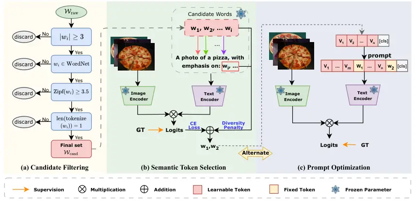
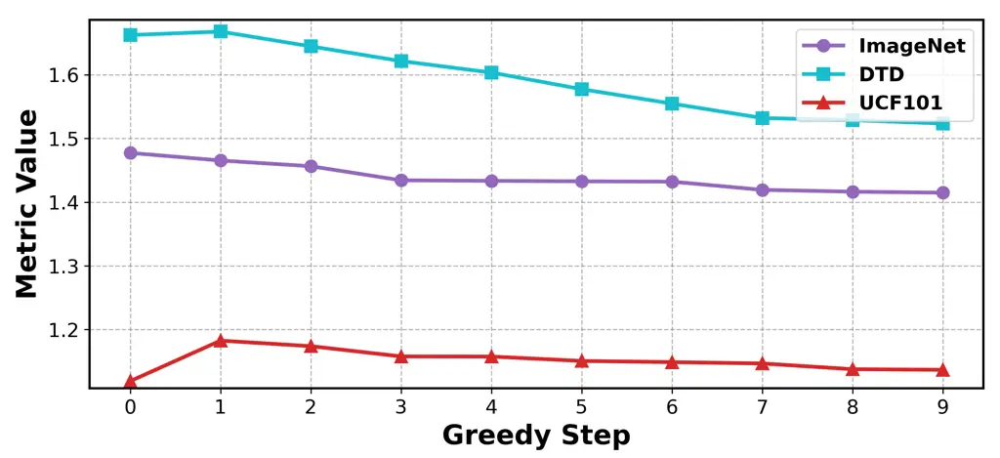
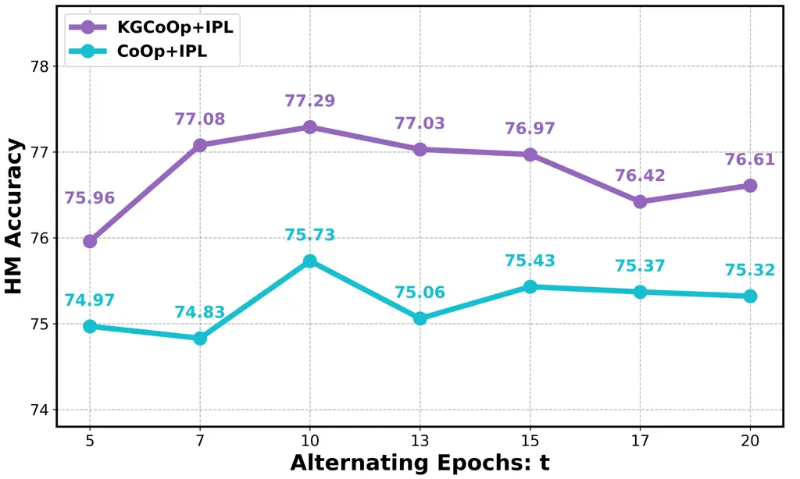
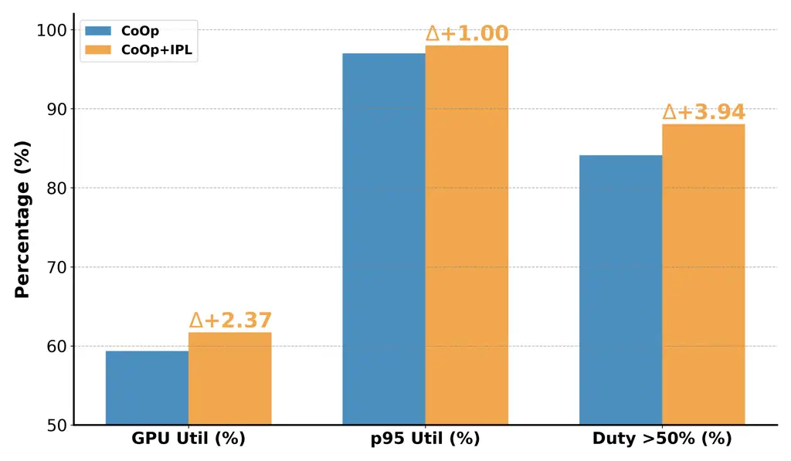

\geometry

paperwidth=192mm, paperheight=262mm, vmargin=19mm,15mm,
hmargin=13.7mm,13.7mm, headsep=12pt, footskip=4pt

# Joint Semantic Token Selection and Prompt Optimization for Interpretable Prompt Learning

Yating Wang    Yaqi Zhao    Yongshun Gong    Yilong Yin    Haoliang Sun
haolsun@sdu.edu.cn organization=School of Software, Shandong University,
city=Jinan, postcode=250101, country=China

###### Abstract

Vision-language models such as CLIP achieve strong visual-textual
alignment, but often suffer from overfitting and limited
interpretability when adapted through continuous prompt learning. While
discrete prompt optimization improves interpretability, it usually
depends on large external models, leading to high computational costs
and limited scalability. In this paper, we propose Interpretable Prompt
Learning (IPL), a hybrid framework that alternates between discrete
semantic token selection and continuous prompt optimization.
Specifically, IPL formulates semantic token selection as an approximate
submodular optimization problem, encouraging tokens that are both
human-understandable and semantically diverse. It further adopts an
alternating optimization strategy to integrate discrete token selection
with continuous prompt tuning, improving interpretability while
preserving adaptability to downstream tasks. Our framework is
plug-and-play, allowing seamless integration with existing prompt
learning methods. Extensive experiments on multiple benchmarks show that
IPL consistently improves both interpretability and accuracy across five
representative prompt learning methods, providing an effective and
scalable extension to existing frameworks.

###### keywords

Vision-Language Models ,Prompt Learning ,Submodular Learning
,Alternating Optimization

^(†)^(†)corresponding: Corresponding author

## 1 Introduction

Vision-Language Models (VLMs) (Alayrac et al., 2022; Jia et al., 2021;
Radford et al., 2021; Yao et al., 2021; Yu et al., 2022; Yuan et al.,
2021; Zhai et al., 2022; Li et al., 2022) have made remarkable progress
in recent years by leveraging large-scale datasets to jointly learn
image and text representations. Their exceptional versatility stems from
the ability to align visual and textual modalities within a shared
representation space, enabling strong zero-shot generalization across
diverse vision-language scenarios. However, their substantial model size
and complexity often pose significant challenges for adaptation to
specific downstream tasks (Zhou et al., 2022b; Zhou et al., 2022a; Sung
et al., 2022).

To further improve the adaptability of VLMs to downstream tasks with
limited labeled data, prompt learning (Jia et al., 2022; Zhou et al.,
2022b; Zhou et al., 2022a) has become a widely adopted approach. It
typically fine-tunes a small set of learnable prompt tokens while
keeping the backbone model frozen, enabling task adaptation with minimal
computational overhead. These continuously optimized methods have
demonstrated impressive performance, even in few-shot scenarios. Despite
their success, these methods face notable challenges. One major issue is
overfitting, where learned prompts become overly specialized to the
training set, leading to poor generalization and reduced
interpretability (Ma et al., 2023; Park et al., 2024). Moreover, because
these prompt tokens are optimized in a continuous embedding space, they
often drift away from interpretable semantic tokens, making the learned
knowledge harder to interpret or transfer. In addition, several existing
methods rely heavily on external models, such as large multimodal or
language models, to generate or refine prompts (Li et al., 2025b; Du et
al., 2024). The dependence on such external models also introduce
potential instability and restricts their flexibility in real-world
applications, particularly when dealing with long or complex textual
contexts (Liu and others, 2023; Li et al., 2025a).

Building on these observations, we propose Interpretable Prompt Learning
(IPL), a method that combines discrete semantic token selection with
continuous prompt optimization. In the discrete stage, we adopt a greedy
selection strategy formulated as an approximate submodular optimization
problem to identify a set of tokens from a candidate pool, ensuring
semantic alignment with the target domain. These semantic tokens serve
as interpretable pivots that capture meaningful visual and textual
concepts, such as object attributes or physical traits, thereby
providing human-understandable semantics for prompt construction. In the
continuous stage, we fine-tune the learnable embeddings while keeping
the semantic tokens fixed, allowing soft tokens to adapt to the target
dataset without losing their semantic grounding. By alternating between
these two stages, IPL unifies discrete semantic selection and continuous
task adaptation within a single framework. Unlike prior methods that
depend on external large models, IPL performs both semantic discovery
and optimization internally, enabling efficient and scalable deployment.

Beyond the architectural design, semantic tokens provide a principled
mechanism for improving prompt learning. Because these tokens correspond
to explicit and transferable concepts, the learned prompts can capture
features that better reflect the underlying structure of the target
domain, thereby enhancing interpretability and transparency. Moreover,
fixing part of the prompt as semantic tokens, rather than treating all
prompt elements as fully learnable embeddings, reduces the number of
free parameters and introduces useful semantic priors. This design helps
mitigate overfitting and improves generalization to unseen categories.
It also implicitly encourages consistency between visual and textual
modalities, leading to more stable transfer across different tasks.

Our approach offers a simple yet effective enhancement to existing
prompt learning methods and can be seamlessly integrated with various
prompt learning frameworks, making it a versatile and broadly applicable
solution. In summary, our contributions are as follows:

- •
  We propose a novel framework that alternates between semantic token
  selection and continuous prompt optimization, achieving a balance
  between prompt interpretability and adaptability.
- •
  We formulate semantic selection as an approximate submodular
  optimization problem and design a submodular function that combines
  cross-entropy with a diversity penalty, encouraging prompt diversity
  and improving generalization to unseen categories.
- •
  We demonstrate the effectiveness of our approach by integrating it
  into five widely used prompt learning methods, achieving consistent
  gains in both interpretability and performance across diverse
  benchmarks.

## 2 Related Works

### 2.1 Vision-Language Models

Vision-language models (VLMs) have achieved remarkable progress by
learning aligned visual and textual representations from large-scale
image–text pairs, enabling strong multimodal understanding and
transferability. Representative models, such as CLIP (Radford et al.,
2021), ALIGN (Jia et al., 2021), BLIP (Li et al., 2022), LiT (Zhai et
al., 2022), and Flamingo (Alayrac et al., 2022), adopt different
pretraining strategies to bridge vision and language. Among them, CLIP
has become one of the most influential foundations for downstream
adaptation, as it maps images and texts into a shared embedding space
through contrastive learning and supports strong zero-shot recognition.

Recent VLMs have further expanded this paradigm by incorporating larger
multimodal architectures and stronger reasoning capabilities, such as
BLIP-2 (Li et al., 2023) and LLaVA-based models (Liu et al., 2024). At
the same time, recent surveys have shown that VLM research has
increasingly shifted from pretraining alone toward efficient adaptation
strategies, including fine-tuning, prompt engineering, and
parameter-efficient transfer (Danish et al., 2025; Shinde et al., 2025).
This trend highlights that, despite strong pretrained alignment,
effectively adapting VLMs to downstream tasks remains a central
challenge.

In particular, CLIP-style models often require task-specific adaptation
to achieve stronger semantic alignment and transferability on downstream
benchmarks. This has motivated the development of prompt learning
methods, which adapt pretrained VLMs by optimizing only a small set of
prompt parameters while keeping the backbone frozen. Recent overviews of
CLIP prompting further indicate that improving generalization and
maintaining interpretability have become key concerns in this line of
research (Cui et al., 2025).

### 2.2 Prompt Learning

Prompt learning (Zhou et al., 2022b; Zhou et al., 2022a; Li et al.,
2025b; Yang et al., 2024; Khattak et al., 2023a; Yao et al., 2023; Du et
al., 2024; Xing et al., 2024; Zhang et al., 2025; Danish et al., 2025;
Zheng et al., 2025) has become a widely adopted strategy for adapting
large pre-trained VLMs to downstream tasks with limited labeled data. By
optimizing only a small set of prompt parameters—typically continuous
embeddings—while keeping the backbone frozen, prompt learning achieves
effective task adaptation with relatively low computational cost.
Representative methods such as CoOp (Zhou et al., 2022b) and CoCoOp
(Zhou et al., 2022a) have demonstrated strong few-shot performance and
improved transferability. However, because these prompts are learned
entirely in a continuous embedding space, the resulting prompt vectors
are often difficult to interpret and cannot be directly mapped to
meaningful natural-language semantics.

To improve the interpretability of prompt learning, recent studies have
introduced explicit semantic structures into prompt design (Li et al.,
2025b; Ding et al., 2024; Ghosal et al., 2024; Du et al., 2024; Kim et
al., 2024). TAP (Ding et al., 2024), for example, constructs an
LLM-generated tree of attributes and combines it with learnable expert
tokens and vision-conditional pooling to achieve attribute-level
alignment. IntCoOp (Ghosal et al., 2024) extends CoOp by incorporating a
graph-based prompt interaction mechanism based on class relations,
thereby enhancing both interpretability and classification performance.
ATPrompt (Li et al., 2025b) anchors prompts with fixed universal
attribute tokens and employs differentiable search for token selection,
improving generalization to unseen categories. IPO (Du et al., 2024)
uses LMM-generated image descriptions and an LLM to iteratively produce
human-readable, dataset-specific prompts without gradient-based
learning, improving both interpretability and transferability.

Despite these advances, existing interpretable prompt learning methods
often depend on external knowledge sources, such as LLMs, LMMs, or
predefined attribute inventories. Such reliance increases annotation or
inference cost and may reduce scalability in practical deployment. In
some cases, these methods also suffer from instability when handling
long textual inputs or complex semantic descriptions (Du et al., 2024).
In contrast, IPL selects a small set of discrete semantic tokens from a
filtered candidate vocabulary and incorporates them into prompts as
fixed semantic anchors interleaved with learnable context vectors. This
design introduces explicit semantic grounding without relying on costly
external generation or elaborate attribute engineering, while
maintaining a favorable balance among interpretability, adaptability,
and efficiency.



Figure 1: Pipeline of our method, divided into three main stages. (a) We
begin by filtering the raw word set through a series of criteria to
construct a refined candidate pool. (b) From this pool, we perform
greedy token selection to identify semantically relevant tokens, which
are inserted into prompt and serve as interpretable tokens that guide
the prompt learning. (c) We alternate between semantic token selection
and continuous prompt optimization to integrate the two process
adaptively.

### 2.3 Submodular Optimization

Submodular optimization (Liu et al., 2020; Zhu, 2024; Dughmi, 2009)
addresses discrete problems defined by the diminishing returns property:
the marginal gain of adding an element to a set decreases as the set
grows. Formally, a set function $`F:2^{V}\rightarrow\mathbb{R}`$ is
submodular if, for all $`A\subseteq B\subseteq V`$ and any
$`v\in V\setminus B`$, it holds that:

```math
F(A\cup\{v\})-F(A)\geq F(B\cup\{v\})-F(B). \tag{1}
```

A key advantage of submodular functions is that greedy algorithms can
provide efficient approximate solutions. For monotone, non-negative
functions under a cardinality constraint, the greedy approach guarantees
a $`(1\!-\!1/e)`$-approximation to the optimal solution (Nemhauser et
al., 1978; Krause and Golovin, 2014). Submodular optimization has been
widely applied in areas such as active learning (Kothawade et al., 2021;
Golovin and Krause, 2011), data summarization (Tschiatschek et al.,
2014; Mitrovic et al., 2018; Schreiber et al., 2020), as well as
exemplar selection for few-shot learning (Killamsetty et al., 2021).

In practice, strict submodularity is often difficult to achieve, but
approximately submodular functions retain many of their desirable
properties (Chierichetti et al., 2022; Ajayi et al., 2019; Das and
Kempe, 2018). A function $`f:2^{V}\rightarrow\mathbb{R}`$ is said to be
$`\epsilon`$-approximately submodular if there exists a submodular
function $`F`$ such that:

```math
(1-\epsilon)F(S)\leq f(S)\leq(1+\epsilon)F(S), \tag{2}
```

for all subsets $`S\subseteq V`$, where $`\epsilon`$ denotes the
approximation error, which represents the deviation from strict
submodularity. Such functions exhibit diminishing marginal gains in a
relaxed sense, allowing greedy algorithms to achieve near-optimal
solutions with provable guarantees. Recent studies (Horel and Singer,
2016; Bian et al., 2017) show that greedy methods remain effective for
approximate or near-submodular functions, often yielding strong
empirical performance.

Motivated by these observations, we adopt an approximately submodular
objective to guide semantic token selection. This formulation provides a
practical basis for greedy search, allowing us to balance efficiency and
solution quality while capturing both discriminative utility and
semantic diversity.

## 3 Problem Setup

### 3.1 The Prediction Function in CLIP

CLIP (Radford et al., 2021) consists of a visual encoder and a textual
encoder. The visual encoder maps an image to a high-dimensional
embedding, while the textual encoder converts a prompt into a textual
embedding. Both embeddings are aligned in a shared space to enable
direct image–text comparison.

For $`N`$ categories, CLIP generates textual features by inserting each
class label (e.g., “pizza”) into a handcrafted template $`P_{h}`$ (“a
photo of a \[CLS\]”) and encoding it with $`E_{\text{text}}`$, yielding
$`\mathbf{y}=E_{\text{text}}(P_{h})`$. Meanwhile, for an image
$`\mathbf{x}`$, the visual encoder $`E_{\text{img}}`$ produces
$`\mathbf{u}=E_{\text{img}}(x)`$. Classification for each class $`c`$ is
then performed by computing cosine similarities between $`\mathbf{u}`$
and all $`\mathbf{y}_{c}`$, followed by a softmax:

```math
p(c|x)=\frac{\exp(\text{sim}(\mathbf{u},\mathbf{y}_{c})/\tau)}{\sum_{i=1}^{N}\exp(\text{sim}(\mathbf{u},\mathbf{y}_{i})/\tau)}, \tag{3}
```

where $`\text{sim}(\cdot,\cdot)`$ denotes cosine similarity, and
$`\tau`$ is a learnable temperature parameter controlling the sharpness
of the distribution.

### 3.2 Prompt Structure

In prompt learning, prompts are designed to adapt pretrained models to
downstream tasks, typically through learnable context tokens. In CoOp
(Zhou et al., 2022b), the original prompt $`P`$ consists of $`n`$
learnable soft tokens followed by the class name \[CLS\]:

```math
P=[V_{1}][V_{2}]\dots[V_{n}]\,[\text{CLS}], \tag{4}
```

where $`\{V_{i}\in\mathbb{R}^{d}\}_{i=1}^{n}`$ are learnable prompt
embeddings, and $`d`$ is the embedding dimension. These vectors are
optimized end-to-end with the contrastive objective, enabling automatic
adaptation of prompt context to downstream datasets.

In our method, let $`W_{\text{cand}}`$ denote the candidate set filtered
from the raw corpus $`W_{\text{raw}}`$. A subset of tokens is selected
from $`W_{\text{cand}}`$ and inserted into the prompt $`P`$, yielding a
modified prompt $`\tilde{P}`$. These selected tokens remain fixed during
optimization. For example, when two semantic tokens are chosen, the
input embedding sequence is interleaved as:

```math
\tilde{P}=[V_{1}]\cdots[V_{m}][w_{1}][V_{m+1}]\cdots[V_{2m}][w_{2}]\cdots[V_{n}][\text{CLS}], \tag{5}
```

where each semantic token $`w_{i}`$ follows a group of $`m`$ learnable
tokens (Li et al., 2025b). This alternating structure preserves both
task adaptability and semantic stability during optimization, thereby
balancing adaptability and interpretability throughout prompt learning.

## 4 The Proposed Method

We propose a framework that alternates between discrete semantic token
selection and continuous prompt optimization. Semantic tokens are
selected through a greedy algorithm guided by an approximate submodular
objective and then inserted into the prompt as discrete semantic
anchors, while the remaining soft context tokens are continuously
optimized. This alternating process balances interpretability and
adaptability. An overview of the pipeline is shown in Figure 1.

### 4.1 Candidate Filtering

To enable effective semantic selection, we construct a high-quality
candidate pool of interpretable tokens from the NLTK corpus (Bird et
al., 2009). This step ensures that the selected tokens carry
human-understandable meanings while remaining compatible with both
linguistic and tokenization constraints. Specifically, we apply four
filtering criteria to derive the candidate set $`W_{\text{cand}}`$ from
the raw corpus $`W_{\text{raw}}`$.

First, we retain only words that are purely alphabetic and satisfy
$`|w_{i}|\geq 3`$, excluding symbols, single letters, and other
non-standard textual artifacts that are unlikely to provide semantically
meaningful information. Second, to ensure semantic validity, each
candidate word must satisfy $`w_{i}\in\text{WordNet}`$, where WordNet
(Miller, 1995) serves as an external lexical database distinct from the
NLTK word list and helps filter out non-semantic entries such as
personal names or place names. This constraint ensures that all selected
tokens correspond to concrete and interpretable concepts. Third, we
impose a frequency threshold requiring $`\text{Zipf}(w_{i})\geq 3.5`$,
where the Zipf (Van Heuven et al., 2014) score reflects how commonly a
word is used in natural language. This removes rare or obscure terms
that may hinder generalization. Finally, to maintain consistency with
the tokenization behavior of the CLIP text encoder, we require that
$`\text{len}(\text{tokenize}(w_{i}))=1`$, ensuring that each word maps
to exactly one token under the CLIP tokenizer. This avoids semantic
fragmentation during tokenization and preserves the integrity of each
selected concept in the embedding process. The first three criteria
correspond to linguistic constraints, while the last one concerns
tokenization consistency.

Formally, the final filtered set is:

```math
W_{\text{cand}}=\left\{w_{i}\in W_{\text{raw}}\;\middle|\;\begin{array}[]{l}|w_{i}|\geq 3,\\
w_{i}\in\text{WordNet},\\
\text{Zipf}(w_{i})\geq 3.5,\\
\text{len}(\text{tokenize}(w_{i}))=1\end{array}\right\} \tag{6}
```

The resulting candidate pool contains 8,883 tokens, forming a compact
yet diverse set of interpretable words. This size provides sufficient
semantic coverage while keeping computational cost manageable, making it
well suited for semantic token selection. Based on this curated
vocabulary, the subsequent optimization can be performed without relying
on external models, enabling an efficient and self-contained pipeline.



Figure 2: Empirical diminishing returns of marginal gain in token
selection, showing the decreasing trend as tokens are added.

### 4.2 Semantic Token Selection

With the candidate pool prepared, we next introduce the semantic token
selection process. Our goal is to construct a token subset that is both
class-relevant and semantically diverse. To this end, we define a
set-level objective that combines a utility term and a redundancy
penalty:

```math
G(W_{\text{sel}})=\mathrm{Utility}(W_{\text{sel}})-\lambda\,\mathrm{Redundancy}(W_{\text{sel}}), \tag{7}
```

where $`W_{\text{sel}}`$ denotes the currently selected token set and
$`\lambda`$ controls the trade-off between discriminability and
diversity.

For the utility term, we measure how much the selected tokens improve
image–text alignment under a CLIP-based prompt. Specifically, let

```math
P_{\text{sel}}=\text{``a photo of a [CLS], with emphasis on: [\ldots]''},
```

where $`[\dots]`$ is replaced by the tokens in $`W_{\text{sel}}`$. We
define

```math
\mathrm{Utility}(W_{\text{sel}})=\mathscr{L}_{\mathrm{ce}}(\emptyset)-\mathscr{L}_{\mathrm{ce}}(W_{\text{sel}}), \tag{8}
```

where $`\mathscr{L}_{\mathrm{ce}}(W_{\text{sel}})`$ is the CLIP-based
classification loss under prompt $`P_{\text{sel}}`$, and
$`\mathscr{L}_{\mathrm{ce}}(\emptyset)`$ denotes the corresponding loss
without any inserted semantic tokens. A larger utility indicates a
larger reduction in classification loss brought by the selected tokens.

The classification loss is defined as

```math
\mathscr{L}_{\mathrm{ce}}(W_{\text{sel}})=-\log\frac{\exp(\mathrm{sim}(\mathbf{u}_{i},\mathbf{y}_{c}(W_{\text{sel}}))/\tau)}{\sum_{j=1}^{N}\exp(\mathrm{sim}(\mathbf{u}_{i},\mathbf{y}_{j}(W_{\text{sel}}))/\tau)}, \tag{9}
```

where $`\mathbf{u}_{i}`$ denotes the CLIP image feature of the $`i`$-th
sample, $`\mathbf{y}_{j}(W_{\text{sel}})`$ denotes the text embedding of
the prompt instantiated with token set $`W_{\text{sel}}`$ for class
$`j`$, and $`\tau`$ is the temperature parameter.

To encourage diversity, we define the redundancy term as the sum of
pairwise similarities among selected tokens:

```math
\mathrm{Redundancy}(W_{\text{sel}})=\sum_{\begin{subarray}{c}w_{i},w_{j}\subseteq W_{\text{sel}}\\
i<j\end{subarray}}\mathrm{sim}(\mathbf{e}_{i},\mathbf{e}_{j}), \tag{10}
```

where $`\mathbf{e}_{i}`$ and $`\mathbf{e}_{j}`$ denote the embeddings of
selected tokens $`w_{i}`$ and $`w_{j}`$. A smaller redundancy indicates
less semantic overlap within the selected set.

Our formulation is motivated by approximately diminishing marginal
behavior in practice: as more informative tokens are added, the
additional reduction in classification loss typically becomes smaller,
while semantically similar tokens incur increasing redundancy. As shown
in Figure 2, the marginal gain generally exhibits a decreasing trend as
the greedy selection proceeds. Therefore, although $`G(W_{\text{sel}})`$
does not strictly satisfy submodularity, it can be viewed as
approximately submodular in practice and is thus well suited to greedy
optimization.

At step $`l`$, given the current selected set
$`W_{\text{sel}}^{(l-1)}`$, we greedily select the token that maximizes
the marginal objective gain:

```math
w^{*}=\arg\max_{w\in W_{\text{cand}}\setminus W_{\text{sel}}^{(l-1)}}\Big[\Delta\mathrm{Utility}(w\mid W_{\text{sel}}^{(l-1)})-\lambda\,\Delta\mathrm{Redundancy}(w\mid W_{\text{sel}}^{(l-1)})\Big]. \tag{11}
```

Here, the marginal utility gain is defined as

```math
\Delta\mathrm{Utility}(w\mid W_{\text{sel}}^{(l-1)})=\mathscr{L}_{\mathrm{ce}}(W_{\text{sel}}^{(l-1)})-\mathscr{L}_{\mathrm{ce}}(W_{\text{sel}}^{(l-1)}\cup\{w\}), \tag{12}
```

which measures the additional reduction in classification loss after
adding $`w`$. The marginal redundancy increase is defined as

```math
\Delta\mathrm{Redundancy}(w\mid W_{\text{sel}}^{(l-1)})=\sum_{w_{i}\subseteq W_{\text{sel}}^{(l-1)}}\mathrm{sim}(\mathbf{e}_{w},\mathbf{e}_{i}), \tag{13}
```

which measures the semantic overlap introduced by $`w`$ with respect to
the current selected set.

That is, the selected token should maximally reduce the classification
loss while introducing as little semantic redundancy as possible. After
each step, $`w^{*}`$ is removed from the candidate pool to avoid
duplicate selection.

### 4.3 Prompt Learning with Alternating Optimization

To integrate discrete token selection with continuous prompt tuning, we
adopt an alternating optimization strategy that balances
interpretability and adaptability. Specifically, discrete token
selection and continuous prompt learning are performed iteratively until
$`k`$ tokens have been selected, ensuring both semantic clarity and
flexibility in prompt representation.

In the continuous stage, the soft tokens in the prompt are optimized via
gradient-based updates. During each iteration, a batch of image–text
pairs is passed through the model, and prediction scores are computed in
the shared embedding space. Formally, for a single image, the training
objective follows the same contrastive loss as before:

```math
\mathscr{L}=-\log\frac{\exp(\cos(\mathbf{u}_{i},\mathbf{y}_{c})/\tau)}{\sum_{j=1}^{N}\exp(\cos(\mathbf{u}_{i},\mathbf{y}_{j})/\tau)}, \tag{14}
```

where $`\mathbf{y}_{j}`$ and $`\mathbf{y}_{c}`$ denote the textual
embeddings generated from the current prompt $`\tilde{P}`$ in Eq. (5).
The gradients of this loss are then backpropagated to update the
learnable soft prompt tokens.

0:  number of selected tokens $`k`$, learning rate $`\alpha`$, candidate
pool $`W_{\text{cand}}`$, total epochs $`T`$, alternating interval $`t`$

1:  Initialize selected token set $`W_{\text{sel}}\leftarrow\emptyset`$,
prompt parameters $`\tilde{P}\leftarrow`$ random initialization

2:  for $`q=1`$ to $`k`$ do

3:   Select $`w^{*}`$ according to Eq. (11)

4:   Update $`W_{\text{sel}}\leftarrow W_{\text{sel}}\cup\{w^{*}\}`$ and
$`W_{\text{cand}}\leftarrow W_{\text{cand}}\setminus\{w^{*}\}`$

5:   Update the prompt with the current selected token set
$`W_{\text{sel}}`$

6:   for $`d=1`$ to $`t`$ do

7:    Optimize $`\tilde{P}\leftarrow\tilde{P}-\alpha\nabla\mathscr{L}`$

8:   end for

9:  end for

10:  for $`r=1`$ to $`T-kt`$ do

11:   Optimize $`\tilde{P}\leftarrow\tilde{P}-\alpha\nabla\mathscr{L}`$

12:  end for

13:  return $`\tilde{P},W_{\text{sel}}`$

Algorithm 1 Semantic Token Selection and Prompt Optimization

In the discrete stage, one semantic token is selected from the candidate
pool in each iteration following Eq. (11). This selection step allows us
to gradually introduce relevant semantic tokens into the prompt.

We then integrate the two stages into a unified alternating optimization
procedure, which is conducted for a total of $`T`$ epochs. Specifically,
after selecting one token, it is inserted into the prompt, resulting in
an updated prompt $`\tilde{P}`$. The model is then optimized for $`t`$
epochs via continuous optimization, allowing it to adapt to the newly
introduced token. This process repeats until $`k`$ semantic tokens have
been incorporated. Once all semantic tokens are selected, the remaining
$`T-kt`$ epochs are devoted to refining the learnable context vectors
while keeping the selected tokens fixed. This alternating strategy
mitigates early selection bias, improves the consistency between token
semantics and downstream objectives, and ultimately enhances
generalization.

The pseudocode for our approach is summarized in Algorithm 1, which
illustrates the process of semantic token selection and optimization.
The algorithm operates in three phases:

- •
  Semantic Token Selection (lines 2–5): At each iteration, the algorithm
  selects a new semantic token from $`W_{\text{cand}}`$ according to
  Eq. (11).
- •
  Alternating Optimization (lines 6–8): After each token is selected,
  the prompt is updated and the learnable soft prompt tokens are
  optimized for $`t`$ epochs.
- •
  Final Refinement (lines 10–12): Once all semantic tokens have been
  selected, the learnable soft prompt tokens are further optimized for
  the remaining $`T-kt`$ epochs.

## 5 Experiments and Analysis

### 5.1 Setup

#### 5.1.1 Dataset

To evaluate both base-to-novel transfer and cross-dataset
generalization, we conduct experiments on 11 widely used image
classification benchmarks covering diverse recognition scenarios. The
evaluation includes generic object recognition (ImageNet (Deng et al.,
2009), Caltech101 (Fei-Fei et al., 2004)); fine-grained categorization
across animals, vehicles, plants, and food (OxfordPets (Parkhi et al.,
2012), StanfordCars (Krause et al., 2013), Flowers102 (Nilsback and
Zisserman, 2008), Food101 (Bossard et al., 2014), FGVCAircraft (Maji et
al., 2013)); scene understanding (SUN397 (Xiao et al., 2010)); action
recognition (UCF101 (Soomro et al., 2012)); texture classification (DTD
(Cimpoi et al., 2014)); and remote sensing imagery (EuroSAT (Helber et
al., 2019)).

To further assess robustness under distribution shifts, we adopt
ImageNet as the source dataset and evaluate on four ImageNet variants:
ImageNet-V2 (Recht et al., 2019), ImageNet-Sketch (Wang et al., 2019),
ImageNet-A (Hendrycks et al., 2021b), and ImageNet-R (Hendrycks et al.,
2021a).

|           |         |       |               |          |       |               |            |       |               |            |       |               |
| --------- | ------- | ----- | ------------- | -------- | ----- | ------------- | ---------- | ----- | ------------- | ---------- | ----- | ------------- |
| Methods   | Average |       |               | ImageNet |       |               | Caltech101 |       |               | OxfordPets |       |               |
|           | Base    | Novel | HM            | Base     | Novel | HM            | Base       | Novel | HM            | Base       | Novel | HM            |
| CoOp      | 82.69   | 63.22 | 71.66         | 76.47    | 67.88 | 71.92         | 98.00      | 89.81 | 93.73         | 93.67      | 95.29 | 94.47         |
| +IPL      | 82.49   | 70.00 | 75.73 (+4.07) | 76.38    | 66.07 | 70.85 (-1.07) | 98.00      | 92.53 | 95.19 (+1.82) | 95.48      | 96.50 | 95.99 (+1.52) |
| CoCoOp    | 80.47   | 71.69 | 75.83         | 75.98    | 70.43 | 73.10         | 97.96      | 93.81 | 95.84         | 95.20      | 97.69 | 96.43         |
| +IPL      | 81.52   | 73.00 | 77.02 (+1.19) | 76.34    | 70.12 | 73.10 (+0.00) | 97.78      | 94.79 | 96.26 (+0.42) | 95.85      | 97.39 | 96.61 (+0.18) |
| KgCoOp    | 80.73   | 73.60 | 77.00         | 75.83    | 69.96 | 72.78         | 97.72      | 94.39 | 96.03         | 94.65      | 97.76 | 96.18         |
| +IPL      | 80.37   | 74.43 | 77.29 (+0.29) | 76.17    | 70.12 | 73.02 (+0.24) | 97.77      | 94.36 | 96.03 (+0.00) | 95.10      | 97.96 | 96.51 (+0.33) |
| MaPLe     | 82.28   | 75.14 | 78.55         | 76.66    | 70.54 | 73.47         | 97.74      | 94.36 | 96.02         | 95.43      | 97.76 | 96.58         |
| +IPL      | 83.51   | 74.85 | 78.94 (+0.39) | 76.90    | 70.36 | 73.48 (+0.01) | 98.19      | 94.18 | 96.14 (+0.12) | 95.59      | 97.67 | 96.62 (+0.04) |
| PromptSRC | 84.26   | 76.10 | 79.97         | 77.60    | 70.73 | 74.01         | 98.10      | 94.03 | 96.02         | 95.33      | 97.30 | 96.30         |
| +IPL      | 84.46   | 76.58 | 80.33 (+0.36) | 77.69    | 70.66 | 74.01 (+0.00) | 98.13      | 94.29 | 96.17 (+0.15) | 95.85      | 97.61 | 96.72 (+0.42) |

|           |              |       |               |            |       |               |         |       |               |              |       |               |
| --------- | ------------ | ----- | ------------- | ---------- | ----- | ------------- | ------- | ----- | ------------- | ------------ | ----- | ------------- |
| Methods   | StanfordCars |       |               | Flowers102 |       |               | Food101 |       |               | FGVCAircraft |       |               |
|           | Base         | Novel | HM            | Base       | Novel | HM            | Base    | Novel | HM            | Base         | Novel | HM            |
| CoOp      | 78.12        | 60.40 | 68.13         | 97.60      | 59.67 | 74.06         | 88.33   | 82.26 | 85.19         | 40.44        | 22.30 | 28.75         |
| +IPL      | 77.38        | 68.61 | 72.73 (+4.60) | 97.18      | 70.47 | 81.70 (+7.64) | 89.68   | 88.93 | 89.30 (+4.11) | 39.10        | 30.43 | 34.22 (+5.47) |
| CoCoOp    | 70.49        | 73.59 | 72.01         | 94.87      | 71.75 | 81.71         | 90.70   | 91.29 | 90.99         | 33.41        | 23.71 | 27.74         |
| +IPL      | 73.14        | 72.47 | 72.80 (+0.79) | 96.26      | 70.89 | 82.81 (+1.10) | 90.41   | 91.38 | 90.89 (-0.10) | 36.61        | 32.33 | 34.32 (+6.58) |
| KgCoOp    | 71.76        | 75.04 | 73.36         | 95.00      | 74.73 | 83.65         | 90.50   | 91.70 | 91.09         | 36.21        | 33.55 | 34.83         |
| +IPL      | 72.17        | 74.83 | 73.47 (+0.11) | 93.77      | 75.68 | 83.76 (+0.11) | 90.52   | 91.72 | 91.11 (+0.02) | 34.74        | 35.09 | 34.91 (+0.08) |
| MaPLe     | 72.94        | 74.00 | 73.47         | 95.92      | 72.46 | 82.56         | 90.71   | 92.05 | 91.38         | 37.44        | 35.61 | 36.50         |
| +IPL      | 76.29        | 73.35 | 74.79 (+1.32) | 96.24      | 73.10 | 83.66 (+1.10) | 90.45   | 91.67 | 91.05 (-0.33) | 40.66        | 35.71 | 37.98 (+1.48) |
| PromptSRC | 78.27        | 74.97 | 73.47         | 98.07      | 76.50 | 85.95         | 90.67   | 91.53 | 91.10         | 42.73        | 37.87 | 40.15         |
| +IPL      | 78.96        | 75.11 | 76.99 (+3.52) | 97.88      | 77.97 | 86.79 (+0.84) | 90.75   | 91.62 | 91.19 (+0.09) | 42.64        | 38.29 | 40.33 (+0.18) |

|           |        |       |               |       |       |               |         |       |               |        |       |               |
| --------- | ------ | ----- | ------------- | ----- | ----- | ------------- | ------- | ----- | ------------- | ------ | ----- | ------------- |
| Methods   | SUN397 |       |               | DTD   |       |               | EuroSAT |       |               | UCF101 |       |               |
|           | Base   | Novel | HM            | Base  | Novel | HM            | Base    | Novel | HM            | Base   | Novel | HM            |
| CoOp      | 80.60  | 65.89 | 72.51         | 79.44 | 41.18 | 54.24         | 92.19   | 54.74 | 68.69         | 84.69  | 56.05 | 67.46         |
| +IPL      | 81.16  | 70.40 | 75.40 (+2.89) | 80.17 | 52.30 | 63.30 (+9.06) | 89.22   | 67.73 | 77.10 (+8.41) | 83.68  | 66.03 | 73.82 (+6.36) |
| CoCoOp    | 79.74  | 76.68 | 78.27         | 77.01 | 56.00 | 64.85         | 87.49   | 60.04 | 71.21         | 82.33  | 73.45 | 77.64         |
| +IPL      | 80.79  | 76.64 | 78.66 (+0.39) | 79.32 | 55.79 | 65.51 (+0.66) | 86.66   | 66.09 | 74.59 (+3.38) | 83.57  | 75.07 | 79.09 (+1.45) |
| KgCoOp    | 80.29  | 76.53 | 78.36         | 77.55 | 54.99 | 64.35         | 85.64   | 64.34 | 73.48         | 82.89  | 76.67 | 79.65         |
| +IPL      | 78.52  | 78.12 | 78.32 (-0.04) | 75.96 | 58.09 | 65.81 (+1.46) | 86.58   | 65.79 | 74.77 (+1.29) | 82.83  | 76.92 | 79.77 (+0.12) |
| MaPLe     | 80.82  | 78.70 | 79.75         | 80.36 | 59.18 | 68.16         | 94.07   | 73.23 | 82.35         | 83.00  | 78.66 | 80.77         |
| +IPL      | 81.81  | 77.83 | 79.77 (+0.02) | 81.33 | 57.51 | 67.38 (-0.75) | 95.90   | 75.01 | 84.01 (+1.66) | 85.30  | 76.96 | 80.91 (+0.14) |
| PromptSRC | 82.67  | 78.47 | 80.52         | 83.37 | 62.97 | 71.75         | 92.90   | 73.90 | 82.32         | 87.10  | 78.89 | 82.74         |
| +IPL      | 82.92  | 78.55 | 80.68 (+0.16) | 84.49 | 62.14 | 71.61 (-0.14) | 92.73   | 77.13 | 84.18 (+1.86) | 87.02  | 79.01 | 82.82 (+0.08) |

Table 1: Base-to-Novel Generalization Results

#### 5.1.2 Base-to-Novel Generalization

Following existing protocols, we partition each dataset into base and
novel classes, training exclusively on base classes and evaluating on
both base and novel test sets. We adopt each baseline’s original
optimization schedule for fair comparison, reporting performance on both
splits along with their harmonic mean (HM). This setting evaluates the
model’s ability to generalize from seen to unseen classes under
distribution shifts.

#### 5.1.3 Cross-dataset Evaluation

For cross-dataset evaluation, models are trained on ImageNet and
evaluated on 10 unseen datasets from diverse domains without additional
fine-tuning. We report accuracy on each dataset to assess the model’s
ability to transfer knowledge across different data distributions and
visual domains.

#### 5.1.4 Domain Generalization

To assess domain generalization, we evaluate ImageNet-trained models on
four ImageNet variants: ImageNetV2, ImageNet-Sketch, ImageNet-A, and
ImageNet-R. We report overall accuracy to measure model performance on
out-of-distribution data, which is critical for real-world deployment.

#### 5.1.5 Implementation Details

We use CLIP with a ViT-B/16 backbone for all experiments under the
16-shot setting, and report the average results over three runs. For
CoOp and MaPLe, each fixed token is paired with $`m=2`$ learnable
tokens, while other methods use $`m=4`$. Fixed tokens are initialized to
zero and then replaced with selected tokens. All experiments are
conducted on a single GPU using the original hyperparameter settings.

[TABLE]

Table 2: Cross-Dataset Evaluation Results

### 5.2 Main Result

#### 5.2.1 Base-to-Novel Generalization

We evaluate IPL on five representative baselines, including text-based
methods—CoOp (Zhou et al., 2022b), CoCoOp (Zhou et al., 2022a), KgCoOp
(Yao et al., 2023), PromptSrc (Khattak et al., 2023b)—and the multimodal
approach MaPLe (Khattak et al., 2023a). Experiments are conducted on 11
datasets, reporting accuracy on base classes, novel classes, and their
harmonic mean to assess generalization.

As shown in Table 1, IPL consistently improves HM across all baselines.
The most significant gains are observed on CoOp (+4.07%) and CoCoOp
(+1.19%). Notable improvements are also achieved on several datasets,
such as Flowers102 and EuroSAT, where the latter shows a +8.41% increase
on novel classes. These results indicate that IPL consistently enhances
the balance between base and novel performance, demonstrating strong
robustness and generalization across diverse scenarios.

#### 5.2.2 Cross-dataset Evaluation

We further evaluate three representative baselines under a cross-dataset
setting, where models are trained on ImageNet and tested on unseen
datasets from different domains. This setting is particularly
challenging due to substantial distribution shifts (e.g., from
fine-grained object recognition to scene classification). Detailed
results are reported in Table 2.

Incorporating IPL leads to consistent performance gains, with average
improvements of +2.05%, +0.98%, and +0.69% for CoOp, CoCoOp, and MaPLe,
respectively. Most datasets show clear improvements, indicating that IPL
effectively enhances both model adaptability and zero-shot
generalization ability.

|         |          |                |       |       |       |               |
| ------- | -------- | -------------- | ----- | ----- | ----- | ------------- |
| Methods | Source   | Target Dataset |       |       |       | Average       |
|         | ImageNet | -V2            | -S    | -A    | -R    |               |
| CoOp    | 71.51    | 64.20          | 47.99 | 49.71 | 75.21 | 59.28         |
| +IPL    | 71.67    | 64.34          | 48.70 | 50.64 | 76.10 | 59.94 (+0.66) |
| CoCoOp  | 71.02    | 64.07          | 48.75 | 50.63 | 76.18 | 59.91         |
| +IPL    | 71.36    | 64.42          | 49.08 | 51.00 | 76.66 | 60.29 (+0.38) |
| MaPLe   | 70.72    | 64.07          | 49.15 | 50.96 | 76.98 | 60.27         |
| +IPL    | 70.77    | 64.11          | 49.27 | 51.24 | 77.44 | 60.52 (+0.25) |

Table 3: Domain Generalization Results

#### 5.2.3 Domain Generalization

To evaluate domain generalization, we integrate IPL into CoOp, CoCoOp,
and MaPLe, train them on ImageNet, and test them on four out-of-domain
datasets. As shown in Table 3, IPL consistently improves performance,
yielding gains of +0.66%, +0.38%, and +0.25% for the three baselines,
respectively. These results demonstrate that IPL effectively enhances
model robustness under domain shift and provides consistent benefits for
domain generalization.

### 5.3 Further Analysis

#### 5.3.1 Semantic Alignment of Selected Tokens

To illustrate the clarity and relevance of the identified tokens,
Table 4 presents the token selections across all datasets, together with
human-annotated semantic relevance scores. The scores are provided by
three annotators with undergraduate degrees, good English proficiency,
and familiarity with the dataset contents. Each annotator rates the
relevance between the selected tokens and the corresponding dataset on a
5-point scale, and the final score is obtained by averaging their
ratings.

For OxfordPets, the tokens convey physical traits and care-related
concepts; in FGVCAircraft, they relate to aircraft functionality and
passenger experience; for Flower102, they describe morphological
features and aesthetic qualities; in UCF101, they capture action
dynamics and situational contexts; in EuroSAT, the selected token
highlights the dominance of color cues and surface patterns in satellite
imagery; and in DTD, the token “heather” reflects texture regularity and
fine-grained material appearance. Overall, these examples show that our
method can select tokens that are semantically rich and closely related
to the conceptual, visual, and functional characteristics of each
dataset, leading to more interpretable visual-textual associations.

However, for some datasets, the selected tokens are less informative,
mainly due to high intra-class diversity or broad semantic coverage, as
in SUN397 and ImageNet. Many of these words have relatively low
similarity scores, often around 0.5 (e.g., “social” with other candidate
tokens), suggesting that the model tends to favor diversity when strong
semantic cues are limited.

Compared with CoOp (Zhou et al., 2022b), which learns continuous context
vectors without explicit semantic grounding, the nearest words retrieved
from its embeddings (Table 4) often show limited visual relevance,
including meaningless or dataset-specific fragments such as “tosc,”
“.#,” or “nytimes.” In contrast, IPL’s discrete tokens are more
consistent with domain semantics and receive higher human relevance
scores in most cases, providing clearer and more interpretable
associations between visual and textual concepts.

|              |                               |           |                       |            |
| ------------ | ----------------------------- | --------- | --------------------- | ---------- |
| Dataset      | Selected Tokens               | IPL Score | CoOp Tokens           | CoOp Score |
| OxfordPets   | furry, veterinary, adopt      | 5         | tosc, enjoyment       | 2          |
| Flower102    | flowering, tilted, stunning   | 4         | \-                    | \-         |
| FGVCAircraft | comfortable, touchdown        | 4         | \-                    | \-         |
| UCF101       | simulation, reaction, turning | 4         | facial, meteorologist | 2          |
| EuroSAT      | blue                          | 3         | \-                    | \-         |
| StanfordCars | departure                     | 3         | \-                    | \-         |
| Food101      | sweating, social              | 2         | nytimes, lc           | 1          |
| DTD          | heather, title, phone         | 2         | honey, series         | 1          |
| ImageNet     | visit, social                 | 1         | .#, potd              | 1          |
| Caltech101   | fascism, social, pile         | 1         | \-                    | \-         |
| SUN397       | excluding                     | 1         | \-                    | \-         |

Table 4: Selected tokens for different datasets with human-annotated
semantic relevance scores (1–5).

|              |            |             |            |            |             |            |            |             |            |
| ------------ | ---------- | ----------- | ---------- | ---------- | ----------- | ---------- | ---------- | ----------- | ---------- |
| Dataset      | HM         |             |            | Base       |             |            | New        |             |            |
|              | w/ Penalty | w/o Penalty | $`\Delta`$ | w/ Penalty | w/o Penalty | $`\Delta`$ | w/ Penalty | w/o Penalty | $`\Delta`$ |
| ImageNet     | 70.85      | 69.33       | +1.52      | 76.38      | 76.11       | +0.27      | 66.07      | 63.67       | +2.40      |
| Caltech101   | 95.19      | 94.28       | +0.91      | 98.00      | 98.06       | -0.06      | 92.53      | 90.97       | +1.56      |
| OxfordPets   | 97.18      | 94.52       | +2.66      | 95.48      | 95.00       | +0.48      | 96.50      | 94.18       | +2.32      |
| StanfordCars | 73.73      | 72.36       | +1.37      | 77.38      | 78.20       | -0.82      | 68.61      | 67.35       | +1.26      |
| Flowers102   | 81.70      | 80.53       | +1.17      | 97.18      | 97.56       | -0.38      | 70.47      | 68.70       | +1.77      |
| Food101      | 89.30      | 88.33       | +0.97      | 89.68      | 88.84       | +0.84      | 88.93      | 87.87       | +1.06      |
| FGVCAircraft | 34.22      | 32.75       | +1.47      | 39.10      | 40.68       | -1.58      | 30.43      | 27.59       | +2.84      |
| SUN397       | 75.40      | 72.57       | +2.83      | 81.16      | 81.02       | +0.14      | 70.40      | 65.72       | +4.68      |
| DTD          | 63.30      | 62.03       | +1.27      | 80.17      | 80.25       | -0.08      | 52.30      | 50.60       | +1.70      |
| EuroSAT      | 77.10      | 69.87       | +7.23      | 89.22      | 90.49       | -1.27      | 67.73      | 56.99       | +10.74     |
| UCF101       | 73.82      | 71.36       | +2.46      | 83.68      | 84.64       | -0.96      | 66.03      | 61.69       | +4.34      |
| Average      | 75.62      | 73.45       | +2.17      | 82.49      | 82.80       | -0.31      | 70.00      | 66.85       | +3.15      |

Table 5: Effect of Removing Diversity Penalty on Model Performance

#### 5.3.2 Diversity Penalty

To evaluate the effect of diversity regularization, we remove the
diversity penalty term from the token selection objective and conduct
experiments on 11 benchmark datasets, using CoOp as the baseline under
the same base-to-novel setting. As shown in Table 5, incorporating the
diversity penalty consistently improves HM accuracy, suggesting its
benefit for generalization. While base-class accuracy remains similar or
slightly decreases, novel-class accuracy generally improves. Without
this regularization, the selected tokens tend to overfit the semantics
of base classes, limiting transfer to unseen categories. These results
indicate that the diversity penalty helps promote a richer and more
transferable set of semantic tokens.

Following the analysis in the previous section, we set $`\lambda`$ to
0.2 for datasets with clearer semantics (e.g., OxfordPets and
Flowers102) and 0.1 for datasets with broader or less explicit
semantics. However, when $`\lambda`$ is set too high (e.g., above 0.4),
its effect becomes overly strong, especially on high-accuracy datasets
such as Caltech101. In this case, the model tends to select less
relevant tokens in pursuit of diversity, which reduces interpretability
and weakens generalization. These findings highlight the importance of
properly balancing the diversity penalty to achieve effective transfer
across datasets.

#### 5.3.3 Token Quantity

To further analyze the effect of token quantity, we vary the number of
selected tokens $`k`$ and examine the resulting model behavior. While
increasing $`k`$ enhances the semantic expressiveness of the prompt, we
observe a continued reduction in the token selection loss
$`\mathscr{L}_{\text{sel}}`$ beyond six tokens, indicating limited
additional gains in semantic alignment. However, this reduction in
$`\mathscr{L}_{\text{sel}}`$ does not lead to improved classification
performance. Instead, inserting too many tokens tends to saturate the
prompt space and introduce redundant or weakly relevant concepts.

To balance expressiveness and efficiency, we conduct a controlled
evaluation across all datasets by varying $`k\in\{1,\dots,6\}`$, and
select the token quantity for each dataset based on training
performance. Since the training and test sets are strictly separated,
this selection does not involve any test-time information. This adaptive
strategy ensures that the number of inserted semantic tokens is
sufficient to capture dataset-specific representations while avoiding
unnecessary prompt complexity that may hinder generalization.



Figure 3: Effect of alternating interval $`t`$ on HM accuracy averaged
over 11 datasets. The best performance is obtained at $`t{=}10`$,
suggesting that balanced update scheduling benefits prompt learning
stability and effectiveness.

#### 5.3.4 Alternating Epochs

We study the effect of the alternating interval $`t`$ on representative
baselines with relatively long training schedules, namely CoOp and
KgCoOp, both trained for 100 epochs. We vary
$`t\in\{5,7,10,13,15,17,20\}`$, where $`t`$ denotes the number of
standard optimization epochs between two alternating updates.

As shown in Figure 3, $`t=10`$ consistently achieves the best or
near-best HM accuracy on these baselines, indicating a favorable
trade-off between base and novel performance. Both smaller and larger
values of $`t`$ lead to slight performance degradation, suggesting that
an appropriate update frequency is important.

For the other baselines, whose training schedules involve relatively few
optimization epochs, the number of alternating updates is inherently
limited. In such cases, varying $`t`$ does not provide a meaningful
sensitivity analysis, as different choices result in only a small number
of updates. We therefore set $`t=1`$ to apply semantic refinement as
frequently as possible while preserving consistency with their original
optimization protocols.



Figure 4: Comparison of GPU utilization, p95 utilization, and duty cycle
between CoOp and CoOp+IPL. CoOp+IPL introduces only modest increases in
GPU usage across all three metrics.

#### 5.3.5 Runtime and Overhead

We evaluate the computational overhead introduced by the semantic token
selection module in IPL. Across the 11 datasets used in our experiments,
with a candidate vocabulary of 8,883 words, one full greedy traversal
takes 252 seconds on average. Since each traversal evaluates candidate
tokens in the same manner, the computational cost grows approximately
linearly with the size of the candidate pool. In practice, this cost can
be further reduced by restricting the pool to a more task-specific
vocabulary.

The evaluation of candidate tokens is also amenable to parallelization.
Specifically, if $`B`$ candidates are processed simultaneously, the
wall-clock time can in principle be reduced by a factor close to $`B`$,
subject to GPU memory and implementation overhead. Therefore, the
reported runtime should be viewed as a conservative estimate under a
standard sequential implementation, while additional acceleration is
possible when hardware resources permit.

To further quantify the training overhead introduced by IPL, we monitor
GPU behavior during training. As shown in Figure 4, compared with CoOp,
CoOp+IPL results in modest increases in three GPU metrics: average
utilization, high-percentile utilization, and the duty ratio above 50%.
These metrics reflect overall load, peak demand, and the proportion of
time the GPU remains actively engaged, respectively. The consistent
trend across all three metrics indicates that incorporating IPL leads to
only a limited increase in training-time GPU demand. In addition, the
peak memory footprint increases from 3.69 GB to 4.66 GB, which remains
modest and does not affect training feasibility on standard GPUs.

Overall, these results show that the additional cost of IPL is small
relative to the full training pipeline, and that the greedy token
selection stage remains lightweight in practice, even under shared or
resource-constrained GPU environments.

#### 5.3.6 Selecting Templates

To further study the effect of template design in Subsection 4.2, we
conduct an ablation study on three representative datasets using CoOp as
the baseline. All variants are built upon the conventional prompt form
“a photo of a \[CLS\]”, with different extended templates used to
introduce the selected tokens. Since different templates provide
different contextual priors, they may lead to different token selections
and thus different downstream performance. As shown in Table 6, the
template “with emphasis on” consistently outperforms the other variants
and yields the best harmonic mean accuracy on all three datasets. Based
on this observation, we adopt “a photo of a \[CLS\], with emphasis on:
\[…\]” as the default template in all experiments.

Beyond the final accuracy differences, template choice also influences
the semantic tendency of token selection. Different templates reshape
the contextual relationship between the class name and candidate words,
thereby affecting their relative similarity ranking in the text
embedding space. In our experiments, the template “with emphasis on”
tends to favor more salient and dataset-relevant attributes, whereas
other templates more often lead to generic or descriptive words. This
suggests that template design affects not only classification
performance but also the type of semantic features that are more likely
to be selected.

|                           |            |            |       |
| ------------------------- | ---------- | ---------- | ----- |
| Template                  | Caltech101 | OxfordPets | DTD   |
| “with emphasis on:”       | 95.19      | 95.99      | 63.30 |
| “focusing on:”            | 94.77      | 93.84      | 61.22 |
| “showcasing:”             | 94.50      | 95.76      | 60.11 |
| “with following aspects:” | 95.08      | 94.15      | 62.96 |

Table 6: Impact of Template Choice on Harmonic Mean Accuracy

## 6 Conclusion and Future Work

Adapting large-scale vision–language models to downstream tasks remains
challenging due to overfitting under limited supervision and the lack of
explicit semantics in learned prompts. Although prompt learning offers a
parameter-efficient adaptation paradigm, the resulting prompts are often
difficult to interpret, which can limit transferability and weaken
generalization to novel categories.

To address these issues, we propose IPL, a prompt learning framework
that embeds selected semantic tokens into continuous prompts, improving
interpretability while alleviating overfitting to base classes.
Extensive experiments on 11 datasets demonstrate consistent gains over
strong baselines, including an average improvement of +1.26% in harmonic
mean for base-to-novel generalization. Additional improvements in
cross-dataset and domain generalization further verify the robustness of
our method. As a plug-and-play enhancement to existing prompt learning
methods, IPL achieves better performance with only modest overhead,
demonstrating both effectiveness and practicality.

Looking ahead, future work will investigate the incorporation of more
dynamic and context-sensitive semantic priors to further enhance the
flexibility and expressiveness of prompt representations. While our
current design relies on handcrafted selection templates that perform
well empirically, they remain static and lack adaptation to different
contexts. In addition, we plan to extend our approach to broader
modalities and domains, such as video-language understanding and medical
imaging, where the dual objectives of interpretability and
generalization remain paramount.

## References

- Ajayi et al. (2019) T. Ajayi, T. Lee, and A. Schaefer Approximate
  submodularity and its implications in discrete optimization.
  arXiv:1901.09209. Cited by: §2.3.
- Alayrac et al. (2022) J. Alayrac, J. Donahue, P. Luc, A. Miech, I.
  Barr, Y. Hasson, K. Lenc, A. Mensch, K. Millican, M. Reynolds, et al.
  Flamingo: a visual language model for few-shot learning. Proc. Adv.
  Neural Inf. Process. Syst. 35, pp. 23716–23736. Cited by: §1, §2.1.
- Bian et al. (2017) A. A. Bian, J. M. Buhmann, A. Krause, and S.
  Tschiatschek Guarantees for greedy maximization of non-submodular
  functions with applications. In Proc. Int. Conf. Mach. Learn.,
  pp. 498–507. Cited by: §2.3.
- Bird et al. (2009) S. Bird, E. Klein, and E. Loper Natural language
  processing with python: analyzing text with the natural language
  toolkit. ” O’Reilly Media, Inc.”. Cited by: §4.1.
- Bossard et al. (2014) L. Bossard, M. Guillaumin, and L. Van Gool
  Food-101–mining discriminative components with random forests. In
  Proc. Eur. Conf. Comput. Vis., pp. 446–461. Cited by: §5.1.1.
- Chierichetti et al. (2022) F. Chierichetti, A. Dasgupta, and R. Kumar
  On additive approximate submodularity. Theor. Comput. Sci. 922,
  pp. 346–360. Cited by: §2.3.
- Cimpoi et al. (2014) M. Cimpoi, S. Maji, I. Kokkinos, S. Mohamed,
  and A. Vedaldi Describing textures in the wild. In Proc. IEEE Conf.
  Comput. Vis. Pattern Recognit., pp. 3606–3613. Cited by: §5.1.1.
- Cui et al. (2025) F. Cui, Y. Zhang, X. Wang, X. Wang, and L. Xiao
  Generalizable prompt learning of clip: a brief overview. arXiv
  preprint arXiv:2503.01263. Cited by: §2.1.
- Danish et al. (2025) S. Danish, A. Sadeghi-Niaraki, S. U. Khan, L. M.
  Dang, L. Tightiz, and H. Moon A comprehensive survey of
  vision–language models: pretrained models, fine-tuning, prompt
  engineering, adapters, and benchmark datasets. Information Fusion.
  Cited by: §2.1, §2.2.
- Das and Kempe (2018) A. Das and D. Kempe Approximate submodularity and
  its applications: subset selection, sparse approximation and
  dictionary selection. J. Mach. Learn. Res. 19 (3), pp. 1–34. Cited
  by: §2.3.
- Deng et al. (2009) J. Deng, W. Dong, R. Socher, L. Li, K. Li, and L.
  Fei-Fei Imagenet: a large-scale hierarchical image database. In Proc.
  IEEE Conf. Comput. Vis. Pattern Recognit., pp. 248–255. Cited by:
  §5.1.1.
- Ding et al. (2024) T. Ding, W. Li, Z. Miao, and H. Pfister Tree of
  attributes prompt learning for vision-language models.
  arXiv:2410.11201. Cited by: §2.2.
- Du et al. (2024) Y. Du, W. Sun, and C. Snoek Ipo: interpretable prompt
  optimization for vision-language models. Proc. Adv. Neural Inf.
  Process. Syst. 37, pp. 126725–126766. Cited by: §1, §2.2, §2.2, §2.2.
- Dughmi (2009) S. Dughmi Submodular functions: extensions,
  distributions, and algorithms. a survey. arXiv:0912.0322. Cited by:
  §2.3.
- Fei-Fei et al. (2004) L. Fei-Fei, R. Fergus, and P. Perona Learning
  generative visual models from few training examples: an incremental
  bayesian approach tested on 101 object categories. In Proc. IEEE Conf.
  Comput. Vis. Pattern Recognit. Workshop, pp. 178–178. Cited by:
  §5.1.1.
- Ghosal et al. (2024) S. S. Ghosal, S. Basu, S. Feizi, and D. Manocha
  Intcoop: interpretability-aware vision-language prompt tuning.
  arXiv:2406.13683. Cited by: §2.2.
- Golovin and Krause (2011) D. Golovin and A. Krause Adaptive
  submodularity: theory and applications in active learning and
  stochastic optimization. J. Artif. Intell. Res. 42, pp. 427–486.
  Cited by: §2.3.
- Helber et al. (2019) P. Helber, B. Bischke, A. Dengel, and D. Borth
  Eurosat: a novel dataset and deep learning benchmark for land use and
  land cover classification. IEEE J. Sel. Topics Appl. Earth Observ.
  Remote Sens. 12 (7), pp. 2217–2226. Cited by: §5.1.1.
- Hendrycks et al. (2021a) D. Hendrycks, S. Basart, N. Mu, S.
  Kadavath, F. Wang, E. Dorundo, R. Desai, T. Zhu, S. Parajuli, M. Guo,
  et al. The many faces of robustness: a critical analysis of
  out-of-distribution generalization. In Proc. IEEE/CVF Int. Conf.
  Comput. Vis., pp. 8340–8349. Cited by: §5.1.1.
- Hendrycks et al. (2021b) D. Hendrycks, K. Zhao, S. Basart, J.
  Steinhardt, and D. Song Natural adversarial examples. In Proc. IEEE
  Conf. Comput. Vis. Pattern Recognit., pp. 15262–15271. Cited by:
  §5.1.1.
- Horel and Singer (2016) T. Horel and Y. Singer Maximization of
  approximately submodular functions. Proc. Adv. Neural Inf. Process.
  Syst. 29. Cited by: §2.3.
- Jia et al. (2021) C. Jia, Y. Yang, Y. Xia, Y. Chen, Z. Parekh, H.
  Pham, Q. Le, Y. Sung, Z. Li, and T. Duerig Scaling up visual and
  vision-language representation learning with noisy text supervision.
  In Proc. Int. Conf. Mach. Learn., pp. 4904–4916. Cited by: §1, §2.1.
- Jia et al. (2022) M. Jia, L. Tang, B. Chen, C. Cardie, S. Belongie, B.
  Hariharan, and S. Lim Visual prompt tuning. In Proc. Eur. Conf.
  Comput. Vis., pp. 709–727. Cited by: §1.
- Khattak et al. (2023a) M. U. Khattak, H. Rasheed, M. Maaz, S. Khan,
  and F. S. Khan Maple: multi-modal prompt learning. In Proc. IEEE Conf.
  Comput. Vis. Pattern Recognit., pp. 19113–19122. Cited by: §2.2,
  §5.2.1.
- Khattak et al. (2023b) M. U. Khattak, S. T. Wasim, M. Naseer, S.
  Khan, M. Yang, and F. S. Khan Self-regulating prompts: foundational
  model adaptation without forgetting. In Proc. IEEE/CVF Int. Conf.
  Comput. Vis., pp. 15190–15200. Cited by: §5.2.1.
- Killamsetty et al. (2021) K. Killamsetty, D. Sivasubramanian, G.
  Ramakrishnan, and R. Iyer Glister: generalization based data subset
  selection for efficient and robust learning. In Proc. AAAI Conf.
  Artif. Intell., Vol. 35, pp. 8110–8118. Cited by: §2.3.
- Kim et al. (2024) G. Kim, S. Kim, and S. Lee Aapl: adding attributes
  to prompt learning for vision-language models. In Proc. IEEE/CVF Conf.
  Comput. Vis. Pattern Recognit., pp. 1572–1582. Cited by: §2.2.
- Kothawade et al. (2021) S. N. Kothawade, N. A. Beck, K. Killamsetty,
  and R. K. Iyer SIMILAR: submodular information measures based active
  learning in realistic scenarios. In Proc. Adv. Neural Inf. Process.
  Syst., A. Beygelzimer, Y. Dauphin, P. Liang, and J. W. Vaughan (Eds.),
  External Links: [Link](https://openreview.net/forum?id=x_n34KpwAvI)
  Cited by: §2.3.
- Krause and Golovin (2014) A. Krause and D. Golovin Submodular function
  maximization.. Tractability 3 (71-104), pp. 3. Cited by: §2.3.
- Krause et al. (2013) J. Krause, M. Stark, J. Deng, and L. Fei-Fei 3d
  object representations for fine-grained categorization. In Proc.
  IEEE/CVF Int. Conf. Comput. Vis. Workshops, pp. 554–561. Cited by:
  §5.1.1.
- Li et al. (2023) J. Li, D. Li, S. Savarese, and S. Hoi Blip-2:
  bootstrapping language-image pre-training with frozen image encoders
  and large language models. In Proc. Int. Conf. Mach. Learn.,
  pp. 19730–19742. Cited by: §2.1.
- Li et al. (2022) J. Li, D. Li, C. Xiong, and S. Hoi Blip:
  bootstrapping language-image pre-training for unified vision-language
  understanding and generation. In Proc. Int. Conf. Mach. Learn.,
  pp. 12888–12900. Cited by: §1, §2.1.
- Li et al. (2025a) T. Li, G. Zhang, Q. D. Do, X. Yue, and W. Chen
  Long-context LLMs struggle with long in-context learning. Trans. Mach.
  Learn. Res.. Note: External Links: ISSN 2835-8856,
  [Link](https://openreview.net/forum?id=Cw2xlg0e46) Cited by: §1.
- Li et al. (2025b) Z. Li, Y. Song, M. Cheng, X. Li, and J. Yang
  Advancing textual prompt learning with anchored attributes. In
  Proceedings of the IEEE/CVF International Conference on Computer
  Vision, pp. 3618–3627. Cited by: §1, §2.2, §2.2, §3.2.
- Liu et al. (2023) N. F. Liu et al. Lost in the middle: how language
  models use long contexts. arXiv:2307.03172. Cited by: §1.
- Liu et al. (2024) S. Liu, H. Cheng, H. Liu, H. Zhang, F. Li, T.
  Ren, X. Zou, J. Yang, H. Su, J. Zhu, et al. Llava-plus: learning to
  use tools for creating multimodal agents. In Proc. Eur. Conf. Comput.
  Vis., pp. 126–142. Cited by: §2.1.
- Liu et al. (2020) Y. Liu, E. K. Chong, A. Pezeshki, and Z. Zhang
  Submodular optimization problems and greedy strategies: a survey.
  Discrete Event Dynamic Systems 30 (3), pp. 381–412. Cited by: §2.3.
- Ma et al. (2023) C. Ma, Y. Liu, J. Deng, L. Xie, W. Dong, and C. Xu
  Understanding and mitigating overfitting in prompt tuning for
  vision-language models. IEEE Trans. Circuits Syst. Video Technol. 33
  (9), pp. 4616–4629. Cited by: §1.
- Maji et al. (2013) S. Maji, E. Rahtu, J. Kannala, M. Blaschko, and A.
  Vedaldi Fine-grained visual classification of aircraft.
  arXiv:1306.5151. Cited by: §5.1.1.
- Miller (1995) G. A. Miller WordNet: a lexical database for english.
  Communications of the ACM 38 (11), pp. 39–41. External Links:
  [Document](https://dx.doi.org/10.1145/219717.219748) Cited by: §4.1.
- Mitrovic et al. (2018) M. Mitrovic, E. Kazemi, M. Zadimoghaddam,
  and A. Karbasi Data summarization at scale: a two-stage submodular
  approach. In Proc. Int. Conf. Mach. Learn., pp. 3596–3605. Cited by:
  §2.3.
- Nemhauser et al. (1978) G. L. Nemhauser, L. A. Wolsey, and M. L.
  Fisher An analysis of approximations for maximizing submodular set
  functions—i. Math. Program. 14 (1), pp. 265–294. Cited by: §2.3.
- Nilsback and Zisserman (2008) M. Nilsback and A. Zisserman Automated
  flower classification over a large number of classes. In Proc. IEEE
  6th Indian Conf. Comput. Vis. Graph. Image Process., pp. 722–729.
  Cited by: §5.1.1.
- Park et al. (2024) J. Park, J. Ko, and H. J. Kim Prompt learning via
  meta-regularization. In Proc. IEEE Conf. Comput. Vis. Pattern
  Recognit., pp. 26940–26950. Cited by: §1.
- Parkhi et al. (2012) O. M. Parkhi, A. Vedaldi, A. Zisserman, and C.
  Jawahar Cats and dogs. In Proc. IEEE Conf. Comput. Vis. Pattern
  Recognit., pp. 3498–3505. Cited by: §5.1.1.
- Radford et al. (2021) A. Radford, J. W. Kim, C. Hallacy, A. Ramesh, G.
  Goh, S. Agarwal, G. Sastry, A. Askell, P. Mishkin, J. Clark, et al.
  Learning transferable visual models from natural language supervision.
  In Proc. Int. Conf. Mach. Learn., pp. 8748–8763. Cited by: §1, §2.1,
  §3.1.
- Recht et al. (2019) B. Recht, R. Roelofs, L. Schmidt, and V. Shankar
  Do imagenet classifiers generalize to imagenet?. In Proc. Int. Conf.
  Mach. Learn., pp. 5389–5400. Cited by: §5.1.1.
- Schreiber et al. (2020) J. Schreiber, J. Bilmes, and W. S. Noble
  Apricot: submodular selection for data summarization in python. J.
  Mach. Learn. Res. 21 (161), pp. 1–6. Cited by: §2.3.
- Shinde et al. (2025) G. Shinde, A. Ravi, E. Dey, S. Sakib, M. Rampure,
  and N. Roy A survey on efficient vision-language models. Wiley
  Interdisciplinary Reviews: Data Mining and Knowledge Discovery 15 (3),
  pp. e70036. Cited by: §2.1.
- Soomro et al. (2012) K. Soomro, A. R. Zamir, and M. Shah Ucf101: a
  dataset of 101 human actions classes from videos in the wild.
  arXiv:1212.0402. Cited by: §5.1.1.
- Sung et al. (2022) Y. Sung, J. Cho, and M. Bansal Vl-adapter:
  parameter-efficient transfer learning for vision-and-language tasks.
  In Proc. IEEE Conf. Comput. Vis. Pattern Recognit., pp. 5227–5237.
  Cited by: §1.
- Tschiatschek et al. (2014) S. Tschiatschek, R. K. Iyer, H. Wei,
  and J. A. Bilmes Learning mixtures of submodular functions for image
  collection summarization. Proc. Adv. Neural Inf. Process. Syst. 27.
  Cited by: §2.3.
- Van Heuven et al. (2014) W. J. Van Heuven, P. Mandera, E. Keuleers,
  and M. Brysbaert SUBTLEX-uk: a new and improved word frequency
  database for british english. Q. J. Exp. Psychol. 67 (6),
  pp. 1176–1190. Cited by: §4.1.
- Wang et al. (2019) H. Wang, S. Ge, Z. Lipton, and E. P. Xing Learning
  robust global representations by penalizing local predictive power.
  Proc. Adv. Neural Inf. Process. Syst. 32. Cited by: §5.1.1.
- Xiao et al. (2010) J. Xiao, J. Hays, K. A. Ehinger, A. Oliva, and A.
  Torralba Sun database: large-scale scene recognition from abbey to
  zoo. In Proc. IEEE Comput. Soc. Conf. Comput. Vis. Pattern Recognit.,
  pp. 3485–3492. Cited by: §5.1.1.
- Xing et al. (2024) Y. Xing, Q. Wu, D. Cheng, S. Zhang, G. Liang, P.
  Wang, and Y. Zhang Dual modality prompt tuning for vision-language
  pre-trained model. IEEE Trans. Multimedia 26 (), pp. 2056–2068.
  External Links:
  [Document](https://dx.doi.org/10.1109/TMM.2023.3291588) Cited by:
  §2.2.
- Yang et al. (2024) L. Yang, R. Zhang, Y. Wang, and X. Xie Mma:
  multi-modal adapter for vision-language models. In Proc. IEEE Conf.
  Comput. Vis. Pattern Recognit., pp. 23826–23837. Cited by: §2.2.
- Yao et al. (2023) H. Yao, R. Zhang, and C. Xu Visual-language prompt
  tuning with knowledge-guided context optimization. In Proc. IEEE Conf.
  Comput. Vis. Pattern Recognit., pp. 6757–6767. Cited by: §2.2, §5.2.1.
- Yao et al. (2021) L. Yao, R. Huang, L. Hou, G. Lu, M. Niu, H. Xu, X.
  Liang, Z. Li, X. Jiang, and C. Xu Filip: fine-grained interactive
  language-image pre-training. arXiv:2111.07783. Cited by: §1.
- Yu et al. (2022) J. Yu, Z. Wang, V. Vasudevan, L. Yeung, M.
  Seyedhosseini, and Y. Wu Coca: contrastive captioners are image-text
  foundation models. arXiv:2205.01917. Cited by: §1.
- Yuan et al. (2021) L. Yuan, D. Chen, Y. Chen, N. Codella, X. Dai, J.
  Gao, H. Hu, X. Huang, B. Li, C. Li, et al. Florence: a new foundation
  model for computer vision. arXiv:2111.11432. Cited by: §1.
- Zhai et al. (2022) X. Zhai, X. Wang, B. Mustafa, A. Steiner, D.
  Keysers, A. Kolesnikov, and L. Beyer Lit: zero-shot transfer with
  locked-image text tuning. In Proc. IEEE Conf. Comput. Vis. Pattern
  Recognit., pp. 18123–18133. Cited by: §1, §2.1.
- Zhang et al. (2025) W. Zhang, L. Wu, Z. Zhang, T. Yu, C. Ma, X.
  Jin, X. Yang, and W. Zeng Unleash the power of vision-language models
  by visual attention prompt and multimodal interaction. IEEE Trans.
  Multimedia 27 (), pp. 2399–2411. External Links:
  [Document](https://dx.doi.org/10.1109/TMM.2024.3521785) Cited by:
  §2.2.
- Zheng et al. (2025) Y. Zheng, S. Wang, and Y. Gao Group-guided prompt
  learning for vision-language models. Expert Systems with Applications,
  pp. 129846. Cited by: §2.2.
- Zhou et al. (2022a) K. Zhou, J. Yang, C. C. Loy, and Z. Liu
  Conditional prompt learning for vision-language models. In Proc. IEEE
  Conf. Comput. Vis. Pattern Recognit., pp. 16816–16825. Cited by: §1,
  §1, §2.2, §5.2.1.
- Zhou et al. (2022b) K. Zhou, J. Yang, C. C. Loy, and Z. Liu Learning
  to prompt for vision-language models. Int. J. Comput. Vis. 130 (9),
  pp. 2337–2348. Cited by: §1, §1, §2.2, §3.2, §5.2.1, §5.3.1.
- Zhu (2024) Y. Zhu Submodular optimization: variants, theory and
  applications. In CIKM, pp. 5503–5506. Cited by: §2.3.
