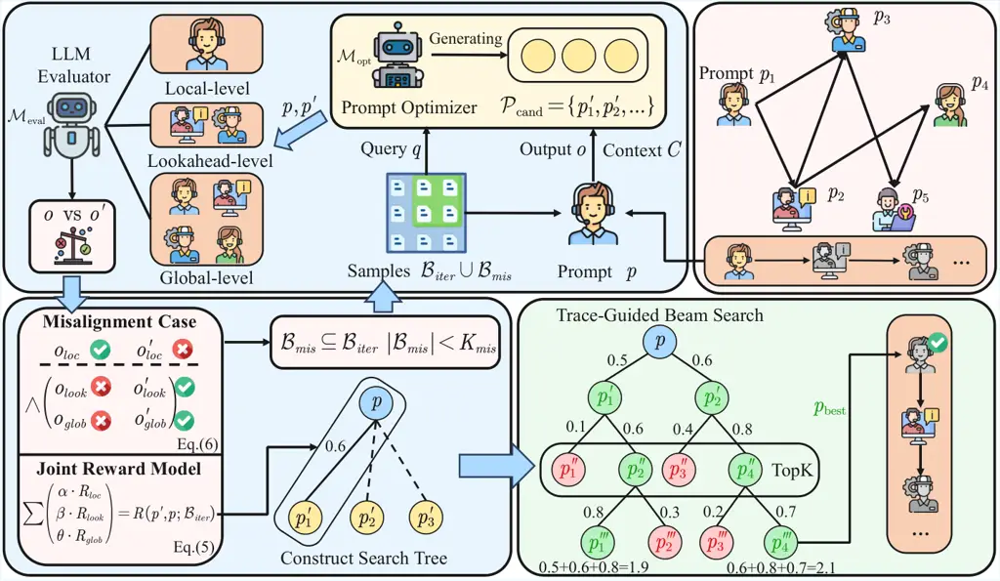
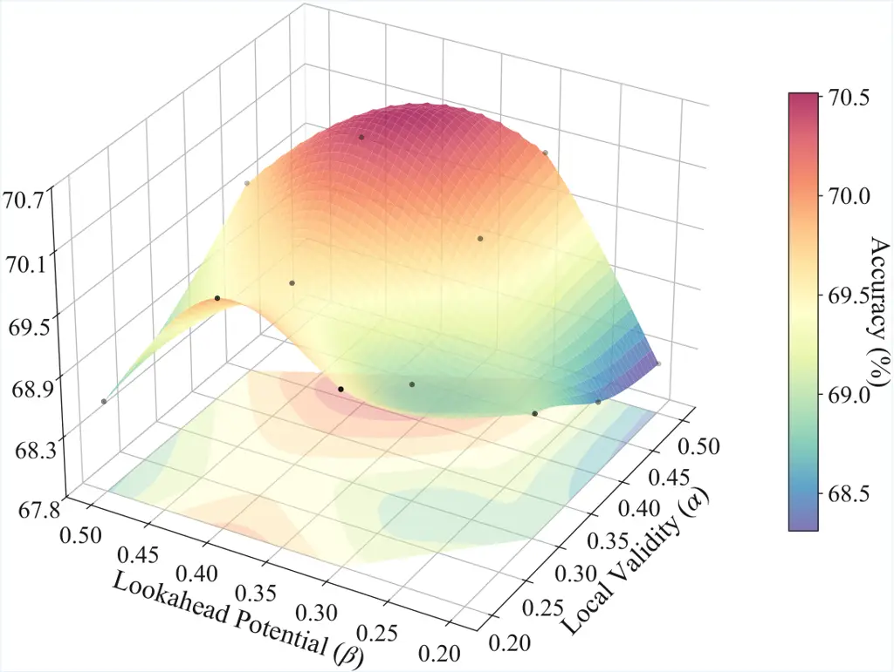

# MASPO: Joint Prompt Optimization for LLM-based Multi-Agent Systems

Zhexuan Wang Affiliation: Institute of Computing and Intelligence,
Harbin Institute of Technology, Shenzhen, China    Xuebo Liu
Affiliation: Institute of Computing and Intelligence, Harbin Institute
of Technology, Shenzhen, China Correspondence to: <liuxuebo@hit.edu.cn>
   Li Wang    Zifei Shan    Yutong Wang Affiliation: Institute of
Computing and Intelligence, Harbin Institute of Technology, Shenzhen,
China    Zhenxi Song Affiliation: Institute of Computing and
Intelligence, Harbin Institute of Technology, Shenzhen, China    Min
Zhang Affiliation: Institute of Computing and Intelligence, Harbin
Institute of Technology, Shenzhen, China

###### Abstract

Large language model (LLM)-based Multi-agent systems (MAS) have shown
promise in tackling complex collaborative tasks, where agents are
typically orchestrated via role-specific prompts. While the quality of
these prompts is pivotal, jointly optimizing them across interacting
agents remains a non-trivial challenge, primarily due to the
misalignment between local agent objectives and holistic system goals.
To address this, we introduce MASPO, a novel framework designed to
automatically and iteratively refine prompts across the entire system. A
core innovation of MASPO is its joint evaluation mechanism, which
assesses prompts not merely by their local validity, but by their
capacity to facilitate downstream success for successor agents. This
effectively bridges the gap between local interactions and global
outcomes without relying on ground-truth labels. Furthermore, MASPO
employs a data-driven evolutionary beam search to efficiently navigate
the high-dimensional prompt space. Extensive empirical evaluations
across 6 diverse tasks demonstrate that MASPO consistently outperforms
state-of-the-art prompt optimization methods, achieving an average
accuracy improvement of 2.9. We release our code at
[https://github.com/wangzx1219/MASPO](https://github.com/wangzx1219/MASPO).

###### Keywords: 

Machine Learning, ICML

## 1 Introduction

Recent advancements in LLMs (Achiam et al., 2023; Team et al., 2024)
have exhibited exceptional capabilities in context understanding,
instruction following, and complex reasoning, demonstrating strong
performance across various tasks and scenarios. Building upon these
foundations, Multi-Agent Systems (MAS) have emerged as a powerful
paradigm for solving multi-stage problems. By orchestrating
heterogeneous agents (Liang et al., 2024; Wang et al., 2025a; Du et al.,
2024; Zhuge et al., 2024) to communicate and collaborate, MAS often
surpass the capabilities of single-agent counterparts. Within such
systems, the design of agent-specific prompts is critical, as they not
only define the distinct roles of each agent but also govern their
interaction dynamics and reasoning trajectories. However, despite their
critical importance, the joint optimization of these prompts remains a
non-trivial challenge. Unlike single-agent scenarios, MAS optimization
involves a combinatorial search space where the optimality of one
agent’s prompt depends intrinsically on the behaviors of others.

Typically, MAS operate through the collaboration of specialized agents.
While existing prompt optimization methods typically rely on labeled
data to evaluate prompt quality, this paradigm is ill-suited for
MAS (Fernando et al., 2024a; Yuksekgonul et al., 2024). In collaborative
settings, specific agents may be tasked with intermediate steps, such as
reasoning, reflection, or summarization rather than generating the final
output. This leads to a severe credit assignment problem. A critical
failure mode in MAS is Local-Global Misalignment, where an intermediate
agent satisfies its local instructions perfectly but generates outputs
that mislead downstream peers, causing system-wide failure. Although
recent self-supervised strategies (Xiang et al., 2025) leverage
comparative feedback to assess reasoning quality, they remain confined
to an isolated scope, failing to capture how local variations propagate
to influence global system outcomes. In the context of MAS, recent
works (Opsahl-Ong et al., 2024; Zhou et al., 2025) have introduced
Bayesian search strategies utilizing Tree-structured Parzen Estimators
(TPE). However, these methods are restricted to selecting prompts from a
fixed, discrete candidate pool, thereby limiting their capacity for
open-ended optimization and fine-grained adjustment. Consequently, there
is an urgent need for a robust framework capable of automating prompt
generation in dynamic multi-agent environments.

To address these challenges, we propose MASPO, a joint prompt
optimization framework tailored for multi-agent environments. MASPO
introduces three key innovations. First, to resolve the credit
assignment dilemma, we design a multi-granularity joint evaluation
mechanism that integrates Local Validity, Lookahead Potential, and
Global Alignment, assessing an agent’s utility through its contribution
to the entire causal chain rather than isolated outputs. Second, we
introduce Misalignment-Aware Sampling, a targeted technique that
explicitly mines and injects historical traces where coordination failed
despite local success, guiding the optimizer to diagnose and rectify
specific interaction breakdowns. Third, regarding the co-adaptation
protocol, we implement a coordinate ascent-style strategy augmented with
a Beam Refresh mechanism, which ensures stability by realigning the
search tree of each agent in real-time to mitigate the non-stationarity
caused by peer agents.

Extensive experiments conducted across diverse domains demonstrate that
MASPO consistently delivers significant performance gains over existing
baselines. Our primary contributions are summarized as follows:

- •
  Multi-Granularity Joint Evaluation: We introduce a composite
  evaluation metric that resolves the credit assignment dilemma in MAS.
  By synergizing Local Validity, Lookahead Potential, and Global
  Alignment, our approach captures the full causal impact of an agent
  within the collaborative chain.
- •
  Misalignment-Driven Generative Search: We design a beam search
  strategy explicitly guided by Misalignment Cases—scenarios where
  agents fulfill local roles but induce system-wide failure.
- •
  Adaptive Optimization Dynamics: We propose a coordinate ascent-based
  scheduling protocol augmented with a Beam Refresh mechanism. These
  techniques effectively mitigate the non-stationarity inherent in
  multi-agent interactions, ensuring that each agent adapts to the
  evolving behaviors of its peers.

## 2 Preliminary

### 2.1 LLM-Based Multi-Agent Systems

Adopting the graph-theoretic perspective from the recent
literature (Chan et al., 2024; Jiang et al., 2023; Wu et al., 2023), we
formalize the MAS as a directed communication graph
$`\mathcal{G}=(\mathcal{V},\mathcal{E})`$. Here,
$`\mathcal{V}=\{v_{i}\}_{i=1}^{N}`$ represents the set of $`N`$ agents,
and the edge set $`\mathcal{E}\subseteq\mathcal{V}\times\mathcal{V}`$
defines the communication topology. A directed edge
$`(v_{j},v_{i})\in\mathcal{E}`$ signifies that the output of agent
$`v_{j}`$ serves as input context for agent $`v_{i}`$. We equip each
agent $`v_{i}`$ with an LLM-based inference function
$`f_{i}\in\mathcal{F}`$ and, crucially, a specific system prompt
$`p_{i}`$. We denote the set of all prompts as
$`\mathcal{P}=\{p_{i}\}_{i=1}^{N}`$, which constitutes the primary
learnable parameters in our optimization framework. Given a global task
query $`q`$, the generation process for a specific agent $`v_{i}`$ is
formulated as:

```math
o_{i}=f_{i}\left(p_{i},q,\mathcal{C}_{i}\right),\quad\text{with}\quad\mathcal{C}_{i}=\bigoplus_{v_{j}\in\mathcal{N}_{in}(v_{i})}o_{j}, \tag{1}
```

where $`\mathcal{N}_{in}(v_{i})`$ denotes the set of predecessors of
$`v_{i}`$. Here, $`\oplus`$ denotes the concatenation operation applied
in a fixed topological order, and $`\mathcal{C}_{i}`$ represents the
aggregated context. $`o_{i}`$ is the resulting output conditioned on the
role-specific agent’s prompt $`p_{i}`$.

### 2.2 Prompt Optimization

Prompt optimization aims to automate the discovery of optimal
instructions that maximize the performance of LLMs on downstream tasks.
In the context of our defined MAS, this objective extends from
optimizing a single string to jointly optimizing the set of
role-specific prompts $`\mathcal{P}`$. Let
$`\mathcal{D}=\{(q_{k},y_{k}^{*})\}_{k=1}^{|\mathcal{D}|}`$ be a dataset
consisting of input queries and their corresponding ground-truth labels
(or reference answers). The execution of the multi-agent system
$`\mathcal{G}`$ on a query $`q`$, governed by the prompt configuration
$`\mathcal{P}`$, produces a final system response $`o_{glob}`$. We
abstract this complex interaction process as a composite function
$`\Phi`$:

```math
o_{glob}=\Phi(\mathcal{G},\mathcal{P},q). \tag{2}
```

Here, $`o_{glob}`$ represents the final output from multiple agents,
derived through the topological propagation defined in Eq. (1). The goal
of MAS prompt optimization is to identify the optimal configuration
$`\mathcal{P}^{*}`$ that maximizes the expected performance over the
data distribution:

```math
\mathcal{P}^{*}=\operatorname*{argmax}_{\mathcal{P}\in\mathcal{S}^{N}}\mathbb{E}_{(q,o_{glob}^{*})\sim\mathcal{D}}\left[R\left(\Phi(\mathcal{G},\mathcal{P},q),o_{glob}^{*}\right)\right], \tag{3}
```

where $`\mathcal{S}`$ denotes the discrete space of natural language
strings (prompts), $`N`$ is the number of agents, and $`R(\cdot,\cdot)`$
is a scalar scoring function measuring the alignment between the
prediction of the system and the ground truth. However, directly
optimizing this objective is non-trivial. Since agents fulfill different
intermediate roles, the final ground truth $`o_{glob}^{*}`$ provides
only sparse supervision and does not effectively assign credit to
individual steps. To address this, we employ a self-supervised
evaluation mechanism as a proxy, which is detailed in Section 3.



Figure 1: Overview of the MASPO Framework. The optimization proceeds
sequentially following the topological order of the agent graph
(Top-Right). (Top) For a specific target agent, the Prompt Optimizer
analyzes execution traces (context $`\mathcal{C}`$ and output $`o`$)
from sampled batches $`\mathcal{B}_{iter}\cup\mathcal{B}_{mis}`$ to
generate candidate prompts $`\mathcal{P}_{cand}`$. These candidates are
rigorously assessed by the LLM Evaluator across three distinct
dimensions: local adherence, lookahead potential, and global alignment.
(Bottom-Left) To resolve credit assignment, we synthesize these
evaluations into a Joint Reward Model. Crucially, we identify and mine
Misalignment Cases to explicitly guide the optimizer towards repairing
coordination breakdowns. (Bottom-Right) Navigating the high-dimensional
search space, the framework employs a Trace-Guided Beam Search. This
mechanism maintains a beam of Top-K candidates, accumulating joint
reward scores along the path to iteratively evolve and select the
optimal prompt.

This optimization problem presents unique challenges compared to
single-agent settings. First, the search space $`\mathcal{S}^{N}`$ is
combinatorial and high-dimensional. Second, the objective function is
non-differentiable with respect to $`\mathcal{P}`$ due to the discrete
nature of language tokens, precluding standard gradient-based updates.
Crucially, the agents are functionally coupled: modifying the prompt
$`p_{j}`$ of an upstream agent $`v_{j}`$ alters the input context
$`\mathcal{C}_{i}`$ for downstream agent $`v_{i}`$. This induces a
covariate shift in the input distribution that $`v_{i}`$ faces, creating
a non-stationary optimization landscape that necessitates a joint
optimization strategy rather than the independent tuning of individual
agents.

## 3 Multi-Agent System Prompt Optimization

We present MASPO, a framework designed to navigate the non-stationary
and combinatorial landscape of multi-agent prompt optimization. As
illustrated in Figure 1, our workflow follows a systematic loop: it
orchestrates agents via a topological protocol, generates candidates
through trace analysis, evaluates them using a multi-granularity reward,
and evolves the population via an adaptive beam search.

### 3.1 Topological Context and Trace-Guided Proposal

#### Topological Scheduling Strategy

Optimizing the entire MAS simultaneously is intractable due to the
functional coupling between agents. To manage this, we adopt a
coordinate ascent-style strategy that respects the causal dependencies
of the MAS. We iterate through the agents $`\{v_{1},\dots,v_{N}\}`$
following the topological order of the communication graph
$`\mathcal{G}`$. Unlike standard sequential optimization that fully
converges one agent before moving to the next, we employ an interleaved
evolution protocol. In each topological turn, we optimize the target
agent for a limited number of generations, denoted as the step size
$`T`$, before freezing it and moving to the successor. This process is
repeated for $`D`$ rounds. This interleaved scheduling prevents upstream
agents from overfitting to the initial, suboptimal behaviors of
downstream peers, thereby stabilizing the co-adaptation process.

#### Trace-Guided Generation

With the target agent fixed, we employ a data-driven generation strategy
to explore the prompt space. Unlike blind mutation, our approach grounds
offspring generation in actual execution traces. For a parent prompt
$`p`$, we sample a batch $`\mathcal{B}_{iter}`$ to collect traces
$`\mathcal{T}_{\text{parent}}=\{(q_{k},\mathcal{C}_{k},o_{k})\}_{k\in\mathcal{B}_{iter}}`$.
Here, $`\mathcal{C}_{k}`$ captures the specific incoming context,
explicitly modeling the dependency on inter-agent communication. We
partition these traces into mini-batches and treat them as few-shot
contexts for the Optimizer Model $`\mathcal{M}_{\text{opt}}`$.
$`\mathcal{M}_{\text{opt}}`$ is instructed to analyze the mapping from
input context $`(q,\mathcal{C})`$ to output $`o`$, and propose a
variation $`p^{\prime}`$ that enhances the reasoning logic:

```math
\mathcal{P}_{cand}=\bigcup_{m=1}^{K_{sub}}\left\{p^{\prime}\mid p^{\prime}\sim\mathcal{M}_{opt}(p_{\text{parent}},\tau_{m})\right\}, \tag{4}
```

where $`\tau_{m}`$ is a subset of traces. Crucially, to address
coordination failures, we employ Misalignment Sampling. We maintain a
memory buffer $`\mathcal{B}_{mis}`$ of “Misalignment Cases” (defined in
Sec. 3.2), the scenarios where local validity coexists with ineffective
downstream adaptation. During generation, we prioritize injecting
$`K_{mis}`$ samples from $`\mathcal{B}_{mis}`$. By exposing
$`\mathcal{M}_{\text{opt}}`$ to these hard negatives, we force the
generation of offspring that specifically bridge the gap between local
instructions and global system goals. The detailed prompt of
$`\mathcal{M}_{\text{opt}}`$ is provided in Appendix A.

### 3.2 Joint Reward Modeling and Misalignment Mining

Once candidate prompts are generated, evaluating their quality presents
a severe credit assignment challenge. The output $`o_{i}`$ of an
upstream agent acts as the input context for downstream agents; thus,
relying solely on local validity or final outcome alignment creates an
evaluation gap.

#### Multi-Granularity Joint Reward

To bridge this gap, we employ a composite scoring function
$`R(p_{cand},p_{ref};\mathcal{B})`$ that evaluates the candidate prompt
against a reference. The resulting score is a weighted combination of
three improvement indicators:

```math
\begin{split}R=\frac{1}{|\mathcal{B}|}&\sum_{k\in\mathcal{B}}\Bigg[\alpha\cdot\underbrace{\mathbb{I}\left(o_{i}^{\prime}\succ o_{i}\right)}_{\text{Local Validity}}+\theta\cdot\underbrace{\mathbb{I}\left(o_{glob}^{\prime}\succ o_{glob}\right)}_{\text{Global Alignment}}\\
+&\beta\cdot\underbrace{\frac{1}{|\mathcal{N}_{out}(v_{i})|}\sum_{v_{j}\in\mathcal{N}_{out}(v_{i})}\mathbb{I}\left(o_{j}^{\prime}\succ o_{j}\right)}_{\text{Lookahead Potential}}\Bigg]^{(k)},\end{split} \tag{5}
```

where Local Validity measures whether the candidate’s output
$`o_{i}^{\prime}`$ satisfies role-specific constraints better than the
baseline. Lookahead Potential is a topology-aware metric that quantifies
the “ripple effect” by evaluating whether downstream agents
$`\{v_{j}\}`$ produce better outputs $`o_{j}^{\prime}`$ when fed with
the new context generated by $`v_{i}`$, thereby ensuring the prompt
produces context useful for immediate successors. Global Alignment
measures the impact on the final system response $`o_{glob}`$, capturing
long-range dependencies across the entire agent chain.
$`\mathcal{N}_{out}(v_{i})`$ denotes the set of immediate successor
agents, and $`\succ`$ represents a preference judgment derived from the
Evaluator Model $`\mathcal{M}_{\text{eval}}`$, whose detailed prompt can
be found in Appendix B.

#### Mining Misalignment Cases

This joint evaluation mechanism allows us to explicitly identify
Local-Global Misalignment. A sample $`k`$ is identified as a
misalignment case if the agent satisfies its local objective but fails
to support the system:

```math
\begin{split}&\mathbb{I}(o_{i}^{\prime}\succ o_{i})^{(k)}=1\quad\text{AND}\\
&\quad\left(\mathbb{I}(\text{Lookahead})^{(k)}=0\;\lor\;\mathbb{I}(o_{glob}^{\prime}\succ o_{glob})^{(k)}=0\right).\end{split} \tag{6}
```

where $`\mathbb{I}(\text{Lookahead})^{(k)}`$ equals 1 if the Lookahead
Potential (defined in Eq. 5) is 1. These identified cases are stored in
$`\mathcal{B}_{mis}`$ and fed back into the proposal stage (Sec. 3.1) to
guide the optimizer in repairing specific interaction breakdowns.

|                  |             |            |          |              |       |       |       |              |       |
| ---------------- | ----------- | ---------- | -------- | ------------ | ----- | ----- | ----- | ------------ | ----- |
|                  |             |            |          |              |       |       |       |              |       |
| Method           | Prompt Opt. | Joint Opt. | MATH-500 | AGIEval-MATH | AQuA  | GPQA  | MBPP  | HumanEval-ET | Avg.  |
|                  |             |            |          |              |       |       |       |              |       |
| Vanilla          | ✗           | ✗          | 74.80    | 55.86        | 79.53 | 45.96 | 63.47 | 71.95        | 65.27 |
| CoT              | ✗           | ✗          | 75.40    | 54.69        | 81.89 | 46.72 | 64.17 | 72.26        | 65.86 |
| SC (CoT)         | ✗           | ✗          | 75.50    | 56.64        | 82.17 | 47.52 | 64.49 | 72.56        | 66.48 |
| Self-Refine      | ✗           | ✗          | 76.20    | 56.52        | 82.28 | 47.73 | 64.17 | 70.73        | 66.27 |
| AgentDropout     | ✗           | ✗          | 76.80    | 59.77        | 86.23 | 47.98 | 58.09 | 72.44        | 66.89 |
| Sequential MAS   | ✗           | ✗          | 75.10    | 59.38        | 83.47 | 47.73 | 57.26 | 68.90        | 65.31 |
| \+ TPE           | ✔          | ✗          | 75.80    | 58.73        | 84.92 | 48.04 | 61.30 | 70.12        | 66.49 |
| \+ SPO           | ✔          | ✗          | 77.20    | 60.13        | 81.10 | 49.52 | 63.47 | 67.94        | 66.56 |
| \+ MASPO         | ✔          | ✔         | 77.80    | 61.98        | 85.56 | 58.08 | 65.11 | 73.78        | 70.39 |
| Hierarchical MAS | ✗           | ✗          | 77.60    | 59.38        | 87.01 | 50.63 | 63.93 | 71.34        | 68.32 |
| \+ TPE           | ✔          | ✗          | 77.60    | 60.68        | 86.45 | 49.49 | 64.32 | 71.73        | 68.47 |
| \+ SPO           | ✔          | ✗          | 77.80    | 63.41        | 86.61 | 51.01 | 61.83 | 73.39        | 69.01 |
| \+ MASPO         | ✔          | ✔         | 78.40    | 64.45        | 87.01 | 54.04 | 65.34 | 76.83        | 71.05 |

Table 1: Performance comparison of MASPO against baselines and other
optimization methods. Prompt Opt. denotes optimizing prompts for
individual agents, while Joint Opt. indicates the joint optimization of
agents within the MAS.

### 3.3 Evolutionary Beam Search with Adaptive Dynamics

To navigate the high-dimensional prompt space efficiently, we integrate
the components above into an evolutionary beam search augmented with a
dynamic refresh mechanism.

#### Trace-Guided Beam Search.

For each optimization step, we maintain a beam of top-$`K`$ candidates.
Each candidate $`p^{\prime}\in\mathcal{P}_{cand}`$ is evaluated on
$`\mathcal{B}_{iter}`$, and we calculate the cumulative performance gain
by adding the joint reward scores to the parent score:

```math
J(p^{\prime})=R(p^{\prime},p_{\text{parent}};\mathcal{B}_{iter})+J(p_{\text{parent}}). \tag{7}
```

This accumulation mitigates the noise of individual samples and enriches
the candidate diversity, thereby expanding the search space and allowing
us to retain the most robust prompts for the next iteration.

#### Beam Refresh Mechanism

A pivotal challenge in MAS optimization is score staleness. Prompts
retained in the beam of Agent $`v_{i}`$ were evaluated based on contexts
generated by obsolete versions of upstream agents. As peer agents evolve
during the topological traversal, the input distribution for $`v_{i}`$
shifts (covariate shift), rendering historical scores unreliable. To
explicitly address this, we discard the stale cumulative scores when an
agent is re-visited in a new epoch. We re-anchor the beam by evaluating
the relative advantage of each candidate against the current global best
prompt $`p_{\text{best}}`$ (serving as a baseline). We define the
refreshed score as the centered win-rate:

```math
J_{new}(p)=R(p,p_{\text{best}};\mathcal{B}_{iter})-0.5, \tag{8}
```

where subtraction of $`0.5`$ centers the metric around zero, ensuring
that prompts performing worse than the baseline receive negative
rewards. By resetting the history, this recalibration ensures the beam
search resumes from a valid, up-to-date performance manifold. A detailed
description of the algorithm can be found in Appendix C.

### 3.4 Discussion

Recent literature (Wang et al., 2025b; Schmidgall et al., 2025; Xiang et
al., 2025) has established that the relative efficacy of prompts can be
determined solely by comparing the quality of LLM inference outputs,
largely independent of ground-truth labels. Building on this insight,
our approach utilizes a small set of unlabeled samples for iterative
prompt evolution and evaluation, thereby significantly enhancing
practical applicability. In our experiments, we restrict the sample pool
to only a few dozen instances. During each optimization iteration, we
randomly sample a mini-batch of size $`|\mathcal{B}|=10`$ from the pool
for trace collection and joint evaluation. This design effectively
minimize both the computational overhead and data annotation
requirements.

## 4 Experiments

### 4.1 Experimental Setup

#### Models and Benchmarks

We conduct experiments using Qwen3-8B (Yang et al., 2025) as the
backbone model of MAS, both configured in standard inference mode to
exclude intrinsic reasoning enhancements. To comprehensively assess
system performance, we employ a diverse suite of benchmarks across three
domains: (1) Mathematical Proficiency: MATH-500 (Hendrycks et al.,
2021), AQuA (Patel et al., 2021), and the Level-5 subset of
AGIEval-MATH (Zhong et al., 2024); (2) Complex Reasoning: the
challenging GPQA-Diamond dataset (Rein et al., 2024); and (3) Code
Generation: MBPP (Austin et al., 2021) and HumanEval-ET (Dong et al.,
2025). Furthermore, we utilize Gemini-2.5-pro (Comanici et al., 2025) as
the engine for both the optimizer and evaluator modules.

#### Baselines

In single-agent scenarios, we compare with the direct reasoning method,
known as Vanilla, Chain-of-Thought (Wei et al., 2022, CoT,) approach,
CoT with self-consistency (Wang et al., 2023, SC (CoT),) and
Self-Refine (Madaan et al., 2023). For multi-agent collaboration tasks,
we establish baselines using two distinct architectures: a Sequential
MAS and a Hierarchical MAS (Zou et al., 2025). To ensure a rigorous
comparison, we further apply the Tree-structured Parzen Estimator (TPE)
used in MIPRO (Opsahl-Ong et al., 2024) and MASS (Zhou et al., 2025) to
optimize these MAS configurations. Furthermore, we incorporate SPO as an
optimization baseline; despite being a single-agent prompt optimizer,
its unsupervised optimization mechanism allows it to be adapted to MAS.

|                                                                               |          |              |       |       |       |              |       |
| ----------------------------------------------------------------------------- | -------- | ------------ | ----- | ----- | ----- | ------------ | ----- |
| Method                                                                        | MATH-500 | AGIEval-MATH | AQuA  | GPQA  | MBPP  | HumanEval-ET | Avg.  |
|                                                                               |          |              |       |       |       |              |       |
| Reference: Proposed Framework                                                 |          |              |       |       |       |              |       |
| MASPO (Full)                                                                  | 77.80    | 61.98        | 85.56 | 58.08 | 65.11 | 73.78        | 70.39 |
| I. Effectiveness of Search & Scheduling Strategies                            |          |              |       |       |       |              |       |
| Serial Search                                                                 | 77.20    | 58.95        | 87.01 | 50.83 | 65.11 | 69.51        | 68.10 |
| Single Cycle                                                                  | 75.50    | 59.77        | 85.24 | 50.51 | 65.58 | 72.56        | 68.19 |
| Single Agent + SPO                                                            | 75.60    | 61.67        | 81.89 | 47.59 | 61.87 | 72.51        | 66.86 |
| \+ Our Proposed Beam Search                                                   | 76.00    | 62.11        | 86.59 | 51.02 | 64.40 | 73.10        | 68.87 |
| II. Contribution of Core Components                                           |          |              |       |       |       |              |       |
| w/o Beam Refresh                                                              | 76.50    | 59.77        | 85.24 | 52.51 | 64.58 | 72.56        | 68.53 |
| w/o Joint Evaluate                                                            | 76.20    | 60.13        | 84.85 | 51.01 | 63.70 | 70.73        | 67.77 |
| w/o Misalignment Sampling                                                     | 77.60    | 62.89        | 86.61 | 52.53 | 65.28 | 73.17        | 69.68 |
| III. Sensitivity to Misalignment Cases (Default $`K_{mis}=3`$)                |          |              |       |       |       |              |       |
| w/ Success-Case Sampling                                                      | 77.20    | 61.63        | 86.52 | 51.51 | 65.11 | 73.78        | 69.29 |
| w/ 2 Misalignment Cases                                                       | 77.40    | 64.45        | 87.01 | 53.03 | 64.17 | 72.56        | 69.77 |
| w/ 4 Misalignment Cases                                                       | 77.60    | 60.13        | 85.83 | 55.41 | 64.64 | 74.73        | 69.72 |
| w/ 5 Misalignment Cases                                                       | 78.80    | 60.55        | 86.61 | 51.01 | 67.03 | 75.00        | 69.83 |
| IV. Robustness to Prompt Initialization                                       |          |              |       |       |       |              |       |
| w/ Minimal Initialization                                                     | 77.20    | 62.23        | 86.61 | 56.06 | 64.64 | 72.95        | 69.95 |
| w/ Wrong-Domain Initialization                                                | 77.00    | 61.62        | 85.86 | 55.56 | 65.11 | 73.17        | 69.72 |
| V. Impact of Lookahead Depth (Default 1-step)                                 |          |              |       |       |       |              |       |
| w/ 2-step Lookahead                                                           | 78.00    | 62.33        | 85.86 | 57.58 | 64.04 | 74.73        | 70.42 |
| w/ 3-step Lookahead                                                           | 77.80    | 62.65        | 84.85 | 57.07 | 65.11 | 75.00        | 70.41 |
| VI. Impact of Computational Budget                                            |          |              |       |       |       |              |       |
| SPO + Same Search Budget                                                      | 76.80    | 61.33        | 84.85 | 50.51 | 63.70 | 69.52        | 67.79 |
| SPO + Same Gemini Budget                                                      | 77.60    | 60.67        | 85.04 | 51.01 | 63.93 | 68.90        | 67.86 |
| VII. Impact of Optimizer and Evaluator Backbone (Self-Optimized via Qwen3-8B) |          |              |       |       |       |              |       |
| Self-Optimized                                                                | 77.00    | 58.92        | 84.58 | 48.48 | 64.64 | 72.56        | 67.70 |

Table 2: Comprehensive analysis of MASPO through extensive ablation
studies and sensitivity analyses. We examine the framework across eight
dimensions, organized into three groups: core mechanism contributions
(I–IV), covering the search strategy, scheduling strategy, joint
evaluation, and misalignment-aware sampling (with sensitivity to
$`K_{mis}`$); design-choice sensitivities (V–VI), including the
lookahead depth and computational budget; and external robustness
validations (VII–VIII), assessing the impact of a weaker
optimizer/evaluator backbone (Qwen3-8B) and sub-optimal prompt
initialization.

#### Implementation Details

For the inference of backbone model of agents, we set the sampling
temperature to 0. Regarding the optimization framework, we configure the
Optimizer Model $`\mathcal{M}_{\text{opt}}`$ with a temperature of
$`0.7`$ to encourage diverse prompt exploration, while the Evaluator
Model $`\mathcal{M}_{\text{eval}}`$ operates at a temperature of $`0`$.
All models are deployed in non-thinking inference mode. During the
iterative optimization phase, we maintain a sample pool of size
$`|\mathcal{D}|=50`$. The evolutionary search is governed by a beam
width of $`K=2`$, and for each parent prompt in the beam, we generate
$`K_{sub}=2`$ candidate variations. We balance the components of the
joint reward model by setting $`\alpha=0.4,\beta=0.4,\theta=0.2`$.
Furthermore, to prioritize error correction while maintaining batch
diversity, we set the maximum capacity for retrieved misalignment cases
to $`K_{mis}=3`$. Regarding the scheduling dynamics, we set the step
size for each topological round to $`T=3`$, and also set the number of
rounds $`D=3`$ to ensure that the agent can adapt to the constantly
changing cues from its peers. Detailed specifications regarding the
initial agent roles, prompt templates, and the architectural
configurations for the MAS baselines are provided in Appendix D.

### 4.2 Main Result

#### MASPO outperforms other baselines on multiple benchmarks

We observe that MASPO-optimized MAS significantly surpass standard
single-agent inference strategies, such as CoT and Vanilla prompting.
More importantly, MASPO outperforms heuristic-based collaborative
paradigms, including Self-Consistency, Self-Refine, and topological
optimization methods like AgentDropout (Wang et al., 2025e). Unlike
these static approaches, which rely on fixed role and prompts, MASPO
dynamically tailors the interaction logic via prompt evolution, enabling
agents to handle intricate dependencies that heuristic methods often
overlook. When compared against state-of-the-art prompt optimization
techniques, MASPO demonstrates a substantial advantage. While TPE and
single-agent adapters SPO provide marginal gains, they often struggle
with the non-stationary nature of multi-agent environments. By
leveraging joint reward modeling and misalignment-aware sampling, MASPO
achieves an average accuracy improvement of 2.90 over the
best-performing optimization baselines. This result highlights the
efficacy of our method in resolving the credit assignment problem.

#### MASPO demonstrates stability across different topologies

We applied MASPO to both Sequential and Hierarchical MAS structures to
assess the architectural adaptability of our framework. Empirical
results indicate that our approach is topology-agnostic, yielding
performance gains in both settings.Specifically, compared to the
respective baselines, MASPO improves the average task accuracy of
Sequential MAS by 5.06 and Hierarchical MAS by 2.73. A case study of the
optimized prompt is provided in Appendix E.

### 4.3 Analysis

In this section, we conduct a comprehensive series of ablation studies
and sensitivity analyses. All experiments in this subsection utilize the
Sequential MAS architecture with the Qwen3-8B backbone. The experimental
setup remains consistent with the configurations detailed in
Section 4.1.



Figure 2: Performance landscape of Joint Reward weights. The
interpolated surface illustrates the average accuracy with respect to
Local Validity ($`\alpha`$) and Lookahead Potential ($`\beta`$), under
the constraint $`\alpha+\beta+\theta=1`$.

|                 |                     |          |              |       |       |       |              |       |
| --------------- | ------------------- | -------- | ------------ | ----- | ----- | ----- | ------------ | ----- |
| Model           | Method              | MATH-500 | AGIEval-MATH | AQuA  | GPQA  | MBPP  | HumanEval-ET | Avg.  |
|                 |                     |          |              |       |       |       |              |       |
| Deepseek-V3     | MAS                 | 78.70    | 66.35        | 85.43 | 55.05 | 68.35 | 76.83        | 71.79 |
|                 | \+ Optimized Prompt | 81.50    | 69.14        | 87.40 | 61.11 | 74.94 | 81.10        | 75.86 |
| GLM-4.6         | MAS                 | 78.80    | 73.05        | 90.16 | 63.13 | 66.79 | 81.71        | 75.61 |
|                 | \+ Optimized Prompt | 84.20    | 76.17        | 90.55 | 66.67 | 69.32 | 83.54        | 78.41 |
| Claude-Sonnet-4 | MAS                 | 84.20    | 74.12        | 89.37 | 64.14 | 71.35 | 82.32        | 77.58 |
|                 | \+ Optimized Prompt | 84.50    | 76.95        | 92.17 | 67.14 | 72.83 | 84.76        | 79.73 |
| Gemini-2.5-Pro  | MAS                 | 87.60    | 85.10        | 90.55 | 83.33 | 80.69 | 82.32        | 84.93 |
|                 | \+ Optimized Prompt | 87.80    | 86.33        | 92.13 | 85.86 | 83.54 | 87.20        | 87.14 |

Table 3: Assessment of cross-model transferability by applying optimized
prompts to different model architectures.

#### Effect of Search Strategy

We leverage trace subset guidance combined with a beam search strategy
to expand the search space of prompts. Unlike greedy linear search that
commits to a single optimization trajectory, our search simultaneously
explores multiple promising directions. To validate the contribution of
this optimization mechanism, we compare it against a direct linear
iterative approach, denoted as “Serial Search” in Table 2. Furthermore,
we extend our evaluation to a single-agent scenario to benchmark our
method against SPO. In this setting, our framework adapts effectively by
retaining the beam search strategy as its core component. The
experimental results demonstrate that our search strategy consistently
enhances task performance in both single-agent and multi-agent contexts,
underscoring the robustness and effectiveness of the proposed method.

#### Effect of Scheduling Strategy

We employ a coordinate ascent-style scheduling protocol to sequentially
optimize each agent. To validate this multi-round iterative
co-adaptation strategy, we restrict optimization to a single topological
pass (“Single Cycle” in Table 2) under an equal budget, ensuring fair
comparison by carefully aligning the total optimization iterations per
agent. Furthermore, we assess the criticality of the Beam Refresh
mechanism in effectively handling distribution shifts (Row w/o “Beam
Refresh”). To mechanistically explain the performance drop in this
ablation, we calculated the average Kendall’s top-1 overlap of beam
candidates’ scores between optimization rounds to be only 0.63,
revealing that a significant portion of the optimal suggestion
candidates change shift and become stale as other agents evolve. The
experimental results indicate that both the coordinate ascent scheduling
and the beam refresh mechanism are indispensable; their combination
consistently enhances overall task performance. This underscores the
effectiveness of our strategy in managing the non-stationarity inherent
in multi-agent optimization.

Figure 3: Misalignment Rate across optimization depths.

#### Impact of Joint Evaluation Strategy

MASPO employs a multi-granularity joint evaluation mechanism to assess
non-terminal agents across three distinct dimensions. To validate the
efficacy of this composite metric, we assess its contribution via
ablation. First, we isolate the evaluation to solely focus on the target
agent’s intrinsic output quality (i.e., setting lookahead and global
weights to zero), denoted as “w/o Joint Evaluate” in Table 2. The
performance drop observed in this setting confirms the necessity of
holistic evaluation. Furthermore, we conduct a fine-grained sensitivity
analysis by varying the weights of the three dimensions. As visualized
in Figure 2 (refer to Table 4 in Appendix F for the full numerical
data), empirical results indicate that assigning higher weights to local
adherence and lookahead potential yields superior adaptability, whereas
the optimal weight for global alignment is comparatively lower.
Collectively, these results demonstrate that our joint evaluation
strategy effectively resolves the credit assignment dilemma,
consistently boosting task performance.

#### Impact of Misalignment-Aware Sampling

To bridge the local-global objective gap, MASPO explicitly mines
“Misalignment Cases”, which are instances that satisfy local roles but
fail globally, to guide optimization. Ablation results in Table 2
validate this design: reverting to standard random sampling (“w/o
Misalignment Sampling”) degrades performance, confirming the
inefficiency of unguided exploration. Crucially, a counter-baseline
prioritizing successful traces (“w/ Success-Case Sampling”)
underperforms the random approach. This suggests that merely reinforcing
successful behaviors offers low information gain. In contrast,
misalignment cases function as hard negatives, providing high-value
gradient signals that distinguish genuine global utility from
superficial local validity. Sensitivity analysis further indicates that
the optimization gain peaks at an injection volume of $`K_{mis}=3`$,
achieving an optimal trade-off.

To further quantify the effectiveness of our misalignment-aware
mechanism, we track the Misalignment Rate, formulated as
$`\frac{1}{|\mathcal{B}|}\sum_{k\in\mathcal{B}}\mathbb{I}_{\text{mis}}^{(k)}`$,
where $`\mathbb{I}_{\text{mis}}^{(k)}`$ indicates whether the sample
$`k`$ satisfies the misalignment criteria defined in Eq. 6. As
illustrated in Figure 3, MASPO consistently reduces the misalignment
rate as optimization depth increases, and remains lower than other
variants. This demonstrates that explicitly injecting misalignment cases
into the optimization loop enables the framework to systematically
diagnose and rectify coordination breakdowns, thereby progressively
aligning local agent with global system objectives.

#### Impact of Lookahead Depth

In our joint reward model (Eq. 5), the Lookahead Potential assesses the
immediate impact of a prompt variation on its direct successors (i.e.,
one-step lookahead). To investigate whether extending this evaluation to
multi-hop dependencies would yield further benefits, we conducted
experiments evaluating 2-step and 3-step lookahead configurations. As
presented in the “w/ 2-step Lookahead” and “w/ 3-step Lookahead” rows of
Table 2, deeper lookahead horizons provide negligible performance
improvements over the default 1-step setup. This finding strongly
confirms that the Global Alignment component integrated into our
composite reward function already sufficiently captures complex
long-range dependencies and broader system-wide effects without
requiring deeper analytical recursion. Consequently, we adopt the
one-step lookahead in MASPO to maintain an optimal balance between
computational efficiency and overall optimization performance during the
execution phase.

#### Impact of Computational Budget

To rigorously verify that MASPO’s performance gains stem from its
inherent algorithmic design rather than merely a higher computational
expenditure, we conducted an ablation study controlling for resource
allocation. We provided the SPO baseline with expanded resources in two
configurations: SPO + same search budget scales SPO’s total number of
optimization steps to match MASPO’s, while SPO + same Gemini budget
ensures SPO consumes an equivalent total number of Gemini API calls as
our framework. These two configurations respectively equalize the search
depth and the overall inference cost, jointly eliminating resource
disparity as a confounding factor. As reported in Table 2, even when
granted equivalent computational resources, SPO still substantially
underperforms MASPO across the benchmarked evaluation tasks. This
ultimately confirms that the superior performance of our framework is
fundamentally attributable to its multi-agent-specific optimization
mechanisms, specifically the joint evaluation metric and
misalignment-aware sampling techniques, rather than relying on
brute-force resource scaling or simply increasing query iterations.

#### Impact of Optimizer and Evaluator Capabilities

To investigate how the capabilities of the backbone model used for
optimization influence the final performance, we conducted an experiment
where the agent’s own backbone (Qwen3-8B) serves as both the Optimizer
($`\mathcal{M}_{\text{opt}}`$) and Evaluator
($`\mathcal{M}_{\text{eval}}`$), replacing the stronger Gemini-2.5-Pro
used in our main setup. As presented in Table 2, MASPO still delivers
consistent gains over the vanilla MAS baseline even when driven by this
weaker model, indicating that our framework does not critically depend
on access to a top-tier optimizer. While employing a more capable
foundation model facilitates superior optimization results, the ability
of the 8B model to self-improve demonstrates the robustness of our
framework, making MASPO applicable to resource-constrained or
privacy-sensitive deployments. In addition, further analyses are
provided in Appendix G and H.

#### Robustness to Prompt Initialization

To verify the effectiveness of MASPO under sub-optimal initialization
conditions, we evaluate the framework against two challenging scenarios:
(1) Minimal Initialization, where all agent prompts are replaced with a
minimal, non-informative instruction (“Answer the question:”) lacking
any task-specific guidance; and (2) Wrong-Domain Initialization, where
initial prompts are deliberately misaligned with the target tasks (e.g.,
assigning math prompts to code tasks, or code prompts to reasoning
tasks). These two settings respectively simulate the absence of prior
knowledge and the presence of misleading priors, representing the most
adverse starting conditions a practitioner might encounter. As reported
in Table 2, both degraded initializations incur only marginal
performance drops compared to the default MASPO, while still
substantially outperforming all baseline methods. This confirms that
MASPO can effectively recover from low-quality or irrelevant
initializations, showcasing strong robustness to the quality of
user-provided initial prompts.

#### Transferability and Robustness Analysis

To strictly evaluate the generalization capability and robustness of our
optimization framework, we conducted two sets of extension experiments.
We assessed the cross-model transferability of the optimized prompts.
Specifically, we directly migrated the role-specific prompts optimized
on the Qwen3-8B to distinct agent architectures, including
DeepSeek-V3 (Liu et al., 2024), GLM-4.6 (Zeng et al., 2025),
Claude-Sonnet-4 and Gemini-2.5-pro, without further fine-tuning. As
presented in Table 3, the prompts derived via MASPO yield consistent
performance improvements on these unseen backbones. This suggests that
MASPO captures generalized interaction logic and reasoning patterns
rather than overfitting to the idiosyncrasies of a specific source
model. This finding highlights a cost-effective optimization paradigm:
when deploying MAS with computationally expensive large-scale models,
practitioners can utilize smaller, more efficient models as proxies for
the optimization phase.

## 5 Related Work

### 5.1 LLM-based MAS

Research on autonomous systems has transitioned from classical
multi-agent reinforcement learning theories (Park et al., 2023; Yang et
al., 2024; Li et al., 2025; Tan et al., 2025) to the modern paradigm of
LLM-based MAS. By leveraging the advanced instruction-following and
reasoning capabilities of LLMs, these systems enable agents to
collaborate on complex planning and problem-solving tasks (Tao et al.,
2024; Wang et al., 2025d; Zhao et al., 2025). Foundational frameworks
such as ReAct (Yao et al., 2023), AutoGen (Wu et al., 2024), and
CAMEL (Li et al., 2023) pioneered this direction by coordinating agents
through explicit dialogue, role assignment, and structured communication
protocols (Yan et al., 2025; Ye et al., 2025). To enhance collective
intelligence, researchers have explored diverse interaction mechanisms,
such as multi-agent debate (Liang et al., 2024; Du et al., 2024) and
emergent specialization (Mieczkowski et al., 2025; Huang et al., 2025).
These collaborative strategies have shown applicability across a wide
spectrum of domains, including software development and specialized
reasoning in math and science (Pezeshkpour et al., 2024; Yue et al.,
2024; Wang et al., 2025c).

As the scale and diversity of agents increase (Wang et al., 2025a;
junyou li et al., 2024; Chen et al., 2025a), and as automated
construction methods such as AutoAgent (Chen et al., 2024a) and
AgentInit (Tian et al., 2025) make it easier to instantiate large-scale
MAS, the challenges of computational cost and communication efficiency
have become increasingly pronounced (Chen et al., 2024b; Li et al.,
2024). Consequently, recent literature has shifted focus toward
system-level optimization. Approaches such as Optima (Chen et al.,
2025b), AgentPrune (Zhang et al., 2025c) and AgentDropout (Wang et al.,
2025e; Wang et al., 2026) seek to refine the communication graph, while
dynamic routing mechanisms like MasRouter (Yue et al., 2025),
EvoFlow (Zhang et al., 2025a), and MaAS (Zhang et al., 2025b) adaptively
select backbone models and sample architectures to balance performance
and efficiency. Despite these structural advancements, the joint
optimization of the instructional prompts that govern these agent
interactions remains a critical yet underexplored challenge.

### 5.2 Prompt Optimization

Prompt optimization aims to automate the design of instructions to
maximize LLM performance, serving as a scalable alternative to
labor-intensive manual engineering. Approaches generally fall into two
categories: continuous soft-prompt tuning and discrete text
optimization. While soft-prompt methods utilize gradient-based updates,
they often suffer from poor interpretability and are inapplicable to
black-box APIs (Cui et al., 2025). Consequently, recent research has
shifted toward discrete optimization, employing strategies such as
evolutionary algorithms (Guo et al., 2025; Fernando et al., 2024b; Guo
et al., 2024), beam search refinement (Chen et al., 2024c; Wang et al.,
2024), and gradient-free feedback mechanisms (Yüksekgönül et al., 2024;
Deng et al., 2026). Despite their success, these methods predominantly
focus on single-agent scenarios.

Optimizing prompts for MAS presents a significantly more complex
challenge due to the intricate coordination required between agents. As
the number of agents scales, the interaction space grows
combinatorially. Early efforts in this domain, such as GPTSwarm (Zhuge
et al., 2024) and MASS, have attempted to co-evolve agent roles and
interaction graphs. A primary bottleneck is the evaluation mechanism,
which drives the optimization process. Standard frameworks rely heavily
on ground-truth labels for benchmark-based assessment (Zhou et al., 2023) that still depend on reference answers. While some works explore
consistency-based (Zhang et al., 2024) or human-preference criteria (Lin
et al., 2024), efficient and scalable evaluation remains challenging. In
contrast to these paradigms, our approach introduces a joint
optimization framework designed for MAS, addressing the distribution
shift problem.

## 6 Conclusion

In this paper, we introduced MASPO, a novel framework designed to
automate the iterative joint optimization of prompts within MAS. Our
approach addresses the intrinsic challenges of inter-agent coordination
and credit assignment by integrating three core mechanisms: (1) a
generative strategy guided by execution traces and misalignment cases to
explicitly rectify interaction breakdowns; (2) a multi-granularity joint
evaluation metric that resolves the local-global objective gap; and (3)
an evolutionary beam search orchestrated via a coordinate ascent
protocol with beam refreshment to ensure stable co-adaptation in
non-stationary environments. Extensive empirical results validate that
MASPO consistently achieves significant and robust performance
improvements across diverse reasoning and coding domains. Beyond
immediate gains, we believe this framework offers valuable insights for
future research into dynamic role specialization and architectural
optimization in collaborative AI systems tackling complex tasks.

## Impact Statement

This paper presents a framework for automating prompt optimization in
multi-agent systems, with the primary goal of advancing Machine Learning
capabilities in collaborative tasks. While the deployment of autonomous
agents carries general societal implications regarding automation and
safety, the consequences of this work largely depend on the specific
applications for which these systems are deployed and the safety
properties of the backbone Large Language Models. We do not foresee
specific ethical issues or negative societal consequences unique to this
optimization framework that require further highlighting.

## References

- Achiam et al. (2023) J. Achiam, S. Adler, S. Agarwal, L. Ahmad, I.
  Akkaya, F. L. Aleman, D. Almeida, J. Altenschmidt, S. Altman, S.
  Anadkat, et al. Gpt-4 technical report. ArXiv preprint abs/2303.08774.
  External Links: [Link](https://arxiv.org/abs/2303.08774) Cited by: §1.
- Austin et al. (2021) J. Austin, A. Odena, M. Nye, M. Bosma, H.
  Michalewski, D. Dohan, E. Jiang, C. Cai, M. Terry, Q. Le, et al.
  Program synthesis with large language models. ArXiv preprint
  abs/2108.07732. External Links:
  [Link](https://arxiv.org/abs/2108.07732) Cited by: §4.1.
- Chan et al. (2024) C. Chan, W. Chen, Y. Su, J. Yu, W. Xue, S.
  Zhang, J. Fu, and Z. Liu ChatEval: towards better llm-based evaluators
  through multi-agent debate. In The Twelfth International Conference on
  Learning Representations, ICLR 2024, Vienna, Austria, May 7-11, 2024,
  External Links: [Link](https://openreview.net/forum?id=FQepisCUWu)
  Cited by: §2.1.
- Chen et al. (2024a) G. Chen, S. Dong, Y. Shu, G. Zhang, J.
  Sesay, B. F. Karlsson, J. Fu, and Y. Shi AutoAgents: a framework for
  automatic agent generation. In Proceedings of the Thirty-Third
  International Joint Conference on Artificial Intelligence, IJCAI-24,
  pp. 22–30. Note: Main Track External Links:
  [Document](https://dx.doi.org/10.24963/ijcai.2024/3),
  [Link](https://doi.org/10.24963/ijcai.2024/3) Cited by: §5.1.
- Chen et al. (2025a) W. Chen, Z. You, R. Li, Y. Guan, C. Qian, C.
  Zhao, C. Yang, R. Xie, Z. Liu, and M. Sun Internet of agents: weaving
  a web of heterogeneous agents for collaborative intelligence. In The
  Thirteenth International Conference on Learning Representations, ICLR
  2025, Singapore, April 24-28, 2025, External Links:
  [Link](https://openreview.net/forum?id=o1Et3MogPw) Cited by: §5.1.
- Chen et al. (2024b) W. Chen, C. Yuan, J. Yuan, Y. Su, C. Qian, C.
  Yang, R. Xie, Z. Liu, and M. Sun Beyond natural language: LLMs
  leveraging alternative formats for enhanced reasoning and
  communication. In Findings of the Association for Computational
  Linguistics: EMNLP 2024, Y. Al-Onaizan, M. Bansal, and Y. Chen (Eds.),
  Miami, Florida, USA, pp. 10626–10641. External Links:
  [Document](https://dx.doi.org/10.18653/v1/2024.findings-emnlp.623),
  [Link](https://aclanthology.org/2024.findings-emnlp.623/) Cited by:
  §5.1.
- Chen et al. (2025b) W. Chen, J. Yuan, C. Qian, C. Yang, Z. Liu, and M.
  Sun Optima: optimizing effectiveness and efficiency for LLM-based
  multi-agent system. In Findings of the Association for Computational
  Linguistics: ACL 2025, W. Che, J. Nabende, E. Shutova, and M. T.
  Pilehvar (Eds.), Vienna, Austria, pp. 11534–11557. External Links:
  [Document](https://dx.doi.org/10.18653/v1/2025.findings-acl.601), ISBN
  979-8-89176-256-5,
  [Link](https://aclanthology.org/2025.findings-acl.601/) Cited by:
  §5.1.
- Chen et al. (2024c) Y. Chen, J. Arkin, Y. Hao, Y. Zhang, N. Roy,
  and C. Fan PRompt optimization in multi-step tasks (PROMST):
  integrating human feedback and heuristic-based sampling. In
  Proceedings of the 2024 Conference on Empirical Methods in Natural
  Language Processing, Y. Al-Onaizan, M. Bansal, and Y. Chen (Eds.),
  Miami, Florida, USA, pp. 3859–3920. External Links:
  [Document](https://dx.doi.org/10.18653/v1/2024.emnlp-main.226),
  [Link](https://aclanthology.org/2024.emnlp-main.226/) Cited by: §5.2.
- Comanici et al. (2025) G. Comanici, E. Bieber, M. Schaekermann, I.
  Pasupat, N. Sachdeva, I. Dhillon, M. Blistein, O. Ram, D. Zhang, E.
  Rosen, et al. Gemini 2.5: pushing the frontier with advanced
  reasoning, multimodality, long context, and next generation agentic
  capabilities. ArXiv preprint abs/2507.06261. External Links:
  [Link](https://arxiv.org/abs/2507.06261) Cited by: §4.1.
- Cui et al. (2025) W. Cui, J. Zhang, Z. Li, H. Sun, D. Lopez, K.
  Das, B. A. Malin, and S. Kumar Automatic prompt optimization via
  heuristic search: a survey. arXiv. External Links:
  [Link](https://arxiv.org/abs/2502.18746) Cited by: §5.2.
- Deng et al. (2026) H. Deng, W. Jiao, X. Liu, J. Rao, and M. Zhang
  REA-RL: reflection-aware online reinforcement learning for efficient
  reasoning. In The Fourteenth International Conference on Learning
  Representations, External Links:
  [Link](https://openreview.net/forum?id=E6keG5QDct) Cited by: §5.2.
- Dong et al. (2025) Y. Dong, J. Ding, X. Jiang, G. Li, Z. Li, and Z.
  Jin CodeScore: evaluating code generation by learning code execution.
  ACM Trans. Softw. Eng. Methodol. 34 (3). External Links:
  [Document](https://dx.doi.org/10.1145/3695991), ISSN 1049-331X,
  [Link](https://doi.org/10.1145/3695991) Cited by: §4.1.
- Du et al. (2024) Y. Du, S. Li, A. Torralba, J. B. Tenenbaum, and I.
  Mordatch Improving factuality and reasoning in language models through
  multiagent debate. In Forty-first International Conference on Machine
  Learning, ICML 2024, Vienna, Austria, July 21-27, 2024, External
  Links: [Link](https://openreview.net/forum?id=zj7YuTE4t8) Cited by:
  §1, §5.1.
- Fernando et al. (2024a) C. Fernando, D. Banarse, H. Michalewski, S.
  Osindero, and T. Rocktäschel Promptbreeder: self-referential
  self-improvement via prompt evolution. In Forty-first International
  Conference on Machine Learning, ICML 2024, Vienna, Austria, July
  21-27, 2024, External Links:
  [Link](https://openreview.net/forum?id=9ZxnPZGmPU) Cited by: §1.
- Fernando et al. (2024b) C. Fernando, D. Banarse, H. Michalewski, S.
  Osindero, and T. Rocktäschel Promptbreeder: self-referential
  self-improvement via prompt evolution. In Forty-first International
  Conference on Machine Learning, ICML 2024, Vienna, Austria, July
  21-27, 2024, External Links:
  [Link](https://openreview.net/forum?id=9ZxnPZGmPU) Cited by: §5.2.
- Guo et al. (2024) Q. Guo, R. Wang, J. Guo, B. Li, K. Song, X. Tan, G.
  Liu, J. Bian, and Y. Yang Connecting large language models with
  evolutionary algorithms yields powerful prompt optimizers. In The
  Twelfth International Conference on Learning Representations, ICLR
  2024, Vienna, Austria, May 7-11, 2024, External Links:
  [Link](https://openreview.net/forum?id=ZG3RaNIsO8) Cited by: §5.2.
- Guo et al. (2025) Q. Guo, R. Wang, J. Guo, B. Li, K. Song, X. Tan, G.
  Liu, J. Bian, and Y. Yang EvoPrompt: connecting llms with evolutionary
  algorithms yields powerful prompt optimizers. arXiv. External Links:
  [Link](https://arxiv.org/abs/2309.08532) Cited by: §5.2.
- Hendrycks et al. (2021) D. Hendrycks, C. Burns, S. Kadavath, A.
  Arora, S. Basart, E. Tang, D. Song, and J. Steinhardt Measuring
  mathematical problem solving with the MATH dataset. In Proceedings of
  the Neural Information Processing Systems Track on Datasets and
  Benchmarks 1, NeurIPS Datasets and Benchmarks 2021, December 2021,
  virtual, J. Vanschoren and S. Yeung (Eds.), External Links:
  [Link](https://arxiv.org/abs/2103.03874) Cited by: §4.1.
- Huang et al. (2025) Q. Huang, Z. Zhou, Y. Li, K. Yang, B. Wang, and Y.
  Wang Many minds, one goal: time series forecasting via sub-task
  specialization and inter-agent cooperation. In The Thirty-ninth Annual
  Conference on Neural Information Processing Systems, External Links:
  [Link](https://openreview.net/forum?id=Uon41HfqR3) Cited by: §5.1.
- Jiang et al. (2023) D. Jiang, X. Ren, and B. Y. Lin LLM-blender:
  ensembling large language models with pairwise ranking and generative
  fusion. In Proceedings of the 61st Annual Meeting of the Association
  for Computational Linguistics (Volume 1: Long Papers), A. Rogers, J.
  Boyd-Graber, and N. Okazaki (Eds.), Toronto, Canada, pp. 14165–14178.
  External Links:
  [Document](https://dx.doi.org/10.18653/v1/2023.acl-long.792),
  [Link](https://aclanthology.org/2023.acl-long.792/) Cited by: §2.1.
- junyou li et al. (2024) junyou li, Q. Zhang, Y. Yu, Q. FU, and D. Ye
  More agents is all you need. Transactions on Machine Learning
  Research. Note: External Links: ISSN 2835-8856,
  [Link](https://openreview.net/forum?id=bgzUSZ8aeg) Cited by: §5.1.
- Li et al. (2023) G. Li, H. Hammoud, H. Itani, D. Khizbullin, and B.
  Ghanem CAMEL: communicative agents for ”mind” exploration of large
  language model society. In Advances in Neural Information Processing
  Systems 36: Annual Conference on Neural Information Processing Systems
  2023, NeurIPS 2023, New Orleans, LA, USA, December 10 - 16, 2023, A.
  Oh, T. Naumann, A. Globerson, K. Saenko, M. Hardt, and S. Levine
  (Eds.), External Links: [Link](https://arxiv.org/abs/2303.17760) Cited
  by: §5.1.
- Li et al. (2024) Y. Li, Y. Du, J. Zhang, L. Hou, P. Grabowski, Y. Li,
  and E. Ie Improving multi-agent debate with sparse communication
  topology. In Findings of the Association for Computational
  Linguistics: EMNLP 2024, Y. Al-Onaizan, M. Bansal, and Y. Chen (Eds.),
  Miami, Florida, USA, pp. 7281–7294. External Links:
  [Document](https://dx.doi.org/10.18653/v1/2024.findings-emnlp.427),
  [Link](https://aclanthology.org/2024.findings-emnlp.427/) Cited by:
  §5.1.
- Li et al. (2025) Z. Li, Q. Ji, X. Ling, and Q. Liu A comprehensive
  review of multi-agent reinforcement learning in video games. IEEE
  Transactions on Games. External Links:
  [Link](https://arxiv.org/abs/2509.03682) Cited by: §5.1.
- Liang et al. (2024) T. Liang, Z. He, W. Jiao, X. Wang, Y. Wang, R.
  Wang, Y. Yang, S. Shi, and Z. Tu Encouraging divergent thinking in
  large language models through multi-agent debate. In Proceedings of
  the 2024 Conference on Empirical Methods in Natural Language
  Processing, Y. Al-Onaizan, M. Bansal, and Y. Chen (Eds.), Miami,
  Florida, USA, pp. 17889–17904. External Links:
  [Document](https://dx.doi.org/10.18653/v1/2024.emnlp-main.992),
  [Link](https://aclanthology.org/2024.emnlp-main.992/) Cited by: §1,
  §5.1.
- Lin et al. (2024) X. Lin, Z. Dai, A. Verma, S. Ng, P. Jaillet,
  and B. K. H. Low Prompt optimization with human feedback. ArXiv
  preprint abs/2405.17346. External Links:
  [Link](https://arxiv.org/abs/2405.17346) Cited by: §5.2.
- Liu et al. (2024) A. Liu, B. Feng, B. Xue, B. Wang, B. Wu, C. Lu, C.
  Zhao, C. Deng, C. Zhang, C. Ruan, et al. Deepseek-v3 technical report.
  ArXiv preprint abs/2412.19437. External Links:
  [Link](https://arxiv.org/abs/2412.19437) Cited by: §4.3.
- Madaan et al. (2023) A. Madaan, N. Tandon, P. Gupta, S. Hallinan, L.
  Gao, S. Wiegreffe, U. Alon, N. Dziri, S. Prabhumoye, Y. Yang, S.
  Gupta, B. P. Majumder, K. Hermann, S. Welleck, A. Yazdanbakhsh, and P.
  Clark Self-refine: iterative refinement with self-feedback. In
  Advances in Neural Information Processing Systems 36: Annual
  Conference on Neural Information Processing Systems 2023, NeurIPS
  2023, New Orleans, LA, USA, December 10 - 16, 2023, A. Oh, T.
  Naumann, A. Globerson, K. Saenko, M. Hardt, and S. Levine (Eds.),
  External Links: [Link](https://arxiv.org/abs/2303.17651) Cited by:
  §4.1.
- Mieczkowski et al. (2025) E. Mieczkowski, R. Mon-Williams, N.
  Bramley, C. G. Lucas, N. Velez, and T. L. Griffiths Predicting
  multi-agent specialization via task parallelizability. ArXiv preprint
  abs/2503.15703. External Links:
  [Link](https://arxiv.org/abs/2503.15703) Cited by: §5.1.
- Opsahl-Ong et al. (2024) K. Opsahl-Ong, M. J. Ryan, J. Purtell, D.
  Broman, C. Potts, M. Zaharia, and O. Khattab Optimizing instructions
  and demonstrations for multi-stage language model programs. In
  Proceedings of the 2024 Conference on Empirical Methods in Natural
  Language Processing, Y. Al-Onaizan, M. Bansal, and Y. Chen (Eds.),
  Miami, Florida, USA, pp. 9340–9366. External Links:
  [Document](https://dx.doi.org/10.18653/v1/2024.emnlp-main.525),
  [Link](https://aclanthology.org/2024.emnlp-main.525/) Cited by: §1,
  §4.1.
- Park et al. (2023) J. S. Park, J. O’Brien, C. J. Cai, M. R. Morris, P.
  Liang, and M. S. Bernstein Generative agents: interactive simulacra of
  human behavior. In Proceedings of the 36th annual acm symposium on
  user interface software and technology, pp. 1–22. External Links:
  [Link](https://arxiv.org/abs/2304.03442) Cited by: §5.1.
- Patel et al. (2021) A. Patel, S. Bhattamishra, and N. Goyal Are NLP
  models really able to solve simple math word problems?. In Proceedings
  of the 2021 Conference of the North American Chapter of the
  Association for Computational Linguistics: Human Language
  Technologies, K. Toutanova, A. Rumshisky, L. Zettlemoyer, D.
  Hakkani-Tur, I. Beltagy, S. Bethard, R. Cotterell, T. Chakraborty,
  and Y. Zhou (Eds.), Online, pp. 2080–2094. External Links:
  [Document](https://dx.doi.org/10.18653/v1/2021.naacl-main.168),
  [Link](https://aclanthology.org/2021.naacl-main.168/) Cited by: §4.1.
- Pezeshkpour et al. (2024) P. Pezeshkpour, E. Kandogan, N. Bhutani, S.
  Rahman, T. Mitchell, and E. Hruschka Reasoning capacity in multi-agent
  systems: limitations, challenges and human-centered solutions. ArXiv
  preprint abs/2402.01108. External Links:
  [Link](https://arxiv.org/abs/2402.01108) Cited by: §5.1.
- Rein et al. (2024) D. Rein, B. L. Hou, A. C. Stickland, J.
  Petty, R. Y. Pang, J. Dirani, J. Michael, and S. R. Bowman GPQA: a
  graduate-level google-proof q&a benchmark. In First Conference on
  Language Modeling, External Links:
  [Link](https://openreview.net/forum?id=Ti67584b98) Cited by: §4.1.
- Schmidgall et al. (2025) S. Schmidgall, Y. Su, Z. Wang, X. Sun, J.
  Wu, X. Yu, J. Liu, M. Moor, Z. Liu, and E. Barsoum Agent laboratory:
  using LLM agents as research assistants. In Findings of the
  Association for Computational Linguistics: EMNLP 2025, C.
  Christodoulopoulos, T. Chakraborty, C. Rose, and V. Peng (Eds.),
  Suzhou, China, pp. 5977–6043. External Links:
  [Document](https://dx.doi.org/10.18653/v1/2025.findings-emnlp.320),
  ISBN 979-8-89176-335-7,
  [Link](https://aclanthology.org/2025.findings-emnlp.320/) Cited by:
  §3.4.
- Tan et al. (2025) L. Tan, F. Wei, X. Ma, R. Peng, H. Xiao, and L. Yang
  Systemic condition-based maintenance optimization under inspection
  uncertainties: a customized multiagent reinforcement learning
  approach. IEEE Transactions on Reliability. External Links:
  [Link](https://ieeexplore.ieee.org/abstract/document/11082020) Cited
  by: §5.1.
- Tao et al. (2024) W. Tao, Y. Zhou, Y. Wang, W. Zhang, H. Zhang, and Y.
  Cheng MAGIS: llm-based multi-agent framework for github issue
  resolution. In Advances in Neural Information Processing Systems 38:
  Annual Conference on Neural Information Processing Systems 2024,
  NeurIPS 2024, Vancouver, BC, Canada, December 10 - 15, 2024, A.
  Globersons, L. Mackey, D. Belgrave, A. Fan, U. Paquet, J. M. Tomczak,
  and C. Zhang (Eds.), External Links:
  [Link](https://arxiv.org/abs/2403.17927) Cited by: §5.1.
- Team et al. (2024) G. Team, P. Georgiev, V. I. Lei, R. Burnell, L.
  Bai, A. Gulati, G. Tanzer, D. Vincent, Z. Pan, S. Wang, et al. Gemini
  1.5: unlocking multimodal understanding across millions of tokens of
  context. ArXiv preprint abs/2403.05530. External Links:
  [Link](https://arxiv.org/abs/2403.05530) Cited by: §1.
- Tian et al. (2025) C. Tian, Y. Wang, X. Liu, Z. Wang, L. Ding, M.
  Zhang, and M. Zhang AgentInit: initializing LLM-based multi-agent
  systems via diversity and expertise orchestration for effective and
  efficient collaboration. In Findings of the Association for
  Computational Linguistics: EMNLP 2025, C. Christodoulopoulos, T.
  Chakraborty, C. Rose, and V. Peng (Eds.), Suzhou, China,
  pp. 11870–11902. External Links:
  [Link](https://aclanthology.org/2025.findings-emnlp.636/),
  [Document](https://dx.doi.org/10.18653/v1/2025.findings-emnlp.636),
  ISBN 979-8-89176-335-7 Cited by: §5.1.
- Wang et al. (2025a) J. Wang, J. Wang, B. Athiwaratkun, C. Zhang,
  and J. Zou Mixture-of-agents enhances large language model
  capabilities. In The Thirteenth International Conference on Learning
  Representations, ICLR 2025, Singapore, April 24-28, 2025, External
  Links: [Link](https://openreview.net/forum?id=h0ZfDIrj7T) Cited by:
  §1, §5.1.
- Wang et al. (2025b) L. Wang, J. Lian, Y. Huang, Y. Dai, H. Li, X.
  Chen, X. Xie, and J. Wen CharacterBox: evaluating the role-playing
  capabilities of LLMs in text-based virtual worlds. In Proceedings of
  the 2025 Conference of the Nations of the Americas Chapter of the
  Association for Computational Linguistics: Human Language Technologies
  (Volume 1: Long Papers), L. Chiruzzo, A. Ritter, and L. Wang (Eds.),
  Albuquerque, New Mexico, pp. 6372–6391. External Links:
  [Document](https://dx.doi.org/10.18653/v1/2025.naacl-long.323), ISBN
  979-8-89176-189-6,
  [Link](https://aclanthology.org/2025.naacl-long.323/) Cited by: §3.4.
- Wang et al. (2024) X. Wang, C. Li, Z. Wang, F. Bai, H. Luo, J.
  Zhang, N. Jojic, E. P. Xing, and Z. Hu PromptAgent: strategic planning
  with language models enables expert-level prompt optimization. In The
  Twelfth International Conference on Learning Representations, ICLR
  2024, Vienna, Austria, May 7-11, 2024, External Links:
  [Link](https://openreview.net/forum?id=22pyNMuIoa) Cited by: §5.2.
- Wang et al. (2023) X. Wang, J. Wei, D. Schuurmans, Q. V. Le, E. H.
  Chi, S. Narang, A. Chowdhery, and D. Zhou Self-consistency improves
  chain of thought reasoning in language models. In The Eleventh
  International Conference on Learning Representations, ICLR 2023,
  Kigali, Rwanda, May 1-5, 2023, External Links:
  [Link](https://openreview.net/forum?id=1PL1NIMMrw) Cited by: §4.1.
- Wang et al. (2026) Y. Wang, S. Xiong, X. Liu, W. Zhou, L. Ding, M.
  Zhang, and M. Zhang AgentDropoutV2: optimizing information flow in
  multi-agent systems via test-time rectify-or-reject pruning. arXiv
  preprint arXiv:2602.23258. External Links:
  [Link](https://arxiv.org/abs/2602.23258) Cited by: §5.1.
- Wang et al. (2025c) Y. Wang, J. Zeng, X. Liu, D. F. Wong, F. Meng, J.
  Zhou, and M. Zhang DelTA: an online document-level translation agent
  based on multi-level memory. In The Thirteenth International
  Conference on Learning Representations, External Links:
  [Link](https://openreview.net/forum?id=hoYFLRNbhc) Cited by: §5.1.
- Wang et al. (2025d) Z. Wang, S. Moriyama, W. Wang, B. Gangopadhyay,
  and S. Takamatsu Talk structurally, act hierarchically: a
  collaborative framework for llm multi-agent systems. ArXiv preprint
  abs/2502.11098. External Links:
  [Link](https://arxiv.org/abs/2502.11098) Cited by: §5.1.
- Wang et al. (2025e) Z. Wang, Y. Wang, X. Liu, L. Ding, M. Zhang, J.
  Liu, and M. Zhang AgentDropout: dynamic agent elimination for
  token-efficient and high-performance LLM-based multi-agent
  collaboration. In Proceedings of the 63rd Annual Meeting of the
  Association for Computational Linguistics (Volume 1: Long Papers), W.
  Che, J. Nabende, E. Shutova, and M. T. Pilehvar (Eds.), Vienna,
  Austria, pp. 24013–24035. External Links:
  [Document](https://dx.doi.org/10.18653/v1/2025.acl-long.1170), ISBN
  979-8-89176-251-0,
  [Link](https://aclanthology.org/2025.acl-long.1170/) Cited by: §4.2,
  §5.1.
- Wei et al. (2022) J. Wei, X. Wang, D. Schuurmans, M. Bosma, B.
  Ichter, F. Xia, E. H. Chi, Q. V. Le, and D. Zhou Chain-of-thought
  prompting elicits reasoning in large language models. In Advances in
  Neural Information Processing Systems 35: Annual Conference on Neural
  Information Processing Systems 2022, NeurIPS 2022, New Orleans, LA,
  USA, November 28 - December 9, 2022, S. Koyejo, S. Mohamed, A.
  Agarwal, D. Belgrave, K. Cho, and A. Oh (Eds.), External Links:
  [Link](https://arxiv.org/abs/2201.11903) Cited by: §4.1.
- Wu et al. (2024) Q. Wu, G. Bansal, J. Zhang, Y. Wu, B. Li, E. Zhu, L.
  Jiang, X. Zhang, S. Zhang, J. Liu, et al. Autogen: enabling next-gen
  llm applications via multi-agent conversations. In First Conference on
  Language Modeling, External Links:
  [Link](https://openreview.net/forum?id=BAakY1hNKS) Cited by: §5.1.
- Wu et al. (2023) Q. Wu, G. Bansal, J. Zhang, Y. Wu, S. Zhang, E.
  Zhu, B. Li, L. Jiang, X. Zhang, and C. Wang Autogen: enabling next-gen
  llm applications via multi-agent conversation framework. ArXiv
  preprint abs/2308.08155. External Links:
  [Link](https://arxiv.org/abs/2308.08155) Cited by: §2.1.
- Xiang et al. (2025) J. Xiang, J. Zhang, Z. Yu, X. Liang, F. Teng, J.
  Tu, F. Ren, X. Tang, S. Hong, C. Wu, and Y. Luo Self-supervised prompt
  optimization. In Findings of the Association for Computational
  Linguistics: EMNLP 2025, C. Christodoulopoulos, T. Chakraborty, C.
  Rose, and V. Peng (Eds.), Suzhou, China, pp. 9017–9041. External
  Links:
  [Document](https://dx.doi.org/10.18653/v1/2025.findings-emnlp.479),
  ISBN 979-8-89176-335-7,
  [Link](https://aclanthology.org/2025.findings-emnlp.479/) Cited by:
  §1, §3.4.
- Yan et al. (2025) B. Yan, Z. Zhou, L. Zhang, L. Zhang, Z. Zhou, D.
  Miao, Z. Li, C. Li, and X. Zhang Beyond self-talk: a
  communication-centric survey of llm-based multi-agent systems. ArXiv
  preprint abs/2502.14321. External Links:
  [Link](https://arxiv.org/abs/2502.14321) Cited by: §5.1.
- Yang et al. (2025) A. Yang, A. Li, B. Yang, B. Zhang, B. Hui, B.
  Zheng, B. Yu, C. Gao, C. Huang, C. Lv, et al. Qwen3 technical report.
  ArXiv preprint abs/2505.09388. External Links:
  [Link](https://arxiv.org/abs/2505.09388) Cited by: §4.1.
- Yang et al. (2024) Y. Yang, Q. Peng, J. Wang, Y. Wen, and W. Zhang
  LLM-based multi-agent systems: techniques and business perspectives.
  ArXiv preprint abs/2411.14033. External Links:
  [Link](https://arxiv.org/abs/2411.14033) Cited by: §5.1.
- Yao et al. (2023) S. Yao, J. Zhao, D. Yu, N. Du, I. Shafran, K. R.
  Narasimhan, and Y. Cao ReAct: synergizing reasoning and acting in
  language models. In The Eleventh International Conference on Learning
  Representations, ICLR 2023, Kigali, Rwanda, May 1-5, 2023, External
  Links: [Link](https://openreview.net/forum?id=WE%5C_vluYUL-X) Cited
  by: §5.1.
- Ye et al. (2025) H. Ye, Z. Gao, M. Ma, Q. Wang, Y. Fu, M. Chung, Y.
  Lin, Z. Liu, J. Zhang, D. Zhuo, et al. KVCOMM: online cross-context
  kv-cache communication for efficient llm-based multi-agent systems.
  ArXiv preprint abs/2510.12872. External Links:
  [Link](https://arxiv.org/abs/2510.12872) Cited by: §5.1.
- Yue et al. (2024) L. Yue, S. Xing, J. Chen, and T. Fu Clinicalagent:
  clinical trial multi-agent system with large language model-based
  reasoning. In Proceedings of the 15th ACM International Conference on
  Bioinformatics, Computational Biology and Health Informatics,
  pp. 1–10. Cited by: §5.1.
- Yue et al. (2025) Y. Yue, G. Zhang, B. Liu, G. Wan, K. Wang, D. Cheng,
  and Y. Qi MasRouter: learning to route LLMs for multi-agent systems.
  In Proceedings of the 63rd Annual Meeting of the Association for
  Computational Linguistics (Volume 1: Long Papers), W. Che, J.
  Nabende, E. Shutova, and M. T. Pilehvar (Eds.), Vienna, Austria,
  pp. 15549–15572. External Links:
  [Document](https://dx.doi.org/10.18653/v1/2025.acl-long.757), ISBN
  979-8-89176-251-0, [Link](https://aclanthology.org/2025.acl-long.757/)
  Cited by: §5.1.
- Yüksekgönül et al. (2024) M. Yüksekgönül, F. Bianchi, J. Boen, S.
  Liu, Z. Huang, C. Guestrin, and J. Zou TextGrad: automatic
  ”differentiation” via text. ArXiv preprint abs/2406.07496. External
  Links: [Link](https://arxiv.org/abs/2406.07496) Cited by: §5.2.
- Yuksekgonul et al. (2024) M. Yuksekgonul, F. Bianchi, J. Boen, S.
  Liu, Z. Huang, C. Guestrin, and J. Zou TextGrad: automatic
  ”differentiation” via text. ArXiv preprint abs/2406.07496. External
  Links: [Link](https://arxiv.org/abs/2406.07496) Cited by: §1.
- Zeng et al. (2025) A. Zeng, X. Lv, Q. Zheng, Z. Hou, B. Chen, C.
  Xie, C. Wang, D. Yin, H. Zeng, J. Zhang, et al. Glm-4.5: agentic,
  reasoning, and coding (arc) foundation models. ArXiv preprint
  abs/2508.06471. External Links:
  [Link](https://arxiv.org/abs/2508.06471) Cited by: §4.3.
- Zhang et al. (2025a) G. Zhang, K. Chen, G. Wan, H. Chang, H. Cheng, K.
  Wang, S. Hu, and L. Bai EvoFlow: evolving diverse agentic workflows on
  the fly. ArXiv preprint abs/2502.07373. External Links:
  [Link](https://arxiv.org/abs/2502.07373) Cited by: §5.1.
- Zhang et al. (2025b) G. Zhang, L. Niu, J. Fang, K. Wang, L. BAI,
  and X. Wang Multi-agent architecture search via agentic supernet. In
  Forty-second International Conference on Machine Learning, External
  Links: [Link](https://openreview.net/forum?id=imcyVlzpXh) Cited by:
  §5.1.
- Zhang et al. (2025c) G. Zhang, Y. Yue, Z. Li, S. Yun, G. Wan, K.
  Wang, D. Cheng, J. X. Yu, and T. Chen Cut the crap: an economical
  communication pipeline for llm-based multi-agent systems. In The
  Thirteenth International Conference on Learning Representations, ICLR
  2025, Singapore, April 24-28, 2025, External Links:
  [Link](https://openreview.net/forum?id=LkzuPorQ5L) Cited by: §5.1.
- Zhang et al. (2024) X. Zhang, Z. Zhang, and H. Zhao GLaPE: gold
  label-agnostic prompt evaluation and optimization for large language
  model. ArXiv preprint abs/2402.02408. External Links:
  [Link](https://arxiv.org/abs/2402.02408) Cited by: §5.2.
- Zhao et al. (2025) W. Zhao, M. Yuksekgonul, S. Wu, and J. Zou Sirius:
  self-improving multi-agent systems via bootstrapped reasoning. ArXiv
  preprint abs/2502.04780. External Links:
  [Link](https://arxiv.org/abs/2502.04780) Cited by: §5.1.
- Zhong et al. (2024) W. Zhong, R. Cui, Y. Guo, Y. Liang, S. Lu, Y.
  Wang, A. Saied, W. Chen, and N. Duan AGIEval: a human-centric
  benchmark for evaluating foundation models. In Findings of the
  Association for Computational Linguistics: NAACL 2024, K. Duh, H.
  Gomez, and S. Bethard (Eds.), Mexico City, Mexico, pp. 2299–2314.
  External Links:
  [Document](https://dx.doi.org/10.18653/v1/2024.findings-naacl.149),
  [Link](https://aclanthology.org/2024.findings-naacl.149/) Cited by:
  §4.1.
- Zhou et al. (2025) H. Zhou, X. Wan, R. Sun, H. Palangi, S. Iqbal, I.
  Vulić, A. Korhonen, and S. Ö. Arık Multi-agent design: optimizing
  agents with better prompts and topologies. ArXiv preprint
  abs/2502.02533. External Links:
  [Link](https://arxiv.org/abs/2502.02533) Cited by: §1, §4.1.
- Zhou et al. (2023) Y. Zhou, A. I. Muresanu, Z. Han, K. Paster, S.
  Pitis, H. Chan, and J. Ba Large language models are human-level prompt
  engineers. In The Eleventh International Conference on Learning
  Representations, ICLR 2023, Kigali, Rwanda, May 1-5, 2023, External
  Links: [Link](https://openreview.net/forum?id=92gvk82DE-) Cited by:
  §5.2.
- Zhuge et al. (2024) M. Zhuge, W. Wang, L. Kirsch, F. Faccio, D.
  Khizbullin, and J. Schmidhuber GPTSwarm: language agents as
  optimizable graphs. In Forty-first International Conference on Machine
  Learning, ICML 2024, Vienna, Austria, July 21-27, 2024, External
  Links: [Link](https://openreview.net/forum?id=uTC9AFXIhg) Cited by:
  §1, §5.2.
- Zou et al. (2025) J. Zou, X. Yang, R. Qiu, G. Li, K. Tieu, P. Lu, K.
  Shen, H. Tong, Y. Choi, J. He, J. Zou, M. Wang, and L. Yang Latent
  collaboration in multi-agent systems. ArXiv preprint abs/2511.20639.
  External Links: [Link](https://arxiv.org/abs/2511.20639) Cited by:
  Appendix D, §4.1.

## Appendix A Optimizer Prompts


## Appendix B Evaluator Prompts


## Appendix C Optimization Algorithm of MASPO

The overall optimization procedure of MASPO is summarized in
Algorithm 1. Our framework adopts a topological coordinate ascent
strategy to iteratively refine the prompts of agents in the graph
$`\mathcal{G}`$. The process is structured into two distinct phases
within each epoch. In Phase 1 (Beam Refresh), specifically starting from
the second epoch, we address the non-stationarity issue caused by
updates in upstream agents. Before further optimization, we re-evaluate
the retained candidates in the beam $`B_{i}`$ against the current global
best prompt $`\mathcal{P}_{i}`$ using a fresh validation batch (Lines
7-15). The scores are recalibrated to centered win-rates (Eq. 8) to
ensure the search resumes from an accurate performance manifold
reflecting the current input distribution. In Phase 2
(Misalignment-Guided Evolutionary Search), we execute the prompt
evolution loop. A crucial step here is the construction of hybrid
batches $`\mathcal{B}_{iter}`$ (Lines 20-22), which mix random samples
with hard negatives from the Misalignment Buffer $`\mathcal{B}_{mis}`$.
This forces the optimizer to explicitly target historical coordination
failures. Throughout the search rounds $`T`$, candidates are generated,
evaluated via the joint reward model (Eq. 5), and accumulated into the
beam. Finally, following a Gauss-Seidel update scheme, any candidate
that outperforms the current baseline is immediately synchronized to the
global configuration $`\mathcal{P}`$ (Lines 36-38), ensuring that
subsequent agents in the topological order optimize against the most
up-to-date context.

1:  Input: Graph $`\mathcal{G}`$, Dataset $`\mathcal{D}`$, Initial
Prompts $`\mathcal{P}^{(0)}`$, Beam size $`K`$, Epochs $`E`$, Rounds
$`T`$.

2:  Initialize: Global prompts
$`\mathcal{P}\leftarrow\mathcal{P}^{(0)}`$, Misalignment Buffer
$`\mathcal{B}_{mis}\leftarrow\emptyset`$.

3:  Initialize: Beam states $`B_{i}\leftarrow\{(p_{i}^{(0)},0.0)\}`$ for
all optimizable agents $`v_{i}\in\mathcal{V}`$.

4:  for epoch $`e=1`$ to $`E`$ do

5:   for each agent $`v_{i}`$ in TopologicalSort($`\mathcal{G}`$) do

6:    {Phase 1: Beam Refresh (Handling Non-Stationarity)}

7:    if $`e>1`$ and $`B_{i}\neq\emptyset`$ then

8:     Sample validation batch $`\mathcal{B}_{val}\sim\mathcal{D}`$.

9:     for each candidate $`p\in B_{i}`$ do

10:      {Re-evaluate score against current global best
$`\mathcal{P}_{i}`$ under new contexts}

11:      $`J(p)\leftarrow R(p,\mathcal{P}_{i};\mathcal{B}_{val})-0.5`$.

12:     end for

13:     Sort $`B_{i}`$ in descending order of $`J(p)`$. {Re-rank
candidates}

14:     if $`J(B_{i}[0])>J(\mathcal{P}_{i})`$ then

15:      $`\mathcal{P}_{i}\leftarrow B_{i}[0]`$. {Update global anchor
if ranking shifts}

16:     end if

17:    end if

18:    {Phase 2: Misalignment-Guided Evolutionary Search}

19:    for round $`t=1`$ to $`T`$ do

20:     Sampling: Construct batch $`\mathcal{B}_{iter}`$ by mixing:

21:      1. Random samples from $`\mathcal{D}`$.

22:      2. Hard Negatives from $`\mathcal{B}_{mis}`$.

23:     Trace Collection: Collect traces $`\mathcal{T}`$ via Eq. (1)
using $`\mathcal{P}`$ on $`\mathcal{B}_{iter}`$.

24:     Update $`\mathcal{B}_{mis}`$ with new failure cases found in
traces.

25:     Initialize candidates $`\mathcal{P}_{look}\leftarrow\emptyset`$.

26:     for each parent $`p\in B_{i}`$ do

27:      Proposal: Generate offspring
$`\mathcal{P}^{\prime}\sim\mathcal{M}_{opt}(p,\mathcal{T})`$ targeting
misalignment cases.

28:      for each child $`p^{\prime}\in\mathcal{P}^{\prime}`$ do

29:       Joint Evaluation: Calculate reward via Eq. (4):

30:
      $`s(p^{\prime})\leftarrow\alpha\cdot R_{loc}+\beta\cdot R_{look}+\theta\cdot R_{glob}`$.

31:       Update cumulative score:
$`J(p^{\prime})\leftarrow J(p)+s(p^{\prime})`$.

32:
      $`\mathcal{P}_{look}\leftarrow\mathcal{P}_{look}\cup\{p^{\prime}\}`$.

33:      end for

34:     end for

35:     Selection:
$`B_{i}\leftarrow\text{Top-}K(B_{i}\cup\mathcal{P}_{look})`$.

36:     Global Synchronization:

37:     if $`\max_{p\in B_{i}}J(p)>J(\mathcal{P}_{i})`$ then

38:
     $`\mathcal{P}_{i}\leftarrow\operatorname{argmax}_{p\in B_{i}}J(p)`$.
{Broadcast best prompt to peers}

39:     end if

40:    end for

41:   end for

42:  end for

43:  return Optimized Configuration $`\mathcal{P}`$.

Algorithm 1 MASPO: Multi-Agent System Prompt Optimization

## Appendix D MAS Initialization

In this section, we elaborate on the topological configurations and
initialization strategies for the MAS baselines employed in our
experiments.

#### Sequential MAS

The Sequential MAS is designed to emulate a linear, iterative refinement
process. Its topology is structured as an alternating chain of
generation and critique, denoted as
$`\text{Predictor}\to\text{Reflector}\to\text{Predictor}\to\text{Reflector}`$.
In this architecture, a Predictor agent generates an initial solution,
which is subsequently analyzed by a Reflector agent to identify logical
fallacies or syntax errors. The Reflector’s feedback serves as the
context for the next Predictor in the chain to produce a refined output.
This sequential dependency ensures that downstream agents can leverage
the reasoning history of upstream agents to progressively improve
solution quality.

#### Hierarchical MAS

For the Hierarchical MAS baseline, we adopt a layered structure that
emphasizes parallel generation followed by high-level synthesis. We
strictly adhere to the topological settings and architectural design
proposed in (Zou et al., 2025). This setup employs agent-based solutions
for different domain tasks in the first layer, followed by an
aggregation agent in the second layer that aggregates the solutions from
the agents handling different tasks. -

#### Initial Prompts

All agents within these architectures are initialized with role-specific
system prompts tailored to the task type (e.g., Math, Reasoning, or Code
Generation).


## Appendix E Optimized Prompts


## Appendix F Detailed Sensitivity Analysis of Joint Evaluation Weights

In this section, we provide the detailed numerical results corresponding
to the sensitivity analysis discussed in Section 4.3 (Impact of Joint
Evaluation Strategy). Table 4 enumerates the performance scores obtained
under a grid search of hyperparameter configurations for the three
evaluation dimensions: local adherence ($`\alpha`$), lookahead potential
($`\beta`$), and global alignment ($`\theta`$). As evidenced by the
empirical results, the configuration with $`\alpha=4,\beta=4,\theta=2`$
(corresponding to normalized weights of $`0.4,0.4,0.2`$) emerges as the
optimal setting, achieving the highest average performance of 70.39
across all benchmarks. This superior performance yields two critical
insights into MAS optimization:

1.  1.  Dominance of Intermediate Signals: The balanced heavy weighting on
        Local Validity ($`\alpha`$) and Lookahead Potential ($`\beta`$)
        outperforms configurations skewed towards Global Alignment
        ($`\theta`$). This validates our hypothesis that in multi-step
        reasoning chains, the final outcome provides a supervision signal
        that is too sparse and noisy for intermediate agents. In contrast,
        $`\alpha`$ and $`\beta`$ offer dense, immediate feedback.
2.  2.  Synergy of Correctness and Utility: The equal importance of
        $`\alpha=4`$ and $`\beta=4`$ suggests that for an agent to be
        effective, it is not enough to merely be ”locally correct”
        (satisfying self-consistency); it must also be ”topologically
        useful” (facilitating the success of its successor). The lower
        weight on $`\theta=2`$ serves as a necessary but auxiliary weak
        constraint to ensure the overall trajectory does not drift from the
        final goal.

|                    |           |            |                  |         |       |       |       |           |       |
| ------------------ | --------- | ---------- | ---------------- | ------- | ----- | ----- | ----- | --------- | ----- |
| Evaluation Weights |           |            | Task Performance |         |       |       |       |           |       |
|                    |           |            |                  |         |       |       |       |           |       |
| $`\alpha`$         | $`\beta`$ | $`\theta`$ | MATH-500         | AGIEval | AQuA  | GPQA  | MBPP  | HumanEval | Avg.  |
|                    |           |            |                  |         |       |       |       |           |       |
| 2                  | 3         | 5          | 77.80            | 63.28   | 87.80 | 50.51 | 64.42 | 72.93     | 69.46 |
| 2                  | 4         | 4          | 78.00            | 62.11   | 85.04 | 52.53 | 66.51 | 75.61     | 69.97 |
| 2                  | 5         | 3          | 75.60            | 62.50   | 86.85 | 50.51 | 63.23 | 73.17     | 68.64 |
| 3                  | 2         | 5          | 77.00            | 63.28   | 85.04 | 53.03 | 64.42 | 71.05     | 68.97 |
| 3                  | 3         | 4          | 78.40            | 64.06   | 84.68 | 50.00 | 63.70 | 72.56     | 68.90 |
| 3                  | 4         | 3          | 75.60            | 65.62   | 86.22 | 54.55 | 63.29 | 71.95     | 69.54 |
| 4                  | 2         | 4          | 76.80            | 59.38   | 84.65 | 54.04 | 65.81 | 70.12     | 68.47 |
| 4                  | 3         | 3          | 79.40            | 61.72   | 85.83 | 51.01 | 66.04 | 74.39     | 69.73 |
| 4                  | 4         | 2          | 77.80            | 61.98   | 85.56 | 58.08 | 65.11 | 73.78     | 70.39 |
| 5                  | 2         | 3          | 77.40            | 59.77   | 84.89 | 51.01 | 63.23 | 73.17     | 68.25 |
| 5                  | 3         | 2          | 77.00            | 65.23   | 87.01 | 52.53 | 65.81 | 72.56     | 70.02 |
|                    |           |            |                  |         |       |       |       |           |       |

Table 4: Performance comparison under different weight configurations
for joint evaluation. The weights $`\alpha`$, $`\beta`$, and $`\theta`$
correspond to local adherence, lookahead potential, and global
alignment, respectively. The results confirm that prioritizing local and
lookahead signals (e.g., 4:4:2 configuration) generally outperforms
configurations heavily weighted towards global alignment.

## Appendix G Integration with Topology Optimization Frameworks

To assess the generalizability of our framework, we investigate the
compatibility of MASPO with existing methods focused on topology
optimization. Specifically, we apply MASPO on top of AgentDropout, a
baseline that optimizes the communication topology by selectively
pruning agent interactions. As presented in Table 5, the integration of
MASPO yields consistent performance enhancements over the standard
AgentDropout baseline. This result highlights two critical insights that
while AgentDropout optimizes the topology of MAS, MASPO refines the
instructions within the agent (node). The observed improvements
demonstrate that these two optimization dimensions: topological
structure and prompt semantics are orthogonal and can be combined to
achieve additive gains. The efficacy of MASPO is not confined to
standard sequential or hierarchical graphs. It adapts effectively to the
specialized, dynamic topologies induced by structural optimization
frameworks, confirming that our joint evaluation and misalignment mining
mechanisms remain robust across diverse architectural configurations.

|              |          |              |       |       |       |              |       |
| ------------ | -------- | ------------ | ----- | ----- | ----- | ------------ | ----- |
| Method       | MATH-500 | AGIEval-MATH | AQuA  | GPQA  | MBPP  | HumanEval-ET | Avg.  |
|              |          |              |       |       |       |              |       |
| AgentDropout | 76.80    | 59.77        | 86.23 | 47.98 | 58.09 | 72.44        | 66.89 |
| \+ MASPO     | 78.20    | 62.98        | 86.61 | 54.04 | 66.51 | 74.39        | 70.46 |

Table 5: The performance compared with integrating MASPO with the
structural optimization framework AgentDropout.

## Appendix H Impact of Sample Pool Size

To investigate the influence of the sample pool size on the optimization
efficacy of MASPO, we conduct comparative experiments with varying
configurations of $`|\mathcal{D}|`$. As presented in Table 6, increasing
the pool size yields consistent improvements. However, when the sample
pool size exceeds 50, the marginal performance gains become negligible.
This saturation phenomenon suggests that a pool of 50 samples provides
sufficient diversity for effective mini-batch sampling during the
iterative optimization process. Beyond this threshold, additional
samples contribute diminishing returns, likely because the existing pool
already captures the representative distribution of task instances
required for robust prompt evolution and evaluation. Based on these
empirical findings, we adopt $`|\mathcal{D}|=50`$ as the default
configuration, which achieves an optimal balance between optimization
effectiveness and computational efficiency.

|                         |          |              |       |       |       |              |       |
| ----------------------- | -------- | ------------ | ----- | ----- | ----- | ------------ | ----- |
| Size of $`\mathcal{D}`$ | MATH-500 | AGIEval-MATH | AQuA  | GPQA  | MBPP  | HumanEval-ET | Avg.  |
|                         |          |              |       |       |       |              |       |
| 30                      | 77.00    | 60.13        | 85.83 | 54.04 | 64.64 | 73.17        | 69.13 |
| 50 (default)            | 77.80    | 61.98        | 85.56 | 58.08 | 65.11 | 73.78        | 70.39 |
| 70                      | 77.60    | 62.11        | 86.22 | 56.06 | 65.57 | 75.00        | 70.43 |

Table 6: The performance of MASPO under different sample pool sizes
$`|\mathcal{D}|`$.

langley00
