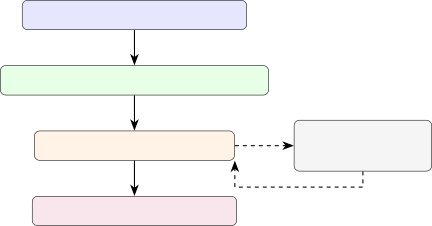
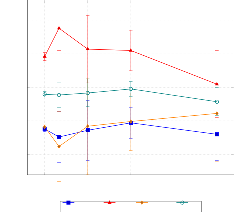

## Methods Article

### Method title

A Reproducible Optimisation Protocol for Calibrating Prompt-Based Large
Language Model Workflows in Evidence Synthesis

### Author

Teo
Susnjak

School of Mathematical and Computational Sciences

Massey University,

Auckland, New Zealand

Email: T.Susnjak@massey.ac.nz

### Keywords

Evidence synthesis automation; Language model calibration; Prompt
optimisation; Declarative programming; Systematic reviews; Reproducible
workflows

## Abstract

This methods article presents a reproducible calibration workflow for
prompt-based large language models (LLMs) in structured
evidence-synthesis tasks. The method separates the rules that define the
scientific task from the mutable prompt harness that frames and applies
them. It optimises that harness against labelled or reference examples
and an explicit task metric, then preserves the calibrated workflow as
an inspectable artefact with its specification, metric, settings, and
evaluation traces. The example code instantiates the protocol with DSPy
and GEPA tools, but the underlying logic can transfer to other
prompt-optimisation frameworks that support structured task definitions,
metric-guided search, and artefact reuse. Title and abstract screening
is the worked validation case because it provides labelled benchmark
data and clear evaluation metrics. The demonstrated workflow uses a
smaller student LLM for performing the scientific task execution and a
larger reflection LLM to steer the prompt optimisation process during
calibration. This work shows compilation, artefact round-tripping, and
how optimisation budget affects a smaller student model.

Key points:

- •
  Separate what the model must decide, the fixed rules, from how it is
  prompted to decide, the mutable prompt instructions.
- •
  Optimise the prompt automatically against labelled examples and a
  declared scoring function, rather than iterating manually.
- •
  Package the calibrated prompt with its rules, metric, settings,
  traces, and evaluation logs for inspection and reuse.

## Graphical abstract

![[Uncaptioned
image]](arxiv-2605-06937v1--3dd7a4b7c67b.figures/figure-1.webp)

## Specifications table

| Item                                  | Description                                                                                                                                            |
| ------------------------------------- | ------------------------------------------------------------------------------------------------------------------------------------------------------ |
| Subject area                          | Computer Science; Information Science                                                                                                                  |
| More specific subject area            | Evidence synthesis automation; research workflow automation; systematic review methods; language-model prompt optimisation; reproducible LLM workflows |
| Name of your method                   | Reproducible prompt calibration for structured evidence-synthesis LLM workflows                                                                        |
| Name and reference of original method | DSPy declarative language-model programming \[1, 2\]; GEPA reflective prompt evolution \[3\]                                                           |
| Resource availability                 | Companion Colab notebook, local test script, saved artefact, and validation summaries are provided with the manuscript materials.                      |

## Background

Large language models (LLMs) now offer a promising path for automating
systematic literature reviews (SLRs) and meta analyses \[4\]. Recent
studies show that models can support screening \[5\], data extraction
\[6\], quality assessment \[7\], and synthesis tasks \[8\]. Currently,
this promise has a practical limit. Performance depends not only on the
task and model, but also on prompt wording, model family,
output-generation settings (e.g., temperature and top-p parameters), and
the manual prompt-tweaking choices made during iterative development.
Studies show that prompt sensitivity varies across datasets and models.
Larger models are often more robust, but pockets of variability persist
even in stronger instruction-tuned systems \[9, 10, 11\]. Repeated
prompting is methodologically important because LLM outputs are
probabilistic and stability should be measured rather than assumed
\[12\]. These sensitivities matter most when researchers use smaller or
locally hosted models because these LLMs tend to be cheaper and more
privacy-preserving for sensitive domains. The consequence is that these
models often need more calibration before they behave as reliable
scientific instruments. In these cases, principled calibration can make
LLM-based evidence-synthesis workflows more reliable, repeatable, and
auditable.

### Prompt variability and the need for calibration

Natural language has been framed as a new programming interface for LLMs
\[13\], but this analogy understates its ambiguity relative to the rigid
syntax of conventional programming languages. Given that prompt
performance is often contingent on numerous factors \[9, 10\], prompt
engineering frequently turns into ad hoc manual refinement. While
studies report prompt-dependent variability on models of all sizes \[9,
11\] and brittleness in SLR automation \[14, 4\], they generally do not
provide reusable calibration protocols for structured evidence-synthesis
tasks that preserve repeatability and reproducibility. To that end, this
article treats prompt optimisation as calibration of a scientific
measurement instrument. The instrument is a workflow that maps a
structured research object, such as a title, abstract, full text, table,
rubric, or tool request, to a structured output or decision. Even though
larger and frontier commercial models may need less calibration, they
nonetheless require an auditable task definition and demonstrable
validation metric that support confidence in prompt stability and
accuracy.

This methodological study makes three contributions. First, it
formalises prompt optimisation as calibration of a mutable prompt
harness around a fixed scientific task contract. Second, it shows how an
executable metric can encode task requirements, output validity, and
workflow trade-offs, using title and abstract screening as the worked
validation case. Third, it defines a transparency pattern in which the
compiled artefact, fixed task specification, metric, optimisation
configuration, environment record, traces, and prediction logs are
retained as inspectable artefacts. These contributions are demonstrated
with DSPy, a declarative language model programming framework \[1, 2\],
and GEPA, a reflective prompt optimiser \[3\], but the protocol is
intended to generalise to other prompt-optimisation frameworks with
structured task definitions, executable metrics, and reusable compiled
outputs. Thus, the same protocol can be implemented in other
optimisation toolchains that support structured task definitions,
executable metrics, metric-guided search, and reusable outputs \[15\].

## Method details

### Overview

The method requires four ingredients: a fixed task contract, which
defines the scientific requirements; a mutable prompt harness, which
defines how those requirements are framed and operationalised for the
model; labelled or reference examples, which provide calibration and
held-out evaluation cases; and an executable metric, which scores
outputs against the task policy and provides feedback for optimisation.
Together, these components define the calibration setting. The protocol
performs bounded optimisation of the prompt harness against the metric
and preserves the calibrated workflow as a reusable artefact.

In DSPy, the calibrated workflow is represented as a language model (LM)
program. This does not mean a conventional software program in the usual
sense. It means a structured object that combines input fields, output
fields, task instructions, model calls, and evaluation logic. In this
article, program refers to this DSPy-style prompt-based workflow,
namely, the object that GEPA calibrates and that can later be saved,
reloaded, inspected, and reused. This work also does not introduce a new
prompt-optimisation algorithm. Instead, it contributes a reproducible
methodological pattern for applying existing prompt-optimisation
frameworks to structured evidence-synthesis and scientific LLM
workflows. The protocol demonstrates how to (1) fix the scientific task
contract, (2) calibrate the prompt harness around that contract, (3)
make the optimisation metric explicit, and (4) preserve the compiled
program with enough provenance for inspection and reuse.

Title and abstract screening is a helpful use case because it is a
common and well-defined evidence-synthesis task with labelled benchmark
data and clear evaluation metrics. The same calibration pattern can, in
principle, be adapted to other repeatable and structured
evidence-synthesis tasks, including data extraction,
study-characteristic coding, risk-of-bias support, evidence-domain
mapping, and search-query generation, provided that the task has
well-defined inputs, outputs, reference examples, and an executable
metric. The protocol is less directly applicable to open-ended
synthesis, exploratory hypothesis generation, or interpretive judgement
tasks where no stable reference output or scoring policy can be defined.
In those cases, the same packaging principles remain useful, but
metric-guided prompt optimisation becomes harder to validate. Again, the
critical requirement is that inputs, outputs, reference examples, and
task metrics can be clearly expressed. As a way of example, E gives an
alternative schematic for a data-extraction adaptation. The accompanying
Colab notebook¹¹ 1 MethodsX_GEPA_Tutorial.ipynb accessible at
[https://colab.research.google.com/drive/1gY_XzQ1h1EsK18bU136t2euiNWlo7sQC?usp=sharing](https://colab.research.google.com/drive/1gY_XzQ1h1EsK18bU136t2euiNWlo7sQC?usp=sharing),
contains the complete runnable Python source code. Meanwhile, the
article body here includes the key method-defining code snippets only
while small example records and notebook-specific execution cells are
confined to the Colab notebook to preserve readability. The presented
protocol has four steps:

1.  1.  define the task contract as a structured LM-program signature;
2.  2.  codify the task standard using labelled or reference examples and an
        executable metric;
3.  3.  compile the prompt harness with an optimisation framework under a
        fixed budget;
4.  4.  save, reload, evaluate, and package the compiled artefact.

Figure 1: Generic calibration workflow for structured prompt-based LLM
programs. The title-and-abstract screening experiment is one
instantiation of this workflow. Dashed arrows show the reflective
optimisation loop inside GEPA.

Figure 1 summarises the four-step calibration workflow. Step 1 defines
the scientific task contract, Step 2 turns that contract into labelled
or reference examples and an executable metric, Step 3 optimises the
prompt harness, and Step 4 packages the compiled artefact for
inspection, reuse, and evaluation. Table 1 clarifies what is meant by
“fixed” and “mutable” in this workflow, while Table 2 shows how the same
calibration pattern can be adapted and is generalisable beyond
title-and-abstract screening. The fixed/mutable distinction is best
understood as a three-layer structure. The first layer is the scientific
task contract: the substantive rules that define the task, such as
eligibility criteria, an extraction schema, a coding manual, a
risk-of-bias rubric, reference labels, or a review policy. The second
layer is the machine-readable interface: the input fields, output
fields, label set, parsing rules, and validity constraints that define
what the program must receive and return during a calibration run. These
first two layers remain fixed. The third layer is the mutable prompt
harness. This is the instructional wrapper around the fixed task
contract and interface. It may include task framing, domain context,
decision guidance, near-miss explanations, uncertainty handling,
examples of acceptable checks, and trace-format guidance. This layer is
where context engineering occurs, and it is the only layer GEPA is
permitted to revise and attempt to optimally frame for a target LLM. In
this article, the phrase “fixed task contract” thus refers to the
scientific task contract and the machine-readable interface together,
unless otherwise specified.

| Layer                      | Fixed or mutable?              | Examples                                                                                        |
| -------------------------- | ------------------------------ | ----------------------------------------------------------------------------------------------- |
| Scientific task contract   | Fixed                          | Eligibility criteria, extraction schema, coding manual, reference labels, review policy         |
| Machine-readable interface | Fixed within a calibration run | Input fields, output fields, label set, JSON or DSPy markers, parser, output-validity rules     |
| Prompt harness             | Mutable                        | Task wording, decision guidance, near-miss guidance, examples of checks, edge-case instructions |

Table 1: Three-layer architecture separating the scientific task rules,
the machine-readable interface, and the mutable prompt harness. During
calibration, GEPA may revise the prompt harness but not the scientific
task contract or the interface. Abstract screening is one instantiation
of this pattern.

| Task type                          | Fixed task contract                                      | Mutable prompt harness                                           | Possible metric                                         |
| ---------------------------------- | -------------------------------------------------------- | ---------------------------------------------------------------- | ------------------------------------------------------- |
| Title/abstract screening           | Inclusion/exclusion criteria and labelled records        | Screening instructions, uncertainty guidance, edge-case handling | Recall, precision, $`F_{1}`$, workload utility          |
| Data extraction                    | Extraction schema and reference extractions              | Extraction order, field-use guidance, evidence-span instructions | Exact or partial field match; evidence support score    |
| Full-text eligibility              | Eligibility criteria and adjudicated decisions           | Clause-by-clause assessment procedure                            | Agreement with reviewer labels; false-exclusion penalty |
| Risk-of-bias support               | Assessment rubric and expert ratings                     | Domain-specific rating instructions and justification format     | Weighted agreement; class-pair cost matrix              |
| Study-characteristic coding        | Coding manual and labelled examples                      | Category boundary guidance and examples                          | Macro-$`F_{1}`$; class-balanced agreement               |
| Evidence-domain mapping            | Domain taxonomy and validated mappings                   | Taxonomy application procedure                                   | Multiclass agreement; confusion-cost utility            |
| Search-query generation            | Search objective and known relevant studies              | Query-construction and expansion instructions                    | Recall of known studies; query precision proxy          |
| Tool selection or workflow routing | Available tools, routing policy, and reference decisions | Tool-choice instructions and failure-handling rules              | Tool-choice accuracy; cost-weighted routing utility     |

Table 2: Examples of repeatable evidence-synthesis and research-support
tasks that can be expressed using the same calibration protocol. The
present paper validates the protocol using title and abstract screening,
but the methodological pattern applies whenever a task can be specified
through structured inputs, outputs, reference examples, and an
executable metric.

### Materials and resources

The method shown uses Python, a prompt-optimisation framework, labelled
or reference examples, a student language model for task execution, and
a reflection language model for prompt revision. The student model is
the LLM of interest and is the target model which is to be deployed
after the prompt calibration. In settings with cost, privacy, or
governance constraints, this will usually be the smaller, less expensive
or locally hosted model. The reflection model can be more capable and
expensive because it is used only during compilation, and its role is
significantly less token-intensive. It inspects failures, reads metric
feedback, and proposes revised instructions for the student program.
This separation allows researchers to economically balance large LLM
reasoning capacity during calibration without requiring the same model
for routine task execution. Recent literature shows that calibrated
smaller models can, in some settings, even approach larger-model
performance at substantially lower cost \[16, 3\].

Temperature settings control the two roles differently. The student
model is run with temperature =0.0 to reduce avoidable variation during
evaluation and execution of the scientifc task. The reflection model is
run with a higher temperature, typically around temperature=1.0, because
reflective prompt optimisation benefits from creative and diverse
candidate revisions during search. The Colab notebook uses example
provider strings only; comparable smaller models can be substituted for
the student and stronger models can likewise be substituted for
reflection²² 2 API credentials must be supplied through environment
configuration as no key is stored in the notebook or manuscript code..
The notebook embeds a 12-record demonstration dataset with explicit
train, val, and test splits to keep the method visible. A separate
validation experiment tests the end-to-end workflow on non-toy data. The
tutorial code was tested with the package versions reported in D. GEPA
is an active optimisation component in the DSPy ecosystem, and its API
or serialisation behaviour may change across package releases. Readers
should therefore use the recorded package versions when reproducing the
tutorial exactly, and should treat newer versions as requiring
re-verification of the notebook, compiled artefact, and evaluation
outputs.

### Step 1: Define the task contract

The DSPy signature operationalises the task contract. It states what
information the model receives and what fields it must return. In
different evidence-synthesis workflows, this contract may describe a
screening decision (i.e., include or exclude), an extraction schema, a
coding rubric, a risk-of-bias judgement, or a tool-selection policy. It
also contains the starting prompt harness, which is a concise but
domain-rich description of the task, scope, reasoning or extraction
procedure, and guidance for satisfying the fixed output contract. This
context engineering step matters most for smaller student models. A thin
instruction gives GEPA little material to vary so it can propose a
meaningful alternative prompt, while a richer harness gives the
reflection model more structure to inspect and work with when examples
fail. Useful context includes task scope, near-miss cases, expected
evidence use, and the required form of the output.

Listing 1 mirrors the Colab notebook and gives the screening
instantiation used in the worked example. The same pattern can be
rewritten for other tasks. For data extraction, the input fields might
include the full text and extraction schema, while the output fields
might include structured study characteristics, effect sizes,
populations, interventions, comparators, outcomes, and evidence spans.
For tool selection, the input fields might include the task request and
available tools, while the output fields might include the selected
tool, arguments, and confidence or fallback policy. In the screening
instantiation, the inclusion and exclusion criteria are supplied through
the criteria input rather than being embedded as mutable prompt text.
This separation is deliberate. The criteria represent the scientific
decision rule agreed for the review; GEPA should not rewrite/mutate
them. GEPA is allowed to revise the prompt harness around those criteria
so that the student model applies them more reliably. Once defined, the
criteria are treated as fixed protocol data, being documented and held
constant for a calibration run.

For readability, STARTING_PROMPT is shown as the conceptual prompt
harness; in the DSPy implementation below, the same text is embedded in
the AbstractScreening signature docstring. In the validation experiment
as well as in the Colab notebook, the review criteria were extracted
from the full text of the systematic review \[17\] (referred to as Study
41), which is the secondary study identified as reference \[41\] in the
SESR-Eval \[18\] dataset; the frozen criteria block used in the
validation comparison is reported in the Appendix Listing 6.

import os

import dspy

STUDENT_MODEL = "openai/gpt-4.1-mini" \# Replace with the model to
calibrate.

REFLECTION_MODEL = "openai/gpt-5-mini" \# Use a stronger model for
reflection.

SEED = 10 \# Any fixed integer is acceptable; report it for
reproducibility.

api_key = os.getenv("OPENAI_API_KEY")

student_lm = dspy.LM(STUDENT_MODEL, temperature=0.0, api_key=api_key)

reflection_lm = dspy.LM(

REFLECTION_MODEL, temperature=1.0, max_tokens=16000, api_key=api_key

)

dspy.configure(lm=student_lm,
adapter=dspy.ChatAdapter(use_json_adapter_fallback=False))

\# Documentation-only copy of the starting harness.

\# The same text is embedded in the Signature docstring below.

STARTING_PROMPT = """

Screen titles and abstracts for a systematic review of
machine-learning-based

software defect prediction.

Context:

- The review focuses on primary empirical studies in software
  engineering.

- Relevant studies predict defects, bugs, faults, or fault-proneness in
  software artefacts.

- Relevant studies use machine learning and report an evaluation or
  comparison.

- Exclude reviews, surveys, bug triage, issue severity, duplicate-report
  detection,

and studies that do not predict defective software artefacts.

Output:

- checks: brief fragments that connect the decision to the criteria.

- label: exactly one token, include or exclude.

"""

class AbstractScreening(dspy.Signature):

"""

Screen titles and abstracts for a systematic review of
machine-learning-based

software defect prediction.

Context:

- The review focuses on primary empirical studies in software
  engineering.

- Relevant studies predict defects, bugs, faults, or fault-proneness in
  software artefacts.

- Relevant studies use machine learning and report an evaluation or
  comparison.

- Exclude reviews, surveys, bug triage, issue severity,
  duplicate-report detection,

and studies that do not predict defective software artefacts.

Output:

- checks: brief fragments that connect the decision to the criteria.

- label: exactly one token, include or exclude.

"""

criteria: str = dspy.InputField(desc="Inclusion and exclusion
criteria.")

title: str = dspy.InputField(desc="Paper title.")

abstract: str = dspy.InputField(desc="Paper abstract.")

checks: str = dspy.OutputField(desc="Short fragments supporting the
decision.")

label: str = dspy.OutputField(desc="Exactly one token: include or
exclude.")

class Screener(dspy.Module):

def \_\_init\_\_(self):

super().\_\_init\_\_()

self.classify = dspy.Predict(AbstractScreening)

def forward(self, criteria: str, title: str, abstract: str):

return self.classify(criteria=criteria, title=title, abstract=abstract)

Listing 1: DSPy task contract for title and abstract screening.

### Step 2: Codify the standard

Similar to machine learning, GEPA optimises against examples and a
metric, not against a vague instruction. The example dataset is split
into training examples that teach the task, the validation examples
which guide GEPA in optimising the prompts, and the held-out test
examples provide a small feasibility check.

The metric is task-specific because different evidence-synthesis tasks
have different error costs. In the general protocol, the metric defines
what the optimiser should reward, what output formats are valid, and how
competing errors should be balanced. For data extraction, this may mean
combining exact field matches, partial credit for near-correct values,
evidence-span checks, and penalties for unsupported or hallucinated
values. For risk-of-bias support, it may mean weighting disagreements so
that adjacent-category errors are treated as less serious than errors at
opposite ends of the rating scale. For tool-selection tasks, it may mean
rewarding the correct tool and valid arguments while penalising unsafe
or unnecessary tool calls. For screening, the main trade-off is between
false exclusions and false inclusions. Listing 2 therefore shows one
concrete metric for binary screening, where false exclusions are
penalised more strongly than false inclusions.

The metric is the most important site of methodological control. A
standard accuracy metric tells the optimiser whether an output was
correct, but it does not explain how the output failed or how severe
that failure is in the downstream workflow. GEPA can use richer
feedback: the metric can return both a numeric score and a short
natural-language diagnosis. This feedback gives the reflection model
information it can convert into better instructions/prompts. For
abstract screening, the metric should encode the review policy. Given
that missing a relevant study is usually worse than sending an
irrelevant study to full-text review, the example metric here (Listing 2
shows the compact metric used in the Colab notebook)³³ 3 The validation
experiments used the expanded version in B. It adds case-grounded
feedback and stricter field-format instructions while preserving the
same label-level asymmetric scoring. The supplementary validation code
also includes the helper utilities normalize_label() and
\_checks_format_ok(). Listing 10 shows them because label normalisation
and trace validation are part of the executable evaluation contract.
penalises false exclusions more strongly than false inclusions. It also
checks for a minimal justification in the checks field. This constraint
discourages prompt revisions that obtain the right label while dropping
the audit trail needed for reproducibility.

Metric design is highly tunable. Researchers can adjust the
false-positive score, add penalties for malformed output, require
criterion-level justifications, or add task-specific constraints such as
“route uncertain records to human review”. The metric should be fixed
before running the final optimisation and reported with the compiled
artefact.

def has_supporting_checks(pred):

checks = str(getattr(pred, "checks", "")).strip()

return bool(checks) and len(checks.split()) \>= 3

def screening_metric(gold, pred, trace=None, pred_name=None,
pred_trace=None):

expected = gold.label

observed = str(getattr(pred, "label", "")).strip().lower()

if observed not in {"include", "exclude"}:

score = 0.0

feedback = "The label must be exactly ’include’ or ’exclude’."

elif observed == expected:

score = 1.0

feedback = "Correct screening decision."

elif expected == "include" and observed == "exclude":

score = 0.0

feedback = (

"False negative. Missing relevant studies "

"is costly in screening."

)

else:

score = 0.4

feedback = (

"False positive. Include only when criteria "

"are clearly satisfied."

)

if not has_supporting_checks(pred):

score = min(score, 0.6)

feedback = (

feedback

- " Also provide brief checks that justify the label."

)

if pred_name is not None:

return dspy.Prediction(score=score, feedback=feedback)

return score

Listing 2: Compact GEPA metric used in the Colab notebook.

#### Designing the GEPA metric as a task-specific utility function

The compact metric in Listing 2 implements the error-cost policy for
binary screening. A plain exact-match objective would assign full credit
to a correct label and zero to any error. That is too coarse for
systematic review workflows, because a false negative removes a
potentially relevant study from the pipeline, whereas a false positive
mainly increases downstream screening workload. This asymmetry is well
established in screening research \[19\]. Table 3 shows the scoring used
in this example and how it can be adjusted for similar use cases.

| Gold label | Predicted label | Error type     | Screening meaning        | Score |
| ---------- | --------------- | -------------- | ------------------------ | ----- |
| include    | include         | correct        | relevant study retained  | 1.0   |
| exclude    | exclude         | correct        | irrelevant study removed | 1.0   |
| include    | exclude         | false negative | relevant study missed    | 0.0   |
| exclude    | include         | false positive | extra full-text workload | 0.4   |

Table 3: Asymmetric scoring for binary screening. The false-positive
value (0.4) is a policy choice: it treats a false inclusion as clearly
inferior to a correct decision while distinguishing it from a false
exclusion, which is the more severe screening failure.

The false-positive score of 0.4 is a policy parameter rather than a
universal screening constant. Increasing this value makes the optimiser
more tolerant of over-inclusion and can shift the calibrated program
towards higher recall and higher downstream full-text screening
workload. Decreasing it increases pressure for precision, but may raise
the risk of false exclusions. Users applying this protocol to a new
review should therefore report the chosen value and, where possible,
perform a sensitivity analysis over plausible values such as 0.2, 0.4,
and 0.6. The present validation uses 0.4 as a moderate partial-credit
setting to demonstrate the protocol, not as a recommended default for
all evidence-synthesis tasks.

The GEPA metric should be reported as a calibration-time utility
function rather than as the sole performance measure. During
optimisation, it combines label correctness, asymmetric error costs,
output-validity checks, and textual feedback for reflection. After
optimisation, performance should still be reported on held-out records
using conventional measures such as accuracy, precision, recall, and
$`F_{1}`$.  B provides the component-level details, shows how label
normalisation and trace validation were implemented, and discusses how
this design extends to multiclass screening.

#### Why GEPA rather than few-shot optimisation?

| Approach               | What it optimises                         | Reflection model? | Best suited for                                          | Limitation                                          |
| ---------------------- | ----------------------------------------- | ----------------- | -------------------------------------------------------- | --------------------------------------------------- |
| Manual prompt revision | Human-written instructions                | No                | Small exploratory tasks                                  | Poor audit trail; low reproducibility               |
| Few-shot bootstrapping | Demonstration selection                   | No or optional    | Tasks where examples drive behaviour                     | Less direct instruction repair                      |
| GEPA                   | Instruction harness using metric feedback | Yes               | Boundary cases, structured outputs, task-policy feedback | Higher calibration cost                             |
| Manual reflection loop | Human- or LLM-generated revisions         | Optional          | Framework-agnostic settings                              | Less standardised packaging                         |
| Fine-tuning            | Model weights                             | No at inference   | Large labelled datasets                                  | Higher setup cost; less prompt-level inspectability |

Table 4: Comparison of prompt-calibration and model-adaptation
strategies relevant to structured evidence-synthesis workflows.

GEPA is used here because the protocol requires feedback-rich revision
of the prompt harness, not only selection or bootstrapping of few-shot
examples. Few-shot optimisers are useful when the main task is to choose
demonstrations for inclusion in a prompt. Structured evidence-synthesis
tasks often fail at boundary conditions where a model may include a
near-miss study, over-apply an exclusion criterion, omit an evidence
field, or choose the wrong workflow tool. These failures are better
addressed by revising task instructions from case-grounded metric
feedback while preserving the fixed task contract and machine-readable
interface. Table 4 situates GEPA among common alternatives.

### Step 3: Compile the program with GEPA

With the task contract, examples, and metric fixed, the next step is to
compile the unoptimised Screener. Listing 3 shows the minimal GEPA
compilation call used in the Colab tutorial.

student = Screener()

gepa = dspy.GEPA(

metric=screening_metric,

reflection_lm=reflection_lm,

max_full_evals=2,

reflection_minibatch_size=2,

seed=SEED,

)

compiled_screener = gepa.compile(student, trainset=trainset,
valset=valset)

Listing 3: Bounded GEPA compilation step.

The main budget parameter is max_full_evals. It controls how many
candidate program variants GEPA can evaluate before returning a compiled
or optimised program. Larger values give GEPA more opportunity to
improve the prompt harness, but it increases the cost and may
over-specialise when the validation set is small. The example uses
max_full_evals=2 only to keep the Colab run inexpensive. The validation
experiment varies this parameter, reported as max_eval, to examine the
cost-performance trade-off.

reflection_minibatch_size controls how many examples are shown to the
reflection model when proposing revised instructions. Small minibatches
are cheap and expose local errors; larger minibatches can reveal broader
failure patterns, but may mix unrelated cases and increase cost. For
small tutorials, values of 2 or 3 are sufficient. For real
evidence-synthesis tasks, this value should be increased only when
enough diverse labelled or reference examples are available.

| Parameter                 | Controls                    | Increase when                                                                                                  | Risk                |
| ------------------------- | --------------------------- | -------------------------------------------------------------------------------------------------------------- | ------------------- |
| max_full_evals            | Search budget               | Held-out performance remains below the target operating point and validation examples are sufficiently diverse | Over-specialisation |
| reflection_minibatch_size | Examples shown to reflector | Failures are diverse                                                                                           | Diluted feedback    |
| num_threads               | Parallel evaluation         | Runtime too long                                                                                               | Rate limits         |
| temperature (reflection)  | Revision diversity          | Revisions too similar                                                                                          | Unstable runs       |

Table 5: Key GEPA parameters and practical guidance for tuning.

Other parameters are implementation controls. num_threads affects
evaluation speed, track_stats supports debugging and trace reporting,
and skip_perfect_score controls whether already-correct examples are
omitted from reflection. Table 5 summarises the parameters readers need
to understand first. After compilation, the revised instruction text can
be inspected and saved as part of the compiled DSPy artefact rather than
treated as an undocumented manual prompt edit.  A shows the relationship
between the starting harness and a compiled harness.

#### Cost and budget reporting

max_full_evals should be reported as both an optimisation hyperparameter
and a cost driver. GEPA cost depends on student-model evaluations,
reflection-model calls, validation-set size, minibatch size, maximum
reflection tokens, provider pricing, and retry behaviour. When
available, users should record model calls, input tokens, output tokens,
wall-clock time, and provider cost. When token accounting is
unavailable, they should at least report the GEPA budget, validation-set
size, reflection minibatch size, model identifiers, temperatures, seeds,
and execution date. Calibration cost is usually one-off or occasional,
so it should be interpreted relative to the number of future records,
reviews, or reruns over which the compiled artefact will be reused.
Table 6 reports the budget and model settings available for this study.

| Setting             | Student model                         | Reflection model   | max_full_evals | Seeds              |
| ------------------- | ------------------------------------- | ------------------ | -------------- | ------------------ |
| Tutorial smoke test | openai/gpt-4.1-mini                   | openai/gpt-5-mini  | 1              | 10                 |
| Validation ablation | openrouter/qwen/ qwen-2.5-7b-instruct | openai/ gpt-5-mini | 2, 6, 12, 24   | 10, 15, 25, 35, 42 |

Table 6: Budget and model settings for Colab notebook verification and
archived validation. The tutorial used reflection_minibatch_size=2; the
validation ablation used reflection_minibatch_size=8. Exact token-level
cost was not available from the local execution logs. Future deployments
should log model calls, input tokens, output tokens, wall-clock time,
provider cost, model identifiers, temperatures, execution date,
reflection_minibatch_size, and max_full_evals.

### Step 4: Package and reuse the artefact

Next, the compiled program should be saved and reloaded before being
used in a study, turning the prompt optimisation into a reusable
research artefact. Listing 4 evaluates the compiled program, saves it,
reloads it into a fresh Screener, and verifies that the reloaded
artefact produces the same held-out predictions.

def evaluate(program, examples):

correct = 0

predictions = \[\]

for example in examples:

pred = program(

criteria=example.criteria,

title=example.title,

abstract=example.abstract,

)

observed = str(getattr(pred, "label", "")).strip().lower()

expected = str(example.label).strip().lower()

predictions.append((expected, observed))

correct += int(observed == expected)

return {

"accuracy": correct / len(examples),

"n": len(examples),

"predictions": predictions,

}

test_metrics = evaluate(compiled_screener, testset)

compiled_screener.save("compiled_abstract_screener.json")

reloaded_screener = Screener()

reloaded_screener.load("compiled_abstract_screener.json")

reload_metrics = evaluate(reloaded_screener, testset)

assert reload_metrics\["predictions"\] == test_metrics\["predictions"\]

Listing 4: Evaluation and artefact round trip.

The Colab notebook uses this round-trip check only to verify artefact
reuse⁴⁴ 4 The larger validation at the end of the notebook below
evaluates the protocol on SESR-Eval records. In the JSON state-only save
used here, DSPy preserves the compiled program state needed to reload
the same program architecture, including the compiled signature or
instruction state and any stored predictor state such as demonstrations
or model assignments. It does not by itself preserve the full research
provenance needed to interpret or reproduce the calibration. That
provenance must be recorded separately, including the dataset version,
split identifiers, metric source, optimisation configuration, model and
provider details, package versions, seeds, adapter settings, and
evaluation or prediction logs. DSPy also supports whole-program saving
with save_program=True, but that option uses cloudpickle and still does
not replace the need to document the dataset, metric, splits,
provider-side model version, optimisation configuration, and evaluation
logs.

### Transparency and artefact-level inspectability

A central aim of the protocol is to make prompt calibration inspectable
rather than ephemeral. In ordinary prompt engineering, the final prompt
is often the only visible object, while failed variants, metric
assumptions, data splits, and output-normalisation decisions are often
lost. In this workflow, the compiled LLM workflow is treated as a
research artefact with provenance. The saved artefact should therefore
be accompanied by the fixed task specification, starting signature,
optimisation metric, GEPA configuration, random seeds, split
identifiers, compiled prompt harness, software environment, and held-out
prediction or output logs. In this workflow, the compiled LLM workflow
is treated as a research artefact with provenance. This packaging
supports two forms of reproducibility. The first is execution-level
reuse: the saved program can be reloaded and evaluated again under
recorded conditions. The second is methodological transparency: the task
specification, metric, prompt harness, traces, and evaluation outputs
can be inspected to determine why a calibration was selected and what
trade-offs it encodes. The artefact should therefore be treated as an
inspectable research object, not as a guarantee of provider-independent
deterministic reproduction.

### Tuning and troubleshooting guidance

Users should tune the method in the following order: (1) check data and
label consistency; (2) refine the metric so that feedback identifies
specific failure types; (3) increase max_full_evals; and (4) adjust
reflection_minibatch_size. Table 7 lists common failure modes and first
remedies.

| Symptom                      | Likely cause                                                   | First remedy                                                                             |
| ---------------------------- | -------------------------------------------------------------- | ---------------------------------------------------------------------------------------- |
| Invalid outputs              | Weak output contract                                           | Tighten label field description; add metric penalty for out-of-schema labels             |
| Over-selective decisions     | Recall pressure too weak; false negatives under-penalised      | Strengthen false-negative feedback; add examples where relevant studies are easy to miss |
| Over-permissive decisions    | False-positive score too generous; inclusion evidence too weak | Lower false-positive partial credit; require explicit evidence for inclusion criteria    |
| Validation rises, test drops | Over-specialisation                                            | Reduce budget; increase validation diversity; simplify the metric                        |
| Trace missing or malformed   | Output trace not rewarded                                      | Cap score for missing checks; require criterion-level fragments                          |

Table 7: Common failure modes and recommended first remedies.

### Minimal replication recipe

The following steps summarise the complete protocol. Each step
corresponds to a section above and a code in the companion notebook.

1.  1.  Install the package versions recorded in  D.
2.  2.  Load source records or documents for the target evidence-synthesis
        task.
3.  3.  Freeze the task contract, such as criteria, rubric, extraction
        schema, coding manual, or tool policy.
4.  4.  Define a DSPy Signature that declares inputs, outputs, and the
        starting prompt harness.
5.  5.  Build dspy.Example objects with explicit train/validation/test
        splits.
6.  6.  Define the task metric with output-validity checks, feedback, and
        task-specific error weighting.
7.  7.  Run GEPA with a fixed seed and bounded budget, such as
        max_full_evals.
8.  8.  Save the compiled program to a JSON artefact.
9.  9.  Reload the artefact into a fresh program object and verify matching
        outputs.
10. 10. Report task-specific held-out metrics, such as accuracy, precision,
        recall, $`F_{1}`$, extraction agreement, field-level match, weighted
        agreement, or routing accuracy.

## Method validation

This validation checks whether the protocol can expose and document
calibration trade-offs under a fixed structured task contract. It is not
intended to rank models or to make a general performance claim about
GEPA. It demonstrates three points: a smaller student model can be
calibrated under a transparent protocol, optimisation budget can change
the resulting operating point, and the compiled artefact can be
evaluated and reused with documented provenance.⁵⁵ 5 The validation was
conducted in a separate experimental workflow rather than in the
companion Colab tutorial notebook. The Colab notebook is an executable
teaching artefact that demonstrates the code path, compilation, saving,
reloading, and adaptation steps on a small example.

The validation was instantiated as a binary title-and-abstract screening
task using Qwen-2.5-7B-instruct as the student model and SESR-Eval Study
41 as the benchmark case. Study 41 contains 1,194 candidate records for
the secondary review Machine learning in software defect prediction: A
business-driven systematic mapping study \[17\], and is one of 24
software-engineering secondary-study screening datasets in SESR-Eval
\[18\]. The inclusion and exclusion criteria were extracted from the
Study 41 source article, reviewed as a compact task contract, and frozen
before calibration. Across five random seeds, stratified
train/validation/test splits were generated under the same fixed
criteria.

The principal comparator was the structured unoptimised DSPy program,
evaluated before calling gepa.compile(). It used the same criteria,
title, and abstract inputs, the same checks and label outputs, and the
same student model, temperature, adapter configuration, label
normalisation, held-out examples, and confusion-matrix evaluation as the
GEPA conditions. The paired deltas therefore compare the same structured
output contract before and after GEPA prompt-harness calibration. Where
a label-only direct prompt is reported, it is only a practical reference
for ordinary direct prompting, not the principal comparator for
attributing the effect of GEPA calibration.  A.2 defines the structured
baseline. The validation varied only the GEPA budget. The tested
max_full_evals values were 2, 6, 12, and 24, reported as max_eval. The
metric, model, data splits, and evaluation procedure were held constant.
Performance was computed on the held-out test set using confusion-matrix
counts and is reported as mean $`\pm`$ sample standard deviation across
five runs.

The observed shifts were modest and should be read as operating-point
changes in this validation setting, not as evidence of universal
optimisation advantage. The structured baseline achieved accuracy
$`0.788\pm 0.004`$ and $`F_{1}=0.840\pm 0.004`$, with recall
$`0.896\pm 0.006`$ and precision $`0.791\pm 0.003`$ for the include
class. A low GEPA budget ($`\mathrm{max\_eval}=2`$) produced the highest
recall ($`0.938\pm 0.033`$) but increased the predicted include rate,
implying more downstream full-text screening work. The most balanced
setting in this validation was $`\mathrm{max\_eval}=12`$, with accuracy
$`0.797\pm 0.023`$, $`F_{1}=0.848\pm 0.011`$, and label-level utility
$`0.855\pm 0.007`$. Relative to the structured baseline, this setting
had $`\Delta F_{1}=+0.008\pm 0.008`$ and $`\Delta`$utility
$`=+0.008\pm 0.005`$, while changing the predicted include rate by only
$`+0.002\pm 0.061`$. A larger budget ($`\mathrm{max\_eval}=24`$)
produced lower mean $`F_{1}`$ and utility in this validation setting,
illustrating why optimisation budget should be treated as a
hyperparameter rather than a simple benefit lever. Figure 2 visualises
these operating-point shifts; full replication settings, metric tables,
paired deltas, and SESR-Eval contextual comparisons are provided in  C.

Figure 2: Budget-sensitive operating points across GEPA settings. BL
denotes the structured unoptimised baseline. Points show means across
five runs; error bars show $`\pm 1`$ sample standard deviation. The
figure shows that increasing GEPA budget did not produce a monotone
improvement curve in this validation: low budget favoured recall, a
moderate budget gave the best balanced mean performance, and the largest
tested budget reduced mean $`F_{1}`$ and utility.

## Limitations

This method calibrates a model to apply a documented task contract; it
does not replace expert judgement in evidence synthesis. Borderline
eligibility decisions, ambiguous extracted fields, risk-of-bias
judgements, and final synthesis decisions should remain under human
oversight. Performance depends on the quality and representativeness of
the labelled or reference examples, the stability of the selected model
provider, and the fidelity of the metric to the task contract. Very
small validation sets can also lead GEPA to over-specialise to local
examples, especially when max_full_evals is increased without more
diverse validation data.

The validation is limited to one binary screening task, one benchmark
case, one student model, and a small number of repeated runs. The paired
GEPA deltas should therefore be read as operating-point changes under a
fixed structured contract, not as a general claim that GEPA will improve
all evidence-synthesis tasks or all models. Other tasks, including
extraction, coding, risk-of-bias support, and tool routing, require
task-specific signatures, reference examples, and metrics, although the
calibration-and-packaging protocol remains the same. Exact numerical
reproduction is not guaranteed across model-provider changes. API
adapters, serving infrastructure, tokenizer behaviour, and provider-side
model versions can change, so reproduction may require pinning the model
identifier, SDK, adapter versions, package versions, and execution
environment recorded in  D.

## Ethics statements

This study used public benchmark records and published secondary-study
materials, and did not involve human participants, private personal
data, intervention, or recruitment. Institutional ethics approval was
therefore not required.

Funding:  
This research did not receive any specific grant from funding agencies
in the public, commercial, or not-for-profit sectors.

## Declaration of interests

The author declares that he has no known competing financial interests
or personal relationships that could have appeared to influence the work
reported in this paper.

## Declaration of generative AI and AI-assisted technologies in the manuscript preparation process

During the preparation of this work, the author used generative AI and
AI-assisted tools to support manuscript drafting, language refinement,
brainstorming, code checking, and verification of selected
implementation details. After using these tools, the author reviewed,
edited, and verified the content as needed and takes full responsibility
for the final manuscript, code, analyses, and conclusions.

## Supplementary material and/or additional information

Supplementary materials include the executable companion Colab tutorial
notebook, the local smoke-test script, the saved compiled-program
artefact generated by the tutorial, and the small example dataset
embedded in the notebook. The larger validation uses SESR-Eval Study 41
records and the Study 41 source article cited above. Table 8 provides a
compact checklist of reported reproducibility items and their locations.
The Colab notebook was executed end-to-end in a clean runtime on 24
April 2026 using the package versions reported in Appendix D. The saved
artefact reloaded successfully and produced the same smoke-test
predictions and metrics as the compiled programme in the Colab run.

| Item                                                              | Reported? | Location               |
| ----------------------------------------------------------------- | --------- | ---------------------- |
| Model identifiers (student + reflection)                          | Yes       | Listing 1, D           |
| Random seeds                                                      | Yes       | Table 11               |
| Train/validation/test split sizes                                 | Yes       | Table 11               |
| Structured baseline, direct-prompt reference, and frozen criteria | Yes       | A.1, A.2               |
| Metric source code                                                | Yes       | Listing 2, B           |
| Execution environment                                             | Yes       | D                      |
| Saved compiled artefact                                           | Yes       | Supplementary material |
| Evaluation metrics reported                                       | Yes       | Tables 12–13           |

Table 8: Reproducibility checklist for the validation experiment.

## References

- \[1\] O. Khattab, A. Singhvi, P. Maheshwari, et al., DSPy: Compiling
  declarative language model calls into self-improving pipelines, arXiv
  preprint arXiv:2310.03714 (2023).
- \[2\] K. Opsahl-Ong, M. J. Ryan, J. Purtell, D. Broman, C. Potts,
  M. Zaharia, O. Khattab, Optimizing instructions and demonstrations for
  multi-stage language model programs, in: 2024 Conference on Empirical
  Methods in Natural Language Processing, EMNLP 2024, Hybrid, Miami,
  United States of America, Nov 12 2024-Nov 16 2024, Association for
  Computational Linguistics (ACL), 2024, pp. 9340–9366.
- \[3\] L. A. Agrawal, S. Tan, D. Soylu, N. Ziems, R. Khare,
  K. Opsahl-Ong, A. Singhvi, H. Shandilya, M. J. Ryan, M. Jiang,
  C. Potts, K. Sen, A. G. Dimakis, I. Stoica, D. Klein, M. Zaharia,
  O. Khattab, [Gepa: Reflective prompt evolution can outperform
  reinforcement learning](https://arxiv.org/abs/2507.19457) (2025).
  [arXiv:2507.19457](http://arxiv.org/abs/2507.19457).  
  URL
  [https://arxiv.org/abs/2507.19457](https://arxiv.org/abs/2507.19457)
- \[4\] J.-L. Lieberum, M. Töws, M. Metzendorf, F. Heilmeyer,
  W. Siemens, C. Haverkamp, D. Böhringer, J. Meerpohl,
  A. Eisele-Metzger, Large language models for conducting systematic
  reviews: on the rise, but not yet ready for use—a scoping review,
  Journal of Clinical Epidemiology 181 (2025) 111746.
  [doi:10.1016/j.jclinepi.2025.111746](https://doi.org/10.1016/j.jclinepi.2025.111746).
- \[5\] M. Sujau, M. Wada, E. Vallée, N. Hillis, T. Sušnjak,
  [Accelerating disease model parameter extraction: An llm-based ranking
  approach to select initial studies for literature review
  automation](https://www.mdpi.com/2504-4990/7/2/28), Machine Learning
  and Knowledge Extraction 7 (2) (2025).
  [doi:10.3390/make7020028](https://doi.org/10.3390/make7020028).  
  URL
  [https://www.mdpi.com/2504-4990/7/2/28](https://www.mdpi.com/2504-4990/7/2/28)
- \[6\] L. Li, A. Mathrani, T. Susnjak, What level of automation is
  “good enough”? a benchmark of large language models for meta-analysis
  data extraction, Research Synthesis Methods (2026)
  1–22[doi:10.1017/rsm.2025.10066](https://doi.org/10.1017/rsm.2025.10066).
- \[7\] L. Li, A. Mathrani, T. Susnjak, [Automated risk-of-bias
  assessment of randomized controlled trials: A first look at a
  gepa-trained programmatic prompting
  framework](https://arxiv.org/abs/2512.01452) (2025).
  [arXiv:2512.01452](http://arxiv.org/abs/2512.01452).  
  URL
  [https://arxiv.org/abs/2512.01452](https://arxiv.org/abs/2512.01452)
- \[8\] T. Susnjak, P. Hwang, N. Reyes, A. L. C. Barczak, T. McIntosh,
  S. Ranathunga, [Automating research synthesis with domain-specific
  large language model fine-tuning](https://doi.org/10.1145/3715964),
  ACM Trans. Knowl. Discov. Data 19 (3) (Mar. 2025).
  [doi:10.1145/3715964](https://doi.org/10.1145/3715964).  
  URL [https://doi.org/10.1145/3715964](https://doi.org/10.1145/3715964)
- \[9\] J. Zhuo, S. Zhang, X. Fang, H. Duan, D. Lin, K. Chen, [ProSA:
  Assessing and understanding the prompt sensitivity of
  LLMs](https://aclanthology.org/2024.findings-emnlp.108/), in: Findings
  of the Association for Computational Linguistics: EMNLP 2024,
  Association for Computational Linguistics, Miami, Florida, USA, 2024,
  pp. 1950–1976.
  [doi:10.18653/v1/2024.findings-emnlp.108](https://doi.org/10.18653/v1/2024.findings-emnlp.108).  
  URL
  [https://aclanthology.org/2024.findings-emnlp.108/](https://aclanthology.org/2024.findings-emnlp.108/)
- \[10\] A. Chatterjee, H. S. V. N. S. K. Renduchintala, S. Bhatia,
  T. Chakraborty, [POSIX: A prompt sensitivity index for large language
  models](https://aclanthology.org/2024.findings-emnlp.852/), in:
  Findings of the Association for Computational Linguistics: EMNLP 2024,
  Association for Computational Linguistics, Miami, Florida, USA, 2024,
  pp. 14550–14565.
  [doi:10.18653/v1/2024.findings-emnlp.852](https://doi.org/10.18653/v1/2024.findings-emnlp.852).  
  URL
  [https://aclanthology.org/2024.findings-emnlp.852/](https://aclanthology.org/2024.findings-emnlp.852/)
- \[11\] L. Zhou, W. Schellaert, F. Martínez-Plumed, Y. Moros-Daval,
  C. Ferri, J. Hernández-Orallo, Larger and more instructable language
  models become less reliable, Nature (634) (2024) 61–68.
  [doi:10.1038/s41586-024-07930-y](https://doi.org/10.1038/s41586-024-07930-y).
- \[12\] R. J. Gallo, M. Baiocchi, T. R. Savage, J. H. Chen,
  [Establishing best practices in large language model research: an
  application to repeat
  prompting](https://doi.org/10.1093/jamia/ocae294), Journal of the
  American Medical Informatics Association 32 (2) (2025) 386–390.
  [doi:10.1093/jamia/ocae294](https://doi.org/10.1093/jamia/ocae294).  
  URL
  [https://doi.org/10.1093/jamia/ocae294](https://doi.org/10.1093/jamia/ocae294)
- \[13\] M. Kearns, [Responsible ai in the generative
  era](https://www.amazon.science/blog/responsible-ai-in-the-generative-era),
  accessed: 2025-08-01 (May 2023).  
  URL
  [https://www.amazon.science/blog/responsible-ai-in-the-generative-era](https://www.amazon.science/blog/responsible-ai-in-the-generative-era)
- \[14\] M. Staudinger, W. Kusa, F. Piroi, A. Lipani, A. Hanbury, A
  reproducibility and generalizability study of large language models
  for query generation, in: Proceedings of the 2024 Annual International
  ACM SIGIR Conference on Research and Development in Information
  Retrieval in the Asia Pacific Region, 2024, pp. 186–196.
- \[15\] C. Spiess, M. Vaziri, L. Mandel, M. Hirzel, [Autopdl: Automatic
  prompt optimization for llm
  agents](https://proceedings.mlr.press/v293/spiess25a.html), in:
  L. Akoglu, C. Doerr, J. N. van Rijn, R. Garnett, J. R. Gardner (Eds.),
  Proceedings of the Fourth International Conference on Automated
  Machine Learning, Vol. 293 of Proceedings of Machine Learning
  Research, PMLR, 2025, pp. 13/1–20.  
  URL
  [https://proceedings.mlr.press/v293/spiess25a.html](https://proceedings.mlr.press/v293/spiess25a.html)
- \[16\] Y. Zhao, P. Wang, H. F. Yang, How to auto-optimize prompts for
  domain tasks? adaptive prompting and reasoning through evolutionary
  domain knowledge adaptation, in: Proceedings of the 39th Conference on
  Neural Information Processing Systems, 2025.
- \[17\] S. Stradowski, L. Madeyski, [Machine learning in software
  defect prediction: A business-driven systematic mapping
  study](https://doi.org/10.1016/j.infsof.2022.107128), Information and
  Software Technology 155 (2023) 107128.
  [doi:10.1016/j.infsof.2022.107128](https://doi.org/10.1016/j.infsof.2022.107128).  
  URL
  [https://doi.org/10.1016/j.infsof.2022.107128](https://doi.org/10.1016/j.infsof.2022.107128)
- \[18\] A. Huotala, M. Kuutila, M. Mäntylä, [SESR-Eval: Dataset for
  evaluating LLMs in the title-abstract screening of systematic
  reviews](https://arxiv.org/abs/2507.19027) (2025).
  [arXiv:2507.19027](http://arxiv.org/abs/2507.19027).  
  URL
  [https://arxiv.org/abs/2507.19027](https://arxiv.org/abs/2507.19027)
- \[19\] S. Matwin, A. Kouznetsov, D. Inkpen, O. Frunza, P. O’Blenis, [A
  new algorithm for reducing the workload of experts in performing
  systematic reviews](https://doi.org/10.1136/jamia.2010.004325),
  Journal of the American Medical Informatics Association 17 (4) (2010)
  446–453.
  [doi:10.1136/jamia.2010.004325](https://doi.org/10.1136/jamia.2010.004325).  
  URL
  [https://doi.org/10.1136/jamia.2010.004325](https://doi.org/10.1136/jamia.2010.004325)

## Appendix A Prompt references and prompt harnesses

The code listings in the article omit the full embedded example records,
but the prompt text remains part of the method. The label-only
direct-prompt reference documents an ordinary manual-instruction
comparator, while the prompt harness records the part of the DSPy
program that GEPA may revise. The principal validation baseline is the
structured unoptimised DSPy program described in  A.2. The inclusion and
exclusion criteria are not part of the mutable harness; they are
supplied as fixed inputs through the criteria field. This prevents the
optimiser from changing the review protocol while allowing it to change
how the student model interprets and applies that protocol.

This appendix reports the label-only direct-prompt reference, frozen
criteria block, structured unoptimised baseline, starting prompt
harness, and an excerpt from a compiled harness. These materials allow
readers to inspect what was fixed, what was mutable, and what GEPA
changed during calibration. This reporting choice matters because two
prompt-based LLM workflows may use the same model and nominally the same
task criteria, yet differ materially in task framing, output contract,
uncertainty policy, and post-processing.

### A.1 Label-only direct-prompt reference and frozen criteria

Listing 5 gives the exact label-only direct-prompt reference, and
Listing 6 gives the frozen criteria block. The prompt requested only a
single screening label and did not require a structured checks trace. It
is therefore reported as a practical reference for ordinary direct
prompting, not as the principal comparator for attributing the effect of
GEPA calibration. The main validation comparison uses the structured
unoptimised DSPy baseline described in  A.2.

BASELINE_PROMPT = """

You are screening research papers by TITLE and ABSTRACT against the

provided INCLUSION/EXCLUSION criteria.

Output MUST be exactly one label:

- include : should be included for full-text review

- exclude : should be excluded

If criteria are missing or ambiguous or your confidence is low, then be

more conservative and give preference to including the study.

""".strip()

Listing 5: Label-only direct-prompt reference.

CRITERIA_TEXT = """

INCLUSION CRITERIA:

- The paper is an empirical study in software engineering

(field of computer science).

- The paper is a primary study.

- The paper is focused on predicting defects in a software system

using machine learning techniques.

- The paper evaluates, analyses, or compares prediction methods and

provides evidence for efficiency.

EXCLUSION CRITERIA:

- The paper was not a peer-reviewed article, conference proceeding,

or book chapter.

- The publication’s language was other than English.

- The same or limited results were already published and included in

another study.

"""

Listing 6: Frozen criteria block used in the validation comparison.

### A.2 Structured unoptimised DSPy baseline

The structured unoptimised baseline used the same AbstractScreening
signature and Screener module as the GEPA-optimised programs, but was
evaluated before calling gepa.compile(). It therefore retained the same
input fields, output fields, adapter, student model, temperature,
criteria text, label normalisation, and held-out evaluation records as
the GEPA conditions. This baseline isolates the effect of GEPA
optimisation from the effect of using a structured output contract.

Operationally, the structured baseline is the unoptimised DSPy module
produced by student = Screener(). The GEPA condition begins from the
same module but passes it to gepa.compile( student, trainset=trainset,
valset=valset) before held-out evaluation. This pairing keeps the
machine-readable interface constant while allowing GEPA to revise the
prompt harness during calibration.

### A.3 Starting prompt harness

Listing 7 shows the mutable starting prompt harness used in the Colab
notebook and as the initial GEPA calibration target.

Screen titles and abstracts for a systematic review of
machine-learning-based

software defect prediction.

Context:

- The review focuses on primary empirical studies in software
  engineering.

- Relevant studies predict defects, bugs, faults, or fault-proneness in
  software artefacts.

- Relevant studies use machine learning and report an evaluation or
  comparison.

- Exclude reviews, surveys, bug triage, issue severity, duplicate-report
  detection,

and studies that do not predict defective software artefacts.

Output:

- checks: brief fragments that connect the decision to the criteria.

- label: exactly one token, include or exclude.

Listing 7: Starting prompt harness used in the Colab notebook and as the
mutable starting point for GEPA.

### A.4 Example of a compiled harness

The exact compiled text depends on the labelled examples, metric
feedback, reflection model, and optimisation budget. A compiled harness
often expands the starting prompt by adding failure-specific guidance,
clarifying near-miss categories, and giving more explicit instructions
for satisfying the fixed output contract. Listing 8 gives an excerpt
from an actual optimised prompt generated during validation. Compared
with the starting harness, the compiled harness is more explicit about
scope boundaries, clause-level checks, conservative inclusion policy,
and the DSPy field structure required by the evaluation pipeline.

You are screening research papers by TITLE and ABSTRACT against the

provided INCLUSION/EXCLUSION criteria.

Task summary

- Decide whether a paper is relevant for a narrow systematic review that

collects primary, peer-reviewed empirical studies that build, evaluate,

or compare machine-learning models for predicting software

defects/bugs/faults/failures.

- Use only the provided criteria, TITLE, and ABSTRACT.

- Output must use the exact DSPy markers and format described below and

nothing else.

Required output format (exact tokens and ordering)

- Return exactly three DSPy blocks in this order and no other text:

\[\[ \## checks \## \]\]

(2--5 bullet fragments)

\[\[ \## label \## \]\]

(exactly one token: include or exclude)

\[\[ \## completed \## \]\]

Rules for the \[\[ \## checks \## \]\] block

- Provide 2--5 bullets.

- Each bullet is a short fragment, \<= 8 words.

- Bullets must name satisfied or violated inclusion or exclusion
  criteria.

- Do not add prose or extra explanation in this block.

Interpretation and decision policy

- Treat original experiments, validation studies, and measured results

as evidence of an empirical primary study.

- Include studies predicting defects, fault-proneness, defect density,

change-proneness, build breakage, or security bugs when machine

learning is used and evaluation is reported.

- Exclude bug-report severity, priority, assignee, or triage tasks
  unless

they are explicitly framed as defect prediction.

- If peer-review status or duplication is unclear, prefer include rather

than exclude.

Listing 8: Excerpt from an optimised screening harness produced by GEPA.

## Appendix B Metric-design notes for GEPA optimisation

The main text presents a compact metric because the article body teaches
the protocol rather than reproducing every local experimental guardrail.
This appendix records the richer logic behind the local-testing metric
and clarifies which parts are essential, optional, or policy-dependent.

### B.1 Why the metric is more than an accuracy check

In DSPy, an optimiser does not discover a universally good prompt. It
discovers a prompt that maximises the declared metric. The metric should
therefore be understood as the task utility that GEPA is asked to
maximise. In screening, this utility is asymmetric: missing a relevant
record is usually more harmful than forwarding an irrelevant one to
full-text review. The metric therefore gives correct predictions full
credit, false negatives zero credit, and false positives partial credit.
This scoring makes the precision–recall trade-off visible to the
optimiser rather than hiding it inside a binary right-or-wrong signal.

### B.2 Richer local-testing metric

Listing 9 gives the expanded local-testing metric used for validation
and smoke testing.

def gepa_metric(gold, pred, trace=None, pred_name=None,
pred_trace=None):

gold_lab = normalize_label(getattr(gold, "label", None))

pred_lab = normalize_label(getattr(pred, "label", None))

checks = (getattr(pred, "checks", "") or "").strip()

case = (

f"\n\nCASE\nCRITERIA:\n{getattr(gold, ’criteria’, ’’)\[:800\]}"

f"\n\nTITLE:\n{getattr(gold, ’title’, ’’)\[:300\]}"

f"\n\nABSTRACT:\n{getattr(gold, ’abstract’, ’’)\[:1200\]}\n"

)

output_contract = (

"Return outputs using DSPy field markers exactly:\n"

"\[\[ \## checks \## \]\]\n"

"(2-5 bullet fragments, each \<= 8 words, max 30 words total)\n"

"\[\[ \## label \## \]\]\n"

"(exactly one token: include or exclude)\n"

"\[\[ \## completed \## \]\]\n"

"Do not add other text.\n"

)

if pred_lab not in {"include", "exclude"}:

score = 0.0

feedback = (

f"Invalid label ’{pred_lab}’. "

f"Label must be exactly one of: include or exclude.\n"

- output_contract

- case

)

elif pred_lab == gold_lab:

score = 1.0

feedback = "Correct.\n" + output_contract

elif gold_lab == "include" and pred_lab == "exclude":

score = 0.0

feedback = (

"False negative. Prefer INCLUDE when uncertain to avoid "

"missing relevant studies. Identify which criteria clause "

"supports inclusion.\n"

- output_contract

- case

)

else:

score = 0.4

feedback = (

"False positive. Only INCLUDE when the criteria are clearly "

"satisfied. Identify which clause was over-applied.\n"

- output_contract

- case

)

if not \_checks_format_ok(checks):

score = min(score, 0.6 if score \> 0 else score)

feedback = "checks format invalid or missing.\n" + output_contract +
feedback

if pred_name is not None:

return dspy.Prediction(score=score, feedback=feedback)

return score

Listing 9: Expanded local-testing metric with case-grounded feedback.

def normalize_label(value):

text = str(value or "").strip().lower()

if text in {"include", "included"}:

return "include"

if text in {"exclude", "excluded"}:

return "exclude"

return text

def \_checks_format_ok(checks):

if not checks:

return False

lines = \[ln.strip() for ln in checks.splitlines() if ln.strip()\]

if not (2 \<= len(lines) \<= 5):

return False

total_words = 0

for line in lines:

words = line.lstrip("-\* ").strip().split()

if len(words) \> 8:

return False

total_words += len(words)

return total_words \<= 30

Listing 10: Validation helper utilities used by the expanded metric.

### B.3 What each component is doing

The expanded metric performs five distinct jobs.

1.  1.  It scores label correctness, but in a cost-sensitive way rather than
        a symmetric exact-match way.
2.  2.  It distinguishes false negatives from false positives, so GEPA can
        prefer prompt variants that preserve recall.
3.  3.  It enforces the output schema, because semantically plausible but
        structurally invalid labels are unusable in an executable DSPy
        program.
4.  4.  It preserves a bounded checks trace, which acts as a compact
        criteria checklist rather than unrestricted reasoning.
5.  5.  It returns failure-specific textual feedback grounded in the actual
        case, which gives the reflection model more useful revision material
        than a bare scalar score.

The case block is especially important in reflective optimisation. The
metric attaches the truncated criteria, title, and abstract to the
feedback. This turns a generic message such as “false negative” into an
example-grounded diagnosis. The reflection model can then revise the
prompt against the actual failure mode instead of inferring a change
from aggregate performance alone.

### B.4 Why malformed checks are only partially penalised

The checks field is not the primary prediction target. The primary
target is still the final label. The limited penalty on malformed checks
therefore expresses a deliberate compromise: semantic correctness
remains most important, but the optimiser is discouraged from dropping
the structured trace entirely. If the label is already wrong, malformed
checks do not materially change the outcome. If the label is correct,
however, capping the score prevents GEPA from learning that checklist
compliance is optional.

### B.5 Interpreting the score correctly

The GEPA metric is a calibration-time optimisation utility, not a
neutral performance statistic. It can prefer prompts that slightly lower
precision if they reduce the risk of missing relevant studies. For this
reason, the paper reports conventional held-out metrics separately after
optimisation. The optimisation metric defines which prompt variants are
favoured during search; the evaluation metrics describe how the
resulting program behaves on unseen examples.

The scalar values should be interpreted as a task-utility scale, not as
calibrated probabilities. Their ordinal relationship encodes the policy
preference: correct outputs should score highest, false exclusions
should be worse than false inclusions in high-recall screening, and
malformed outputs should be penalised even when the semantic label is
correct. The magnitudes also matter because GEPA compares candidate
programs using aggregate metric scores. Raising the false-positive score
makes the optimiser more tolerant of over-inclusion and may shift the
prompt towards recall; lowering it makes the optimiser more conservative
and may favour precision at the cost of missed records. The value 0.4
was used as a moderate partial-credit setting, not as a universal
constant. Users should treat these values as policy parameters and
should report them with the compiled artefact.

Table 9 summarises how false-positive scores and checks penalties change
the optimisation signal.

| Parameter            | Setting                 | Interpretation                                                                  |
| -------------------- | ----------------------- | ------------------------------------------------------------------------------- |
| False-positive score | Lower, e.g., 0.1–0.3    | Stricter inclusion, with higher precision pressure.                             |
| False-positive score | Moderate, e.g., 0.4–0.6 | Balanced high-recall screening.                                                 |
| False-positive score | Higher, e.g., 0.7–0.9   | Strong tolerance for over-inclusion, supporting a recall-prioritising workflow. |
| Checks cap           | Lower                   | Stronger enforcement of the audit trace.                                        |
| Checks cap           | Higher                  | Label correctness dominates, while trace compliance is weaker.                  |

Table 9: Interpretation of false-positive score and checks cap settings.

### B.6 Sensitivity of the false-positive utility parameter

The false-positive score determines how strongly the optimisation
utility tolerates over-inclusion relative to false exclusion. Table 10
recomputes the label-level utility from the archived confusion matrices
under three plausible false-positive scores. This is a post-hoc
illustration only; it does not rerun GEPA under each score. A full
sensitivity analysis would repeat optimisation for each candidate
utility value because changing the metric can change the selected
prompts.

| Condition                      | FP score 0.2        | FP score 0.4        | FP score 0.6        |
| ------------------------------ | ------------------- | ------------------- | ------------------- |
| Structured baseline            | 0.818 $`\pm`$ 0.004 | 0.847 $`\pm`$ 0.004 | 0.877 $`\pm`$ 0.004 |
| GEPA $`\mathrm{max\_eval}=2`$  | 0.813 $`\pm`$ 0.027 | 0.850 $`\pm`$ 0.017 | 0.887 $`\pm`$ 0.009 |
| GEPA $`\mathrm{max\_eval}=6`$  | 0.817 $`\pm`$ 0.030 | 0.849 $`\pm`$ 0.016 | 0.880 $`\pm`$ 0.006 |
| GEPA $`\mathrm{max\_eval}=12`$ | 0.826 $`\pm`$ 0.015 | 0.855 $`\pm`$ 0.007 | 0.884 $`\pm`$ 0.004 |
| GEPA $`\mathrm{max\_eval}=24`$ | 0.806 $`\pm`$ 0.028 | 0.832 $`\pm`$ 0.019 | 0.858 $`\pm`$ 0.016 |

Table 10: Post-hoc label-level utility under alternative false-positive
scores, computed from the archived confusion matrices. Values are mean
$`\pm`$ sample SD across five runs.

### B.7 How this changes in multiclass settings

The binary asymmetry used here does not transfer directly to multiclass
screening. In a multiclass problem, each error is simultaneously a false
negative for the true class and a false positive for the predicted
class. A more appropriate design is then a cost matrix over class pairs.
For example, predicting uncertain for a truly includable record may be
less severe than predicting exclude, because an uncertain record can
still be routed to human review. Multiclass metrics therefore require
class-pair-specific scores and feedback rather than a single
false-positive branch and a single false-negative branch.

### B.8 Practical recommendation

The main article shows the compact metric because it is readable and
teaches the core method. For adaptation work, users should expect to
iterate on the metric before they iterate on GEPA budget. In most
screening applications, metric design is the most direct way to align
prompt optimisation with the review workflow, because the optimiser can
only learn the screening policy that the metric makes explicit.

## Appendix C Validation configuration and GEPA budget ablation

This appendix reports the validation details that support the concise
Method validation section, so readers can reproduce the experiment
without turning the main article into a benchmark-style results report.

| Component            | Value                                                                                                                 | Why it matters                                      |
| -------------------- | --------------------------------------------------------------------------------------------------------------------- | --------------------------------------------------- |
| Dataset subset       | SESR-Eval Study 41                                                                                                    | Defines task population                             |
| Criteria source      | Study 41 full text                                                                                                    | Defines screening protocol                          |
| Criteria extraction  | GPT-5 Nano, reviewed/frozen                                                                                           | Separates extraction from optimisation              |
| Student model        | Qwen-2.5-7B-instruct                                                                                                  | Deployable model under calibration                  |
| Reflection model     | GPT-5-mini                                                                                                            | Prompt revision model (calibration only)            |
| Train/val/test sizes | 59/59/1076 for the structured baseline and most GEPA runs; one $`\mathrm{max\_eval}=12`$ GEPA run retained $`N=1076`$ | Defines labelled budget and held-out evaluation set |
| Seeds                | 10, 15, 25, 35, 42                                                                                                    | Enables repeated-run replication                    |
| GEPA budgets tested  | 2, 6, 12, 24                                                                                                          | Defines optimisation effort                         |
| Metric               | Asymmetric utility + checks penalty                                                                                   | Defines optimisation objective                      |
| Student temperature  | 0.0                                                                                                                   | Controls stochasticity                              |

Table 11: Minimum replication configuration for the validation
experiment.

| Method                           | Accuracy            | Precision           | Recall              | $`F_{1}`$           | MCC                 | $`\kappa`$          | $`\hat{\pi}(\mathrm{include})`$ | Utility             |
| -------------------------------- | ------------------- | ------------------- | ------------------- | ------------------- | ------------------- | ------------------- | ------------------------------- | ------------------- |
| Structured baseline              | 0.788 $`\pm`$ 0.004 | 0.791 $`\pm`$ 0.003 | 0.896 $`\pm`$ 0.006 | 0.840 $`\pm`$ 0.004 | 0.539 $`\pm`$ 0.010 | 0.530 $`\pm`$ 0.009 | 0.704 $`\pm`$ 0.005             | 0.847 $`\pm`$ 0.004 |
| GEPA ($`\mathrm{max\_eval}=2`$)  | 0.776 $`\pm`$ 0.038 | 0.762 $`\pm`$ 0.052 | 0.938 $`\pm`$ 0.033 | 0.839 $`\pm`$ 0.019 | 0.518 $`\pm`$ 0.081 | 0.482 $`\pm`$ 0.106 | 0.768 $`\pm`$ 0.075             | 0.850 $`\pm`$ 0.017 |
| GEPA ($`\mathrm{max\_eval}=6`$)  | 0.786 $`\pm`$ 0.045 | 0.792 $`\pm`$ 0.072 | 0.907 $`\pm`$ 0.050 | 0.842 $`\pm`$ 0.021 | 0.540 $`\pm`$ 0.099 | 0.516 $`\pm`$ 0.129 | 0.719 $`\pm`$ 0.105             | 0.849 $`\pm`$ 0.016 |
| GEPA ($`\mathrm{max\_eval}=12`$) | 0.797 $`\pm`$ 0.023 | 0.799 $`\pm`$ 0.043 | 0.905 $`\pm`$ 0.030 | 0.848 $`\pm`$ 0.011 | 0.562 $`\pm`$ 0.053 | 0.548 $`\pm`$ 0.066 | 0.706 $`\pm`$ 0.060             | 0.855 $`\pm`$ 0.007 |
| GEPA ($`\mathrm{max\_eval}=24`$) | 0.780 $`\pm`$ 0.039 | 0.811 $`\pm`$ 0.071 | 0.855 $`\pm`$ 0.050 | 0.829 $`\pm`$ 0.021 | 0.529 $`\pm`$ 0.102 | 0.519 $`\pm`$ 0.107 | 0.661 $`\pm`$ 0.091             | 0.832 $`\pm`$ 0.019 |

Table 12: Qwen-2.5-7B abstract screening results (mean $`\pm`$ sample SD
over 5 random splits; positive class is include).
$`\hat{\pi}(\mathrm{include})=(TP+FP)/N`$ approximates downstream
full-text screening workload. Utility is the label-level asymmetric
utility corresponding to the GEPA cost shaping, $`U=(TP+TN+0.4\,FP)/N`$.
It excludes auxiliary penalties for malformed checks or invalid field
formatting, which are used during optimisation but are not represented
in the confusion matrix. MCC is Matthews correlation coefficient and
$`\kappa`$ is Cohen’s kappa computed from the observed and expected
agreement under the run-specific marginal rates. One GEPA run under
$`\mathrm{max\_eval}=12`$ evaluated $`N=1076`$ examples; all other
reported structured baseline and GEPA runs used $`N=1076`$.

| GEPA budget               | $`\Delta`$Accuracy  | $`\Delta`$Precision | $`\Delta`$Recall    | $`\Delta F_{1}`$    | $`\Delta\hat{\pi}(\mathrm{include})`$ | $`\Delta`$Utility   |
| ------------------------- | ------------------- | ------------------- | ------------------- | ------------------- | ------------------------------------- | ------------------- |
| $`\mathrm{max\_eval}=2`$  | $`-0.012\pm 0.036`$ | $`-0.028\pm 0.051`$ | $`+0.042\pm 0.039`$ | $`-0.001\pm 0.018`$ | $`+0.064\pm 0.078`$                   | $`+0.003\pm 0.016`$ |
| $`\mathrm{max\_eval}=6`$  | $`-0.002\pm 0.045`$ | $`+0.001\pm 0.072`$ | $`+0.010\pm 0.049`$ | $`+0.002\pm 0.020`$ | $`+0.015\pm 0.106`$                   | $`+0.001\pm 0.015`$ |
| $`\mathrm{max\_eval}=12`$ | $`+0.009\pm 0.020`$ | $`+0.009\pm 0.041`$ | $`+0.009\pm 0.034`$ | $`+0.008\pm 0.008`$ | $`+0.002\pm 0.061`$                   | $`+0.008\pm 0.005`$ |
| $`\mathrm{max\_eval}=24`$ | $`-0.008\pm 0.039`$ | $`+0.021\pm 0.071`$ | $`-0.041\pm 0.047`$ | $`-0.011\pm 0.020`$ | $`-0.043\pm 0.089`$                   | $`-0.015\pm 0.018`$ |

Table 13: Differences (mean $`\pm`$ sample SD over 5 splits) between
each GEPA setting and the structured baseline on the corresponding seed.
Positive values indicate higher metric values relative to baseline. The
$`\mathrm{max\_eval}=12`$, seed 10 GEPA run used $`N=1076`$, while the
supplied structured baseline for the same seed used $`N=1076`$;
rerunning or recomputing that baseline on the retained common subset
would make the paired comparison exact.

### C.1 Interpreting the budget ablation

Across five repeated splits, the structured baseline achieved an
accuracy of $`0.788\pm 0.004`$ and an $`F_{1}`$ of $`0.840\pm 0.004`$,
with recall $`0.896\pm 0.006`$ and precision $`0.791\pm 0.003`$ for the
include class. The gold include prevalence was approximately $`0.621`$
across all splits. With a small optimisation budget
($`\mathrm{max\_eval}=2`$), GEPA increases recall to $`0.938\pm 0.033`$
while reducing precision to $`0.762\pm 0.052`$ and increasing the
predicted include rate to $`0.768\pm 0.075`$. The paired deltas show
that this setting primarily reduces false negatives at the cost of
additional false positives. Relative to the structured baseline, recall
increases by $`+0.042\pm 0.039`$, precision decreases by
$`-0.028\pm 0.051`$, and the predicted include rate increases by
$`+0.064\pm 0.078`$. This pattern is consistent with the asymmetric
metric shaping that penalises false negatives more strongly than false
positives.

In this validation setting, $`\mathrm{max\_eval}=12`$ produced the best
balanced operating point. It had the highest mean $`F_{1}`$
($`0.848\pm 0.011`$), accuracy ($`0.797\pm 0.023`$), and label-level
utility ($`0.855\pm 0.007`$), with recall $`0.905\pm 0.030`$ and
precision $`0.799\pm 0.043`$. Relative to the structured baseline on
corresponding seeds, $`\mathrm{max\_eval}=12`$ had
$`\Delta F_{1}=+0.008\pm 0.008`$ and $`\Delta`$utility
$`=+0.008\pm 0.005`$, while changing the predicted include rate by only
$`+0.002\pm 0.061`$. MCC and Cohen’s $`\kappa`$ show the same broad
pattern, which is consistent with a modest balanced shift rather than
only a large shift in predicted include rate.

Increasing the budget to $`\mathrm{max\_eval}=24`$ produced a
non-monotonic outcome. Mean recall ($`0.855\pm 0.050`$), $`F_{1}`$
($`0.829\pm 0.021`$), and utility ($`0.832\pm 0.019`$) fell below the
structured baseline, despite higher mean precision ($`0.811\pm 0.071`$).
This pattern is compatible with instability or over-specialisation under
a limited validation signal. It shows why optimisation budget should be
treated as a controlled hyperparameter rather than a monotone benefit
lever. For abstract screening workflows that prioritise minimising
missed relevant studies, $`\mathrm{max\_eval}=2`$ offers the highest
recall at the cost of workload. In contrast, $`\mathrm{max\_eval}=12`$
offers the best balanced operating point with almost no mean increase in
predicted include rate. The lower mean values at max_eval=24 are
consistent with over-specialisation under a small validation signal. The
validation split contains only 59 examples, so repeated reflective
revisions may begin to fit idiosyncratic boundary cases rather than the
broader held-out distribution. This does not prove that larger GEPA
budgets always overfit. It illustrates a practical constraint: the safe
optimisation budget is bounded by the size and diversity of the
validation set. In small-label settings, users should treat
max_full_evals as a hyperparameter, inspect held-out performance across
seeds, and prefer the smallest budget that gives stable held-out
behaviour.

### C.2 Contextual comparison with SESR-Eval

The SESR-Eval benchmark provides useful scale context, although their
testing protocols are not directly comparable. In their testing GPT-4.1
mini tended to produce the best results. In the validation setting here,
the optimised Study 41 workflow reached a mean accuracy of
$`0.833\pm 0.008`$ when optimised with GPT-4.1 mini. SESR-Eval reports
an aggregate Study 41 accuracy of $`0.78`$ across all evaluated LLMs in
their Table IX, and an average secondary-study accuracy of $`0.73`$ for
GPT-4.1 mini across 24 studies in Table VII \[18\]. These figures should
be interpreted only as indicative because the prompt architecture,
output requirements, and experimental setup differ. SESR-Eval used a
more elaborate screening prompt and Likert-style decision procedure,
whereas the present study evaluates a calibrated binary screening
workflow designed to foreground reproducibility and prompt optimisation.
Alos, the present validation places the calibrated 7B-class student
model in the same broad numerical range as the published SESR-Eval
aggregate figures for Study 41. Direct ranking is not appropriate again
because the prompt architecture, output format, decision procedure, and
evaluation setup differ. This context matters because the SESR-Eval
benchmark was dominated by large proprietary or frontier-scale models,
including several OpenAI models, Claude 3.7 Sonnet, Llama 4 Maverick
(400B), and DeepSeek R1 (671B). Ministral 8B was the only clearly small
open model in their comparison set \[18\].

## Appendix D Execution environment used for local verification

| Component                                                   | Verified configuration                                                |
| ----------------------------------------------------------- | --------------------------------------------------------------------- |
| Verification date                                           | 24 April 2026                                                         |
| Operating system                                            | Windows 11; not required for the method                               |
| Alternative execution environment                           | Google Colab or equivalent Python runtime with the listed packages    |
| Python                                                      | 3.11.15                                                               |
| DSPy                                                        | 3.2.0                                                                 |
| GEPA package                                                | 0.0.27                                                                |
| LiteLLM                                                     | 1.82.6                                                                |
| OpenAI Python SDK                                           | 2.32.0                                                                |
| Pandas                                                      | 3.0.2                                                                 |
| scikit-learn                                                | 1.8.0                                                                 |
| Provider routing convention                                 | LiteLLM model strings with environment-based API credentials          |
| Tutorial / smoke-test student model used in verification    | openai/gpt-4.1-mini; replaceable with another supported student model |
| Tutorial / smoke-test reflection model used in verification | openai/gpt-5-mini; replaceable with another stronger reflection model |
| Validation student model in archived experiment             | openrouter/qwen/qwen-2.5-7b-instruct                                  |
| Validation reflection model in archived experiment          | openai/gpt-5-mini                                                     |

Table 14: Compact execution environment record for reproducibility. The
listed configuration documents the verified local and archived
validation runs; it is not a required platform. The tutorial can be run
in Google Colab or another compatible Python environment, and users may
substitute supported student and reflection models according to cost,
privacy, governance, and availability constraints.

Table 14 records the environment used for local verification and
archived validation, not a required execution environment. The code can
run in Google Colab or any compatible Python environment that supports
the listed package versions and model-provider configuration. The
operating system documents the verified local run only; it is not a
methodological dependency. Users may substitute locally hosted or
open-weight student models where privacy, cost, or governance
requirements favour local inference.

## Appendix E Schematic adaptation for meta-analysis data extraction

This appendix is illustrative only. It is not an empirical validation.
It shows how the same calibration pattern can be adapted to a structured
extraction task when labelled examples and a scoring metric are
available.

In a meta-analysis extraction task, the fixed scientific task contract
consists of the review’s extraction schema, outcome definitions,
eligible effect measures, unit rules, and conventions for prioritising
adjusted versus unadjusted estimates. The input may be a full text, a
table, or a selected collection of paragraphs. The output is a
structured extraction record containing the study identifier,
population, intervention or exposure, comparator, outcome, effect
measure, numerical estimate, uncertainty measure, sample sizes, and
evidence spans. Listing 11 sketches the corresponding DSPy signature.

class MetaAnalysisExtraction(dspy.Signature):

"""

Extract quantitative values needed for meta-analysis from a study
report.

Use only the supplied text.

Return values only when they are explicitly supported by the text.

If a value is not reported, return not_reported.

"""

extraction_schema: str = dspy.InputField(

desc="Fixed extraction schema, outcome definitions, and unit
conventions."

)

review_question: str = dspy.InputField(

desc="Review question and target
population/intervention/comparator/outcome."

)

source_text: str = dspy.InputField(

desc="Full text, table text, or selected paragraphs from the study
report."

)

study_id: str = dspy.OutputField(desc="Study identifier or citation
key.")

population: str = dspy.OutputField(

desc="Population or sample described in the extracted comparison."

)

intervention_or_exposure: str = dspy.OutputField(

desc="Intervention, exposure, model, or treatment group."

)

comparator: str = dspy.OutputField(desc="Comparator or control group.")

outcome: str = dspy.OutputField(desc="Outcome matching the extraction
schema.")

effect_measure: str = dspy.OutputField(

desc="Effect measure, such as mean difference, odds ratio, risk ratio, "

"hazard ratio, correlation, or standardised mean difference."

)

effect_value: str = dspy.OutputField(

desc="Numerical effect estimate or not_reported."

)

uncertainty: str = dspy.OutputField(

desc="Standard error, confidence interval, p value, standard deviation,
"

"or not_reported."

)

sample_sizes: str = dspy.OutputField(

desc="Group-level or total sample sizes needed for analysis, or
not_reported."

)

evidence_spans: str = dspy.OutputField(

desc="Short source fragments supporting the extracted values."

)

extraction_notes: str = dspy.OutputField(

desc="Brief notes on ambiguity, conversions, or missing values."

)

Listing 11: Schematic DSPy signature for meta-analysis data extraction.

The extraction metric would differ from the screening metric because the
output is a multi-field record rather than a binary label. A compact
design is shown in Listing 12. It would give full credit for correct
numeric values within a pre-specified tolerance, partial credit for
correct field identification with missing uncertainty, and strong
penalties for hallucinated values not supported by the text. It should
also penalise missing evidence spans, handle not_reported explicitly
when the gold record indicates missingness, and apply higher penalties
when the wrong outcome or comparison is extracted because those errors
can corrupt the downstream meta-analysis.

def extraction_metric(gold, pred, trace=None, pred_name=None,
pred_trace=None):

"""

Schematic only.

Score combines:

- schema validity

- exact or tolerance-based numeric match

- correct effect-measure type

- correct outcome mapping

- correct sample-size extraction

- evidence-span support

- penalty for hallucinated values

"""

...

Listing 12: Schematic metric design for extraction calibration.

The optimiser should not be asked to infer pooled meta-analytic results.
It should calibrate extraction of study-level values only. Statistical
pooling remains a downstream analysis step.
