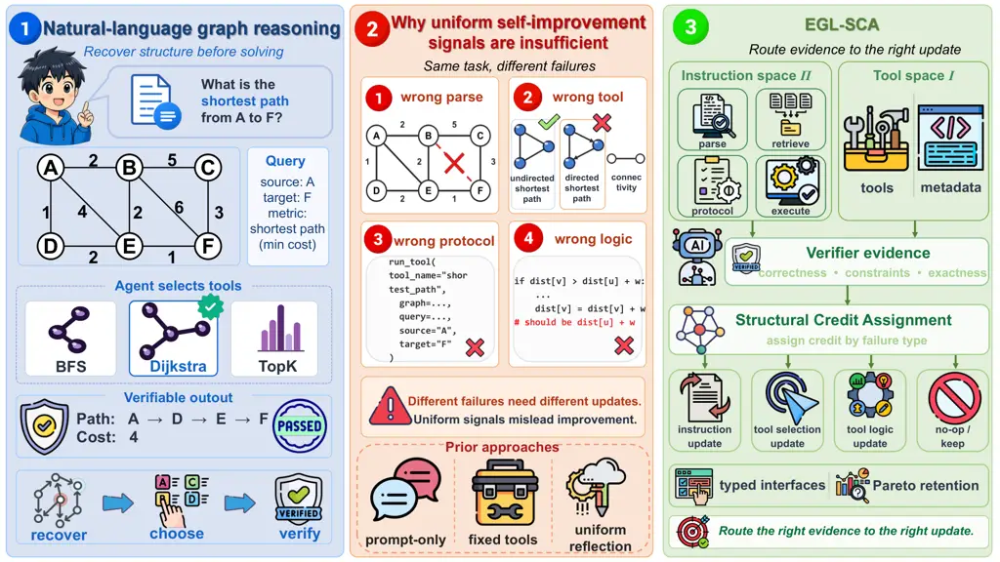
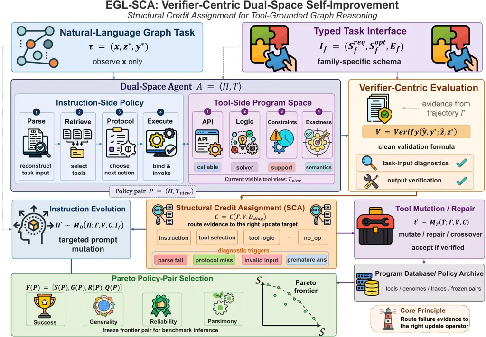
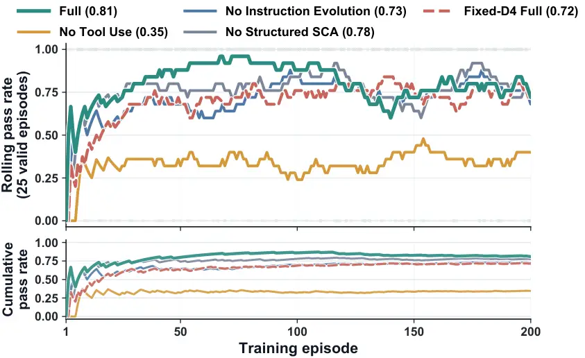
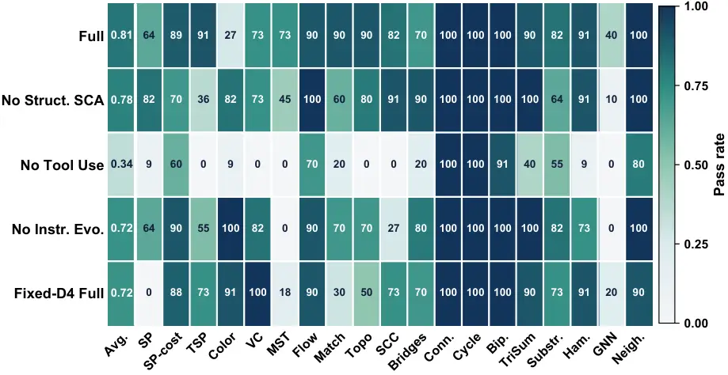
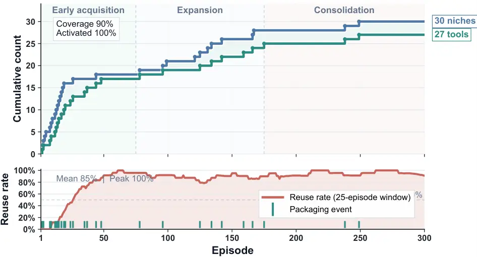
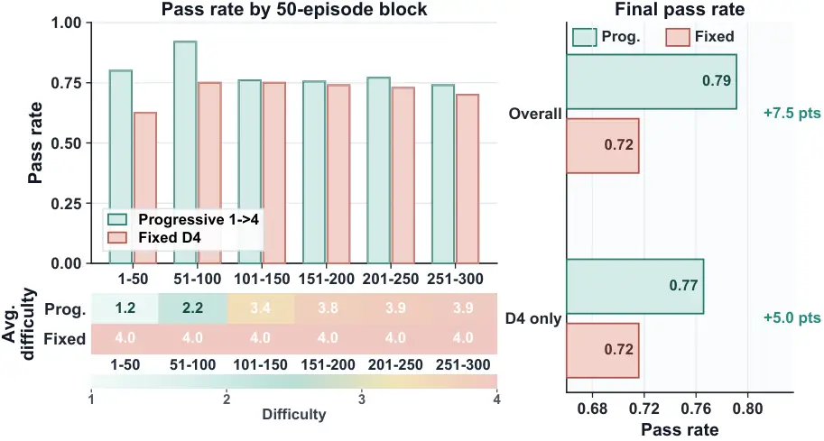

# EGL-SCA: Structural Credit Assignment for Co-Evolving Instructions and Tools in Graph Reasoning Agents

Zike Yuan ^(†)^(†)thanks: Equal contribution. Affiliation: Harbin
Institute of Technology, Shenzhen, China Affiliation: Peng Cheng
Laboratory, Shenzhen, China    Yukun Cao¹¹footnotemark: 1
Affiliation: School of Computer Science and Technology, Xidian
University    Han Zhang Affiliation: Harbin Institute of Technology,
Shenzhen, China Affiliation: Peng Cheng Laboratory, Shenzhen, China   
Jianzhi Yan Affiliation: Harbin Institute of Technology, Shenzhen, China
Affiliation: Peng Cheng Laboratory, Shenzhen, China    Le Liu
Affiliation: Harbin Institute of Technology, Shenzhen, China
Affiliation: Peng Cheng Laboratory, Shenzhen, China    Cai Ke
Affiliation: Harbin Institute of Technology, Shenzhen, China
Affiliation: Peng Cheng Laboratory, Shenzhen, China    Yue Yu
Affiliation: Peng Cheng Laboratory, Shenzhen, China    Hui Wang
Affiliation: Peng Cheng Laboratory, Shenzhen, China    Ming Liu
Affiliation: Harbin Institute of Technology, Shenzhen, China
Affiliation: Peng Cheng Laboratory, Shenzhen, China    Bing Qin
Email: [{yuanzk,yanjzh,liul07,wangh06}@pcl.ac.cnHanlardResearch@gmail.com;
kecai@stu.hit.edu.cncaoyukun@xidian.edu.cn;
{mliu,qinb}@ir.hit.edu.cn](mailto:;%20) Affiliation: Harbin Institute of
Technology, Shenzhen, China Affiliation: Peng Cheng Laboratory,
Shenzhen, China

###### Abstract

Graph reasoning agents operating from natural-language inputs must solve
a coupled problem: they must reconstruct a structured graph instance
from text, decide whether existing computational assets are sufficient,
interact with tools under a strict execution protocol, and satisfy an
external verifier that checks structured correctness rather than textual
plausibility. Existing approaches usually improve either the instruction
side or the tool side in isolation, which leaves unclear what should be
updated after failure. We propose EGL-SCA, a verifier-centric dual-space
framework that models a graph reasoning agent using two collaborative
components: an instruction-side policy space for reasoning strategies,
and a tool-side program space for executable algorithmic tools. Our
central mechanism is structural credit assignment, which maps trajectory
evidence to conditional updates, precisely routing failures to either
prompt optimization or tool synthesis and repair. To provide sufficient
learning signals for dual-space adaptation, we introduce a training
distribution stratified by task family, coupled with a Pareto-style
retention strategy to balance success, generality, and parsimony.
Experiments on four graph reasoning benchmarks show that EGL-SCA
achieves a state-of-the-art 92.0% average success rate. By effectively
co-evolving instructions and tools, our framework significantly
outperforms both pure-prompting and fixed-toolbox baselines.

## 1 Introduction

Graph reasoning remains a persistent weakness of large language model
(LLM) agents when tasks are presented as natural-language problem
statements rather than as canonical graph objects \[1, 2, 3, 4\]. In
realistic settings, an agent must first recover a structured instance
from text: it must identify the node set, edge relations,
directionality, weights, query variables, and side constraints, and then
decide how that reconstructed object should be solved. This difficulty
is qualitatively different from unconstrained text generation. A model
may produce a fluent answer while solving the wrong graph, selecting an
inappropriate algorithmic routine, or violating an execution protocol
required by an external verifier \[5, 1\]. As a result, the dominant
errors in graph reasoning are often not merely logical mistakes in the
final answer; they are upstream errors in structured reconstruction,
solver choice, or executable interaction.



Figure 1: Motivation: EGL-SCA routes graph-reasoning failures to the
component that caused them.

This observation exposes a limitation shared by several existing lines
of work.

Prompt-only reasoning methods \[6, 7\] can produce plausible solutions
on small graph instances, but they are brittle when exact structural
recovery and verifiable outputs are required.

Tool-using agents \[8, 9, 10, 11, 12\] improve execution, yet they
usually assume a fixed toolbox and therefore cannot accumulate new
graph-specific algorithmic tools during training.

Reflection-based self-improvement methods \[13, 14\] can refine language
behavior through feedback, but they typically treat failure as a single
undifferentiated signal. In graph reasoning, such undifferentiated
feedback is inadequate. A failure caused by an incorrectly reconstructed
constraint should improve the parsing behavior; a failure caused by
choosing an unsuitable solver should improve retrieval or selection; and
a failure caused by a tool-logic error should improve the tool itself.
Treating all of these failures as the same learning event leads to
misdirected updates and unstable training.

We argue that self-improving graph reasoning requires _conditional
adaptation over structured solve trajectories_. The central question is
not simply how to improve an agent after failure, but _what should be
improved, and why_. To address this question, we conceptualize a graph
reasoning agent as a dual-space system composed of two distinct but
complementary halves: an instruction-side policy space and a tool-side
program space. The instruction side governs how the agent reconstructs
task structure, retrieves relevant capabilities, follows an interaction
protocol, and formats executable inputs. The tool side contains reusable
algorithmic procedures together with metadata describing their
applicability. Under this view, learning no longer amounts to editing a
single prompt or growing an unstructured toolbox; it becomes a problem
of coordinating updates between two coupled spaces that fail for
different reasons.

Our proposed framework, EGL-SCA (Evolving Graph Learning via Structural
Credit Assignment), resolves this coordination problem through its core
mechanism of _structural credit assignment_. Given a solve trajectory,
task-level diagnostics, and verifier feedback, EGL-SCA infers which
component of the agent was primarily responsible for failure. It
distinguishes between failures attributable to the instruction side,
failures caused by incorrect tool selection, failures caused by
tool-logic errors, and cases in which no update is necessary. Moreover,
instruction-side failures are further localized to more specific
subproblems. EGL-SCA therefore treats failure as a trajectory-level
object rather than a terminal binary label.

To retain the highest-quality adaptations, EGL-SCA captures intermediate
behavior by retaining policy pairs according to a Pareto-style criterion
over success, generality, protocol reliability, and parsimony \[15\].
Finally, because learning dynamics depend heavily on the environment, we
expose the necessary learning pressure through a family-aware training
distribution that varies graph scale, structural regime, active
constraints, and exactness requirements.

Extensive experiments validate our framework. Across four graph
benchmarks, EGL-SCA achieves a state-of-the-art 92.0% average success
rate, decisively outperforming pure-prompting (e.g., ExpeL at 20.6%) and
fixed-toolbox agents (e.g., AgentSquare at 87.8%). Furthermore, our
mechanism prevents blind mutations, synthesizing a highly reusable,
parsimonious toolbox while maintaining an exceptional protocol
reliability of 0.936.

Main Contributions:

We frame graph reasoning as a dual-space learning system, explicitly
decoupling language-based reasoning strategies from executable
operations.

We introduce _structural credit assignment_ to precisely diagnose
reasoning failures, routing feedback to either optimize prompts or
repair tools.

We design a family-aware training curriculum and a Pareto-style
retention scheme to ensure the agent learns robust, general, and
parsimonious skills.

EGL-SCA achieves a SOTA 92.0% success rate across four graph benchmarks,
proving that co-evolving instructions and tools effectively breaks the
bottleneck of current LLM reasoning.

## 2 Related Work

#### Prompting and policy improvement.

General prompting methods (e.g., few-shot \[6\], chain-of-thought \[7\])
improve reasoning by altering input formats without updating model
parameters. To further refine language policies, feedback-driven methods
like Reflexion \[13\] and ExpeL \[14\] leverage verbal feedback and
accumulated experience, while frameworks such as Promptbreeder \[16\],
MIPRO \[17\], and GEPA \[18\] treat prompts as optimizable objects via
search and validation.

#### Tool use, workflows, and program search.

Tool-augmented agents (e.g., ReAct \[8\], Toolformer \[9\], ART \[10\])
interleave language reasoning with external API calls, whereas
workflow-level systems like AFlow \[19\] and AgentSquare \[20\] automate
the design of multi-step agent structures. In executable domains,
evaluator-guided search algorithms (e.g., FunSearch \[21\],
AlphaEvolve \[22\]) have also proven effective for discovering strong
programmatic procedures through iterative proposal and verifier
selection.

#### Graph reasoning and graph-specialized agents.

Recent benchmarks (NLGraph \[1\], GraphInstruct \[2\], GraphArena \[3\],
GraCoRe \[4\]) expose a persistent gap between fluent text generation
and exact graph computation. This difficulty is further exacerbated by
representational challenges, such as positional bias in serialized graph
descriptions \[23, 5\]. To narrow this gap, specialized methods rely on
prompt augmentation (Graph-ToolFormer \[24\]), instruction tuning
(GraphWiz \[25\]), or multi-agent decomposition (MA-GTS \[26\]).
However, these approaches typically operate within fixed toolboxes or
tool pipelines, or optimize language policies in isolation. In contrast,
EGL-SCA jointly evolves instruction-side parsing strategies and
executable graph tools under verifier feedback, utilizing structured
credit assignment to precisely repair failures in protocol, tool choice,
or tool-logic errors.

## 3 Method



Figure 2: EGL-SCA overview: verifier evidence coordinates updates
between instructions and tools.

### 3.1 Problem Setup

We study graph reasoning tasks expressed in natural language. Each task
instance is a tuple $`\tau=(x,z^{\ast},y^{\ast})`$, where $`x`$ is the
textual problem statement, $`z^{\ast}`$ is the canonical structured task
object, and $`y^{\ast}`$ is the reference answer. We further write
$`z^{\ast}=(g^{\ast},q^{\ast},c^{\ast})`$, where $`g^{\ast}`$ is the
graph structure, $`q^{\ast}`$ is the query object, and $`c^{\ast}`$
denotes task-specific constraints. At inference time, the agent observes
only $`x`$, not $`z^{\ast}`$. The task is therefore not to run an
algorithm over a given graph object, but to first reconstruct a
candidate structured object $`\hat{z}=(\hat{g},\hat{q},\hat{c})`$ from
language and then produce an answer $`\hat{y}`$ based on that
reconstruction. See Appendix E for a symbol summary.

A single solve attempt induces a trajectory

```math
\Gamma=(s_{1},a_{1},o_{1},\ldots,s_{T},a_{T},o_{T}),
```

where $`s_{t}`$ is the internal state at step $`t`$, $`a_{t}`$ is the
chosen action, and $`o_{t}`$ is the resulting observation. The
trajectory may include task reconstruction, capability retrieval,
candidate-tool proposal, tool execution, and verifier-related protocol
interactions. The external verifier judges structured correctness rather
than textual plausibility, so a failure may arise even when $`\hat{y}`$
appears linguistically reasonable. Our goal is therefore not only to
maximize end-task success, but also to identify which component first
diverged from a valid solution path and should be updated.

### 3.2 Dual-Space Agent Representation

We represent the agent as a dual-space system
$`A=\langle\Pi,\mathcal{T}\rangle`$, where $`\Pi`$ is an
instruction-side policy space and $`\mathcal{T}`$ is a tool-side program
space. The instruction side governs the full decision process from
natural language to executable behavior. To make failure attribution
explicit, we conceptually decompose it as

```math
\Pi=(\Pi_{\mathrm{parse}},\Pi_{\mathrm{retrieve}},\Pi_{\mathrm{protocol}},\Pi_{\mathrm{execute}}),
```

where $`\Pi_{\mathrm{parse}}`$ reconstructs a structured task object
from text, $`\Pi_{\mathrm{retrieve}}`$ determines which tools,
documents, or prior assets are relevant, $`\Pi_{\mathrm{protocol}}`$
selects the next admissible transition in the solve process, and
$`\Pi_{\mathrm{execute}}`$ constructs schema-valid executable inputs and
formats outputs correctly. This decomposition does not require four
separate models; its purpose is to provide a structural coordinate
system for credit assignment and routed updates. In natural-language
graph reasoning, many failures arise not because the model “cannot
reason” in the abstract, but because it takes the wrong action at the
wrong stage.

The tool side $`\mathcal{T}`$ is a set of reusable graph-algorithm
procedures. Each tool $`t\in\mathcal{T}`$ can be written as
$`t=(f_{t},m_{t})`$, where $`f_{t}`$ is the executable program body and
$`m_{t}`$ is metadata describing the tool’s applicability, such as
supported task families, structural regimes, constraint semantics,
complexity class, or exactness requirements. Concretely, a reusable tool
is characterized not only by its solver logic, but also by its callable
API, supported constraint regime, and exactness semantics. These
metadata are part of the tool object itself rather than auxiliary
annotations, because reusability depends not only on what a tool
computes, but also on the conditions under which that computation is
compatible with the task.

The retained learning object is not an instruction policy or a tool in
isolation, but a _policy pair_ $`P=(\Pi,\mathcal{T}_{\mathrm{view}})`$,
where $`\mathcal{T}_{\mathrm{view}}\subseteq\mathcal{T}`$ denotes the
currently visible or reusable tool view. This representation lets us
evaluate and retain the instruction policy together with the executable
tools it can actually access.

### 3.3 Verifier-Centric Solve Process

Given a task statement $`x`$, the agent performs a verifier-centric
solve chain:

```math
\hat{z}=\mathrm{Parse}(x;\Pi_{\mathrm{parse}}),\qquad\mathcal{R}=\mathrm{Retrieve}(x,\hat{z},\mathcal{T}_{\mathrm{view}};\Pi_{\mathrm{retrieve}}),\qquad a_{t}\sim\Pi_{\mathrm{protocol}}(s_{t}),
```

```math
\hat{y}=\mathrm{Exec}(\hat{z},a_{t};\Pi_{\mathrm{execute}},\mathcal{R}),\qquad V=\mathrm{Verify}(\hat{y},y^{\ast};\hat{z},z^{\ast}).
```

Here the execution side constructs executable inputs from $`\hat{z}`$,
the current action, and the retrieved assets, while the external
verifier judges structured correctness rather than textual surface
plausibility.

In EGL-SCA, the verifier returns structured evidence rather than a
single scalar. It may expose schema validity, feasibility, exactness,
hidden-test behavior, and execution-time error messages. The verifier is
therefore not merely a scorer; it is the central diagnostic source of
the learning loop. It determines not only whether the current attempt
succeeds, but also what kind of corrective update should follow.

### 3.4 Structural Credit Assignment

The core question of EGL-SCA is: given a failed attempt, which component
should be updated? We answer this question through _structural credit
assignment_. Given a trajectory $`\Gamma`$ and verifier evidence $`V`$,
the framework first extracts a diagnostic result
$`D_{\mathrm{diag}}=\mathrm{Diag}(\Gamma,V)`$, and then computes a
structured attribution object

```math
C=\mathcal{C}(\Gamma,V,D_{\mathrm{diag}}).
```

At a coarse level, each unsuccessful attempt is routed to one of four
update targets:
$`\mathrm{Route}(\Gamma,V)\in\{\texttt{instruction},\texttt{tool\_selection},\texttt{tool\_logic},\texttt{no\_op}\}`$.

To define this routing rule, we distinguish three broad error sources:
_reconstruction error_, _selection error_, and _tool-logic (algorithmic
residual) error_. These correspond to three simple questions: Was the
task parsed incorrectly? Was the wrong tool chosen? Or did the chosen
tool still fail even though the task and tool match were already
reasonable? Concretely, we write
$`\mathcal{L}_{\mathrm{parse}}=d(\hat{z},z^{\ast})`$,
$`\mathcal{L}_{\mathrm{sel}}=\Delta_{\mathrm{compat}}(t_{\mathrm{sel}},\hat{z})`$,
and
$`\mathcal{L}_{\mathrm{alg}}=\Delta_{\mathrm{verify}}(\hat{y},y^{\ast})`$,
where $`d(\cdot,\cdot)`$ is a structured discrepancy measure,
$`\Delta_{\mathrm{compat}}`$ measures tool-task incompatibility, and
$`\Delta_{\mathrm{verify}}`$ denotes the residual verifier-level
failure. The routing logic is simple: EGL-SCA blames the earliest stage
that clearly failed. If parsing failed, we update the instruction side.
Otherwise, if the chosen tool is incompatible with the recovered
structure, we update tool selection. Otherwise, if the tool is
compatible but still fails, we route the failure to tool-logic repair.
If none of these conditions applies, we make no update. This compact
form is a conceptual summary. In the actual implementation, these
conditions are instantiated by thresholded diagnostics derived from
verifier evidence and trajectory-level signals.

This top-level route is still insufficient for graph reasoning, because
many instruction-side failures occur at different stages of the solve
process. A failure may be caused by missing required structural fields,
an incorrect retrieval-or-reuse transition, a missing protocol
escalation, a premature answer before execution, a malformed task input,
or a failure to run a candidate tool. EGL-SCA therefore does not merely
conclude that the instruction side failed; it further asks _which
instruction-side sub-process first deviated from a valid solve path_.
This finer localization is essential because a parsing deficiency and an
execution-formatting deficiency should not trigger the same update.

The update step is equally simple: once $`C`$ identifies the failing
stage, the framework dispatches to the matching repair operator,

```math
\mathcal{U}(A;C)=\mathcal{U}_{k}(A;C),\qquad k\in\{\mathrm{parse},\mathrm{retrieve},\mathrm{protocol},\mathrm{execute},\mathcal{T},\mathrm{id}\},
```

where $`k`$ denotes reconstruction repair, retrieval/selection repair,
transition repair, executable-format repair, tool-side repair, or no
update, respectively. This conditional structure is the key distinction
between EGL-SCA and undifferentiated reflection. We do not optimize by
simply producing a better post hoc summary; instead, verifier evidence
is routed to the correct update operator according to the inferred
failure source.

### 3.5 Typed Task Interface

Graph tasks differ not only in graph size, but also in what counts as a
complete specification and what output semantics count as correct. To
capture this structure, we define for each task family $`f`$ a typed
task interface
$`\mathcal{I}_{f}=(\mathcal{S}^{\mathrm{req}}_{f},\mathcal{S}^{\mathrm{opt}}_{f},E_{f})`$,
where $`\mathcal{S}^{\mathrm{req}}_{f}`$ is the set of required fields,
$`\mathcal{S}^{\mathrm{opt}}_{f}`$ is the set of optional fields, and
$`E_{f}`$ describes the exactness semantics of the family.

This interface is not an auxiliary annotation layer; it is a structural
prior for credit assignment. It makes missing structural fields
diagnosable, enables family-specific reflective updates, and explicitly
distinguishes semantic regimes such as exact, feasible, and approximate
outputs. In this sense, the typed task interface is not separate from
structural credit assignment, but one of the structural foundations that
allows it to operate at higher resolution. See Appendix B for the
task-family interface table.

### 3.6 Instruction Evolution and Tool-Side Growth/Repair

When structural credit assignment routes a failure to the instruction
side, EGL-SCA performs reflective instruction mutation. Let $`C`$ denote
the current attribution object. A child policy is generated as
$`\Pi^{\prime}\sim\mathcal{M}_{\Pi}(\Pi;\Gamma,V,C,\mathcal{I}_{f})`$,
where $`\mathcal{M}_{\Pi}`$ is a mutation operator conditioned on the
trajectory, verifier evidence, attribution result, and family-specific
interface. Its purpose is not to rewrite the entire policy
indiscriminately, but to produce localized, source-aligned, and
verifiable repairs.

When failure is routed to the tool side, EGL-SCA triggers tool growth or
repair depending on the circumstance. If the current task lacks a
compatible capability, the system may propose a new candidate tool from
the current tool space; if a compatible tool exists but behaves
incorrectly, the system performs tool-side repair or variation.
Abstractly, we write

```math
t^{\prime}\sim\mathcal{M}_{\mathcal{T}}(\mathcal{T};\Gamma,V,C).
```

Unlike unconstrained code generation, any candidate tool must satisfy
verifier-based acceptance before entering the reusable toolbox. This
rule ensures that tool growth is grounded in observed task performance
rather than drifting into an unstructured repository of unverifiable
programs.

### 3.7 Pareto-Style Policy-Pair Selection

Because graph reasoning quality cannot be summarized adequately by a
single scalar, EGL-SCA retains policy pairs through multi-objective
selection. For each policy pair $`P`$, we compute an objective vector
$`\mathbf{F}(P)=\big[S(P),G(P),R(P),Q(P)\big]`$, where $`S(P)`$ is
validation success, $`G(P)`$ is generality across evaluation buckets,
$`R(P)`$ is protocol reliability, and $`Q(P)`$ is a parsimony measure
favoring concise, stable, and low-redundancy behavior. Rather than
collapsing these criteria into one score, we retain the non-dominated
frontier

```math
\mathcal{F}=\{P\mid\nexists P^{\prime}\text{ such that }\mathbf{F}(P^{\prime})\succ\mathbf{F}(P)\},
```

where $`\succ`$ denotes Pareto dominance. This rule allows training to
preserve policy pairs that are not yet best in raw task success but are
already stronger in stability or generality. Final benchmark evaluation
is then performed with a frozen pair selected from this frontier.

Taken together, these components define EGL-SCA as a verifier-centric
framework for dual-space self-improvement. The instruction side learns
to reconstruct and manage graph tasks more reliably, the tool side grows
or repairs executable graph procedures when necessary, and structural
credit assignment determines how failure evidence should flow between
them. The resulting system is neither prompt optimization alone nor
program search in isolation, but a coordinated learning loop over
language policies and executable graph assets. See Appendix E for the
training-loop pseudocode and route table.

## 4 Experiments

|                                                   |               |                                                      |            |                                                      |         |                                                      |        |                                                      |       |                                                      |
| ------------------------------------------------- | ------------- | ---------------------------------------------------- | ---------- | ---------------------------------------------------- | ------- | ---------------------------------------------------- | ------ | ---------------------------------------------------- | ----- | ---------------------------------------------------- |
| Method                                            | GraphInstruct |                                                      | GraphArena |                                                      | NLGraph |                                                      | G-Real |                                                      | Avg   |                                                      |
| Prompting & Self-Improvement Baselines (No Tools) |               |                                                      |            |                                                      |         |                                                      |        |                                                      |       |                                                      |
| Direct Prompting                                  | 0.525         |                                                      | 0.160      |                                                      | 0.245   |                                                      | 0.015  |                                                      | 0.236 |                                                      |
| Chain-of-Thought (CoT)                            | 0.645         |                                                      | 0.420      |                                                      | 0.300   |                                                      | 0.020  |                                                      | 0.346 |                                                      |
| Few-Shot                                          | 0.400         |                                                      | 0.080      |                                                      | 0.150   |                                                      | 0.065  |                                                      | 0.174 |                                                      |
| Reflexion                                         | 0.175         |                                                      | 0.045      |                                                      | 0.170   |                                                      | 0.055  |                                                      | 0.111 |                                                      |
| ExpeL                                             | 0.380         |                                                      | 0.180      |                                                      | 0.210   |                                                      | 0.055  |                                                      | 0.206 |                                                      |
| GEPA                                              | 0.640         |                                                      | 0.475      |                                                      | 0.215   |                                                      | 0.000  |                                                      | 0.333 |                                                      |
| Tool-Augmented Agents (Fixed Toolbox)             |               |                                                      |            |                                                      |         |                                                      |        |                                                      |       |                                                      |
| AgentSquare                                       | 0.875         |                                                      | 1.000      |                                                      | 0.635   |                                                      | 1.000  |                                                      | 0.878 |                                                      |
| ReAct                                             | 0.405         |                                                      | 0.655      |                                                      | 0.590   |                                                      | 0.195  |                                                      | 0.461 |                                                      |
| MA-GTS^(†)                                        | –             |                                                      | 1.000      |                                                      | 0.629   |                                                      | 0.720  |                                                      | 0.783 |                                                      |
| FixedSolver                                       | 0.575         |                                                      | 0.670      |                                                      | 0.580   |                                                      | 0.795  |                                                      | 0.655 |                                                      |
| EGL-SCA (Ours) & Ablations                        |               |                                                      |            |                                                      |         |                                                      |        |                                                      |       |                                                      |
| w/o SCA Routing                                   | 0.875         | $`{}_{\!\color[rgb]{0.7578,0.1523,0.1758}{-0.045}}`$ | 0.995      |                                                      | 0.930   | $`{}_{\!\color[rgb]{0.7578,0.1523,0.1758}{-0.040}}`$ | 0.780  | $`{}_{\!\color[rgb]{0.7578,0.1523,0.1758}{-0.015}}`$ | 0.895 | $`{}_{\!\color[rgb]{0.7578,0.1523,0.1758}{-0.025}}`$ |
| w/o Tool Use                                      | 0.685         | $`{}_{\!\color[rgb]{0.7578,0.1523,0.1758}{-0.235}}`$ | 0.360      | $`{}_{\!\color[rgb]{0.7578,0.1523,0.1758}{-0.635}}`$ | 0.445   | $`{}_{\!\color[rgb]{0.7578,0.1523,0.1758}{-0.525}}`$ | 0.030  | $`{}_{\!\color[rgb]{0.7578,0.1523,0.1758}{-0.765}}`$ | 0.380 | $`{}_{\!\color[rgb]{0.7578,0.1523,0.1758}{-0.540}}`$ |
| w/o Tool Growth                                   | 0.885         | $`{}_{\!\color[rgb]{0.7578,0.1523,0.1758}{-0.035}}`$ | 0.995      |                                                      | 0.930   | $`{}_{\!\color[rgb]{0.7578,0.1523,0.1758}{-0.040}}`$ | 0.695  | $`{}_{\!\color[rgb]{0.7578,0.1523,0.1758}{-0.100}}`$ | 0.876 | $`{}_{\!\color[rgb]{0.7578,0.1523,0.1758}{-0.044}}`$ |
| w/o Instruction Evol.                             | 0.885         | $`{}_{\!\color[rgb]{0.7578,0.1523,0.1758}{-0.035}}`$ | 0.910      | $`{}_{\!\color[rgb]{0.7578,0.1523,0.1758}{-0.085}}`$ | 0.885   | $`{}_{\!\color[rgb]{0.7578,0.1523,0.1758}{-0.085}}`$ | 0.760  | $`{}_{\!\color[rgb]{0.7578,0.1523,0.1758}{-0.035}}`$ | 0.860 | $`{}_{\!\color[rgb]{0.7578,0.1523,0.1758}{-0.060}}`$ |
| w/o Protocol-Reliability Obj                      | 0.890         | $`{}_{\!\color[rgb]{0.7578,0.1523,0.1758}{-0.030}}`$ | 0.995      |                                                      | 0.945   | $`{}_{\!\color[rgb]{0.7578,0.1523,0.1758}{-0.025}}`$ | 0.795  |                                                      | 0.906 | $`{}_{\!\color[rgb]{0.7578,0.1523,0.1758}{-0.014}}`$ |
| EGL-SCA (Full)                                    | 0.920         | $`{}_{\!\color[rgb]{0.1016,0.5234,0.3516}{+0.045}}`$ | 0.995      | $`{}_{\!\color[rgb]{0.7578,0.1523,0.1758}{-0.005}}`$ | 0.970   | $`{}_{\!\color[rgb]{0.1016,0.5234,0.3516}{+0.335}}`$ | 0.795  | $`{}_{\!\color[rgb]{0.7578,0.1523,0.1758}{-0.205}}`$ | 0.920 | $`{}_{\!\color[rgb]{0.1016,0.5234,0.3516}{+0.042}}`$ |

- †
  MA-GTS failed to produce valid results on GraphInstruct due to toolbox
  limitations.

(a) External benchmark success rates. Best in bold, second underlined.
Subscripts denote performance deltas: ablations versus the Full model,
and the Full model versus the strongest baseline (AgentSquare).

|                       |             |                |          |       |          |
| --------------------- | ----------- | -------------- | -------- | ----- | -------- |
| Method                | Protocol    | Accepted Inst. | Packaged | Used  | Frontier |
|                       | Reliability | Mutations      | Tools    | Tools | Size     |
| w/o SCA Routing       | 0.788       | 22             | 39       | 32    | 4        |
| w/o Tool Use          | 0.775       | 10             | 0        | 0     | 4        |
| w/o Instruction Evol. | 0.817       | 0              | 40       | 26    | 2        |
| EGL-SCA (Full)        | 0.936       | 2              | 27       | 26    | 3        |

(b) Training-time mechanism statistics.

Table 1: External performance and training-time mechanism statistics for
EGL-SCA and its baselines.

### 4.1 Experimental goals and setup

We design our empirical evaluation to systematically answer four core
research questions (RQs):

- •
  $`\mathbf{RQ_{1}}`$ (Overall Superiority): Does EGL-SCA consistently
  outperform pure-prompting methods and fixed-toolbox baselines on
  natural-language graph reasoning benchmarks?
- •
  $`\mathbf{RQ_{2}}`$ (Mechanism Ablation): Is this performance gain
  driven by the synergistic effect of the dual-space loop (i.e.,
  structured credit assignment, instruction evolution, and tool growth)
  rather than any isolated component?
- •
  $`\mathbf{RQ_{3}}`$ (Task-Family Generalization): Does our framework
  produce balanced, structural capability gains across diverse graph
  task families, rather than merely inflating an aggregate score?
- •
  $`\mathbf{RQ_{4}}`$ (Curriculum Dynamics): How does the training
  distribution affect the emergence of dual-space capabilities,
  particularly when comparing a progressive $`1\!\rightarrow\!4`$
  curriculum against a fixed-D4 setting?

Unless otherwise stated, all reported training and benchmark runs use
gpt-5.4-nano as the base LLM, with the same verifier-centric interaction
protocol across methods.

The internal training side uses a unified graph-task generator covering
19 task families (e.g., shortest path, TSP, topological sorting,
bipartite matching). The generator varies graph scale, structural
regime, active constraints, and exactness semantics, exposing
heterogeneous failures in parsing, protocol behavior, tool selection,
and tool-logic errors. Each generated instance is assigned one of four
difficulty levels, D1–D4, which act as a composite control over graph
size, constraint complexity, and verifier strictness. Here, _fixed-D4_
denotes training entirely at the hardest level, whereas _progressive
$`1\!\rightarrow\!4`$_ denotes training that starts from D1 and
gradually advances to D4. See Appendix B for the grouped task-interface
specification.

#### Dynamic data synthesis and curriculum.

Training instances are dynamically synthesized on-the-fly rather than
sampled statically. Each episode selects a task family via deterministic
round-robin across 19 categories. A generator instantiates a canonical
graph, queries, and constraints based on the current difficulty and
seed, which a reference algorithm solves to yield ground-truth data
strictly for verifier evaluation. A rule-based verbalizer then
translates the instance into a natural-language statement. The agent
observes only this text; the underlying task_input and solutions remain
hidden. For the pass-based curriculum, each family’s difficulty
independently advances from D1 to D4 after two successful solves at its
current tier.

On the external side, we evaluate on four standardized benchmarks:
GraphInstruct, GraphArena, NLGraph, and G-Real \[2, 3, 1, 26\]. All main
results use a verifier-centric protocol, where success is defined by
structured correctness rather than surface-form similarity. See
Appendix C for benchmark and baseline protocol details, Appendix A for
implementation details, and Appendix I for training-cost accounting.

### 4.2 Main Results: The Necessity of Dual-Space Co-Evolution

Table 11(a) compares EGL-SCA against various baselines under a unified
external evaluation protocol. EGL-SCA (Full) achieves a state-of-the-art
average success rate of 0.920, significantly outperforming the strongest
fixed-toolbox workflow (AgentSquare, 0.878) and graph-native
pipelines \[20, 26\].

The collapse of prompting baselines (e.g., CoT at 0.346, Reflexion at
0.111) reveals a fundamental misalignment: LLMs often mask structural
hallucinations with linguistic fluency. In exact graph reasoning, a
single missed constraint invalidates the entire trajectory.
Language-only reflection treats this as a text-generation error,
repeatedly tweaking the prompt without addressing the underlying
algorithmic deficit. This proves that externalizing computation to a
tool space is not optional, but mandatory.

Furthermore, the ablations confirm the necessity of the dual-space loop.
Removing tool use causes the most severe degradation (dropping to
0.380). However, removing instruction evolution also reduces the average
to 0.860, demonstrating that tools alone cannot solve the
natural-language-to-executable-structure binding problem. We further
provide a three-seed sensitivity analysis in Appendix D.

### 4.3 Mechanism Diagnostics: SCA Prevents Update Thrashing



(a) EGL-SCA learns faster and saturates higher than its ablations.



(b) The full method remains more balanced across graph families.



(c) Tool discovery quickly turns into stable reuse.



(d) Progressive 1$`\rightarrow`$4 training beats fixed-D4 even on
D4-only tasks.

Figure 3: Internal diagnostics for EGL-SCA: learning dynamics,
family-level structure, tool reuse, and curriculum effects.

Table 11(b) reports training-time mechanism statistics, revealing
exactly _how_ EGL-SCA learns. Without SCA Routing, the system exhibits a
crucial failure mode we term “update thrashing”. The agent acts like a
blind optimizer: when a tool-logic error occurs, it mistakenly punishes
the parsing instruction (accepting 22 redundant mutations) and
hallucinates 39 overlapping tools. This misattribution degrades protocol
reliability (0.788) because the agent constantly unlearns previously
successful behaviors.

In contrast, EGL-SCA (Full) demonstrates that learning efficiency comes
from precise blame assignment, not update frequency. By routing failures
accurately, the full system maintains an exceptional protocol
reliability of 0.936 while accepting only 2 instruction mutations and
packaging 27 highly reusable tools. It forms a compact, parsimonious
combination of instruction behavior and toolbox contents. See
Appendices G and H for trace-level and prompt-evolution examples.

### 4.4 Training Dynamics: Stable Convergence via Structured Routing

Figure 33(a) shows the internal learning dynamics. The full method rises
quickly and reaches approximately 0.809 cumulative pass rate by episode 200. In contrast, _w/o Tool Use_ stagnates between 0.25 and 0.45,
reaffirming that generative reasoning alone hits a hard ceiling.
Interestingly, _w/o SCA Routing_ produces early local gains but remains
volatile and less efficient overall, proving that unstructured updates
eventually plateau due to accumulated contradictory edits.

### 4.5 Task-Level Analysis: Where and Why Generative Reasoning Fails

Figure 33(b) decomposes performance across the 19 task families. The
full method remains highly balanced (internal average $`\sim`$0.81). As
expected, _w/o Tool Use_ nearly fails completely on exact combinatorial
tasks such as TSP, topological sorting, and MST, which require stable
graph traversal and decomposition routines.

The degradation patterns of the ablations are highly diagnostic. _w/o
Instruction Evolution_ loses substantially on MST and bipartite
matching, indicating these tasks heavily rely on language-side
adaptation for reuse decisions and valid execution payloads. _w/o SCA
Routing_ degrades severely when constraint parsing and tool
compatibility heavily interact, proving that structured attribution is
crucial when resolving multi-step dependencies.

### 4.6 Toolbox Growth and Reuse Dynamics

Figure 33(c) analyzes toolbox growth. The system observes 30 tool niches
and packages 27 tools. More importantly, the activation rate of these
tools reaches 100%, and the rolling reuse rate peaks at 100% (mean
$`\sim`$85%). This temporal dimension illustrates that EGL-SCA first
covers frequent niches, consolidates tools during expansion, and rapidly
enters a reuse-dominated regime. The tool side acts as a verifier-guided
repository of reusable algorithmic tools rather than a static, bloated
toolbox; Appendix F lists the frozen toolbox used for benchmark
evaluation.

### 4.7 Curriculum Dynamics: Bootstrapping Credit Assignment

Figure 33(d) reveals that progressive $`1\!\rightarrow\!4`$ training
outpaces the fixed-D4 setting (0.791 vs. 0.716 overall pass rate). Even
when restricted purely to D4 evaluation samples, progressive training
maintains a 5.0-point advantage.

Why does curriculum training yield stronger final capabilities? In
high-difficulty graphs, the trajectory is extremely long and errors
compound rapidly, creating a dense credit assignment bottleneck. The
verifier’s failure signal becomes too noisy to localize. Progressive
training allows the agent to first calibrate its parsing and protocol
reliability ($`\Pi`$ space) on simpler graphs. Once the instruction
policy is stabilized, the system can reliably isolate and target complex
tool-logic errors ($`\mathcal{T}`$ space) without interference from
basic parsing failures.

## 5 Conclusion

We presented EGL-SCA, a verifier-centric framework for graph reasoning
agents that co-evolves instruction policies and executable tools through
structural credit assignment. The core idea is simple: when a graph
reasoning attempt fails, the agent should not blindly rewrite
everything, but should identify whether the error came from parsing,
protocol behavior, tool selection, or tool-logic errors. Across external
benchmarks and internal diagnostics, EGL-SCA shows that this targeted
routing leads to stronger accuracy, more reliable execution, and a
compact reusable toolbox. These results suggest that future
self-improving agents should treat instruction policies and executable
programs as coupled learning objects, with verifier evidence deciding
where adaptation should occur.

## References

- \[1\] H. Wang, S. Feng, T. He, Z. Tan, X. Han, and Y. Tsvetkov (2023)
  Can language models solve graph problems in natural language?.
  Advances in Neural Information Processing Systems 36, pp. 30840–30861.
  Cited by: Appendix C, NeurIPS Paper Checklist, §1, §2, §4.1.
- \[2\] Z. Luo, X. Song, H. Huang, J. Lian, C. Zhang, J. Jiang, X. Xie,
  and H. Jin (2024) Graphinstruct: empowering large language models with
  graph understanding and reasoning capability. arXiv preprint
  arXiv:2403.04483. Cited by: Appendix C, NeurIPS Paper Checklist, §1,
  §2, §4.1.
- \[3\] J. Tang, Q. Zhang, Y. Li, N. Chen, and J. Li (2024) Grapharena:
  evaluating and exploring large language models on graph computation.
  arXiv preprint arXiv:2407.00379. Cited by: Appendix C, NeurIPS Paper
  Checklist, §1, §2, §4.1.
- \[4\] Z. Yuan, M. Liu, H. Wang, and B. Qin (2025) Gracore:
  benchmarking graph comprehension and complex reasoning in large
  language models. In Proceedings of the 31st International Conference
  on Computational Linguistics, pp. 7925–7948. Cited by: NeurIPS Paper
  Checklist, §1, §2.
- \[5\] Y. Cao, S. Han, Z. Gao, Z. Ding, X. Xie, and S. K. Zhou (2025)
  Graphinsight: unlocking insights in large language models for graph
  structure understanding. In Proceedings of the 63rd Annual Meeting of
  the Association for Computational Linguistics (Volume 1: Long Papers),
  pp. 12096–12134. Cited by: NeurIPS Paper Checklist, §1, §2.
- \[6\] T. Brown, B. Mann, N. Ryder, M. Subbiah, J. D. Kaplan, P.
  Dhariwal, A. Neelakantan, P. Shyam, G. Sastry, A. Askell, et
  al. (2020) Language models are few-shot learners. Advances in neural
  information processing systems 33, pp. 1877–1901. Cited by: NeurIPS
  Paper Checklist, §1, §2.
- \[7\] J. Wei, X. Wang, D. Schuurmans, M. Bosma, F. Xia, E. Chi, Q. V.
  Le, D. Zhou, et al. (2022) Chain-of-thought prompting elicits
  reasoning in large language models. Advances in neural information
  processing systems 35, pp. 24824–24837. Cited by: NeurIPS Paper
  Checklist, §1, §2.
- \[8\] S. Yao, J. Zhao, D. Yu, N. Du, I. Shafran, K. Narasimhan, and Y.
  Cao (2022) React: synergizing reasoning and acting in language models.
  arXiv preprint arXiv:2210.03629. Cited by: Appendix C, NeurIPS Paper
  Checklist, §1, §2.
- \[9\] T. Schick, J. Dwivedi-Yu, R. Dessì, R. Raileanu, M. Lomeli, E.
  Hambro, L. Zettlemoyer, N. Cancedda, and T. Scialom (2023) Toolformer:
  language models can teach themselves to use tools. Advances in neural
  information processing systems 36, pp. 68539–68551. Cited by: NeurIPS
  Paper Checklist, §1, §2.
- \[10\] B. Paranjape, S. Lundberg, S. Singh, H. Hajishirzi, L.
  Zettlemoyer, and M. T. Ribeiro (2023) Art: automatic multi-step
  reasoning and tool-use for large language models. arXiv preprint
  arXiv:2303.09014. Cited by: NeurIPS Paper Checklist, §1, §2.
- \[11\] L. Gao, A. Madaan, S. Zhou, U. Alon, P. Liu, Y. Yang, J.
  Callan, and G. Neubig (2023) Pal: program-aided language models. In
  International conference on machine learning, pp. 10764–10799. Cited
  by: NeurIPS Paper Checklist, §1.
- \[12\] W. Chen, X. Ma, X. Wang, and W. W. Cohen (2022) Program of
  thoughts prompting: disentangling computation from reasoning for
  numerical reasoning tasks. arXiv preprint arXiv:2211.12588. Cited by:
  NeurIPS Paper Checklist, §1.
- \[13\] N. Shinn, F. Cassano, A. Gopinath, K. Narasimhan, and S.
  Yao (2023) Reflexion: language agents with verbal reinforcement
  learning. Advances in neural information processing systems 36,
  pp. 8634–8652. Cited by: NeurIPS Paper Checklist, §1, §2.
- \[14\] A. Zhao, D. Huang, Q. Xu, M. Lin, Y. Liu, and G. Huang (2024)
  Expel: llm agents are experiential learners. In Proceedings of the
  AAAI Conference on Artificial Intelligence, Vol. 38, pp. 19632–19642.
  Cited by: NeurIPS Paper Checklist, §1, §2.
- \[15\] K. Deb, A. Pratap, S. Agarwal, and T. Meyarivan (2002) A fast
  and elitist multiobjective genetic algorithm: nsga-ii. IEEE
  transactions on evolutionary computation 6 (2), pp. 182–197. Cited by:
  NeurIPS Paper Checklist, §1.
- \[16\] C. Fernando, D. Banarse, H. Michalewski, S. Osindero, and T.
  Rocktäschel (2023) Promptbreeder: self-referential self-improvement
  via prompt evolution. arXiv preprint arXiv:2309.16797. Cited by:
  NeurIPS Paper Checklist, §2.
- \[17\] K. Opsahl-Ong, M. J. Ryan, J. Purtell, D. Broman, C. Potts, M.
  Zaharia, and O. Khattab (2024) Optimizing instructions and
  demonstrations for multi-stage language model programs. In Proceedings
  of the 2024 Conference on Empirical Methods in Natural Language
  Processing, pp. 9340–9366. Cited by: NeurIPS Paper Checklist, §2.
- \[18\] L. A. Agrawal, S. Tan, D. Soylu, N. Ziems, R. Khare, K.
  Opsahl-Ong, A. Singhvi, H. Shandilya, M. J. Ryan, M. Jiang, et
  al. (2025) Gepa: reflective prompt evolution can outperform
  reinforcement learning. arXiv preprint arXiv:2507.19457. Cited by:
  NeurIPS Paper Checklist, §2.
- \[19\] J. Zhang, J. Xiang, Z. Yu, F. Teng, X. Chen, J. Chen, M.
  Zhuge, X. Cheng, S. Hong, J. Wang, et al. (2024) Aflow: automating
  agentic workflow generation. In The Thirteenth International
  Conference on Learning Representations, Cited by: NeurIPS Paper
  Checklist, §2.
- \[20\] Y. Shang, Y. Li, K. Zhao, L. Ma, J. Liu, F. Xu, and Y.
  Li (2024) Agentsquare: automatic llm agent search in modular design
  space. In The Thirteenth International Conference on Learning
  Representations, Cited by: Appendix C, NeurIPS Paper Checklist, §2,
  §4.2.
- \[21\] B. Romera-Paredes, M. Barekatain, A. Novikov, M. Balog, M. P.
  Kumar, E. Dupont, F. J. Ruiz, J. S. Ellenberg, P. Wang, O. Fawzi, et
  al. (2024) Mathematical discoveries from program search with large
  language models. Nature 625 (7995), pp. 468–475. Cited by: NeurIPS
  Paper Checklist, §2.
- \[22\] A. Novikov, N. Vũ, M. Eisenberger, E. Dupont, P. Huang, A. Z.
  Wagner, S. Shirobokov, B. Kozlovskii, F. J. Ruiz, A. Mehrabian, et
  al. (2025) Alphaevolve: a coding agent for scientific and algorithmic
  discovery. arXiv preprint arXiv:2506.13131. Cited by: NeurIPS Paper
  Checklist, §2.
- \[23\] Z. Zhang, H. Li, Z. Zhang, Y. Qin, X. Wang, and W. Zhu (2023)
  Graph meets llms: towards large graph models. arXiv preprint
  arXiv:2308.14522. Cited by: NeurIPS Paper Checklist, §2.
- \[24\] J. Zhang (2023) Graph-toolformer: to empower llms with graph
  reasoning ability via prompt augmented by chatgpt. arXiv preprint
  arXiv:2304.11116. Cited by: NeurIPS Paper Checklist, §2.
- \[25\] N. Chen, Y. Li, J. Tang, and J. Li (2024) Graphwiz: an
  instruction-following language model for graph computational problems.
  In Proceedings of the 30th ACM SIGKDD Conference on Knowledge
  Discovery and Data Mining, pp. 353–364. Cited by: NeurIPS Paper
  Checklist, §2.
- \[26\] Z. Yuan, M. Liu, H. Wang, and B. Qin (2025) MA-gts: a
  multi-agent framework for solving complex graph problems in real-world
  applications. In Proceedings of the 2025 Conference on Empirical
  Methods in Natural Language Processing, pp. 19297–19315. Cited by:
  Appendix C, Appendix C, NeurIPS Paper Checklist, §2, §4.1, §4.2.
- \[27\] H. Xu, X. Jian, X. Zhao, W. Pang, C. Zhang, S. Wang, Q.
  Zhang, Z. Dong, J. Monteiro, B. Liu, et al. (2025) Graphomni: a
  comprehensive and extendable benchmark framework for large language
  models on graph-theoretic tasks. arXiv preprint arXiv:2504.12764.
  Cited by: NeurIPS Paper Checklist.

## Appendix A Reproducibility and Implementation Details

#### Model and decoding.

All reported benchmark results use the same underlying GPT-5.4-nano
model family and the same verifier-centric interaction protocol across
methods. Decoding configuration, retry policy, timeout settings, and
prompt templates are kept fixed within each comparison group; the exact
runnable configuration is recorded with the anonymous experiment
artifacts. This design is intended to make differences in Table 1(a)
attributable to the agent protocol and update mechanism rather than to
per-method decoding changes.

#### Training budget and randomness.

The main training runs use a 200-episode budget unless otherwise stated.
The curriculum comparison uses 300 episodes to compare progressive
$`1\!\rightarrow\!4`$ training with fixed-D4 training under the same
high-level protocol. All main runs are generated with seed 20260413.
Randomness enters through task sampling, LLM generation, candidate-tool
mutation, and policy-pair selection, and all logged summaries retain the
seed and run identifier.

#### Execution and verification.

Executable graph tools are run in a Python execution environment and
judged by task-family verifiers. The verifier checks structured
correctness, including schema validity, feasibility, exactness,
hidden-test behavior, and constraint satisfaction, rather than textual
similarity. Success rate is computed as the number of verifier-passed
tasks divided by the number of evaluated tasks.

#### Logged evidence.

Each solve attempt records the task family, difficulty, pass/fail
result, selected tool if any, whether a candidate tool ran, verifier
messages, and structured credit-assignment diagnostics. The most
important diagnostic fields include task_kind, difficulty, passed,
tool_used, candidate_ran, credit_assignment.route, typed_missing_slots,
and protocol_signature. These fields support the mechanism statistics in
Table 1(b) and the internal diagnostics in Figure 3.

Table 2 summarizes the exact configuration used for the main training
run and for the frozen benchmark evaluations. Table 3 further details
how the pass-based curriculum was instantiated and how much exposure the
run allocated to each difficulty band.

|                            |                                                                                                      |                                                       |
| -------------------------- | ---------------------------------------------------------------------------------------------------- | ----------------------------------------------------- |
| Setting                    | Main Training Run                                                                                    | External Benchmark Evaluation                         |
| Base model                 | gpt-5.4-nano                                                                                         | gpt-5.4-nano                                          |
| Student prompt profile     | weak                                                                                                 | weak frozen instruction genome                        |
| Budget                     | 300 planned episodes; 297 counted after 3 exclusions                                                 | 200 cases per benchmark                               |
| Attempts                   | 2 attempts per training episode                                                                      | 1 attempt per benchmark case                          |
| Toolbox policy             | fresh toolbox with dynamic growth and repair enabled                                                 | frozen reusable toolbox from the selected policy pair |
| Tool proposal at test time | enabled during training                                                                              | disabled (--no-propose-tool)                          |
| Selection rule             | Pareto over success, generality, protocol reliability, and parsimony; re-evaluated every 38 episodes | frozen pair selected under the same objective vector  |
| Population / concurrency   | 4 policy pairs; at most 4 active pairs                                                               | single frozen pair                                    |
| Validation / probes        | 2 validation cases per kind; 2 tool-probe cases                                                      | none; direct benchmark evaluation                     |
| Decoding                   | temperature 0.0                                                                                      | temperature 0.0                                       |
| Timeout / retries          | 420 s / 12 retries                                                                                   | 300 s / 12 retries                                    |
| Seed                       | 20260413                                                                                             | 20260413                                              |

Table 2: Unified training and benchmark-evaluation configuration for the
reported full EGL-SCA system.

|            |                    |                  |                                                                                                       |
| ---------- | ------------------ | ---------------- | ----------------------------------------------------------------------------------------------------- |
| Difficulty | First Seen Episode | Counted Episodes | Interpretation                                                                                        |
| D1         | 1                  | 52               | Initial easy-stage exposure used to stabilize parsing, protocol discipline, and early tool discovery. |
| D2         | 40                 | 40               | First promoted band after per-task pass thresholds began to trigger.                                  |
| D3         | 78                 | 47               | Intermediate band where retrieval and compatibility decisions became more consequential.              |
| D4         | 116                | 158              | Longest training phase; all 19 task kinds reached D4 and no task kind remained unfinished.            |

Table 3: Pass-based curriculum configuration and realized difficulty
exposure in the main 300-episode run. Advancement was enabled per task
family, starting from D1 and promoting after 2 passes at the current
difficulty.

## Appendix B Task Families and Typed Interfaces

The typed task interface specifies which fields must be recovered from
natural language, which optional constraints may be active, and what
output semantics the verifier expects. Table 4 summarizes the internal
task families used for training and diagnostics. The interface is used
to detect missing structural slots, distinguish exact versus feasible
outputs, and localize failures such as malformed payloads or
output-schema mismatches.

[TABLE]

Table 4: Typed task interfaces used by the internal graph-task
generator. The interface specifies the exact structured payload
requirements and evaluation semantics for each task family.

## Appendix C External Benchmarks and Baseline Protocol

All external datasets \[2, 3, 1, 26\] are converted to a common task
format before evaluation. The agent observes a natural-language problem
statement, while the verifier uses the canonical structured object and
reference answer to judge success. Table 5 summarizes the four external
benchmarks, and Table 7 summarizes the baseline protocols used in
Table 1(a).

|               |                                     |                               |                                         |
| ------------- | ----------------------------------- | ----------------------------- | --------------------------------------- |
| Benchmark     | Input form                          | Evaluation target             | Main stress                             |
| GraphInstruct | natural-language graph instructions | structured graph answer       | graph understanding and schema recovery |
| GraphArena    | graph computation problems          | algorithmic answer or witness | exact graph computation                 |
| NLGraph       | natural-language graph tasks        | parsed graph reasoning answer | language-to-graph reconstruction        |
| G-Real        | real-world style graph problems     | verifiable graph solution     | realistic constraints and tool coverage |

Table 5: External benchmark protocol.

|               |       |            |                                                                                                                                          |           |           |
| ------------- | ----- | ---------- | ---------------------------------------------------------------------------------------------------------------------------------------- | --------- | --------- |
| Benchmark     | Cases | Task Kinds | Composition                                                                                                                              | Avg Nodes | Avg Edges |
| GraphInstruct | 200   | 8          | bipartite_check 25; connectivity 25; cycle 25; hamilton 25; max_flow 25; shortest_path_cost 25; topological_sort 25; triangle_max_sum 25 | 26.04     | 89.30     |
| NLGraph       | 200   | 5          | cycle 68; gnn_sum 13; hamilton 40; max_flow 39; shortest_path 40                                                                         | 17.46     | 34.64     |
| GraphArena    | 200   | 2          | common_neighbors 100; tsp 100                                                                                                            | 8.52      | 24.64     |
| G-Real        | 200   | 3          | coloring 67; tsp 67; vertex_cover 66                                                                                                     | 18.84     | 111.44    |

Table 6: Benchmark scale statistics for the four external evaluations
used in the main paper.

|                                                     |                   |                   |                                                                                       |
| --------------------------------------------------- | ----------------- | ----------------- | ------------------------------------------------------------------------------------- |
| Method                                              | Tool Access       | Update Mechanism  | Key Characteristics                                                                   |
| Static Prompting (Language-Only)                    |                   |                   |                                                                                       |
| Direct Prompting                                    | None              | None              | Zero-shot generation under verifier protocol.                                         |
| Few-Shot                                            | None              | None              | Static in-context demonstrations.                                                     |
| Chain-of-Thought                                    | None              | None              | Step-by-step reasoning traces.                                                        |
| Self-Refinement & Evolution (Language-Only)         |                   |                   |                                                                                       |
| Reflexion                                           | None              | Verbal Reflection | Iterative prompt correction via verbal feedback.                                      |
| ExpeL                                               | None              | Experience Pool   | Accumulates textual insights from trajectories.                                       |
| GEPA                                                | None              | Prompt Evolution  | Evaluator-guided prompt and program refinement.                                       |
| Tool-Augmented & Graph-Native Agents (Fixed Assets) |                   |                   |                                                                                       |
| ReAct                                               | Fixed APIs        | In-context Action | Interleaves reasoning with external tool calls.                                       |
| FixedSolver                                         | Fixed Algorithms  | None              | Routes directly to predefined solver inventory.                                       |
| AgentSquare                                         | Fixed Workflows   | Modular Search    | Strongest fixed-toolbox baseline (SOTA modular).                                      |
| MA-GTS                                              | Graph-native APIs | Multi-Agent       | Collaborative framework (fails on GraphInstruct).                                     |
| EGL-SCA (Ours)                                      | Dynamic Growth    | Dual-Space SCA    | Structurally routes credit to co-evolve prompts and synthesize executable algorithms. |

Table 7: Comparison of baseline methodologies. Unlike existing methods
that either rely purely on language updates or use a fixed tool
inventory, EGL-SCA achieves true dual-space co-evolution.

Prompt-only baselines never access executable tools. ReAct and
AgentSquare \[8, 20\] are evaluated as tool or workflow baselines with a
fixed inventory. MA-GTS \[26\] is treated as a graph-native multi-agent
baseline; its missing GraphInstruct entry in Table 1(a) reflects an
interface and toolbox-coverage limitation rather than a failed score
being hidden.

## Appendix D Seed Sensitivity Analysis

To rigorously assess the robustness of EGL-SCA against variations in
initialization and trajectory sampling, we conduct a sensitivity
analysis across three independent random seeds: 20260414, 20260415, and 20260416. Each seed instantiates a fresh dual-space learning environment
to train the agent autonomously, after which the Pareto-optimal policy
pair is frozen for zero-shot evaluation on the standard external
benchmarks.

Given the substantial computational overhead of executing three complete
training-and-evaluation lifecycles, this sweep employs a constrained
budget of 150 training episodes per seed. Consequently, this analysis
acts as a conservative lower-bound estimation of stability rather than a
direct substitute for the primary 300-episode evaluations. Under this
truncated schedule, several challenging task families do not accumulate
sufficient exposure to complete curriculum promotion to the highest
difficulty tier (D4).

|               |                  |               |               |                   |                    |
| ------------- | ---------------- | ------------- | ------------- | ----------------- | ------------------ |
| Benchmark     | Independent Runs |               |               | Mean $`\pm`$ Std. | Pooled Rate        |
|               | Seed 20260414    | Seed 20260415 | Seed 20260416 |                   |                    |
| GraphInstruct | 95.5             | 91.5          | 96.0          | 94.3 $`\pm`$ 2.5  | 566 / 600 = 94.3   |
| NLGraph       | 95.5             | 99.0          | 95.0          | 96.5 $`\pm`$ 2.2  | 579 / 600 = 96.5   |
| GraphArena    | 97.5             | 100.0         | 95.0          | 97.5 $`\pm`$ 2.5  | 585 / 600 = 97.5   |
| G-Real        | 79.5             | 77.0          | 86.5          | 81.0 $`\pm`$ 4.9  | 486 / 600 = 81.0   |
| Overall       | 92.0             | 91.9          | 93.1          | 92.3 $`\pm`$ 0.7  | 2216 / 2400 = 92.3 |

Table 8: Seed sensitivity on external benchmarks under a constrained
150-episode training budget. Each benchmark evaluation contains 200
cases per seed. Values denote verifier pass rates (%).

|               |                      |                |
| ------------- | -------------------- | -------------- |
| Benchmark     | Pooled Pass Rate (%) | 95% Wilson CI  |
| GraphInstruct | 94.3                 | \[92.2, 95.9\] |
| NLGraph       | 96.5                 | \[94.7, 97.7\] |
| GraphArena    | 97.5                 | \[95.9, 98.5\] |
| G-Real        | 81.0                 | \[77.7, 83.9\] |
| Overall       | 92.3                 | \[91.2, 93.3\] |

Table 9: Pooled case-level confidence intervals for the three-seed
sensitivity sweep. The 95% Wilson score intervals are computed over the
aggregated execution traces ($`n=600`$ per benchmark).

[TABLE]

Table 10: Internal training-stage diagnostics for the three 150-episode
sensitivity runs. These metrics characterize the behavior and
evolutionary assets of the learned policy pair prior to the frozen
benchmark evaluation.

The empirical results demonstrate robust cross-seed generalization on
all evaluation sets. As shown in Table 8, GraphInstruct, NLGraph, and
GraphArena maintain striking stability, with seed-level standard
deviations remaining strictly below 2.5 percentage points. Overall, the
aggregated sweep successfully solves 2216 out of 2400 evaluated cases,
yielding a pooled average pass rate of 92.3% with an exceptionally
narrow 95% Wilson confidence interval of\[91.2, 93.3\].

The primary source of inter-seed variance is isolated to the G-Real
benchmark, which exhibits a slightly lower mean pass rate of 81.0% and a
standard deviation of 4.9 points. A fine-grained task-level
decomposition reveals that this variance stems almost entirely from
highly constrained NP-hard problem families, predominantly graph
coloring and the Traveling Salesperson Problem (TSP). For instance,
under seed 20260415, the agent failed to complete D4 curriculum
promotion for the coloring task family before the 150-episode cutoff
(see Table 10), which depressed its performance on the corresponding
G-Real subset. This finding underscores that the reduced-budget sweep
artificially penalizes stability; a fully converged 300-episode agent
routinely masters these edge cases by ensuring all complex task niches
receive adequate exploratory exposure.

The internal training diagnostics (Table 10) corroborate this structural
stability. Across all initializations, the dual-space learning loop
reliably prevents collapse: the agents autonomously synthesize and
package a consistent volume of reusable tools (19–21), trigger similar
mutation frequencies, and uniformly achieve near-perfect frontier
protocol reliability ($`>98\%`$). Thus, the fundamental co-evolution
mechanism of EGL-SCA is functionally deterministic, with the minor
remaining variance strictly governed by whether the limited training
budget affords sufficient time to discover optimal programmatic
algorithms for the hardest niches.

## Appendix E EGL-SCA Algorithm and Structural Credit Assignment

Table 11 summarizes the notation used in the method and algorithm.

|                                                 |                                                                        |                     |
| ----------------------------------------------- | ---------------------------------------------------------------------- | ------------------- |
| Symbol                                          | Description                                                            | Context             |
| Task & Problem Setup                            |                                                                        |                     |
| $`\tau=(x,z^{\ast},y^{\ast})`$                  | Task tuple (text, true structure, true answer).                        | Environment         |
| $`x`$                                           | Natural-language task statement.                                       | Agent input         |
| $`z^{\ast}=(g^{\ast},q^{\ast},c^{\ast})`$       | Canonical graph structure, query, and constraints.                     | Verifier reference  |
| $`\hat{z}=(\hat{g},\hat{q},\hat{c})`$           | Agent-reconstructed graph, query, and constraints.                     | Parsed state        |
| $`y^{\ast},\hat{y}`$                            | Reference answer and agent-predicted answer.                           | Evaluation          |
| $`\mathcal{I}_{f}`$                             | Typed task interface for task family $`f`$.                            | Missing-slot checks |
| Dual-Space Agent Architecture                   |                                                                        |                     |
| $`A=\langle\Pi,\mathcal{T}\rangle`$             | Dual-space agent representation.                                       | Core model          |
| $`\Pi`$                                         | Instruction policy (parse, retrieve, protocol, execute).               | Prompt space        |
| $`\mathcal{T},\mathcal{T}_{\mathrm{view}}`$     | Full reusable tool space and currently visible subset.                 | Program space       |
| $`t=(f_{t},m_{t})`$                             | Executable tool body and its metadata.                                 | Tool selection      |
| $`\Gamma=(s_{t},a_{t},o_{t})_{t=1}^{T}`$        | Solve trajectory (states, actions, observations).                      | Trace logging       |
| Credit Assignment & Evolution                   |                                                                        |                     |
| $`V`$                                           | Structured verifier evidence (e.g., error logs).                       | Diagnostics         |
| $`D_{\mathrm{diag}}`$                           | Trajectory-level diagnostic summary.                                   | SCA routing         |
| $`C`$                                           | Structured attribution object (fault localization).                    | Localized update    |
| $`\mathcal{M}_{\Pi},\mathcal{M}_{\mathcal{T}}`$ | Instruction mutation and tool growth/repair operators.                 | Evolutionary step   |
| $`P=(\Pi,\mathcal{T}_{\mathrm{view}})`$         | Retained agent policy pair.                                            | Genome archiving    |
| $`\mathbf{F}(P)=[S,G,R,Q]`$                     | Multi-objective metrics (success, generality, reliability, parsimony). | Pareto selection    |
| $`\mathcal{F}`$                                 | Non-dominated Pareto frontier of policy pairs.                         | Final selection     |

Table 11: Mathematical notation used in the EGL-SCA framework.

1: Curriculum distribution $`\mathcal{D}_{\mathrm{train}}`$, task
interfaces $`\{\mathcal{I}_{f}\}`$, max episodes $`E`$

2: Pareto-optimal policy pair
$`P^{\ast}=(\Pi^{\ast},\mathcal{T}^{\ast}_{\mathrm{view}})`$

3: Initialize instruction policy $`\Pi`$ and visible tool space
$`\mathcal{T}_{\mathrm{view}}`$

4: Initialize Pareto frontier
$`\mathcal{F}\leftarrow\{(\Pi,\mathcal{T}_{\mathrm{view}})\}`$

5: for episode $`e=1,2,\dots,E`$ do

6:   Sample graph task
$`\tau=(x,z^{\ast},y^{\ast})\sim\mathcal{D}_{\mathrm{train}}`$

7:   Step 1: Forward Solve Trajectory

8:   $`\hat{z}\leftarrow\textsc{Parse}(x;\Pi_{\mathrm{parse}})`$
$`\triangleright`$ Reconstruct structure

9:
  $`\mathcal{R},a_{t}\leftarrow\textsc{RetrieveSelect}(x,\hat{z},\mathcal{T}_{\mathrm{view}};\Pi_{\mathrm{retrieve}},\Pi_{\mathrm{protocol}})`$

10:
  $`\hat{y}\leftarrow\textsc{Exec}(\hat{z},a_{t},\mathcal{R};\Pi_{\mathrm{execute}})`$
$`\triangleright`$ Execute tool payload

11:   Step 2: Verifier-Centric Evaluation

12:
  $`V\leftarrow\textsc{Verify}(\hat{y},y^{\ast};\hat{z},z^{\ast},\mathcal{I}_{f})`$
$`\triangleright`$ Structured correctness

13:   Step 3: Structural Credit Assignment (SCA)

14:   $`D_{\mathrm{diag}}\leftarrow\textsc{Diag}(\Gamma,V)`$
$`\triangleright`$ Extract trajectory diagnostics

15:   $`C\leftarrow\mathcal{C}(\Gamma,V,D_{\mathrm{diag}})`$
$`\triangleright`$ Compute attribution object

16:   Step 4: Conditional Routing & Dual-Space Update

17:   if $`C`$ attributes failure to instruction $`\Pi`$ (e.g., parse,
retrieve, protocol) then

18:
   $`\Pi\leftarrow\mathcal{M}_{\Pi}(\Pi;\Gamma,V,C,\mathcal{I}_{f})`$
$`\triangleright`$ Reflective prompt mutation

19:   else if $`C`$ attributes failure to tool $`\mathcal{T}`$ (e.g.,
logic, missing capability) then

20:
   $`t^{\prime}\leftarrow\mathcal{M}_{\mathcal{T}}(\mathcal{T};\Gamma,V,C)`$
$`\triangleright`$ Tool growth or code repair

21:    if $`\textsc{Verify}(t^{\prime})`$ is successful then

22:
     $`\mathcal{T}_{\mathrm{view}}\leftarrow\mathcal{T}_{\mathrm{view}}\cup\{t^{\prime}\}`$
$`\triangleright`$ Expand reusable tool space

23:    end if

24:   end if

25:   Step 5: Pareto-Style Retention

26:   $`P\leftarrow(\Pi,\mathcal{T}_{\mathrm{view}})`$

27:   $`\mathcal{F}\leftarrow\textsc{ParetoUpdate}(\mathcal{F},P)`$
based on objective $`\mathbf{F}(P)=[S,G,R,Q]`$

28: end for

29: return $`P^{\ast}\in\mathcal{F}`$ selected for final benchmark
evaluation

Algorithm 1 EGL-SCA Training Loop: Verifier-Centric Dual-Space
Co-Evolution

Algorithm 1 expands the compact method description in the main text. The
key implementation point is that a failed trajectory is not treated as a
single undifferentiated error. Instead, the verifier and trace fields
are converted into a routing decision, and only the implicated
sub-process is updated.

|                                                        |                |                 |                                              |
| ------------------------------------------------------ | -------------- | --------------- | -------------------------------------------- |
| Observed evidence                                      | Route          | Subtarget       | Update                                       |
| Missing task_input or direct answer before execution   | instruction    | protocol        | mutate transition and execution discipline   |
| Parsed graph or query differs from canonical structure | instruction    | parse           | mutate reconstruction instructions           |
| Compatible tool exists but wrong tool is selected      | tool_selection | retrieve/select | repair retrieval query or compatibility rule |
| Compatible tool runs but verifier still fails          | tool_logic     | tool space      | repair or grow executable candidate          |
| Verifier passes or evidence is inconclusive            | no_op          | identity        | retain, evaluate, or skip update             |

Table 12: Structural credit-assignment routes and localized updates.

The route table also explains the mechanism statistics in Table 1(b).
For example, the full system packages 27 tools, uses 26 of them,
maintains a frontier of size 3, and reaches protocol reliability 0.936
because verifier evidence is routed to localized repairs. The
tool-growth analysis in Figure 33(c) further shows 30 observed tool
niches, 27 packaged tools, and a reuse-dominated regime.

## Appendix F Frozen Tool Inventory

The frozen Pareto-selected policy pair used for benchmark evaluation
exposes 27 packaged tools, of which 26 were exercised at least once
during the main training run. Table 13 and Table 14 summarize each
tool’s covered task family and a compact niche summary derived from the
manifest niche_key.

|                                   |                    |                     |                                                      |       |
| --------------------------------- | ------------------ | ------------------- | ---------------------------------------------------- | ----- |
| Tool                              | Task Kind          | Family              | Niche Summary                                        | Reuse |
| directed_substructure_present     | substructure       | Pattern Matching    | small_dag_pattern / pattern_graph / exact_small / D1 | 9     |
| scc_components                    | scc                | Decomp. & Order     | sparse_directed / none / exact / D1                  | 15    |
| bipartite_check_solver            | bipartite_check    | Connectivity Checks | tree_like / none / exact / D1                        | 15    |
| mst_solver_general                | mst                | Optimization Flow   | dense_undirected / none / exact / D1                 | 6     |
| bipartite_matching_solver_general | bipartite_matching | Optimization Flow   | balanced_bipartite / none / exact / D1               | 14    |
| common_neighbors_solver_general   | common_neighbors   | Local Substructure  | sparse_undirected / none / exact / D1                | 12    |
| max_flow_solver_general           | max_flow           | Optimization Flow   | sparse_directed / none / exact / D1                  | 7     |
| gnn_sum_solver_general            | gnn_sum            | Message Passing     | 1_layer_sparse / none / exact / D1                   | 13    |
| topological_sort_solver_general   | topological_sort   | Decomp. & Order     | sparse_directed / none / exact / D1                  | 13    |
| connectivity_solver_general       | connectivity       | Connectivity Checks | sparse_undirected / none / exact / D1                | 12    |
| tsp_bruteforce_undirected_general | tsp                | Routing & Coverage  | exact_small / none / exact_small / D1                | 3     |
| hamilton_path_solver_exact        | hamilton           | Routing & Coverage  | chain_planted / none / exact_small / D1              | 14    |
| shortest_path_dijkstra_general    | shortest_path      | Path Queries        | weighted_base / none / exact / D1                    | 9     |
| bridges_solver_general            | bridges            | Decomp. & Order     | sparse_undirected / none / exact / D1                | 11    |

Table 13: Frozen tool inventory of the selected policy pair (Part I).

|                                                                       |                        |                                         |                                                                |       |
| --------------------------------------------------------------------- | ---------------------- | --------------------------------------- | -------------------------------------------------------------- | ----- |
| Packaged Tool API                                                     | Task Kind              | Task Family                             | Niche Regime                                                   | Reuse |
| triangle_max_sum_solver_general                                       | triangle_max_sum       | Local Substructure                      | tree_like / none / exact / D1                                  | 13    |
| cycle_detection_solver_general                                        | cycle                  | Connectivity Checks                     | sparse_undirected / none / exact / D2                          | 13    |
| vertex_cover_exact_or_feasible_solver                                 | vertex_cover           | Labeling & Covering                     | exact_small / none / exact_small / D1                          | 9     |
| directed_substructure_present_wrapper                                 | substructure           | Pattern Matching                        | planted_pattern_sparse_host / pattern_graph / exact_small / D3 | 0     |
| tsp_undirected_feasible_solver                                        | tsp                    | Routing & Coverage                      | constraint_tight / blocked_edges+max_cost / exact_small / D3   | 5     |
| shortest_path_cost_directed_dijkstra                                  | shortest_path_cost     | Path Queries                            | directed_blocked / blocked_edges / exact / D4                  | 6     |
| tsp_directed_feasible_solver_dp15                                     | tsp                    | Routing & Coverage                      | feasible_large / blocked_edges+max_cost / feasible_large / D4  | 4     |
| mst_solver_general_2                                                  | mst                    | Optimization Flow                       | sparse_undirected / none / exact / D4                          | 7     |
| shortest_path_directed_with_path                                      | shortest_path          | Path Queries                            | directed_blocked / blocked_edges / exact / D4                  | 1     |
| max_flow_solver_general_mut                                           | max_flow               | Optimization Flow                       | sparse_directed / none / exact / D4                            | 8     |
| coloring_max_colors_solver                                            | coloring               | Labeling & Covering                     | bipartite_easy / max_colors / exact_small / D1                 | 6     |
| directed_substructure_present_simple                                  | substructure           | Pattern Matching                        | planted_pattern_dense_host / pattern_graph / exact_medium / D4 | 2     |
| vertex_cover_exact_or_feasible_solver \_x_max_flow_solver_general_mut | max_flow, vertex_cover | Optimization Flow / Labeling & Covering | constraint_tight / max_size / feasible_large / D4              | 1     |

Table 14: Frozen tool inventory of the selected policy pair (Part II).
Tool names represent the executable API endpoints, while the niche
summary denotes the operational regime (Graph Type / Constraints /
Semantics / Difficulty) where each tool is valid.

## Appendix G Case Studies

This section provides three representative execution traces sampled from
the main training phase of EGL-SCA. Rather than presenting aggregate
metrics, these qualitative diagnostics serve to unpack the “black box”
of our dual-space learning loop. They explicitly demonstrate how the
verifier-centric machinery transforms a concrete, structured failure
signal into a precisely localized update or a reusable algorithmic
asset.

As shown in Table 15, these cases illustrate the practical distinction
between our structural credit assignment (SCA) routes: protocol failures
change how the agent reconstructs inputs; selection failures adjust the
retrieval binding; and verified candidate programs are systematically
archived as reusable tools rather than discarded as one-off code
snippets.

[TABLE]

Table 15: Representative training traces demonstrating the Structural
Credit Assignment (SCA) routing mechanism. EGL-SCA dynamically routes
verifier evidence to the appropriate space (Instruction or Tool) based
on the root cause of the failure or success.

## Appendix H Seed-to-Final Prompt Evolution

To concretely illustrate instruction-side learning, we trace the exact
lineage of the language policy during training. We compare the initial
heuristic seed prompt (Genome ID: pi_b885c1d0a7cc, variant_1) against
the frozen Pareto-optimal prompt selected for evaluation (Genome ID:
pi_16fa230ab432, variant_1_mut). Because the final prompt’s ancestor
list strictly points back to the seed, this provides a direct
before-and-after ablation of a single evolutionary lineage, rather than
a comparison of unrelated policies.

While the seed prompt provided general guidance for careful graph
reconstruction and verifier-ready outputs, the final prompt incorporates
three targeted rules. Crucially, these additions do not hallucinate new
graph algorithms. Instead, they represent strict _protocol constraints_
induced by structural credit assignment—specifically targeting failures
where the agent attempted tool execution without a fully captured
task_input payload. Table 16 provides the exact qualitative diff.

[TABLE]

Table 16: Direct prompt diff between the seed ancestor and the final
selected instruction genome. The evolution targets strict operational
constraints rather than general reasoning heuristics.

The internal tracking metadata perfectly corroborates this text
evolution. While the seed metadata only records seed_index=1, the final
genome explicitly attributes this edit to instruction-side execution
repair (route=instruction, focus=execute_missing_task_input), triggered
by a protocol signature where the agent proposed a tool without
task-input capture.

This proves that prompt evolution in EGL-SCA is highly targeted and
evidence-aligned. Rather than accumulating verbose heuristics, the agent
compiles exact operational constraints exposed by the verifier:
construct nested payloads, preserve message-passing embeddings exactly,
and reject empty executions. This dynamically complements the
tool-growth phenomenon analyzed in Appendix G: as the tool space
($`\mathcal{T}`$) accumulates reusable algorithms, the instruction space
($`\Pi`$) learns the rigorous protocol discipline required to invoke
them safely.

## Appendix I Training Cost Analysis

This appendix reports the training cost of the main EGL-SCA run using
provider-independent resource accounting. The run used gpt-5.4-nano
through the closeai provider, a fresh toolbox, one asynchronous worker,
temperature 0.0, and the pass-based curriculum described in Appendix A.
Because monetary charges depend on the billing gateway and the active
token prices, we report the directly logged token and wall-clock costs,
and compute monetary cost from the formula

```math
\mathrm{Cost}=6.241432\cdot r_{\mathrm{in}}+0.492581\cdot r_{\mathrm{out}},
```

where $`r_{\mathrm{in}}`$ and $`r_{\mathrm{out}}`$ are the provider
prices per one million input and output tokens, respectively. This
formula uses the counted training-token totals in Table 17.

|                                 |                 |                                                                                          |
| ------------------------------- | --------------- | ---------------------------------------------------------------------------------------- |
| Cost Metric                     | Logged Value    | Interpretation & Details                                                                 |
| Execution Activity              |                 |                                                                                          |
|    Episodes (Planned / Counted) | 300 / 297       | Three episodes excluded due to infrastructure or API authentication failures.            |
|    Solve Attempts               | 407             | Allowed at most two attempts per episode, yielding 1.37 attempts per counted episode.    |
|    LLM Calls                    | 1,953           | All logged calls were student-side; no coach or narrator token usage is counted.         |
| LLM Token Cost                  |                 |                                                                                          |
|    Prompt Tokens                | 6.241M (92.7%)  | Major cost driver: presenting task statements, tool metadata, and verifier evidence.     |
|    Completion Tokens            | 0.493M (7.3%)   | Includes reasoning traces, structured answers, and candidate-tool code generation.       |
|    Total Tokens                 | 6.734M          | Corresponds to 22.7K tokens per counted episode, or 3.45K tokens per LLM call.           |
| Wall-Clock Timing               |                 |                                                                                          |
|    Total Elapsed Time           | 18.02 h         | End-to-end runtime, including orchestration, API network latency, and validation.        |
|    Student Solve Time           | 7.14 h          | Active time spent inside the main student reasoning and coding loop.                     |
|    Validation Time              | 1.04 h          | Time for periodic and final Pareto selection over success, generality, and reliability.  |
| Retained Agent Assets           |                 |                                                                                          |
|    Packaged Toolset             | 27 tools        | Derived from 41 candidate-tool episodes. Averages $`\sim`$249K tokens per packaged tool. |
|    Program Database             | 85 policy pairs | Cost encompasses not only solving tasks but maintaining a compact evolutionary archive.  |

Table 17: Resource cost of the main 300-episode EGL-SCA training run.
Token counts and timings are taken from the logged run summary,
excluding three infrastructure/authentication failure episodes.

|            |          |               |               |                                                                                                                                             |
| ---------- | -------- | ------------- | ------------- | ------------------------------------------------------------------------------------------------------------------------------------------- |
| Difficulty | Episodes | Passed (Rate) | Avg. Attempts | Curriculum Role & Cost Interpretation                                                                                                       |
| D1         | 52       | 38 (73.1%)    | 1.42          | Early spending stabilizes task parsing, payload construction, and initial tool proposal.                                                    |
| D2         | 40       | 38 (95.0%)    | 1.15          | Once basic protocol behavior is learned, most episodes pass with little retry overhead.                                                     |
| D3         | 47       | 38 (80.9%)    | 1.34          | Intermediate constraints expose retrieval and tool-compatibility failures.                                                                  |
| D4         | 158      | 121 (76.6%)   | 1.42          | The largest share of counted episodes is allocated to the hardest regime, where parsing drift and algorithmic edge cases are most frequent. |

Table 18: Realized curriculum exposure in the counted training episodes.
The hardest band (D4) dominates the final training budget, while earlier
bands (D1–D3) amortize parser, protocol, and basic tool-discovery
calibration before D4.

The cost profile shows two useful properties of EGL-SCA. First, the run
is token-heavy but not GPU-training-heavy: the main expenditure is API
inference over generated graph tasks and verifier feedback, while
executable graph tools run as lightweight Python procedures. Second, the
cost is amortized into reusable artifacts. The final run retains a
27-tool frozen toolbox and a Pareto-selected instruction policy, so
later benchmark evaluation disables new tool proposal and reuses the
learned assets rather than repeating the full search process.

## Appendix J Limitations

EGL-SCA is designed for verifier-centric graph reasoning, so its
benefits are most direct when tasks admit structured checks or
executable validation. Extending the same credit-assignment scheme to
open-ended settings may require weaker or learned verifiers. In
addition, our experiments focus on graph task families and a fixed base
model, leaving broader cross-domain transfer and model-scaling behavior
for future study. Finally, tool growth introduces engineering overhead
for sandboxing, logging, and candidate validation, although this
overhead is modest compared with the reliability gains observed in our
experiments.

Broader impacts Our framework significantly enhances the reliability and
interpretability of LLM agents in structured reasoning tasks, offering
positive implications for fields relying on complex combinatorial
optimization, such as logistics, network routing, and scientific
discovery. However, as agents gain the ability to autonomously
synthesize and execute algorithmic tools, there is a potential risk of
these capabilities being repurposed for malicious automated operations
(e.g., analyzing and exploiting network vulnerabilities) if deployed
without appropriate strict human oversight. We mitigate such risks in
our study by restricting tool execution to isolated, mathematically
grounded sandboxes.

## NeurIPS Paper Checklist

1.  1.  Claims
2.  Question: Do the main claims made in the abstract and introduction
    accurately reflect the paper’s contributions and scope?
3.  Answer: \[Yes\]
4.  Justification: The claims made in the abstract and introduction are
    fully supported by the empirical evaluations and ablation studies
    presented in Section 4.
5.  Guidelines:
    - •
      The answer \[N/A\] means that the abstract and introduction do not
      include the claims made in the paper.
    - •
      The abstract and/or introduction should clearly state the claims
      made, including the contributions made in the paper and important
      assumptions and limitations. A \[No\] or \[N/A\] answer to this
      question will not be perceived well by the reviewers.
    - •
      The claims made should match theoretical and experimental results,
      and reflect how much the results can be expected to generalize to
      other settings.
    - •
      It is fine to include aspirational goals as motivation as long as
      it is clear that these goals are not attained by the paper.

6.  2.  Limitations
7.  Question: Does the paper discuss the limitations of the work
    performed by the authors?
8.  Answer: \[Yes\]
9.  Justification: We explicitly discuss the limitations of our
    verifier-centric assumption and tool growth overhead in Appendix J.
10. Guidelines:
    - •
      The answer \[N/A\] means that the paper has no limitation while
      the answer \[No\] means that the paper has limitations, but those
      are not discussed in the paper.
    - •
      The authors are encouraged to create a separate “Limitations”
      section in their paper.
    - •
      The paper should point out any strong assumptions and how robust
      the results are to violations of these assumptions (e.g.,
      independence assumptions, noiseless settings, model
      well-specification, asymptotic approximations only holding
      locally). The authors should reflect on how these assumptions
      might be violated in practice and what the implications would be.
    - •
      The authors should reflect on the scope of the claims made, e.g.,
      if the approach was only tested on a few datasets or with a few
      runs. In general, empirical results often depend on implicit
      assumptions, which should be articulated.
    - •
      The authors should reflect on the factors that influence the
      performance of the approach. For example, a facial recognition
      algorithm may perform poorly when image resolution is low or
      images are taken in low lighting. Or a speech-to-text system might
      not be used reliably to provide closed captions for online
      lectures because it fails to handle technical jargon.
    - •
      The authors should discuss the computational efficiency of the
      proposed algorithms and how they scale with dataset size.
    - •
      If applicable, the authors should discuss possible limitations of
      their approach to address problems of privacy and fairness.
    - •
      While the authors might fear that complete honesty about
      limitations might be used by reviewers as grounds for rejection, a
      worse outcome might be that reviewers discover limitations that
      aren’t acknowledged in the paper. The authors should use their
      best judgment and recognize that individual actions in favor of
      transparency play an important role in developing norms that
      preserve the integrity of the community. Reviewers will be
      specifically instructed to not penalize honesty concerning
      limitations.

11. 3.  Theory assumptions and proofs
12. Question: For each theoretical result, does the paper provide the
    full set of assumptions and a complete (and correct) proof?
13. Answer: \[N/A\]
14. Justification: This paper presents an empirical framework and
    agentic system design; it does not introduce new theoretical bounds
    or proofs.
15. Guidelines:
    - •
      The answer \[N/A\] means that the paper does not include
      theoretical results.
    - •
      All the theorems, formulas, and proofs in the paper should be
      numbered and cross-referenced.
    - •
      All assumptions should be clearly stated or referenced in the
      statement of any theorems.
    - •
      The proofs can either appear in the main paper or the supplemental
      material, but if they appear in the supplemental material, the
      authors are encouraged to provide a short proof sketch to provide
      intuition.
    - •
      Inversely, any informal proof provided in the core of the paper
      should be complemented by formal proofs provided in appendix or
      supplemental material.
    - •
      Theorems and Lemmas that the proof relies upon should be properly
      referenced.

16. 4.  Experimental result reproducibility
17. Question: Does the paper fully disclose all the information needed
    to reproduce the main experimental results of the paper to the
    extent that it affects the main claims and/or conclusions of the
    paper (regardless of whether the code and data are provided or not)?
18. Answer: \[Yes\]
19. Justification: Comprehensive implementation details, baseline
    protocols, and curriculum configurations are provided in Section
    4.1, Appendix A, and Appendix C.
20. Guidelines:
    - •
      The answer \[N/A\] means that the paper does not include
      experiments.
    - •
      If the paper includes experiments, a \[No\] answer to this
      question will not be perceived well by the reviewers: Making the
      paper reproducible is important, regardless of whether the code
      and data are provided or not.
    - •
      If the contribution is a dataset and/or model, the authors should
      describe the steps taken to make their results reproducible or
      verifiable.
    - •
      Depending on the contribution, reproducibility can be accomplished
      in various ways. For example, if the contribution is a novel
      architecture, describing the architecture fully might suffice, or
      if the contribution is a specific model and empirical evaluation,
      it may be necessary to either make it possible for others to
      replicate the model with the same dataset, or provide access to
      the model. In general. releasing code and data is often one good
      way to accomplish this, but reproducibility can also be provided
      via detailed instructions for how to replicate the results, access
      to a hosted model (e.g., in the case of a large language model),
      releasing of a model checkpoint, or other means that are
      appropriate to the research performed.
    - •
      While NeurIPS does not require releasing code, the conference does
      require all submissions to provide some reasonable avenue for
      reproducibility, which may depend on the nature of the
      contribution. For example
      1.  (a)
          If the contribution is primarily a new algorithm, the paper
          should make it clear how to reproduce that algorithm.
      2.  (b)
          If the contribution is primarily a new model architecture, the
          paper should describe the architecture clearly and fully.
      3.  (c)
          If the contribution is a new model (e.g., a large language
          model), then there should either be a way to access this model
          for reproducing the results or a way to reproduce the model
          (e.g., with an open-source dataset or instructions for how to
          construct the dataset).
      4.  (d)
          We recognize that reproducibility may be tricky in some cases,
          in which case authors are welcome to describe the particular
          way they provide for reproducibility. In the case of
          closed-source models, it may be that access to the model is
          limited in some way (e.g., to registered users), but it should
          be possible for other researchers to have some path to
          reproducing or verifying the results.

21. 5.  Open access to data and code
22. Question: Does the paper provide open access to the data and code,
    with sufficient instructions to faithfully reproduce the main
    experimental results, as described in supplemental material?
23. Answer: \[Yes\]
24. Justification: The exact runnable configuration, prompt templates,
    and evaluation code are included in the anonymous supplementary
    material.
25. Guidelines:
    - •
      The answer \[N/A\] means that paper does not include experiments
      requiring code.
    - •
      Please see the NeurIPS code and data submission guidelines
      ([https://neurips.cc/public/guides/CodeSubmissionPolicy](https://neurips.cc/public/guides/CodeSubmissionPolicy))
      for more details.
    - •
      While we encourage the release of code and data, we understand
      that this might not be possible, so \[No\] is an acceptable
      answer. Papers cannot be rejected simply for not including code,
      unless this is central to the contribution (e.g., for a new
      open-source benchmark).
    - •
      The instructions should contain the exact command and environment
      needed to run to reproduce the results. See the NeurIPS code and
      data submission guidelines
      ([https://neurips.cc/public/guides/CodeSubmissionPolicy](https://neurips.cc/public/guides/CodeSubmissionPolicy))
      for more details.
    - •
      The authors should provide instructions on data access and
      preparation, including how to access the raw data, preprocessed
      data, intermediate data, and generated data, etc.
    - •
      The authors should provide scripts to reproduce all experimental
      results for the new proposed method and baselines. If only a
      subset of experiments are reproducible, they should state which
      ones are omitted from the script and why.
    - •
      At submission time, to preserve anonymity, the authors should
      release anonymized versions (if applicable).
    - •
      Providing as much information as possible in supplemental material
      (appended to the paper) is recommended, but including URLs to data
      and code is permitted.

26. 6.  Experimental setting/details
27. Question: Does the paper specify all the training and test details
    (e.g., data splits, hyperparameters, how they were chosen, type of
    optimizer) necessary to understand the results?
28. Answer: \[Yes\]
29. Justification: We document the hyperparameters, model settings, and
    training budgets in Appendix A.
30. Guidelines:
    - •
      The answer \[N/A\] means that the paper does not include
      experiments.
    - •
      The experimental setting should be presented in the core of the
      paper to a level of detail that is necessary to appreciate the
      results and make sense of them.
    - •
      The full details can be provided either with the code, in
      appendix, or as supplemental material.

31. 7.  Experiment statistical significance
32. Question: Does the paper report error bars suitably and correctly
    defined or other appropriate information about the statistical
    significance of the experiments?
33. Answer: \[Yes\]
34. Justification: We explicitly discuss the Experiment statistical
    significance in Appendix I.
35. Guidelines:
    - •
      The answer \[N/A\] means that the paper does not include
      experiments.
    - •
      The authors should answer \[Yes\] if the results are accompanied
      by error bars, confidence intervals, or statistical significance
      tests, at least for the experiments that support the main claims
      of the paper.
    - •
      The factors of variability that the error bars are capturing
      should be clearly stated (for example, train/test split,
      initialization, random drawing of some parameter, or overall run
      with given experimental conditions).
    - •
      The method for calculating the error bars should be explained
      (closed form formula, call to a library function, bootstrap, etc.)
    - •
      The assumptions made should be given (e.g., Normally distributed
      errors).
    - •
      It should be clear whether the error bar is the standard deviation
      or the standard error of the mean.
    - •
      It is OK to report 1-sigma error bars, but one should state it.
      The authors should preferably report a 2-sigma error bar than
      state that they have a 96% CI, if the hypothesis of Normality of
      errors is not verified.
    - •
      For asymmetric distributions, the authors should be careful not to
      show in tables or figures symmetric error bars that would yield
      results that are out of range (e.g., negative error rates).
    - •
      If error bars are reported in tables or plots, the authors should
      explain in the text how they were calculated and reference the
      corresponding figures or tables in the text.

36. 8.  Experiments compute resources
37. Question: For each experiment, does the paper provide sufficient
    information on the computer resources (type of compute workers,
    memory, time of execution) needed to reproduce the experiments?
38. Answer: \[Yes\]
39. Justification: We provide a highly detailed, provider-independent
    resource and token cost analysis in Appendix H (Tables 14 and 15)
40. Guidelines:
    - •
      The answer \[N/A\] means that the paper does not include
      experiments.
    - •
      The paper should indicate the type of compute workers CPU or GPU,
      internal cluster, or cloud provider, including relevant memory and
      storage.
    - •
      The paper should provide the amount of compute required for each
      of the individual experimental runs as well as estimate the total
      compute.
    - •
      The paper should disclose whether the full research project
      required more compute than the experiments reported in the paper
      (e.g., preliminary or failed experiments that didn’t make it into
      the paper).

41. 9.  Code of ethics
42. Question: Does the research conducted in the paper conform, in every
    respect, with the NeurIPS Code of Ethics
    [https://neurips.cc/public/EthicsGuidelines](https://neurips.cc/public/EthicsGuidelines)?
43. Answer: \[Yes\]
44. Justification: The research conducted conforms to the NeurIPS Code
    of Ethics.
45. Guidelines:
    - •
      The answer \[N/A\] means that the authors have not reviewed the
      NeurIPS Code of Ethics.
    - •
      If the authors answer \[No\] , they should explain the special
      circumstances that require a deviation from the Code of Ethics.
    - •
      The authors should make sure to preserve anonymity (e.g., if there
      is a special consideration due to laws or regulations in their
      jurisdiction).

46. 10. Broader impacts
47. Question: Does the paper discuss both potential positive societal
    impacts and negative societal impacts of the work performed?
48. Answer: \[Yes\]
49. Justification: We discuss the broader impacts in Appendix J
    (Limitations), highlighting both the positive implications for
    complex optimization domains and the potential dual-use risks
    associated with autonomous tool synthesis, along with our sandboxing
    mitigation.
50. Guidelines:
    - •
      The answer \[N/A\] means that there is no societal impact of the
      work performed.
    - •
      If the authors answer \[N/A\] or \[No\] , they should explain why
      their work has no societal impact or why the paper does not
      address societal impact.
    - •
      Examples of negative societal impacts include potential malicious
      or unintended uses (e.g., disinformation, generating fake
      profiles, surveillance), fairness considerations (e.g., deployment
      of technologies that could make decisions that unfairly impact
      specific groups), privacy considerations, and security
      considerations.
    - •
      The conference expects that many papers will be foundational
      research and not tied to particular applications, let alone
      deployments. However, if there is a direct path to any negative
      applications, the authors should point it out. For example, it is
      legitimate to point out that an improvement in the quality of
      generative models could be used to generate Deepfakes for
      disinformation. On the other hand, it is not needed to point out
      that a generic algorithm for optimizing neural networks could
      enable people to train models that generate Deepfakes faster.
    - •
      The authors should consider possible harms that could arise when
      the technology is being used as intended and functioning
      correctly, harms that could arise when the technology is being
      used as intended but gives incorrect results, and harms following
      from (intentional or unintentional) misuse of the technology.
    - •
      If there are negative societal impacts, the authors could also
      discuss possible mitigation strategies (e.g., gated release of
      models, providing defenses in addition to attacks, mechanisms for
      monitoring misuse, mechanisms to monitor how a system learns from
      feedback over time, improving the efficiency and accessibility of
      ML).

51. 11. Safeguards
52. Question: Does the paper describe safeguards that have been put in
    place for responsible release of data or models that have a high
    risk for misuse (e.g., pre-trained language models, image
    generators, or scraped datasets)?
53. Answer: \[N/A\]
54. Justification: The paper does not release high-risk pre-trained
    models or scraped datasets that require special safeguards.
55. Guidelines:
    - •
      The answer \[N/A\] means that the paper poses no such risks.
    - •
      Released models that have a high risk for misuse or dual-use
      should be released with necessary safeguards to allow for
      controlled use of the model, for example by requiring that users
      adhere to usage guidelines or restrictions to access the model or
      implementing safety filters.
    - •
      Datasets that have been scraped from the Internet could pose
      safety risks. The authors should describe how they avoided
      releasing unsafe images.
    - •
      We recognize that providing effective safeguards is challenging,
      and many papers do not require this, but we encourage authors to
      take this into account and make a best faith effort.

56. 12. Licenses for existing assets
57. Question: Are the creators or original owners of assets (e.g., code,
    data, models), used in the paper, properly credited and are the
    license and terms of use explicitly mentioned and properly
    respected?
58. Answer: \[Yes\]
59. Justification: The external benchmarks used (GraphInstruct,
    GraphArena, NLGraph) are properly cited in the paper and their usage
    aligns with standard research practices.
60. Guidelines:
    - •
      The answer \[N/A\] means that the paper does not use existing
      assets.
    - •
      The authors should cite the original paper that produced the code
      package or dataset.
    - •
      The authors should state which version of the asset is used and,
      if possible, include a URL.
    - •
      The name of the license (e.g., CC-BY 4.0) should be included for
      each asset.
    - •
      For scraped data from a particular source (e.g., website), the
      copyright and terms of service of that source should be provided.
    - •
      If assets are released, the license, copyright information, and
      terms of use in the package should be provided. For popular
      datasets,
      [paperswithcode.com/datasets](https://paperswithcode.com/datasets)
      has curated licenses for some datasets. Their licensing guide can
      help determine the license of a dataset.
    - •
      For existing datasets that are re-packaged, both the original
      license and the license of the derived asset (if it has changed)
      should be provided.
    - •
      If this information is not available online, the authors are
      encouraged to reach out to the asset’s creators.

61. 13. New assets
62. Question: Are new assets introduced in the paper well documented and
    is the documentation provided alongside the assets?
63. Answer: \[Yes\]
64. Justification: The internal graph-task generator introduced in this
    paper is documented via its typed task interface (Appendix B,
    Table 4) and included in the code artifacts.
65. Guidelines:
    - •
      The answer \[N/A\] means that the paper does not release new
      assets.
    - •
      Researchers should communicate the details of the
      dataset/code/model as part of their submissions via structured
      templates. This includes details about training, license,
      limitations, etc.
    - •
      The paper should discuss whether and how consent was obtained from
      people whose asset is used.
    - •
      At submission time, remember to anonymize your assets (if
      applicable). You can either create an anonymized URL or include an
      anonymized zip file.

66. 14. Crowdsourcing and research with human subjects
67. Question: For crowdsourcing experiments and research with human
    subjects, does the paper include the full text of instructions given
    to participants and screenshots, if applicable, as well as details
    about compensation (if any)?
68. Answer: \[N/A\]
69. Justification: The research does not involve crowdsourcing or human
    subjects.
70. Guidelines:
    - •
      The answer \[N/A\] means that the paper does not involve
      crowdsourcing nor research with human subjects.
    - •
      Including this information in the supplemental material is fine,
      but if the main contribution of the paper involves human subjects,
      then as much detail as possible should be included in the main
      paper.
    - •
      According to the NeurIPS Code of Ethics, workers involved in data
      collection, curation, or other labor should be paid at least the
      minimum wage in the country of the data collector.

71. 15. Institutional review board (IRB) approvals or equivalent for
        research with human subjects
72. Question: Does the paper describe potential risks incurred by study
    participants, whether such risks were disclosed to the subjects, and
    whether Institutional Review Board (IRB) approvals (or an equivalent
    approval/review based on the requirements of your country or
    institution) were obtained?
73. Answer: \[N/A\]
74. Justification: The research does not involve human subjects
    requiring IRB approval.
75. Guidelines:
    - •
      The answer \[N/A\] means that the paper does not involve
      crowdsourcing nor research with human subjects.
    - •
      Depending on the country in which research is conducted, IRB
      approval (or equivalent) may be required for any human subjects
      research. If you obtained IRB approval, you should clearly state
      this in the paper.
    - •
      We recognize that the procedures for this may vary significantly
      between institutions and locations, and we expect authors to
      adhere to the NeurIPS Code of Ethics and the guidelines for their
      institution.
    - •
      For initial submissions, do not include any information that would
      break anonymity (if applicable), such as the institution
      conducting the review.

76. 16. Declaration of LLM usage
77. Question: Does the paper describe the usage of LLMs if it is an
    important, original, or non-standard component of the core methods
    in this research? Note that if the LLM is used only for writing,
    editing, or formatting purposes and does _not_ impact the core
    methodology, scientific rigor, or originality of the research,
    declaration is not required.
78. Answer: \[Yes\]
79. Justification: LLMs are the central component of our proposed
    EGL-SCA agent framework. The specific base model (GPT-5.4-nano) and
    its operational details are explicitly declared in Appendix A and I.
80. Guidelines:
    - •
      The answer \[N/A\] means that the core method development in this
      research does not involve LLMs as any important, original, or
      non-standard components.
    - •
      Please refer to our LLM policy in the NeurIPS handbook for what
      should or should not be described.

22, 19, 6, 5, 25, 16, 18, 23, 24, 2, 17, 10, 21, 9, 20, 13, 3, 1, 7, 27,
8, 4, 26, 14, 11, 12, 15
