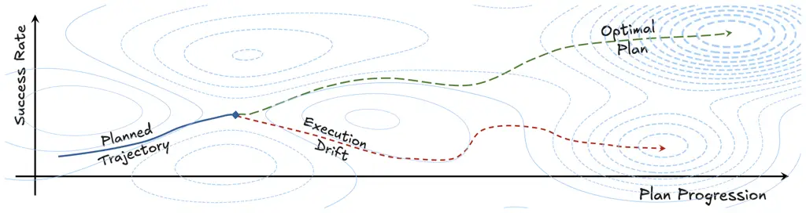
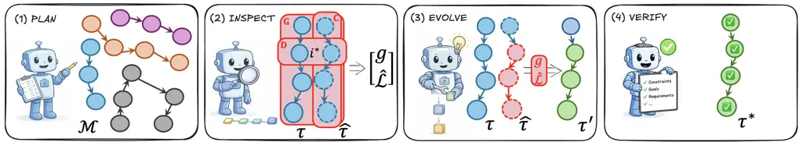
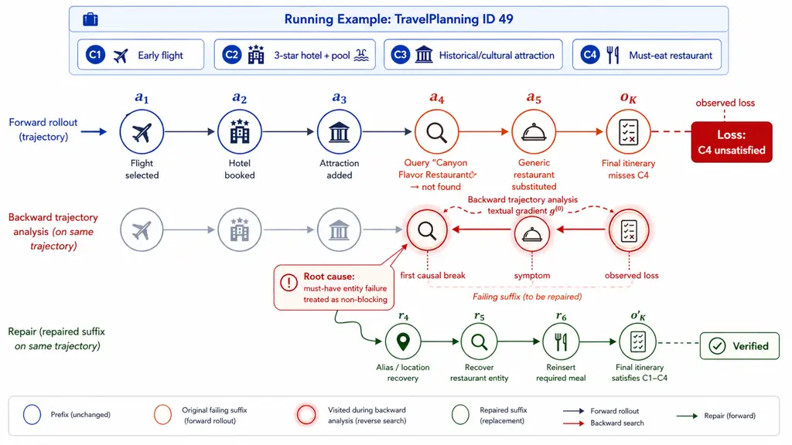
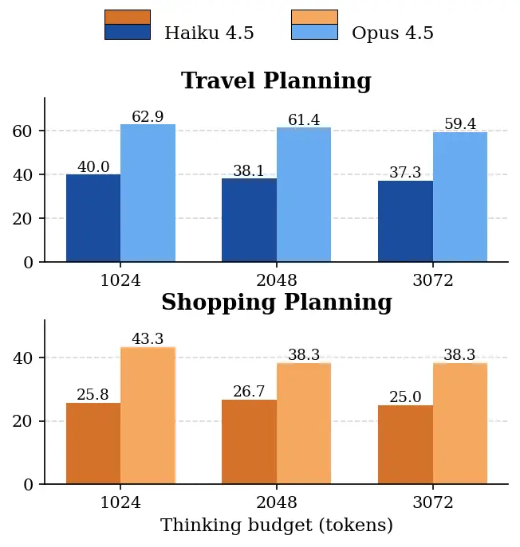

# PIVOT: Bridging Planning and Execution in LLM Agents via Trajectory Refinement

Tuo Zhang Email: [tuozhang@amazon.com](mailto:)    Alin-Ionut Popa
Email: [popaaln@amazon.com](mailto:)    Yan Xu
Email: [yanxuml@amazon.com](mailto:)    Rui Song
Email: [ruisong@amazon.com](mailto:)    Dimitrios Dimitriadis
Email: [dbdim@amazon.com](mailto:)

###### Abstract

When a long-horizon Large Language Model (LLM) agent fails, the decisive
error is often made long before failure surfaces. Existing methods
either critique the final output and replan globally, breaking parts
that were already correct, or map failures onto a fixed error taxonomy
that cannot express task-specific repairs. We explore whether an agent
can instead locate the earliest execution-grounded causal error in its
trajectory and repair only the affected suffix. To address it, we
propose PIVOT, which couples planning and execution through four stages:
PLAN states an explicit plan before acting; INSPECT checks execution
evidence against the plan and localizes the earliest unsupported step;
EVOLVE rewrites the trajectory from that step while preserving the
validated prefix; and VERIFY checks the final output against all task
constraints. Empirical evaluations on DeepPlanning and GAIA demonstrate
state-of-the-art performance: PIVOT establishes a strong upper bound up
to $`\sim`$94% relative improvement in constraint satisfaction, showing
that the core trajectory-refinement mechanism remains effective without
external supervision. PIVOT also remains computationally efficient,
requiring up to 3–5$`\times`$ fewer tokens than competing refinement
methods.

## 1 Introduction



Figure 1: LLM-generated plans (blue) often appear valid but diverge
during execution (red) due to infeasible steps, incorrect state
assumptions, or constraint violations. These discrepancies compound over
long horizons, leading to undesirable or suboptimal outcomes that
surface only at the end. Aligning planning with execution to reach an
optimal trajectory (green) is therefore a core challenge in reliable
agentic systems.

Long-horizon LLM agents make dozens of interdependent decisions, such as
tool queries, entity selections, and schedule commitments, but receive
feedback only on the final output Yao et al. (2023). This feedback could
identify which constraint is violated at the end of the trajectory, but
could not point out which decision caused the violation, which typically
lies at an earlier step. As shown in Figure 1, as execution first
diverges from the plan, the error propagates through every decision that
often render the remainder of the plan unrecoverable Zhu et al. (2025).
This raises a central question for reliable long-horizon agents: can an
agent use execution evidence to identify where its plan breaks down,
both to prevent errors from propagating and to repair them from their
origin?

Existing agent-improvement methods only partially address this challenge
because they lack a trajectory-level optimization view. Diagnostic and
attribution methods Zhu et al. (2025); Cemri et al. (2025); Zhang et al.
(2025b); Zhang et al. (2025a); Deshpande et al. (2025) identify failures
post hoc, but map them onto fixed error categories and do not repair the
trajectory; iterative refinement methods Madaan et al. (2023); Shinn et
al. (2023); Gou et al. (2024); Bohnet et al. (2025) critique the final
output and revise it as a whole, discarding parts that were already
correct; constraint-based methods Ji et al. (2024); Kumar and Cohen
(2026) fix the violated constraint where it surfaces rather than where
it originates; and evolutionary methods Guo et al. (2026) resample and
recombine entire trajectories without locating the responsible step.
What is missing is a trajectory-level mechanism that converts execution
feedback into a localized update signal: one that identifies the
earliest step at which execution contradicts the plan, and directs both
reasoning and repair to that point.

To this end, we propose PIVOT (Plan–Inspect–eVOlve Trajectories), a
self-supervised framework that formulates trajectory refinement as
iterative optimization in a discrete, language-defined space. PIVOT
defines a trajectory-level objective combining goal-achievement loss,
plan–execution divergence, and execution cost. Since exact gradients are
unavailable for language trajectories, PIVOT uses structured
natural-language feedback as a surrogate *textual gradient* Yuksekgonul
et al. (2024), guiding local updates to the unsupported parts of the
plan. A preference-based monotonic acceptance rule then keeps only
refinements that improve the estimated trajectory loss, yielding a
gradient-like optimization procedure over plans without requiring model
fine-tuning. Inspired by backpropagation, PIVOT treats the executed
trajectory as an unrolled computation graph and propagates the observed
failure backward to the earliest decision whose planned assumption is
contradicted by execution evidence. The subsequent update is localized
accordingly: the validated prefix is retained, and only the downstream
suffix is regenerated.

We evaluate PIVOT on two complementary benchmarks: DeepPlanning Zhang et
al. (2026), which stresses long-horizon constraint satisfaction in
Travel and Shopping Planning, and GAIA Mialon et al. (2023), which tests
open-domain tool use and multi-step reasoning. PIVOT performs best on
constraint-heavy planning tasks, where execution feedback exposes
recoverable violations for trajectory-level repair. On GAIA, gains are
more limited by retrieval quality, but PIVOT still improves task success
in realistic tool-augmented settings. Across model families, PIVOT
complements backbone scaling and remains token-efficient relative to
competing refinement methods.

## 2 Related Work

Trajectory analysis and failure diagnosis. A growing body of work
studies the reliability gap between planned and executed agent behavior
through trajectory analysis and failure diagnosis Cemri et al. (2025);
Deshpande et al. (2025); Ji et al. (2024); Ma et al. (2026); Zhang et
al. (2025a); Zhang et al. (2025b); Zhu et al. (2025). AgentDebug Zhu et
al. (2025) models agent behavior as a modular pipeline and shows how
errors propagate across components, while VeriLA Sung et al. (2025)
introduces human-centered criteria for identifying component-level
failures. In multi-agent settings, MAST Cemri et al. (2025) and
attribution benchmarks such as Who&When Zhang et al. (2025b) and
AgenTracer Zhang et al. (2025a) highlight the difficulty of localizing
failures in long trajectories. Constraint-based methods Ji et al.
(2024); Kumar and Cohen (2026) check plans against task requirements and
correct the violating steps. These efforts show that failures can be
localized, but either stop at diagnosis or check plans against static
task requirements rather than against execution evidence. PIVOT closes
this loop: the earliest step at which execution contradicts the plan
becomes the starting point of repair.

Iterative refinement and trajectory-level optimization. Recent
self-critique methods Madaan et al. (2023); Shinn et al. (2023); Gou et
al. (2024); Bohnet et al. (2025) show that structured refinement of
intermediate reasoning and tool use can yield strong empirical gains.
However, such approaches remain operating through step-wise corrections
rather than modeling the full trajectory as an optimizable object.
PromptAgent Wang et al. (2023) similarly frames optimization as search
over prompts and intermediate states, but does not directly optimize
execution-grounded trajectory discrepancies. SE-Agent Guo et al. (2026)
moves closer to trajectory-level optimization by treating trajectories
as genotypes whose phenotypic expression is problem-solving performance.
This shares PIVOT’s view of trajectories as optimizable objects, but
derives its signal from _cross-trajectory diversity and recombination_
rather than from _how intended plans diverge during execution_. PIVOT
instead models the plan–execution discrepancy as a structured loss and
interprets execution feedback as a textual gradient, enabling
gradient-like optimization directly in trajectory space through a
task-agnostic, self-supervised loop.



Figure 2: Overview of PIVOT. Given a task $`t`$, Plan states an explicit
plan $`\tau`$, whose execution in $`\mathcal{M}`$ yields the trace
$`\hat{\tau}`$. Inspect traces the unmet constraints
$`\widehat{\mathcal{L}}`$ backward through $`\hat{\tau}`$ to the
earliest step $`i^{\star}`$ contradicted by execution evidence,
producing a repair signal $`g`$. Evolve preserves the prefix before
$`i^{\star}`$ and regenerates only the suffix, yielding
$`\tau^{\prime}`$. Verify checks the final trajectory $`\tau^{\star}`$
against all task constraints.

## 3 PIVOT: Discrepancy-Driven Trajectory Refinement

### 3.1 Problem Setup

We consider a task $`t`$ to be completed over an environment
$`\mathcal{M}=(\mathcal{S},\mathcal{A},\mathcal{O})`$, where
$`\mathcal{S}`$ is the state space, $`\mathcal{A}`$ is the action space,
$`\mathcal{O}`$ the space of outcomes after each step, and a transition
function $`f(\cdot)`$ that maps state-action interactions to next states
and outcomes , $`f:\mathcal{M}\rightarrow\mathcal{S}\times\mathcal{O}`$,
reflecting the environment dynamics induced by agent actions.

A trajectory $`\tau_{K}`$ of length $`K`$ is defined as
$`\tau_{K}=\left((s_{0},a_{0}),\dots,(s_{K},a_{K})\right)`$, where
$`k\leq K`$, $`s_{k}\in\mathcal{S}`$ and $`a_{k}\in\mathcal{A}`$.
Executing $`\tau_{k}`$ up to a step $`k`$ produces an outcome $`o_{k}`$
evaluated as $`G(\hat{\tau}_{\leq k},o_{k})`$, with transitions
following $`(s_{k+1},o_{k+1})=f(s_{k},a_{k},o_{k})`$.

These definitions are task-agnostic: the initial plan $`\tau^{(0)}`$
should preserve user-specified requirements, the executed trace
$`\hat{\tau}^{(0)}`$ reveals where they are no longer supported, Inspect
produces a repair signal, and Evolve rewrites the remaining trajectory.

### 3.2 PLAN: Trajectory Generation and Forward Rollout

PIVOT begins with the Plan  ![[Uncaptioned
image]](arxiv-2605-11225v2--8c0a595df10f.figures/figure-3.webp) module,
which converts the task into an explicit candidate trajectory. Like
chain-of-thought reasoning, agent execution unfolds as an explicit
reasoning-and-action trace. We view that trace as an unrolled forward
computation in trajectory space. A planned trajectory $`\tau`$ induces
an execution trace $`\hat{\tau}`$ when interacting with the environment,
that can diverge due to incorrect assumptions or infeasible actions. We
capture this mismatch through a trajectory-level objective:

```math
\mathcal{L}(\tau)=\ell_{G}(\hat{\tau},o_{K})+D(\tau,\hat{\tau})+C(\hat{\tau}), \tag{1}
```

This objective combines three complementary sources of error: The term
$`\ell_{G}(\hat{\tau},o_{K})`$ captures failure to achieve the desired
task outcome, i.e. a terminal goal-achievement loss derived from the
reward-like success function $`G(\hat{\tau},o_{K})`$ as
$`\ell_{G}(\hat{\tau},o_{K})=1-G(\hat{\tau},o_{K})`$,
$`D(\tau,\hat{\tau})`$ measures divergence between planned and executed
trajectories, and $`C(\hat{\tau})`$ penalizes inefficient execution,
defined as the number of tool calls:
$`C(\hat{\tau})=\sum_{i=0}^{K}\mathbf{1}[a_{i}\text{ invokes a tool}]`$.
This decomposition separates three different failure modes. The term
$`\ell_{G}(\hat{\tau},o_{K})`$ rises when the final outcome fails to
satisfy the task, $`D(\tau,\hat{\tau})`$ increases once execution no
longer preserves the constraint structure encoded in the plan, and
$`C(\hat{\tau})`$ captures the computation spent on trajectories that
have already gone off course.

To localize failure, we identify the first step where planned and
executed trajectories diverge:

```math
i^{\star}=\min\{i:D(\tau_{\leq i},\hat{\tau}_{\leq i})\geq T\}, \tag{2}
```

where $`T`$ is a divergence threshold. The index $`i^{\star}`$ marks the
earliest step at which the executed trace no longer provides sufficient
support for the planned trajectory prefix, and therefore identifies the
point from which local repair should begin.

### 3.3 INSPECT: Backward Localization over the Executed Trace

The objective in Eq. 1 provides a unified signal for trajectory
refinement by aggregating goal-level, trajectory-level, and
efficiency-related errors. If Section 3.2 treats the agent trace as a
forward rollout, then Inspect ![[Uncaptioned
image]](arxiv-2605-11225v2--8c0a595df10f.figures/figure-4.webp)
performs the reverse operation: once a task-level loss is observed, it
analyzes the trajectory backward to identify the earliest causally
responsible break. For a specific trajectory, the gradient of
$`\mathcal{L}`$ becomes:

```math
\frac{\partial\mathcal{L}}{\partial\tau}\;\approx\;\sum_{i\leq K}\left[\nabla_{\tau_{i}}\ell_{G}(\cdot)+\nabla_{\tau_{i}}D(\cdot)+\frac{\partial C(\cdot)}{\partial\tau_{i}}\right], \tag{3}
```

Each term contributes error signals to every trajectory step, playing
backward credit assignment over the discrete trace, traversing
dependencies backward from each violation and stopping at the earliest
step contradicted by execution evidence. It returns
$`(\hat{\imath}^{\star},g)`$, where the repair signal $`g`$ states the
observed failure, its manifestation in the trace, the break at
$`\hat{\imath}^{\star}`$, and what to do differently from there.

### 3.4 EVOLVE: Local Trajectory Repair

Given a backward attribution signal from Inspect, the role of Evolve
 ![[Uncaptioned
image]](arxiv-2605-11225v2--8c0a595df10f.figures/figure-5.webp) is to
produce an improved trajectory by modifying current plan in response to
identified discrepancies. At iteration $`r\leq R`$, Evolve proposes an
updated trajectory:

```math
\tau^{\prime}=\texttt{{Evolve}}(\hat{\tau}^{(r)},\tau^{(r)},g^{(r)}), \tag{4}
```

where $`g^{(r)}`$ specifies both the location and nature of the failure.
Rather than regenerating the full trajectory, the update operates
locally: the validated prefix $`\tau_{\leq i^{\star}}`$ is preserved,
while the unsupported suffix is rewritten, focusing on the part of the
trajectory responsible for the current loss.

The candidate trajectory is then executed and evaluated:

```math
(\widehat{\mathcal{L}}^{\prime},g^{\prime})=\texttt{{Inspect}}(\hat{\tau}^{\prime},\tau^{\prime},t). \tag{5}
```

The update is accepted only if it improves the objective:

```math
\tau^{(r+1)}=\begin{cases}\tau^{\prime}&\text{if }\widehat{\mathcal{L}}^{\prime}\prec\widehat{\mathcal{L}}^{(r)},\\
\tau^{(r)}&\text{otherwise}.\end{cases} \tag{6}
```

This accept/reject mechanism ensures monotonic improvement, resembling a
gradient-based update in the trajectory space, where Inspect provides a
structured approximation of the loss and Evolve performs a local step
guided by this signal.

### 3.5 VERIFY: Global Constraint Validation.

While Inspect provides local feedback for trajectory refinement, it does
not guarantee that the final trajectory fully satisfies the original
task specification. To address this, PIVOT applies a final validation
step using Verify  ![[Uncaptioned
image]](arxiv-2605-11225v2--8c0a595df10f.figures/figure-6.webp), which
performs a global check over the complete trajectory. Given a candidate
solution $`\tau`$, Verify evaluates whether all user-specified
constraints and requirements are satisfied. This step operates
independently of the trajectory-level discrepancy signals used during
refinement, ensuring that improvements in intermediate behavior do not
come at the expense of violating the original task. The final output of
the system is therefore obtained by applying:

```math
\tau^{\star}=\texttt{{Verify}}\left(\operatorname*{arg\,min}_{r\leq R}^{\prec}\ \widehat{\mathcal{L}}^{(r)},\ t\right), \tag{7}
```

which enforces that the selected trajectory is both optimal under the
refinement objective and consistent with the task specification.

## 4 Experiments

We evaluate PIVOT on three axes: (1) trajectory alignment optimization:
can explicitly optimizing the alignment between planned trajectories and
executed behavior translate into state-of-the-art task performance and
improved reliability on long-horizon agent benchmarks? (2) execution
efficiency: are these gains practically attainable under favorable token
usage and execution overhead? and (3) improvement attribution: which
components drive the observed gains, and what gives PIVOT an advantage
over prior agent frameworks?

### 4.1 Experimental Setup

Benchmarks and evaluation Metrics. We evaluate PIVOT on two
complementary benchmarks. DeepPlanning Zhang et al. (2026) is a
long-horizon planning benchmark with two tool-grounded domains: _Travel
Planning_ and _Shopping Planning_, each containing $`120`$ tasks. We
follow the official benchmark protocol for the main evaluation metrics.
GAIA Mialon et al. (2023) contains $`466`$ human-authored, open-domain
questions that require multi-step reasoning and tool use in realistic
assistant settings. We report exact-match task success rate as guided in
the original dataset paper. We equip the agent with four basic tools in
the evaluation: web_search, web_fetch, read_file, and python_exec. More
details for the dataset and tool setups are in App. E.2.

Experimental settings. We instantiate all methods on the same set of
underlying model backbones, including Qwen3-235B Team (2025), Claude 4.5
model family, and Claude 4.6 Opus. All methods share the same benchmark
tools, system prompts, and task environments, and baselines are
re-implemented within this common harness, as listed in the App. A.

|                                    |                 |           |            |          |          |                   |           |            |          |          |         |           |            |          |          |
| ---------------------------------- | --------------- | --------- | ---------- | -------- | -------- | ----------------- | --------- | ---------- | -------- | -------- | ------- | --------- | ---------- | -------- | -------- |
|                                    | Travel Planning |           |            |          |          | Shopping Planning |           |            |          |          | GAIA    |           |            |          |          |
| Method                             | Q3 235B         | Haiku 4.5 | Sonnet 4.5 | Opus 4.5 | Opus 4.6 | Q3 235B           | Haiku 4.5 | Sonnet 4.5 | Opus 4.5 | Opus 4.6 | Q3 235B | Haiku 4.5 | Sonnet 4.5 | Opus 4.5 | Opus 4.6 |
| ReACT Yao et al. (2023)            | 28.3            | 35.2      | 53.1       | 62.9     | 86.0     | 10.8              | 25.8      | 40.8       | 43.3     | 50.8     | 31.5    | 37.0      | 40.6       | 59.4     | 57.0     |
| Self-Critique Bohnet et al. (2025) | 30.1            | 45.1      | 52.6       | 75.2     | 87.3     | 16.7              | 35.8      | 55.8       | 53.3     | 70.0     | 37.6    | 44.8      | 51.5       | 64.2     | 68.5     |
| SE-Agent Guo et al. (2026)         | 29.6            | 41.9      | 52.6       | 63.9     | 82.8     | 15.8              | 31.7      | 45.8       | 43.7     | 53.7     | 37.5    | 37.0      | 40.0       | 57.6     | 56.4     |
| AgentDebug Zhu et al. (2025)       | 25.1            | 42.7      | 46.2       | 59.3     | 86.1     | 15.0              | 33.3      | 47.5       | 45.8     | 53.3     | 33.4    | 41.8      | 47.9       | 63.6     | 66.7     |
| PIVOT (_self-judged_)              | 39.8            | 53.7      | 59.8       | 76.5     | 89.3     | 20.0              | 37.5      | 43.3       | 48.3     | 55.8     | 35.2    | 40.6      | 41.8       | 60.6     | 64.8     |
| PIVOT (_oracle_)                   | 39.9            | 57.3      | 67.1       | 82.7     | 96.2     | 76.7              | 89.2      | 89.2       | 94.2     | 98.3     | 41.8    | 44.8      | 52.7       | 68.5     | 71.5     |

Table 1: Main results across DeepPlanning and GAIA. Travel reports
composite score, Shopping reports case accuracy, and GAIA reports task
success rate (all in %). Each column group corresponds to one benchmark,
and each row reports the same agent framework instantiated on the same
set of backbones. We bold the best result and underline the second-best
result within each column.

Figure 3: Extra token cost per solved case, relative to ReACT baseline.
Bars report median extra billed tokens (input + output) on solved cases
(composite score $`\geq 0.7`$); lower is better. PIVOT (w/o HITL) adds
3–5$`\times`$ fewer tokens than Self-Critique, SE-Agent or AgentDebug;
the HITL variant remains cheaper than either baseline. Since
autoregressive decoding time grows with the number of generated tokens,
token usage serves as a proxy for both inference cost and latency.

Feedback regimes. We evaluate PIVOT under two feedback regimes differ in
the source of the unmet-constraint set $`\widehat{\mathcal{L}}`$. In the
default _self-judged_ regime, the agent determines
$`\widehat{\mathcal{L}}`$ itself through Verify without external signal.
In the _oracle_ regime, $`\widehat{\mathcal{L}}`$ is supplied by the
benchmark’s deterministic and rule-based evaluator. The reports only
contains which constraints are unmet (e.g., “hotel price outside the
requested range”) but never how to satisfy them to mimic the real human
interaction with agent. No human annotators are involved. Because this
signal is exact and constraint-level, the oracle regime is an upper
bound rather than a deployable setting, and it receives strictly more
information than any baseline.

Baselines. We compare PIVOT against four representative agent baselines.
ReACT Yao et al. (2023) serves as a canonical single-pass
reasoning-and-acting baseline. Self-Critique Bohnet et al. (2025) and
SE-Agent Guo et al. (2026) are self-refinement baselines, providing
competitive benchmarks for iterative plan improvement. AgentDebug Zhu et
al. (2025) is a debugging framework that isolates root-cause failures
and generates corrective feedback for recovery, as a relevant comparison
for our discrepancy-driven refinement setting.

ReAct Yao et al. (2023) and SE-Agent Guo et al. (2026) use no external
signal, matching self-judged PIVOT. Self-Critique Bohnet et al. (2025)
and AgentDebug Zhu et al. (2025) baselines rely on human-provided or
externally supplied feedback in their evaluated setups. We therefore
compare them with oracle PIVOT. Since only AgentDebug releases usable
code, we re-implement all baselines under identical tools, prompts, and
state-of-the-art backbones rather than the weaker models of their
original papers, a setting that favors the baselines.



Figure 4: Trajectory-level repair via PIVOT with HITL feedback. The
initial rollout violates constraint $`C_{4}`$ after a failed retrieval
for “Canyon Flavor Restaurant,” producing an invalid itinerary. Inspect
localizes the first causal break and produce a textual gradient; Evolve
repairs only the unsupported suffix while preserving the valid prefix.
The refined trajectory restores the required entity and satisfies
$`C_{1}`$–$`C_{4}`$.

### 4.2 Main Results

Table 1 summarizes the main evaluation results. We have three key
observations:

PIVOT is consistently strong across models and benchmarks. Because the
baselines receive different inputs, we compare PIVOT with each group at
its level of information. At equal information, self-judged PIVOT
improves over ReAct in all 15 settings and over the stronger of ReAct
and SE-Agent in 13. The gains are largest on Travel Planning, where
PIVOT is best among all methods on every backbone, and they persist on
the strongest backbone so trajectory repair complements backbone
scaling. Against baselines that know which trajectories failed with
precise feedback, self-judged PIVOT still wins 7 of 15, and with
constraint-level feedback, PIVOT is best or tied in all. Under
equal-input comparison, PIVOT leads uniformly, indicating its robust
performance.

Retrieval bounds the gains on GAIA. All methods on GAIA use the same
minimal four-tool setup, so absolute numbers are not comparable to
papers with richer tooling. GAIA failures typically stem from evidence
that was never retrieved rather than evidence that was misused; the
trajectory then contains no unsupported step to repair from, and
re-querying the same tools returns the same results. PIVOT still
improves over baselines on all five backbones, but by smaller margins
than on DeepPlanning, which delineates where execution-grounded repair
is most effective.

PIVOT is token-usage efficient. To isolate the computational cost, we
compute the extra tokens each method spends on cases it solves relative
to the ReACT baseline in DeepPlanning. We report the per-case median and
aggregate across backbones with the median-of-medians to be robust to
long-tail outliers where weaker backbones enter tool-call loops under
ReACT. In Fig. 3, PIVOT saves 345k (4.2×) and 320k (4.1×) extra tokens
per solved case compared to Self-Critique and AgentDebug due to: (1)
Both baselines require a second full trajectory conditioned on a long
failure transcript, scaling their cost with how much the backbone needs
to explore in the first place. PIVOT instead steers a single trajectory
with four in-line prompts, adding a bounded overhead that is largely
independent of backbone verbosity. (2) PIVOT bounds the worst case: when
a backbone enters a long, non-productive exchange, PIVOT inspect/evolve
triggers can redirect it within the current trajectory, whereas post-hoc
methods inherit the full failed transcript and must re-run for it.

|                         |                                                                                |                                                                                |                                                                                |                                                                                |         |           |            |          |          |                      |
| ----------------------- | ------------------------------------------------------------------------------ | ------------------------------------------------------------------------------ | ------------------------------------------------------------------------------ | ------------------------------------------------------------------------------ | ------- | --------- | ---------- | -------- | -------- | -------------------- |
|                         | ![[Uncaptioned image]](arxiv-2605-11225v2--8c0a595df10f.figures/figure-3.webp) | ![[Uncaptioned image]](arxiv-2605-11225v2--8c0a595df10f.figures/figure-8.webp) | ![[Uncaptioned image]](arxiv-2605-11225v2--8c0a595df10f.figures/figure-5.webp) | ![[Uncaptioned image]](arxiv-2605-11225v2--8c0a595df10f.figures/figure-6.webp) | Q3-235B | Haiku 4.5 | Sonnet 4.5 | Opus 4.5 | Opus 4.6 | Avg. Drop            |
| ReAct Yao et al. (2023) | $`-`$                                                                          | $`-`$                                                                          | $`-`$                                                                          | $`-`$                                                                          | 28.33   | 35.23     | 53.07      | 62.86    | 86.02    | —                    |
| PIVOT                   | ✓                                                                              | ✓                                                                              | ✓                                                                              | ✓                                                                              | 39.81   | 53.69     | 59.82      | 76.45    | 89.27    | —                    |
|                         | ✗                                                                              | ✓                                                                              | ✓                                                                              | ✓                                                                              | 15.34   | 51.51     | 54.69      | 62.79    | 77.89    | $`\downarrow`$ 11.36 |
|                         | ✓                                                                              | ✗                                                                              | ✓                                                                              | ✓                                                                              | 29.40   | 50.18     | 58.93      | 71.51    | 87.92    | $`\downarrow`$ 4.22  |
|                         | ✓                                                                              | ✓                                                                              | ✗                                                                              | ✓                                                                              | 20.57   | 50.62     | 54.74      | 61.28    | 77.92    | $`\downarrow`$ 10.78 |
|                         | ✓                                                                              | ✓                                                                              | ✓                                                                              | ✗                                                                              | 18.78   | 44.74     | 52.03      | 60.62    | 76.43    | $`\downarrow`$ 13.29 |

Table 2: Ablation of PIVOT stages on Travel Benchmark. Each row removes
one component (✗) while keeping others (✓); Avg. Drop reports the mean
degradation relative to the full pipeline. All stages contribute to
performance, confirming that PIVOT operates as a tightly coupled
refinement loop rather than a set of independent modules. Verify has the
largest impact, highlighting the importance of final constraint
validation, followed by Plan and Evolve, which govern trajectory
initialization and repair. Inspect shows a smaller but consistent
contribution, indicating that even imperfect discrepancy signals remain
useful for guiding updates.

### 4.3 A Trajectory-Level View of Failures and Repair

We visualized a running example to illustrate how PIVOT locates break
point and repairs as shown in Figure 4. In this section, we examine in
general about where errors arise along the trajectory, and how the scope
of repair affects its outcome based on the trajectories from the Travel
Planning.

Errors surface late but become irrecoverable early. The step at which an
error becomes visible differs from the step at which it becomes
irrecoverable. We probe these two points separately on failed
trajectories. For visibility, we leverage a rule-based check to flag the
conflicts against each user request and tool outputs. For
irrecoverability, we use a resumption probe: we keep each step $`k`$
verbatim including its tool outputs, and let a fixed model continue the
task without feedback. The resumer can satisfy a violated constraint
only if the retained prefix has not yet committed to the error, so the
last $`k`$ at which resumption succeeds marks where the error is locked
in.

The two probes locate errors at different points. The rule-based check
finds a conflict in 27 of 112 failed trajectories. In all 27 the wrong
value is first written at the final assembly step, although the correct
value had been retrieved earlier. The resumption probe labels 20 cases,
and places the lock-in point mid-trajectory in 14, at the first step in
4, and at the last step in only 2. Together they reproduce the pattern
of Figure 1: the violation is written during plan assembly, but the
prefix that makes it unavoidable is fixed several steps earlier.
Locating this point precisely is inherently hard: a single-sample probe
with Claude 4.5 Opus as the resumer agrees with the majority label
within one step in 63% of cases. Existing diagnostics are not designed
for this difficulty and fail in opposite directions. Across 874 cases,
57.3% of AgentDebug diagnoses fall into a single category and 60.4%
blame the first step, which is too coarse to locate the lock-in point.
SE-Agent’s critic over-flags instead: its precision drops from 0.99 to
0.49 as the backbone strengthens, and 40 of its 95 false-positive
corrections on Claude 4.6 Opus strictly lower the score. PIVOT therefore
does not rely on pinpointing this step exactly; instead, it repairs
conditioned on the executed prefix.

Repair must be local and actionable. Effective repair must state what to
change and keep what execution has already validated; existing methods
violate one or the other. SE-Agent’s critique triggers broad re-plans
that fix one element while breaking others: a suboptimal flight prompts
a rewrite that loses attraction coverage, meal timing, or transfer
feasibility. AgentDebug’s taxonomy instead yields a verdict rather than
a repair, as 53% of its correction strings merely restate the predicted
label. PIVOT’s diagnosis names the violated constraint, its
manifestation in the trace, the step where support was lost, and what to
do differently, and is applied on top of the executed trajectory. With
the diagnosis fixed, this outperforms replanning from the query by 5.6
points. Repair succeeds when the evidence was retrieved but ignored, and
also when the root cause lies far upstream, e.g., a train fabricated at
the first query. It fails when the evidence cannot be retrieved at all,
which bounds the gains on GAIA. Local repair can also leave a plan whose
steps are each supported but whose total violates a global constraint
such as budget, which is why Verify checks the assembled plan as a
whole.

### 4.4 Why PIVOT Works

Thinking is in the right place. A natural alternative to structured
reflection is to simply allocate more test-time compute by raising the
extended-thinking budget but this does not work, as in Figure 5;
increasing the budget yields no consistent gain on either benchmark.
Inspection of the trajectories reveals that under the default
extended-thinking regime, 100% of thinking blocks fire on the first
assistant turn, spending tokens on task decomposition and tool
selection, while 99.2% of final-plan generation steps produce zero
thinking tokens. The model actually uses only $`\sim`$230 thinking
tokens on average, well below the 1024 ceiling, and raising the ceiling
does not redirect where that thinking happens. The hardest part of the
task, synthesizing 20+ tool outputs into a coherent multi-day itinerary
under interacting constraints, is executed with no reasoning at all,
regardless of budget. PIVOT addresses this distributional problem rather
than the quantity problem: its plan–inspect–evolve–verify schedule
triggers reasoning at multiple points along the trajectory. After tool
returns, before plan assembly, and before the final answer, thinking is
allocated precisely where synthesis and verification happen, not only at
the upfront planning step.



Figure 5: Thinking-budget ablation. Scaling the extended-thinking budget
from 1024 to 3072 tokens does not improve performance on either backbone
or benchmark.

Ablation study on importance of PIVOT components. Table 2 reports the
effect of disabling each PIVOT stage while keeping the remaining stages
active. The largest degradation occurs when removing Verify ($`-13.3`$
avg.), followed by Plan ($`-11.4`$ avg.), Evolve ($`-10.8`$ avg.), and
Inspect ($`-4.2`$ avg.). This suggests that PIVOT’s gains do not come
solely from better upfront planning; instead, reasoning at the end of
the trajectory, where the draft plan is checked against the original
constraints, contributes the most. The effect persists even for stronger
backbones: disabling Verify reduces Opus 4.6 by $`12.9`$ points,
indicating that even highly capable models can silently emit constraint
violations unless explicitly prompted to validate them. This finding is
consistent with the thinking-allocation analysis above. Vanilla extended
thinking spends most of its reasoning budget on the opening turn and
produces little or no thinking during plan synthesis or final answering.
Verify places reasoning precisely at this under-covered stage, where
constraint violations are most likely to surface in the final output.
Its benefit therefore comes from improved reasoning coverage rather than
simply adding more reasoning tokens. Plan and Evolve also remain
important, especially for weaker backbones, showing that both strong
trajectory initialization and discrepancy-guided repair are necessary
for robust performance.

Why Verify matters most. Verify is the only stage that reasons at plan
assembly, and plan assembly is where errors are committed. Plan,
Inspect, and Evolve act before or between tool calls, while the agent is
still gathering evidence; the violations themselves are written later,
when the agent combines that evidence into the final itinerary. In all
27 failed trajectories where a plan value contradicts a tool output, the
correct value had been retrieved and the wrong one first appears at this
assembly step, where the default agent performs no reasoning as we
reported in Sec. 4.3.

## 5 Conclusions

We studied where long-horizon LLM agents fail and how to repair them.
Errors are written at plan assembly, where models reason least, but
become irrecoverable several steps earlier, so correcting the final
output does not reach their cause. PIVOT uses an explicit plan as the
reference for checking execution, places reasoning where execution
evidence must be reconciled with the plan, and repairs failures from the
localized step on top of the executed trajectory. Empirical results
across DeepPlanning and GAIA show that PIVOT is especially effective in
long-horizon, constraint-driven settings where failures stem from
recoverable plan–execution discrepancies. Overall, our findings position
discrepancy-driven trajectory optimization as a principled mechanism for
improving reliability in autonomous agents, particularly when constraint
satisfaction, execution feedback, and iterative repair are central to
task success.

## 6 Limitations

PIVOT proposes safer autonomous systems and interpretable failure
attribution. However, these same capabilities introduce risks around
reduced human oversight, dual-use potential, misplaced trust, and labor
displacement that must be proactively addressed. The responsible path
forward requires coupling PIVOT technical contributions with deployment
guardrails, and ongoing evaluation in real-world settings beyond
controlled benchmarks.

## References

- Bohnet et al. (2025) B. Bohnet, P. Kamienny, H. Sedghi, D. Gorur, P.
  Awasthi, A. Parisi, K. Swersky, R. Liu, A. Nova, and N. Fiedel
  Enhancing llm planning capabilities through intrinsic self-critique.
  arXiv preprint arXiv:2512.24103. Cited by: §1, §2, §4.1, §4.1, Table
  1.
- Cemri et al. (2025) M. Cemri, M. Z. Pan, S. Yang, L. A. Agrawal, B.
  Chopra, R. Tiwari, K. Keutzer, A. Parameswaran, D. Klein, K.
  Ramchandran, et al. Why do multi-agent llm systems fail?. arXiv
  preprint arXiv:2503.13657. Cited by: §1, §2.
- Deshpande et al. (2025) D. Deshpande, V. Gangal, H. Mehta, J.
  Krishnan, A. Kannappan, and R. Qian Trail: trace reasoning and agentic
  issue localization. arXiv preprint arXiv:2505.08638. Cited by: §1, §2.
- Gou et al. (2024) Z. Gou, Z. Shao, Y. Gong, Y. Shen, Y. Yang, N. Duan,
  and W. Chen CRITIC: large language models can self-correct with
  tool-interactive critiquing. In International Conference on Learning
  Representations, Vol. 2024, pp. 57734–57811. Cited by: §1, §2.
- Guo et al. (2026) Y. Guo, J. Lin, H. Wang, Y. Han, S. Hu, Z. Ni, L.
  Wang, and M. Chen Se-agent: self-evolution trajectory optimization in
  multi-step reasoning with llm-based agents. Advances in Neural
  Information Processing Systems 38, pp. 116314–116341. Cited by: §1,
  §2, §4.1, §4.1, Table 1.
- Ji et al. (2024) Z. Ji, D. Wu, P. Ma, Z. Li, and S. Wang Testing and
  understanding erroneous planning in llm agents through synthesized
  user inputs. arXiv preprint arXiv:2404.17833. Cited by: §1, §2.
- Kumar and Cohen (2026) A. Kumar and W. W. Cohen Localizing and
  correcting errors for llm-based planners. arXiv preprint
  arXiv:2602.00276. Cited by: §1, §2.
- Ma et al. (2026) T. Ma, Y. Chen, V. Anand, A. Cornacchia, A. R.
  Faustino, G. Liu, S. Zhang, H. Luo, S. A. Fahmy, Z. A. Qazi, et al.
  MAESTRO: multi-agent evaluation suite for testing, reliability, and
  observability. arXiv preprint arXiv:2601.00481. Cited by: §2.
- Madaan et al. (2023) A. Madaan, N. Tandon, P. Gupta, S. Hallinan, L.
  Gao, S. Wiegreffe, U. Alon, N. Dziri, S. Prabhumoye, Y. Yang, S.
  Gupta, B. P. Majumder, K. Hermann, S. Welleck, A. Yazdanbakhsh, and P.
  Clark Self-refine: iterative refinement with self-feedback. arXiv
  preprint arXiv:2303.17651. Cited by: §1, §2.
- Mialon et al. (2023) G. Mialon, C. Fourrier, T. Wolf, Y. LeCun, and T.
  Scialom Gaia: a benchmark for general ai assistants. In The Twelfth
  International Conference on Learning Representations, Cited by: §1,
  §4.1.
- Shinn et al. (2023) N. Shinn, F. Cassano, E. Berman, A. Gopinath, K.
  Narasimhan, and S. Yao Reflexion: language agents with verbal
  reinforcement learning. arXiv preprint arXiv:2303.11366. Cited by: §1,
  §2.
- Sung et al. (2025) Y. Y. Sung, H. Kim, and D. Zhang Verila: a
  human-centered evaluation framework for interpretable verification of
  llm agent failures. arXiv preprint arXiv:2503.12651. Cited by: §2.
- Team (2025) Q. Team Qwen3 technical report. External Links:
  2505.09388, [Link](https://arxiv.org/abs/2505.09388) Cited by: §4.1.
- Wang et al. (2023) X. Wang, C. Li, Z. Wang, F. Bai, H. Luo, J.
  Zhang, N. Jojic, E. P. Xing, and Z. Hu PromptAgent: strategic planning
  with language models enables expert-level prompt optimization. arXiv
  preprint arXiv:2310.16427. Cited by: §2.
- Yao et al. (2023) S. Yao, J. Zhao, D. Yu, N. Du, I. Shafran, K. R.
  Narasimhan, and Y. Cao ReAct: synergizing reasoning and acting in
  language models. In The Eleventh International Conference on Learning
  Representations, External Links:
  [Link](https://openreview.net/forum?id=WE_vluYUL-X) Cited by: §1,
  §4.1, §4.1, Table 1, Table 2.
- Yuksekgonul et al. (2024) M. Yuksekgonul, F. Bianchi, J. Boen, S.
  Liu, Z. Huang, C. Guestrin, and J. Zou TextGrad: automatic
  "differentiation" via text. URL https://arxiv.org/abs/2406.07496.
  Cited by: §1.
- Zhang et al. (2025a) G. Zhang, J. Wang, J. Chen, W. Zhou, K. Wang,
  and S. Yan AgenTracer: who is inducing failure in the llm agentic
  systems?. arXiv preprint arXiv:2509.03312. Cited by: §1, §2.
- Zhang et al. (2025b) S. Zhang, M. Yin, J. Zhang, J. Liu, Z. Han, J.
  Zhang, B. Li, C. Wang, H. Wang, Y. Chen, et al. Which agent causes
  task failures and when? on automated failure attribution of llm
  multi-agent systems. arXiv preprint arXiv:2505.00212. Cited by: §1,
  §2.
- Zhang et al. (2026) Y. Zhang, S. Jiang, R. Li, J. Tu, Y. Su, L.
  Deng, X. Guo, C. Lv, and J. Lin DeepPlanning: benchmarking
  long-horizon agentic planning with verifiable constraints. arXiv
  preprint arXiv:2601.18137. Cited by: §1, §4.1.
- Zhu et al. (2025) K. Zhu, Z. Liu, B. Li, M. Tian, Y. Yang, J.
  Zhang, P. Han, Q. Xie, F. Cui, W. Zhang, et al. Where llm agents fail
  and how they can learn from failures. arXiv preprint arXiv:2509.25370.
  Cited by: §1, §1, §2, §4.1, §4.1, Table 1.

## Appendix A Prompts and Flow Discussion

### A.1 Stage 1: PLAN - Structured Planning Before Action

Intuitive Analogy: Imagine a chef who just received an order for a
multi-course dinner. Before touching any ingredients, they sit down with
pen and paper: What dishes are we making? What ingredients do we need?
Which stations handle what? What’s the cooking sequence? What if the
oven breaks or we’re out of a key ingredient? This is what PLAN forces
the AI agent to do before it touches any tool.

Core Mechanism:

- •
  Forces the agent to produce an explicit, structured plan before any
  tool is called
- •
  The plan must include: goal restatement, information needs, tool
  selection per step, step dependencies, and failure contingencies
- •
  Serves as the "blueprint" that all subsequent stages reference


Trigger Condition: Appended to the system prompt. Runs once, at the very
start of the task.

Design Rationale: Research consistently shows that LLMs perform better
when they "think before acting." Without an explicit planning step,
agents tend to call tools reactively, grabbing whatever seems relevant
in the moment rather than following a coherent strategy. By requiring
the agent to articulate its plan upfront (including failure
contingencies), we front-load the strategic thinking that prevents
downstream waste.

### A.2 Stage 2: INSPECT — Periodic Reflection Checkpoints

Intuitive Analogy: Now the chef is actively cooking. After finishing
each course, they pause to taste and assess: "Did this sauce reach the
right consistency? Am I still on schedule for the next course? Does this
plating match my original vision, or do I need to adjust my approach for
the remaining dishes?" They don’t wait until all courses are plated—they
catch issues while there’s still time to correct course.

Core Mechanism:

- •
  Executes plans step-by-step in the actual environment
- •
  Tracks discrepancies between what was planned and what actually
  happened
- •
  Identifies constraint violations, infeasible actions, and early
  warning signs
- •
  Generates structured diagnostic reports documenting exactly where and
  why things went wrong
- •
  Proactively detects problems rather than waiting for catastrophic
  failures


Trigger Condition: Injected automatically every 3 tool-call rounds
during execution.

Design Rationale: Without periodic reflection, agents exhibit "tunnel
vision", they keep executing the original plan even when early results
clearly indicate it won’t work. The 3-round interval is a deliberate
balance: frequent enough to catch problems early, but not so frequent
that it slows down execution with excessive self-reflection. The
three-question structure (Result → Status → Revision) mirrors the
observe-orient-decide loop used in real-world decision-making
frameworks.

### A.3 Stage 3: EVOLVE — Adaptive Plan Revision on Failure

Intuitive Analogy: The chef discovers mid-service that a key ingredient
is spoiled. Rather than just trying to salvage that same ingredient or
make the dish anyway, they step back to diagnose: Why won’t this work?
Is there a completely different ingredient that provides the same flavor
profile? Could I pivot to an entirely different dish that uses what’s
available? And if no substitution works, what’s the best menu I can
serve with the ingredients I do have? EVOLVE forces the agent through
this same discipline: diagnose root cause, pivot to a fundamentally
different strategy, or gracefully degrade—but never blindly retry the
same failed approach.

Core Mechanism:

- •
  Triggered specifically when a tool call fails or returns useless
  results
- •
  Forces the agent to diagnose the root cause, propose a completely
  different approach (not just a retry), and identify a fallback if no
  alternative exists
- •
  Capped at 3 invocations per task to prevent infinite retry loops


Trigger Condition: injected when a tool call fails, max 3 times

Design Rationale: The most common failure pattern in AI agents is the
"retry loop": when a search fails, the agent tries the same query (or a
trivially different one) repeatedly. EVOLVE breaks this pattern by
explicitly prohibiting repeated queries and requiring the agent to name
a completely different approach. The 3-invocation cap is a cost-control
mechanism: if three fundamentally different approaches all fail, the
information likely isn’t accessible, and the agent should construct the
best partial answer it can.

### A.4 Stage 4: VERIFY — Final Quality Gate

Intuitive Analogy: All courses are plated and ready. Before sending them
to the dining room, the chef does a final inspection against the
original order: ✓Are all requested courses present? ✓Are dietary
restrictions honored? ✓Is the presentation what was promised? ✓Is the
temperature correct for each dish? If anything’s missing or wrong, they
fix it now. If something’s impossible with available ingredients, they
communicate it clearly to the customer. VERIFY is the agent’s version of
this final quality check before serving.

Core Mechanism:

- •
  Runs once, just before the agent produces its final answer
- •
  Forces the agent to re-read the original question and check its answer
  against every stated requirement
- •
  Each requirement is explicitly marked as ✓ satisfied or ✗ not
  satisfied
- •
  Any gaps are either fixed on the spot or transparently acknowledged
- •
  Addresses root causes identified through backward analysis, and then
  fundamentally reconstructs plans rather than just patching individual
  steps
- •
  Produces plans that are more executable and constraint-aware


Trigger Condition: injected once before the final answer

Design Rationale: Even after good planning, diligent execution, and
adaptive recovery, agents frequently produce answers that miss one or
more requirements from the original question, especially when the
question is multi-part or has specific formatting requirements. VERIFY
acts as a safety net that catches these last-mile errors. The
instruction "Do NOT discard your work" is critical: without it, agents
sometimes over-correct by throwing away good work and starting over,
which is wasteful and often produces worse results.

## Appendix B Motivation: Backward Error Analysis for Agent Debugging

A central challenge in improving LLM-based agents is the opacity of
their failure modes. When an agent produces an incorrect answer after a
multi-step reasoning trajectory involving tool calls, web searches, and
intermediate computations, it is rarely obvious where the reasoning went
wrong. The final output is a single point of failure, but the causal
chain leading to it may span dozens of steps. Without a principled
method for localizing errors within this chain, practitioners are left
with two unsatisfying options: (1) manually inspecting lengthy execution
traces, which does not scale, or (2) blindly re-running the agent, which
tends to reproduce the same errors. We draw inspiration from
back-propagation in neural network training, where the gradient of the
loss is propagated backward through the computation graph to identify
which parameters contributed most to the error. Analogously, we treat
the agent’s reasoning trace as a directed computation graph: a sequence
of decisions, tool invocations, and intermediate conclusions. We
propagate the error signal (an incorrect final answer) backward through
this graph to identify the root cause: the earliest decision point where
a different choice would have plausibly led to a correct outcome.

The backward analysis (PIVOT with HITL) revealed a consistent pattern:
the most common failure mode is not missing information but ignored
information. This diagnosis points to a structural problem: the agent’s
thinking budget is allocated in the wrong place. The agent loop is a
simple cycle:  
     call LLM → execute tool calls → when no more tool calls, extract
plan $`\rightarrow`$ return

There are no intermediate steps between “done gathering data” and
“generate plan” where the agent cross-references its collected evidence
against constraints. More importantly, the same four failure archetypes
recur systematically across tasks and models:

- •
  Absence of planning: agents dive into tool calls without structuring
  their approach, producing disorganized trajectories with redundant
  searches and missed dependencies.
- •
  Ignored evidence: agents retrieve all necessary data but fail to
  cross-reference it during output assembly — the dominant failure mode
  at 44–47% of cases.
- •
  Retry loops: when a tool call fails, agents retry the same query
  rather than pivoting to a fundamentally different strategy.
- •
  Silent constraint dropping: agents satisfy most requirements but
  silently drop one or two constraints, producing partially correct
  answers indistinguishable from fully correct ones.

This observation directly motivates the PIVOT framework: rather than
diagnosing and repairing failures post-hoc, we embed the lessons from
backward analysis as proactive guardrails that prevent the failures from
arising in the first place. Each PIVOT stage maps to one of the
archetypes above: PLAN addresses absence of planning, INSPECT catches
ignored evidence mid-execution, EVOLVE breaks retry loops, and VERIFY
eliminates silent constraint dropping at the final gate.

1: task $`t`$, pool size $`M`$, refinement steps $`R`$

2: $`\mathcal{T}_{0}\leftarrow\{\texttt{{Plan}}(t)\}_{m=1}^{M}`$

3: for each $`\tau\in\mathcal{T}_{0}`$ do

4:   Execute $`\tau\rightarrow\hat{\tau}`$

5:
  $`\widehat{\mathcal{L}}(\tau)\leftarrow\texttt{{Inspect}}(\hat{\tau},\tau,t)`$

6: end for

7:
$`\tau^{(0)}\leftarrow\operatorname*{arg\,min}_{\tau\in\mathcal{T}_{0}}^{\prec}\widehat{\mathcal{L}}(\tau)`$

8: $`\tau^{\star}\leftarrow\tau^{(0)}`$

9:
$`\widehat{\mathcal{L}}^{\star}\leftarrow\widehat{\mathcal{L}}(\tau^{(0)})`$

10: for $`r=0`$ to $`R-1`$ do

11:   Execute $`\tau^{(r)}\rightarrow\hat{\tau}^{(r)}`$

12:
  $`(\widehat{\mathcal{L}}^{(r)},g^{(r)})\leftarrow\texttt{{Inspect}}(\hat{\tau}^{(r)},\tau^{(r)},t)`$

13:   if $`\mathrm{Success}(\hat{\tau}^{(r)},t)`$ then

14:    return $`\texttt{{Verify}}(\tau^{(r)},t)`$

15:   end if

16:
  $`\tau^{\prime}\leftarrow\texttt{{Evolve}}(\hat{\tau}^{(r)},\tau^{(r)},g^{(r)})`$

17:   Execute $`\tau^{\prime}\rightarrow\hat{\tau}^{\prime}`$

18:
  $`(\widehat{\mathcal{L}}^{\prime},\_)\leftarrow\texttt{{Inspect}}(\hat{\tau}^{\prime},\tau^{\prime},t)`$

19:   if
$`\widehat{\mathcal{L}}^{\prime}\prec\widehat{\mathcal{L}}^{(r)}`$ then

20:    $`\tau^{(r+1)}\leftarrow\tau^{\prime}`$

21:
   $`\widehat{\mathcal{L}}^{(r+1)}\leftarrow\widehat{\mathcal{L}}^{\prime}`$

22:   else

23:    $`\tau^{(r+1)}\leftarrow\tau^{(r)}`$

24:
   $`\widehat{\mathcal{L}}^{(r+1)}\leftarrow\widehat{\mathcal{L}}^{(r)}`$

25:   end if

26: end for

27: $`\tau^{\star}\leftarrow\tau^{(R)}`$

28: return $`\texttt{{Verify}}(\tau^{\star},t)`$

Algorithm 1 PIVOT: PLAN–INSPECT–EVOLVE–VERIFY Trajectory Refinement

## Appendix C Sampled PIVOT Trajectories (self-judged)

### C.1 Example 1 — id_16: Hangzhou$`\rightarrow`$ Shaoxing day trip (0.375 $`\rightarrow`$ 1.000)

Query: Solo traveler, earliest train, cheapest Home Inn, must eat near
Bazhi Bridge at a restaurant with waiting area service.  
What the baseline got wrong: Scheduled an attraction visit before
opening hours (Lu Xun’s Hometown at 08:23, opens 08:30), missed the
“waiting area service” restaurant tag requirement near Bazhi Bridge, and
had an incomplete Day 2 itinerary.  
What PIVOT audit caught: The \<thinking\> block systematically listed
all constraints as a checklist, flagged the opening-hours violation (“Lu
Xun’s Hometown opens at 08:30, not 08:23!”), identified the missing
restaurant tag constraint, and noted the incomplete Day 2. It then
rebuilt the plan from scratch, fixing all three issues to achieve a
perfect 1.000 composite score.

### C.2 Example 2 — id_62: Harbin $`\rightarrow`$ Beijing 5-day trip (0.125 $`\rightarrow`$ 0.875)

Query: 3 travelers, direct Airbus flight (cheapest), highest-rated
3-star hotel, 2 rooms, must eat at “Pebbles Courtyard Mexican
Restaurant,” restaurant with private room near Beihai Park.  
What the baseline got wrong: Selected a Boeing flight instead of Airbus
(violating the aircraft manufacturer constraint), missed the must-eat
restaurant entirely, scheduled a meal outside restaurant operating
hours, and had cost calculation errors across the budget summary.  
What PIVOT audit caught: The \<thinking\> block enumerated all available
flights and marked each Boeing option with ✗, identifying CZ6217 (Airbus
320, ¥520) as the correct cheapest Airbus direct flight. It flagged the
restaurant operating hours violation and the missing must-eat
restaurant. The rebuilt plan corrected the flight, included Pebbles
Courtyard, and fixed the budget — recovering 6 of 8 commonsense
dimensions.

### C.3 Example 3 — id_58: Shenzhen$`\rightarrow`$ Beijing 4-day trip (0.250 $`\rightarrow`$ 0.938)

Query: 4 travelers, return flight arriving 11:00–15:00, 3-star hotel
with gym, birthday dinner near Sanlitun Taikoo Li, budget meal near
Tiananmen.  
What the baseline got wrong: Selected return flight ZH1393 arriving at
10:10 AM (before the 11:00 AM requirement), reused bluefrog restaurant
on two different days, and routed through Shichahai without allocating
actual visit time.  
What PIVOT audit caught: Flagged 4 critical failures — return flight
time violation (“✗ FAILED — arrives at 10:10 AM, BEFORE 11:00”),
restaurant diversity violation (“✗ — I used bluefrog twice”), incomplete
attraction coverage ("✗ — Shichahai never actually visited"). The
rebuilt plan switched to flight DZ6210 (arrives 11:55 AM), replaced the
duplicate restaurant, and properly scheduled Shichahai.

### C.4 Example 4 — id_19: Ningbo$`\rightarrow`$ Suzhou 2-day trip (0.312 $`\rightarrow`$ 0.938)

Query: 4 travelers, most affordable direct train, hotel ¥330–360/night,
2 rooms, highest-rated restaurant near Suzhou Museum, restaurant with
outdoor seating near Suzhou Museum.  
What the baseline got wrong: Selected a hotel (Four Points by Sheraton
Kunshan) outside the ¥330–360 price range, had no activity diversity
(insufficient attractions), and violated itinerary structure rules.  
What PIVOT audit caught: Identified the hotel price constraint violation
and the missing outdoor-seating restaurant tag. The rebuilt plan
selected a correctly-priced hotel, added diverse attractions, and
matched both restaurant requirements near Suzhou Museum.

### C.5 Example 5 — id_32: Harbin$`\rightarrow`$ Beijing 3-day trip (0.188 $`\rightarrow`$ 0.812)

Query: Solo traveler, first-class train both ways, 3-star hotel with
SPA, restaurant with waiting area near Shichahai, cheapest restaurant
near Tsinghua University.  
What the baseline got wrong: Failed to find the cheapest restaurant near
Tsinghua University (used wrong entity), had route consistency errors
(teleportation between locations), violated business hours, and
miscalculated costs.  
What PIVOT audit caught: Flagged “✗ CRITICAL FAILURE — Meal 2: Near
Tsinghua University, MUST pick LOWEST average cost per person” and
identified the wrong restaurant selection. The rebuilt plan queried the
correct cheapest option (Tsinghua University Nanyuan Restaurant) and
fixed route continuity.

### C.6 Example 6 — id_36: Wuhan$`\rightarrow`$ Nanjing 3-day trip (0.188 $`\rightarrow`$ 0.812)

Query: 3 travelers, earliest direct train, 4-star hotel with TV screen
mirroring, 2 rooms, budget $`\geq`$ ¥5,500, restaurant with online queue
near Nanjing Eye, must eat at “New Bailu.”  
What the baseline got wrong: Selected a hotel without TV screen
mirroring capability (Atour Hotel instead of one with the required
service), had unreasonable visit durations, and violated business
hours.  
What PIVOT audit caught: Flagged "✗ CRITICAL FAILURE — Accommodation: TV
screen mirroring" and "I chose the WRONG hotel." The rebuilt plan
selected a hotel with the correct amenity and restructured the daily
schedule with proper durations.

## Appendix D Sampled PIVOT Trajectories (oracle)

### D.1 Example 1— id_49: Shanghai$`\rightarrow`$ Enshi 4-day trip (0.312 $`\rightarrow`$ 0.875)

What the baseline got wrong: Completely omitted “Canyon Flavor
Restaurant” — a must-eat restaurant explicitly requested by the user —
resulting in 0% personalized score.  
What backward analysis diagnosed: The agent queried
query_restaurant_details(“Canyon Flavor Restaurant”) and got “not
found,” then gave up entirely instead of trying alternative name
variations (“Grand Canyon Flavor Restaurant”) or coordinate-based
searches. The backward analysis identified this as an INFORMATION error
at the tool-retry level. The correction pass used alternative search
strategies to locate and include the restaurant.

### D.2 Example 2 — id_18: Hangzhou$`\rightarrow`$ Shaoxing 2-day trip (0.188 $`\rightarrow`$ 0.875)

Query: Train departing 6:00–7:00 AM, cheapest hotel with swimming pool,
must visit Keyan Scenic Area and free attractions, must eat at a
specific local restaurant.  
What the baseline got wrong: 5 cascading violations — train price
mismatch (¥16 vs actual ¥520), Keyan visited at 17:35 (closes 17:00),
only 50 minutes at Keyan (requires 2.5–4 hours), unreasonable transfer
gaps, and missing Shaoxing Museum.  
What backward analysis diagnosed: Root cause type INFORMATION. The
agent’s train query returned truncated results with only one option
(G7711 at 16:30). The agent fabricated train G7713 at 06:40 which didn’t
exist in the results, causing a late arrival that compressed the entire
Day 1 schedule into an impossible timeline. The correction pass (8 new
tool calls) re-queried trains, restructured both days, and added the
missing museum.

### D.3 Example 3 — id_42: Urumqi$`\rightarrow`$ Shanghai 4-day trip (0.125$`\rightarrow`$ 0.750)

Query: Return flight arriving 14:00–18:00, 4-star hotel, must visit The
Bund and Yu Garden, restaurant with birthday set menu.  
What the baseline got wrong: Only generated 3 days instead of 4,
selected return flight arriving at 21:40 (outside the 14:00–18:00
window), and missed the birthday restaurant requirement.  
What backward analysis diagnosed: Root cause type INFORMATION. The agent
retrieved the return flight but failed to validate the arrival time
against the user’s explicit 14:00–18:00 constraint. It accepted the
first result without checking alternatives. The correction pass (3 new
tool calls) found a compliant flight and rebuilt the 4-day itinerary.

### D.4 Example 4 — id_82: Wuhan$`\rightarrow`$ Nanjing 6-day trip (0.125 $`\rightarrow`$ 0.750)

Query: 6-day trip (Nov 12–17), train both ways, 3-star hotel, must visit
historical sites, restaurant near Confucius Temple.  
What the baseline got wrong: Malformed last-day structure, insufficient
attractions on final day, business hours violations, and timing gaps
throughout.  
What PIVOT with HITL analysis diagnosed: Root cause type PLANNING. The
agent correctly counted 5 nights but failed to convert this into 6
calendar days of itinerary. The Nov 12–17 span requires 6 daily
schedules, but the agent generated fewer, leaving the final day
incomplete. The correction pass (10 new tool calls) rebuilt the full
6-day structure with proper daily closure.

### D.5 Example 5 — id_77: Ningbo$`\rightarrow`$ Zhengzhou 5-day trip (0.062 $`\rightarrow`$ 0.688)

Query: Hotel ¥250–280/night, must visit Yellow River scenic area,
earliest train, restaurant near Erqi Square.  
What the baseline got wrong: Selected a hotel outside the ¥250–280 price
range, had invalid transportation segments, missing meals, attractions
visited outside operating hours, and incorrect visit durations.  
What PIVOT with HITL analysis diagnosed: Root cause type REASONING. The
agent did not enforce the user’s explicit numerical hotel price
constraint — treating “between 250 and 280 yuan per night” as a
guideline rather than a hard boundary. The correction pass (23 new tool
calls) re-queried hotels with strict price filtering and rebuilt the
entire itinerary from scratch.

### D.6 Example 6 — id_117: Chongqing$`\rightarrow`$ Zhengzhou 7-day trip (0.312 $`\rightarrow`$ 0.875)

Query: Highest-rated Home Inn, must visit Shaolin Temple and Yellow
River, restaurant with private room near Erqi Square, budget-friendly
meal near Zhengzhou East Station.  
What the baseline got wrong: Did not book the highest-rated Home Inn
(4.9$`\star`$) despite retrieving it, missed required attractions, and
failed personalized restaurant constraints.  
What PIVOT with HITL analysis diagnosed: Root cause type REASONING
$`\rightarrow`$ INFORMATION. The agent was “data-sufficient but
logic-deficient” - it gathered all necessary information through tool
calls but did not apply systematic filtering when assembling the plan.
It retrieved the 4.9$`\star`$ hotel but selected a lower-rated one; it
found the required attractions but didn’t include them all. The
correction pass (17 new tool calls) applied proper selection logic to
the already-gathered data.

## Appendix E Experiment Implementation Details

### E.1 Experiments Compute Resource

All the experiments related to the LLM inference are conducted by Amazon
Bedrock platform. For the data analysis part, we used the Amazon EC2
g5.48xlarge instance, with 8 NVIDIA A10G GPUs (24 GB memory each). All
experiments are run through the AWS Bedrock Converse API with
temperature $`0.0`$ for deterministic decoding. When extended thinking
is enabled (Claude 4.5 Haiku / Sonnet / Opus and Claude 4.6 Opus),
temperature is set to $`1.0`$ as required by the Claude API.
Qwen3-235B-A22B does not support extended thinking and is always run at
temperature $`0.0`$.

### E.2 Definition of Tools in GAIA Evaluation

GAIA tasks are solved by an agent that interacts with four tools through
the Bedrock Converse toolConfig interface. The same tool set is used for
every method compared in Section 4, so differences in task accuracy
reflect reflection strategy rather than tool affordance. Each tool is
exposed to the model with a JSON schema specifying its name, a
one-sentence description, and a typed input object; the agent selects
tools via the native tool-use protocol.

Tool Catalog.

- •
  web_search(query: str). Executes a Google query and returns the top
  result snippets. Falls back to a DuckDuckGo lite scrape if Google
  returns no parseable snippets. Output is limited to the first five
  results.
- •
  web_fetch(url: str). Retrieves a URL with a 20s timeout, strips
  navigation, scripts, and style tags from HTML, and returns the visible
  text. Content is truncated to 15,000 characters.
- •
  read_file(filename: str). Reads an attachment associated with the
  task. PDFs, Word (.docx), Excel (.xlsx), PowerPoint (.pptx), CSV,
  JSON, Python, and plain-text files are returned as text. Images (.png,
  .jpg) are returned as a vision-model caption. Audio (.mp3) is returned
  as an ASR transcription.
- •
  python_exec(code: str). Executes Python code in an isolated subprocess
  with a 30-second wall-clock limit; standard output (and any stderr) is
  returned, truncated to 10,000 characters. Pre-installed libraries
  include pandas, numpy, json, math, re, collections, and itertools.

#### Scope.

This tool set is deliberately minimal. It does not include a browser, a
multi-hop retriever, or any specialist tool (e.g., PubMed search,
symbolic solver). Every method, ours and the baselines, operates under
the same ceiling on what information can be recovered from the
environment. Accuracy differences attributed to PIVOT therefore reflect
better use of the available tools, not additional affordances.
