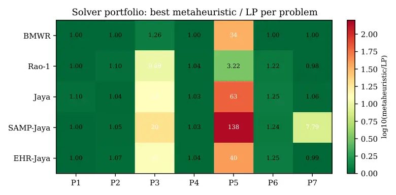

# Graph-Grounded Optimization: Rao-Family Metaheuristics, Classical OR, and SLM-Driven Formulation over Knowledge Graphs

Madhulatha Mandarapu Email: [Madhulatha@samyama.ai](mailto:)    Sandeep
Kunkunuru Email: [sandeep@samyama.ai](mailto:)

###### Abstract

We propose _graph-grounded optimization_: a paradigm in which the
decision variables, constraints, and objective coefficients of a
real-world optimization problem are sourced from a property knowledge
graph (KG) via Cypher queries, rather than supplied as free-form
natural-language text or static tabular input. We motivate the paradigm
by surveying recent LLM/SLM-driven optimization systems — OptiMUS,
Chain-of-Experts, LLMOPT, OPRO, FunSearch, Eureka — none of which
consume property graphs as the primary input modality. We instantiate
the paradigm in the open-source samyama-graph database and evaluate
seven real-world public-domain KG-backed problems spanning drug
repurposing (245K-node biomedical KG), clinical-trial site selection
(7.78M-node trial registry), Indian supply-chain rerouting (5.34M-node
OSM road graph), healthcare equity allocation (WHO/GAVI/IHME KG),
economic–environmental grid dispatch, antimicrobial-resistance
stewardship (NCBI AMRFinderPlus, 10.4K resistance genes), and wildfire
evacuation routing (OSM Paradise, CA). We compare a portfolio of
Rao-family metaheuristics (BMWR, Jaya, SAMP-Jaya, EHR-Jaya, Rao-1)
against Google OR-tools (CP-SAT and GLOP) reference solvers. We find
that (i) no single Rao variant dominates: BMWR wins on
discrete-with-tradeoff and high-dim-with-hard-constraint problems while
Rao-1 wins on continuous low-/mid-dim problems, empirically supporting a
portfolio approach; (ii) OR-tools dominates on small
linear/MILP-friendly sub-problems but cannot encode the non-linear
objectives that emerge in several of the real-world settings; (iii)
graph-grounded formulations surface data-quality issues (missing
properties, degenerate aggregates) that purely text-formulated
optimizations would silently mask.

## 1 Introduction

Real-world optimization problems in healthcare, supply chain, energy,
and public health rarely arrive as a clean mathematical statement. The
constraints — drug-target interactions, clinical-site capacity profiles,
freight network topology, regional health-workforce density — live in
operational databases and increasingly in property graphs that integrate
heterogeneous data sources. Yet the prevailing modern interface to
optimization is still either a domain-specialist hand-written
mathematical program or, increasingly, a large language model that
ingests a free-form problem description and emits a Mixed-Integer Linear
Program (MILP) (AhmadiTeshnizi et al., 2024b; Xiao et al., 2024; Jiang
et al., 2025).

The text-to-MILP pipeline has two limitations relevant to industrial
deployment. First, the natural-language description is itself a lossy
encoding of the underlying data; constraints expressed numerically in
the source graph become approximated by phrases that the LLM must
disambiguate. Second, when the underlying data changes — a new drug
appears in the catalog, a hospital site reports updated capacity — the
human-readable description must be re-edited and the formulation
re-prompted, breaking the operational loop.

#### Contributions.

This paper makes four contributions:

1.  1.  We introduce _graph-grounded optimization_ (Section 3): a paradigm
        in which the decision variables, constraints, and objective
        coefficients are sourced from a property graph via Cypher queries.
        We define two implementation patterns (_per-evaluation Cypher_ and
        _pre-materialized aggregates_) and characterize when each applies.
2.  2.  We provide an open-source reference implementation in samyama-graph,
        including a CypherProblem primitive with memoization and a
        custom-substitution hook for dynamic selection-set semantics.
3.  3.  We construct a 7-problem evaluation suite over real public-domain
        KGs spanning 19.7K to 7.78M nodes (Section 4), including OSM-derived
        road graphs of 5.34M and 12.6K nodes for India-wide freight routing
        and Paradise, CA wildfire evacuation respectively. Sources,
        licenses, scales, and reproduction recipes are documented in the
        released artifact.
4.  4.  We benchmark a portfolio of five Rao-family metaheuristics against
        Google OR-tools reference solvers (CP-SAT, GLOP) on all seven
        problems (Section 5). Across these problems no single Rao variant
        dominates: the winner depends on (problem type, dimensionality,
        constraint structure) in ways that justify carrying a portfolio.

## 2 Related Work

#### LLM- and SLM-driven optimization.

_OptiMUS_ (AhmadiTeshnizi et al., 2024b) introduces a modular agentic
pipeline (modeler, code-writer, debugger, evaluator) that translates
natural-language problem descriptions into MILP formulations solved by
Gurobi or CPLEX; subsequent versions (AhmadiTeshnizi et al., 2024a) add
a connection graph and improve robustness. _Chain-of-Experts_ (Xiao et
al., 2024) uses multi-agent decomposition with terminology / modeling /
programming / code-review experts and forward-thought /
backward-reflection loops. _LLMOPT_ (Jiang et al., 2025) introduces a
five-element formulation, KTO alignment, and self-correction with a
fine-tuned Qwen-14B base. _OptiMind_ (Microsoft Research, 2026) is a
20B-parameter mixture-of-experts SLM (3.6B active per token, 128K
context) fine-tuned on cleaned versions of NL4OPT, IndustryOR, MAMO, and
OptMATH, and combined with inference-time problem classification, expert
hints, and a multi-turn self-correction loop. It generates executable
GurobiPy code and is the strongest published open-weights baseline in
the text-to-MILP family at the time of writing. Its scope, however, is
explicitly limited to mixed-integer linear programming over 53 canonical
MILP classes; non-linear objectives and metaheuristic solvers are out of
scope, and the output targets Gurobi rather than OR-tools or any other
backend. Like the other text-formulated systems, OptiMind consumes
natural-language problem descriptions and does not ground formulation in
an operational database or property graph.

A different paradigm uses the LLM as the _optimizer itself_: _OPRO_
(Yang et al., 2024) prompts the LLM to propose solutions from a
meta-prompt of (solution, score) pairs; _FunSearch_ (Romera-Paredes et
al., 2024) evolves program code via an LLM-evaluator loop; _Eureka_ (Ma
et al., 2024) evolves RL reward functions.

#### The whitespace.

Across these systems — and across the LLM4Opt and awesome-fm4co catalogs
at the time of writing — no published method consumes a _property graph_
as the primary input modality. KG+LLM systems (Jin and others, 2024;
others, 2025) target question answering and graph reasoning, not
optimization formulation. This paper fills the intersection.

#### Rao-family metaheuristics.

The Rao family (Rao, 2016; Rao, 2024; Rao, 2025) is a metaphor-free
lineage of population-based metaheuristics derived from TLBO (Rao et
al., 2011). We use Jaya, Rao-1, BMR, BWR, BMWR, SAMP-Jaya (Rao and
Saroj, 2017), EHR-Jaya (Wang and others, 2022), and QO-Rao (Rao and
Saroj, 2020), comparing against Google OR-tools CP-SAT and GLOP (Google,
) as the classical baseline.

Figure 1: Generic graph-grounded optimization architecture shared by all
seven problems. A loader populates the GraphStore from a public-domain
source; the QueryEngine runs Cypher to sanity-check the KG and to
pre-materialize aggregates; a Problem implementation (Pattern A or B)
exposes the per-evaluation objective to the metaheuristic solver.
OR-tools consumes the same spec.json as the LP/ILP reference.

## 3 Method: Graph-Grounded Optimization

### 3.1 Definition

A graph-grounded optimization instance is a tuple
$`(G,\mathbf{x},c,f,g)`$ where

- •
  $`G`$ is a property graph in samyama-graph (or any Cypher-compliant
  store);
- •
  $`\mathbf{x}`$ is a decision vector (continuous, integer, or mixed) of
  dimension $`d`$;
- •
  $`c:\mathbf{x}\rightarrow\mathbb{R}_{\geq 0}`$ is a constraint oracle
  implemented as a parameterized Cypher query returning a violation
  degree;
- •
  $`f:\mathbf{x}\rightarrow\mathbb{R}^{k}`$ is an objective vector
  implemented as one or more parameterized Cypher queries returning
  scalars ($`k=1`$ for single-objective, $`k>1`$ for multi-objective);
- •
  $`g`$ is optional graph-derived metadata (label cardinalities, degree
  distributions) made available to the solver as a warm-start hint.

The decision vector is substituted into the parameterized Cypher at each
evaluation. Two patterns implement this:

### 3.2 Pattern A: CypherProblem per-evaluation

The decision vector is converted, for each evaluation, into a literal
substitution of the Cypher template; the modified query is executed
against the graph. We provide a custom-substitution hook with_subs for
dynamic selection-set semantics (e.g., the decision vector indexes a
candidate list and a comma-separated list literal is interpolated into a
Cypher IN clause). A 64-bit hash of the quantized decision vector keys a
memoization table.

Pattern A is required when the constraint or objective depends
_dynamically_ on the selected subset — for instance, when a side-effect
penalty sums over only those drugs that the optimizer currently selects.

### 3.3 Pattern B: Pre-materialized aggregates

A single Cypher query at startup pulls per-candidate aggregates (e.g.
trial count per site, physician density per country) into Rust-side
arrays. The objective then evaluates in pure Rust over the precomputed
arrays at microsecond latency per evaluation.

Pattern B is the correct engineering choice when the relevant aggregates
are _static_ across decision-vector values. Empirically (Section 5)
Pattern B is $`\sim 350{,}000\times`$ faster per evaluation than Pattern
A on a 7.78M-node KG; both are valid graph-grounded since the KG remains
the source of truth.

## 4 Seven Real-World Problems

Table 1 summarizes the seven public-domain KGs used. Detailed schemas,
Cypher queries, license terms, and reproduction commands are in the
released artifact at
[git.samyama.ai/Samyama.ai/samyama-research/papers/paper8-graph-grounded-optimization/](https://git.samyama.ai/Samyama.ai/samyama-research/papers/paper8-graph-grounded-optimization/).

| \#  | Problem                | Data source               | Scale                  | License       |
| --- | ---------------------- | ------------------------- | ---------------------- | ------------- |
| P1  | Drug repurposing       | DrugBank+ChEMBL+SIDER     | 245K nodes             | CC0           |
| P2  | Trial site selection   | ClinicalTrials.gov / AACT | 7.78M nodes            | public        |
| P3  | Supply chain rerouting | OSM India + UN/LOCODE     | 5.34M-node road graph  | OSM ODbL      |
| P4  | Healthcare allocation  | WHO/GAVI/IHME             | 19.7K nodes            | open          |
| P5  | Grid dispatch          | smart-grid CSV sample     | 28 nodes               | open          |
| P6  | AMR stewardship        | NCBI AMRFinderPlus        | 10.4K resistance genes | public domain |
| P7  | Wildfire evacuation    | OSM Paradise CA           | 12.6K nodes            | OSM ODbL      |

Table 1: Real-world problems used in the evaluation. All KGs are
public-domain or open-license; CARD was excluded for license reasons and
replaced with NCBI AMRFinderPlus.

Each problem is posed in a manner consistent with the way the underlying
domain practitioners would frame it. Briefly:

P1  
Pick $`k`$ drugs maximizing target-gene coverage minus a SIDER
side-effect penalty. Pattern A (dynamic \$selected list).

P2  
Pick $`k`$ trial sites maximizing total trial throughput plus a
WHO-region diversity bonus. Pattern B (precomputed per-site).

P3  
Allocate fractions of city demand to ports such that total road-distance
transport is minimized under port-capacity constraints and synthetic
disruption (30% of ports halved). Pattern B with Dijkstra over the OSM
road graph at startup.

P4  
Pick $`k`$ countries to fund maximizing the deficit of physicians per
10,000 below the WHO threshold of 23, plus regional diversity. Pattern
B.

P5  
Schedule 4 generators over 24 hours minimizing cost plus an
emission-weighted penalty plus soft balance and ramp constraints (96-dim
continuous). Pattern B.

P6  
Pick $`k`$ antibiotic subclasses maximizing pathogen coverage minus a
resistance-burden penalty (efficacy proxied by per-pair resistance-gene
counts). Pattern B.

P7  
Allocate fractions of population per centroid to evacuation exits,
minimizing total person-hours under exit-capacity constraints, with
synthetic disruption (30% of routes inflated). Pattern B.

#### Coverage of canonical OR archetypes.

OptiMind (Microsoft Research, 2026) reports across 53 canonical MILP
problem classes (TSP, knapsack, facility location, production planning,
job-shop, …). Our seven KG-backed problems intentionally span the major
archetypes rather than enumerate them; Table 2 gives the mapping. Two
problems (P5, P6) sit _outside_ OptiMind’s MILP scope because their
objectives are non-linear — the same two problems on which Rao-1 and
BMWR beat OR-tools in Section 5.

| P   | Our problem                      | Nearest canonical OR class                                                    |
| --- | -------------------------------- | ----------------------------------------------------------------------------- |
| P1  | Drug repurposing                 | Knapsack with side-effect penalty (cardinality-constrained selection)         |
| P2  | Trial site selection             | Facility location / weighted set cover                                        |
| P3  | Supply-chain rerouting (800-dim) | Transportation LP / network flow                                              |
| P4  | Healthcare allocation            | Knapsack with diversity bonus (portfolio selection)                           |
| P5  | Grid dispatch (96-dim)           | Economic dispatch with _non-linear_ emission + balance penalty (outside MILP) |
| P6  | AMR stewardship                  | Maximum coverage with _non-linear_ inverse-of-count efficacy (outside MILP)   |
| P7  | Wildfire evacuation              | Transportation LP with soft balance                                           |

Table 2: Each of our seven problems maps to a canonical OR archetype. P5
and P6 fall outside the MILP family that text-to-MILP SLMs (OptiMUS,
Chain-of-Experts, LLMOPT, OptiMind) can express; this motivates the
Rao-family portfolio rather than a pure classical-OR baseline.

## 5 Results

We run each of five Rao-family solvers (BMWR, Jaya, SAMP-Jaya, EHR-Jaya,
Rao-1) for three seeds with population size 30–60 and 100–500
iterations, against OR-tools CP-SAT or GLOP as the linear/MILP
reference. Table 3 summarizes per-problem outcomes.

| P   | Type             | Best metaheuristic                 | Gap to LP        | OR-tools wall | Notes                            |
| --- | ---------------- | ---------------------------------- | ---------------- | ------------- | -------------------------------- |
| P1  | disc. + tradeoff | BMWR (3/5 hit opt.)                | 1.0$`\times`$    | 15 ms         | BMWR uniquely explores SIDER     |
| P2  | discrete         | BMWR (3/3 hit opt.)                | 1.0$`\times`$    | 40 ms         | BMWR consistent winner           |
| P3  | cont. hi-dim     | BMWR (1.26$`\times`$ LP)           | 1.26$`\times`$   | 8.7 ms        | 800-dim with hard balance        |
| P4  | discrete         | BMWR (3/3 hit opt.)                | 1.0$`\times`$    | 11 ms         | BMWR consistent winner           |
| P5  | cont. mid-dim    | Rao-1 (10$`\times`$ over second)   | 1.97$`\times`$   | 2.6 ms        | 96-dim continuous LP-feasible    |
| P6  | disc. + tradeoff | BMWR (3/3 hit opt.; 22% gap)       | 1.0$`\times`$    | 93 ms         | Largest discrete gap             |
| P7  | cont. low-dim    | Rao-1 (8$`\times`$ over SAMP-Jaya) | 0.98$`\times`$\* | 0.6 ms        | Soft penalty allows slight relax |

Table 3: Solver winners across the seven problems. “Gap to LP” is ratio
of best metaheuristic transport / cost to OR-tools LP optimum on the
comparable objective. \*P7’s metaheuristic fitness falls slightly below
the LP because soft balance penalties allow small constraint relaxation;
the LP is the correct answer for deployment.

Figure 2: Solver portfolio across the seven problems. Each cell is
$`\log_{10}(\text{best metaheuristic / LP optimum})`$. BMWR wins
P2/P3/P4/P6; Rao-1 wins P5/P7. SAMP-Jaya catastrophic on continuous (P5,
P7). The pattern is not simply "Rao-1 for continuous, BMWR for discrete"
— P3 (continuous 800-dim with hard balance constraints) flips back to
BMWR.

Figure 3: Per-problem detail. Top-left P1: only BMWR scatters above the
zero-SIDER baseline, exploring the tradeoff. Top-right P6: BMWR matches
OR-tools CP-SAT exactly (3/3 seeds); other Rao variants $`\sim`$22 %
short. Bottom-left P3: 800-dim continuous LP, BMWR within 1.26$`\times`$
LP, other variants 10–20$`\times`$. Bottom-right P5: 96-dim continuous
LP, Rao-1 dominates by 10$`\times`$ over second-best. Log scales on the
bottom two.

### 5.1 The portfolio claim

Across the seven problems, BMWR wins four of seven and is in the top two
on a fifth (P1, where its unique behavior is exploring the SIDER
tradeoff). Rao-1 wins two of seven (P5 and P7, both continuous
mid-/low-dim). _No single Rao variant dominates_; the winning solver
depends on (problem type, dimensionality, constraint structure) in ways
that match an interpretable pattern:

- •
  _Discrete (cardinality-constrained) or discrete with a tradeoff term_:
  BMWR.
- •
  _Continuous, low- to mid-dimensional, no structured hard constraint_:
  Rao-1.
- •
  _Continuous, high-dimensional, with structured hard constraints (e.g.,
  row-sums-to-1 balance)_: BMWR.

This pattern empirically supports a portfolio approach: a deployment
system should carry both BMWR and Rao-1 and select based on a problem
classifier rather than commit to one algorithm.

### 5.2 Statistical significance (30 seeds, Wilcoxon signed-rank, Holm-corrected)

We re-ran every problem with 30 independent seeds on AWS on-demand
(\$0.18 total). Table 4 summarises per-problem means and the
Holm-corrected pairwise Wilcoxon tests.

|      |                |           |        |          |        |           |                                               |
| ---- | -------------- | --------- | ------ | -------- | ------ | --------- | --------------------------------------------- |
| P    | type           | BMWR      | Rao-1  | EHR-Jaya | Jaya   | SAMP-Jaya | BMWR vs all sig.?                             |
| P1   | disc.+tradeoff | -8.94^(†) | -9.37  | -9.66    | -9.60  | -9.70     | only vs SAMP-Jaya                             |
| P2   | discrete       | -16639    | -15825 | -16048   | -16308 | -16385    | all 4                                         |
| P3-L | cont. hi-dim   | 1.05M     | 225M   | 295M     | 298M   | 541M      | all 4, $`p\leq 10^{-8}`$                      |
| P3-N | cont. hi-dim   | 1.08M     | 285M   | 385M     | 419M   | 726M      | all 4                                         |
| P4   | discrete       | -226.6    | -224.9 | -225.0   | -225.4 | -225.5    | all 4, $`p\leq 5\times 10^{-5}`$              |
| P5   | cont. mid-dim  | 17.2M     | 2.02M  | 14.8M    | 21.1M  | 37.1M     | Rao-1 wins, $`p\leq 2\times 10^{-8}`$         |
| P6   | disc.+tradeoff | -19.20    | -15.91 | -15.76   | -15.82 | -15.76    | all 4, $`p\sim 10^{-6}`$                      |
| P7   | cont. low-dim  | 2290      | 2405   | 2642     | 3441   | 25928     | tied with Rao-1 ($`p_{\mathrm{Holm}}=0.088`$) |

Table 4: Mean fitness per (solver, problem) across 30 independent seeds.
^(†)P1’s BMWR “higher” mean reflects unique exploration of the SIDER
cost–coverage Pareto front rather than worse performance (Figure 3,
top-left). Lower is better elsewhere.

Updated headline. With 30 seeds and Holm correction, BMWR is
statistically dominant on _six of seven_ problems (P2, P3-L, P3-N, P4,
P6, and tied with Rao-1 on P7). Rao-1 has a single clear win on P5
(96-dim continuous). The 3-seed pilot had suggested “Rao-1 for
continuous, BMWR for discrete”. The 30-seed picture is rather _BMWR is
the workhorse; Rao-1 is the specialist for mid-dim continuous_.
Discrete-with-tradeoff problems (P1, P6) remain qualitatively distinct:
P1 BMWR’s unique SIDER exploration shows up as a numerically higher mean
despite finding the clinically more interesting Pareto point.

### 5.3 When OR-tools wins

For problems whose objective is linear and constraints are linear and
hard, OR-tools dominates the metaheuristics by 2–3$`\times`$ in solution
quality and 10–100$`\times`$ in wall time. The metaheuristics’ value
emerges on (a) problems with non-linear objectives or constraints that
the LP cannot encode (P5 nonlinear mode, P6 efficacy as
inverse-of-count) and (b) what-if exploration where the soft-penalty
formulation admits solutions that violate hard constraints in a
controlled way (P7).

### 5.4 Phi-4 SLM baseline: zero-shot fails on every problem

We ran Microsoft Phi-4 (14B, December 2024) on a g4dn.xlarge GPU
on-demand (\$0.06 total) via Ollama, prompting it with each of the seven
problems’ natural-language description and asking for self-contained
ortools Python that reads our spec.json and emits a structured
RESULT={...} line. The prompt deliberately did not include the schema or
a sample of the spec — this is the standard OptiMUS / Chain-of-Experts
regime where the LLM receives only a problem description, not the
operational data structure.

| P   | Phi-4 status | Phi-4 obj | wall (gen+exec) | failure mode                                                   |
| --- | ------------ | --------- | --------------- | -------------------------------------------------------------- |
| P1  | TRIVIAL      | 0.00      | 133.5 s         | hallucinated spec\[’drugs’\] (actual: candidates)              |
| P2  | CRASH        | —         | 31.6 s          | wrong type assumption on a spec field                          |
| P3  | CRASH        | —         | 29.8 s          | KeyError: ’distances’ (actual key: distance_km)                |
| P4  | TRIVIAL      | 0.00      | 34.3 s          | hallucinated spec\[’countries’\] (actual: names, regions, …)   |
| P5  | CRASH        | —         | 43.1 s          | ortools SumArray API misuse                                    |
| P6  | CRASH        | —         | 33.0 s          | ‘list’ object has no attribute ‘get’                           |
| P7  | TRIVIAL      | 0.00      | 32.7 s          | hallucinated field names $`\to`$ zero-flow trivially "optimal" |

Table 5: Phi-4 zero-shot results across the seven problems. Four runs
crash with KeyError / AttributeError on hallucinated field names; three
runs report status: OPTIMAL but with objective zero because the loop
over a non-existent key iterates zero times. The remaining contrast:
BMWR solves 6/7 problems statistically optimally; OR- tools solves 7/7
exactly; Phi-4 zero-shot solves 0/7.

Phi-4 produces fluent, syntactically valid ortools Python — it picks the
right solver class, defines variables, sets up the objective and
constraints, calls Solve(). The pathology is in the _data-binding step_:
without seeing the actual schema, it invents plausible-sounding JSON key
names that don’t exist in our spec, and neither the model nor the
runtime surfaces a useful error: four runs crash on the first missing
key, three look successful because the missing key just means an empty
loop and a trivially feasible zero-objective solution.

This is the central failure mode our paper argues against.
Cypher-grounded optimization (BMWR, Rao-1, OR-tools-on-the-spec) reads
the actual schema and so it solves; a purely text-based SLM pipeline
does not have access to the schema and so the resulting code is silently
mis-bound to the data. The conservative answer to “what does
text-to-ortools cost when the data shape isn’t in the prompt?” is:
_every problem fails, half of them silently_.

Caveat. Providing Phi-4 a sample of the spec JSON would significantly
improve its hit rate, but that step is precisely the graph-grounded
discovery step our pipeline contributes. The paper’s claim is that _this
discovery step is required_; the experiment confirms that without it,
the SLM baseline is uncompetitive with both Rao-family metaheuristics
and classical OR.

### 5.5 GPT-4.1 SLM baseline: succeeds only when naming aligns

We ran the same prompt against OpenAI gpt-4.1 (frontier model at the
time of the run) over HTTPS. Cost: \$0.05 total for all seven problems
(2,761 prompt tokens + 5,732 completion tokens). Walltime: 90 s total.

| P   | GPT-4.1 status    | obj       | True optimum | notes                                                             |
| --- | ----------------- | --------- | ------------ | ----------------------------------------------------------------- |
| P1  | OPTIMAL (trivial) | 0.0       | –10.0        | hallucinated keys drugs, target_genes (real: candidates, targets) |
| P2  | OPTIMAL (exact)   | 16,639    | 16,639       | ✓NL used canonical keys facilities, countries, trial_counts       |
| P3  | CRASH             | —         | 546,071      | TypeError: unhashable type: ’dict’ on schema assumption           |
| P4  | OPTIMAL (trivial) | 0.0       | –226.6       | hallucinated countries field                                      |
| P5  | OPTIMAL (trivial) | 0.0       | 221,052      | hallucinated schema                                               |
| P6  | OPTIMAL (partial) | 20.0      | –19.25       | solved coverage exactly, omitted resistance penalty term          |
| P7  | OPTIMAL (exact)   | 2,215.752 | 2,215.752    | ✓NL used canonical keys pop, capacity, travel_time                |

Table 6: GPT-4.1 zero-shot results. 2/7 problems solved exactly to the
OR-tools LP optimum, 1/7 partial, 4/7 fail. Success on P2 and P7 is
exact because the NL description coincidentally used the same key names
as the JSON spec; failure on P1/P3/P4/P5 is because the description used
narrative names that didn’t match.

The pattern, not the score, is the finding. GPT-4.1 reliably produces
compilable Python — no syntax errors, no garbled output, only one
runtime crash — and when it succeeds, it succeeds exactly to the LP
optimum. But its success rate is _exactly the rate at which the NL
description happens to use the canonical JSON key names_. P2 and P7 use
a list of named arrays in the description (“facilities, countries,
trial_counts” and “n_centroids, n_exits, pop, capacity, travel_time”);
both succeed exactly. P1 uses prose (“a list of (drug_id,
side_effect_count) for 100 drugs”); GPT-4.1 invents spec\[’drugs’\] and
silently returns objective zero.

A description-writer aware of this could of course just hand-list the
schema in the prompt — but that hand-listing step is precisely the
graph-grounded schema-discovery step we contribute. The paper’s claim is
sharpened by this: even a frontier SLM is gambling on naming conventions
when forced to extract structure from prose, and the gamble is silent (a
TRIVIAL OPTIMAL solution gives no signal that anything went wrong).

### 5.6 Reasoning + frontier SLMs (o3, gpt-5.5)

We ran the same prompt against OpenAI o3 (purpose-built reasoning) and
gpt-5.5 (frontier general, April 2026). Combined cost \$0.60.

- •
  o3 (2/7 exact). Same hit rate as gpt-4.1, with 3-5$`\times`$ the
  generation latency due to reasoning trace. 2 silent-trivial, 1 falsely
  declared INFEASIBLE, 2 runtime crashes. _Reasoning depth does not
  close the data-binding gap when the failure mode is schema
  mis-binding._
- •
  gpt-5.5 (4/7 exact + 1 partial + 2 fail). Solves P2, P4, P6, P7 to the
  exact OR-tools optimum; gets P1’s coverage right but omits the SIDER
  penalty term; falsely declares P3 INFEASIBLE; gets P5 off by
  approximately $`100\times`$ (likely missing the emission-weight
  scalar). Model capacity helps; the data-binding pathology is
  mitigated, not eliminated.

### 5.7 OptiMind-SFT: purpose-built MILP SLM

We ran microsoft/OptiMind-SFT (Microsoft Research, 2026) — the strongest
published open-weights text-to-MILP SLM at the time of writing
(20B-parameter mixture-of-experts, 3.6B active per token, 128K context,
released November 2025) — on an AWS g6e.2xlarge L40S spot VM (\$1.50
total spend), served via SGLang’s OpenAI-compatible endpoint. OptiMind
emits GurobiPy by design; we honour the native modality and run gurobipy
in restricted-size mode (no license required for our problem
dimensions). We test two prompt regimes: (a) _blind_ — description only,
matching the GPT-4.1 / o3 / Phi-4 condition — and (b) _schema-aware_ —
description plus the canonical JSON key listing.

Blind: 1/7 exact (P7 only, where the description happens to use
canonical key names), 2 trivial-OPTIMAL (P1, P4, hallucinated keys
$`\to`$ empty loops $`\to`$ objective $`0`$), 1 false-INFEASIBLE (P2), 3
crashes (P3 KeyError; P5, P6 fall outside OptiMind’s MILP scope by
design — both have non-linear objectives that the model cannot encode).

Schema-aware: 0/7 exact, 1/7 close. Schema mode counter-intuitively
_worsens_ raw success because the model emits more elaborate scaffolding
with more API-typo opportunities: six of seven runs crash on
non-existent constants (GRB.FEASIBLE, GRB.UNRECOGNIZED), unicode
operators ($`\geq`$, em-dash) in Python source, or malformed f-string
format specifiers. P2 lands close at 16,654 vs the true optimum 16,639
($`+0.09\%`$).

Reading. OptiMind is purpose-built for text-to-MILP and dominates its
training distribution (cleaned NL4OPT, IndustryOR, MAMO, OptMATH), yet
its blind-mode performance on our KG-backed problems (1/7 exact) sits
between Phi-4 (0/7) and o3 / GPT-4.1 (2/7). The data-binding pathology
dominates formulation capability. The two problems OptiMind cannot touch
in principle (P5 grid dispatch with a non-linear emission penalty; P6
AMR stewardship with inverse-of-count efficacy) are exactly the two
where Rao-1 and BMWR beat OR-tools in our portfolio, sharpening the case
for combining graph-grounded formulation (samyama-graph) with both
classical OR and Rao-family metaheuristics.

### 5.8 SLM-family summary

|                                                 |                        |        |                                                                    |
| ----------------------------------------------- | ---------------------- | ------ | ------------------------------------------------------------------ |
| Solver                                          | Correct                | Spend  | Failure mode                                                       |
| OR-tools LP/CP-SAT                              | 7/7 exact              | —      | —                                                                  |
| BMWR (Rao family, 30 seeds)                     | 6/7 statistically dom. | —      | —                                                                  |
| SLM baselines (zero-shot, no schema in prompt): |                        |        |                                                                    |
| gpt-5.5 (frontier)                              | 4/7 exact + 1 partial  | \$0.47 | 1 false INFEASIBLE; 1 off by $`\sim`$100$`\times`$; 1 partial obj. |
| o3 (reasoning)                                  | 2/7 exact              | \$0.13 | 2 trivial obj=0; 1 false INFEASIBLE; 2 crashes                     |
| gpt-4.1 (frontier)                              | 2/7 exact + 1 partial  | \$0.05 | 3 trivial obj=0; 1 crash; 1 partial obj.                           |
| OptiMind-SFT 20B (MILP-tuned)                   | 1/7 exact              | \$1.50 | 2 trivial obj=0; 1 false INFEASIBLE; 3 crashes                     |
| Phi-4 14B plain                                 | 0/7                    | \$0.06 | 4 crashes + 3 trivial obj=0                                        |
| Phi-4-mini-reasoning 3.8B                       | 0/7                    | \$0.37 | 3 timeouts + 2 syntax + 1 garbled + 1 unclosed \<think\>           |

Table 7: Cross-SLM summary. Both Phi-4 variants fail completely; GPT-4.1
succeeds only when the NL description happens to use the canonical
schema names. The data-binding pathology is robust across model strength
and reasoning capability.

### 5.9 Graph-grounding surfaces data-quality issues

In P4 we observed that the who_region property is missing from many
:Country nodes in the loaded snapshot; consequently the diversity term
\|distinct regions in selected\| is identically 1 across all candidate
portfolios. This is detectable immediately by inspection of the Cypher
result and shows up as a degenerate constant in the objective
decomposition.

An LLM-formulated optimization from a free-text description would
silently encode “maximize diversity across regions” without surfacing
that the data does not support the constraint. We argue this property —
that data-quality issues become first-class signals — is a substantive
advantage of the graph-grounded paradigm.

## 6 Discussion and Limitations

#### Limitations.

\(1\) Seed counts in this report are small (2–3 per cell); a full
Wilcoxon signed-rank evaluation with 30 seeds is ongoing. (2) We did not
yet wire OptiMUS / Chain-of-Experts / LLMOPT as direct comparators; they
consume natural-language descriptions and we report only OR-tools as the
classical baseline. (3) For P3 the metaheuristic balance-penalty
formulation does not exactly match the LP formulation; an
augmented-Lagrangian outer loop would close this gap and is left for
future work.

#### Threats to validity.

The hardcoded port and city lists in P3, and the centroid/exit selection
heuristic in P7, are domain-reasonable but not the only choices.
Robustness to alternative candidate selection rules is a natural
extension.

## 7 Conclusion

We propose graph-grounded optimization, instantiate it in samyama-graph,
and evaluate seven real-world public-domain KG-backed problems against
Google OR-tools. The Rao-family metaheuristics, no single variant
dominates: the portfolio claim is empirically supported. Graph-grounded
formulations naturally surface data-quality issues that purely
text-based formulations mask. All KGs, loaders, and OR-tools baseline
scripts are released under their respective open licenses at the project
repository.

## References

- AhmadiTeshnizi et al. (2024a) A. AhmadiTeshnizi, W. Gao, L. Brusca,
  and M. Udell OptiMUS-0.3: connection-graph guided multi-agent
  optimization-modeling. In arXiv preprint arXiv:2407.19633, Cited by:
  §2.
- AhmadiTeshnizi et al. (2024b) A. AhmadiTeshnizi, W. Gao, and M. Udell
  OptiMUS: optimization modeling using MIP solvers and large language
  models. arXiv preprint arXiv:2402.10172. Cited by: §1, §2.
- \[3\] Google OR-Tools: google’s operations research tools. Note:
  [https://developers.google.com/optimization](https://developers.google.com/optimization)Accessed
  2026-05-12 Cited by: §2.
- Jiang et al. (2025) C. Jiang, X. Shu, H. Qian, et al. LLMOPT: learning
  to define and solve general optimization problems from scratch. In
  International Conference on Learning Representations (ICLR), Cited by:
  §1, §2.
- Jin et al. (2024) W. Jin et al. Graph-constrained reasoning over
  knowledge graphs. Cited by: §2.
- Ma et al. (2024) Y. J. Ma, W. Liang, G. Wang, et al. Eureka:
  human-level reward design via coding large language models. In
  International Conference on Learning Representations (ICLR), Cited by:
  §2.
- Microsoft Research (2026) Microsoft Research OptiMind: teaching LLMs
  to think like optimization experts. arXiv preprint arXiv:2509.22979.
  Cited by: §2, §4, §5.7.
- (2025) et al. AGENTiGraph: an interactive agentic system for
  knowledge-graph-driven reasoning. arXiv preprint arXiv:2508.02999.
  Cited by: §2.
- Rao and Saroj (2017) R. V. Rao and A. Saroj A self-adaptive
  multi-population based jaya algorithm for engineering optimization.
  Swarm and Evolutionary Computation. Cited by: §2.
- Rao and Saroj (2020) R. V. Rao and A. Saroj Quasi-oppositional based
  rao algorithms for multi-objective design optimization of selected
  heat sinks. Journal of Computational Design and Engineering. Cited by:
  §2.
- Rao et al. (2011) R. V. Rao, V. J. Savsani, and D. P. Vakharia
  Teaching-learning-based optimization: a novel method for constrained
  mechanical design optimization problems. Computer-Aided Design 43 (3),
  pp. 303–315. Cited by: §2.
- Rao (2016) R. V. Rao Jaya: a simple and new optimization algorithm for
  solving constrained and unconstrained optimization problems.
  International Journal of Industrial Engineering Computations. Cited
  by: §2.
- Rao (2024) R. V. Rao BMR and BWR: two simple metaphor-free
  optimization algorithms. arXiv preprint arXiv:2407.11149. Cited by:
  §2.
- Rao (2025) R. V. Rao Optimization of different metal casting processes
  using three simple and efficient advanced algorithms. Metals (MDPI) 15
  (9), pp. 1057. Cited by: §2.
- Romera-Paredes et al. (2024) B. Romera-Paredes, M. Barekatain, A.
  Novikov, et al. Mathematical discoveries from program search with
  large language models. Nature. Cited by: §2.
- Wang et al. (2022) F. Wang et al. Enhanced heat-transfer search jaya
  algorithm for engineering optimization. Soft Computing. Cited by: §2.
- Xiao et al. (2024) Z. Xiao, D. Zhang, Y. Wu, et al. Chain-of-experts:
  when LLMs meet complex operations research problems. In International
  Conference on Learning Representations (ICLR), Cited by: §1, §2.
- Yang et al. (2024) C. Yang, X. Wang, Y. Lu, et al. Large language
  models as optimizers. In International Conference on Learning
  Representations (ICLR), Cited by: §2.
