# VIP: Visual-guided Prompt Evolution for Efficient Dense Vision-Language Inference

Hao Zhu Affiliation: Institute of Computing Technology, Chinese Academy
of Sciences, Beijing, China Affiliation: School of Computer Science and
Technology, University of Chinese Academy of Sciences, Beijing, China   
Shuo Jin Affiliation: XJTLU Affiliation: University of Liverpool   
Wenbin Liao Affiliation: Institute of Computing Technology, Chinese
Academy of Sciences, Beijing, China Affiliation: School of Computer
Science and Technology, University of Chinese Academy of Sciences,
Beijing, China    Jiayu Xiao Affiliation: Institute of Computing
Technology, Chinese Academy of Sciences, Beijing, China
Affiliation: School of Computer Science and Technology, University of
Chinese Academy of Sciences, Beijing, China    Yan Zhu
Affiliation: School of Computer Science and Technology, University of
Chinese Academy of Sciences, Beijing, China    Siyue Yu
Affiliation: XJTLU    Feng Dai Affiliation: Institute of Computing
Technology, Chinese Academy of Sciences, Beijing, China Correspondence
to: <fdai@ict.ac.cn>

###### Abstract

Pursuing training-free open-vocabulary semantic segmentation in an
efficient and generalizable manner remains challenging due to the
deep-seated spatial bias in CLIP. To overcome the limitations of
existing solutions, this work moves beyond the CLIP-based paradigm and
harnesses the recent spatially-aware dino.txt framework to facilitate
more efficient and high-quality dense prediction. While dino.txt
exhibits robust spatial awareness, we find that the semantic ambiguity
of text queries gives rise to severe mismatch within its dense
cross-modal interactions. To address this, we introduce VIsual-guided
Prompt evolution (VIP) to rectify the semantic expressiveness of text
queries in dino.txt, unleashing its potential for fine-grained object
perception. Towards this end, VIP integrates alias expansion with a
visual-guided distillation mechanism to mine valuable semantic cues,
which are robustly aggregated in a saliency-aware manner to yield a
high-fidelity prediction. Extensive evaluations demonstrate that VIP: ❶
surpasses the top-leading methods by $`1.4\%\sim 8.4\%`$ average mIoU, ❷
generalizes well to diverse challenging domains, and ❸ requires marginal
inference time and memory overhead. [Our code is publicly available at
GitHub ](https://github.com/MiSsU-HH/VIP).

###### Keywords: 

Machine Learning, ICML

^(†)^(†)affiliationnotice: Equal contribution

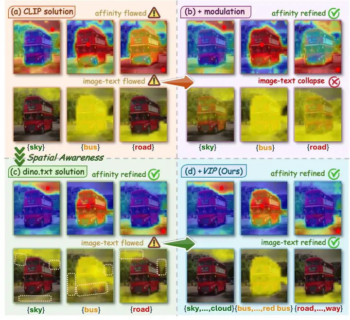

Figure 1: Comparison of image affinity and dense image-text activation.
(a) Prevalent CLIP-based one-layer attention modulation methods. (b)
Extended two-layers modulation on CLIP-based methods to further rectify
spatial bias. (c) Spatially-aware dino.txt solution. (d) Ours VIP,
building upon dino.txt.

## 1 Introduction

The progress in vision-language models (VLMs) (Radford et al., 2021; Jia
et al., 2021; Li et al., 2023; Jiang et al., 2026) provides an effective
solution for open-vocabulary semantic segmentation (OVSS), which aims to
segment images into arbitrary categories specified by text prompts.
Conventional approaches address OVSS by fine-tuning VLM (Liang et al.,
2023; Wu et al., 2024; Xu et al., 2023; Xing et al., 2023) or training
auxiliary modules (Ding et al., 2023; Cha et al., 2023; Lin et al.,
2023; He et al., 2025) to equip the model with spatial awareness.
Despite significant strides, this paradigm relies heavily on manual
annotations and time-consuming training to adapt VLM.

Motivated by this, recent studies have been drawn to exploring the
potential of CLIP (Radford et al., 2021) to perform OVSS in a fully
training-free manner. Given that CLIP aligns global image
representations with text embeddings during pre-training, the dense
image features inherently lack fine-grained spatial awareness. To
mitigate this, the common practice is to modulate the self-attention
mechanism in the last layer of the image encoder to render the image
features more discriminative (Wang et al., 2024; Lan et al., 2024b; Kang
et al., 2025; Chi et al., 2025). However, the deep-seated spatial bias
induced by pre-training impedes CLIP-based methods from effectively
restoring the spatial awareness, as extended modulation often disrupts
cross-modal alignment, thereby confining prevalent approaches to
suboptimal performance, as shown in Figure 1(a)-(b). To remedy this, a
few approaches (Shi et al., 2025; Zhang et al., 2025) resort to using
the Segment Anything Model (SAM) (Kirillov et al., 2023; Ravi et al., 2025) as a post-processor to alleviate the performance bottleneck of
CLIP-based methods. Though effective, they introduce significant
inference latency and memory overhead, hampering their applicability in
many real-world applications. Moreover, the improvements achieved by
such methods are essentially rooted in SAM’s large-scale training with
labor-intensive mask annotations, and may not generalize well to
out-of-distribution domains, e.g., remote sensing imagery.

On the other hand, the success of DINO (Caron et al., 2021) has inspired
recent works (Naeem et al., 2024; Maninis et al., 2025; Tschannen et
al., 2025; Jose et al., 2025) to incorporate self-supervised objectives
in the pre-training of VLMs to instill spatial awareness without mask
supervision. Among them, dino.txt (Jose et al., 2025) stands out for its
superior performance on both global and dense visual understanding
tasks. By virtue of grounding in the frozen DINOv3 backbone (Siméoni et
al., 2025), the image representations of dino.txt are naturally endowed
with robust local discriminability. Crucially, with a simple
self-correction, dino.txt can thoroughly eliminate the spatial bias
induced by global text alignment pre-training, without shifting image
features away from the learned cross-modal feature distribution, as
shown in Figure 1(c). Driven by this, our work moves away from prior
CLIP-based paradigms plagued by spatial bias, and instead, pivots to
spatially-aware dino.txt in pursuit of efficient and high-fidelity dense
inference.

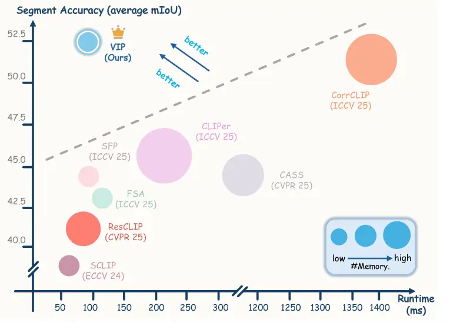

Figure 2: Comparisons of segmentation accuracy and inference latency.
Our VIP  establishes a new state-of-the-art for this field.

Although dino.txt exhibits powerful visual discriminability, however, as
a task-agnostic pre-trained VLM, it often manifests dense cross-modal
mismatch when directly applied to downstream OVSS. The prevailing
paradigm typically leverages text queries, derived from
benchmark-defined canonical class names, as semantic probes to activate
target regions within dense image features. However, there is a lexical
gap between the canonical class names and the image-caption descriptions
found in the pre-training data of dino.txt (Jose et al., 2025).
Furthermore, a single canonical name has limited semantic capacity and
may fail to encapsulate the visual diversity of an object category. As a
result, this semantic ambiguity of text queries hinders the
spatially-aware image features from accurately responding to semantic
anchors, marked as orange rectangles at the bottom of Figure 1(c).

To mitigate this limitation, we propose a simple yet effective solution,
termed VIsual-guided Prompt evolution (VIP), which refines the semantic
expressiveness of text queries in dino.txt and facilitates high-quality
object activations. Specifically, there are three key aspects of VIP:
First, we employ a large language model to generate a candidate pool of
image-caption style aliases for each class name. While these aliases
enhance semantic coverage, they may blur the separability of class
boundaries, leading to erroneous activations. Second, we thus devise a
visual-guided alias distillation scheme that exploits hierarchical
visual priors to automatically mine valid aliases from the candidate
pool. Third, we introduce a saliency-aware soft aggregation technique to
robustly integrate activation maps derived from multiple filtered names
within the same category into a unified prediction. In addition, we
explore the transferability of our core idea to text templates, which
can further enhance the perceptual capability of text queries. Our
method significantly narrows the gap between dense visual
representations and text queries, thereby yielding more precise dense
cross-modal activations, as depicted in Figure 1(d).

We conduct comprehensive evaluations on multiple benchmarks, covering
diverse scenarios in natural images, urban street scenes, and remote
sensing imagery. Empirical results demonstrate that VIP is ❶ top
performing, surpassing existing state-of-the-arts (SOTA) by
$`1.4\%\sim 8.4\%`$ average mIoU on standard benchmarks; ❷ versatile
generalization, consistently delivering optimal results across diverse
challenging domains; ❸ high efficiency, operating with only $`7\%`$
inference time and $`50\%`$ memory overhead compared to recent SAM-based
SOTA, as illustrated in Figure 2.


## 2 Related Work

Vision-language models. The advent of CLIP (Radford et al., 2021) has
catalyzed extensive exploration into vision–language models (VLMs) in
the vision community. Building upon this foundation, follow-up works
such as ALIGN (Jia et al., 2021), CoCa (Yu et al., 2022),
OpenCLIP (Cherti et al., 2023), SigLIP (Zhai et al., 2023) and
InternVL (Chen et al., 2024) introduce significant advances in data
curation and learning objectives. However, most existing VLMs focus on
learning global image-text alignment that overlook the performance on
downstream dense prediction tasks. To address this, several
methods (Naeem et al., 2024; Maninis et al., 2025; Tschannen et al., 2025) attempt to integrate DINO-style (Caron et al., 2021; Oquab et al., 2024) self-supervised objectives into the pre-training stage of VLMs,
aiming to enhance the model’s spatial perception without any manual
annotations. In this setting, dino.txt (Jose et al., 2025) applies
contrastive learning to align the text representations with the frozen
dense image features of DINOv3 (Siméoni et al., 2025), demonstrating
exceptional performance on both image-level and pixel-level visual
understanding tasks. In this work, we build on top of dino.txt framework
to liberate the training-free OVSS model from the intrinsic spatial bias
embedded in CLIP, thereby facilitating efficient and high-quality dense
prediction.

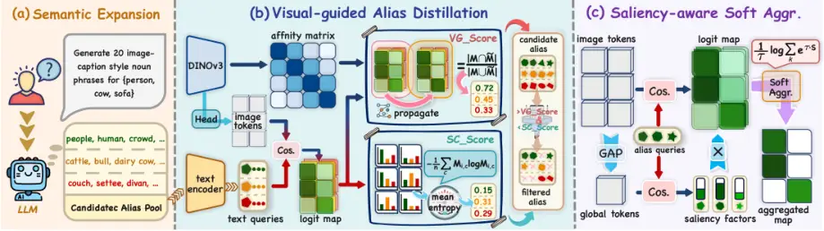

Figure 3: Overview of our proposed VIP. It comprises three key modules:
§3.2 semantic expansion, §3.3 alias distillation, and §3.4 activation
aggregation, to refine the semantic expressiveness of text queries.
Here, the distinct colored shapes
 represent
text queries from different categories, and different shapes within the
same color 
denote text queries of the same category.

Training-free Open-vocabulary Semantic Segmentation. The training-free
OVSS paradigm performs text-specific semantic segmentation by directly
aligning text embeddings with image patch embeddings derived from the
frozen VLM. Prevailing solutions (Zhou et al., 2022; Wang et al., 2024;
Li et al., 2025b; Kang et al., 2025; Chi et al., 2025) are devoted to
modulating the self-attention mechanism in the last layer of image
encoder to enhance CLIP’s spatial awareness, while several methods (Jin
et al., 2025; Shao et al., 2024; Bai et al., 2025) mitigate the spatial
defects by rectifying the outlier tokens. Following this line of work, a
few recent efforts (Kang and Cho, 2024; Lan et al., 2024b; Sun et al.,
2025; Kim et al., 2025; Stojnić et al., 2025) incorporate extra
off-the-shelf vision foundation models, i.e., DINO (Caron et al., 2021;
Oquab et al., 2024) and Stable Diffusion (Rombach et al., 2022), to
further improve the robustness of attention matrices. Some methods (Shi
et al., 2025; Zhang et al., 2025) additionally prompt SAM  (Kirillov et
al., 2023; Ravi et al., 2025) to generate high-quality masks that serve
to refine CLIP’s dense prediction. Nevertheless, the above works
predominantly target the image modality, leaving the potential of the
textual modality largely untapped. Closer to our work, (Sun et al.,
2024; Benigmim et al., 2025) explicitly investigate the role of the
textual modality. Specifically,  (Sun et al., 2024) expands each class
name into 10 synonyms and fuses the corresponding text representations,
and  (Benigmim et al., 2025) identifies class-experts from 80
handcrafted CLIP text templates. However, the inherent bottlenecks of
CLIP’s spatial discriminability curtail the efficacy of these textual
improvements, resulting in only marginal performance gains. In contrast,
our core idea, i.e., exploiting robust visual priors to refine the
semantic expressiveness of text queries, is conceptually novel and
rarely explored before. It is executed under a fully training-free
manner without any mask annotations, while entailing negligible
inference latency during deployment.

Training-free VLMs Text Prompts Refinement via Large Language Models.
Leveraging large language models (LLMs) to enrich textual inputs for
VLMs has been proven to improve the performance on the zero-shot
classification (Menon and Vondrick, 2023; Dong et al., 2025). The core
strategy is to query GPT-3 (Brown et al., 2020) to generate
class-specific contextual descriptors, thereby deriving more informative
text representations (Pratt et al., 2023; Roth et al., 2023; Mirza et
al., 2024). In addition, ZPE (Allingham et al., 2023) introduces a
prompt ensemble method that assigns ensemble weights to prompt templates
by accessing the pre-training data of VLM. While these approaches have
advanced zero-shot image classification, these gains fail to extend to
dense prediction. Different from prior works, we introduce an
optimization-free textual refinement strategy to improve the pixel-level
perception capability of VLM.

## 3 Method

In this section, we commence by briefly reviewing the mechanism of
dino.txt (Jose et al., 2025) for dense prediction (§3.1). The following
three parts represent our proposed method (cf. Figure 3): §3.2
LLM-driven class semantic expansion, §3.3 visual-guided alias
distillation, and §3.4 saliency-aware soft aggregation. Finally, we
present the transferability of our method to the text templates in §3.5.

### 3.1 Preliminary

Akin to CLIP (Radford et al., 2021), dino.txt (Jose et al., 2025)
employs the dual-tower framework to independently encode image and text
inputs, and achieves cross-modal alignment through the contrastive
objective. The crucial distinction lies in the treatment of the visual
modality: while CLIP trains its image encoder from scratch, dino.txt
builds upon the spatially-aware image representations derived from
DINOv3 (Siméoni et al., 2025). Specifically, the image encoder of
dino.txt consists of a frozen DINOv3 ViT (Dosovitskiy et al., 2021)
backbone and two-layer transformer blocks (we refer to “adapter”). We
denote the image patch tokens output by the backbone and the adapter as
$`V\in\mathbb{R}^{hw\times d}`$ and $`I\in\mathbb{R}^{hw\times d}`$,
respectively, where $`hw`$ represent the number of patch tokens and
$`d`$ is the feature dimension. Here we omit the \[CLS\] token for
brevity. During pre-training, dino.txt applies global average pooling to
$`I`$ and aligns it with the text embedding via contrastive learning.
Therefore, in the inference phase, we can obtain the segmentation logits
map $`\mathcal{M}`$ by directly calculating the cosine similarity
between patch tokens $`I`$ and text queries
$`T\in\mathbb{R}^{C\times d}`$:

```math
\mathcal{M}=\mathrm{cosine}\left(I,T\right),\quad\mathcal{M}\in\mathbb{R}^{hw\times C}, \tag{1}
```

where $`C`$ is the number of categories for a given dataset. The final
segmentation output is derived by applying the $`\mathrm{argmax}`$
operation to the logit map $`\mathcal{M}`$ that assigns the most
probable class to each pixel. By default, we consider that
$`\mathcal{M}`$ is normalized through $`\mathrm{softmax}`$ function.

Self-Correction. While dino.txt’s global alignment also dilutes spatial
awareness originating from DINOv3, such cues remain latent rather than
vanishing entirely. Through a simple self-correction strategy, we can
effectively disentangle the spatial bias caused by image-level
pre-training. We leverage the self-attention modulation technique
adopted in previous CLIP-based approaches (Lan et al., 2024b) to achieve
self-correction. In particular, we replace the attention weights in
vanilla self-attention mechanism with the self-similarity derived from
DINOv3 output patch tokens $`V`$, aiming to restore the inherent spatial
awareness while maintaining the semantic coherence:

```math
\mathit{Attn}=\mathrm{softmax}(\frac{VV^{\top}}{\sqrt{d}}),~\mathit{Attn}\in\mathbb{R}^{hw\times hw}. \tag{2}
```

This modification is applied to the two-layer transformer blocks of the
adapter to thoroughly reawaken the capacity for fine-grained object
perception of image tokens $`I`$.

Limitations. Crucially, unlike CLIP-based approaches, restoring spatial
awareness in dino.txt image tokens does not disrupt the well-established
unified feature space (see §4.3 for more details). This is mainly due to
the fact that dino.txt freezes the DINOv3 backbone and optimizes the
adapter solely, thereby preventing the image tokens from being severely
compromised. However, although dino.txt can fundamentally eliminate
spatial bias via self-correction, its segmentation results remain
sub-optimal, even falling behind several CLIP-based solutions. It
reveals that the bottleneck of dino.txt lies not only in the
discriminative power of the visual modality, but rather in the
cross-modal mismatch, where rich visual features fail to find their
precise semantic anchors in the text embedding space. Driven by this
insight, our work pivots to the text modality, especially targeting the
lexical enrichment of semantic anchors to bridge the cross-modal
semantic gap in dino.txt framework.

### 3.2 Semantic Expansion by Large Language Model

Prevailing training-free OVSS methods generally employ the canonical
class names defined by datasets as semantic anchors to retrieve visual
objects. However, a solitary class name is semantically sparse and may
fail to capture the intrinsic visual diversity associated with an object
category. Furthermore, there exists a lexical discrepancy between the
canonical class names defined by benchmarks and the natural language
descriptions encountered during dino.txt’s pre-training (Jose et al.,
2025). For example, the term “people” is more prevalent in image
captions rather than the canonical category label “person”. Ultimately,
these limitations prevent the rich and spatially-aware dense visual
representations from aligning with semantic text anchors.

To mitigate these limitations, we automatically construct a set of
candidate aliases by prompting a large language model (LLM), to extend
the semantic coverage of each category label. Specifically, we query the
LLM with the following prompt format:


Here, {category name} is substituted for a given canonical class name
$`c`$. We provide more implementation details in the Appendix A.1.
Figure 3(a) presents several examples of class aliases generated by the
LLM. These aliases typically encompass a wide range of linguistic forms,
including synonyms and hyponyms, thereby enriching the semantic
representation of the abstract category labels.

Challenge. Nevertheless, it is crucial to acknowledge that naively
integrating the LLM-generated aliases is not a silver bullet for
bridging the cross-modal gap. Instead, it presents a double-edged sword:
unchecked semantic expansion may obscure the discriminative boundaries
among categories, thereby compromising segmentation accuracy.

### 3.3 Visual-guided Alias Distillation

To address the above challenge, we introduce a visual-guided alias
distillation strategy to automatically filter candidate aliases without
relying on any mask annotations. Our key insight lies in exploiting
high-fidelity visual cues as an implicit supervision signal, which
scores generated aliases based on their visual-text alignment. To this
end, we first extract multi-layer attention matrices from the DINOv3
backbone to incorporate hierarchical visual priors as guidance. We
formulate the aggregated visual affinity as:

```math
\mathcal{A}=\frac{1}{L}\sum_{l}\tilde{Attn}_{l},~\mathcal{A}\in\mathbb{R}^{hw\times hw}, \tag{3}
```

where $`\tilde{Attn}_{l}`$ denotes the $`l`$-th layer attention matrix
derived from the DINOv3 backbone, and $`L`$ is the number of layers. The
affinity matrix $`\mathcal{A}`$ encapsulates the hierarchical visual
guidance encoded by DINOv3, capturing both low-level boundary perception
and high-level semantic cues.

Visual Grounding Score. Inspired by this, we treat the pairwise affinity
$`\mathcal{A}`$ as the annotation-free visual supervision and leverage
the image-text activation map $`\mathcal{M}`$ (cf. Eq. 1) as the
evaluation proxy to assess the quality of the candidate aliases. In
particular, we score each alias by evaluating the consistency between
its activation map and visual affinity. Given the dimensionality
mismatch between activation maps and visual affinity, we employ an
intermediary to evaluate their consistency. To this end, we first adopt
random walk algorithm (Vernaza and Chandraker, 2017) to robustly
propagate the pairwise affinity on the activation map.

```math
\displaystyle\mathcal{W}=\mathcal{Q}^{-1}\mathcal{A}^{\alpha} \displaystyle,\quad\mathrm{~where~}\mathcal{Q}_{ii}=\sum_{j}\mathcal{A}^{\alpha}_{ij}, \tag{4}
```

```math
\displaystyle\tilde{\mathcal{M}} \displaystyle=\mathcal{W}^{\beta}\cdot\mathcal{M},
```

here $`\alpha\geq 1`$ serves to dampen irrelevant affinities in
$`\mathcal{A}`$, $`\beta`$ is the number of iterations. For each
candidate alias, we substitute the canonical class name with the alias
and derive corresponding logit maps $`\mathcal{M}`$ and
$`\tilde{\mathcal{M}}`$ for it. By this way, $`\tilde{\mathcal{M}}`$
implicitly encodes the structural priors inherent in the visual model.
Therefore, we compute the IoU between $`\mathcal{M}`$ and
$`\tilde{\mathcal{M}}`$ as visual grounding score metric to measure the
congruence between alias semantic responses and latent visual priors:

```math
\mathtt{VG\_Score}=\mathbb{E}_{\mathtt{img}\sim\mathcal{D}}[\frac{|\mathcal{M}_{c}\odot\tilde{\mathcal{M}}_{c}|}{|\mathcal{M}_{c}|+|\tilde{\mathcal{M}}_{c}|-|\mathcal{M}_{c}\odot\tilde{\mathcal{M}}_{c}|}], \tag{5}
```

where $`\mathcal{D}`$ represent the test set, $`c`$ is the index of
alias’s class, $`|\cdot|`$ denote the global summation over all map
locations and $`\odot`$ represents the Hadamard product. The final score
for an alias is computed as the average across the test dataset. Note
that we only account for scores within the high-activation patches of
the alias ($`\mathcal{M}_{i,c}\geq 0.4`$, where $`i`$ denotes the patch
index). If a given alias fails to manifest a high-activation patch
within a image sample, that sample is excluded from this alias’s
computation. The $`\mathtt{VG\_Score}`$ enables us to measure the
congruence between alias and visual priors, serving as a strong basis
for assessing the alias’s geometric fidelity.

Semantic Certainty Score. However, the $`\mathtt{VG\_Score}`$ fails to
capture the inter-class discriminability, where an alias may exhibit
superior visual fidelity yet suffer from semantic ambiguity at the
decision boundaries. For this reason, we introduce semantic certainty
score to evaluate the inter-class semantic discriminability of aliases,
serving as the orthogonal counterpart to $`\mathtt{VG\_Score}`$. We
employ entropy to implement $`\mathtt{SC\_Score}`$, as it is a widely
recognized metric for quantifying uncertainty, as follows:

```math
\mathtt{SC\_Score}=\mathbb{E}_{\mathtt{img}\sim\mathcal{D}}[-\frac{1}{n}\sum^{n}_{i}\sum_{c}(\mathcal{M}_{i,c}\odot\log\mathcal{M}_{i,c})], \tag{6}
```

where $`n`$ represents the number of patches in high-activation regions,
and we only consider the entropy values of the patches within this
specific region. The $`\mathtt{SC\_Score}`$ forms a synergistic alliance
with the $`\mathtt{VG\_Score}`$, ensuring that the selected category
aliases are both visually aligned and semantically discriminative.

Automated alias filtering mechanism. We use the score from canonical
class name as an anchor to filter candidate aliases. Specifically, we
retain only candidate aliases that achieve a higher
$`\mathtt{VG\_Score}`$ but a lower $`\mathtt{SC\_Score}`$ than the
corresponding canonical class name. This balanced mechanism facilitates
the exploration of semantic diversity while mitigating potential noise
given the absence of manual supervision. It also avoids the need for
manually tuning hard thresholds and hyperparameters.

|                                                     |                  |                     |                     |                     |                     |                     |                     |                      |                     |                     |                     |                    |
| --------------------------------------------------- | ---------------- | ------------------- | ------------------- | ------------------- | ------------------- | ------------------- | ------------------- | -------------------- | ------------------- | ------------------- | ------------------- | ------------------ |
|                                                     | Extra            | With Background     |                     |                     | Without Background  |                     |                     |                      |                     | Avg.$`\uparrow`$    | Time.$`\downarrow`$ | Mem.$`\downarrow`$ |
| Methods                                             | Backbone         | VOC21               | PC60                | Object              | VOC20               | PC59                | Stuff               | City                 | ADE                 | (mIoU)              | (ms)                | (MB)               |
| Dense image-text inference with multi vision models |                  |                     |                     |                     |                     |                     |                     |                      |                     |                     |                     |                    |
| LaVG \[ECCV24\]                                     | DINO             | 61.8                | 31.5                | 33.3                | 81.9                | 34.6                | 22.8                | 25.0                 | 14.8                | 38.2                | 140                 | 1750               |
| ProxyCLIP \[ECCV24\]                                | DINO             | 61.3                | 35.3                | 37.5                | 80.3                | 39.1                | 26.5                | 38.1                 | 20.2                | 42.3                | 105                 | 1600               |
| LPOSS \[CVPR25\]                                    | DINO             | 62.4                | 35.4                | 34.3                | 79.3                | 38.6                | 26.5                | 37.9                 | 22.3                | 42.1                | -                   | -                  |
| CASS \[CVPR25\]                                     | DINO             | 65.8                | 36.7                | 37.8                | 87.8                | 40.2                | 26.7                | 39.4                 | 20.4                | 44.4                | 440                 | 2890               |
| FSA \[ICCV25\]                                      | DINO             | 63.7                | 36.1                | 38.0                | 82.3                | 39.9                | 27.0                | 38.8                 | 20.5                | 43.3                | 110                 | 1650               |
| CLIPer \[ICCV25\]                                   | Stable Diffusion | 66.5                | 38.3                | 40.0                | 86.0                | 42.4                | 28.6                | 38.7                 | 22.0                | 45.3                | 180                 | 3390               |
| Trident \[ICCV25\]                                  | DINO+SAM         | 67.1                | 38.6                | 41.1                | 84.5                | 42.2                | 28.3                | 42.9                 | 21.9                | 45.8                | 120                 | 3710               |
| CorrCLIP \[ICCV25\]                                 | DINO+SAM2        | 74.8                | 44.2                | 43.7                | 88.8                | 48.8                | 31.6                | 49.4                 | 26.9                | 51.0                | 1440                | 3200               |
| Dense image-text inference with single vision model |                  |                     |                     |                     |                     |                     |                     |                      |                     |                     |                     |                    |
| CLIP \[ICML21\]                                     | ✗                | 16.2                | 7.7                 | 5.5                 | 41.8                | 9.2                 | 4.4                 | 5.5                  | 2.1                 | 11.6                | -                   | -                  |
| MaskCLIP \[ECCV22\]                                 | ✗                | 38.8                | 23.6                | 20.6                | 74.9                | 26.4                | 16.4                | 12.6                 | 9.8                 | 27.9                | -                   | -                  |
| SCLIP \[ECCV24\]                                    | ✗                | 59.1                | 30.4                | 30.5                | 80.4                | 34.2                | 22.4                | 32.2                 | 16.1                | 38.2                | 60                  | 1580               |
| ClearCLIP \[ECCV24\]                                | ✗                | 51.8                | 32.6                | 33.0                | 80.9                | 35.9                | 23.9                | 30.0                 | 16.7                | 38.1                | 45                  | 650                |
| CdamCLIP \[ICLR25\]                                 | ✗                | 58.7                | 30.6                | 35.2                | -                   | -                   | 24.8                | 23.7                 | 17.2                | -                   | 100                 | 920                |
| ResCLIP \[CVPR25\]                                  | ✗                | 60.9                | 33.4                | 34.7                | 85.9                | 36.6                | 24.6                | 35.6                 | 18.0                | 41.2                | 85                  | 2550               |
| dino.txt \[CVPR25\]                                 | ✗                | 35.9                | 22.9                | 24.2                | 84.5                | 26.1                | 19.2                | 22.6                 | 18.9                | 31.8                | 90                  | 1500               |
| FreeCP \[ICCV25\]                                   | ✗                | 64.5                | 35.7                | 36.9                | 81.5                | 39.3                | 26.1                | 34.4                 | 18.9                | 42.2                | 120                 | 750                |
| SFP \[ICCV25\]                                      | ✗                | 63.9                | 37.2                | 37.9                | 84.5                | 39.9                | 26.4                | 41.1                 | 20.8                | 44.0                | 100                 | 1600               |
| SC-CLIP \[IEEE TIP25\]                              | ✗                | 64.6                | 36.8                | 37.7                | 84.3                | 40.1                | 26.6                | 41.0                 | 20.1                | 43.9                | 85                  | 1600               |
| VIP (Ours)                                          | ✗                | 73.2$`\uparrow`$8.6 | 41.2$`\uparrow`$4.0 | 47.4$`\uparrow`$9.5 | 92.5$`\uparrow`$6.6 | 46.5$`\uparrow`$6.4 | 33.3$`\uparrow`$6.7 | 55.7$`\uparrow`$14.6 | 29.1$`\uparrow`$8.3 | 52.4$`\uparrow`$8.4 | 100                 | 1650               |
|                                                     |                  |                     |                     |                     |                     |                     |                     |                      |                     |                     |                     |                    |

Table 1: Comparison with the state-of-the-art training-free OVSS methods
on natural images and urban scenes. Best results are in bold, and second
best are underlined. The inference time and memory footprint of the
model are evaluated on the Pascal VOC dataset.

### 3.4 Saliency-aware Soft Aggregation

After building the robust alias library, we now focus on aggregating
alias activation maps within each category into a single map during the
final dense inference stage. We observe that naive aggregation ways,
such as mean or max operations, fail to achieve optimal performance.
This is mainly due to such schemes are vulnerable to outliers and noise,
and tend to neglect the contextual information of the image. To address
this, we propose the saliency-aware soft aggregation strategy to
adaptively establish consensus regions among diverse linguistic prompts.
We first compute the global response between the image global feature
and distinct aliases within the same class, as follows:

```math
\delta_{k}=\frac{\exp(g_{k})}{\sum_{j=1}^{K}\exp(g_{j})},\mathrm{~where~}g=\mathrm{cosine}(\sigma(I),\hat{T}_{c}), \tag{7}
```

where $`\sigma(\cdot)`$ is the global average pooling, and
$`\hat{T}_{c}\in\mathbb{R}^{K\times d}`$ denotes the text embeddings of
$`K`$ filtered aliases for the $`c`$-th category. We then utilize the
global response $`\delta\in\mathbb{R}^{K}`$ as a saliency factor to
modulate their dense activation maps:

```math
\mathcal{S}=\delta\cdot\hat{\mathcal{M}_{c}},\quad\mathrm{where}\ \ \mathcal{S}\in\mathbb{R}^{hw\times K} \tag{8}
```

where $`\hat{\mathcal{M}}_{c}\in\mathbb{R}^{hw\times K}`$ represents the
dense activation maps generated for the $`K`$ aliases via Eq. 1.
Inspired by the energy-based model (LeCun et al., 2006; Liu et al.,
2020), we leverage the free energy function to map multiple alias
activations to a single dimension, formulated as:

```math
\hat{\mathcal{S}}=\frac{1}{\tau}\log(\sum_{k}\exp(\tau\cdot\mathcal{S}_{k})), \tag{9}
```

where $`\tau`$ is the temperature parameter. Unlike rigid max or mean
operations, this probabilistic formulation mitigates spurious outliers
and prevents signal dilution by rewarding the collective consensus of
multiple aliases rather than relying on isolated or averaged activation
maps.

### 3.5 Exploration of transferability to text templates

In general, a complete text input comprises a class name and text
templates. An example input prompt is “a photo of the {class_name}”.
Current studies are grounded in a set of $`80`$ manually curated text
templates offered by CLIP (Radford et al., 2021), originally tailored
for image classification. Our expansion and filtering strategies (§3.2
and §3.3) can be equally transferable to the refinement of text
templates. To be specific, we leverage LLM to generate candidate
templates for dense prediction, and subsequently score these templates
by fixing the filtered class names. Our attempt can be regarded as a
preliminary exploration of text templates and demonstrates the
transferability of the proposed method. Additional details are provided
in the Appendix A.1.

## 4 Experiments

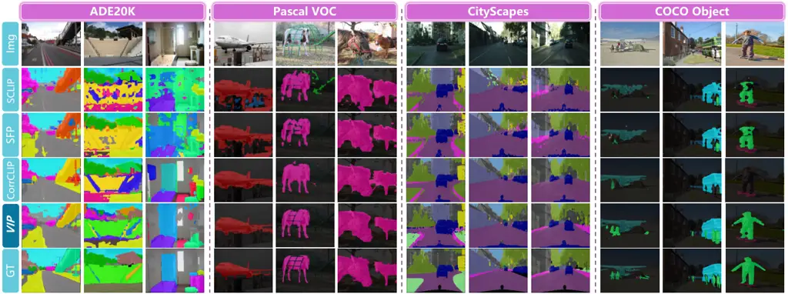

Figure 4: Qualitative comparison results on natural images and urban
scenes. Additional results are provided in the Appendix B.3.

### 4.1 Experimental Setup

Datasets. We conduct our main experiments on eight gold-standard
benchmarks: i) with a background class: PASCAL VOC (Everingham et al., 2015) (VOC21), PASCAL Context (Mottaghi et al., 2014) (Context60), COCO
Object (Caesar et al., 2018) (Object); and ii) without background class:
PASCAL VOC (Everingham et al., 2015) (VOC20), PASCAL Context59 (Mottaghi
et al., 2014) (Context59), COCO Stuff (Caesar et al., 2018) (Stuff),
Cityscapes (Cordts et al., 2016) (City) and ADE20K (Zhou et al., 2019)
(ADE). To assess the generalization capability of our approach across
different domains, we additionally perform evaluation on four widely
used remote sensing semantic segmentation benchmarks, i.e., iSAID (Waqas
Zamir et al., 2019), Potsdam¹¹ 1
[https://www.isprs.org/resources/datasets/benchmarks/UrbanSemLab/2d-sem-label-potsdam.aspx](https://www.isprs.org/resources/datasets/benchmarks/UrbanSemLab/2d-sem-label-potsdam.aspx),
Vaihingen²² 2
[https://www.isprs.org/resources/datasets/benchmarks/UrbanSemLab/2d-sem-label-vaihingen.aspx](https://www.isprs.org/resources/datasets/benchmarks/UrbanSemLab/2d-sem-label-vaihingen.aspx),
and VDD (Cai et al., 2025).

|     Methods             |                     |                      |                     |                     |                     | iSAID | Vaihing. | Potsdam | VDD | Avg. |
| ----------------------- | ------------------- | -------------------- | ------------------- | ------------------- | ------------------- | ----- | -------- | ------- | --- | ---- |
| CLIP \[ICML21\]         | 7.5                 | 10.3                 | 14.5                | 14.2                | 11.6                |       |          |         |     |      |
| ProxyCLIP \[ECCV24\]    | 20.7                | 27.8                 | 44.1                | 44.3                | 34.2                |       |          |         |     |      |
| dino.txt \[CVPR25\]     | 19.3                | 18.9                 | 24.3                | 32.3                | 23.7                |       |          |         |     |      |
| Trident \[ICCV25\]      | 20.0                | 27.7                 | 44.4                | 45.7                | 34.5                |       |          |         |     |      |
| CorrCLIP \[ICCV25\]     | 16.9                | 24.7                 | 42.6                | 37.7                | 30.5                |       |          |         |     |      |
| SC-CLIP \[IEEE TIP25\]  | 18.4                | 29.6                 | 43.4                | 41.0                | 33.1                |       |          |         |     |      |
| SegEarth-OV \[CVPR25\]  | 21.7                | 29.1                 | 47.1                | 45.3                | 35.8                |       |          |         |     |      |
| VIP (Ours)              | 26.1$`\uparrow`$4.4 | 47.0$`\uparrow`$17.4 | 49.8$`\uparrow`$2.7 | 54.3$`\uparrow`$8.6 | 44.3$`\uparrow`$8.5 |       |          |         |     |      |
|                         |                     |                      |                     |                     |                     |       |          |         |     |      |

Table 2: Quantitative comparison on remote sensing imagery. Our VIP
surpasses current SOTA methods by a substantial margin, including
SegEarth-OV, which is tailored for remote sensing.

Evaluation Metric. We employ the standard mean Intersection over Union
(mIoU) as the evaluation metric. All results are not post-processed with
mask-refinement methods like DenseCRF (Krähenbühl and Koltun, 2011) and
PAMR (Araslanov and Roth, 2020) for a fair comparison. We employ the
average per-image inference time and memory footprint as evaluation
metrics for computational overhead.

Implementation Details. We adopt DINOv3 (Siméoni et al., 2025) with
ViT-L (Dosovitskiy et al., 2021) as the visual backbone for dense
inference. For each class name, we query GPT-5 by default to generate
candidate aliases and text templates. Our implementation is based on
mmsegmentation repository, and all experiments are conducted on a NVIDIA
RTX 4090 GPU. We empirically set the hyperparameters guided by prior
knowledge of the dataset’s semantic complexity and class granularity.

### 4.2 Comparison to State-of-the-Arts

Counterparts. We categorize existing CLIP-based methods into two groups:
① requiring auxiliary visual foundation models (dense prediction with
multi vision models), and ② relying exclusively on CLIP (dense
prediction with single vision model). As VIP does not rely on any
auxiliary vision models, we classify it into the second group. We
provide additional details about the counterparts in Appendix A.2.

Quantitative comparisons on natural images and urban scenes. Table 1
reports the quantitative comparison of our method against existing
training-free OVSS approaches. In particular, for single model
competitors, VIP surpasses the recent top-leading method SFP (Jin et
al., 2025) by a large margin, yielding a remarkable gain of 8.4% average
mIoU. Even against the multi-model SOTA CorrCLIP (Zhang et al., 2025),
which leverages auxiliary DINO (Caron et al., 2021) and SAM2 (Ravi et
al., 2025) to counter the spatial bias of CLIP, our method still
exhibits superior performance, achieving 1.4% average improvements.
Crucially, this is accomplished while delivering up to
$`\textbf{14}\times`$ faster inference speed and halving the memory
footprint. In light of the potential that manual mask annotations from
these public datasets are partially or entirely incorporated into the
training data for SAM2, our results are particularly compelling.

Quantitative comparisons on remote sensing images. Table 2 shows our
superior performance on remote sensing images. It is observed that most
CLIP-based solutions fail to generalize effectively to
out-of-distribution domain. In contrast, our VIP remarkably surpasses
the existing approaches, demonstrating strong generalization ability.
Although SegEarth-OV (Li et al., 2025a) capitalizes on pre-trained
upsampling components tailored for remote sensing, VIP transcends this
domain-specific barrier with a significant 8.5% performance boost in
average mIoU. These findings confirm that VIP unlocks the generic
fine-grained perception potential of dino.txt, demonstrating its robust
generalization across diverse scenarios.

Qualitative results. Figure 4 provides qualitative comparisons of VIP
against prior CLIP-based solutions. We observe that while CLIP-based
SOTA methods can capture salient foreground regions, they are prone to
the pitfall of semantic distortion, like ‘grandstand’, ‘pave-way’ on the
ADE20K and ‘terrain’ on the CityScapes. In contrast, our VIP effectively
bridges this gap, generating high-fidelity masks while maintaining
superior semantic understanding.

|     Methods              |      |      |      |      |      | VOC   | Object | City | ADE | Avg. | $`\Delta`$ |
| ------------------------ | ---- | ---- | ---- | ---- | ---- | ----- | ------ | ---- | --- | ---- | ---------- |
| baseline                 | 35.9 | 24.2 | 22.6 | 18.9 | 25.4 | -     |        |      |     |      |            |
| + S-C §3.1               | 62.1 | 31.4 | 35.0 | 23.6 | 38.0 | -     |        |      |     |      |            |
| + SE-LLM  §3.2           | 61.9 | 28.6 | 36.7 | 23.0 | 37.6 | -0.4  |        |      |     |      |            |
| + Alias Dis.  §3.3       | 68.3 | 41.3 | 50.2 | 27.1 | 46.7 | +8.7  |        |      |     |      |            |
| + Soft Aggr.  §3.4       | 72.3 | 46.7 | 54.8 | 28.9 | 50.7 | +12.7 |        |      |     |      |            |
| + Templates.  §3.5       | 73.2 | 47.3 | 55.7 | 29.1 | 51.3 | +13.3 |        |      |     |      |            |
|                          |      |      |      |      |      |       |        |      |     |      |            |

Table 3: Ablation experiments of key components. For simplicity, we use
the abbreviations of the modules. The $`\mathrm{max}`$ operation is
applied to aggregate activation maps of aliases for baseline strategy.

### 4.3 Diagnostic Experiment

Key Component Analysis. To better understand the role of each component
in our VIP, we conduct an ablation study across four datasets based on
dino.txt. As shown in Table 3, dino.txt is capable of rectifying the
spatial bias induced during global pre-training (we provide further
analysis below), thereby enhancing segmentation performance. Yet, the
results are still unsatisfactory, lagging behind several CLIP-based
SOTA. The $`4^{th}`$-$`6^{th}`$ rows indicate that our proposed
components are able to work in a collaborative manner, effectively
alleviating the dense cross-modal mismatch in dino.txt and yielding
marked performance gains. It is worth noting that directly utilizing
LLM-generated aliases without filtering has a detrimental impact, as
this introduces excessive noise. In addition, the efficacy of our core
idea on text templates ($`6^{th}`$ row) highlights its exceptional
transferability and opens an avenue for future in-depth exploration.

dino.txt versus CLIP. To investigate the pervasiveness of spatial bias
within CLIP and dino.txt, we conduct quantitative empirical analyses.
Specifically, we consider two comparative settings for both models: ①
modulating the self-attention mechanism exclusively in the final layer
of the image encoders, and ② extending the modulation to the penultimate
layer to further enhance spatial awareness. Figure 5 shows the
intra-class image feature similarity and image-text feature similarity
under the two settings. It is evident that CLIP’s cross-modal alignment
suffers a collapse following extended modulation This reveals that the
spatial bias in CLIP is inextricably entangled with its cross-modal
alignment capability. Hence, attempts to address the former often come
at the expense of the latter. Conversely, benefiting from the inherent
spatial awareness priors of DINOv3, dino.txt fundamentally mitigates
this bottleneck. More detailed analyses are provided in the
Appendix B.2.

Figure 5: Analysis experiments of spatial bias. Here ‘C’ and ‘D’ denote
the CLIP and dino.txt model respectively, while the ‘-1’ and ‘-2’
represent the modulated layer numbers.

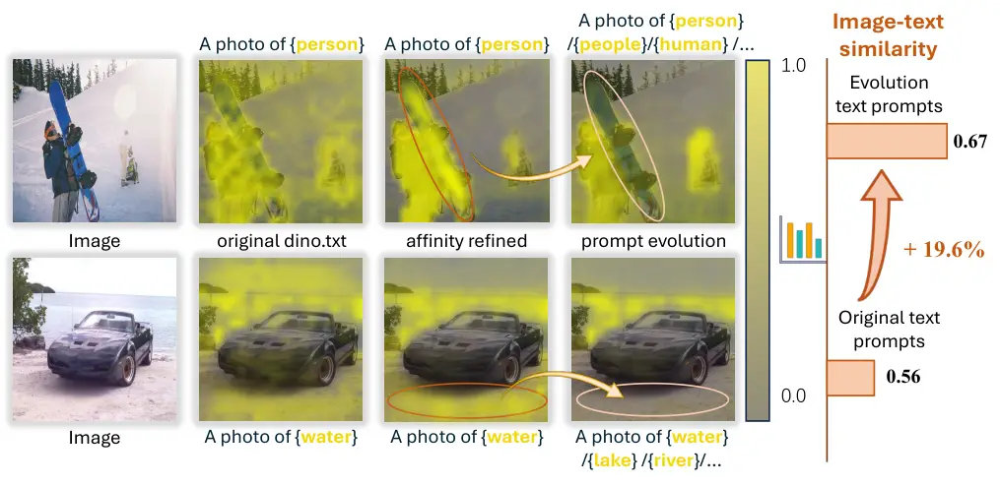

Figure 6: Analysis experiments of text query responses. Activation
values are normalized to the range \[0, 1\]. The erroneous responses
highlighted are effectively corrected through our VIP.

Comparative Study on Text Query Activations. We further conduct a
comparative study of the activation quality induced by original text
query versus refined text queries on dense image features. As shown in
Figure 6, while the self-correction mechanism suppresses artifacts for
original queries, significant noises remain persistent. In contrast, the
refined text queries exhibit more holistic and pristine activations,
remarkably eliminating noises and accurately delineating object regions.
To quantify the impact of refined text queries on cross-modal
interaction, we computed the similarity scores between them and the
dense image features. Our method delivers a $`19.6\%`$ increase in
image-text similarity, narrowing the gap between dense image features
and corresponding semantic anchors, thereby mitigating the cross-modal
mismatch limitation.

## 5 Conclusion

In this paper, we depart from the prevailing CLIP-based paradigm and
exploit the untapped potential of dino.txt to achieve efficient and
high-quality training-free OVSS. Towards this end, we introduce
VIsual-guided Prompt evolution (VIP), to mitigate the dense cross-modal
mismatch in dino.txt, thereby unleashing its potent object perception
capabilities. Experimental results validate that VIP remarkably
outperforms existing top-leading methods on diverse challenging domains,
while incurring only negligible inference costs. These results are
non-trivial, especially considering that our approach relies solely on
self-supervised pre-trained foundation model, without recourse to any
potential mask supervision. We hope that this work can inspire further
innovation towards this promising avenue.

## Acknowledgments

This work is supported by National Key R&D Program of China
(2023YFD2000303) and National Natural Science Foundation of China
(62372433).

## Impact Statement

This paper presents work whose goal is to advance the field of machine
learning. There are many potential societal consequences of our work,
none of which we feel must be specifically highlighted here.

## References

- Allingham et al. (2023) J. U. Allingham, J. Ren, M. W. Dusenberry, X.
  Gu, Y. Cui, D. Tran, J. Z. Liu, and B. Lakshminarayanan A simple
  zero-shot prompt weighting technique to improve prompt ensembling in
  text-image models. In International Conference on Machine Learning,
  pp. 547–568. Cited by: §2.
- Araslanov and Roth (2020) N. Araslanov and S. Roth Single-stage
  semantic segmentation from image labels. In Proceedings of the
  IEEE/CVF Conference on Computer Vision and Pattern Recognition,
  pp. 4253–4262. Cited by: §4.1.
- Bai et al. (2025) S. Bai, Y. Liu, Y. Han, H. Zhang, Y. Tang, J. Zhou,
  and J. Lu Self-calibrated clip for training-free open-vocabulary
  segmentation. IEEE Transactions on Image Processing. Cited by: §A.2,
  Table 6, §2.
- Benigmim et al. (2025) Y. Benigmim, M. Fahes, T. Vu, A. Bursuc, and R.
  de Charette FLOSS: free lunch in open-vocabulary semantic
  segmentation. In Proceedings of the IEEE/CVF International Conference
  on Computer Vision, Cited by: §2.
- Brown et al. (2020) T. Brown, B. Mann, N. Ryder, M. Subbiah, J. D.
  Kaplan, P. Dhariwal, A. Neelakantan, P. Shyam, G. Sastry, A. Askell,
  et al. Language models are few-shot learners. In Advances in Neural
  Information Processing Systems, Vol. 33, pp. 1877–1901. Cited by: §2.
- Caesar et al. (2018) H. Caesar, J. Uijlings, and V. Ferrari
  Coco-stuff: thing and stuff classes in context. In Proceedings of the
  IEEE/CVF Conference on Computer Vision and Pattern Recognition,
  pp. 1209–1218. Cited by: §4.1.
- Cai et al. (2025) W. Cai, K. Jin, J. Hou, C. Guo, L. Wu, and W. Yang
  Vdd: varied drone dataset for semantic segmentation. Journal of Visual
  Communication and Image Representation 109, pp. 104429. Cited by:
  §4.1.
- Caron et al. (2021) M. Caron, H. Touvron, I. Misra, H. Jégou, J.
  Mairal, P. Bojanowski, and A. Joulin Emerging properties in
  self-supervised vision transformers. In Proceedings of the IEEE/CVF
  International Conference on Computer Vision, pp. 9650–9660. Cited by:
  §1, §2, §2, §4.2.
- Cha et al. (2023) J. Cha, J. Mun, and B. Roh Learning to generate
  text-grounded mask for open-world semantic segmentation from only
  image-text pairs. In Proceedings of the IEEE/CVF Conference on
  Computer Vision and Pattern Recognition, pp. 11165–11174. Cited by:
  §1.
- Chen et al. (2025) Q. Chen, L. Yang, Y. Chen, N. Zhao, J. Lai, J.
  Shao, and X. Xie Training-free class purification for open-vocabulary
  semantic segmentation. In Proceedings of the IEEE/CVF International
  Conference on Computer Vision, pp. 23124–23134. Cited by: §A.2.
- Chen et al. (2024) Z. Chen, J. Wu, W. Wang, W. Su, G. Chen, S.
  Xing, M. Zhong, Q. Zhang, X. Zhu, L. Lu, et al. Internvl: scaling up
  vision foundation models and aligning for generic visual-linguistic
  tasks. In Proceedings of the IEEE/CVF Conference on Computer Vision
  and Pattern Recognition, pp. 24185–24198. Cited by: §2.
- Cherti et al. (2023) M. Cherti, R. Beaumont, R. Wightman, M.
  Wortsman, G. Ilharco, C. Gordon, C. Schuhmann, L. Schmidt, and J.
  Jitsev Reproducible scaling laws for contrastive language-image
  learning. In Proceedings of the IEEE/CVF Conference on Computer Vision
  and Pattern Recognition, pp. 2818–2829. Cited by: §2.
- Chi et al. (2025) Z. Chi, Y. Wu, L. Gu, H. Liu, Z. Wang, Y. Zhang, Y.
  Wang, and K. Plataniotis Plug-in feedback self-adaptive attention in
  clip for training-free open-vocabulary segmentation. In Proceedings of
  the IEEE/CVF International Conference on Computer Vision,
  pp. 22815–22825. Cited by: §A.1, §A.2, §1, §2.
- Comanici et al. (2025) G. Comanici, E. Bieber, M. Schaekermann, I.
  Pasupat, N. Sachdeva, I. Dhillon, M. Blistein, O. Ram, D. Zhang, E.
  Rosen, et al. Gemini 2.5: pushing the frontier with advanced
  reasoning, multimodality, long context, and next generation agentic
  capabilities. arXiv preprint arXiv:2507.06261. Cited by: §B.1, Table 4.
- Cordts et al. (2016) M. Cordts, M. Omran, S. Ramos, T. Rehfeld, M.
  Enzweiler, R. Benenson, U. Franke, S. Roth, and B. Schiele The
  cityscapes dataset for semantic urban scene understanding. In
  Proceedings of the IEEE/CVF Conference on Computer Vision and Pattern
  Recognition, pp. 3213–3223. Cited by: §4.1.
- Ding et al. (2023) Z. Ding, J. Wang, and Z. Tu Open-vocabulary
  universal image segmentation with maskclip. In International
  Conference on Machine Learning, pp. 8090–8102. Cited by: §1.
- Dong et al. (2025) H. Dong, L. Sheng, J. Liang, R. He, E. Chatzi,
  and O. Fink Adapting vision-language models without labels: a
  comprehensive survey. arXiv preprint arXiv:2508.05547. Cited by: §2.
- Dosovitskiy et al. (2021) A. Dosovitskiy, L. Beyer, A. Kolesnikov, D.
  Weissenborn, X. Zhai, T. Unterthiner, M. Dehghani, M. Minderer, G.
  Heigold, S. Gelly, et al. An image is worth 16x16 words: transformers
  for image recognition at scale. In International Conference on
  Learning Representations, Cited by: §3.1, §4.1.
- Everingham et al. (2015) M. Everingham, S. A. Eslami, L. Van
  Gool, C. K. Williams, J. Winn, and A. Zisserman The pascal visual
  object classes challenge: a retrospective. International Journal of
  Computer Vision 111 (1), pp. 98–136. Cited by: §4.1.
- Guo et al. (2025) D. Guo, D. Yang, H. Zhang, J. Song, R. Zhang, R.
  Xu, Q. Zhu, S. Ma, P. Wang, X. Bi, et al. Deepseek-r1: incentivizing
  reasoning capability in llms via reinforcement learning. arXiv
  preprint arXiv:2501.12948. Cited by: §B.1, Table 4.
- He et al. (2025) S. He, G. Jie, C. Wang, Y. Zhou, S. Hu, G. Li, and H.
  Ding ReferSplat: referring segmentation in 3d gaussian splatting. In
  International Conference on Machine Learning, Cited by: §1.
- Jia et al. (2021) C. Jia, Y. Yang, Y. Xia, Y. Chen, Z. Parekh, H.
  Pham, Q. Le, Y. Sung, Z. Li, and T. Duerig Scaling up visual and
  vision-language representation learning with noisy text supervision.
  In International Conference on Machine Learning, pp. 4904–4916. Cited
  by: §1, §2.
- Jiang et al. (2026) Y. Jiang, Y. Hu, J. Deng, X. Qiu, Y. Cui, X.
  He, R. Li, Q. Sun, and C. Zhuo Circuit-think: a multimodal reasoning
  framework for automated circuit-to-netlist translation with
  trajectory-guided reinforcement learning. In Proceedings of the AAAI
  Conference on Artificial Intelligence, pp. 5477–5484. Cited by: §1.
- Jin et al. (2025) S. Jin, S. Yu, B. Zhang, M. Sun, Y. Dong, and J.
  Xiao Feature purification matters: suppressing outlier propagation for
  training-free open-vocabulary semantic segmentation. In Proceedings of
  the IEEE/CVF International Conference on Computer Vision,
  pp. 20291–20300. Cited by: §A.2, §B.3, §2, §4.2.
- Jose et al. (2025) C. Jose, T. Moutakanni, D. Kang, F. Baldassarre, T.
  Darcet, H. Xu, D. Li, M. Szafraniec, M. Ramamonjisoa, M. Oquab, et al.
  Dinov2 meets text: a unified framework for image-and pixel-level
  vision-language alignment. In Proceedings of the IEEE/CVF Conference
  on Computer Vision and Pattern Recognition, pp. 24905–24916. Cited by:
  §A.1, §B.3, §1, §1, §2, §3.1, §3.2, §3.
- Kang and Cho (2024) D. Kang and M. Cho In defense of lazy visual
  grounding for open-vocabulary semantic segmentation. In European
  Conference on Computer Vision, pp. 143–164. Cited by: §A.2, §2.
- Kang et al. (2025) D. U. Kang, H. Kim, and S. Y. Chun Class
  distribution-induced attention map for open-vocabulary semantic
  segmentations. In International Conference on Learning
  Representations, Cited by: §A.1, §A.2, §1, §2.
- Kim et al. (2025) C. Kim, D. Ju, W. Han, M. Yang, and S. J. Hwang
  Distilling spectral graph for object-context aware open-vocabulary
  semantic segmentation. In Proceedings of the IEEE/CVF Conference on
  Computer Vision and Pattern Recognition, pp. 15033–15042. Cited by:
  §A.2, §2.
- Kirillov et al. (2023) A. Kirillov, E. Mintun, N. Ravi, H. Mao, C.
  Rolland, L. Gustafson, T. Xiao, S. Whitehead, A. C. Berg, W. Lo, et
  al. Segment anything. In Proceedings of the IEEE/CVF International
  Conference on Computer Vision, pp. 4015–4026. Cited by: §1, §2.
- Krähenbühl and Koltun (2011) P. Krähenbühl and V. Koltun Efficient
  inference in fully connected crfs with gaussian edge potentials. In
  Advances in Neural Information Processing Systems, Cited by: §4.1.
- Lan et al. (2024a) M. Lan, C. Chen, Y. Ke, X. Wang, L. Feng, and W.
  Zhang Clearclip: decomposing clip representations for dense
  vision-language inference. In European Conference on Computer Vision,
  pp. 143–160. Cited by: §A.2.
- Lan et al. (2024b) M. Lan, C. Chen, Y. Ke, X. Wang, L. Feng, and W.
  Zhang Proxyclip: proxy attention improves clip for open-vocabulary
  segmentation. In European Conference on Computer Vision, pp. 70–88.
  Cited by: §A.2, Table 6, §1, §2, §3.1.
- LeCun et al. (2006) Y. LeCun, S. Chopra, R. Hadsell, M. Ranzato, F.
  Huang, et al. A tutorial on energy-based learning. Predicting
  Structured Data 1 (0). Cited by: §3.4.
- Li et al. (2023) J. Li, D. Li, S. Savarese, and S. Hoi Blip-2:
  bootstrapping language-image pre-training with frozen image encoders
  and large language models. In International Conference on Machine
  Learning, pp. 19730–19742. Cited by: §1.
- Li et al. (2025a) K. Li, R. Liu, X. Cao, X. Bai, F. Zhou, D. Meng,
  and Z. Wang Segearth-ov: towards training-free open-vocabulary
  segmentation for remote sensing images. In Proceedings of the IEEE/CVF
  Conference on Computer Vision and Pattern Recognition,
  pp. 10545–10556. Cited by: §4.2.
- Li et al. (2025b) Y. Li, H. Wang, Y. Duan, J. Zhang, and X. Li A
  closer look at the explainability of contrastive language-image
  pre-training. Pattern Recognition 162, pp. 111409. Cited by: §2.
- Liang et al. (2023) F. Liang, B. Wu, X. Dai, K. Li, Y. Zhao, H.
  Zhang, P. Zhang, P. Vajda, and D. Marculescu Open-vocabulary semantic
  segmentation with mask-adapted clip. In Proceedings of the IEEE/CVF
  Conference on Computer Vision and Pattern Recognition, pp. 7061–7070.
  Cited by: §1.
- Lin et al. (2023) Y. Lin, M. Chen, W. Wang, B. Wu, K. Li, B. Lin, H.
  Liu, and X. He Clip is also an efficient segmenter: a text-driven
  approach for weakly supervised semantic segmentation. In Proceedings
  of the IEEE/CVF Conference on Computer Vision and Pattern Recognition,
  pp. 15305–15314. Cited by: §1.
- Liu et al. (2020) W. Liu, X. Wang, J. Owens, and Y. Li Energy-based
  out-of-distribution detection. Advances in Neural Information
  Processing Systems 33, pp. 21464–21475. Cited by: §3.4.
- Maninis et al. (2025) K. Maninis, K. Chen, S. Ghosh, A. Karpur, K.
  Chen, Y. Xia, B. Cao, D. Salz, G. Han, J. Dlabal, D. Gnanapragasam, M.
  Seyedhosseini, H. Zhou, and A. Araujo TIPS: Text-Image Pretraining
  with Spatial Awareness. In International Conference on Learning
  Representations, Cited by: §1, §2.
- Menon and Vondrick (2023) S. Menon and C. Vondrick Visual
  classification via description from large language models. In
  International Conference on Learning Representations, Cited by: §A.1,
  §B.1, §2.
- Mirza et al. (2024) M. J. Mirza, L. Karlinsky, W. Lin, S. Doveh, J.
  Micorek, M. Kozinski, H. Kuehne, and H. Possegger Meta-prompting for
  automating zero-shot visual recognition with llms. In European
  Conference on Computer Vision, pp. 370–387. Cited by: §2.
- Mottaghi et al. (2014) R. Mottaghi, X. Chen, X. Liu, N. Cho, S.
  Lee, S. Fidler, R. Urtasun, and A. Yuille The role of context for
  object detection and semantic segmentation in the wild. In Proceedings
  of the IEEE/CVF Conference on Computer Vision and Pattern Recognition,
  pp. 891–898. Cited by: §4.1.
- Naeem et al. (2024) M. F. Naeem, Y. Xian, X. Zhai, L. Hoyer, L. Van
  Gool, and F. Tombari Silc: improving vision language pretraining with
  self-distillation. In European Conference on Computer Vision,
  pp. 38–55. Cited by: §1, §2.
- Oquab et al. (2024) M. Oquab, T. Darcet, T. Moutakanni, H. Vo, M.
  Szafraniec, V. Khalidov, P. Fernandez, D. Haziza, F. Massa, A.
  El-Nouby, et al. DINOv2: learning robust visual features without
  supervision. Transactions on Machine Learning Research Journal. Cited
  by: §A.1, §2, §2.
- Pratt et al. (2023) S. Pratt, I. Covert, R. Liu, and A. Farhadi What
  does a platypus look like? generating customized prompts for zero-shot
  image classification. In Proceedings of the IEEE/CVF International
  Conference on Computer Vision, pp. 15691–15701. Cited by: §A.1, §B.1,
  §2.
- Radford et al. (2021) A. Radford, J. W. Kim, C. Hallacy, A. Ramesh, G.
  Goh, S. Agarwal, G. Sastry, A. Askell, P. Mishkin, J. Clark, et al.
  Learning transferable visual models from natural language supervision.
  In International Conference on Machine Learning, pp. 8748–8763. Cited
  by: §A.2, §1, §1, §2, §3.1, §3.5.
- Ravi et al. (2025) N. Ravi, V. Gabeur, Y. Hu, R. Hu, C. Ryali, T.
  Ma, H. Khedr, R. Rädle, C. Rolland, L. Gustafson, et al. SAM 2:
  segment anything in images and videos. In International Conference on
  Learning Representations, Cited by: §1, §2, §4.2.
- Rombach et al. (2022) R. Rombach, A. Blattmann, D. Lorenz, P. Esser,
  and B. Ommer High-resolution image synthesis with latent diffusion
  models. In Proceedings of the IEEE/CVF conference on computer vision
  and pattern recognition, pp. 10684–10695. Cited by: §2.
- Roth et al. (2023) K. Roth, J. M. Kim, A. Koepke, O. Vinyals, C.
  Schmid, and Z. Akata Waffling around for performance: visual
  classification with random words and broad concepts. In Proceedings of
  the IEEE/CVF International Conference on Computer Vision, Cited by:
  §B.1, §2.
- Shao et al. (2024) T. Shao, Z. Tian, H. Zhao, and J. Su Explore the
  potential of clip for training-free open vocabulary semantic
  segmentation. In European Conference on Computer Vision, pp. 139–156.
  Cited by: §2.
- Shi et al. (2025) Y. Shi, M. Dong, and C. Xu Harnessing vision
  foundation models for high-performance, training-free open vocabulary
  segmentation. In Proceedings of the IEEE/CVF International Conference
  on Computer Vision, pp. 23487–23497. Cited by: §A.2, §B.3, §1, §2.
- Siméoni et al. (2025) O. Siméoni, H. V. Vo, M. Seitzer, F.
  Baldassarre, M. Oquab, C. Jose, V. Khalidov, M. Szafraniec, S. Yi, M.
  Ramamonjisoa, et al. Dinov3. arXiv preprint arXiv:2508.10104. Cited
  by: §A.1, §1, §2, §3.1, §4.1.
- Stojnić et al. (2025) V. Stojnić, Y. Kalantidis, J. Matas, and G.
  Tolias LPOSS: label propagation over patches and pixels for
  open-vocabulary semantic segmentation. In Proceedings of the Computer
  Vision and Pattern Recognition Conference, pp. 9794–9803. Cited by:
  §A.2, §2.
- Sun et al. (2025) L. Sun, J. Cao, J. Xie, X. Jiang, and Y. Pang
  Cliper: hierarchically improving spatial representation of clip for
  open-vocabulary semantic segmentation. In Proceedings of the IEEE/CVF
  International Conference on Computer Vision, pp. 23199–23209. Cited
  by: §A.2, §2.
- Sun et al. (2024) W. Sun, Y. Du, G. Liu, R. Kompella, and C. G. Snoek
  Training-free semantic segmentation via llm-supervision. arXiv
  preprint arXiv:2404.00701. Cited by: §2.
- Tschannen et al. (2025) M. Tschannen, A. Gritsenko, X. Wang, M. F.
  Naeem, I. Alabdulmohsin, N. Parthasarathy, T. Evans, L. Beyer, Y.
  Xia, B. Mustafa, et al. Siglip 2: multilingual vision-language
  encoders with improved semantic understanding, localization, and dense
  features. arXiv preprint arXiv:2502.14786. Cited by: §1, §2.
- Vernaza and Chandraker (2017) P. Vernaza and M. Chandraker Learning
  random-walk label propagation for weakly-supervised semantic
  segmentation. In Proceedings of the IEEE/CVF Conference on Computer
  Vision and Pattern Recognition, pp. 7158–7166. Cited by: §3.3.
- Wang et al. (2024) F. Wang, J. Mei, and A. Yuille Sclip: rethinking
  self-attention for dense vision-language inference. In European
  Conference on Computer Vision, pp. 315–332. Cited by: §A.1, §A.2,
  §B.3, Table 6, §1, §2.
- Waqas Zamir et al. (2019) S. Waqas Zamir, A. Arora, A. Gupta, S.
  Khan, G. Sun, F. Shahbaz Khan, F. Zhu, L. Shao, G. Xia, and X. Bai
  Isaid: a large-scale dataset for instance segmentation in aerial
  images. In Proceedings of the IEEE/CVF Conference on Computer Vision
  and Pattern Recognition Workshops, pp. 28–37. Cited by: §4.1.
- Wu et al. (2024) S. Wu, W. Zhang, L. Xu, S. Jin, X. Li, W. Liu,
  and C. C. Loy Clipself: vision transformer distills itself for
  open-vocabulary dense prediction. In International Conference on
  Learning Representations, Cited by: §1.
- Xing et al. (2023) Y. Xing, J. Kang, A. Xiao, J. Nie, L. Shao, and S.
  Lu Rewrite caption semantics: bridging semantic gaps for
  language-supervised semantic segmentation. Advances in Neural
  Information Processing Systems 36, pp. 68798–68809. Cited by: §1.
- Xu et al. (2023) J. Xu, J. Hou, Y. Zhang, R. Feng, Y. Wang, Y. Qiao,
  and W. Xie Learning open-vocabulary semantic segmentation models from
  natural language supervision. In Proceedings of the IEEE/CVF
  Conference on Computer Vision and Pattern Recognition, pp. 2935–2944.
  Cited by: §1.
- Yang et al. (2025) Y. Yang, J. Deng, W. Li, and L. Duan ResCLIP:
  residual attention for training-free dense vision-language inference.
  In Proceedings of the IEEE/CVF Conference on Computer Vision and
  Pattern Recognition, pp. 29968–29978. Cited by: §A.2, §B.3.
- Yu et al. (2022) J. Yu, Z. Wang, V. Vasudevan, L. Yeung, M.
  Seyedhosseini, and Y. Wu Coca: contrastive captioners are image-text
  foundation models. Transactions on Machine Learning Research. Cited
  by: §2.
- Zhai et al. (2023) X. Zhai, B. Mustafa, A. Kolesnikov, and L. Beyer
  Sigmoid loss for language image pre-training. In Proceedings of the
  IEEE/CVF International Conference on Computer Vision, pp. 11975–11986.
  Cited by: §2.
- Zhang et al. (2025) D. Zhang, F. Liu, and Q. Tang CorrCLIP:
  reconstructing patch correlations in clip for open-vocabulary semantic
  segmentation. In Proceedings of the IEEE/CVF International Conference
  on Computer Vision, pp. 24677–24687. Cited by: §A.2, §1, §2, §4.2.
- Zhou et al. (2019) B. Zhou, H. Zhao, X. Puig, T. Xiao, S. Fidler, A.
  Barriuso, and A. Torralba Semantic understanding of scenes through the
  ade20k dataset. International Journal of Computer Vision 127 (3),
  pp. 302–321. Cited by: §4.1.
- Zhou et al. (2022) C. Zhou, C. C. Loy, and B. Dai Extract free dense
  labels from clip. In European Conference on Computer Vision,
  pp. 696–712. Cited by: §A.2, §2.
- Zhu et al. (2024) H. Zhu, Y. Zhu, J. Xiao, Y. Ma, Y. Zhang, J. Li,
  and F. Dai MISA: mining saliency-aware semantic prior for box
  supervised instance segmentation.. In IJCAI, pp. 1798–1806. Cited by:
  §A.1.
- Zhu et al. (2025) H. Zhu, Y. Zhu, J. Xiao, T. Xiao, Y. Ma, Y. Zhang,
  and F. Dai Exact: exploring space-time perceptive clues for weakly
  supervised satellite image time series semantic segmentation. In
  Proceedings of the Computer Vision and Pattern Recognition Conference,
  pp. 14036–14045. Cited by: §C.2.

The appendix is divided into several sections, each giving extra
information and details.

 

## Appendix A Detailed Experimental Setups

### A.1 Implementation details

Main experiment. The original version of dino.txt (Jose et al., 2025)
adopted DINOv2 (Oquab et al., 2024) as its visual backbone, and was then
upgraded in tandem with the release of DINO v3 (Siméoni et al., 2025).
In this work, we employ the latest version to ensure optimal
performance. To ensure a fair comparison, our data processing pipeline
strictly follows to the protocols established in previous studies (Wang
et al., 2024; Zhu et al., 2024; Chi et al., 2025; Kang et al., 2025).
Specifically, we first resize each input image with the shorter side
fixed at 336 pixels (or 560 pixels for the high-resolution Cityscapes
dataset), followed by sliding-window inference using a window size of
224 and a stride of 112. Furthermore, during the aggregation phase, we
incorporate the activation maps derived by canonical class name to
ensure semantic stability. For hyperparameter settings, we empirically
observe that the propagation converges when $`\alpha`$ and $`\beta`$ are
set to $`2`$ (cf. Eq.4). Thus, we adopt this setting as default to
facilitate efficient propagation. The temperature parameter $`\tau`$
(cf. Eq.9) is set to $`4.0`$. The comparison of the framework pipeline
between the CLIP-based paradigm and our VIP is shown in Figure 7.

Measurement of inference cost. In general, the semantic expansion (§3.2)
and alias distillation (§3.3) are conducted offline, whereas the final
aggregation (§3.4) is performed online to yield the final segmentation
results, as illustrated in Figure 3. However, in practice, the alias
distillation process already computes the similarity maps between the
dense image features and all text queries, which can be cached. This
enables the aggregation of logits maps and the final segmentation
results can be obtained directly, bypassing the need for a repeated
model forward pass, thereby significantly reducing inference overhead.
The average inference speed and memory footprint reported in Table 1 are
calculated in this way to assess the true cost of our method in
practical deployment. Notably, our alias distillation and aggregation
modules rely exclusively on a few straightforward matrix
multiplications, incurring negligible latency and achieving an optimal
trade-off between performance and inference costs.

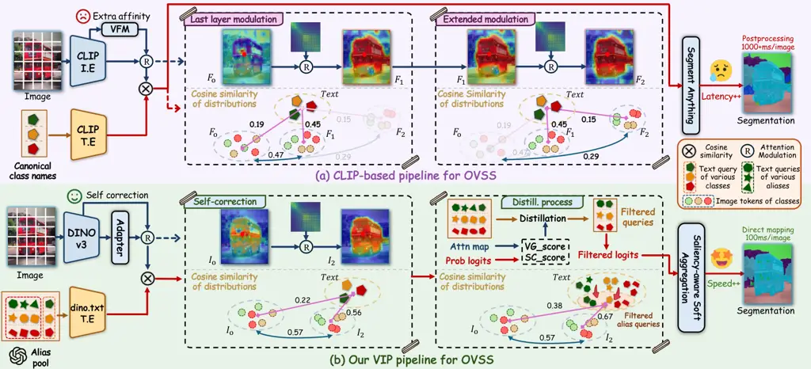

Figure 7: Framework comparison of CLIP-based paradigm and our VIP
pipeline. Beneath the module diagram, we illustrate the flow of
image-text similarity distributions. Here, $`F`$ and $`I`$ denote the
dense image features of CLIP-based paradigm and dino.txt, respectively,
with subscripts indicating the number of attention modulation iterations
the features have undergone.

Prompting the language model. A key component of our method involves
leveraging LLM (we use GPT-5 by default) to generate image-caption style
aliases for each category, thereby expanding semantic coverage. Recall
that the form of our prompt introduced in §3.2:


In practice, we typically incorporate specific scene descriptors into
the prompt to guide the LLM in generating scene-specific class aliases.
Consistent with previous work utilizing GPT (Menon and Vondrick, 2023;
Pratt et al., 2023), we provide several examples of the expected output
to enhance the reliability of list formatting. These examples may take
the following form:


To mitigate potential hallucinatory outputs, we discard aliases
exhibiting a cosine similarity lower than $`0.7`$ with the canonical
class name by default. It is possible that extensive prompt tuning would
produce better aliases; however, this simple formulation proves
sufficient. Since our goal is simple, the critical challenge is the
filtration of these aliases to retain useful information, which
constitutes the core of §3.3.

Attempt on transferability to text templates. Our core idea applied to
class names can be similarly transferred to text templates. Currently,
training-free OVSS methods predominantly rely on the 80 hand-crafted
templates provided by CLIP, which are specific to image classification.
In fact, these templates encompass a vast majority of application
scenarios and are consequently widely adopted by existing zero-shot
visual understanding tasks. Therefore, we utilize these templates as
references for LLM to generate new text templates tailored for the
segmentation task across diverse scenarios. We upload the CLIP’s 80 text
templates as an attachment to LLM in advance, and subsequently employ
prompts in the following format to query LLM:


For each generated text template, we compute the corresponding
$`\mathtt{VG\_Score}`$ (cf. Eq. 5) and $`\mathtt{SC\_Score}`$(cf.
Eq. 6), and utilize the mean scores of the 80 CLIP templates as a
reference. Mirroring our filtering strategy for class aliases, we retain
only those templates that surpass the reference value in
$`\mathtt{VG\_Score}`$ while remaining lower than the reference in
$`\mathtt{SC\_Score}`$. In addition, we maintain two foundational
templates across all scenarios, i.e., “a photo of a {class_name}” and “a
detailed view of a {class_name}”, to ensure a stable semantic
representation. Though somewhat modest compared to those for class
names, the achieved gains on text templates are still sufficient to
demonstrate the generalizability of our idea. Given that it is not the
primary focus of our work, we encourage future research to conduct a
more in-depth exploration of text templates.

Implementation details of spatial bias experiments. CLIP-based methods
typically modify the last layer of the image encoder to enhance the
feature affinity for improved segmentation results. However, only
one-layer refinement often exhibits sub-optimal and flawed dense image
features. Hence, we extend this refinement operation to the penultimate
layer for diagnostic analysis, which validates how image feature
affinity influences the cross-modal alignment representation. To
quantitatively analyze these variant models, we calculate intra-class
image feature similarity and image-text feature similarity scores,
respectively. The results are summarized in Figure 8 and the detailed
calculation processes are as follows:

I) Image features. We first use ground-truth (GT) masks to isolate patch
tokens for each class and accordingly separate them into different
classes. For patch tokens refined at the last layer and those further
refined at the penultimate layer, we compute the cosine similarity
between each refined patch token and its corresponding original token in
a per-patch manner. The mean of these similarities is finally reported
as the intra-class image-feature similarity score. In this way, a higher
score indicates that the refined patch tokens remain closer to the
original feature distribution, whereas a lower score suggests greater
deviation from it.

II) Cross-modal features. Similarly, we first utilize GT masks to
isolate patch tokens for each class and group them accordingly. Then, we
compute the cosine similarity between each patch token and the
corresponding class-specific text embedding (e.g., “a photo of the
{class_name}”). Finally, we average the similarity scores over all patch
tokens within each class to obtain the image–text feature similarity
score for that class. Under this formulation, a higher score indicates
stronger discriminative alignment between the patch tokens and the
corresponding class, and vice versa.

### A.2 Counterparts

We categorize existing training-free OVSS CLIP-based solutions into two
groups based on whether they rely on auxiliary visual foundation
backbones during dense inference, as follows:

I) dense prediction with multi vision models: LaVG (Kang and Cho, 2024),
ProxyCLIP (Lan et al., 2024b), LPOSS (Stojnić et al., 2025), CASS (Kim
et al., 2025), FSA (Chi et al., 2025), CLIPer (Sun et al., 2025),
Trident (Shi et al., 2025), CorrCLIP (Zhang et al., 2025).

II) dense prediction with single vision model: CLIP (Radford et al.,
2021), MaskCLIP (Zhou et al., 2022), SCLIP (Wang et al., 2024),
ClearCLIP (Lan et al., 2024a), CdamCLIP (Kang et al., 2025),
ResCLIP (Yang et al., 2025), FreeCP (Chen et al., 2025), SFP (Jin et
al., 2025), SC-CLIP (Bai et al., 2025). As our VIP does not require
auxiliary visual models for dense inference, it is categorized within
this group. Furthermore, we observe that the majority of these methods
perform better on ViT-B than on ViT-L backbone. This is primarily
attributed to the fact that increased network depth exacerbates the
spatial bias encoded in CLIP, thereby leading to inferior performance.
For this reason, we report the better performance (using ViT-B model) of
these methods to ensure a fair comparison.

## Appendix B Additional Experimental results

### B.1 Diagnostic Analysis

Effect of different language models. We evaluate the impact of using
different LLMs for alias generation. Specifically, we queried
Gemini-2.5 (Comanici et al., 2025) and DeepSeek-R1 (Guo et al., 2025)
using the identical prompt, with the results reported in Table 4. It can
be seen that the choice of LLM has a negligible impact on performance,
and we find that the category aliases generated by different models are
largely consistent. This is primarily because alias generation is a
straightforward task for modern LLMs; given the prompt and demonstration
examples, all models can perform it well.

|     LLMs                           |      |      |      |      |      | VOC21 | Object | City | ADE | Avg. |
| ---------------------------------- | ---- | ---- | ---- | ---- | ---- | ----- | ------ | ---- | --- | ---- |
| Gemini-2.5 (Comanici et al., 2025) | 73.0 | 47.2 | 55.4 | 28.9 | 51.1 |       |        |      |     |      |
| DeepSeek-R1 (Guo et al., 2025)     | 72.8 | 46.5 | 55.1 | 28.8 | 50.8 |       |        |      |     |      |
| GPT-5                              | 73.2 | 47.3 | 55.7 | 29.1 | 51.3 |       |        |      |     |      |
|                                    |      |      |      |      |      |       |        |      |     |      |

Table 4: Ablation studies of different large language models. Broadly
speaking, the influence of utilizing distinct LLMs is minimal,
attributed to the fact that all models are adept at the task of
generating semantically diverse aliases.

|     Methods               |      |      |      |      |      | VOC21 | Object | City | ADE | Avg. | $`\Delta`$ |
| ------------------------- | ---- | ---- | ---- | ---- | ---- | ----- | ------ | ---- | --- | ---- | ---------- |
| baseline                  | 35.9 | 24.2 | 22.6 | 18.9 | 25.4 | -     |        |      |     |      |            |
| + S-C §3.1                | 62.1 | 31.4 | 35.0 | 23.6 | 38.0 | -     |        |      |     |      |            |
| + Category Descriptor     | 58.2 | 27.6 | 32.8 | 21.0 | 34.9 | -3.1  |        |      |     |      |            |
| + Descriptor Distillation | 59.3 | 27.4 | 33.2 | 21.5 | 35.4 | -2.6  |        |      |     |      |            |
|                           |      |      |      |      |      |       |        |      |     |      |            |

Table 5: The performance of category descriptor queries. Deriving text
queries via category descriptors leads to a severe performance drop.
Notably, this issue persists even after applying our filtering
mechanism.

Semantic expansion by category descriptors. Leveraging LLMs to generate
visual context descriptors for each category has been extensively
studied in prior works on zero-shot image classification via VLMs (Menon
and Vondrick, 2023; Pratt et al., 2023; Roth et al., 2023). We also
adopted this practice in our early experimental validation. However, we
found it unsuitable for segmentation task. In particular, we directly
employ the prompts provided in prior works to query GPT-5, generating
corresponding context descriptors for each category. The formats of the
prompt are as follows (please refer to CuPL (Pratt et al., 2023) for
details):


We can obtain the following sample outputs for {bus} category:


However, substituting the standard combination of templates and class
names with such descriptors leads to a significant performance
degradation, as shown in Table 5. We attribute this to the fact that
dense image features primarily encode local visual semantics and lack
the capacity to capture global contextual information. By contrast, in
image classification task, where global image features are matched with
text queries, the category descriptors can effectively enhance
cross-modal perception. Consequently, unlike existing methods, we focus
on a coarse-grained approach that refines aliases for segmentation,
which offers a simple yet effective way to unleash the dense perception
ability of dino.txt.

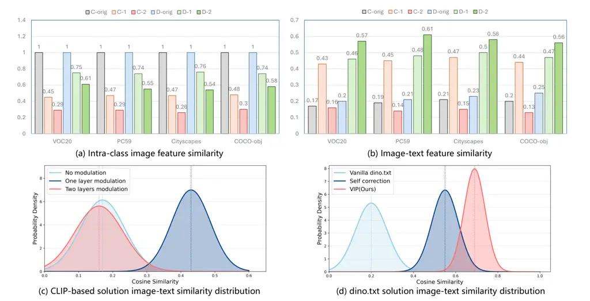

Figure 8: Quantitative similarity analysis between the refined and the
original features. ‘C’ and ‘D’ denote the CLIP and dino.txt models,
respectively, while the ‘-1’ and ‘-2’ denote the refined layers. ‘-orig’
denotes the original feature. (a) Intra-class image feature similarity,
which measures the patch-level similarity between the refined and the
original image features. ‘-orig’ means the self-similarity, e.g.,
$`=1`$. (b) Image-text similarity, which measures the image-text
similarity among the refined and the original image features to the same
text embeddings. (c) CLIP-based solution image-text similarity
distribution. (d) dino.txt solution image-text similarity distribution.
Both (c) and (d) represent results evaluated on the Pascal VOC.

### B.2 More experimental analysis

|     Methods           |      | SCLIP (Wang et al., 2024) | ProxyCLIP (Lan et al., 2024b) | SC-CLIP (Bai et al., 2025) |
| --------------------- | ---- | ------------------------- | ----------------------------- | -------------------------- |
| One layer modulation  | 46.4 | 61.5                      | 60.8                          |                            |
| Two layers modulation | 54.7 | 73.8                      | 69.6                          |                            |
| $`\Delta`$            | +8.3 | +12.3                     | +8.8                          |                            |
|                       |      |                           |                               |                            |

Table 6: The precision of semantic affinity in the dense image features.
Results are evaluated on Pascal VOC dataset.

More analyses on dino.txt versus CLIP. As discussed in main paper, the
image feature distributions of dino.txt exhibit greater stability than
CLIP, which avoids modality alignment collapse. To substantiate this
claim, we apply affinity refinement to the last-layer image features of
both dino.txt and CLIP, and further extend this operation to the
penultimate layer. Build upon this, we conduct a quantitative analysis
of the induced changes, which assesses their variations in intra-class
image-feature similarity between the refined feature and the original
feature. First, we demonstrate the impact of extended modulation on the
semantic affinity of image features in Table 6 (refer to the preceding
text for implementation details). It is evident that two-layer
modulation significantly enhances the semantic affinity of features,
rendering them more discriminative. Subsequently, Figure 8 (a) shows
that the extended affinity refinement from an additional VFM leads to a
substantial drop in CLIP’s intra-class image-feature similarity, e.g.
$`1\rightarrow 0.3`$. In contrast, the reduction for dino.txt is much
lower and limited to 50%. This discrepancy arises because the external
VFM and CLIP exhibit mismatched feature distributions, whereas dino.txt
relies on features from its own frozen backbone, thereby preserving the
original feature distribution.

We also quantitatively evaluate the induced changes in image-text
alignment, shown in Figure 8 (b). It illustrates that both the original
CLIP and dino.txt exhibit unpromising image-text similarity, which
suggests that if we do not modify their original vision transformer
process, they show a poor segmentation performance on OVSS. After the
affinity refinement is applied, both CLIP and dino.txt achieve a
significant improvement ($`0.18\rightarrow 0.45`$ for CLIP, and
$`0.23\rightarrow 0.49`$ for dino.txt). Moreover, when the extended
refinement is employed, CLIP suffers a catastrophic degradation, e.g.
$`0.45\rightarrow 0.15`$. It indicates that the extended refinement on
CLIP disrupts the unified feature space from the pre-training stage. In
contrast, dino.txt performs self-affinity refinement derived from its
backbone features, consistently improving the image–text alignment, e.g.
$`0.46\rightarrow 0.57`$. These results demonstrate a robust unified
feature space of dino.txt for cross-modal inference and highlight the
inherent image-text limitation of CLIP-based paradigms in spatial
optimization, as elaborated in §3.1.

### B.3 More qualitative segmentation results

In Figure 9, we present qualitative comparisons across four
representative remote sensing semantic segmentation benchmarks. As
observed, our VIP exhibits superior semantic comprehension while
precisely delineating object boundaries, thereby substantially
surpassing prior state-of-the-art methods.

We also provide more qualitative comparisons between our VIP and
existing counterparts, including Trident (Shi et al., 2025), SFP (Jin et
al., 2025), ResCLIP (Yang et al., 2025), SCLIP (Wang et al., 2024), and
the baseline dino.txt (Jose et al., 2025) on Object, ADE, Context60, and
VOC21 benchmarks, respectively. As shown in Figure 10-13, through the
proposed text evolution, our VIP successfully corrects
misclassifications and avoids missing objects found in existing
counterparts.

## Appendix C Limitations and Future Work

### C.1 Limitations

Although VIP can substantially improve the quality of text queries in
dino.txt, the model may still fail in certain edge cases. For example,
in the COCO-Stuff dataset, the definitions of some category names are
highly ambiguous, such as wall-concrete and wall-panel. While VIP
enhances the model’s semantic representation ability for most
categories, its segmentation performance remains poor on these highly
confusable classes. In addition, although VIP can filter category names
generated by LLMs, the selected category aliases are not necessarily
optimal due to the lack of explicit supervision signals. There is
therefore still considerable room for improvement.

### C.2 Future Work

Our work reveals that, under the current paradigm, the main bottleneck
in training-free OVSS with VLMs lies not in obtaining more
discriminative image features, but in enhancing the model’s semantic
recognition ability. Future work could therefore focus on improving the
expressive power of the text branch, for example by mining better text
templates or precisely correcting category names.

In addition, in terms of generalization, our model is limited by the
DINOv3 pretrained backbone and may perform poorly on low-resolution
images, such as Sentinel-2 satellite imagery (Zhu et al., 2025). Future
work could further explore how to generalize the model’s capability in
this direction.

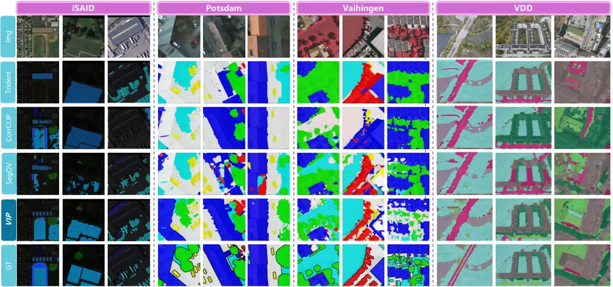

Figure 9: Qualitative comparison results on remote sensing imagery.

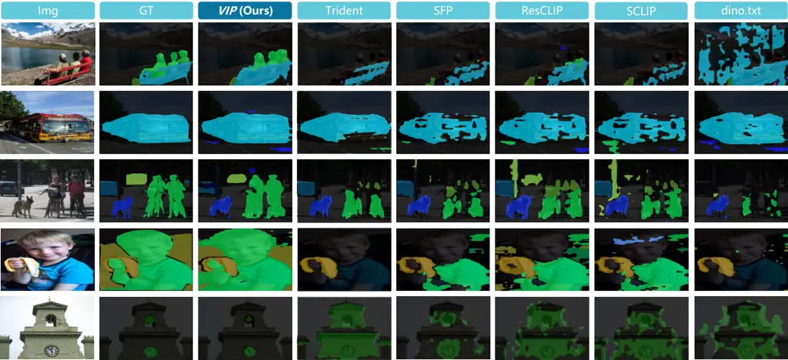

Figure 10: Qualitative comparison on the Object benchmark.

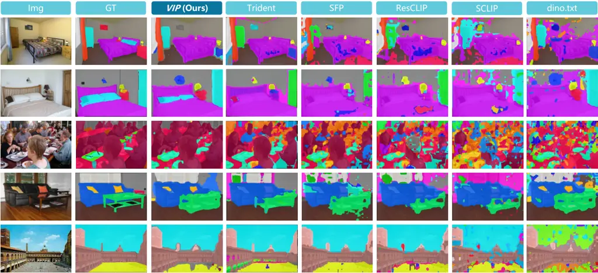

Figure 11: Qualitative comparison on the ADE benchmark.

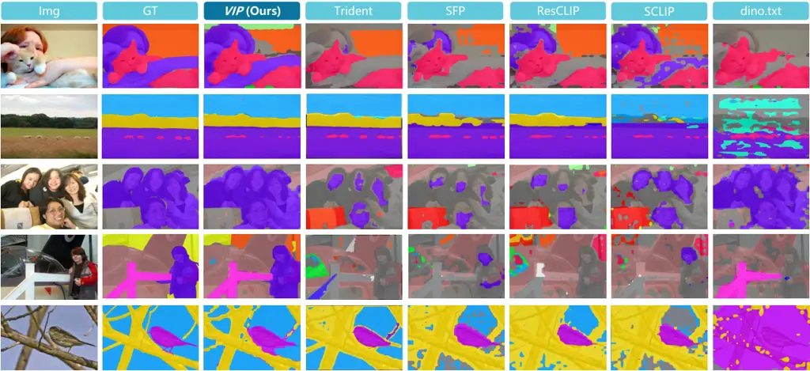

Figure 12: Qualitative comparison on the Context60 benchmark.

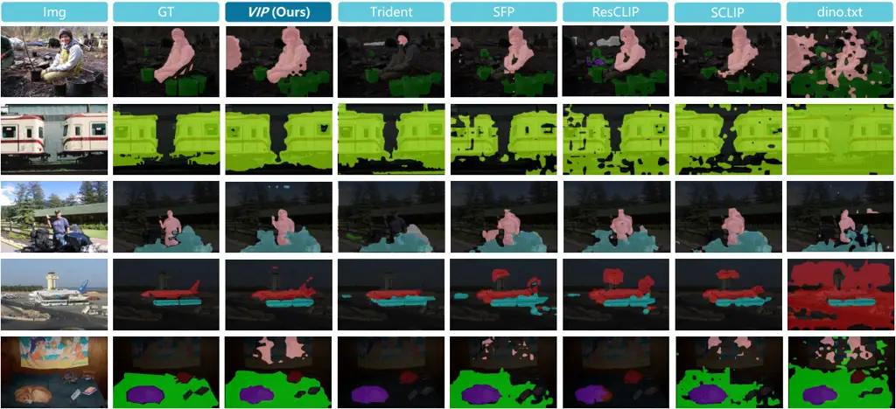

Figure 13: Qualitative comparison on the VOC21 benchmark.
