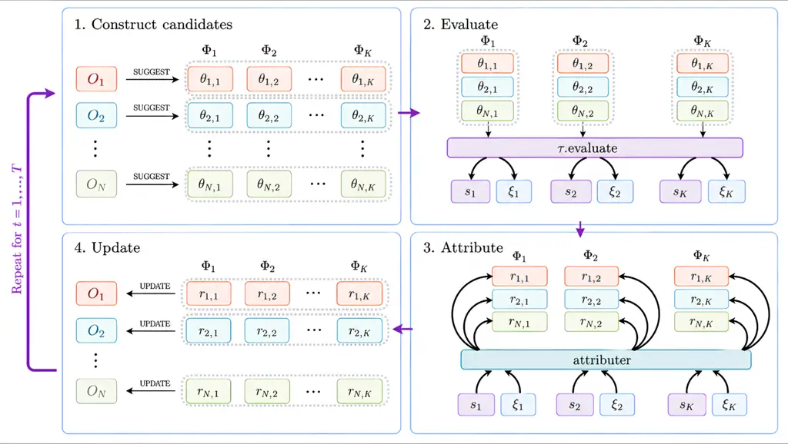

# Cantante: Optimizing Agentic Systems via Contrastive Credit Attribution

Tom Zehle Affiliation: University of Freiburg Affiliation: ELLIS
Institute Tübingen Email: [tom.zehle@tue.ellis.eu](mailto:)

###### Abstract

LLM-based multi-agent systems have demonstrated strong performance
across complex real-world tasks, such as software engineering,
predictive modeling, and retrieval-augmented generation. Yet automating
their configuration remains a structural challenge, as scores are
available only at the system level, whereas the parameters governing
agent behavior are local. We argue that optimizing these systems is
fundamentally a credit-assignment problem. We therefore introduce
Cantante, a framework that decomposes system-level rewards into
per-agent update signals by contrasting rollouts of multiple joint
configurations on the same query. We instantiate it for prompt
optimization, treating agent prompts as learnable system parameters. We
evaluate Cantante against GEPA and MIPROv2 on programming (MBPP),
mathematical reasoning (GSM8K), and multi-hop question answering
(HotpotQA). Across these benchmarks, Cantante achieves the best average
rank among all evaluated optimizers and consistently outperforms
unoptimized prompts. It improves over the strongest baseline by
$`+18.9`$ percentage points on MBPP and $`+12.5`$ percentage points on
GSM8K, while incurring a lower inference cost. It remains within one
standard deviation of the strongest baseline on HotpotQA. Crucially, our
credit correlation analysis confirms that the attributer produces
meaningful per-agent signals rather than echoing the global system
score.

## 1 Introduction

Figure 1: Trajectories on MBPP.  
Cantante improves steadily, reaching the highest final accuracy.

Agentic systems built on large language models have demonstrated strong
empirical performance across a range of complex, real-world tasks, from
autonomous software engineering \[1\] to end-to-end machine learning
pipelines \[2\] and multi-hop retrieval \[3\]. More broadly, multi-agent
systems (MAS) turn LLMs from passive conversational models into
autonomous problem-solving systems. Yet realizing this potential in
practice remains labor-intensive: each deployment requires manual
selection of agents, hand-authored prompts, workflow design, and tool
setup.

Manually tuning MAS configurations, however, contradicts the main
paradigm of machine learning: Just as no practitioner hand-tunes neural
network weights, manual iteration over agent prompts and roles is a
problem that should be solved via optimization. The manual labor
required grows combinatorially with each agent requiring its own
configuration and each prompt requiring a co-adaption to the behavior of
the others, making trial-and-error tuning both tedious and ineffective.
Automating the configuration of MAS would reduce this burden and enable
principled adaptation to new tasks and models, but doing so is
non-trivial. Not only is the search space high-dimensional, but more
fundamentally, the optimization problem has a structural mismatch:
agent-level parameters are local, while evaluation feedback is global,
available only as a scalar signal over the full workflow output.

We argue that multi-agent system optimization is fundamentally a
credit-assignment problem: global feedback must be converted into
per-agent update signals. In a planner–coder–evaluator workflow, for
example, faulty code introduced by the coder should not trigger equally
negative updates in the planner and evaluator. This problem is
well-established in multi-agent reinforcement learning, where
cooperative agents must each receive a learning signal derived from a
shared global reward \[4, 5\]. Existing approaches to LLM-based MAS
optimization largely sidestep this issue by propagating global scores as
update signals to individual agents \[6, 7\].

We therefore introduce Cantante, a novel framework for node-level
optimization in MAS based on system-level rewards and reasoning
trajectories. The central mechanism is contrastive in-group attribution:
by comparing rollouts of multiple joint configurations for the same
query, the attribution model isolates each agent’s parameterization’s
contribution to the observed differences in outcomes. This method is
independent of the choice of local optimizer. We instantiate this
framework for prompt optimization, treating agent prompts as learnable
system parameters rather than fixed implementation details.

We evaluate Cantante on workflow graphs with non-trivial structure,
including conditional edges, ensemble nodes, and tool-using agents,
across programming (MBPP), mathematical reasoning (GSM8K), and multi-hop
question answering (HotpotQA). Cantante obtains the best average rank
among all evaluated optimizers, with the largest gains occurring on MBPP
and GSM8K, where Cantante improves over the strongest baseline by 18.9
percentage points (pp) and $`12.5\text{\,}\mathrm{pp}`$, respectively.
The MBPP trajectory plot in Figure 1 further shows that Cantante reaches
these gains steadily over optimization, rather than through a single
late-stage jump. We show that these gains are achieved without
substantially increasing inference-time token cost relative to the
unoptimized prompts. On HotpotQA, Cantante remains within a standard
deviation of the best baseline and improves over the unoptimized initial
configuration. Finally, our credit correlation analysis suggests that
the attributer produces meaningful per-agent signals rather than merely
echoing the global system score and that these signals can serve as a
diagnostic tool for MAS topology design.

##### Contributions.

We make the following contributions:

I) We formalize the optimization of LLM-based multi-agent systems as a
credit-assignment problem and introduce Cantante. II) We instantiate
Cantante for prompt optimization, treating agent prompts as learnable
system parameters, and evaluate it against MAS-capable prompt optimizers
across multiple benchmarks. III) We isolate contrastive attribution
itself — rather than the underlying local optimizer — as the principal
driver of Cantante’s gains via an identity-attribution ablation, and
further demonstrate robustness to attributer prompt, attributer model,
local optimizer choice, and dataset size. IV) We release the full
implementation of Cantante to support adoption by practitioners and to
enable further research on attribution-driven MAS optimization,
available at
[https://github.com/finitearth/cantante](https://github.com/finitearth/cantante).

## 2 Related Work

##### LLM-Based Multi-Agent Systems.

Multi-agent systems consist of multiple autonomous agents that
coordinate their actions to solve a shared task \[8\]. LLM-based
variants extend this paradigm through a language interface, composing
agents via role specialization, communication, planning, memory, and
tool use \[9\]. Representative applications include autonomous software
engineering with SWEAgent \[1\], automated predictive modeling with
MLZero \[2\], and agent-based retrieval with MAIN-RAG \[3\].

##### Credit Assignment in Multi-Agent Reinforcement Learning.

In multi-agent reinforcement learning (MARL), credit assignment under
shared rewards is a well-studied problem. Methods such as QMIX \[10\]
decompose the global value function into per-agent contributions, while
counterfactual approaches like COMA \[5\] estimate individual agent
impact by comparing observed outcomes against baselines that marginalize
out each agent’s action. More recently, LLM-MCA \[11\] utilizes LLM
critics to decompose global rewards into individual feedback. However,
it remains tied to updating the neural network weights of traditional
reinforcement learning agents, and it relies on a task-specific
attribution prompt. It adapts the comparative intuition behind
counterfactual credit assignment to LLM-based workflows by comparing
concrete alternative trajectories for the same query and using a
prompted LLM to attribute observed differences in outcomes to individual
agents. Unlike value-based decomposition methods such as QMIX, Cantante
does not impose a constraint requiring credits to reconstruct the global
score.

##### Prompt Optimization.

Prompt design affects model behavior, with surface-level formatting
choices alone producing substantial performance variation \[12\].
EvoPrompt \[13\] performs evolutionary search over prompt candidates
using LLMs in its mutation and selection operators. CAPO \[14\] builds
on evolutionary search by incorporating AutoML techniques such as racing
to reduce optimization cost, and introduces prompt length penalties.
TextGrad \[15\] simulates gradient descent via LLM feedback, iteratively
identifying and correcting failure cases in generated outputs.
MIPROv2 \[16\] samples prompt candidates and selects among them via
Bayesian optimization, treating prompt search as a structured
hyperparameter problem. GEPA \[6\] frames prompt optimization as a
multi-objective problem over a Pareto front, where each dataset sample
constitutes its own objective, and uses LLM-generated critiques of
execution traces to guide prompt updates. These methods operate at the
level of individual agents and can be applied to the Cantante framework
by utilizing them as local optimizers.

##### Optimization of Multi-Agent Systems.

MIPROv2 in its multi-agent setting treats the joint prompt configuration
as a single monolithic parameter, without decomposing the reward signal.
GEPA approaches multi-agent configurations by updating agents
sequentially via round-robin, optimizing one agent per step while
holding all others fixed. Unlike these approaches, Cantante decouples
attribution from the update mechanism, enabling the use of arbitrary,
sophisticated local optimizers. ADAS \[17\] uses an optimizer LLM to
iteratively propose and evaluate modifications to the MAS topology,
while AFLOW \[18\] formulates workflow optimization as Monte Carlo Tree
Search over system configurations. MASS \[7\] interleaves prompt and
topology optimization but propagates the global reward without
agent-level attribution. More recent closed-source attribution-based
works like HiveMind \[19\] and MAPRO \[20\] do isolate contributions,
but couple their credit assignment to built-in LLM-oracle mutations.
HiveMind relies on Shapley-based attribution, which requires per-agent
credits to reconstruct the global score; Cantante does not impose this
decomposition. Furthermore, Cantante drives node-level optimization
through contrastive attribution grounded in reasoning traces across
multiple joint rollouts, updates all agents simultaneously at each step,
and leaves workflow topology fixed.

## 3 Contrastive Attribution via In-Group Comparison

We formalize the optimization of a multi-agent system as a parameter
optimization problem over joint agent configurations. We first present
the general problem setting, then introduce Cantante and its contrastive
attribution mechanism, and finally describe its instantiation for prompt
optimization.

### 3.1 Problem Formulation

##### Agents.

A multi-agent system (MAS) consists of $`N`$ agents
$`\{A_{a}\}_{a=1}^{N}`$. Each agent $`A_{a}`$ is a parameterized
function mapping an input string to an observable output string,

```math
y_{a}=A_{a}(x_{a};\,\theta_{a}), \tag{1}
```

where $`\theta_{a}\in\Theta_{a}`$ denotes the local parameter set
searched by a per-agent local optimizer $`O_{a}`$. The input $`x_{a}`$
may be a task query or the output of an upstream agent, which is
injected into the agent’s prompt. Agent behavior is primarily governed
by a prompt $`p_{a}`$ specifying role and instructions; additional local
parameters could include, but are not limited to, model weights, model
choice, or decoding settings. Agents may interact with external tools,
incorporating tool outputs into their computation, and may produce
internal reasoning that is not part of the extracted output $`y_{a}`$.

##### Multi-Agent System.

The MAS is a directed graph $`\mathcal{G}=(\mathcal{V},\mathcal{E})`$
with $`|\mathcal{V}|=N`$ agents as vertices. Each edge
$`(u\rightarrow v)\in\mathcal{E}`$ carries the variables passed from
agent $`A_{u}`$ to agent $`A_{v}`$, and the graph supports structured
workflow designs including conditional routing, parallel execution, and
ensembling. A rollout is a single execution of $`\mathcal{G}`$ on a
query $`q`$; the resulting trajectory $`\xi`$ is the ordered sequence of
all agent outputs $`y_{a}`$ produced during that execution. Given a
query $`q`$ and a joint configuration
$`\Phi=\left(\theta_{1},\dots,\theta_{N}\right)`$, the graph produces a
prediction $`Y=\mathcal{G}(q;\,\Phi)`$.

##### Optimization Objective.

Each task $`\tau`$ is associated with a scoring function $`S_{\tau}(Y)`$
that maps a prediction to a global system score, e.g., a reward signal,
human ranking, or accuracy in classification settings. In this work, we
focus on optimizing the local parameters $`\Phi`$, treating the workflow
graph $`(\mathcal{V},\mathcal{E})`$ as a fixed upstream design choice.
The objective is to find the joint configuration maximizing expected
score over the data distribution $`\mathcal{D}`$:

```math
\argmax_{\Phi}\;\mathbb{E}_{q\sim\mathcal{D}}\!\left[S_{\tau}\!\left(\mathcal{G}(q;\,\Phi)\right)\right]. \tag{2}
```

In practice, optimization proceeds over a fixed query set $`Q`$:

```math
\argmax_{\Phi}\;\frac{1}{|Q|}\sum_{q\in Q}S_{\tau}\!\left(\mathcal{G}(q;\,\Phi)\right). \tag{3}
```

This optimization is subject to a finite budget, which can, for example,
be defined in terms of tokens consumed by the downstream LLMs.

##### The Credit Assignment Problem.

The reward signal $`S_{\tau}`$ is defined at the system level, yet the
parameters $`\theta_{a}`$ that determine agent behavior are local.
Directly optimizing Equation 3 over the joint space $`\Phi`$ is
intractable for large $`N`$, as it requires exhaustive evaluation of
numerous configurations.

### 3.2 Cantante



Figure 2: Overview of Cantante. (1) At each iteration, every local
optimizer $`O_{a}`$ proposes $`K`$ candidate parameterizations
$`\theta_{a,i}`$, yielding $`K`$ joint configurations. (2) Each joint
configuration is evaluated on task $`\tau`$, producing system-level
scores $`s_{i}`$ and an execution trace $`\xi_{i}`$ per configuration.
(3) The attributer receives the full set of scores and traces and
performs contrastive attribution within random comparison groups,
estimating aggregated credit $`r_{a,i}`$. (4) Each parameterization’s
credit is forwarded to its local optimizer $`O_{a}`$ to perform local
update steps.

Cantante (Contrastive Attribution for Tuning of Multi-Agent Systems)
makes multi-agent systems learnable by decomposing the joint
optimization over $`\Phi`$ into $`N`$ parallel local optimization
problems, using contrastive attribution. We offer a visual overview in
Figure 2, and detail its pseudo-algorithm in Appendix C.

Assigning credit in absolute terms is difficult: judging whether an
agent performed well requires knowledge of what constitutes good
behavior for every task, which is not generally available. Relative
attribution within a comparison group is more tractable: We utilize an
attribution model that, for each agent, independently assesses how well
its output contributed to the observed system outcome by comparing it
with a group of contrastive rollouts.

This contrastive framing offers an additional advantage in degenerate
cases where all configurations in a group achieve identical system
scores. In these cases, a purely score-based optimizer would stall
because the absence of score differences eliminates the signal to guide
optimization. The attribution LLM, instead, can fall back on assessing
intermediate agent outputs $`y_{a}`$ directly. As a result, Cantante can
still distinguish between configurations with identical system-level
scores.

The attributer is a prompted LLM that receives a group of trajectories
and their system scores and outputs a scalar credit estimate
$`c_{a}\in[-1,+1]`$ per agent per rollout, where positive credit
indicates that the agent’s behavior was relatively supportive of high
system performance and negative credit indicates the converse.
Concretely, the attributer receives the query $`q`$, the per-agent
outputs $`\{y_{a}\}_{a=1}^{N}`$ extracted from each trajectory
$`\xi_{q,i}`$, and the system scores $`S_{\tau}(Y)`$. When an agent is
invoked multiple times within a rollout, we use its final produced
output as $`y_{a}`$. We assume the attributer to be
instruction-following and non-adversarial, consistent with its prompt
design, which includes a few-shot example grounding its behavior; the
full prompt is provided in Appendix D.2.

At each iteration, the local optimizers propose $`K`$ candidate
parameterizations per agent, which are assembled into $`K`$ joint
configurations $`\{\Phi_{i}\}_{i=1}^{K}`$ (Figure 2, Panel 1).
Exhaustively evaluating all $`K^{N}`$ cross-agent combinations would be
prohibitively expensive. Instead, each joint configuration pairs one
candidate from each agent, requiring only $`K`$ rollouts per query. The
contrastive attributer then estimates contributions per agent
parameterization despite the jointly varying co-parameterizations. The
resulting joint configurations are evaluated on task $`\tau`$, producing
system scores $`s_{i}`$, and execution traces $`\xi_{i}`$ (Figure 2,
Panel 2).

In the attribution stage (Figure 2, Panel 3), the attributer assesses
each agent’s contribution relative to the other configurations in its
comparison group, yielding per-query credits $`c_{q,a,i}\in[-1,+1]`$. We
decide to assign scalar credits rather than ranks, enabling more nuanced
attribution. The signed range allows the attributer to express both
positive and negative contributions while remaining within an
interpretable, normalized range. We aggregate these credits into a
per-agent-and-configuration score by averaging uniformly over the query
set, mirroring the per-query weighting of the empirical objective in
Equation 3: $`r_{a,i}=\frac{1}{|Q|}\sum_{q\in Q}c_{q,a,i}`$.

Finally, each local optimizer $`O_{a}`$ consumes the resulting
parameter-credit pairs $`\{(\theta_{a,i},r_{a,i})\}_{i=1}^{K}`$ (Figure
2, Panel 4) and proposes updated parameterizations for the next
iteration.

## 4 Experiments

We instantiate Cantante for prompt optimization, treating agent prompts
$`p_{a}`$ as learnable parameters and using CAPO as the default local
optimizer $`O_{a}`$. We evaluate Cantante against GEPA and MIPROv2 on
three benchmarks, spanning code generation (MBPP), mathematical
reasoning (GSM8K), and multi-hop question answering (HotpotQA), each
paired with a distinct workflow graph. We additionally analyze credit
attribution behavior and conduct experiments to broaden understanding of
the method.

### 4.1 Setup

##### Benchmarks and Graphs.

We score MBPP \[21\] as the proportion of programming tasks for which
the system produces code that passes all test cases, using a conditional
workflow with a planner, executor, and validator agent, with tool access
for code execution. GSM8K \[22\] is evaluated by exact match and uses an
ensembling graph in which three parallel executor agents produce
predictions that a consensus agent aggregates into a final answer.
HotpotQA \[23\] is scored by exact match and uses an agentic
retrieval-augmented generation graph with a retriever, reader,
synthesizer, and hallucination checker. These benchmarks were chosen to
cover three qualitatively different MAS structures: conditional
execution, parallel ensembling, and retrieval-augmented multi-hop
reasoning. Full experimental details, including implementation details,
parameterizations, benchmark descriptions, as well as respective
topologies, hardware, and model details, are provided in Appendix B.

##### Models and Optimizers.

All downstream task agents use Qwen3 with 30 billion total parameters, 3
billion of which are active. GPT-OSS-120B, as a model from a distinct
family, serves as both an optimizer and an attribution model. We
evaluate Cantante against GEPA \[6\] and MIPROv2 \[16\], representing
two dominant paradigms of MAS-capable prompt optimization.

##### Protocol.

To ensure a fair starting point, all initial prompts are generated
automatically by prompting GPT-OSS-120B, as detailed in Appendix D.1. We
report the initial prompts in Appendix D.3. All optimizers operate under
a shared optimization budget of 10 million tokens, which includes input
and output tokens from downstream task-agent calls, as well as optimizer
and attribution calls. The reported score is the
development-set-selected configuration at the last optimization step
completed within budget. On MBPP seeds 42 and 47, MIPROv2 did not return
a configuration within the shared 10M-token budget. We extended its
budget on these seeds to 15.8M and 11.8M tokens, respectively, favoring
MIPROv2 in the comparison. All results are reported as mean and standard
deviation across three seeds using Bessel’s correction.

### 4.2 Main Results

| Optimizer              | MBPP                              | GSM8K                             | HotpotQA                          | Avg Rank |
| ---------------------- | --------------------------------- | --------------------------------- | --------------------------------- | -------- |
| Initial                | 5.54 $`{}_{\pm\phantom{0}1.62}`$  | 59.20 \_(±10.73)                  | 9.67 $`{}_{\pm\phantom{0}3.00}`$  | -3.44    |
| GEPA                   | 22.96 \_(±18.30)                  | 61.27 $`{}_{\pm\phantom{0}2.66}`$ | 10.93 $`{}_{\pm\phantom{0}3.91}`$ | -2.67    |
| MIPROv2                | 18.42 \_(±14.13)                  | 69.80 $`{}_{\pm\phantom{0}7.10}`$ | 14.20 $`{}_{\pm\phantom{0}5.72}`$ | -2.33    |
| Cantante (ours)        | 41.89 $`{}_{\pm\phantom{0}7.56}`$ | 82.33 $`{}_{\pm\phantom{0}4.35}`$ | 11.93 $`{}_{\pm\phantom{0}5.06}`$ | -1.44    |
| $`\Delta`$ vs. Initial | 36.35                             | 23.13                             | 2.27                              | -2.00    |
| $`\Delta`$ vs. Best    | 18.93                             | 12.53                             | -2.27                             | -0.89    |

Table 1: Test accuracy (%) averaged over three seeds ($`\pm`$std). Bold:
best, underlined: second-best per benchmark. Average rank computed
across benchmarks and seeds. The bottom rows show Cantante’s absolute
gain over the initial prompt and the best baseline.

Table 1 reports the main results. Across the nine benchmark-seed
combinations, Cantante obtains the highest test score in 6 cases and
achieves the best average rank of 1.44, compared to 2.33 for the
strongest baseline MIPROv2. Cantante outperforms the unoptimized initial
prompts on 8 of 9 seeds, with gains on MBPP and GSM8K that substantially
exceed the cross-seed standard deviations. The highest-scoring prompt
sets obtained by Cantante are provided in Appendix D.4.

On MBPP, Cantante achieves a mean accuracy of $`41.89\text{\,}\%`$,
improving over the strongest baseline by 18.93 percentage points (pp)
and over the unoptimized initial prompts by
$`36.35\text{\,}\mathrm{pp}`$. Beyond mean performance, Cantante
exhibits substantially lower standard deviation than the baselines
($`\pm`$ $`7.56`$ vs. $`\pm`$ 14–18 pp). The relatively low variance
across seeds indicates more stable optimization behavior, suggesting
that per-agent attribution provides a more consistent update signal than
system-level feedback alone.

On GSM8K, Cantante achieves $`82.33\text{\,}\%`$, improving over MIPROv2
by $`12.53\text{\,}\mathrm{pp}`$ and over GEPA by
$`21.06\text{\,}\mathrm{pp}`$. Its variance is lower than MIPROv2’s but
higher than GEPA’s ($`\pm`$ $`4.35`$ vs. $`\pm`$ $`7.10`$ and
$`\pm`$ $`2.66`$ pp, respectively). The high variance of the initial
prompts ($`\pm`$ $`10.73`$ pp) indicates that GSM8K performance is
particularly sensitive to prompt quality. Notably, GEPA fails to
meaningfully improve over the initial prompts, plateauing near the
baseline performance.

On HotpotQA, performance differences across all optimizers and for
unoptimized prompts are small (ranging from $`9.67\text{\,}\%`$ to
$`14.2\text{\,}\%`$) relative to cross-seed standard deviations (ranging
from $`3\text{\,}\%`$ to $`5.72\text{\,}\%`$), suggesting that prompt
optimization has limited leverage on this benchmark regardless of the
method. Within this constrained regime, Cantante remains within one
standard deviation of the strongest baseline and improves over the
unoptimized prompts.

(a) MBPP

(b) GSM8K

(c) HotpotQA

Figure 3: Accuracy vs. evaluation-time inference cost across benchmarks,
where inference cost denotes mean token usage per query for the final
selected prompt sets.

Figure 3 compares evaluated optimizers in terms of inference cost and
achieved score. We distinguish the optimization budget from the
evaluation-time inference cost. The former counts all input and output
tokens consumed during optimization, including those consumed by
downstream, optimizer, and attribution calls. The latter measures the
tokens consumed (both input and output) by the final selected MAS when
evaluated on the held-out test set, averaged over queries. On MBPP and
GSM8K, Cantante achieves the strongest accuracy while simultaneously
requiring the fewest mean evaluation-time tokens per inference (1.99 and
1.74 thousand tokens per invocation), beating the token efficiency of
the unoptimized initial prompts (2.11 and 1.81), as well as MIPROv2
(2.09 and 2.11) and GEPA (2.28 and 1.79), demonstrating that the
accuracy gains on these datasets are not an artifact of expensive
reasoning traces, but rather a direct result of role-specific parameter
updates. In contrast, on the retrieval-augmented HotpotQA benchmark,
Cantante favors a more expansive configuration, using substantially more
tokens per inference (2.28 vs. 1.17 for the initial prompts, 1.71 for
MIPROv2, and 1.54 for GEPA). This increased cost reflects a regime where
the optimizer attempts to resolve complex multi-hop reasoning through
more detailed prompting, yet remains constrained by underlying
topological bottlenecks that limit further performance or efficiency
gains. A detailed breakdown of token usage across optimizers and
benchmarks is provided in Appendix A.1.

### 4.3 Analysis of Attributed Credits

Figure 4: Spearman correlation between attribution credits and system
scores, per agent and benchmark. Dots denote mean; crosses per-seed
values; whiskers standard deviation.

To further analyze our method’s behavior, we examine the credits
assigned in the main experiments by computing the Spearman correlation
$`\rho`$ between the system score for a joint configuration and the
attributions to the respective agent prompts received during
optimization. Figure 4 reports this analysis for all three benchmarks,
and Appendix A.2 provides the per-seed values.

On MBPP, the validator receives the highest and most stable attribution
across seeds, suggesting that it is a particularly relevant target for
optimization. The planner and coder show substantially weaker
correlations. This suggests that, within this topology, many prompt
variants are sufficient for these roles, or the validator’s final
judgment constrains their outputs.

On GSM8K, an ordering emerges across the three executor agents despite
their identical tasks: Executor 1 receives near-zero attribution, while
Executors 2 and 3 carry progressively stronger signals. This pattern is
consistent with recency bias documented by \[24\] and \[25\]: because
executor outputs appear in a fixed order in the consensus prompt, later
outputs, especially that of Executor 3, are more likely to be attended
to and therefore receive stronger attribution. The consensus agent
receives moderate attribution, as expected from its role in aggregating
the executor outputs.

On HotpotQA, the hallucination detector receives near-zero attribution
across seeds, and the retriever straddles zero, while the reader and
synthesizer show moderate positive signal. Although these magnitudes are
not far below some agents in MBPP and GSM8K, the pattern is less sharply
differentiated: no single agent dominates the correlation analysis. This
may indicate that structural bottlenecks limit the extent to which
improvements in any individual prompt affect the final system score.
Alternatively, it may reflect a limitation of the attributer, which may
have struggled to identify meaningful per-agent contributions in this
setting.

### 4.4 Additional Experiments

|                       |                  |
| --------------------- | ---------------- |
| Configuration         | $`\Delta`$ Score |
| Default setting       | 84.00            |
| Identity Attribution  |                  |
|    Equal Steps        | $`-`$ 13.40      |
|    Equal Budget       | $`-`$ 04.40      |
| Attribution component |                  |
|    alt. Prompt        | $`+`$ 00.60      |
|    alt. Model         | $`+`$ 00.20      |
| Prompt optimizer      |                  |
|    w/ Few-Shots       | $`-`$ 09.20      |
|    alt. Optimizer     | $`+`$ 03.20      |
| Group size            |                  |
|    g = 2              | $`-`$ 54.40      |
|    g = 5              | $`+`$ 00.80      |
| Dataset size          |                  |
|    \|DS\| = 075       | $`-`$ 02.80      |
|    \|DS\| = 150       | $`-`$ 03.40      |

Table 2: Ablation results on GSM8K (Seed 42). Test accuracy relative to
the default setting, in percentage points.

We analyze the sensitivity of our method to key design choices and
hyperparameters by conducting additional experiments on GSM8K, ablating
the attributer components, alternating the local optimizer, and testing
sensitivity to the group-size parameter and to varying dataset sizes.
Table 2 reports the performance differences against the default setting
from the main experiments.

To isolate the impact of the attributer, we replaced it with an
“identity attributer” that propagates the global system score directly
to the local optimizer. Under equal optimization steps, this removal
causes a severe $`13.4\text{\,}\mathrm{pp}`$ drop in accuracy,
highlighting contrastive attribution as the primary driver of
optimization efficiency. Because the identity attributer bypasses LLM
attribution costs, we also evaluated an “equal budget” setting that
allows the local optimizer to execute substantially more optimization
steps. Given this extended budget, the identity attributer alone
achieves $`79.60\text{\,}\%`$, which is roughly
$`9.8\text{\,}\mathrm{pp}`$ higher than the strongest baseline
(MIPROv2). Yet, default Cantante still outperforms this
budget-advantaged run by $`4.4\text{\,}\mathrm{pp}`$. This breakdown
clarifies that while a strong local optimizer sets a high performance
floor, per-agent attribution yields a superior learning signal than
global rewards.

Exchanging the attributer prompt or the LLM underlying the optimization
and attribution model (Qwen3-Next-80B instead of GPT-OSS-120B) yields
scores of $`84.60\text{\,}\%`$ and $`84.20\text{\,}\%`$ against the
default of $`84.00\text{\,}\%`$, which is within the cross-seed standard
deviation of the original experiment. This suggests that the method is
robust against concrete choices of prompt and LLMs.

Prior work suggests performance gains from introducing few-shot examples
into prompt optimization \[14, 26\]. However, bootstrapping these from
initial rollouts caused a $`9.2\text{\,}\mathrm{pp}`$ drop in test
accuracy. This performance decay suggests that, when the initial agent
configuration is weak, its rollouts provide poor demonstrations of the
intended agent behavior—reusing these traces as exemplars biases later
prompt candidates toward the same flawed reasoning patterns. The credit
correlation analysis in Appendix A.2 further shows that introducing
few-shot examples causes the attributer to assign elevated and less
differentiated credit-score correlations across agents, suggesting that
the resulting agent behaviors become less agent-specific.

To test the generalizability of Cantante, we initialized it with
EvoPrompt as a local optimizer and observed a
$`3.2\text{\,}\mathrm{pp}`$ increase in performance. This suggests that
our method successfully extends to other local optimizers and that
performance gains cannot be attributed solely to CAPO.

To understand the impact of the group-size hyperparameter $`g`$, which
controls the number of configurations within a contrastive comparison
group, we vary it around the default $`g=3`$.¹¹ 1 We additionally
increase the number of parameterizations per agent from 9 to 10 to
ensure divisibility between $`K`$ and $`g`$. At $`g=2`$, each group
contains only a single pair of configurations. This binary contrast
yields a severe performance drop of $`54.4\text{\,}\mathrm{pp}`$. The
credit correlation analysis in Appendix A.2 shows that the aggregate
attribution direction is largely preserved at $`g=2`$, indicating the
collapse is driven by elevated per-query credit variance rather than
systematic misdirection — a single pair of rollouts might lack the
overlapping variation needed to disentangle individual agent
contributions reliably. The $`0.8\text{\,}\mathrm{pp}`$ gain from
$`g=5`$ over the default indicates diminishing returns for larger group
sizes, supporting the premise that $`g=3`$ provides an effective
trade-off between attribution accuracy and sample efficiency.

Finally, even when reducing the development set by half or
three-quarters, Cantante retains most of its performance. With 150 and
75 samples, it achieves $`80.60\text{\,}\%`$ and $`81.20\text{\,}\%`$,
corresponding to modest drops of only $`3.40\text{\,}\mathrm{pp}`$ and
$`2.80\text{\,}\mathrm{pp}`$ relative to the default
$`84.00\text{\,}\%`$ setting. This suggests that Cantante extracts
useful credit signals from a few examples and remains effective in
low-data regimes.

### 4.5 Discussion

Cantante achieves the best average rank across benchmarks, outperforming
the strongest baseline by up to $`18.9\text{\,}\mathrm{pp}`$; on MBPP
and GSM8K, these gains are obtained while improving over the token
efficiency of the initial prompts, showing that improvements are not
driven by increased test-time compute.

The credit correlation analysis shows that the attributer does not
merely echo system scores. These patterns can help diagnose MAS topology
by indicating which agents are associated with performance gains. On
HotpotQA, weaker correlations suggest that prompt optimization has
limited leverage, due to topological weaknesses of the respective MAS.

The identity attributer ablation further shows that global-score
propagation remains at a comparable level to MIPROv2 under an
equal-steps setting, but remains $`13.4\text{\,}\mathrm{pp}`$ below
Cantante. Together with the robustness to the attributer prompt and
model choice, this suggests that the central mechanism driving
performance is the in-group comparison structure. We also find that
Cantante generalizes to other local optimizers and remains effective
under substantially reduced development sets.

## 5 Limitations and Future Work

##### Limitations.

Cantante holds the workflow graph topology fixed throughout
optimization, treating the number of agents, edge structure, and tool
assignments as upstream design choices. Performance, therefore, depends
on the quality of this initial graph design. The attribution model is a
prompted LLM; consequently, attribution quality is bounded by the
capabilities of the underlying model. In settings where the attributer
is weaker than the downstream agents, credit estimates may become
unreliable. The use of an LLM as an attributer model incurs additional
optimization budget, which might be allocated to additional optimization
steps. Finally, as the number of agents grows, the attributer receives
increasingly long trajectories, which may exceed context limits or
degrade attribution quality due to information overload. Our experiments
cover topologies of up to four agents; scalability to substantially
larger systems remains empirically untested. Many practical agentic
workflows, however, use a moderate number of agents, and Cantante
remains directly applicable in this regime.

##### Future Work.

The most natural extension is to lift the fixed-graph assumption, using
the credit correlations analyzed in Section 4.3 as a signal for topology
optimization: agents whose credits show consistently low correlation
with system performance may indicate structural bottlenecks warranting
redesign. Extending the local optimizer interface to model weights or
decoding configurations would allow Cantante to operate as a general MAS
training framework beyond prompt optimization. A further direction is to
revisit few-shot prompt optimization under warm-started settings, where
demonstrations are bootstrapped only after the system has reached a
sufficiently reliable initial configuration. Finally, incorporating
richer supervision sources, such as execution traces or human preference
signals, can meaningfully guide attribution quality.

## 6 Conclusion

We argued that optimizing LLM-based multi-agent systems is fundamentally
a credit-assignment problem, a challenge well recognized in MARL but
underexplored in MAS. We introduced Cantante, a contrastive attribution
framework that converts system-level reward into per-agent update
signals. Cantante achieves the best average rank and, on two of three
benchmarks, while matching or improving the token efficiency of the
unoptimized prompts. The credit correlation analysis suggests that the
attributer produces meaningful per-agent signals rather than echoing
global scores. We see this work as evidence that contrastive attribution
is a more effective optimization primitive for LLM-based MAS than global
score propagation, and a step toward treating multi-agent system
parameters as objects of machine learning rather than manual
configuration.

##### Broader Impact.

Cantante reduces the manual effort required to configure MAS, improving
efficiency and lowering deployment barriers. As a method for improving
MAS, it inherits its dual-use risks, including misuse for disinformation
or harmful automation, but does not differentially enable such
applications beyond the underlying models.

## Acknowledgments

Tom Zehle received funding by the European Union. This work was
supported by the European Union’s Horizon Europe research and innovation
program under grant agreement No. 101214398 (ELLIOT).

## References

- \[1\] John Yang, Carlos E. Jimenez, Alexander Wettig, Kilian Lieret,
  Shunyu Yao, Karthik Narasimhan, and Ofir Press. SWE-agent:
  Agent-computer interfaces enable automated software engineering.
  _Advances in Neural Information Processing Systems_,
  37:50528–50652, 2024.
- \[2\] Haoyang Fang, Boran Han, Nick Erickson, Xiyuan Zhang, Su Zhou,
  Anirudh Dagar, Jiani Zhang, Ali Caner Turkmen, Cuixiong Hu, Huzefa
  Rangwala, Ying Nian Wu, Bernie Wang, and George Karypis. MLZero: A
  multi-agent system for end-to-end machine learning automation. In _The
  Thirty-ninth Annual Conference on Neural Information Processing
  Systems_, 2025.
- \[3\] Chia-Yuan Chang, Zhimeng Jiang, Vineeth Rakesh, Menghai Pan,
  Chin-Chia Michael Yeh, Guanchu Wang, Mingzhi Hu, Zhichao Xu, Yan
  Zheng, Mahashweta Das, and Na Zou. MAIN-RAG: Multi-agent filtering
  retrieval-augmented generation. In Wanxiang Che, Joyce Nabende,
  Ekaterina Shutova, and Mohammad Taher Pilehvar, editors, _Proceedings
  of the 63rd Annual Meeting of the Association for Computational
  Linguistics (Volume 1: Long Papers)_, pages 2607–2622, Vienna,
  Austria, July 2025. Association for Computational Linguistics.
- \[4\] David H. Wolpert and Kagan Tumer. Optimal payoff functions for
  members of collectives. _Advances in Complex Systems_,
  4(2–3):265–279, 2001.
- \[5\] Jakob N. Foerster, Gregory Farquhar, Triantafyllos Afouras,
  Nantas Nardelli, and Shimon Whiteson. Counterfactual multi-agent
  policy gradients. In _Proceedings of the Thirty-Second AAAI Conference
  on Artificial Intelligence and Thirtieth Innovative Applications of
  Artificial Intelligence Conference and Eighth AAAI Symposium on
  Educational Advances in Artificial Intelligence_,
  AAAI’18/IAAI’18/EAAI’18. AAAI Press, 2018.
- \[6\] Lakshya A. Agrawal, Shangyin Tan, Dilara Soylu, Noah Ziems,
  Rishi Khare, Krista Opsahl-Ong, Arnav Singhvi, Herumb Shandilya,
  Michael J. Ryan, Meng Jiang, Christopher Potts, Koushik Sen, Alex
  Dimakis, Ion Stoica, Dan Klein, Matei Zaharia, and Omar Khattab. GEPA:
  Reflective prompt evolution can outperform reinforcement learning. In
  _The Fourteenth International Conference on Learning
  Representations_, 2026.
- \[7\] Han Zhou, Xingchen Wan, Ruoxi Sun, Hamid Palangi, Shariq Iqbal,
  Ivan Vulić, Anna Korhonen, and Sercan Ö. Arık. Multi-agent design:
  Optimizing agents with better prompts and topologies.
  _arXiv:2502.02533 \[cs.LG\]_, 2025.
- \[8\] Michael Wooldridge and Nicholas R. Jennings. Intelligent agents:
  Theory and practice. _The Knowledge Engineering Review_,
  10(2):115–152, 1995.
- \[9\] Taicheng Guo, Xiuying Chen, Yaqi Wang, Ruidi Chang, Shichao Pei,
  Nitesh V. Chawla, Olaf Wiest, and Xiangliang Zhang. Large language
  model based multi-agents: A survey of progress and challenges.
  _arXiv:2402.01680 \[cs.AI\]_, 2024a.
- \[10\] Tabish Rashid, Mikayel Samvelyan, Christian Schroeder de Witt,
  Gregory Farquhar, Jakob Foerster, and Shimon Whiteson. Monotonic value
  function factorisation for deep multi-agent reinforcement learning.
  _Journal of Machine Learning Research_, 21(178):1–51, 2020.
- \[11\] Kartik Nagpal, Dayi Dong, and Negar Mehr. Leveraging large
  language models for effective and explainable multi-agent credit
  assignment. In _Proceedings of the 24th International Conference on
  Autonomous Agents and Multiagent Systems_, AAMAS ’25, pages 1501–1510,
  Richland, SC, 2025. International Foundation for Autonomous Agents and
  Multiagent Systems.
- \[12\] Melanie Sclar, Yejin Choi, Yulia Tsvetkov, and Alane Suhr.
  Quantifying language models’ sensitivity to spurious features in
  prompt design or: How I learned to start worrying about prompt
  formatting. In _The Twelfth International Conference on Learning
  Representations_, 2024.
- \[13\] Qingyan Guo, Rui Wang, Junliang Guo, Bei Li, Kaitao Song,
  Xu Tan, Guoqing Liu, Jiang Bian, and Yujiu Yang. Connecting large
  language models with evolutionary algorithms yields powerful prompt
  optimizers. In _The Twelfth International Conference on Learning
  Representations_, 2024b.
- \[14\] Tom Zehle, Moritz Schlager, Timo Heiß, and Matthias Feurer.
  CAPO: Cost-aware prompt optimization. In _4th International Conference
  on Automated Machine Learning_, 2025.
- \[15\] Mert Yuksekgonul, Federico Bianchi, Joseph Boen, Sheng Liu, Pan
  Lu, Zhi Huang, Carlos Guestrin, and James Zou. Optimizing generative
  AI by backpropagating language model feedback. _Nature_,
  639(8055):609–616, 2025.
- \[16\] Krista Opsahl-Ong, Michael J. Ryan, Josh Purtell, David Broman,
  Christopher Potts, Matei Zaharia, and Omar Khattab. Optimizing
  instructions and demonstrations for multi-stage language model
  programs. In _Proceedings of the 2024 Conference on Empirical Methods
  in Natural Language Processing_, pages 9340–9366, 2024.
- \[17\] Shengran Hu, Cong Lu, and Jeff Clune. Automated design of
  agentic systems. In _The Thirteenth International Conference on
  Learning Representations_, 2025.
- \[18\] Jiayi Zhang, Jinyu Xiang, Zhaoyang Yu, Fengwei Teng, Xiong-Hui
  Chen, Jiaqi Chen, Mingchen Zhuge, Xin Cheng, Sirui Hong, Jinlin Wang,
  Bingnan Zheng, Bang Liu, Yuyu Luo, and Chenglin Wu. AFlow: Automating
  agentic workflow generation. In _The Thirteenth International
  Conference on Learning Representations_, 2025.
- \[19\] Yihan Xia, Taotao Wang, Shengli Zhang, Zhangyuhua Weng, Bin
  Cao, and Soung Chang Liew. HiveMind: Contribution-guided online prompt
  optimization of LLM multi-agent systems. In _Proceedings of the AAAI
  Conference on Artificial Intelligence_, volume 40, pages
  29767–29774, 2026.
- \[20\] Zheyuan Zhang, Lin Ge, Hongjiang Li, Weicheng Zhu, Chuxu Zhang,
  and Yanfang Ye. MAPRO: Recasting multi-agent prompt optimization as
  maximum a posteriori inference. In _Findings of the Association for
  Computational Linguistics: EACL 2026_, pages 4458–4480, 2026.
- \[21\] Jacob Austin, Augustus Odena, Maxwell Nye, Maarten Bosma,
  Henryk Michalewski, David Dohan, Ellen Jiang, Carrie Cai, Michael
  Terry, Quoc Le, and Charles Sutton. Program synthesis with large
  language models. _arXiv:2108.07732 \[cs.PL\]_, 2021.
- \[22\] Karl Cobbe, Vineet Kosaraju, Mohammad Bavarian, Mark Chen,
  Heewoo Jun, Lukasz Kaiser, Matthias Plappert, Jerry Tworek, Jacob
  Hilton, Reiichiro Nakano, Christopher Hesse, and John Schulman.
  Training verifiers to solve math word problems. _arXiv:2110.14168
  \[cs.LG\]_, 2021.
- \[23\] Zhilin Yang, Peng Qi, Saizheng Zhang, Yoshua Bengio, William W.
  Cohen, Ruslan Salakhutdinov, and Christopher D. Manning. HotpotQA: A
  dataset for diverse, explainable multi-hop question answering. In
  _Proceedings of the 2018 Conference on Empirical Methods in Natural
  Language Processing_, pages 2369–2380, 2018.
- \[24\] Nelson F. Liu, Kevin Lin, John Hewitt, Ashwin Paranjape,
  Michele Bevilacqua, Fabio Petroni, and Percy Liang. Lost in the
  middle: How language models use long contexts. _Transactions of the
  Association for Computational Linguistics_, 12:157–173, 2024.
- \[25\] Tom Zehle and Matthias Aßenmacher. Can calibration of
  positional encodings enhance long context utilization? In _Findings of
  the Association for Computational Linguistics: EACL 2026_, pages
  2268–2280, 2026.
- \[26\] Xingchen Wan, Ruoxi Sun, Hootan Nakhost, and Sercan Ö. Arık.
  Teach better or show smarter? On instructions and exemplars in
  automatic prompt optimization. _Advances in Neural Information
  Processing Systems_, 37:58174–58244, 2024.
- \[27\] Tom Zehle, Timo Heiß, Moritz Schlager, Matthias Aßenmacher, and
  Matthias Feurer. promptolution: A unified, modular framework for
  prompt optimization. In _Proceedings of the 19th Conference of the
  European Chapter of the Association for Computational Linguistics
  (Volume 3: System Demonstrations)_, pages 282–296, 2026.
- \[28\] Omar Khattab, Arnav Singhvi, Paridhi Maheshwari, Zhiyuan Zhang,
  Keshav Santhanam, Sri Vardhamanan, Saiful Haq, Ashutosh Sharma, Thomas
  Joshi, Hanna Moazam, Heather Miller, Matei Zaharia, and Christopher
  Potts. DSPy: Compiling declarative language model calls into
  state-of-the-art pipelines. In _The Twelfth International Conference
  on Learning Representations_, 2024.
- \[29\] LangChain AI. LangGraph, 2024. URL
  [https://github.com/langchain-ai/langgraph](https://github.com/langchain-ai/langgraph).
- \[30\] An Yang, Anfeng Li, Baosong Yang, Beichen Zhang, Binyuan Hui,
  Bo Zheng, Bowen Yu, Chang Gao, Chengen Huang, Chenxu Lv, et al. Qwen3
  technical report. _arXiv:2505.09388 \[cs.CL\]_, 2025.
- \[31\] OpenAI. gpt-oss-120b & gpt-oss-20b model card.
  _arXiv:2508.10925 \[cs.CL\]_, 2025.
- \[32\] Woosuk Kwon, Zhuohan Li, Siyuan Zhuang, Ying Sheng, Lianmin
  Zheng, Cody Hao Yu, Joseph E. Gonzalez, Hao Zhang, and Ion Stoica.
  Efficient memory management for large language model serving with
  PagedAttention. In _Proceedings of the ACM SIGOPS 29th Symposium on
  Operating Systems Principles_, 2023.

## Appendix A Extended Results

### A.1 Token Breakdown

We provide a detailed breakdown of the inference cost for the optimized
prompts, in thousands of tokens per invocation. Table 3 reports the
token usage of the optimizers on the main experiments in Section 4.1,
aggregated over seeds with mean and standard deviation, using Bessel’s
correction.

Table 4 reports the fraction of token budget utilized by optimization
and attribution LLMs per optimization method, for the main experiments
in Section 4.1.

Table 5 reports the token usage for the further experiments in
Section 4.4.

| Optimizer       | MBPP                              | GSM8K                             | HotpotQA                          | Avg Rank |
| --------------- | --------------------------------- | --------------------------------- | --------------------------------- | -------- |
| Initial         | 02.11 $`{}_{\pm\phantom{0}0.08}`$ | 01.81 $`{}_{\pm\phantom{0}0.16}`$ | 01.17 $`{}_{\pm\phantom{0}0.09}`$ | 2.11     |
| GEPA            | 02.28 $`{}_{\pm\phantom{0}0.36}`$ | 01.79 $`{}_{\pm\phantom{0}0.07}`$ | 01.54 $`{}_{\pm\phantom{0}0.26}`$ | 2.78     |
| MIPROv2         | 02.09 $`{}_{\pm\phantom{0}0.30}`$ | 02.11 $`{}_{\pm\phantom{0}0.15}`$ | 01.71 $`{}_{\pm\phantom{0}0.71}`$ | 3.00     |
| Cantante (ours) | 01.99 $`{}_{\pm\phantom{0}0.07}`$ | 01.74 $`{}_{\pm\phantom{0}0.04}`$ | 02.28 $`{}_{\pm\phantom{0}1.02}`$ | 2.11     |

Table 3: Evaluation-time token usage on the held-out test sets. We
report the mean number of input and output tokens per inference, in
thousands, with standard deviation across three seeds using Bessel’s
correction. Bold and underlined values indicate the lowest and
second-lowest mean token usage for each benchmark, respectively.

| Optimizer       | MBPP                              | GSM8K                             | HotpotQA                          |
| --------------- | --------------------------------- | --------------------------------- | --------------------------------- |
| GEPA            | 24.74 $`{}_{\pm\phantom{0}1.56}`$ | 24.19 $`{}_{\pm\phantom{0}5.17}`$ | 23.41 $`{}_{\pm\phantom{0}2.15}`$ |
| MIPROv2         | 00.45 $`{}_{\pm\phantom{0}0.18}`$ | 00.82 $`{}_{\pm\phantom{0}0.06}`$ | 00.66 $`{}_{\pm\phantom{0}0.09}`$ |
| Cantante (ours) | 25.91 $`{}_{\pm\phantom{0}1.49}`$ | 25.55 $`{}_{\pm\phantom{0}1.48}`$ | 20.11 $`{}_{\pm\phantom{0}2.25}`$ |

Table 4: Fraction of optimization tokens spent on meta (attribution and
optimization) calls, as a percentage of total tokens used up to the
token budget. Values are averaged across seeds.

| Configuration                       | Tokens/inv (k) |
| ----------------------------------- | -------------- |
| Default setting                     | 01.69          |
| Attribution Prompt                  | 01.63          |
| Attribution Model                   | 01.97          |
| w/ Few-Shot Examples                | 02.44          |
| \|DS\| = 75                         | 01.72          |
| \|DS\| = 150                        | 01.66          |
| \|G\| = 2                           | 01.96          |
| \|G\| = 5                           | 01.65          |
| Identity Attribution (Equal Budget) | 01.66          |
| Identity Attribution (Equal Steps)  | 01.66          |
| PO = EvoPrompt                      | 01.83          |

Table 5: Evaluation token usage per MAS invocation for ablation
configurations on GSM8K, seed 42. Values are average evaluation tokens
divided per query, in thousands.

### A.2 Further Analysis of Credit Attribution

(a) MBPP

(b) GSM8K

(c) HotpotQA

Figure 5: Spearman correlation ($`\rho`$) between attribution credits
and system scores, per agent and seed.

Figure 5 provides the per-seed Spearman correlations underlying the
aggregated analysis in Section 4.3.

Figure 6: Spearman correlation between attribution credits and system
scores for the additional experiments, on GSM8K, seed 42.

Figure 6 extends the credit correlation analysis of Section 4.4 to the
ablation configurations. Across most settings – including an alternative
attribution prompt, alternative attribution model, and varying dataset
sizes – the correlation structure remains consistent with the default:
Executor 1 receives near-zero credit correlation while Executors 2 and 3
carry the dominant signal, reflecting the positional bias discussed in
Section 4.3. This stability supports the robustness of the attribution
mechanism to concrete design choices. The most notable deviation occurs
in the w/ Few-Shots configuration, where all four agents show elevated
and roughly uniform correlations ($`0.32`$-$`0.65`$). This flattening of
the per-agent signal indicates that the attributer reverts to echoing
the global system score rather than isolating individual contributions —
providing a potential explanation for the $`9.2\text{\,}\mathrm{pp}`$
accuracy drop reported in Table 2. For $`g=2`$, the aggregate
correlation structure is largely preserved relative to the default, with
Executor 1 remaining near zero. This suggests the severe performance
degradation at $`g=2`$ is not caused by systematic misdirection of
credits, but is instead consistent with elevated per-query credit
variance. With only two rollouts available for comparison, individual
credit estimates become unreliable even when their average direction is
maintained.

## Appendix B Experimental Details

### B.1 Implementation Details

We implement CAPO and EvoPrompt using promptolution \[27\] and MIPROv2
and GEPA using DSPy \[28\]. Agent architectures are constructed with
LangGraph \[29\]. Experiments are conducted on NVIDIA L40 GPUs. The main
experiments took roughly 100 GPU-hours to finish, and the ablation
studies 30, totaling 130 GPU-hours.

### B.2 Parameterizations

We use the default parameters of the respective implementations where
possible. To control for computational budget, we apply the following
modifications. For MIPROv2, we reduce the number of trials to 10 and set
the number of candidates to 4. For GEPA, we set the maximum number of
metric calls to 150 as suggested in the documentation, with optimization
allowed to continue in increments of 150 per step. For CAPO and
EvoPrompt, we reduce the population size to 6 and the number of
offspring to 3; additionally, for CAPO, we reduce the block size to 10
and the maximum number of block evaluations to 5. In the group-size
ablation, the number of offspring is increased to 4 to ensure the
divisibility of the group and configuration sizes. For LLM inference, we
use a temperature of 0.7 for the downstream model and 0.1 for the
optimizer LLM. Maximum token lengths for the downstream model are set to
512 for GSM8K and HotpotQA, and 1024 for MBPP. The optimizer model
operates with a context window of 4096 tokens, extended to 8192 in the
group size ablation to accommodate five rollouts within the attributer’s
context.

### B.3 Benchmark Details

#### B.3.1 Seeding

For each benchmark, we sample a development set of 300 instances and an
evaluation set of 500 instances from the respective official splits. The
random seed controls LLM generation, the train-test split sampling, the
sampling of initial prompts for the optimizer, and the random
partitioning of agents into groups within Cantante. We report results
across three seeds (7, 42, 47). Note that LLM inference is not fully
replicable due to hardware-level non-determinism.

#### B.3.2 Scoring and Topologies

##### MBPP

\[21\] is a code generation benchmark consisting of crowdsourced Python
programming tasks, each accompanied by a natural-language description
and a set of unit tests. Following the standard evaluation protocol, a
task is scored as 1 if the system produces code that passes all hidden
test cases upon termination of the multi-agent loop, and 0 otherwise;
the reported metric is the fraction of tasks solved on the held-out test
split. During execution, the validator agent has access to one of the
three test cases per query; the remaining two are held out for scoring
and are not observed by any agent at any point during the rollout.

The workflow graph consists of three agents arranged in a conditional
loop. A planner agent receives the natural language task description and
produces a step-by-step implementation plan. The executor agent has
access to a code execution tool that enables it to write, run, and
modify Python code within the rollout. The validator agent evaluates the
generated code against the visible test case and, when needed, returns
targeted feedback to the executor for repair. If no bug is detected or
the maximum number of repair iterations is reached, the loop terminates,
and the final code is submitted for scoring; we set this maximum to 3.

##### GSM8K

\[22\] is a benchmark of grade-school mathematical reasoning problems
requiring multi-step arithmetic and algebraic reasoning, scored by exact
match against the ground-truth numerical answer.

The workflow graph implements a parallel ensembling strategy. Three
executor agents independently receive the query, and each produces a
numerical prediction together with a step-by-step justification. A
consensus agent receives all three predictions and justifications and
produces the final answer by aggregating the evidence. No agent in this
graph has access to external tools; all computation is performed via
language model inference.

##### HotpotQA

\[23\] is a multi-hop question-answering benchmark that requires
synthesizing information from multiple supporting documents and is
scored by exact match against the ground-truth answer string. The
benchmark is designed to probe robustness to distractor passages and to
test multi-step reasoning over retrieved evidence.

The workflow graph implements an agentic retrieval-augmented generation
pipeline. A retriever agent receives the query and issues targeted
queries to a document store via a retrieval tool, returning a set of
relevant passages. A reader agent receives the retrieved passages and
extracts the facts most relevant to the query. A synthesizer agent
receives the extracted facts and produces a candidate answer. A
hallucination checker agent receives the candidate answer together with
the supporting passages and verifies factual consistency; if a
hallucination is detected, it generates corrective feedback and
conditionally routes execution back to the reader agent, forming a
verification loop. If no hallucination is detected or if the maximum
number of verification iterations is reached, the candidate answer is
submitted for scoring; we set this maximum to 3. The retriever agent has
access to a document retrieval tool; all other agents operate via
language model inference only.

### B.4 Model Details

We evaluate all optimizers using three language models: Qwen3-30B-A3B,
Qwen3-Next-80B-A3B \[30\], and GPT-OSS-120B \[31\]. All three are
mixture-of-experts models and are used as released, without additional
quantization. Models can reason within the agentic loop, as the workflow
requires them to produce structured outputs with explicit output tags,
yielding their respective intermediate outputs $`y_{a}`$. All models are
served via an API of a compute cluster using vLLM version 0.17 \[32\].

## Appendix C Pseudo Algorithm of Cantante

Algorithm 1 provides the pseudo code of Cantante, summarizing the method
described in Section 3.

1: Number of agents $`\boldsymbol{N}`$; local optimizers
$`\{\boldsymbol{O_{a}}\}_{a=1}^{N}`$; scorable task
$`\boldsymbol{\tau}`$, with queries
$`\boldsymbol{Q}=\{\boldsymbol{q}_{i}\}_{i=1}^{n}`$; number of joint
configurations $`\boldsymbol{K}`$; group size $`\boldsymbol{g}`$;
attributer Attributer; number of iterations $`\boldsymbol{T}`$;

2: Updated optimizers $`\{\boldsymbol{O_{a}}\}_{a=1}^{N}`$

3: $`t\leftarrow 0`$

4:

while $`t<T`$ do


5:
  

for $`(a,i)\in\{1,\dots,N\}\times\{1,\dots,K\}`$ do


6:
   
$`\theta_{a,i}\leftarrow O_{a}.\textsc{suggest}()`$
  

7:
  

for $`i=1`$ to $`K`$ do


8:
   
$`\Phi_{i}\leftarrow(\theta_{1,i},\dots,\theta_{N,i})`$
$`\triangleright`$ Construct candidate joint configurations
  

9:
  

for $`(i,q)\in\{1,\dots,K\}\times Q`$ do


10:
   
$`(\xi_{q,i},\,s_{q,i})\leftarrow\tau.\textsc{evaluate}(q,\Phi_{i})`$
$`\triangleright`$ Evaluate joint configurations
  

11:
  

for each $`q\in Q`$ do


12:
   
Randomly partition $`\{1,\dots,K\}`$ into groups of size $`g`$


13:
   

for each group $`G{}`$ in the partition do $`\triangleright`$ Perform
contrastive attribution


14:
     
$`\{c_{q,a,i}\}_{a,\,i}\leftarrow\textsc{Attributer}.\textsc{attribute}\!\left(q,\,\{(\xi_{q,i},s_{q,i})\}_{i\in G{}}\right)`$
     

15:
  

for $`(a,i)\in\{1,\dots,N\}\times\{1,\dots,K\}`$ do


16:
   
$`r_{a,i}\leftarrow\dfrac{1}{|Q|}\displaystyle\sum_{q\in Q}c_{q,a,i}`$
$`\triangleright`$ Aggregate credits per agent across queries
  

17:
  

for $`a=1`$ to $`N`$ do


18:
   
$`O_{a}.\textsc{update}\!\left(\{(\theta_{a,i},\,r_{a,i})\}_{i=1}^{K}\right)`$
  

19:
  
$`t\leftarrow t+1`$


20: return $`\{O_{a}.\textsc{suggest}()\}_{a=1}^{N}`$

Algorithm 1 Cantante (Contrastive Attribution for Tuning of Multi-Agent
Systems)

## Appendix D Prompts

All prompts utilized in this work, including the full prompt sets for
every optimizer, seed, and ablation study, as well as the alternative
attribution prompt utilized in the additional experiments, are available
in the supplementary material of this paper at
[https://github.com/finitearth/cantante](https://github.com/finitearth/cantante).

### D.1 Initial Prompt Creation

We use the following Prompt D.1 to generate initial prompts from the
agent’s task descriptions. The placeholders for task description, input,
and output variables are replaced with the respective agent-specific
information before inference. We regenerate only outputs that violate
the required interface, e.g., missing input variables, missing output
tags, or malformed structured-output instructions.


### D.2 Prompt of the Attribution Model

Prompt D.2 shows the full prompt used for the attribution model. The
prompt instructs the attributer to compare multiple executions of the
same query, each produced under a different agent parameterization, and
to assign a credit score in $`[-1,+1]`$ to each agent per execution
based on behavioral differences across executions, their effect on
downstream reasoning, and the resulting system scores. To guide
structured and consistent output, the prompt includes explicit
formatting rules and a few-shot example covering three archetypal
attribution scenarios: a fully correct execution, a failure originating
in an early agent, and a localized formatting error. The placeholders
for the number of parameterizations, the agent’s name, and the rollouts
are replaced with the respective runtime values before inference.


### D.3 Initial Prompts

We report the initial prompt sets from seed 42 for each benchmark. All
initial prompts are available in the paper’s supplementary material at
[https://github.com/finitearth/cantante](https://github.com/finitearth/cantante).

Prompts D.3–D.3 show the initial prompt set for MBPP corresponding to
seed 42, which achieved $`7.0\text{\,}\%`$ on the respective evaluation
set.


Prompts D.3–D.3 show the initial prompt set for GSM8K corresponding to
seed 42, which achieved $`69.4\text{\,}\%`$ on the respective evaluation
set.


Prompts D.3–D.3 show the initial prompt set for HotpotQA corresponding
to seed 42, which achieved $`7.2\text{\,}\%`$ on the respective
evaluation set.


### D.4 Best Prompts per Task

We report the highest-scoring prompt sets identified by Cantante for
each benchmark.

#### D.4.1 MBPP

Prompts D.4.1–D.4.1 show the prompt set for MBPP corresponding to seed
47, which achieved $`47.4\text{\,}\%`$ on the respective evaluation set.


#### D.4.2 GSM8K

Prompts D.4.2–D.4.2 show the prompt set for GSM8K corresponding to seed
7, which achieved $`85.6\text{\,}\%`$ on the respective evaluation set.


#### D.4.3 HotpotQA

Prompts D.4.3–D.4.3 show the prompt set for HotpotQA corresponding to
seed 7, which achieved $`17.4\text{\,}\%`$ on the respective evaluation
set.


