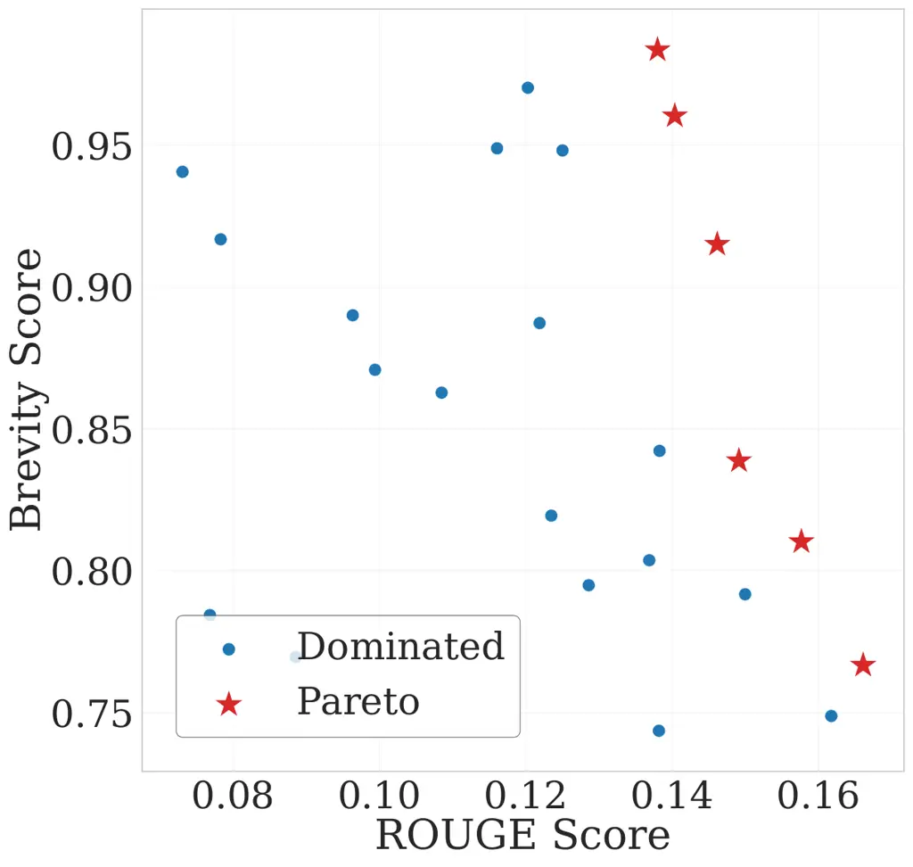
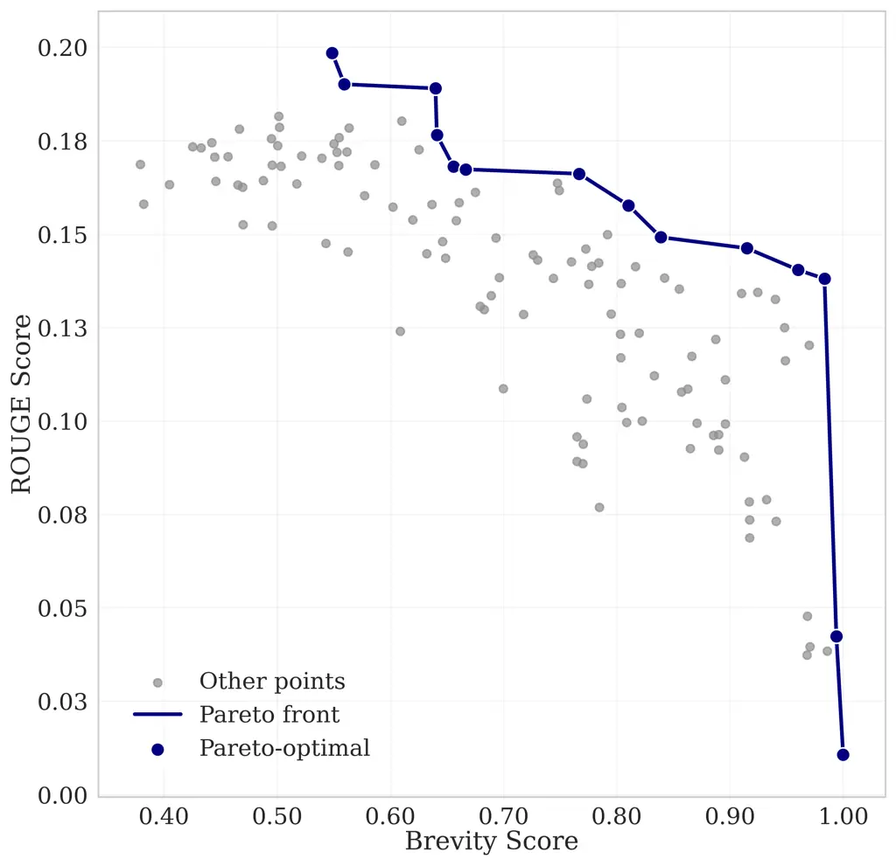
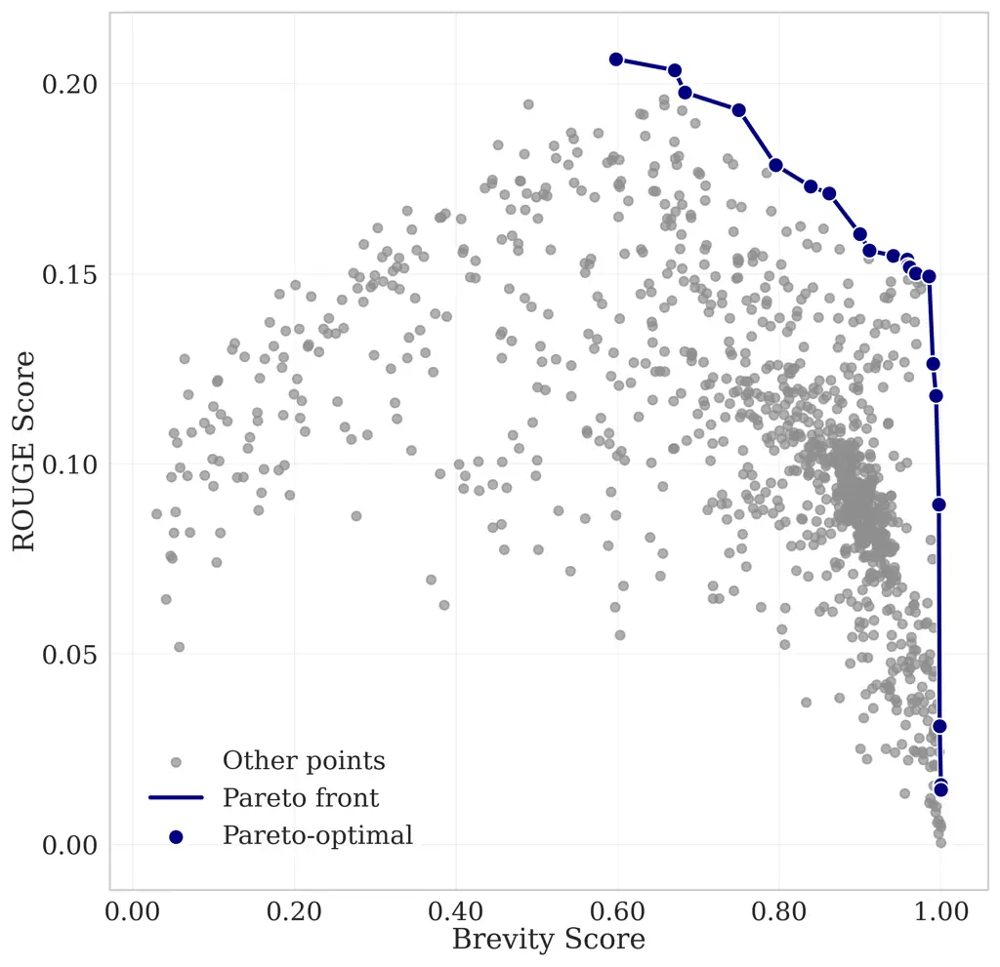
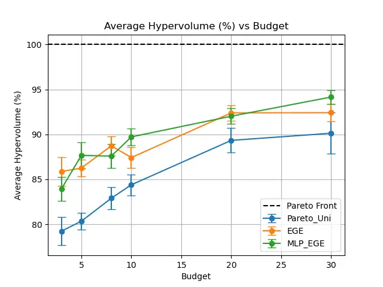
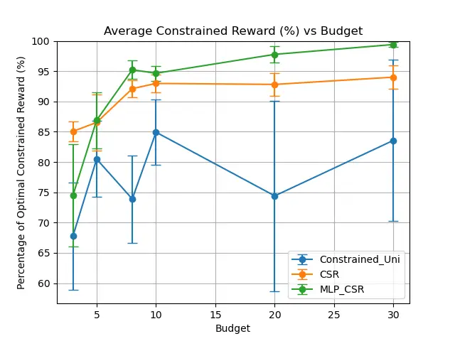
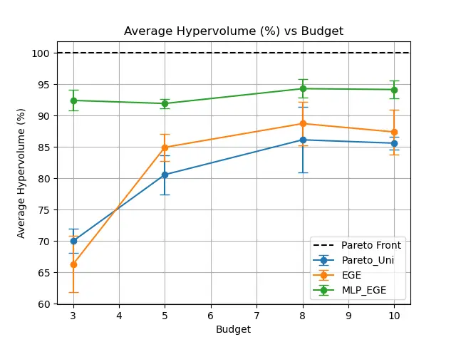
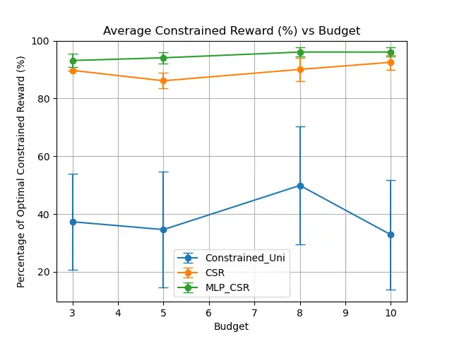
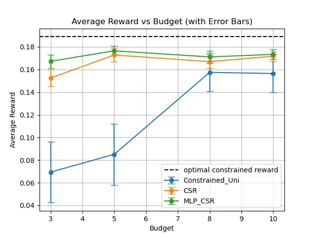
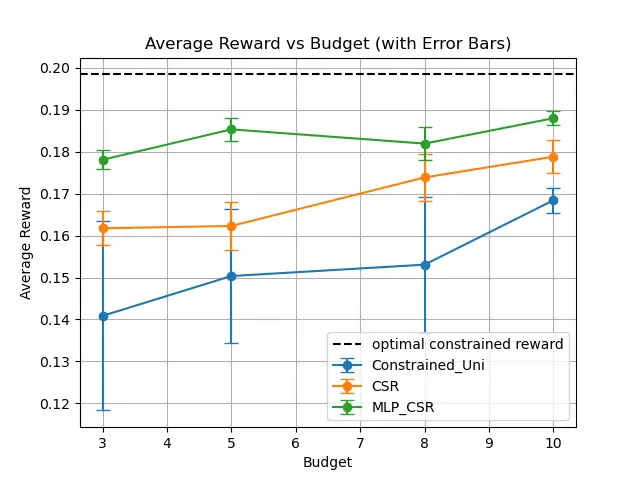
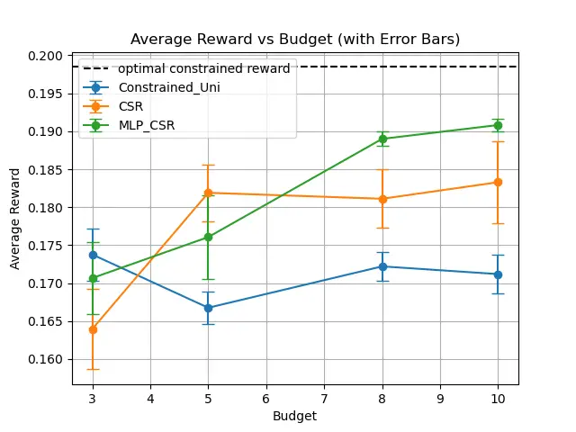

# Efficient Multi-objective Prompt Optimization via Pure-exploration Bandits

Donghao Li^(⋆)    Chengshuai Shi^(†)    Weijuan Ou^(⋄)    Cong Shen^(⋆)
   Jing Yang^(⋆) Affiliation: ^(⋆) University of Virginia,
Charlottesville, VA 22904, USA Affiliation: ^(†) Princeton University,
Princeton, NJ 08544, USA Affiliation: ^(⋄) Southern University of
Science and Technology, Shenzhen, Guangdong 518055, China

###### Abstract

Prompt engineering has become central to eliciting the capabilities of
large language models (LLMs). At its core lies _prompt selection_ –
efficiently identifying the most effective prompts. However, most prior
investigations overlook a key challenge: the inherently multi-faceted
nature of prompt performance, which cannot be captured by a single
metric. To fill this gap, we study the multi-objective prompt selection
problem under two practical settings: Pareto prompt set recovery and
best feasible prompt identification. Casting the problem into the
pure-exploration bandits framework, we adapt provably efficient
algorithms from multi-objective bandits and further introduce a novel
design for best feasible arm identification in structured bandits, with
theoretical guarantees on the identification error in the linear case.
Extensive experiments across multiple LLMs show that the bandit-based
approaches yield significant improvements over baselines, establishing a
principled and efficient framework for multi-objective prompt
optimization.

|     |
| --- |
|     |

## 1 Introduction

Prompt engineering has become a practical way to leverage large language
models (LLMs) without expensive, time-consuming fine-tuning (Sahoo et
al., 2024; Schulhoff et al., 2024). Early results show that
zero-shot (Radford et al., 2019) and few-shot prompting (Brown et al., 2020) with a small number of examples can elicit strong performance from
frozen models. More recently, chain-of-thought (CoT) prompting (Wei et
al., 2022; Kojima et al., 2022; Zhang et al., 2023) has further unlocked
step-by-step reasoning, matching or even surpassing task-specific
fine-tuning on several complex benchmarks. Prompting has also become
foundational across adjacent areas, including retrieval-augmented
generation (RAG) (Kang et al., 2024), text-to-image generation (Brade et
al., 2023; Mo et al., 2024), and jailbreak analysis and defenses (Yan et
al., 2024; Mehrotra et al., 2024; Xu and Parhi, 2025).

Generally speaking, prompt engineering comprises manual prompt design,
in which experts craft prompts through intuition and iteration, and
automatic prompt optimization, in which algorithms search the prompt
space systematically. Examples of the latter include evolutionary search
for high-performing prompts (Guo et al., 2024); gradient-based methods
such as AutoPrompt and APO (Shin et al., 2020; Pryzant et al., 2023);
reinforcement learning approaches that cast prompt construction as
sequential decision making (Deng et al., 2022); and methods that use an
LLM itself as the optimizer (Cheng et al., 2024; Tang et al., 2025).
Despite their algorithmic differences, these methods share a core
challenge: prompt selection, i.e., given a finite candidate prompt set
$`\mathcal{X}`$ and a limited evaluation budget $`B`$, how should one
allocate queries to identify the prompts that maximize task performance?

Prior work on prompt selection spans Bayesian optimization (Chen et al.,
2024; Sabbatella et al., 2024), discrete search (Hu et al., 2024), and
bandit formulations (Shi et al., 2024; Lin et al., 2024b; Lin et al.,
2024a; Kong et al., 2025). Despite these advances, existing methods
predominantly optimize a single objective (e.g., task accuracy), leaving
broader trade-offs among multiple objectives largely addressed. However,
in many real-world applications, prompt performance is inherently
multi-faceted, involving multiple objectives rather than a single
metric. For example, in text summarization tasks, human and benchmark
assessments consider coherence, faithfulness, fluency, and relevance,
and no single metric captures all dimensions (Fabbri et al., 2021). In
text style transfer tasks, outputs must satisfy both content
preservation and style adherence (e.g., modern-to-Shakespearean
translation (Caldas et al., 2018) and politeness transfer (Madaan et
al., 2020)). In these multi-objective settings, a single prompt usually
cannot be universally superior across all metrics. The trade-offs among
these objectives require moving beyond scalarized prompt selection to
procedures that preserve multiple criteria throughout the evaluation.

Meanwhile, research on multi-objective bandits offers principled tools
for trade-off exploration under fixed evaluation budgets, including
algorithms that learn with multiple criteria and handle explicit metric
constraints with instance-dependent guarantees (Auer et al., 2016; Kone
et al., 2024; Kone et al., 2025; Faizal and Nair, 2022). Yet this
toolkit has not been systematically applied to multi-objective prompt
selection.

In this work, we aim to bridge these areas by formulating
multi-objective prompt selection within a bandit framework and
developing a principled, bandit-based approach for efficient prompt
selection under stringent prompt evaluation budget constraint. Our major
contributions are three-fold:

- •
  First, we bridge prompt selection under multiple evaluation criteria
  with the framework of multi-objective bandits. To the best of our
  knowledge, this is the first attempt to formalize multi-criteria
  prompt selection as a multi-objective bandit problem. This connection
  allows us to move beyond ad-hoc or single-metric prompt selection
  strategies and instead leverage the rich toolbox of multi-objective
  bandit algorithms. By doing so, we obtain a principled and efficient
  framework for balancing diverse evaluation criteria, leading to more
  robust and systematic prompt selection.
- •
  Secondly, within this framework, we investigate two fundamental
  problems: best feasible prompt identification and Pareto prompt set
  identification. For the former, we introduce a general algorithm,
  Gensec, and provide a theoretical characterization of its error rate
  under the linear reward setting. For the latter, we propose another
  general algorithm, GenPSI, which unifies and generalizes existing
  bandit algorithms for both the standard and linear settings.
  Importantly, both Gensec and GenPSI are designed to accommodate
  general shared structures among prompts, thereby enhancing learning
  efficiency, particularly when the evaluation budget is limited.
- •
  We evaluate the performance of Gensec and GenPSI on two summarization
  benchmarks: XSum and CNN/DailyMail. For best feasible prompt
  identification, Gensec based algorithms recover over 80% and 90% of
  the utility of the optimal constrained prompt on the two tasks,
  respectively, whereas the baseline methods achieve only 20–50%. For
  Pareto prompt set identification, GenPSI based algorithms recover more
  than 90% of the hypervolume of the ground-truth Pareto set, while the
  baselines remain in the low-to-mid 80% range.

## 2 Related Works

Single-objective prompt selection. InstructZero (Chen et al., 2024)
applies Bayesian optimization in the continuous space of soft prompts,
while Sabbatella et al. (2024) uses Bayesian optimization over hard
prompts by modeling prompts as $`n`$-gram phrases. ZOPO (Hu et al., 2024) specializes in selection from a fixed candidate set and argues
that a locally optimal prompt can outperform generation-based
algorithms. Bandit-based methods improve sample efficiency via adaptive
allocation and elimination (Shi et al., 2024; Lin et al., 2024b; Lin et
al., 2024a; Kong et al., 2025): TRIPLE (Shi et al., 2024) casts
selection as fixed-budget best-arm identification; INSTINCT (Lin et al.,
2024b) leverages NeuralUCB with transformer features to optimize
instructions; APOHF (Lin et al., 2024a) frames human-in-the-loop
selection as a dueling bandit over pairwise preferences; and EXPO (Kong
et al., 2025) addresses non-stationarity in agentic settings with
adversarial bandits.

Multi-objective prompt engineering. Multi-criteria prompt optimization
has been receiving increasing attention due to its practical impact
across various domains. Evolutionary approaches, such as
EMO-Prompts (Baumann and Kramer, 2024), InstOptima (Yang and Li, 2023),
and MOPO (Resendiz and Klinger, 2025) use LLM-driven mutation and
crossover to generate candidate prompts with high-quality trade-offs.
Beyond evolutionary search, MORL-Prompt (Jafari et al., 2024) adapts
multi-objective RL with Pareto-aware policy gradient, and GEPA (Agrawal
et al., 2025) combines natural-language reflection with Pareto-guided
evolution. While those work aim to achieve tradeoffs among different
metrics in prompt optimization, they mostly focus on prompt generation
while adopting uniform sampling as the selection method.

For constrained prompt optimization, CAPO (Zehle et al., 2025) adds cost
awareness by combining evolutionary search with a length penalty,
yielding prompts that balance task accuracy against token usage.
Co-Prompt (Cho et al., 2023) focuses on token-wise prompt generation
optimization, and uses another discriminator model to evaluate the
generated token. To the best of our knowledge, there are currently no
prompt optimization studies that consider hard constraints, which is a
key focus of our work.

Multi-objective bandits. Pareto set identification in multi-armed
bandits was first studied in the fixed-confidence setting (Auer et al.,
2016). In the fixed-budget regime, Kone et al. (2024) introduced
Empirical Gap Elimination (EGE), and showed that the misidentification
probability decays exponentially with the budget, achieving the optimal
rate up to constants. Kone et al. (2025) further investigated the linear
bandits setting, while Zuluaga et al. (2013); Zuluaga et al. (2016)
investigate the problem from a Bayesian perspective. In the constrained
bandits setting, regret minimization was investigated in Kagrecha et al.
(2023); Pacchiano et al. (2021), while pure exploration strategies have
been studied in Faizal and Nair (2022); Bian and Tan (2025) recently. In
summary, there has been active research on multi-objective bandits,
providing a rich set of tools for principled prompt optimization.
However, existing work primarily focuses on bandits with simple
structures, which limits their applicability in practical scenarios. Our
work builds on the bandit framework and extends it with
application-inspired designs to address these gaps.

## 3 Multi-objective Prompt Selection

We first introduce the basic notations used in the prompt-assisted
interactions with LLMs (Zhou et al., 2022; Chen et al., 2024; Shi et
al., 2024). Let $`x`$ be a prompt, $`\mathcal{D}=\{(q,a)\}`$ a task
dataset consisting of inputs $`q`$ and reference answers $`a`$, and
$`\mathcal{M}`$ a black-box LLM that maps the prompt $`x`$ together with
an input $`q`$ to a distribution over the output language space
$`\mathcal{Y}`$. Given $`(x,q)`$, the LLM generates outputs according to
$`y\sim\mathcal{M}(q;x)`$, where $`y\in\mathcal{Y}`$.

Due to the multi-criteria nature of prompt performance (Baumann and
Kramer, 2024; Yang and Li, 2023; Agrawal et al., 2025), we consider
$`m`$ objectives represented by evaluation functions

```math
f_{j}:\mathcal{Y}\times\mathcal{Y}\to\mathbb{R},\quad j=1,\dots,m, \tag{1}
```

where each $`f_{j}`$ assigns a numerical score to an LLM output
$`y\in\mathcal{Y}`$ given a reference answer $`a\in\mathcal{Y}`$. For
each prompt $`x\in\mathcal{X}`$, its expected performance vector is

```math
\mu(x)=\mathbb{E}_{(q,a)\sim\mathcal{D}}\;\mathbb{E}_{y\sim\mathcal{M}(q;x)}\big(f_{1}(y,a),\dots,f_{m}(y,a)\big)\in\mathbb{R}^{m}. \tag{2}
```

Here, the inner expectation averages over the stochasticity of the LLM
given a fixed input, while the outer expectation averages over the
dataset. Thus $`\mu(x)`$ summarizes how prompt $`x`$ performs across all
objectives on average. In addition, we assume that all metrics are
defined such that larger values indicate better performance.



Figure 1: Trade-offs between ROUGE and Brevity.

Motivating example. Figure 1 illustrates the evaluation of prompts on
the XSum dataset using the Llama3 model, where each point corresponds to
a prompt’s ROUGE score (x-axis) and brevity score (y-axis). These two
metrics exhibit inherent trade-offs, motivating joint consideration for
prompt optimization.

In this work, we focus on the problem of multi-criteria prompt
selection: given a set of candidate prompts $`\mathcal{X}`$ and
evaluation metrics $`{f_{j}}`$, the objective is to identify a subset of
prompts from $`\mathcal{X}`$ that achieves the desired trade-offs. We
consider this problem under the following two settings: (i) best
feasible prompt identification , and (ii) Pareto prompt set
identification.

##### Best feasible prompt identification.

The first target arises when one objective is designated as the
_primary_ performance metric (e.g., task accuracy), while the remaining
objectives act as constraints (e.g., safety above a threshold).
Formally, let objective $`j=1`$ be the primary objective to maximize,
and denote the constraints on the other objectives as
$`\{\tau_{j}\}_{j\neq 1}`$. A prompt $`x`$ is _feasible_ if

```math
\mu_{j}(x)\geq\tau_{j},\quad\forall j\neq 1. \tag{3}
```

The best feasible prompt is then defined as

```math
x^{\star}=\arg\max_{x\in\mathcal{X}}\;\mu_{1}(x)\quad\text{s.t.}\quad\mu_{j}(x)\geq\tau_{j},\forall j\neq 1. \tag{4}
```

This formulation is especially relevant for safe or regulated domains
where utility must be achieved under explicit constraints. In the
following designs, we assume that there must exist at least one prompt
that is feasible for the considered $`\{\tau_{j}\}_{j\neq 1}`$.

##### Pareto prompt set identification.

The second target is to recover the Pareto prompt set, which is the set
of prompts that is not strictly dominated by any other prompt, as
defined in the following.

###### Definition 1 (Pareto Optimality).

A prompt $`x\in\mathcal{X}`$ is _Pareto optimal_ if there does not exist
another prompt $`x^{\prime}\in\mathcal{X}`$ such that
$`\mu_{j}(x^{\prime})\geq\mu_{j}(x)`$ for all $`j\in\{1,\dots,m\}`$ and
$`\mu_{j}(x^{\prime})>\mu_{j}(x)`$ for at least one $`j`$.

The set of Pareto-optimal prompts is denoted $`\mathcal{X}^{\star}`$,
and $`\{\mu(x):x\in\mathcal{X}^{\star}\}`$ is the _Pareto front_. In the
absence of explicit constraints, Pareto set identification is the most
general target for multi-objective optimization, which captures the best
achievable trade-offs among objectives.

##### Fixed budget constraint.

In practice, prompt evaluations are costly because each trial requires
querying an LLM on multiple data examples and metrics. Therefore, in
this work, we consider a fixed budget setting, where the total number of
evaluations in the optimization procedure is upper bounded by $`B`$.
Then, given a fixed budget constraint $`B`$, the learner’s goal is to
identify (i) the optimal feasible prompt $`x^{*}`$, or (ii) the Pareto
set of prompts $`\mathcal{X}^{*}`$, as accurate as possible.

## 4 Prompt Optimization via Pure-exploration Bandits

Recent work (Shi et al., 2024) shows that prompt optimization can be
formulated as a best arm identification (BAI) problem and solved
efficiently by leveraging the rich toolbox from BAI in multi-armed
bandits. While extensive experiments demonstrate the remarkable
performance improvement of such an approach over baselines for a single
performance metric, to the best of our knowledge, leveraging bandits
algorithms to solve the more general multi-objective prompt optimization
has not been studied previously. To fill this gap, in the following, we
formulate the multi-objective prompt optimization problem under a fixed
budget constraint as a pure-exploration multi-objective bandits.

Specifically, we model the prompt set $`\mathcal{X}`$ as the set of arms
in a multi-armed bandits, and pulling an arm corresponds to evaluating a
prompt $`x\in\mathcal{X}`$ on a randomly sampled input
$`(q,a)\in\mathcal{D}`$, which produces an output
$`y\sim\mathcal{M}(q;x)`$. The evaluation metrics
$`(f_{1}(y,a),f_{2}(y,a),\dots,f_{m}(y,a))`$ then serve as the
stochastic _reward vector_ observed for that pull. Thus, the expected
reward of each arm is denoted as $`\mu(x)`$, which captures the mean
performance of prompt $`x`$ across all objectives.

Under the given budget constraint $`B`$, our objective is to leverage
the algorithms from pure-exploration bandits to efficiently identify the
optimal feasible prompt and the Pareto set of prompts (arms),
respectively.

In practice, the candidate prompt set could be very large. Treating each
prompt independently may not be very cost efficient, especially when the
total budget is limited. On the hand other, the candidate prompts may
inherently have certain correlations, and exploiting such correlation
can potentially speed up the learning process and improve the learning
accuracy. Motivated by those observations, we introduce a general
bandits model to capture such inherent dependency among prompts.

Specifically, we let $`\phi:\mathcal{X}\to\mathbb{R}^{d}`$ be a known
feature map that embeds a given prompt $`x`$ to a $`d`$-dimensional
feature vector $`\phi(x)`$. The expected reward of $`x`$, denoted as
$`\mu(x)`$, is then equal to $`g_{\theta}(\phi(x))`$, where
$`g_{\theta}:\mathbb{R}^{d}\to\mathbb{R}^{m}`$ is a function
parameterized by an unknown parameter $`\theta`$. Since $`g_{\theta}`$
is shared across all prompts, the observations obtained by evaluating
any of the prompts will contribute to the estimation of $`\theta`$,
potentially speeding up the learning process.

For ease of exposition, in the following, we assume $`m=2`$, i.e., there
are two metrics for the prompt performance, denoted as $`\mu_{1}`$ and
$`\mu_{2}`$, respectively. The algorithm design and analysis can be
extended for a general $`m`$.

## 5 Best Feasible Prompt Identification

For best feasible prompt identification, the learner seeks a prompt that
maximizes a primary objective while satisfying feasibility conditions on
a secondary criteria, under a fixed budget constraint. Under the
corresponding bandits formulation, bandits algorithm Constrained
Successive Rejects (CSR) (Faizal and Nair, 2022) is shown to be able to
obtain the optimal feasible arm with an exponentially decaying error
probability for stochastic bandits.

### 5.1 General Framework

Under the general bandits formulation, we propose a round based arm
elimination framework. The process consists of $`R`$ rounds, each having
$`n_{r}`$ pulls. In total, it has $`\sum_{r=1}^{R}n_{r}=B`$. Each round
begins with an active arm set $`A_{r-1}`$, and at the end of each round,
only $`l_{r}`$ arms will be kept.
$`(R,\{n_{r}\}_{r=1}^{R},\{l_{r}\}_{r=1}^{R})`$ are determined
beforehand through a scheduler, such as Successive Rejection (Audibert
and Bubeck, 2010) or Sequential Halving (Karnin et al., 2013). We set
$`l_{R}=1`$, which corresponds to the estimated best feasible prompt. As
the process proceeds, the major tasks in each round $`r`$ are as
follows.

(i) Budget allocation. each round $`r`$ starts from the active set
$`A_{r-1}`$ and a planned budget $`n_{r}`$. The step determines which
arms to be pulled for the given budget $`n_{t}`$. Denote
$`(x^{(1)},\ldots,x^{(n_{r})})`$ as the list of arms to pull. The budget
allocation for the active arms can be flexible as long as a sufficient
exploration on the active arms is performed (e.g., uniformly sampling
each arm, or adopting G-optimal design to cover the feature space).

(ii) Arm pulling and evaluation. For each $`t\in[n_{r}]`$, sample
$`(q_{t},a_{t})\sim\mathcal{D}`$, query the LLM to generate
$`y_{t}\sim\mathcal{M}(q_{t};x^{(t)})`$, evaluate $`y_{t}`$ and obtain
$`f^{(t)}=(f_{1}(y_{t},a_{t}),f_{2}(y_{t},a_{t}))`$. The new
observations $`\phi(x^{(t)},f^{(t)})`$ will be included in the collected
datasets $`X_{r}`$ and $`Y_{r}`$.

(iii) Reward estimation. An estimator will then utilize
$`(X_{r},Y_{r})`$ to estimate the unknown parameter $`\theta`$, based on
which the estimated performance $`\widehat{\mu}(x)`$ can be obtained for
each $`x\in A_{r-1}`$. The estimation can also be performed in flexible
ways. In the simplest approach, sample means can be used without
accounting for prompt features. More efficient alternatives can be
developed based on the considered parameterization function
$`g_{\theta}`$, e.g., (regularized) least squares.

(iv) Arm elimination. Due to the multi-objective setting, the arm
elimination step should jointly consider the optimality and feasibility
of the active arms. For that purpose, it first forms the empirical
feasible arm set $`\widehat{\mathcal{F}}_{r}`$ by checking whether
$`\widehat{\mu}_{2,r}(x)>\tau`$. A key component is the elimination
step. At the end of round $`r`$, we first rank the arms by placing the
empirical feasible arms before the empirical infeasible arms. Within the
empirical feasible set, arms are ordered by decreasing primary reward
estimate $`\widehat{\mu}_{1,r}(x)`$; within the empirical infeasible
set, arms are ordered by decreasing constraint estimate
$`\widehat{\mu}_{2,r}(x)`$. We then keep the top $`l_{r}`$ arms in this
ranking and eliminate the rest, forming the active set $`A_{r}`$ for the
next round.

Based on the ordering elimination, the learner then eliminates the arms
that are determined to be infeasible or suboptimal, and keeps the
$`l_{r}`$ arms that is more likely to be optimal feasible to form
$`A_{r}`$. It then proceeds to the next round. The algorithm is
presented in Algorithm 1.

1: Input: budget $`B`$, constraint threshold $`\tau`$, prompt set
$`\mathcal{X}`$, feature map $`\phi(\cdot)`$, dataset $`\mathcal{D}`$

2: Initialization: $`A_{0}\leftarrow\mathcal{X}`$;
$`(R,\{n_{r}\}_{r=1}^{R},\{l_{r}\}_{r=1}^{R})\leftarrow\textsc{Scheduler}(K,B)`$;
$`X_{0}\leftarrow\emptyset,Y_{0}\leftarrow\emptyset`$

3: for $`r=1:R`$ do

4:
  $`(x^{(1)},\ldots,x^{(n_{r})})\leftarrow\textsc{Allocator}(n_{r},A_{r-1})`$

5:   At each step $`t\in\{1,\ldots,n_{r}\}`$, pull arm $`x^{(t)}`$ with
feature $`\phi(x^{(t)})`$, collect evaluation $`f^{(t)}`$, and update
observations as
$`X_{r}\leftarrow X_{r-1}\cup\{\phi(x^{(t)})\},Y_{r}\leftarrow Y_{r-1}\cup\{f^{(t)}\}`$

6:   Obtain estimator
$`\widehat{\mu}_{r}(x)\leftarrow\textsc{Estimator}(x;X_{r},Y_{r})`$,
$`\forall x\in A_{r-1}`$

7:   Construct the empirically feasible set and the empirically
infeasible set:

```math
\displaystyle\widehat{\mathcal{F}}_{r}\leftarrow\{x\in A_{r-1}:\widehat{\mu}_{2,r}(x)>\tau\},
```

```math
\displaystyle\widehat{\mathcal{F}}_{r}^{c}\leftarrow\{x\in A_{r-1}:\widehat{\mu}_{2,r}(x)\leq\tau\}
```

8:   Sort the arms in $`\widehat{\mathcal{F}}_{r}`$ in decreasing order
of $`\widehat{\mu}_{1,r}(x)`$, followed by the arms in
$`\widehat{\mathcal{F}}_{r}^{c}`$, ordered in decreasing
$`\widehat{\mu}_{2,r}(x)`$

9:   Let $`A_{r}`$ consist the first $`l_{r}`$ arms in this ordering

10: end for

11: Output: $`A_{R}`$

Algorithm 1 GENeralized Successive Elimination under Constraints
(Gensec)

### 5.2 Theoretical Analysis with Linear Reward Functions

We instantiate the general framework to a special case where the reward
function $`g_{\theta}(\phi(x))`$ is linear in both $`\phi(x)`$ and
$`\theta`$, i.e., $`\mu(x)=\phi(x)^{\top}\theta`$, where
$`\phi(x)\in\mathbb{R}^{d}`$ and $`\theta\in\mathbb{R}^{d\times m}`$.
This recovers the classical linear bandits setting. The following
theoretical guarantee can be obtained.

###### Theorem 1 (Informal version of Theorem 2).

Assume total budget $`B\geq 45d\left\lceil\log_{2}K\right\rceil`$. With
Scheduler being Sequential Halving, Allocator using the G-optimal
design (Section A.3.1), and Estimator based on least squares, the
probability that Algorithm 1 fails to return $`x^{\star}`$ satisfies
$`\Pr\big[x^{\star}\notin A_{R}\big]\leq 48\left\lceil\log_{2}K\right\rceil\cdot\exp\left\{-\frac{c_{1}}{dH}\cdot\left\lfloor\frac{B}{\lceil\log_{2}K\rceil}\right\rfloor\right\},`$
where $`c_{1}`$ is a positive constant,
$`H=\max_{x\in\mathcal{X}\setminus\{x^{*}\}}\frac{1}{\Delta(x)^{2}}`$,
and $`\Delta(x)`$ is the constrained gap defined as
$`\Delta(x)=\min\left\{\max\left(\tau-\mu_{2}(x),\mu_{1}(x^{*})-\mu_{1}(x)\right),\mu_{2}(x^{*})-\tau\right\}.`$

Compared to the existing upper bounds in the stochastic bandit problem
(Faizal and Nair, 2022), our result makes a significant improvement in
the dependency on $`K`$. Specifically, while the existing results
exhibit a dependence of $`K^{3}`$ in the leading coefficient, our upper
bound only depends on $`\log_{2}K`$, greatly reducing the impact of
$`K`$ on the error probability. Furthermore, although we adopt a
different definition for $`H`$, both results show similar influence of
the budget $`B`$ and the constrained gap on the error upper bound.

##### Proof sketch of Theorem 1.

At a high level, the proof shows that the algorithm rarely eliminates
the optimal feasible arm $`x^{\star}`$. It consists of the following
major steps. Step 1: establish uniform concentration bounds for the
empirical estimates, which is derived from a self-normalized
concentration inequality for linear models as shown in Lemma 1. Step 2:
use the uniform concentration bounds to show that any suboptimal or
infeasible arm appears better than $`x^{\star}`$ only with exponentially
small probability (see Lemma 2). During this process, three types of
arms are carefully considered: feasible but suboptimal arms, deceiver
arms (infeasible but better than the optimal feasible arm on the primary
objective), and infeasible sub-optimal arms, which brings more
complicated failure modes compared with previous single-objective
analyses. Step 3: Lemma 3 argues that $`x^{\star}`$ can only be
eliminated if many such arms are simultaneously misleading, which is
very unlikely. Finally, Step 4 combines the error probabilities across
all rounds via a union bound. This yields an error bound that decays
exponentially in the budget $`B`$, up to logarithmic factors.

## 6 Pareto Prompt Set Identification

In this section, we investigate the Pareto set identification problem
and propose an algorithm named Generalized Pareto Set Identification
(GenPSI), which can be found in Appendix B. Compared with Algorithm 1,
GenPSI shares the same components such as budget allocation, arm pulling
and evaluation, and reward estimation. The major difference lies in the
last component, i.e., arm elimination. Due to the different objectives
between best feasible arm identification and Pareto set identification,
we use the empirical Pareto gap (Kone et al., 2024) as the metric for
arm elimination.

We denote the empirical Pareto set as $`\widehat{\mathcal{X}}^{\star}`$,
and employ the following notations

```math
\displaystyle\widehat{m}(x,y)=\min_{i\in[m]}\widehat{\mu}_{i}(y)-\widehat{\mu}_{i}(x),\qquad\widehat{M}(x,y)=\max_{i\in[m]}\widehat{\mu}_{i}(x)-\widehat{\mu}_{i}(y),
```

```math
\displaystyle\widehat{\delta}^{+}(x)=\min_{\,y\in\widehat{\mathcal{X}}^{\star}\setminus\{x\}}\min\left(M(x,y),\,M(y,x)\right),
```

```math
\displaystyle\widehat{\delta}^{-}(x)=\min_{y\notin\widehat{\mathcal{X}}^{\star}}\left(\max(\widehat{M}(y,x),0)+\max_{y^{\prime}\in\widehat{\mathcal{X}}^{\star}}\widehat{m}(y,y^{\prime})\right).
```

Then, the empirical Pareto gap is defined as

```math
\widehat{\Delta}(x)=\begin{cases}\max_{y\in\widehat{\mathcal{X}}^{\star}}\widehat{m}(x,y),&x\notin\widehat{\mathcal{X}}^{\star},\\
\min\bigl\{\widehat{\delta}^{+}(x),\widehat{\delta}^{-}(x)\bigr\},&x\in\widehat{\mathcal{X}}^{\star}.\end{cases}
```

The Pareto gap measures the difficulty of classifying an arm to be
Pareto or sub-optimal.

We note that GenPSI recovers the Empirical Gap Elimination (EGE) (Kone
et al., 2024) for stochastic bandits and G-optimal Empirical Gap
Elimination (GEGE) (Kone et al., 2025) for linear bandits when the
corresponding Allocator and Estimator are set in the same form.

## 7 Experiments

##### Datasets.

We evaluate the prompt selection algorithms on two standard
summarization benchmarks: XSum (Narayan et al., 2018) and CNN/DailyMail
(Hermann et al., 2015). The XSum dataset contains approximately 227,000
documents paired with concise one-sentence summaries, whereas the
CNN/DailyMail dataset comprises roughly 311,000 article-summary pairs
with multi-sentence outputs.

##### Candidate prompt generation.

We generate candidate prompts $`\mathcal{X}`$ using LLaMA-3. For each
dataset, $`200`$ prompts are generated based on randomly sampled
examples from the dataset (Zhou et al., 2022). The generated prompts are
then manually filtered to remove some completely irrelevant prompts and
down-sampled to form the final prompt pool of size $`100`$. Within the
prompt pool, we further sample 50 and 30 prompts to form smaller
candidate prompt sets.

##### Models.

We evaluate the performance of candidate prompts on two LLMs:
instruction-tuned LLaMA-3-8B-instruct and Gemma-7B-it. Given a prompt
$`x`$ and a query $`q`$, the LLM generates an output using greedy
decoding with a maximum of 512 new tokens, which will then be evaluated
according the metrics below.

##### Metrics.

We evaluate LLM generated responses on two metrics: ROUGE-L F1 (Lin,
2004), measuring the overlap with the reference summary, and Brevity
score, measuring the token lengths. The details of the reward definition
can be found in Section C.2.

##### Feature extraction.

To facilitate the general bandits formulation, we use GPT-3.5-turbo to
extract the embeddings of the prompts. Let $`e(x)\in\mathbb{R}^{p}`$ be
the extracted embedding for prompt $`x\in\mathcal{X}`$. We then perform
principle component analysis (PCA) to obtain a reduced feature
representation. Let $`U_{d}\in\mathbb{R}^{p\times d}`$ denote the matrix
of the top-$`d`$ eigenvectors of the sample covariance of
$`\{e(x)\}_{x\in\mathcal{X}}`$. The reduced feature of $`x`$ is then
$`\phi(x)\;=\;U_{d}^{\top}\bigl(e(x)-\bar{e}\bigr)\in\mathbb{R}^{d},`$
where $`\bar{e}=\tfrac{1}{K}\sum_{x\in\mathcal{X}}e(x)`$.

### 7.1 Best Feasible Prompt Identification

In this subsection, we evaluate our constrained prompt selection
algorithm, Gensec, where the objective is to maximize task utility under
a prescribed brevity constraint. We instantiate Gensec into two
variants, namely, CSR and MLP-CSR.

CSR. We first treat prompts independently, and adopt Successive
Rejection, uniform pulling and sample averaging as the Scheduler,
Allocator and Estimator, respectively, under which Gensec reduces to
CSR.

MLP-CSR. For the general bandits setting, we use an MLP consisting of a
ReLU neural network with one hidden layer of 30 hidden states to model
the reward function $`g_{\theta}(\cdot)`$. We set the Scheduler to be
Sequential Halving to reduce the training rounds.

Figure 2: Average soft constrained reward vs. per-arm budget. Error bars
denote 95% confidence intervals over 20 random seeds.

| $`\mathbf{K}`$ | Method  | $`\mathbf{b=3}`$            | $`\mathbf{b=5}`$            | $`\mathbf{b=8}`$            | $`\mathbf{b=10}`$           |
| -------------- | ------- | --------------------------- | --------------------------- | --------------------------- | --------------------------- |
|                | Uniform | $`0.015\pm 0.010`$          | $`0.000\pm 0.000`$          | $`0.030\pm 0.013`$          | $`0.037\pm 0.014`$          |
| 30             | CSR     | $`0.117\pm 0.013`$          | $`0.137\pm 0.007`$          | $`\mathbf{0.144\pm 0.000}`$ | $`\mathbf{0.143\pm 0.000}`$ |
|                | MLP-CSR | $`\mathbf{0.123\pm 0.010}`$ | $`\mathbf{0.139\pm 0.002}`$ | $`0.140\pm 0.002`$          | $`0.142\pm 0.001`$          |
|                | Uniform | $`0.021\pm 0.011`$          | $`0.021\pm 0.011`$          | $`0.037\pm 0.014`$          | $`0.036\pm 0.014`$          |
| 50             | CSR     | $`0.122\pm 0.012`$          | $`\mathbf{0.143\pm 0.001}`$ | $`0.141\pm 0.002`$          | $`0.140\pm 0.002`$          |
|                | MLP-CSR | $`\mathbf{0.143\pm 0.002}`$ | $`0.142\pm 0.002`$          | $`\mathbf{0.147\pm 0.001}`$ | $`\mathbf{0.142\pm 0.002}`$ |
|                | Uniform | $`0.021\pm 0.011`$          | $`0.066\pm 0.016`$          | $`0.037\pm 0.014`$          | $`0.044\pm 0.015`$          |
| 100            | CSR     | $`0.134\pm 0.007`$          | $`0.141\pm 0.002`$          | $`0.142\pm 0.001`$          | $`0.143\pm 0.002`$          |
|                | MLP-CSR | $`\mathbf{0.139\pm 0.002}`$ | $`\mathbf{0.142\pm 0.002}`$ | $`\mathbf{0.145\pm 0.001}`$ | $`\mathbf{0.147\pm 0.001}`$ |

Table 1: Average soft constrained reward on XSum - Gemma.

Denote the final output of the algorithms as $`\hat{x}`$. Then, we
define soft constrained reward of the $`\hat{x}`$ as
$`\mu_{1}(\hat{x})`$ if $`\mu_{2}(\hat{x})\geq 0.9\tau`$; otherwise, it
equals zero. We use this definition to tolerate slight violation of the
constraint. In Figure 2, we report the average soft constrained reward
as a function of the average budget per arm with $`K=100`$ prompts. We
normalize the value by $`\mu_{1}({x}^{*})`$, where $`x^{*}`$ is the best
feasible arm. We note that the proposed bandits based algorithms
outperform the uniform baseline in almost all settings. The advantage is
more significant when performing task CNN_Dailymail on Llama3 (denoted
as ‘CNN_Dailymail - Llama3’) and performing task XSUM on Gemma (denoted
as ‘XSum - Gemma’). For both cases, when the average budget on each arm
$`b`$ is sufficiently large, the proposed bandits based algorithms
recover more than 80% and 90% of the utility of $`x^{*}`$ subject to the
relaxed constraint, while the baseline only reaches 20% to 50% of that,
respectively.

In Table 1, we present the soft constrained reward results by performing
task XSum on Gemma. Across different prompt set sizes $`K`$, and per-arm
budget $`b`$, both CSR and MLP-CSR consistently outperform the uniform
pulling baseline. The uniform pulling baseline rarely finds a feasible
near-optimal prompt, while our algorithms can reliably find a
close-optimal prompt. Notably, MLP-CSR yields slightly higher average
soft rewards than CSR, demonstrating the advantage of shared structure
in reward functions.

### 7.2 Pareto Prompt Set Identification

The proposed GenPSI framework for Pareto prompt set identification is
also instantiated into two variants.

EGE. We first treat prompts independently, and adopt Successive
Rejection, uniform pulling and sample averaging as the Scheduler,
Allocator and Estimator, respectively, under which GenPSI reduces to
EGE.

MLP-EGE. Following the same configuration of Scheduler and reward
function as in MLP-CSR, we instantiate GenPSI to MLP-EGE.

To evaluate the performance of the algorithms on Pareto prompt set
identification, we introduce a metric called hypervolume (HV) (Knowles
et al., 2003). HV measures the Lebesgue volume of objective space
dominated by the obtained Pareto set, which is a scaler indicator of the
quality and diversity of trade-offs of the estimated Pareto set. HV is
computed with respect to a reference point, which we set to the origin
for both metrics. We also present the recovered HV as a percentage of
the ground-truth Pareto-set HV, which is obtained by exhaustively
evaluating all prompts in the candidate pool.

Figure 3: Hypervolume recovery vs. per-arm budget. Error bars denote 95%
confidence intervals over 20 random seeds.

| $`\mathbf{K}`$ | Method  | $`\mathbf{b=3}`$              | $`\mathbf{b=5}`$              | $`\mathbf{b=8}`$              | $`\mathbf{b=10}`$             |
| -------------- | ------- | ----------------------------- | ----------------------------- | ----------------------------- | ----------------------------- |
|                | Uniform | $`0.1577\pm 0.0039`$          | $`0.1534\pm 0.0051`$          | $`0.1685\pm 0.0028`$          | $`0.1661\pm 0.0037`$          |
| 30             | EGE     | $`0.1603\pm 0.0049`$          | $`0.1680\pm 0.0028`$          | $`0.1753\pm 0.0033`$          | $`\mathbf{0.1744\pm 0.0043}`$ |
|                | MLP-EGE | $`\mathbf{0.1632\pm 0.0034}`$ | $`\mathbf{0.1688\pm 0.0039}`$ | $`\mathbf{0.1803\pm 0.0022}`$ | $`0.1727\pm 0.0030`$          |
|                | Uniform | $`0.1559\pm 0.0029`$          | $`0.1543\pm 0.0031`$          | $`0.1618\pm 0.0023`$          | $`0.1646\pm 0.0031`$          |
| 50             | EGE     | $`\mathbf{0.1651\pm 0.0023}`$ | $`0.1647\pm 0.0022`$          | $`\mathbf{0.1706\pm 0.0032}`$ | $`\mathbf{0.1720\pm 0.0023}`$ |
|                | MLP-EGE | $`0.1618\pm 0.0033`$          | $`\mathbf{0.1628\pm 0.0027}`$ | $`0.1671\pm 0.0028`$          | $`0.1673\pm 0.0026`$          |
|                | Uniform | $`0.1519\pm 0.0024`$          | $`0.1579\pm 0.0022`$          | $`0.1624\pm 0.0019`$          | $`0.1631\pm 0.0023`$          |
| 100            | EGE     | $`0.1503\pm 0.0028`$          | $`0.1639\pm 0.0024`$          | $`0.1690\pm 0.0020`$          | $`\mathbf{0.1754\pm 0.0022}`$ |
|                | MLP-EGE | $`\mathbf{0.1628\pm 0.0024}`$ | $`\mathbf{0.1684\pm 0.0020}`$ | $`\mathbf{0.1699\pm 0.0023}`$ | $`0.1716\pm 0.0023`$          |

Table 2: Hypervolume (HV) on CNN/DailyMail - Llamma 3.

In Figure 3, we report the results when prompt set size $`K=100`$. We
note that both bandits based algorithms consistently outperform the
baseline. When per-arm budget $`b`$ is low, MLP-EGE achieves the highest
performance on average, indicating the advantage of exploiting shared
parameters under GenPSI. When per-arm budget $`b=8,10`$, both
elimination approaches recover about $`90\%`$ HV of the ground-truth
Pareto set, whereas the baseline recovers around the low-to-mid $`80\%`$
range.

Table 2 presents the average hypervolume on XSum dataset with Gemma for
varying $`K`$ and $`b`$. Bandits based algorithms consistently
outperform the baseline, indicating robustness of the proposed GenPSI
framework. More comprehensive evaluation results can be found in
Section C.4.

## 8 Conclusion

In this work, we established a principled connection between
multi-objective prompt selection and the framework of multi-objective
pure-exploration bandits, representing (to the best of our knowledge)
the first formalization of this problem in such a setting. Within this
framework, we addressed two fundamental problems: best feasible prompt
identification and Pareto prompt set identification. To this end, we
proposed two general algorithms, Gensec and GenPSI, which were
theoretically grounded and designed to exploit shared structures among
prompts to improve sample efficiency under limited evaluation budgets.
Extensive experiments on XSum and CNN/DailyMail demonstrated the
effectiveness of our approach. Our framework opened new opportunities
for principled and scalable prompt optimization under complex evaluation
criteria. Future directions include extending our methods to more
diverse tasks and models, incorporating richer evaluation metrics such
as fairness and efficiency, and exploring strategies for real-world,
large-scale deployment.

## References

- Agrawal et al. (2025) L. A. Agrawal, S. Tan, D. Soylu, N. Ziems, R.
  Khare, K. Opsahl-Ong, A. Singhvi, H. Shandilya, M. J. Ryan, M. Jiang,
  et al. GEPA: reflective prompt evolution can outperform reinforcement
  learning. In NeurIPS 2025 Workshop on Foundations of Reasoning in
  Language Models, Cited by: §2, §3.
- Allen-Zhu et al. (2017) Z. Allen-Zhu, Y. Li, A. Singh, and Y. Wang
  Near-optimal design of experiments via regret minimization. In
  International Conference on Machine Learning, pp. 126–135. Cited by:
  §A.3.1.
- Audibert and Bubeck (2010) J. Audibert and S. Bubeck Best arm
  identification in multi-armed bandits. In COLT-23th Conference on
  learning theory-2010, pp. 13–p. Cited by: §5.1.
- Auer et al. (2016) P. Auer, C. Chiang, R. Ortner, and M. Drugan Pareto
  front identification from stochastic bandit feedback. In Artificial
  intelligence and statistics, pp. 939–947. Cited by: §B.1, §1, §2.
- Baumann and Kramer (2024) J. Baumann and O. Kramer Evolutionary
  multi-objective optimization of large language model prompts for
  balancing sentiments. In International conference on the applications
  of evolutionary computation (part of evoStar), pp. 212–224. Cited by:
  §2, §3.
- Bian and Tan (2025) J. Bian and V. Y. Tan Asymptotically optimal
  linear best feasible arm identification with fixed budget. In
  Conference on Uncertainty in Artificial Intelligence, pp. 296–331.
  Cited by: §2.
- Brade et al. (2023) S. Brade, B. Wang, M. Sousa, S. Oore, and T.
  Grossman Promptify: text-to-image generation through interactive
  prompt exploration with large language models. In Proceedings of the
  36th Annual ACM Symposium on User Interface Software and Technology,
  pp. 1–14. Cited by: §1.
- Brown et al. (2020) T. Brown, B. Mann, N. Ryder, M. Subbiah, J. D.
  Kaplan, P. Dhariwal, A. Neelakantan, P. Shyam, G. Sastry, A. Askell,
  et al. Language models are few-shot learners. Advances in neural
  information processing systems 33, pp. 1877–1901. Cited by: §1.
- Caldas et al. (2018) S. Caldas, P. Wu, T. Li, J. Konečný, H. B.
  McMahan, V. Smith, and A. Talwalkar LEAF: A benchmark for federated
  settings. CoRR abs/1812.01097. External Links:
  [Link](http://arxiv.org/abs/1812.01097), 1812.01097 Cited by: §1.
- Chen et al. (2024) L. Chen, J. Chen, T. Goldstein, H. Huang, and T.
  Zhou INSTRUCTZERO: efficient instruction optimization for black-box
  large language models6518. In Proceedings of the 41st International
  Conference on Machine Learning, pp. 6503–6518. Cited by: §1, §2, §3.
- Cheng et al. (2024) J. Cheng, X. Liu, K. Zheng, P. Ke, H. Wang, Y.
  Dong, J. Tang, and M. Huang Black-box prompt optimization: aligning
  large language models without model training. In Proceedings of the
  62nd Annual Meeting of the Association for Computational Linguistics
  (Volume 1: Long Papers), pp. 3201–3219. Cited by: §1.
- Cho et al. (2023) S. Cho, S. Jeong, J. yeon Seo, and J. C. Park
  Discrete prompt optimization via constrained generation for zero-shot
  re-ranker. In Findings of the Association for Computational
  Linguistics: ACL 2023, pp. 960–971. Cited by: §2.
- Deng et al. (2022) M. Deng, J. Wang, C. Hsieh, Y. Wang, H. Guo, T.
  Shu, M. Song, E. Xing, and Z. Hu Rlprompt: optimizing discrete text
  prompts with reinforcement learning. In Proceedings of the 2022
  Conference on Empirical Methods in Natural Language Processing,
  pp. 3369–3391. Cited by: §1.
- Fabbri et al. (2021) A. R. Fabbri, W. Kryściński, B. McCann, C.
  Xiong, R. Socher, and D. Radev Summeval: re-evaluating summarization
  evaluation. Transactions of the Association for Computational
  Linguistics 9, pp. 391–409. Cited by: §1.
- Faizal and Nair (2022) F. Z. Faizal and J. Nair Constrained pure
  exploration multi-armed bandits with a fixed budget. arXiv preprint
  arXiv:2211.14768. Cited by: §A.2, §1, §2, §5.2, §5.
- Grattafiori et al. (2024) A. Grattafiori, A. Dubey, A. Jauhri, A.
  Pandey, A. Kadian, A. Al-Dahle, A. Letman, A. Mathur, A. Schelten, A.
  Vaughan, et al. The llama 3 herd of models. In Neural Information
  Processing Systems, Cited by: §C.1.
- Guo et al. (2024) Q. Guo, R. Wang, J. Guo, B. Li, K. Song, X. Tan, G.
  Liu, J. Bian, and Y. Yang Connecting large language models with
  evolutionary algorithms yields powerful prompt optimizers. In
  International Conference on Learning Representations, Vol. 2024,
  pp. 34133–34156. Cited by: §1.
- Hermann et al. (2015) K. M. Hermann, T. Kocisky, E. Grefenstette, L.
  Espeholt, W. Kay, M. Suleyman, and P. Blunsom Teaching machines to
  read and comprehend. Advances in neural information processing systems 28. Cited by: §7.
- Hu et al. (2024) W. Hu, Y. Shu, Z. Yu, Z. Wu, X. Lin, Z. Dai, S. Ng,
  and B. K. H. Low Localized zeroth-order prompt optimization. Advances
  in Neural Information Processing Systems 37, pp. 86309–86345. Cited
  by: §1, §2.
- Jafari et al. (2024) Y. Jafari, D. Mekala, R. Yu, and T.
  Berg-Kirkpatrick MORL-prompt: an empirical analysis of multi-objective
  reinforcement learning for discrete prompt optimization. In Findings
  of the Association for Computational Linguistics: EMNLP 2024,
  pp. 9878–9889. Cited by: §2.
- Kagrecha et al. (2023) A. Kagrecha, J. Nair, and K. Jagannathan
  Constrained regret minimization for multi-criterion multi-armed
  bandits. Machine Learning 112 (2), pp. 431–458. Cited by: §2.
- Kang et al. (2024) B. Kang, J. Kim, T. Yun, and C. Kim Prompt-rag:
  pioneering vector embedding-free retrieval-augmented generation in
  niche domains, exemplified by korean medicine. arXiv preprint
  arXiv:2401.11246. Cited by: §1.
- Karnin et al. (2013) Z. Karnin, T. Koren, and O. Somekh Almost optimal
  exploration in multi-armed bandits. In International conference on
  machine learning, pp. 1238–1246. Cited by: §5.1.
- Knowles et al. (2003) J. D. Knowles, D. W. Corne, and M. Fleischer
  Bounded archiving using the lebesgue measure. In The 2003 Congress on
  Evolutionary Computation, 2003. CEC’03., Vol. 4, pp. 2490–2497. Cited
  by: §7.2.
- Kojima et al. (2022) T. Kojima, S. S. Gu, M. Reid, Y. Matsuo, and Y.
  Iwasawa Large language models are zero-shot reasoners. Advances in
  neural information processing systems 35, pp. 22199–22213. Cited by:
  §1.
- Kone et al. (2024) C. Kone, E. Kaufmann, and L. Richert Bandit Pareto
  set identification: the fixed budget setting. In International
  Conference on Artificial Intelligence and Statistics, pp. 2548–2556.
  Cited by: §B.1, §1, §2, §6, §6.
- Kone et al. (2025) C. Kone, E. Kaufmann, and L. Richert Bandit Pareto
  set identification in a multi-output linear model. In AISTATS 2025-8th
  International Conference on Artificial Intelligence and Statistics,
  Cited by: §A.3.1, §A.4, §1, §2, §6, Lemma 1, Algorithm 3, Algorithm 3.
- Kong et al. (2025) M. Kong, Z. Wang, Y. Shu, and Z. Dai Meta-prompt
  optimization for LLM-based sequential decision making. In ICLR 2025
  Workshop on Reasoning and Planning for Large Language Models, Cited
  by: §1, §2.
- Lin (2004) C. Lin Rouge: a package for automatic evaluation of
  summaries. In Text summarization branches out, pp. 74–81. Cited by:
  §C.2, §7.
- Lin et al. (2024a) X. Lin, Z. Dai, A. Verma, S. Ng, P. Jaillet,
  and B. K. H. Low Prompt optimization with human feedback. In ICML 2024
  Workshop on Models of Human Feedback for AI Alignment, Cited by: §1,
  §2.
- Lin et al. (2024b) X. Lin, Z. Wu, Z. Dai, W. Hu, Y. Shu, S. Ng, P.
  Jaillet, and B. K. H. Low Use your INSTINCT: instruction optimization
  for LLMs using neural bandits coupled with transformers. In
  International Conference on Machine Learning, pp. 30317–30345. Cited
  by: §1, §2.
- Madaan et al. (2020) A. Madaan, A. Setlur, T. Parekh, B. Poczos, G.
  Neubig, Y. Yang, R. Salakhutdinov, A. W. Black, and S. Prabhumoye
  Politeness transfer: a tag and generate approach. In Proceedings of
  the 58th Annual Meeting of the Association for Computational
  Linguistics, pp. 1869–1881. Cited by: §1.
- Mehrotra et al. (2024) A. Mehrotra, M. Zampetakis, P. Kassianik, B.
  Nelson, H. Anderson, Y. Singer, and A. Karbasi Tree of attacks:
  jailbreaking black-box llms automatically. Advances in Neural
  Information Processing Systems 37, pp. 61065–61105. Cited by: §1.
- Mo et al. (2024) W. Mo, T. Zhang, Y. Bai, B. Su, J. Wen, and Q. Yang
  Dynamic prompt optimizing for text-to-image generation. In Proceedings
  of the IEEE/CVF Conference on Computer Vision and Pattern Recognition,
  pp. 26627–26636. Cited by: §1.
- Narayan et al. (2018) S. Narayan, S. B. Cohen, and M. Lapata Don’t
  give me the details, just the summary! topic-aware convolutional
  neural networks for extreme summarization. ArXiv abs/1808.08745. Cited
  by: §7.
- Pacchiano et al. (2021) A. Pacchiano, M. Ghavamzadeh, P. Bartlett,
  and H. Jiang Stochastic bandits with linear constraints. In
  International conference on artificial intelligence and statistics,
  pp. 2827–2835. Cited by: §2.
- Pryzant et al. (2023) R. Pryzant, D. Iter, J. Li, Y. Lee, C. Zhu,
  and M. Zeng Automatic prompt optimization with “gradient descent” and
  beam search. In Proceedings of the 2023 conference on empirical
  methods in natural language processing, pp. 7957–7968. Cited by: §1.
- Radford et al. (2019) A. Radford, J. Wu, R. Child, D. Luan, D.
  Amodei, I. Sutskever, et al. Language models are unsupervised
  multitask learners. OpenAI blog 1 (8), pp. 9. Cited by: §1.
- Resendiz and Klinger (2025) Y. M. Resendiz and R. Klinger MOPO:
  multi-objective prompt optimization for affective text generation. In
  Proceedings of the 31st International Conference on Computational
  Linguistics, pp. 5588–5606. Cited by: §2.
- Sabbatella et al. (2024) A. Sabbatella, A. Ponti, I. Giordani, A.
  Candelieri, and F. Archetti Prompt optimization in large language
  models. Mathematics 12 (6), pp. 929. Cited by: §1, §2.
- Sahoo et al. (2024) P. Sahoo, A. K. Singh, S. Saha, V. Jain, S.
  Mondal, and A. Chadha A systematic survey of prompt engineering in
  large language models: techniques and applications. arXiv preprint
  arXiv:2402.07927. Cited by: §1.
- Schulhoff et al. (2024) S. Schulhoff, M. Ilie, N. Balepur, K.
  Kahadze, A. Liu, C. Si, Y. Li, A. Gupta, H. Han, S. Schulhoff, et al.
  The prompt report: a systematic survey of prompt engineering
  techniques. arXiv preprint arXiv:2406.06608. Cited by: §1.
- Shi et al. (2024) C. Shi, K. Yang, Z. Chen, J. Li, J. Yang, and C.
  Shen Efficient prompt optimization through the lens of best arm
  identification. Advances in Neural Information Processing Systems 37,
  pp. 99646–99685. Cited by: §1, §2, §3, §4.
- Shin et al. (2020) T. Shin, Y. Razeghi, R. L. Logan IV, E. Wallace,
  and S. Singh Autoprompt: eliciting knowledge from language models with
  automatically generated prompts. In Proceedings of the 2020 conference
  on empirical methods in natural language processing (EMNLP),
  pp. 4222–4235. Cited by: §1.
- Tang et al. (2025) X. Tang, X. Wang, W. X. Zhao, S. Lu, Y. Li, and J.
  Wen Unleashing the potential of large language models as prompt
  optimizers: analogical analysis with gradient-based model optimizers.
  In Proceedings of the AAAI Conference on Artificial Intelligence, Vol.
  39, pp. 25264–25272. Cited by: §1.
- Tao et al. (2018) C. Tao, S. Blanco, and Y. Zhou Best arm
  identification in linear bandits with linear dimension dependency. In
  International Conference on Machine Learning, pp. 4877–4886. Cited by:
  §A.3.1.
- Team et al. (2024) G. Team, T. Mesnard, C. Hardin, R. Dadashi, S.
  Bhupatiraju, S. Pathak, L. Sifre, M. Rivière, M. S. Kale, J. Love, et
  al. Gemma: open models based on gemini research and technology. arXiv
  preprint arXiv:2403.08295. Cited by: §C.1.
- Wei et al. (2022) J. Wei, X. Wang, D. Schuurmans, M. Bosma, F. Xia, E.
  Chi, Q. V. Le, D. Zhou, et al. Chain-of-thought prompting elicits
  reasoning in large language models. Advances in neural information
  processing systems 35, pp. 24824–24837. Cited by: §1.
- Xu and Parhi (2025) W. Xu and K. K. Parhi A survey of attacks on large
  language models. arXiv preprint arXiv:2505.12567. Cited by: §1.
- Yan et al. (2024) J. Yan, V. Yadav, S. Li, L. Chen, Z. Tang, H.
  Wang, V. Srinivasan, X. Ren, and H. Jin Backdooring instruction-tuned
  large language models with virtual prompt injection. In Proceedings of
  the 2024 Conference of the North American Chapter of the Association
  for Computational Linguistics: Human Language Technologies (Volume 1:
  Long Papers), pp. 6065–6086. Cited by: §1.
- Yang and Li (2023) H. Yang and K. Li Instoptima: evolutionary
  multi-objective instruction optimization via large language
  model-based instruction operators. In Findings of the Association for
  Computational Linguistics: EMNLP 2023, pp. 13593–13602. Cited by: §2,
  §3.
- Zehle et al. (2025) T. Zehle, M. Schlager, T. Heiß, and M. Feurer
  CAPO: cost-aware prompt optimization. In International Conference on
  Automated Machine Learning, pp. 18–1. Cited by: §2.
- Zhang et al. (2023) Z. Zhang, A. Zhang, M. Li, and A. Smola Automatic
  chain of thought prompting in large language models. In The Eleventh
  International Conference on Learning Representations, Cited by: §1.
- Zhou et al. (2022) Y. Zhou, A. I. Muresanu, Z. Han, K. Paster, S.
  Pitis, H. Chan, and J. Ba Large language models are human-level prompt
  engineers. In The eleventh international conference on learning
  representations, Cited by: §3, §7.
- Zuluaga et al. (2016) M. Zuluaga, A. Krause, and M. Püschel E-PAL: an
  active learning approach to the multi-objective optimization problem.
  Journal of Machine Learning Research 17 (104), pp. 1–32. Cited by: §2.
- Zuluaga et al. (2013) M. Zuluaga, G. Sergent, A. Krause, and M.
  Püschel Active learning for multi-objective optimization. In
  International conference on machine learning, pp. 462–470. Cited by:
  §2.

## Appendix

## Appendix A Best feasible prompt identification

### A.1 Settings and notations

In this section, we formally present the Linear Constrained Sequential
Halving in Algorithm 2. We first recap the linear constrained bandit
setting and notations. For the multi-objective bandit setting, we have
the prompt or arm set $`\mathcal{X}`$ with $`|\mathcal{X}|=K`$, and the
expected performance or reward vector $`\mu(x),x\in\mathcal{X}`$. For
each arm, there is an associated feature $`\phi(x)\in\mathbb{R}^{d}`$.
In the linear constrained bandit setting, we assume the number of reward
dimensions is only two for simplicity and the expected rewards satisfy
the linear structure,

```math
\mu_{1}(x)=\phi(x)^{\top}\theta^{(1)},\qquad\mu_{2}(x)=\phi(x)^{\top}\theta^{(2)}, \tag{5}
```

where $`\theta^{(1)},\theta^{(2)}\in\mathbb{R}^{d}`$ are unknown.
Moreover, for the theoretical results, we further assume that the
one-time evaluation results satisfy,

```math
f^{(t)}=(f^{(t)}_{1},f^{(t)}_{2})=(\mu_{1}(x^{(t)}),\mu_{2}(x^{(t)}))+(\eta^{(t)}_{1},\eta^{(t)}_{2}), \tag{6}
```

where $`f^{(t)}`$ is the evaluation reward of one pull of the arm
$`x^{(t)}`$ and $`\eta^{(t)}_{1},\eta^{(t)}_{2}`$ are the independent
$`\sigma`$-sub-Gaussian noise.

###### Definition 2 ($`\sigma`$-sub-Gaussian).

A random variable $`X`$ is _$`1`$-sub-Gaussian_ if for all
$`\lambda\in\mathbb{R}`$,

```math
\mathbb{E}\!\left[e^{\lambda\,(X-\mathbb{E}[X])}\right]\leq\exp\!\left(\frac{\sigma^{2}\lambda^{2}}{2}\right).
```

### A.2 Constrained gap

Given a constrained threshold $`\tau`$, the feasible set is denoted as
$`\mathcal{F}:=\{\,x\in\mathcal{X}:\mu_{2}(x)\geq\tau\}.`$ The goal of
the constrained bandit algorithm is to identify the optimal arm
$`x^{\star}`$,

```math
\displaystyle x^{\star}:=\arg\max_{x\in\mathcal{F}}\mu_{1}(x).
```

With the notations, we follow Faizal and Nair (2022) to define the
violation gap and sub-optimal gap as follows

```math
\mathrm{viol}(x):=\max\{\tau-\mu_{2}(x),\,0\},\qquad\mathrm{subopt}(x):=\mu_{1}(x^{\star})-\mu_{1}(x).
```

They characterize the difficulty to distinguish a prompt as infeasible
or suboptimal. Then, the gap used to classify an arm as infeasible or
suboptimal is denoted as

```math
\displaystyle\delta(x)=\max\{\mathrm{viol}(x),\ \mathrm{subopt}(x)\}.
```

We note that for $`x\neq x^{*}`$, $`\delta(x)>0`$ while
$`\delta(x^{*})=0`$.

Finally, note that the probability of failing to identify the optimal
arm also includes the case where the optimal arm is estimated as
infeasible. Therefore, we define the constrained gap as

```math
\Delta(x)=\min\{\delta(x),\mu_{2}(x^{*})-\tau\}. \tag{7}
```

We also assume that the arms are indexed in ascending order of their
constrained gaps, with the first arm corresponding to the optimal
feasible arm, such that
$`\Delta(1)\leq\Delta(2)\leq\cdots\leq\Delta(K)`$.

### A.3 Algorithm Design

We present the Linear Constrained Sequential Halving Algorithm for the
linear reward setting in Algorithm 2. The algorithm is instantiated from
GenSec Algorithm 1 by using the Sequential Halving (SH) scheduler, the
G-optimal design allocator and the linear estimator.

1: Input: budget $`B`$, threshold $`\tau`$, prompt set $`\mathcal{X}`$,
feature map $`\phi(\cdot)`$, tolerance $`\epsilon`$, parameter
$`\kappa\in(0,1/3]`$

2: Initialization: $`A_{0}\leftarrow\mathcal{X}`$;
$`X_{0}\leftarrow\emptyset,Y_{0}\leftarrow\emptyset`$

3:
$`(R,\{n_{r}\}_{r=1}^{R},\{l_{r}\}_{r=1}^{R})\leftarrow\textsc{Scheduler}(K,B)`$:

```math
\text{Sequential Halving}:\;R=\lceil\log_{2}K\rceil,\quad l_{r}=\big\lceil\tfrac{K}{2^{r}}\big\rceil,\quad n_{r}=\big\lfloor\tfrac{B}{R}\big\rfloor
```

4: for $`r=1`$ to $`R`$ do

5:   Allocate $`n_{r}`$ pulls across active arm set $`A_{r-1}`$ based on
G-optimal design (Algorithm 3):

```math
(x^{(1)},\ldots,x^{(n_{r})})\leftarrow\textsc{G-optimal Design}(n_{r},A_{r-1},\phi,\epsilon,\kappa)
```

6:   Pull the arms and collect the observations:

```math
X_{r}\leftarrow\{\phi(x^{(t)})\}_{t},\quad Y_{r}\in\mathbb{R}^{n_{r}}\leftarrow\{f^{(t)}\}_{t}
```

7:   Estimate $`\mu`$ based on $`X_{r},Y_{r}`$:

```math
\widehat{\mu}_{r}(x)\leftarrow\textsc{Linear Estimator}(x;\phi(\cdot),X_{r},Y_{r}),\forall x\in A_{r-1}
```

8:   Construct the empirically feasible set and the empirically
infeasible set:

```math
\displaystyle\widehat{\mathcal{F}}_{r}\leftarrow\{x\in A_{r-1}:\widehat{\mu}_{2,r}(x)>\tau\},
```

```math
\displaystyle\widehat{\mathcal{F}}_{r}^{c}\leftarrow\{x\in A_{r-1}:\widehat{\mu}_{2,r}(x)\leq\tau\}
```

9:   Sort the arms in $`\widehat{\mathcal{F}}_{r}`$ in decreasing order
of $`\widehat{\mu}_{1,r}(x)`$, followed by the arms in
$`\widehat{\mathcal{F}}_{r}^{c}`$, ordered in decreasing
$`\widehat{\mu}_{2,r}(x)`$

10:   Let $`A_{r}`$ consist the first $`l_{r}`$ arms in this ordering

11: end for

12: Output: $`A_{R}`$

Algorithm 2 Linear Constrained Sequential Halving

#### A.3.1 G-optimal Design

The G-optimal design follows Kone et al. (2025), achieving the same
estimation error bound as in Lemma 1 for multi-objective bandits. It
employs entropic mirror descent to solve the continuous relaxation of
the G-optimal design problem, followed by an efficient rounding step to
produce an approximate integer solution. These procedures are adapted
from Tao et al. (2018) and Allen-Zhu et al. (2017), and are denoted by
MD and ROUND, respectively.

The output $`N_{i}`$ of the rounding procedure indicates the number of
pulls allocated for arm $`i`$. The corresponding budget allocation
$`\{x^{(t)}\}_{t=1}^{n_{r}}`$ can then be constructed accordingly. We
present the subroutine below.

1: Input: budget $`N`$, active set $`A`$, feature map $`\phi(\cdot)`$,
tolerance $`\epsilon`$, parameter $`\kappa\in(0,1/3]`$

2: $`\{w_{i}\}_{i\in A}\leftarrow\textsc{MD}(A,\phi,\epsilon)`$

3:
$`\{N_{i}\}_{i\in A}\leftarrow\textsc{ROUND}(N,\{w_{i}\}_{i\in A},\kappa,A,\phi)`$

4: for $`t=1`$ to $`N`$ do
$`x^{(t)}\leftarrow i\text{, if }t\in\left(\sum_{j=1}^{i-1}N_{j},\sum_{j=1}^{i}N_{j}\right]`$

5: end for

6: Output: $`\{x^{(t)}\}_{t}`$

Algorithm 3 G-optimal Design (Kone et al., 2025)

#### A.3.2 Linear Estimator

For the linear case, the estimator only relies on the data collected in
the current round to estimate $`\theta`$. In round $`r`$, given the
active arm set $`A_{r-1}`$, the arm pulled at step $`t`$ satisfies
$`x^{(t)}\in A_{r-1}`$ and yields the observed outcome $`f^{(t)}`$. We
define $`X_{r}`$ as the design matrix obtained by stacking the feature
vectors $`\phi(x^{(t)})^{\top}`$ from round $`r`$, and $`Y_{r}`$ as the
vector of the corresponding outcomes $`f^{(t)}`$.

```math
X_{r}:=\begin{bmatrix}\phi(x^{(1)})^{\top}\\
\phi(x^{(2)})^{\top}\\
\vdots\\
\phi(x^{(n_{r})})^{\top}\end{bmatrix}\in\mathbb{R}^{n_{r}\times d},\qquad Y_{r}:=\begin{bmatrix}f^{(1)}\\
f^{(2)}\\
\vdots\\
f^{(n_{r})}\end{bmatrix}\in\mathbb{R}^{n_{r}}.
```

In each round $`r`$, define the Gram matrix

```math
V_{r}:=X_{r}^{\top}X_{r}\in\mathbb{R}^{d\times d}.
```

Denoting
$`\Phi_{r}=[\,\phi(x_{r,1}),\ldots,\phi(x_{r,k_{r}})\,]\in\mathbb{R}^{d\times k_{r}}`$
as a maximal linearly independent subset selected from
$`\{\phi(x)\}_{x\in A_{r}}`$, we can define the pesudo inverse

```math
V_{r}^{\dagger}\;:=\;\Phi_{r}\big(\Phi_{r}^{\top}V_{r}\Phi_{r}\big)^{-1}\Phi_{r}^{\top}\quad\in\mathbb{R}^{d\times d}. \tag{8}
```

Then, the estimation becomes

```math
\widehat{\theta}_{r}\;=\;V_{r}^{\dagger}\,X_{r}^{\top}Y_{r},\qquad\widehat{\mu}_{r}(x)\;=\;\phi(x)^{\top}\widehat{\theta}_{r}. \tag{9}
```

### A.4 Proof of Theorem 2

Before we proceed to prove Theorem 2, we first introduce several key
lemmas.

We first bound the estimation error in each round by adapting Lemma 2 of
Kone et al. (2025).

###### Lemma 1 (Adapted from Lemma 2 in Kone et al. (2025)).

Let $`n_{r}\geq 45d_{r-1}`$, where
$`d_{r}=\text{dim(span}\{\phi(x):x\in A_{r}\})`$,
$`\theta\in\mathbb{R}^{d\times m}`$. Then, under Algorithm 2, for all
$`\epsilon>0`$ and $`x\in A_{r-1}`$,

```math
\mathbb{P}\left(\left\|(\theta-\hat{\theta})^{\top}\phi(x)\right\|_{\infty}\geq\epsilon\right)\leq 4\exp\left(-\frac{an_{r}\epsilon^{2}}{d_{r}}\right),
```

where $`a=\frac{1}{6\sigma^{2}}.`$

Lemma 1 indicates that, by applying the G-optimal allocator and the
linear estimator, the estimated rewards concentrate around the true
performance mean.

Next, we leverage Lemma 1 to show Lemma 2, which bounds the probability
that a sub-optimal prompt is empirically better than the best feasible
arm.

###### Lemma 2.

At one round $`r`$, consider arm $`x`$ remaining active in the arm set
$`A_{r-1}`$, define event
$`G_{r}(x)=\{\text{arm $x$ ranked higher than arm $1$ at the end of round $r$}\}`$.
It can be obtained that

```math
\displaystyle\mathbb{P}(G_{r}(x))\leq 12\exp\left(-\frac{an_{r}\Delta(x)^{2}}{4d_{r}}\right).
```

###### Proof.

Let $`F_{r}(x)`$ denote the event that arm $`x`$ is empirically feasible
at the end of round $`r`$, i.e., $`\widehat{\mu}_{2,r}(x)\geq\tau`$, and
$`F^{c}_{r}(x)`$ be its complement. It can be first obtained that

```math
\displaystyle\mathbb{P}(G_{r}(x)) \displaystyle=\mathbb{P}(G_{r}(x)\cap F^{c}_{r}(1))+\mathbb{P}(G_{r}(x)\cap F_{r}(1))
```

```math
\displaystyle\leq\mathbb{P}(F^{c}_{r}(1))+\mathbb{P}(G_{r}(x)\cap F_{r}(1)).
```

In the following, we bound the two terms of $`\mathbb{P}(F^{c}_{r}(1))`$
and $`\mathbb{P}(G_{r}(x)\cap F_{r}(1))`$ respectively.

First, for the term $`\mathbb{P}(F^{c}_{r}(1))`$, with Lemma 1, it holds
that

```math
\displaystyle\mathbb{P}(F^{c}_{r}(1))\leq 4\exp\left(-\frac{an_{r}(\mu_{2}(1)-\tau)^{2}}{d_{r}}\right).
```

Then, for the term $`\mathbb{P}(G_{r}(x)\cap F_{r}(1))`$, we do a
case-by-case analysis based on the property of arm $`x`$. It is easy to
see that arm $`x`$ must fall into one of the three cases.

Case 1. $`\mu_{1}(x)<\mu_{1}(1)`$ and $`\mu_{2}(x)>\tau`$. In this case,
it holds that
$`G_{r}(x)\cap F_{r}(1)\subseteq\{\widehat{\mu}_{1,r}(x)>\widehat{\mu}_{1,r}(1)\}`$,
which implies that

```math
\displaystyle\mathbb{P}(G_{r}(x)\cap F_{r}(1)) \displaystyle\leq\mathbb{P}(\widehat{\mu}_{1,r}(x)>\widehat{\mu}_{1,r}(1))
```

```math
\displaystyle\leq\mathbb{P}\left(\widehat{\mu}_{1,r}(x)-\mu_{1}(x)\geq\frac{\mu_{1}(1)-\mu_{1}(x)}{2}\right)
```

```math
\displaystyle\quad+\mathbb{P}\left(\mu_{1}(1)-\widehat{\mu}_{1,r}(1)\geq\frac{\mu_{1}(1)-\mu_{1}(x)}{2}\right)
```

```math
\displaystyle\leq 8\exp\left(-\frac{an_{r}(\mu_{1}(1)-\mu_{1}(x))^{2}}{4d_{r}}\right),
```

where the last inequality is from Lemma 1.

Case 2. $`\mu_{1}(x)>\mu_{1}(1)`$ and $`\mu_{2}(x)\leq\tau`$. In this
case, it holds that
$`G_{r}(x)\cap F_{r}(1)\subseteq\{\widehat{\mu}_{2,r}(x)>\tau\}`$, which
leads to

```math
\displaystyle\mathbb{P}(G_{r}(x)\cap F_{r}(1)) \displaystyle\leq\mathbb{P}(\widehat{\mu}_{2,r}(x)>\tau)\leq 4\exp\left(-\frac{an_{r}(\tau-\mu_{2}(x))^{2}}{d_{r}}\right),
```

where the last inequality is from Lemma 1.

Case 3. $`\mu_{1}(x)<\mu_{1}(1)`$ and $`\mu_{2}(x)\leq\tau`$. In this
case, it holds that
$`G_{r}(x)\cap F_{r}(1)\subseteq\{\widehat{\mu}_{2,r}(x)>\tau\}\cap\{\widehat{\mu}_{1,r}(x)>\widehat{\mu}_{1,r}(1)\}`$,
which leads to

```math
\displaystyle\mathbb{P}(G_{r}(x)\cap F_{r}(1)) \displaystyle\leq\mathbb{P}(\widehat{\mu}_{2,r}(x)>\tau,\widehat{\mu}_{1,r}(x)>\widehat{\mu}_{1,r}(1))
```

```math
\displaystyle\leq\min\left\{\mathbb{P}(\widehat{\mu}_{2,r}(x)>\tau),\mathbb{P}(\widehat{\mu}_{1,r}(x)>\widehat{\mu}_{1,r}(1))\right\}
```

```math
\displaystyle\leq\min\left\{8\exp\left(-\frac{an_{r}(\mu_{1}(1)-\mu_{1}(x))^{2}}{4d_{r}}\right),4\exp\left(-\frac{an_{r}(\tau-\mu_{2}(x))^{2}}{d_{r}}\right)\right\}
```

```math
\displaystyle\leq 8\exp\left(-\frac{an_{r}(\max\{\mu_{1}(1)-\mu_{1}(x),\tau-\mu_{2}(x)\})^{2}}{4d_{r}}\right)
```

where the third inequality can be obtained similarly as Case 1 and Case
2 following Lemma 1.

Combining the three cases, regardless of the property of arm $`x`$, it
holds that

```math
\displaystyle\mathbb{P}(G_{r}(x)\cap F_{r}(1))\leq 8\exp\left(-\frac{an_{r}(\max\{\mu_{1}(1)-\mu_{1}(x),\tau-\mu_{2}(x)\})^{2}}{4d_{r}}\right).
```

The proof can then be concluded by adding the terms
$`\mathbb{P}(F^{c}_{r}(1))`$ and $`\mathbb{P}(G_{r}(x)\cap F_{r}(1))`$
together as

```math
\displaystyle\mathbb{P}(G_{r}(x)) \displaystyle\leq\mathbb{P}(F^{c}_{r}(1))+\mathbb{P}(G_{r}(x)\cap F_{r}(1))
```

```math
\displaystyle\leq 4\exp\left(-\frac{an_{r}(\mu_{2}(1)-\tau)^{2}}{d_{r}}\right)+8\exp\left(-\frac{an_{r}(\max\{\mu_{1}(1)-\mu_{1}(x),\tau-\mu_{2}(x)\})^{2}}{4d_{r}}\right)
```

```math
\displaystyle\leq 12\exp\left(-\frac{an_{r}\Delta(x)^{2}}{4d_{r}}\right),
```

where the last step comes from the definition of $`\Delta(x)`$. ∎

###### Lemma 3.

The probability that arm $`1`$ is eliminated on round $`r`$ satisfies

```math
\displaystyle\mathbb{P}(1\notin A_{r}|1\in A_{r-1})\leq 48\exp\left(-\frac{an_{r}\min_{i\neq 1}\Delta(x)^{2}}{4d_{r}}\right).
```

###### Proof.

Denote $`N_{r}`$ as the number of arms ranked higher than arm $`1`$ at
the end of round $`r`$, i.e.,

```math
\displaystyle N_{r}=\sum_{x\in A_{r-1},x\neq 1}\mathbb{I}\{G_{r}(x)\},
```

where we reused the definition of $`G_{r}(x)`$ in Lemma 2. For arm $`1`$
to be eliminated at the end of round $`r`$, the following needs to
happen:

```math
\displaystyle N_{r}\geq l_{r},
```

i.e., there are at least $`l_{r}`$ arms ranked higher than arm $`1`$. We
can bound the probability of this event as

```math
\displaystyle\mathbb{P}(N_{r}\geq l_{r}) \displaystyle\leq\frac{\mathbb{E}[N_{r}]}{l_{r}}
```

```math
\displaystyle=\frac{1}{l_{r}}\sum_{x\in A_{r-1},x\neq 1}\mathbb{P}(G_{r}(x))
```

```math
\displaystyle\leq\frac{1}{l_{r}}\sum_{x\in A_{r-1},x\neq 1}12\exp\left(-\frac{an_{r}\Delta(x)^{2}}{4d_{r}}\right)
```

```math
\displaystyle\leq\frac{12l_{r-1}}{l_{r}}\cdot\exp\left(-\frac{an_{r}\min_{x\neq 1}\Delta(x)^{2}}{4d_{r}}\right)
```

```math
\displaystyle\leq 48\exp\left(-\frac{an_{r}\min_{x\neq 1}\Delta(x)^{2}}{4d_{r}}\right)
```

where the first inequality follows the Markov inequality and the second
inequality leverages Lemma 2. The proof is then concluded. ∎

###### Theorem 2.

Given a fixed set of $`K`$ arms $`\mathcal{X}`$ with the linear reward
structure specified in Equations 5 and 6, under total budget
$`B\geq 45d\left\lceil\log_{2}K\right\rceil`$, the probability that
Algorithm 2 fails to output the best feasible arm is upper bounded by

```math
\mathbb{P}(1\notin A_{R})\leq 48\left\lceil\log_{2}K\right\rceil\exp\left(-\frac{a}{4}\cdot\left\lfloor\frac{B}{\left\lceil\log_{2}K\right\rceil}\right\rfloor\cdot\frac{1}{dH}\right),
```

where

```math
a=\frac{1}{6\sigma^{2}},\,H=\max_{x\in\mathcal{X}\setminus\{1\}}\frac{1}{\Delta^{2}(x)},
```

and $`\Delta(x)`$ is defined in Equation 7.

###### Proof.

With Lemma 3, the proof of the theorem can be obtained as follows:

```math
\displaystyle\mathbb{P}(1\notin A_{R}) \displaystyle=\sum_{r=1}^{R}\mathbb{P}(1\notin A_{r},1\in A_{r-1})
```

```math
\displaystyle\leq\sum_{r=1}^{R}\mathbb{P}(1\notin A_{r}|1\in A_{r-1})
```

```math
\displaystyle\leq\sum_{r=1}^{R}48\exp\left(-\frac{an_{r}\min_{x\neq 1}\Delta(x)^{2}}{4d_{r}}\right)
```

```math
\displaystyle\leq 48\left\lceil\log_{2}K\right\rceil\exp\left(-\frac{a}{4}\cdot\left\lfloor\frac{B}{\left\lceil\log_{2}K\right\rceil}\right\rfloor\cdot\frac{1}{dH}\right),
```

which concludes the proof. ∎

## Appendix B Pareto set identification

### B.1 Restate the GenPSI

For the GenPSI framework, the main difference from GenSEC is the design
of gaps. In GenPSI, we use the Pareto gap, following Auer et al. (2016)
and Kone et al. (2024). To define the gap, we first introduce the
following definitions.

###### Definition 3 (Pareto Dominance).

We say that arm $`x`$ Pareto-dominates arm $`y`$ (denoted as
$`\mu(x)\succ\mu(y)`$) if and only if

```math
\forall i,\;\mu_{i}(x)\geq\mu_{i}(y)\;\text{and}\;\exists i,\;\mu_{i}(x)>\mu_{i}(y).
```

###### Definition 4 (Pareto set).

For a given set of arms $`\mathcal{X}`$, the Pareto set is defined as

```math
\mathcal{X}^{\star}\;:=\;\left\{\,x\in\mathcal{X}\;\Big|\;\nexists\,x^{\prime}\in\mathcal{X}\text{ such that }\mu(x^{\prime})\succ\mu(x)\right\},
```

i.e., the Pareto set consists of all arms that are not dominated by any
other arm.

Then, we define $`m(x,y)`$ and $`M(x,y)`$ for any prompt pair
$`x,y\in\mathcal{X}`$ as follows:

```math
m(x,y):=\min_{i\in[m]}\bigl(\mu_{i}(y)-\mu_{i}(x)\bigr),\qquad M(x,y):=\max_{i\in[m]}\bigl(\mu_{i}(x)-\mu_{i}(y)\bigr).
```

These two terms quantify the level of $`y`$ dominating $`x`$.

If $`x\notin\mathcal{X}^{\star}`$, the Pareto gap is directly

```math
\Delta(x)=\max_{y\in\mathcal{X}^{\star}}m(x,y),
```

which quantifies the greatest dominance from a Pareto prompt.

If $`x\notin\mathcal{X}^{\star}`$, we further denote

```math
\displaystyle\delta^{+}(x)\;:=\;\min_{\,y\in\mathcal{X}^{\star}\setminus\{x\}}\;\min\!\bigl(M(x,y),\,M(y,x)\bigr),\qquad\delta^{-}(x)\;:=\;\min_{\,y\notin\mathcal{X}^{\star}}\;\Bigl(\max\!\bigl(M(y,x),0\bigr)+\Delta(y)\Bigr),
```

and define the Pareto gaps for $`x\in\mathcal{X}^{\star}`$

```math
\Delta(x)=\min\bigl\{\delta^{+}(x),\,\delta^{-}(x)\bigr\}.
```

In Algorithm 4, we use the empirical estimates of the Pareto gaps for
arm elimination.

1: Input: budget $`B`$, prompt set $`\mathcal{X}`$, feature map
$`\phi(\cdot)`$, dataset $`\mathcal{D}`$

2: Initialization: $`A_{0}\leftarrow\mathcal{X}`$;
$`(R,\{n_{r}\}_{r=1}^{R},\{l_{r}\}_{r=1}^{R})\leftarrow\textsc{Scheduler}(K,B)`$;
$`X_{0}\leftarrow\emptyset,Y_{0}\leftarrow\emptyset`$

3: for $`r=1:R`$ do

4:
  $`(x^{(1)},\ldots,x^{(n_{r})})\leftarrow\textsc{Allocator}(n_{r},A_{r-1})`$

5:   At each step $`t\in\{1,...,n_{r}\}`$, pull arm $`x^{(t)}`$ with
feature $`\phi(x^{(t)}`$, observe evaluation $`f^{(t)}`$, and update
observations as
$`X_{r}\leftarrow X_{r-1}\cup\{\phi(x^{(t)})\},Y_{r}\leftarrow Y_{r-1}\cup\{f^{(t)}\}`$

6:   Obtain estimator
$`\widehat{\mu}_{r}(x)\leftarrow\textsc{Estimator}(x;X_{r},Y_{r})`$,
$`\forall x\in A_{r-1}`$

7:   Calculate the empirical dominating set

```math
\hat{\mathcal{X}}_{r}^{\star}:=\Bigl\{x\in\hat{\mathcal{X}}\Big|\nexists\,x^{\prime}\in\mathcal{X}\ \text{such that}\text{ such that }\hat{\mu}_{r}(x^{\prime})\succ\hat{\mu}_{r}(x)\Bigr\}
```

8:   Estimate the empirical Pareto gap

```math
\widehat{\Delta}_{r}(x)=\begin{cases}\displaystyle\max_{\,y\in\widehat{\mathcal{X}}^{\star}}\widehat{m}(x,y),&x\notin\widehat{\mathcal{X}}_{r}^{\star},\\[6.0pt]
\displaystyle\min\bigl\{\widehat{\delta}^{+}(x),\widehat{\delta}^{-}(x)\bigr\},&x\in\widehat{\mathcal{X}}_{r}^{\star}\end{cases}
```

where the $`\widehat{m},\widehat{\delta}^{+},\widehat{\delta}^{-}`$ are
all the empirical version based on $`\widehat{\mu}`$

9:   Perform arm elimination:
$`A_{r}\leftarrow\textsc{Eliminator}\big(A_{r-1},\,l_{r},\,\widehat{\Delta}_{r}(\cdot)\big)`$

10: end for

11: Output: $`A_{R}`$

Algorithm 4 GENeralized Pareto Set Identification (Genpsi)

### B.2 Extension to general $`m\geq 2`$

Our framework extends naturally to settings with more than two
objectives. The key quantities underlying our algorithms, such as the
Pareto gaps and constrained gaps, can be generalized to
$`m`$-dimensional objective spaces without changing the fundamental
structure of the elimination or selection rules. The computational
overhead associated with these extensions is modest: dominance checks
and gap computations scale polynomially with $`m`$ and remain efficient
for the small number of objectives typically encountered in practice.
Thus, the proposed algorithms retain both conceptual simplicity and
computational tractability when applied to $`m>2`$ multi-objective
prompt selection problems.

## Appendix C Experiments details and results

### C.1 Models and template

We uses two target models Gemma-7b-it (Team et al., 2024) and
Llama3-8b-instruct (Grattafiori et al., 2024). For the instruction
models, we adopt the recommended system template as Figure 4.


Figure 4: The system prompt template is used for both Gemma and Llama3.

In addition, to generate the prompt sets, we use the generation template
as Figure 5.


Figure 5: Prompt generation with 3-5 examples.

### C.2 Metrics used in Summarization Tasks

In our experiments, we mainly consider two metrics for the summarization
task, the ROUGE and Brevity score.

##### ROUGE Score.

The ROUGE (Lin, 2004) score is a widely used metric for the
summarization task. It captures the token-wise similarity between two
texts. We use its variant, ROUGE-Lsum, provided by the Hugging Face
evaluate python package. In general, it computes the longest common
subsequences between the generated text and the reference, and
aggregates the results across sentences. It captures the similarity
between the generated summary from the LLM and the gold reference from
the dataset.

##### Brevity Score.

The Brevity score function is an artificial score to map the token
lengths into the range $`[0,1]`$. It is a piecewise function

```math
f_{B}(x)=\begin{cases}1,&x\leq\tau_{\text{low}},\\[4.0pt]
\dfrac{\tau_{\text{high}}-x}{\tau_{\text{high}}-\tau_{\text{low}}},&\tau_{\text{low}}<x<\tau_{\text{high}},\\[8.0pt]
0,&x\geq\tau_{\text{high}}~.\end{cases}
```

where $`x`$ is the token length and
$`\tau_{\text{low}}<\tau_{\text{high}}`$.

### C.3 Implementation Details with General Reward Structure

We now specify the algorithm for general reward functions. We set the
Scheduler to be Sequential Halving. A uniform budget Allocator is
adopted in each round for ease of implementation.

For the Estimator, a neural network with parameter $`\theta`$ is used to
approximate the reward function $`g_{\theta}`$. In each round $`r`$, we
use the observations collected from the pulled arms to optimize
$`\theta`$. Specifically, we let

```math
\displaystyle\mathcal{L}_{r}(\theta;\lambda)=\tfrac{1}{n_{r}}\!\sum_{t=1}^{n_{r}}\!\|g_{\theta}(\phi^{(t)})-f^{(t)}\|_{2}^{2}+\lambda\|\theta\|_{2}^{2}. \tag{10}
```

where the $`\ell_{2}`$ regularization is adopted to prevent model
overfitting.

Then, the estimator obtains the estimates according to

```math
\displaystyle\hat{\theta}_{r}=\arg\min_{\theta}\mathcal{L}_{r}(\theta;\lambda),\quad\widehat{\mu}_{r}(x)=g_{\hat{\theta}_{r}}(\phi(x)),\quad\forall x\in A_{r}.
```

### C.4 Experimental Results

#### C.4.1 Best Feasible Prompt Identification

We list our main results of best feasible prompt identification in
Table 3 and Table 4, which are separately for datasets XSum and
CNN/DailyMail. As defined in the main paper, $`K`$ denotes the size of
the candidate prompts, and $`b`$ denotes the budget per arm. We report
the averaged soft constrained reward that soft constrained reward
defined as $`\mu_{1}(\hat{x})`$ if $`\mu_{2}(\hat{x})\geq 0.9\tau`$, and
zero otherwise.

In Tables 3 and 4, CSR and MLP-CSR consistently outperform uniform
evaluation across budgets, candidate-set sizes $`K`$, models, and
datasets, highlighting the benefit of adaptive allocation under
constraints. As expected, increasing the per-arm budget $`b`$ generally
improves the performance of all methods. The effect of increasing $`K`$
is mixed. On one hand, a larger candidate pool makes identification more
challenging under a fixed budget. On the other hand, it increases the
likelihood of containing higher-quality feasible prompts, so the
soft-constrained reward does not exhibit a clear monotonic trend with
respect to $`K`$. Finally, uniform evaluation may fail to return any
feasible prompt in more challenging regimes, whereas CSR and MLP-CSR
remain robust, consistently recovering feasible prompts with high
reward.

|                |         |                             |                             |                             |                             |
| -------------- | ------- | --------------------------- | --------------------------- | --------------------------- | --------------------------- |
| $`\mathbf{K}`$ | Method  | $`\mathbf{b=3}`$            | $`\mathbf{b=5}`$            | $`\mathbf{b=8}`$            | $`\mathbf{b=10}`$           |
| _Gemma-7B_     |         |                             |                             |                             |                             |
|                | Uniform | $`0.015\pm 0.010`$          | $`0.000\pm 0.000`$          | $`0.030\pm 0.013`$          | $`0.037\pm 0.014`$          |
| 30             | CSR     | $`0.117\pm 0.013`$          | $`0.137\pm 0.007`$          | $`\mathbf{0.144\pm 0.000}`$ | $`\mathbf{0.143\pm 0.000}`$ |
|                | MLP-CSR | $`\mathbf{0.123\pm 0.010}`$ | $`\mathbf{0.139\pm 0.002}`$ | $`0.140\pm 0.002`$          | $`0.142\pm 0.001`$          |
|                | Uniform | $`0.021\pm 0.011`$          | $`0.021\pm 0.011`$          | $`0.037\pm 0.014`$          | $`0.036\pm 0.014`$          |
| 50             | CSR     | $`0.122\pm 0.012`$          | $`\mathbf{0.143\pm 0.001}`$ | $`0.141\pm 0.002`$          | $`0.140\pm 0.002`$          |
|                | MLP-CSR | $`\mathbf{0.143\pm 0.002}`$ | $`0.142\pm 0.002`$          | $`\mathbf{0.147\pm 0.001}`$ | $`\mathbf{0.142\pm 0.002}`$ |
|                | Uniform | $`0.021\pm 0.011`$          | $`0.066\pm 0.016`$          | $`0.037\pm 0.014`$          | $`0.044\pm 0.015`$          |
| 100            | CSR     | $`0.134\pm 0.007`$          | $`0.141\pm 0.002`$          | $`0.142\pm 0.001`$          | $`0.143\pm 0.002`$          |
|                | MLP-CSR | $`\mathbf{0.139\pm 0.002}`$ | $`\mathbf{0.142\pm 0.002}`$ | $`\mathbf{0.145\pm 0.001}`$ | $`\mathbf{0.147\pm 0.001}`$ |
| _Llama3-8B_    |         |                             |                             |                             |                             |
|                | Uniform | $`0.048\pm 0.016`$          | $`0.069\pm 0.019`$          | $`0.080\pm 0.020`$          | $`0.089\pm 0.020`$          |
| 30             | CSR     | $`\mathbf{0.161\pm 0.003}`$ | $`\mathbf{0.154\pm 0.004}`$ | $`\mathbf{0.148\pm 0.002}`$ | $`\mathbf{0.149\pm 0.003}`$ |
|                | MLP-CSR | $`0.143\pm 0.003`$          | $`0.126\pm 0.010`$          | $`0.147\pm 0.004`$          | $`\mathbf{0.149\pm 0.002}`$ |
|                | Uniform | $`0.063\pm 0.018`$          | $`0.045\pm 0.017`$          | $`0.051\pm 0.018`$          | $`0.078\pm 0.019`$          |
| 50             | CSR     | $`\mathbf{0.144\pm 0.011}`$ | $`0.134\pm 0.010`$          | $`0.122\pm 0.014`$          | $`\mathbf{0.157\pm 0.002}`$ |
|                | MLP-CSR | $`0.141\pm 0.008`$          | $`\mathbf{0.151\pm 0.003}`$ | $`\mathbf{0.154\pm 0.003}`$ | $`0.156\pm 0.002`$          |
|                | Uniform | $`0.113\pm 0.015`$          | $`0.134\pm 0.010`$          | $`0.123\pm 0.012`$          | $`0.141\pm 0.009`$          |
| 100            | CSR     | $`\mathbf{0.141\pm 0.003}`$ | $`\mathbf{0.144\pm 0.008}`$ | $`0.153\pm 0.002`$          | $`0.154\pm 0.002`$          |
|                | MLP-CSR | $`0.124\pm 0.001`$          | $`\mathbf{0.144\pm 0.008}`$ | $`\mathbf{0.158\pm 0.003}`$ | $`\mathbf{0.157\pm 0.002}`$ |

Table 3: Average soft constrained reward on XSum.

|                |         |                             |                             |                             |                             |
| -------------- | ------- | --------------------------- | --------------------------- | --------------------------- | --------------------------- |
| $`\mathbf{K}`$ | Method  | $`\mathbf{b=3}`$            | $`\mathbf{b=5}`$            | $`\mathbf{b=8}`$            | $`\mathbf{b=10}`$           |
| _Gemma-7B_     |         |                             |                             |                             |                             |
|                | Uniform | $`0.021\pm 0.014`$          | $`0.032\pm 0.017`$          | $`0.021\pm 0.014`$          | $`0.021\pm 0.014`$          |
| 30             | CSR     | $`0.081\pm 0.018`$          | $`0.134\pm 0.020`$          | $`0.153\pm 0.012`$          | $`\mathbf{0.166\pm 0.010}`$ |
|                | MLP-CSR | $`\mathbf{0.138\pm 0.016}`$ | $`\mathbf{0.164\pm 0.011}`$ | $`\mathbf{0.164\pm 0.005}`$ | $`0.163\pm 0.005`$          |
|                | Uniform | $`0.007\pm 0.007`$          | $`0.020\pm 0.013`$          | $`0.020\pm 0.013`$          | $`0.000\pm 0.000`$          |
| 50             | CSR     | $`0.091\pm 0.019`$          | $`0.161\pm 0.013`$          | $`0.161\pm 0.010`$          | $`\mathbf{0.167\pm 0.011}`$ |
|                | MLP-CSR | $`\mathbf{0.146\pm 0.015}`$ | $`\mathbf{0.162\pm 0.008}`$ | $`\mathbf{0.172\pm 0.007}`$ | $`0.153\pm 0.006`$          |
|                | Uniform | $`0.015\pm 0.015`$          | $`\mathbf{0.045\pm 0.022}`$ | $`0.000\pm 0.000`$          | $`0.015\pm 0.015`$          |
| 100            | CSR     | $`\mathbf{0.088\pm 0.023}`$ | $`0.015\pm 0.015`$          | $`\mathbf{0.062\pm 0.024}`$ | $`0.032\pm 0.021`$          |
|                | MLP-CSR | $`0.032\pm 0.020`$          | $`\mathbf{0.045\pm 0.027}`$ | $`0.032\pm 0.020`$          | $`\mathbf{0.072\pm 0.026}`$ |
| _Llama3-8B_    |         |                             |                             |                             |                             |
|                | Uniform | $`0.000\pm 0.000`$          | $`0.000\pm 0.000`$          | $`0.008\pm 0.008`$          | $`0.000\pm 0.000`$          |
| 30             | CSR     | $`\mathbf{0.157\pm 0.002}`$ | $`\mathbf{0.136\pm 0.015}`$ | $`\mathbf{0.148\pm 0.011}`$ | $`\mathbf{0.154\pm 0.009}`$ |
|                | MLP-CSR | $`0.142\pm 0.011`$          | $`0.126\pm 0.015`$          | $`0.142\pm 0.011`$          | $`\mathbf{0.154\pm 0.004}`$ |
|                | Uniform | $`0.015\pm 0.010`$          | $`0.016\pm 0.011`$          | $`0.008\pm 0.008`$          | $`0.010\pm 0.010`$          |
| 50             | CSR     | $`\mathbf{0.154\pm 0.000}`$ | $`\mathbf{0.157\pm 0.009}`$ | $`0.155\pm 0.009`$          | $`\mathbf{0.165\pm 0.003}`$ |
|                | MLP-CSR | $`0.144\pm 0.005`$          | $`0.155\pm 0.004`$          | $`\mathbf{0.160\pm 0.003}`$ | $`0.160\pm 0.004`$          |
|                | Uniform | $`0.019\pm 0.013`$          | $`0.044\pm 0.017`$          | $`0.018\pm 0.012`$          | $`0.018\pm 0.012`$          |
| 100            | CSR     | $`0.123\pm 0.014`$          | $`0.138\pm 0.011`$          | $`0.151\pm 0.008`$          | $`\mathbf{0.160\pm 0.003}`$ |
|                | MLP-CSR | $`\mathbf{0.134\pm 0.011}`$ | $`\mathbf{0.154\pm 0.003}`$ | $`\mathbf{0.154\pm 0.003}`$ | $`\mathbf{0.160\pm 0.003}`$ |

Table 4: Average soft constrained reward on CNN/DailyMail.

#### C.4.2 Pareto Prompt Set Identification

Here, we list our main results for Pareto prompt set identification in
Table 5 and Table 6, corresponding to the datasets XSum and
CNN/DailyMail, respectively.

From Table 5 and Table 6, EGE and especially MLP-EGE generally achieve
higher hypervolumn (HV) than uniform evaluation across budgets $`b`$,
prompt pool size $`K`$, model, and datasets. Especially, MLP-CSR usually
outperforms CSR when the prompt size is large and the budget is limited.
As expected, increasing the budget would generally improve all methods,
since the estimates would be more accurate. The effect of increasing
$`K`$ is also mixed, since larger $`K`$ makes identification harder, but
it can also contain better trade-offs. Generally, elimination-based
methods remain robust across settings.

|                |         |                               |                               |                               |                               |
| -------------- | ------- | ----------------------------- | ----------------------------- | ----------------------------- | ----------------------------- |
| $`\mathbf{K}`$ | Method  | $`\mathbf{b=3}`$              | $`\mathbf{b=5}`$              | $`\mathbf{b=8}`$              | $`\mathbf{b=10}`$             |
| _Gemma-7B_     |         |                               |                               |                               |                               |
|                | Uniform | $`0.1105\pm 0.0019`$          | $`0.1127\pm 0.0021`$          | $`0.1165\pm 0.0013`$          | $`0.1173\pm 0.0012`$          |
| 30             | EGE     | $`0.1115\pm 0.0020`$          | $`\mathbf{0.1172\pm 0.0014}`$ | $`\mathbf{0.1188\pm 0.0015}`$ | $`0.1193\pm 0.0013`$          |
|                | MLP-EGE | $`\mathbf{0.1147\pm 0.0021}`$ | $`0.1138\pm 0.0023`$          | $`0.1172\pm 0.0018`$          | $`\mathbf{0.1195\pm 0.0015}`$ |
|                | Uniform | $`0.1105\pm 0.0023`$          | $`0.1169\pm 0.0019`$          | $`0.1181\pm 0.0017`$          | $`0.1192\pm 0.0014`$          |
| 50             | EGE     | $`\mathbf{0.1126\pm 0.0028}`$ | $`\mathbf{0.1180\pm 0.0018}`$ | $`\mathbf{0.1207\pm 0.0019}`$ | $`\mathbf{0.1212\pm 0.0016}`$ |
|                | MLP-EGE | $`0.1117\pm 0.0024`$          | $`0.1152\pm 0.0025`$          | $`0.1174\pm 0.0018`$          | $`0.1187\pm 0.0012`$          |
|                | Uniform | $`0.1007\pm 0.0013`$          | $`0.1023\pm 0.0016`$          | $`0.1084\pm 0.0017`$          | $`0.1126\pm 0.0014`$          |
| 100            | EGE     | $`0.1085\pm 0.0013`$          | $`\mathbf{0.1187\pm 0.0010}`$ | $`\mathbf{0.1218\pm 0.0007}`$ | $`0.1219\pm 0.0007`$          |
|                | MLP-EGE | $`\mathbf{0.1138\pm 0.0012}`$ | $`0.1179\pm 0.0013`$          | $`0.1216\pm 0.0009`$          | $`\mathbf{0.1220\pm 0.0009}`$ |
| _Llama3-8B_    |         |                               |                               |                               |                               |
|                | Uniform | $`0.1433\pm 0.0026`$          | $`0.1481\pm 0.0023`$          | $`0.1472\pm 0.0031`$          | $`0.1493\pm 0.0031`$          |
| 30             | EGE     | $`\mathbf{0.1614\pm 0.0008}`$ | $`\mathbf{0.1496\pm 0.0022}`$ | $`0.1535\pm 0.0031`$          | $`\mathbf{0.1560\pm 0.0015}`$ |
|                | MLP-EGE | $`0.1488\pm 0.0026`$          | $`\mathbf{0.1496\pm 0.0031}`$ | $`\mathbf{0.1577\pm 0.0019}`$ | $`0.1548\pm 0.0017`$          |
|                | Uniform | $`0.1500\pm 0.0022`$          | $`0.1557\pm 0.0024`$          | $`0.1586\pm 0.0020`$          | $`0.1585\pm 0.0021`$          |
| 50             | EGE     | $`\mathbf{0.1626\pm 0.0004}`$ | $`\mathbf{0.1587\pm 0.0023}`$ | $`\mathbf{0.1596\pm 0.0019}`$ | $`0.1604\pm 0.0020`$          |
|                | MLP-EGE | $`0.1520\pm 0.0020`$          | $`0.1552\pm 0.0022`$          | $`0.1595\pm 0.0013`$          | $`\mathbf{0.1616\pm 0.0021}`$ |
|                | Uniform | $`0.1423\pm 0.0028`$          | $`0.1443\pm 0.0016`$          | $`0.1489\pm 0.0022`$          | $`0.1516\pm 0.0021`$          |
| 100            | EGE     | $`\mathbf{0.1542\pm 0.0028}`$ | $`0.1549\pm 0.0016`$          | $`\mathbf{0.1594\pm 0.0019}`$ | $`0.1570\pm 0.0021`$          |
|                | MLP-EGE | $`0.1507\pm 0.0024`$          | $`\mathbf{0.1574\pm 0.0027}`$ | $`0.1573\pm 0.0024`$          | $`\mathbf{0.1611\pm 0.0016}`$ |

Table 5: Hypervolume (HV) on XSum.

|                |         |                               |                               |                               |                               |
| -------------- | ------- | ----------------------------- | ----------------------------- | ----------------------------- | ----------------------------- |
| $`\mathbf{K}`$ | Method  | $`\mathbf{b=3}`$              | $`\mathbf{b=5}`$              | $`\mathbf{b=8}`$              | $`\mathbf{b=10}`$             |
| _Gemma-7B_     |         |                               |                               |                               |                               |
|                | Uniform | $`0.1345\pm 0.0036`$          | $`0.1393\pm 0.0029`$          | $`0.1484\pm 0.0019`$          | $`0.1459\pm 0.0021`$          |
| 30             | EGE     | $`0.1327\pm 0.0038`$          | $`0.1458\pm 0.0026`$          | $`0.1472\pm 0.0023`$          | $`0.1453\pm 0.0036`$          |
|                | MLP-EGE | $`\mathbf{0.1441\pm 0.0029}`$ | $`\mathbf{0.1499\pm 0.0019}`$ | $`\mathbf{0.1505\pm 0.0016}`$ | $`\mathbf{0.1505\pm 0.0019}`$ |
|                | Uniform | $`0.1310\pm 0.0038`$          | $`0.1390\pm 0.0023`$          | $`0.1414\pm 0.0021`$          | $`0.1429\pm 0.0020`$          |
| 50             | EGE     | $`0.1334\pm 0.0032`$          | $`0.1413\pm 0.0020`$          | $`\mathbf{0.1455\pm 0.0024}`$ | $`0.1445\pm 0.0019`$          |
|                | MLP-EGE | $`\mathbf{0.1358\pm 0.0032}`$ | $`\mathbf{0.1430\pm 0.0017}`$ | $`0.1434\pm 0.0020`$          | $`\mathbf{0.1463\pm 0.0016}`$ |
|                | Uniform | $`0.1280\pm 0.0015`$          | $`0.1305\pm 0.0015`$          | $`0.1325\pm 0.0017`$          | $`0.1342\pm 0.0018`$          |
| 100            | EGE     | $`0.1279\pm 0.0014`$          | $`0.1342\pm 0.0016`$          | $`0.1343\pm 0.0016`$          | $`\mathbf{0.1411\pm 0.0013}`$ |
|                | MLP-EGE | $`\mathbf{0.1316\pm 0.0016}`$ | $`0.1336\pm 0.0019`$          | $`\mathbf{0.1379\pm 0.0021}`$ | $`0.1408\pm 0.0015`$          |
| _Llama3-8B_    |         |                               |                               |                               |                               |
|                | Uniform | $`0.1577\pm 0.0039`$          | $`0.1534\pm 0.0051`$          | $`0.1685\pm 0.0028`$          | $`0.1661\pm 0.0037`$          |
| 30             | EGE     | $`0.1603\pm 0.0049`$          | $`0.1680\pm 0.0028`$          | $`0.1753\pm 0.0033`$          | $`\mathbf{0.1744\pm 0.0043}`$ |
|                | MLP-EGE | $`\mathbf{0.1632\pm 0.0034}`$ | $`\mathbf{0.1688\pm 0.0039}`$ | $`\mathbf{0.1803\pm 0.0022}`$ | $`0.1727\pm 0.0030`$          |
|                | Uniform | $`0.1559\pm 0.0029`$          | $`0.1543\pm 0.0031`$          | $`0.1618\pm 0.0023`$          | $`0.1646\pm 0.0031`$          |
| 50             | EGE     | $`\mathbf{0.1651\pm 0.0023}`$ | $`0.1647\pm 0.0022`$          | $`\mathbf{0.1706\pm 0.0032}`$ | $`\mathbf{0.1720\pm 0.0023}`$ |
|                | MLP-EGE | $`0.1618\pm 0.0033`$          | $`\mathbf{0.1628\pm 0.0027}`$ | $`0.1671\pm 0.0028`$          | $`0.1673\pm 0.0026`$          |
|                | Uniform | $`0.1519\pm 0.0024`$          | $`0.1579\pm 0.0022`$          | $`0.1624\pm 0.0019`$          | $`0.1631\pm 0.0023`$          |
| 100            | EGE     | $`0.1503\pm 0.0028`$          | $`0.1639\pm 0.0024`$          | $`0.1690\pm 0.0020`$          | $`\mathbf{0.1754\pm 0.0022}`$ |
|                | MLP-EGE | $`\mathbf{0.1628\pm 0.0024}`$ | $`\mathbf{0.1684\pm 0.0020}`$ | $`\mathbf{0.1699\pm 0.0023}`$ | $`0.1716\pm 0.0023`$          |

Table 6: Hypervolume (HV) on CNN/DailyMail.

### C.5 Ablation Studies

#### C.5.1 Distribution of prompt objectives

We visualize the objective distributions of the generated prompts to
highlight the trade-off between the two metrics and to validate the
reasonableness of our prompt-generation process and experimental design.



(a) 100 prompts



(b) 1000 prompts

Figure 6: Distributions of the objectives for generated prompts on Xsum.

Figure 6(a) shows the objective distribution of the 100 generated
prompts used in our main XSum experiments. The trade-off between the two
metrics is clearly visible, demonstrating that identifying the
Pareto-optimal prompts or the optimal feasible prompt is indeed a
meaningful task in this environment.

We further extend the prompt set to 1000 candidates in Figure 6(b). For
this larger pool, no manual filtering is applied. Comparing the two
figures, we observe that manual filtering primarily removes prompts that
perform poorly on both Brevity and ROUGE, while preserving the overall
structure of the distribution. Moreover, the Pareto-front shapes in both
figures are similar, indicating that manual filtering does not
materially alter the key characteristics of the candidate prompt set.

#### C.5.2 Varying Evaluation Budget

We next analyze how performance changes as the evaluation budget per
prompt-selection run increases.





Figure 7: Average recovered hypervolume (%) and constrained reward on
XSum using Llama-3.

Figure 7 illustrates how the recovered hypervolume changes as we
increase the evaluation budget for both our methods and the baselines.
As expected, all algorithms benefit from larger budgets, but our methods
consistently outperform the uniform-pulling baseline across all
settings. This confirms that increasing the budget does not alter the
overall conclusions. In the main experiments, we focus on smaller
budgets in order to highlight that our algorithms remain effective even
in the low-budget regime, which is the setting of primary interest.

#### C.5.3 Experiments with an Expanded Candidate Prompt Pool

We next examine how the algorithms behave when we increase the size of
the candidate prompt pool.





Figure 8: Average recovered hypervolume (%) and average constrained
reward (%) with 1000 candidate prompts on XSum using Llama-3.

Figure 8 reports the recovered hypervolume when scaling the candidate
pool to 1000 prompts under different evaluation budgets. We observe that
MLP-EGE performs best in this larger-pool setting, and EGE outperforms
the uniform baseline when the budget is sufficiently large. These
results indicate that our algorithms remain robust as the prompt pool
grows substantially in size.

#### C.5.4 Varying constraint

Finally, we vary the constraint threshold and track the feasible average
reward under different constraints in Figure 9. It indicates that our
proposed algorithms consistently outperform the uniform baseline, and
the choice of constraint does not compromise the effectiveness of our
algorithms.



(a) Constraint = 0.6



(b) Constraint = 0.5



(c) Constraint = 0.4

Figure 9: Feasible average reward vs. per-armed budget on XSum using
Llama3 with varying constraints.

### C.6 Computing resources and costs

Our experiments are conducted on a server equipped with an AMD EPYC 9554
CPU, 755 GiB of system memory, and four NVIDIA H100 PCIe GPUs (80 GiB
HBM each; driver 550.144.03) running CUDA 12.4.131. We employ Gemma and
Llama-3 in quantized, inference-only settings. Generally, the
experiments are expected to be reproduced on a server with over 20G GPU
memory.

## Appendix D Language Model usage in paper writing disclosure

ChatGPT 5 is used during the writing of the paper, mainly for
paraphrasing the sentences, improving the grammar, reorganizing the
sentences in paragraphs, and generating a few paragraphs based on
human-provided outlines. All the generated texts are reviewed and
revised by humans. All technical claims, definitions, algorithms,
theorems, and proofs are written by humans.
