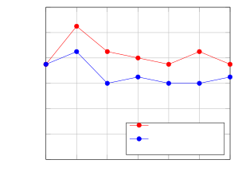
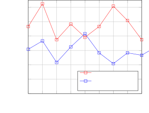
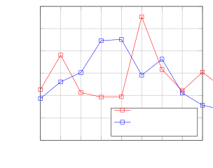
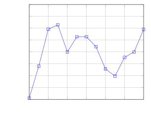
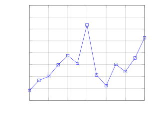
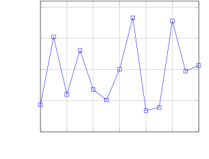

# Towards Robust Argumentative Essay Understanding via TIDE: An Interactive Framework with Trial and Debate

Zheqin Yin Email: [zqyin@stu.ecnu.edu.cn](mailto:)    Yupei Ren
Email: [mlan@cs.ecnu.edu.cn](mailto:)    Yadong Zhang    Yujiang Lu   
Man Lan ^(†)^(†)thanks: Corresponding author. Affiliation: School of
Computer Science and Technology, East China Normal University
Affiliation: Shanghai Institute of Artificial Intelligence for
Education, East China Normal University Affiliation: Lab of Artificial
Intelligence for Education, East China Normal University

###### Abstract

Argumentative essays serve as a vital medium for assessing critical
thinking and reasoning skills, yet there is limited works on accurately
understanding and evaluating such texts via prompt. In this work, we
propose TIDE, a novel framework designed to improve criteria-based
prompt optimization for argument-related tasks by integrating TrIal and
DEbate mechanism. Our method addresses key limitations of criteria-based
prompt optimizing by mitigating the influence of noisy training data and
enhancing optimization stability. We evaluate TIDE on three core tasks:
Automated Essay Scoring, Argument Component Detection, and Argument
Relation Identification. Results demonstrate that our framework improves
performance across tasks. These findings underscore the potential of
combining prompt-based methods for advanced argument understanding.

## 1 Introduction

Argumentative essays, as a genre of academic writing, serve as tangible
artifacts that reflect ones’ abilities to construct, articulate, and
defend coherent arguments Drury et al. (2019); Ulfa and Purwati (2023).
Understanding and evaluating argumentative essays, i.e. conducting
argument mining, not only provides a window into the study of
argumentative thinking but also offers a practical pathway for promoting
the development of this crucial cognitive skill Lu (2021); Mombaers
et al. (2024).

In recent years, the predominant approaches in argument mining have
focused on training pretrained language models or fine-tuning large
language models (LLMs), both of which have demonstrated strong
performance on this task Favero et al. (2025); Wang et al. (2020).
However, current research in this field has seen limited exploration of
novel frameworks built upon prompt-based methods, despite their
advantages in terms of simplicity and flexibility. With the emergence of
advanced reasoning models such as DeepSeek-R1 DeepSeek-AI et al. (2025),
prompt-based approaches are becoming an increasingly promising
alternative, warranting deeper investigation within the context of
argument mining.

Recent studies demonstrate that criterion-based prompt optimization
methods, as illustrated in Figure 1(a), can achieve optimization through
implicit task signals in training data without directly modifying the
prompt text of LLMs Yang et al. (2023a); Liu et al. (2023). While this
approach aims to emulate human-like abstraction of inferential rules
Barwise (1993) from observations, existing methods often suffer from
critical limitations. Specifically, this approach refines the initial
criteria in a gradient-free, iterative manner, which lacks performance
guarantees and may be overly sensitive to noisy or unrepresentative
samples. To address these challenges, we propose criteria optimizing
with TrIal and DEbate (TIDE), a novel framework that leverages
Randomized Trial Selection and Debate to enhance the performance of
understanding argumentative essays. The overview of TIDE can be found in
Figure 1(b). First, to mitigate the adverse influence of noisy or
unrepresentative training data, we introduce a Debate process that
allows the current criteria to "defend" itself. Furthermore, to enhance
the quality of each refinement step, we introduce a Randomized
Trial Selection mechanism, which explores multiple candidate updates and
selects the most promising one, thereby improving both stability and
convergence of the optimization process.

(a) The process of criteria-based prompt optimizing.

(b) Our proposed framework TIDE

Figure 1: The overview of criteria-based prompt optimizing (Figure 1(a))
and our proposed framework TIDE (Figure 1(b)), where Debate and
Randomized Trial Selection is employed to enhance the optimizing
process.

We evaluate our TIDE across three representative tasks—Automated Essay
Scoring (AES), Argument Component Detection (ACD), and Argument Relation
Identification (ARI), where the results demonstrate the effectiveness of
our framework. We find that task complexity should guide the
configuration of these components, with simpler tasks like AES
benefiting from minimal refinement but need more debate, while more
complex tasks like ARI requiring deeper iterative processing for optimal
outcomes. Furthermore, we highlight that the reasoning ability of the
base models is essential for fully realizing the potential of TIDE for
DeepSeek series models by comparing DeepSeek-R1 and DeepSeek-V3
DeepSeek-AI et al. (2024). Substituting these models with weaker
alternatives results in substantial performance degradation across all
tasks. This work aims to provide a comprehensive understanding of the
framework’s capabilities and its implications for improving
argumentative essay understanding and evaluating tasks. In summary, our
main contributions are as follows:

- •
  We conduct a systematic study on o1-like models, specially
  DeepSeek-R1, in understanding human argumentative thinking, grounded
  in three representative tasks: AES, ACD, and ARI.
- •
  We propose a novel prompt optimization framework, TIDE, which
  integrates Randomized Trial Selection and Debate to significantly
  enhance model performance in argument understanding and evaluation
  across the three tasks.
- •
  We empirically analyze the role of reasoning within TIDE and
  demonstrate that reasoning ability is essential to fully unlocking the
  argumentative potential of DeepSeek-series.

## 2 Related Works

### 2.1 Argument Mining

In the domain of argumentation-related tasks, prior research has
predominantly focused on pretrained language models such as BERT Devlin
et al. (2019) as its variants Sazid and Mercer (2022); Cheng et al.
(2020). In recent times, there has been an emerging trend to delve into
the performance of LLMs in pertinent tasks Favero et al. (2025); Gorur
et al. (2024). For instance, Favero et al. (2025) investigated the
application of open-source models such as Qwen and LLaMA for argument
segmentation and argument type classification within educational
settings. On the other hand, Gorur et al. (2024) explored the
performance of LLaMA and Mistral models with varying parameter scales on
the task of relation prediction.

To the best of our knowledge, most existing studies have concentrated on
either fine-tuning pretrained language models or developing
task-specific adaptations of LLMs, leaving a gap in developing new forms
of prompting strategies for argumentation-related tasks.

### 2.2 Debate by LLMs

There has been growing interest in exploring the interaction between
LLMs and the concept of debate Liang et al. (2023); Irving et al.
(2018). Some researchers treat debate as a scenario to probe and
evaluate relevant capabilities of LLMs. For example, He et al. (2024)
employed LLMs to compose argumentative essays. In addition, Arnesen
et al. (2024) assigned them roles as participants and trained them to
win debates, while Liang et al. (2024) positioned them as judges to
assess the quality of arguments from three dimensions.

On the other hand, there are researchers incorporating debate as a
functional module within broader system architectures. They treat LLMs
as argumentative collaborators more than just answer providers Musi
et al. (2025). For instance, Wu et al. (2024) employed debate between
different psychologist-agents to enhance empathetic response of their
system in the domain of psychological diagnostics. Similarly, in the
context of chain-of-thought (CoT) prompting, debate mechanisms have been
introduced to facilitate more robust math capability Wan et al. (2024).

### 2.3 Prompt Optimizing Strategies

Rather than relying on manually crafted prompts, which can be
time-consuming, suboptimal, and difficult to generalize across tasks, an
alternative approach is to leverage the LLM itself to generate or refine
prompts. For example, APE Zhou et al. (2022) uses LLMs to propose
candidate prompts, which are then evaluated and selected based on their
performance on a given task. This approach achieves human-level
performance on various tasks with minimal human input. Similarly, Yang
et al. (2023b) introduces Optimization by PROmpting (OPRO), a method
leveraging LLMs as optimizers. OPRO describes optimization tasks in
natural language and iteratively generates new solutions based on
previously evaluated ones. This approach is demonstrated in prompt
optimization, where prompts are optimized to maximize task accuracy.
Different from optimize the prompt itself, Liu et al. (2023) employed
the in-context learning capability of LLMs to capture criteria from
annotated examples, which is then assessed and refined through
self-correction, ultimately yielding a calibrated version of criteria.

## 3 Method

### 3.1 Criteria-based prompt optimizing

Criteria are central to prompts for guiding LLMs toward better
performance. For instance, users may include directives such as
"…carefully analyze coherence, structure, and argumentation before
giving the final score…" to improve alignment in scoring argumentative
essays. However, how should the LLM understand coherence, and, how much
weight should be placed on it? Given the typical absence of detailed
rubric in user-provided prompts or annotation guidelines, criteria-based
prompt optimization is used to generate and refine well-specified
criteria, thereby enhancing the guidance for LLM predictions.

An overview of criteria-based prompt optimizing is illustrated in Figure
1(a). Initially, Guider produces an initial version of criteria, denoted
as $`c_{0}`$, which in our context serves as a guideline for
understanding and assessing argumentative essays. Then Solver is
employed to perform the corresponding task with $`c_{0}`$, producing a
predicted output $`\hat{y}`$ given an input $`x\in\mathcal{X}`$. By
comparing the predicted output $`\hat{y}`$ with the ground truth $`y`$,
Guider is guided to update the criteria from $`c_{0}`$ to $`c_{1}`$.
This updated critiera is then evaluated on the training data again, and
the refinement process continues.

However, several limitations exist in this vanilla process. First, since
no gradients are updated throughout this pipeline, there is no guarantee
that the updated criteria $`c_{i+1}`$ will lead to improved performance
of Solver compared to the previous version $`c_{i}`$. Moreover, forcing
Guider to update the criteria solely based on observed discrepancies may
be problematic, as it could be influenced by noisy or unrepresentative
data, potentially degrading overall performance.

### 3.2 Overall Framework of TIDE

We propose criteria optimizing with TrIal and DEbate (TIDE), which
leverages Debate and Randomized Trial Selection to improve
criteria-based prompt optimization as shown in Figure 1(b). TIDE  begins
by initializing the criteria draft $`c_{0}`$ by Guider and iterates over
batches $`B`$ of the training dataset $`D_{train}`$. For each batch,
Solver generates predictions, computes discrepancy (see Section 3.4),
and identifies the sample with the largest discrepancy. A debate is then
conducted between the predicted value $`\hat{y}`$ and the ground truth
$`y`$ to determine whether an update is necessary (see Section 3.3). If
the $`\hat{y}`$ wins the debate, the process proceeds into the next
iteration without update. Otherwise, the algorithm generates multiple
candidate updates and selects the one with the minimal error on the same
batch $`B`$ as the final update. Algorithm 1 presents detailed
TIDE algorithm.

### 3.3 Debate module

1: Training dataset $`D_{train}`$, max iteration $`n_{Iter}`$, batch
size $`bsz`$, number of Trial $`n_{trial}`$

2: Refined criteria $`c`$

3: Generate initial criteria $`c_{current}\leftarrow c_{0}`$

4: for $`i=0`$ to $`n_{Iter}`$ do

5:   for Batch $`B\in D_{train}`$ do

6:    Employing $`c_{current}`$ to generate predictions
$`\hat{y}=\hat{y}_{1},\cdots,\hat{y}_{bsz}`$

7:    Compute discrepancy for batch $`b=b_{1},\cdots,b_{bsz}`$

8:    Pick the sample with the largest discrepancy
$`i_{max},b_{i_{max}}=\max(b)`$

9:    Debate between $`\hat{y}_{i_{max}}`$ and $`y`$

10:    if $`y`$ wins then

11:      Generate $`n_{trial}`$ candidate updates
$`\hat{c}_{i+1}=\hat{c}_{i+1}^{1},\cdots,\hat{c}^{n_{trial}}_{i+1}`$
with $`B[i_{max}]`$

12:      The minimal discrepancy $`b_{min}\leftarrow\infty`$

13:      The final update $`c_{final}\leftarrow\textbf{None}`$

14:      for $`\hat{c}\in\hat{c}_{i+1}`$ do

15:       Compute discrepancy of $`B`$ using $`\hat{c}`$ to get
$`b^{\hat{c}}`$

16:       if $`max(b^{\hat{c}})\leq b_{min}`$ then

17:         $`b_{min}\leftarrow max(b^{\hat{c}})`$

18:         $`c_{final}\leftarrow\hat{c}`$

19:       end if

20:      end for

21:      $`c_{current}\leftarrow c_{final}`$

22:    end if

23:   end for

24: end for

25: return $`c_{current}`$

Algorithm 1 TIDE

Many studies have demonstrated that debate serves as an effective
mechanism for enhancing the truthfulness of system-generated responses,
which is primarily because LLMs have been shown to struggle when
attempting to defend false or inaccurate claims Michael et al. (2023);
Khan et al. (2024); Du et al. (2023). Leveraging this characteristic,
and recognizing the natural compatibility between debate structures and
argumentative tasks, we introduce a debate-based process aimed at
mitigating the impact of noisy data in argumentative contexts. We
further extend the evaluation process by incorporating a simple internal
debate mechanism, which compares the predicted output with the gold
reference. This simulated debate in turn serves to control the iteration
condition, allowing the model to refine its outputs more selectively and
robustly.

Concretely, when Solver produces an incorrect prediction $`\hat{y}`$
based on a given criterion $`c_{i}`$, a debate is initiated between the
predicted output $`\hat{y}`$ and the correct label $`y`$. In this
setting, the "speech" for $`\hat{y}`$ is the explanation originally
generated by Solver at prediction time, while the "speech" for $`y`$ is
constructed by prompting the LLM to generate a plausible explanation
supporting the correct label. A LLM-based judge is then employed to
assess which explanation better aligns with the annotation criterion
(differ according to specific dataset). The update will only initialize
when $`\hat{y}`$ won the debate, or the process would proceed to next
iteration. This debate mechanism allows Guider to reduce the influence
of potentially noisy annotations present in the training data, as their
explanation would be less convincing, thereby enhancing the overall
robustness of the framework, resulting in the training dynamic
illustrated in Figure 2.

### 3.4 Randomized Trial Selection

We introduced randomized trial selection upon updating criteria.
Specifically, given the previous criteria $`c_{i}`$, multiple candidate
updates, denoted as $`\hat{c}_{i+1}^{0},\hat{c}_{i+1}^{1},\cdots`$, are
generated, where each sample serves as an estimate of the potentially
optimal update from $`c_{i}`$. More formally, an update is generated via
$`\hat{c}_{i+1}=\pi_{\theta}(\mathcal{T},c_{i})`$, where $`\mathcal{T}`$
is the prompt template, $`\pi_{\theta}`$ is Guider with parameter
$`\theta`$. We repeat this generation for $`n_{trial}`$ times to get
different candidates.

Among the generated candidates, discrepancy between the prediction and
the latent criteria embedded in the data is computed to identify the
most promising update. We measure the discrepancy via the error
predictions, which may differ according to each task. Specifically, for
ACD, we regard the number of predicted labels that do not match the
ground truth labels, while the absolute difference between predicted and
labeled scores for AES. For ARI, which is rather complicated, we
consider both the error rate of the identification of related pairs and
the prediction of the relationship categories between them.
Additionally, we introduce a penalty mechanism that imposes a higher
penalty when the model fails to recognize the existence of any
relationship between a pair of sequences, prior to predicting the exact
type of relationship. Details of how the discrepancy is computed for
each task can be found in Appendix D. The candidate with the lowest
score is then selected as the final update for $`c_{i+1}`$.

## 4 Experiment Setup

|                |       |       |       |       |       |       |       |       |
| -------------- | ----- | ----- | ----- | ----- | ----- | ----- | ----- | ----- |
| Method         | CEAMC |       |       |       | AEE   |       |       |       |
|                | ACD   |       | ARI   |       | ACD   |       | ARI   |       |
|                | Micro | Macro | Micro | Macro | Micro | Macro | Micro | Macro |
| ICL            | 62.75 | 49.21 | 6.50  | 8.47  | 84.06 | 82.00 | 51.42 | 37.19 |
| CoT            | 62.27 | 48.83 | 8.23  | 9.64  | 85.07 | 82.78 | 56.05 | 38.76 |
| Calibrate      | 63.37 | 50.29 | 10.76 | 9.97  | 82.25 | 59.95 | 58.06 | 40.99 |
| Criteria-based | 67.28 | 48.69 | 9.27  | 10.11 | 82.70 | 81.64 | 60.13 | 40.18 |
| TIDE           | 69.57 | 56.85 | 16.05 | 15.39 | 85.35 | 83.39 | 62.83 | 43.83 |

Table 1: Performance comparison with different baselines on ACD and ARI,
both from CEAMC dataset. All results in this table are presented in
percent format(%).

### 4.1 Task Format

In this work, we mainly focus on three representative argument-related
tasks:

Automated Essay Scoring (AES): This task involves assigning an overall
score to an input argumentative essay ranged from 1 to 5, based on the
quality, coherence, and other relevant aspects of the argumentation.

Argument Component Detection (ACD): Given an argumentative essay $`D`$
consisting of $`n`$ discourse units, i.e., $`D=[s^{1},...,s^{n}]`$, the
task requires predicting the fine-grained type of each sentence,
resulting in a label sequence
$`\mathcal{AC}=\hat{y}^{1},...,\hat{y}^{n}`$.

Argument Relation Identification (ARI): In this task, the input is an
essay $`D_{c}`$ segmented into $`m`$ discourse chunks, i.e.,
$`D_{c}=[c^{1},...,c^{m}]`$. Given the argument component type of each
chunks, the model is required to identify and classify all possible
argument relations between discourse chunks
$`\mathcal{AR}=\{(i_{from},i_{to},r)\},i_{from},i_{to}\in[1,m]`$. It is
worth noting that relational instances are sparse within individual
essays, leading to a high ratio of negative to positive samples, which
make this task more complexed.

The three tasks are arranged in ascending order of difficulty. The AES
task is rather simple, while the ACD task necessitates more domain
knowledge though manageable and relatively easy in general. The ARI
task, however, combines complexity and domain-specific expertise, posing
a significant challenge to the capabilities of LLMs.

### 4.2 Dataset

- •
  AEE Stab and Gurevych (2017) was annotated on student-written essays.
  A stance for a controversial theme is expressed by a major claim
  component as well as claim components, and premise components justify
  or refute the claims. Attack and support labels are defined as
  relations.
- •
  CEAMC Ren et al. (2025) also contains argumentative essays penned by
  students. It defines 10 fine-grained categories of argument components
  and 14 types of argument relations, posing additional challenges in
  the comprehension and evaluation of argumentative essays. Moreover, in
  CEAMC, a single sequence pair may be associated with multiple relation
  types, which adds additional challenges to the task.
- •
  ASAP 2.0 Crossley et al. (2025) is a representative dataset in essay
  scoring, which collected a large amount of student-written
  argumentative essays. Given its large scale, we sampled 1000 essays to
  conduct experiments.
- •
  ArGPT Rocha et al. (2024) includes arguments generated by ChatGPT and
  annotated labels assessing the quality. We incorporate this dataset
  into our experiments with the aim of providing insights for
  applications involving LLM-based scoring or evaluation.

Additional details about these dataset are provided in Appendix E.

### 4.3 Baselines and Evaluation metrics

As baselines, we employ DeepSeek-R1 as base model (for details, see
Appendix A) and report the performance of several existing methods,
including In-Context Learning (ICL), Chain of Thought (CoT), and
Calibrate Liu et al. (2023), which an prompt optimization framework that
follows a three-stage framework consisting of drafting, filtering, and
refining to generate final criteria.

For the AES task, we additionally compare our approach with the methods
proposed by Stahl et al. (2024), who investigated various prompt
strategies for automated scoring of argumentative essays. Specifically,
we select the Feedback_dCoT$`\rightarrow`$Score and
Explanation$`\rightarrow`$Score strategies as baselines due to their
relatively strong performance as reported in the original study.
Different subtasks are evaluated using task-specific metrics:

1.  1.  AES: For this scoring task, we use Quadratic Weighted Kappa (QWK) as
        the primary evaluation metric, providing a nuanced measure of
        inter-rater reliability by considering the relative difference
        between scores.
2.  2.  ACD and ARI: For these classification tasks, we report both Micro F1
        and Macro F1 scores (denoted as Micro and Macro in tables) to
        provide a comprehensive evaluation.

## 5 Main Results

The main results of our experiments is shown in Table 1 and Table 2,
where we report the performance of our framework in all three subtasks
on different datasets.

In the AES task, the Criteria-based approach yielded relatively high
performance in terms of QWK. This pattern suggests that Guider is
effective at capturing the relative ranking or category of the scores.
In contrast, TIDE achieved a higher score of QWK, which demonstrates
more consistent and robust performance, exhibiting lower sensitivity to
individual samples that could otherwise compromise overall model
effectiveness. As illustrated in Figure 2, the reduced error magnitude
further substantiates the efficacy of our proposed design.

|           |       |       |          |
| --------- | ----- | ----- | -------- |
| Method    | CEAMC | ArGPT | ASAP 2.0 |
| ICL       | 25.49 | 13.60 | 25.10    |
| CoT       | 16.08 | 13.22 | 25.99    |
| Calibrate | 10.81 | 5.04  | 16.69    |
| Feed      | 10.20 | 15.73 | 20.00    |
| Exp       | 15.33 | 34.34 | 15.08    |
| Criteria  | 24.17 | 48.25 | 38.61    |
| TIDE      | 45.64 | 53.59 | 49.51    |

Table 2: Performance comparison with different baselines on AES. In this
table ’Feed’ and ’Exp’ represents Feedback_dCoT and Explanation from
Stahl et al. (2024), while ’Criteria’ represents the criteria-based
prompt optimizing. All results in this table are presented in percent
format(%).

For the ACD task, the Criteria-based method attained the second highest
Micro F1 score but performed worst in terms of Macro F1. This
discrepancy indicates that Guider is particularly discrepancyed towards
frequent labels. Conversely, TIDE maintains balanced performance,
demonstrating the ability to correctly classify both frequent and rare
labels, thus enhancing overall robustness in label distribution.



Figure 2: The error dynamic during optimizing process of AES, where
error is computed via the absolute difference between predicted and
labeled scores.

|                |           |        |       |
| -------------- | --------- | ------ | ----- |
| Method         | Precision | Recall | F1    |
| ICL            | 27.82     | 16.38  | 20.62 |
| CoT            | 30.82     | 18.38  | 23.03 |
| Calibrate      | 40.49     | 26.71  | 32.19 |
| Criteria-based | 29.08     | 18.19  | 22.38 |
| TIDE           | 40.80     | 26.78  | 32.33 |

Table 3: Predictions of whether there is some relation between two
chunks of discourse in task ARI from CEAMC. All results in this table
are presented in percent format(%).

(a) $`n_{trial}`$=2

(b) $`n_{trial}`$=4

Figure 3: Debate Wins for AES on CEAMC in different settings

In the ARI task, TIDE surpassed all other methods by achieving superior
performance in both Micro and Macro F1 scores. To gain deeper insights,
we analyzed whether the models were capable of correctly identifying the
presence of relations between chunks, i.e. telling the positive samples
from negative ones. As presented in Table 3, the Criteria-based approach
improved the detection of discourse relations relative to the ICL
baseline, and also enhanced relation-type classification (Table 1).
Notably, although Calibrate and TIDE exhibited comparable performance in
general metrics, TIDE significantly outperformed Calibrate on ARI
evaluations. These results further underscore the effectiveness and
generalizability of our proposed framework. The output criteria can be
found in Appendix F.

### 5.1 Reasoning Models Leads to Better Performance

Table 4 presents an evaluation of different models employed as
Guider and Solver. Our primary focus is on assessing the impact of the
reasoning capability of DeepSeek-R1, which proves to be essential for
generating and optimizing criteria as shown in the table.

|               |       |       |       |       |       |
| ------------- | ----- | ----- | ----- | ----- | ----- |
| Role Settings | AES   | ACD   |       | ARI   |       |
|               | QWK   | Micro | Macro | Micro | Macro |
| R1+R1         | 45.64 | 69.57 | 56.85 | 16.05 | 15.39 |
| R1+V3         | 45.03 | 66.72 | 48.16 | 11.63 | 12.66 |
| V3+R1         | 44.94 | 64.77 | 44.24 | 6.38  | 7.11  |
| o1-mini       | 11.56 | 59.98 | 35.23 | 7.53  | 7.18  |
| QwQ           | 17.19 | 27.78 | 42.04 | 7.32  | 7.18  |
| Qwen-TIDE     | 10.62 | 59.88 | 40.16 | 6.17  | 5.83  |
| Qwen-R1       | 29.19 | 63.08 | 45.47 | 10.15 | 8.75  |

Table 4: Different combination of (Guider+Solver). For example, R1+V3
represents employing DeepSeek-R1 as Guider, while DeepSeek-V3 as Solver.
QwQ+QwQ represents employ QwQ-32B for both Guider and Solver. All
results in this table are presented in percent format(%).

The results demonstrate that utilizing DeepSeek-R1 as both Guider and
Solver leads to significant performance improvements across all tasks.
More specifically, when the reasoning ability is removed from
Guider (i.e., the V3+R1 setting in Table 4), TIDE suffers a substantial
decline in performance across AES, ACD, and ARI. This finding highlights
the critical role of a reasoning-capable Guider in driving the
framework’s success. Furthermore, although the R1+V3 setting performs
better than V3+R1, it still underperforms compared to the R1+R1
configuration. This indicates that a strong Solver is also necessary to
fully leverage the benefits of the framework. We also included the
results provided by o1-mini and QwQ in the table, where DeepSeek-R1
consistently outperforms o1-mini and QwQ across all tasks. This is
possibly due to their pretraining focus on mathematical and code
reasoning tasks instead of arguments El-Kishky (2024); Team (2025).

In addition, to further study the generalization of TIDE, we tested a
small scaled model, Qwen2.5-14B using criteria derived from
Deepseek-R1’s TIDE runs (Qwen-R1 row in the table). The results show
clear performance improvements across all three tasks compared to the
native Qwen-TIDE setup, even outperforming o1-mini and QwQ, and coming
reasonably close to R1+V3 in Table 4. These findings demonstrate the
generalization capability of TIDE, as well as reducing costs on
influence phase.

### 5.2 Complex Tasks need More Trial

In this section we discuss different settings of TIDE, which mainly
includes Trial and batch size, which is presented in Table 5. It is
evident that, for the ARI task—which is comparatively more complex and
requires a higher degree of domain knowledge—a larger number of Trial is
more suitable. This is because Guider benefits from multiple refinement
steps to achieve more effective model updates. The impact of Trial is
further accentuated when considering the effect of batch size: smaller
batch sizes consistently yield better performance, likely due to
improved granularity in learning signal and reduced averaging effects.
In contrast, for the AES task—which is relatively simpler in
nature—increasing the number of Trial or using smaller batch sizes tends
to degrade performance. Specifically, such configurations result in
reduced QWK scores, thereby mimicking the shortcomings observed in the
Criteria-based approach, as discussed in Table 1. As for ACD, which lies
between AES and ARI in terms of task complexity, optimal performance is
achieved with moderate settings. This suggests that both the number of
Trial iterations and batch size should be chosen to reflect the
intermediate difficulty of the task, balancing the trade-off between
refinement and overfitting.

|                 |       |       |       |       |       |
| --------------- | ----- | ----- | ----- | ----- | ----- |
| Settings        | AES   | ACD   |       | ARI   |       |
|                 | QWK   | Micro | Macro | Micro | Macro |
| $`n_{trial}`$=1 | 38.14 | 67.29 | 40.97 | 10.55 | 11.49 |
| $`n_{trial}`$=2 | 45.64 | 69.57 | 56.85 | 12.64 | 13.16 |
| $`n_{trial}`$=4 | 21.85 | 68.92 | 51.33 | 16.05 | 15.39 |
| $`bsz`$=1       | 19.66 | 64.80 | 45.93 | 14.07 | 13.64 |
| $`bsz`$=2       | 45.64 | 69.57 | 56.85 | 12.64 | 13.16 |
| $`bsz`$=4       | 40.00 | 68.29 | 54.71 | 9.44  | 10.01 |

Table 5: Different setting of Trial and batch in TIDE. When discussing
Trial, we set batch size to 2. When discussing batch, we set Trial to 2.
All results in this table are presented in percent format(%).

### 5.3 Simple Tasks need More Debate

The results in Table 6 clearly demonstrate that the incorporation of the
Debate mechanism significantly improves both Pearson and QWK scores,
which indicates its effectiveness in reducing noise and enabling more
accurate and stable predictions during training.

|                 |               |               |
| --------------- | ------------- | ------------- |
|                 | Pearson       | QWK           |
| $`n_{trial}`$=1 |               |               |
| w/o debate      | 25.59         | 24.17         |
| w/ debate       | 42.87(+17.28) | 38.14(+13.97) |
| $`n_{trial}`$=2 |               |               |
| w/o debate      | 42.04         | 38.31         |
| w/ debate       | 52.59(+10.55) | 45.64(+7.33)  |

Table 6: Ablation study of Debate in AES on CEAMC. We computed another
metric: Pearson coefficient, in order to provide more insights.

The win rate of Solver in debate during AES execution is illustrated in
Figure 3. Notably, under the $`n_{trial}`$=4 setting, Solver achieves a
substantially higher win rate compared to the Gold Data. This may, to
some extent, hinder the system’s ability to continuously improve through
training. In contrast, with $`n_{trial}`$=2, Solver exhibits a
considerably lower win rate, suggesting that the system continues to
optimize, which corresponds to the superior performance reported in
Table 1. Further discussion and details on the win rate are provided in
Appendix C.

## 6 Conclusion

In this work, we propose TIDE, a novel framework designed to enhance
performance of understanding and evaluating argumentative essays through
a combination of iterative refinement and structured interaction between
two main roles—Guider and Solver. Through studies, we show that key
components such as the Trial mechanism and the Debate module play
pivotal roles in balancing robustness and performance. Specifically, we
find that task complexity should guide the configuration of these
components: while simpler tasks like AES benefit from minimal refinement
but need more debate, while more complex tasks like ARI require deeper
iterative processing to achieve optimal outcomes.

Moreover, our analysis reveals that, for DeepSeek series models, the
reasoning ability of the underlying models is crucial: both the
Guider and the Solver must possess strong reasoning capabilities to
fully realize the potential of TIDE. In addition, other weak,
small-scaled models can also benefit from the outcome criteria from
these powerful ones, which shows the generalizability of the framework.

## Limitations

While TIDE demonstrates promising performance across a range of
educational NLP tasks, several limitations remain that warrant further
exploration.

- •
  Debate Protocol Variants. In the current implementation of TIDE, we
  adopt a conventional debate protocol in which two parties represent
  opposing stances and take turns to defend their respective positions.
  Prior work (Khan et al., 2024) has proposed alternative debate
  paradigms, including consultancy-style discussions, structured
  debates, and interactive debates that allow for dynamic exchanges.
  Exploring how these different debate protocols influence the quality
  and stability of prompt optimization within TIDE may lead to further
  performance gains and a deeper understanding of model reasoning
  dynamics.
- •
  Cross-domain Generalizability. Although our experiments demonstrate
  the effectiveness of TIDE across three argumentation-related tasks in
  the educational domain, its applicability to other fields remains
  uncertain. Domains such as law, medicine, and policy analysis present
  unique linguistic structures, reasoning requirements, and data
  distributions. Investigating the adaptability of TIDE to these
  high-stakes or domain-specific applications—particularly in terms of
  prompt robustness, criteria abstraction, and reasoning
  fidelity—constitutes an important direction for future research.

## References

- Arnesen et al. (2024) Samuel Arnesen, David Rein, and Julian
  Michael. 2024. [Training language models to win debates with self-play
  improves judge
  accuracy](https://api.semanticscholar.org/CorpusID:272881215).
  _ArXiv_, abs/2409.16636.
- Bai et al. (2023) Jinze Bai, Shuai Bai, Yunfei Chu, Zeyu Cui, Kai
  Dang, Xiaodong Deng, Yang Fan, Wenhang Ge, Yu Han, Fei Huang, Binyuan
  Hui, Luo Ji, Mei Li, Junyang Lin, Runji Lin, Dayiheng Liu, Gao Liu,
  Chengqiang Lu, K. Lu, and 31 others. 2023. [Qwen technical
  report](https://api.semanticscholar.org/CorpusID:263134555). _ArXiv_,
  abs/2309.16609.
- Barwise (1993) Jon Barwise. 1993. Everyday reasoning and logical
  inference. _Behavioral and Brain Sciences_, 16(2):337–338.
- Beltagy et al. (2020) Iz Beltagy, Matthew E. Peters, and Arman
  Cohan. 2020. [Longformer: The long-document
  transformer](https://api.semanticscholar.org/CorpusID:215737171).
  _ArXiv_, abs/2004.05150.
- Cheng et al. (2020) Liying Cheng, Lidong Bing, Qian Yu, Wei Lu, and
  Luo Si. 2020. [Argument pair extraction from peer review and rebuttal
  via multi-task
  learning](https://api.semanticscholar.org/CorpusID:227035335). In
  _Conference on Empirical Methods in Natural Language Processing_.
- Contributors et al. (2024) Foundational Contributors, Ahmed El-Kishky,
  Daniel Selsam, Francis Song, Giambattista Parascandolo, Hongyu Ren,
  Hunter Lightman, Hyung Won, Ilge Akkaya, Ilya Sutskever, Jason Wei,
  Jonathan Gordon, Karl Cobbe, Kevin Yu, Lukasz Kondraciuk, Max
  Schwarzer, Mostafa Rohaninejad, Noam Brown, Shengjia Zhao, and 189
  others. 2024. [Openai o1 system
  card](https://api.semanticscholar.org/CorpusID:274611667). _ArXiv_,
  abs/2412.16720.
- Crossley et al. (2025) Scott A. Crossley, Perpetual Baffour,
  L. Burleigh, and Jules King. 2025. [A large-scale corpus for assessing
  source-based writing quality: Asap
  2.0](https://doi.org/10.1016/j.asw.2025.100954). _Assessing Writing_,
  65:100954.
- DeepSeek-AI et al. (2025) DeepSeek-AI, Daya Guo, Dejian Yang, Haowei
  Zhang, Jun-Mei Song, Ruoyu Zhang, Runxin Xu, Qihao Zhu, Shirong Ma,
  Peiyi Wang, Xiaoling Bi, Xiaokang Zhang, Xingkai Yu, Yu Wu, Z. F. Wu,
  Zhibin Gou, Zhihong Shao, Zhuoshu Li, Ziyi Gao, and 179 others. 2025.
  [Deepseek-r1: Incentivizing reasoning capability in llms via
  reinforcement
  learning](https://api.semanticscholar.org/CorpusID:275789950).
  _ArXiv_, abs/2501.12948.
- DeepSeek-AI et al. (2024) DeepSeek-AI, Aixin Liu, Bei Feng, Bing Xue,
  Bing-Li Wang, Bochao Wu, Chengda Lu, Chenggang Zhao, Chengqi Deng,
  Chenyu Zhang, Chong Ruan, Damai Dai, Daya Guo, Dejian Yang, Deli Chen,
  Dong-Li Ji, Erhang Li, Fangyun Lin, Fucong Dai, and 179 others. 2024.
  [Deepseek-v3 technical
  report](https://api.semanticscholar.org/CorpusID:275118643). _ArXiv_,
  abs/2412.19437.
- Devlin et al. (2019) Jacob Devlin, Ming-Wei Chang, Kenton Lee, and
  Kristina Toutanova. 2019. [Bert: Pre-training of deep bidirectional
  transformers for language
  understanding](https://api.semanticscholar.org/CorpusID:52967399). In
  _North American Chapter of the Association for Computational
  Linguistics_.
- Drury et al. (2019) Jeffrey P. Mehltretter Drury, Nicholas S.
  Paliewicz, and Sara A. Mehltretter Drury. 2019. [Argument pedagogy for
  everyday life](https://api.semanticscholar.org/CorpusID:146011477).
  _Journal of Communication Pedagogy_.
- Du et al. (2023) Yilun Du, Shuang Li, Antonio Torralba, Joshua B.
  Tenenbaum, and Igor Mordatch. 2023. [Improving factuality and
  reasoning in language models through multiagent
  debate](https://api.semanticscholar.org/CorpusID:258841118). _ArXiv_,
  abs/2305.14325.
- El-Kishky (2024) Ahmed El-Kishky. 2024. [Openai o1 system
  card](https://api.semanticscholar.org/CorpusID:272648256). _ArXiv_,
  abs/2412.16720.
- Favero et al. (2025) Lucile Favero, Juan Antonio P’erez-Ortiz, Tanja
  Käser, and Nuria Oliver. 2025. [Leveraging small llms for argument
  mining in education: Argument component identification,
  classification, and
  assessment](https://api.semanticscholar.org/CorpusID:276482778).
  _ArXiv_, abs/2502.14389.
- Gorur et al. (2024) Deniz Gorur, Antonio Rago, and Francesca
  Toni. 2024. [Can large language models perform relation-based argument
  mining?](https://api.semanticscholar.org/CorpusID:267750218) _ArXiv_,
  abs/2402.11243.
- He et al. (2024) Yuhang He, Jianzhu Bao, Yang Sun, Bin Liang, Min
  Yang, Bing Qin, and Ruifeng Xu. 2024. [Decomposing argumentative essay
  generation via dialectical planning of complex
  reasoning](https://api.semanticscholar.org/CorpusID:271860879). In
  _Annual Meeting of the Association for Computational Linguistics_.
- Irving et al. (2018) Geoffrey Irving, Paul Francis Christiano, and
  Dario Amodei. 2018. [Ai safety via
  debate](https://api.semanticscholar.org/CorpusID:22050710). _ArXiv_,
  abs/1805.00899.
- Khan et al. (2024) Akbir Khan, John Hughes, Dan Valentine, Laura Ruis,
  Kshitij Sachan, Ansh Radhakrishnan, Edward Grefenstette, Samuel R.
  Bowman, Tim Rocktaschel, and Ethan Perez. 2024. [Debating with more
  persuasive llms leads to more truthful
  answers](https://api.semanticscholar.org/CorpusID:267627652). _ArXiv_,
  abs/2402.06782.
- Liang et al. (2024) Jingcong Liang, Rong Ye, Meng Han, Ruofei Lai,
  Xinyu Zhang, Xuanjing Huang, and Zhongyu Wei. 2024. [Debatrix:
  Multi-dimensional debate judge with iterative chronological analysis
  based on llm](https://api.semanticscholar.org/CorpusID:268379278). In
  _Annual Meeting of the Association for Computational Linguistics_.
- Liang et al. (2023) Tian Liang, Zhiwei He, Wenxiang Jiao, Xing Wang,
  Yan Wang, Rui Wang, Yujiu Yang, Zhaopeng Tu, and Shuming Shi. 2023.
  [Encouraging divergent thinking in large language models through
  multi-agent
  debate](https://api.semanticscholar.org/CorpusID:258967540). _ArXiv_,
  abs/2305.19118.
- Liu et al. (2019) Yinhan Liu, Myle Ott, Naman Goyal, Jingfei Du,
  Mandar Joshi, Danqi Chen, Omer Levy, Mike Lewis, Luke Zettlemoyer, and
  Veselin Stoyanov. 2019. [Roberta: A robustly optimized bert
  pretraining
  approach](https://api.semanticscholar.org/CorpusID:198953378).
  _ArXiv_, abs/1907.11692.
- Liu et al. (2023) Yuxuan Liu, Tianchi Yang, Shaohan Huang, Zihan
  Zhang, Haizhen Huang, Furu Wei, Weiwei Deng, Feng Sun, and
  Qi Zhang. 2023. [Calibrating llm-based
  evaluator](https://api.semanticscholar.org/CorpusID:262464745). In
  _International Conference on Language Resources and Evaluation_.
- Lu (2021) Chunxia Lu. 2021. [Infusing critical thinking skills into
  argumentative writing: A study of chinese college college
  learners](https://api.semanticscholar.org/CorpusID:239046459).
  _English Language and Literature Studies_.
- Michael et al. (2023) Julian Michael, Salsabila Mahdi, David Rein,
  Jackson Petty, Julien Dirani, Vishakh Padmakumar, and Samuel R.
  Bowman. 2023. [Debate helps supervise unreliable
  experts](https://api.semanticscholar.org/CorpusID:265213107). _ArXiv_,
  abs/2311.08702.
- Mombaers et al. (2024) Tine Mombaers, Roos Van Gasse, and Sven De
  Maeyer. 2024. [Learning from compa(i)ring exemplars: Enhancing genre
  knowledge of argumentative
  texts](https://api.semanticscholar.org/CorpusID:270467114). _Journal
  of Writing Research_.
- Musi et al. (2025) Elena Musi, Nadin Kokciyan, Khalid Al-Khatib,
  Davide Ceolin, Emmanuelle Dietz, Klara Gutekunst, Annette
  Hautli-Janisz, Cristian Manuel Santibañez Yañez, Jodi Schneider, Jonas
  Scholz, and 1 others. 2025. Toward reasonable parrots: Why large
  language models should argue with us by design. _arXiv preprint
  arXiv:2505.05298_.
- Ren et al. (2024) Yupei Ren, Hongyi Wu, Zhaoguang Long, Shangqing
  Zhao, Xinyi Zhou, Zheqin Yin, Xinlin Zhuang, Xiaopeng Bai, and Man
  Lan. 2024. [Ceamc: Corpus and empirical study of argument analysis in
  education via
  llms](https://api.semanticscholar.org/CorpusID:274060298). In
  _Conference on Empirical Methods in Natural Language Processing_.
- Ren et al. (2025) Yupei Ren, Xinyi Zhou, Ning Zhang, Shangqing Zhao,
  Man Lan, and Xiaopeng Bai. 2025. [Towards comprehensive argument
  analysis in education: Dataset, tasks, and
  method](https://arxiv.org/abs/2505.12028). _Preprint_,
  arXiv:2505.12028.
- Rocha et al. (2024) Victor Hugo Nascimento Rocha, Igor Cataneo
  Silveira, Paulo Pirozelli, Denis Deratani Mauá, and Fábio Gagliardi
  Cozman. 2024. [Assessing good, bad and ugly arguments generated by
  chatgpt: a new dataset, its methodology and associated
  tasks](https://api.semanticscholar.org/CorpusID:266757593). In
  _Portuguese Conference on Artificial Intelligence_.
- Sazid and Mercer (2022) Muhammad Tawsif Sazid and Robert E.
  Mercer. 2022. [A unified representation and a decoupled deep learning
  architecture for argumentation mining of students’ persuasive
  essays](https://api.semanticscholar.org/CorpusID:252819316). In
  _Workshop on Argument Mining_.
- Stab and Gurevych (2017) Christian Stab and Iryna Gurevych. 2017.
  [Parsing argumentation structures in persuasive
  essays](https://doi.org/10.1162/COLI_a_00295). _Computational
  Linguistics_, 43(3):619–659.
- Stahl et al. (2024) Maja Stahl, Leon Biermann, Andreas Nehring, and
  Henning Wachsmuth. 2024. [Exploring llm prompting strategies for joint
  essay scoring and feedback
  generation](https://api.semanticscholar.org/CorpusID:269362090).
  _ArXiv_, abs/2404.15845.
- Team (2025) Qwen Team. 2025. [Qwq-32b: Embracing the power of
  reinforcement learning](https://qwenlm.github.io/blog/qwq-32b/).
- Ulfa and Purwati (2023) Siti Maria Ulfa and Oikurema Purwati. 2023.
  [Argumentative essay patterns produced by university
  students](https://api.semanticscholar.org/CorpusID:265027617).
  _Journal of English Education and Teaching_.
- Wan et al. (2024) Guangya Wan, Yuqi Wu, Jie Chen, and Sheng Li. 2024.
  Cot rerailer: Enhancing the reliability of large language models in
  complex reasoning tasks through error detection and correction. _arXiv
  preprint arXiv:2408.13940_.
- Wang et al. (2020) Hao Wang, Zhen Huang, Yong Dou, and Yu Hong. 2020.
  [Argumentation mining on essays at multi
  scales](https://api.semanticscholar.org/CorpusID:227230893). In
  _International Conference on Computational Linguistics_.
- Wu et al. (2024) Yijie Wu, Shi Feng, Ming Wang, Daling Wang, and Yifei
  Zhang. 2024. [Llm-based empathetic response through psychologist-agent
  debate](https://api.semanticscholar.org/CorpusID:272511985). In
  _APWeb/WAIM_.
- Yang et al. (2023a) Chengrun Yang, Xuezhi Wang, Yifeng Lu, Hanxiao
  Liu, Quoc V Le, Denny Zhou, and Xinyun Chen. 2023a. Large language
  models as optimizers. _arXiv preprint arXiv:2309.03409_.
- Yang et al. (2023b) Chengrun Yang, Xuezhi Wang, Yifeng Lu, Hanxiao
  Liu, Quoc V. Le, Denny Zhou, and Xinyun Chen. 2023b. [Large language
  models as
  optimizers](https://api.semanticscholar.org/CorpusID:261582296).
  _ArXiv_, abs/2309.03409.
- Yang et al. (2024) Qwen An Yang, Baosong Yang, Beichen Zhang, Binyuan
  Hui, Bo Zheng, Bowen Yu, Chengyuan Li, Dayiheng Liu, Fei Huang,
  Guanting Dong, Haoran Wei, Huan Lin, Jian Yang, Jianhong Tu, Jianwei
  Zhang, Jianxin Yang, Jiaxin Yang, Jingren Zhou, Junyang Lin, and 25
  others. 2024. [Qwen2.5 technical
  report](https://api.semanticscholar.org/CorpusID:274859421). _ArXiv_,
  abs/2412.15115.
- Zeng et al. (2024) Team Glm Aohan Zeng, Bin Xu, Bowen Wang, Chenhui
  Zhang, Da Yin, Diego Rojas, Guanyu Feng, Hanlin Zhao, Hanyu Lai, Hao
  Yu, Hongning Wang, Jiadai Sun, Jiajie Zhang, Jiale Cheng, Jiayi Gui,
  Jie Tang, Jing Zhang, Juanzi Li, Lei Zhao, and 36 others. 2024.
  [Chatglm: A family of large language models from glm-130b to glm-4 all
  tools](https://api.semanticscholar.org/CorpusID:270562306). _ArXiv_,
  abs/2406.12793.
- Zhou et al. (2022) Yongchao Zhou, Andrei Ioan Muresanu, Ziwen Han,
  Keiran Paster, Silviu Pitis, Harris Chan, and Jimmy Ba. 2022. [Large
  language models are human-level prompt
  engineers](https://api.semanticscholar.org/CorpusID:253265328).
  _ArXiv_, abs/2211.01910.

## Appendix A Implementation Details

In this work, we mainly employ Deepseek-R1 as the backbone model, due to
its powerful capability shown in long CoT reasoning and low in cost.
Also, we compare it with o1-mini Contributors et al. (2024), QwQ Team
(2025), a small model Qwen2.5-14B Yang et al. (2024), as well as
Deepseek V3 DeepSeek-AI et al. (2024), which is the base model of
Deepseek R1 but do not feature in o1-like reasoning, in order to
investigate the influence of reasoning ability in our framework.

To better guide Guider in generating more aligned initial criteria, we
incorporate several in-context demonstrations during this stage. In
addition, unless explicitly stated, the batch size is set to 2 in our
experiments. Furthermore, to minimize the influence from the
Solver model, we set its temperature to 0.7.

For the baselines, we include two demonstrations in the context of both
ICL and CoT. To mitigate prompt-induced discrepancy, we adopt the same
prompt template used for Solver when generating predictions in ICL, and
append “Let’s think step by step…” for CoT. Similarly, for Calibrate, we
follow the same setup, but replace the updating criteria with the four
atomic editing operations proposed in the original paper.

## Appendix B Token Budgets

Given the iterative nature of TIDE, it inherently entails a relatively
high token budget. This aspect constitutes one of the primary
motivations for selecting DeepSeek-R1 as the base model for TIDE, owing
to its favorable cost-efficiency and competitive performance. The token
consumption of both Criteria-based and TIDE methods during the prompt
optimization process is documented in Table 7.

| Method   | AES   | ACD   | ARI    |
| -------- | ----- | ----- | ------ |
| Criteria | 2.27M | 3.38M | 5.51M  |
| TIDE     | 1.08M | 4.46M | 13.27M |

Table 7: Token budget for Criteria-based method and TIDE, where
DeepSeek-R1 was adopted as the backbone model.

The introduction of the Debate and Trial modules intuitively increases
TIDE’s token consumption compared to the Criteria-based method, as the
trade-off of the performance. However, as shown in the table, we observe
the opposite trend on AES. One possible reason is that the Guider
achieves a certain number of victories during the Debate module, thus
reducing the number of updates.

We also incorporate insights aimed at reducing the overall cost, as
discussed in Section 5.1. During inference, an alternative approach is
to employ lightweight models rather than powerful but costly ones,
leveraging the optimized criteria to predict labels. Although this
substitution may incur a slight performance degradation, it can
significantly reduce API invocation costs or GPU resource consumption.

## Appendix C Debate Win Rate

To further dive into the win rate of Solver, we examine the performance
at the iteration point where Solver’s win rate surpasses that of the
Gold Data under Trial=4 on Iteration 180. The results, presented in
Table 8, reveal a noticeable performance jump—particularly in Pearson
and QWK metrics—between iteration 180 and iteration 300. Further
investigation into controlling Solver’s win rate remains an open
direction for future work.

Additionally, we observe that Solver rarely wins debates during training
in ACD and ARI. For instance, under the batch size of 2, only five wins
are observed in ACD and two in ARI over 240 iterations. We argue that
this takes place when the task is relatively complex, compared the
scoring task where the model itself is already capable (though not
aligned with the data).

| Settings     | Pearson | QWK   |
| ------------ | ------- | ----- |
| $`Iter=180`$ | 30.25   | 29.21 |
| $`Iter=300`$ | 22.11   | 21.85 |

Table 8: The performance in different settings in AES task, where
Trial=4 and batch size is set to 2.

## Appendix D Discrepancy Computation

For different task, we employed different methods for computing
discrepancy, all in document-level. For AES, we utilize the absolute
difference between $`y`$ and $`\hat{y}`$ as the discrepancy, while
number of labels that mismatch with $`y`$ for each discourse in ACD.

```math
d_{AES}=abs(y-\hat{y})
```

```math
d_{ACD}=|\{\hat{y}_{i}|\hat{y}_{i}\neq y_{i}\}|
```

For ARI, in addition to mismatched labels between individual pairs of
chunks (i.e., predicted labels not appearing in the ground truth $`y`$,
and ground truth labels not present in the predictions $`\hat{y}`$), we
also consider the accuracy of pairwise identification. To further
enhance the precision of index extraction, we impose penalty on cases
with incorrect index predictions, as illustrated in Algorithm 2.
Specifically, we count the number of predicted pairs that do not exist
in $`y`$, as well as the number of ground truth pairs in $`y`$ that are
not predicted. These errors are penalized with a weight of 2 in our
experiments. This design encourages TIDE to more accurately identify
chunk pairs with relational links, as demonstrated in Table 3.



Figure 4: Error dynamic during training for ACD



Figure 5: Error dynamic during training for ARI

1: Ground truth pairs $`Y`$, predicted pairs $`\hat{Y}`$, penalty $`p`$

2: Discrepancy for $`\hat{Y}`$

3: $`d_{ARI}\leftarrow 0`$

4: for $`\hat{y}\in\hat{Y}`$ do

5:   Ground truth pair that match in index
$`y,y\in Y~and~y_{from}=\hat{y}_{from}~and~y_{to}=\hat{y}_{to}`$

6:   if y is not null then

7:    $`d_{ARI}\leftarrow d_{ARI}+`$ mismatched labels between $`y`$ and
$`\hat{y}`$

8:   else

9:    $`d_{ARI}\leftarrow d_{ARI}+`$ number of labels in
$`\hat{y}+2\times p`$

10:   end if

11: end for

12: for $`y\in Y`$ do

13:   if $`y`$ not be predicted in previous loop then

14:    $`d_{ARI}\leftarrow d_{ARI}+`$ number of labels in
$`y+2\times p`$

15:   end if

16: end for

17: return $`d_{ARI}`$

Algorithm 2 Computation for $`Discrepancy_{ari}`$

The discrepancy dynamic during training for AES is presented in Figure
2, while for ACD and ARI is illustrated in Figure 4 and Figure 5.

## Appendix E Details of Dataset

In this work, we utilize CEAMC , ArGPT, AEE and ASAP 2.0 to evaluate the
performance of TIDE. For ASAP 2.0, given its large scale, we randomly
shuffle and select 10% samples to conduct experiments. For AEE, we
follow the original train-test split from the original paper. For the
other datasets, we randomly shuffle the data using a fixed seed of 42,
and then split each dataset into 60% for training and 40% for evaluation
to ensure sufficient evaluation samples.

### E.1 CEAMC

CEAMC Ren et al. (2025) includes 226 Chinese argumentative essays penned
by high school students. These essays range from 557 to 1,101 tokens
with an average of 829.82 tokens. There are 4,726 dicourse in total,
each of which has an argument component category in MajorClaim, Claim,
Restated Claim, Fact, Anecdote, Quotation, Proverb, Axiom, Elaboration
and Others, which is what the label needs to be predicted in ACD task.
For ARI, the dataset defines 14 fine-grained categories of Positive,
Negative, Comparative, Example, Citation, Metaphorical, Hypothetical,
Restatement, Detail, Background, Coherence, Progression, Contrast and
Concession. There are 4,837 relations appear in the chunks. Following
Ren et al. (2024), we categorize the original score data into five
levels, corresponding to scores from 1 to 5.

The original paper mainly reported performance of pretrained models such
as RoBERTa Liu et al. (2019) and Longformer Beltagy et al. (2020), and
LLMs after fine-tuning such as ChatGLM Zeng et al. (2024) and Qwen Bai
et al. (2023). In this work we mainly discuss how TIDE help improve the
performance via prompt optimization.

### E.2 AEE

The AEE dataset focuses on analyzing argumentative essays by annotating
the argument components and relations within. The dataset contains over
400 student-written argumentative essays. We include this dataset mainly
because its division of components (Major Claim, Claim and Premise) and
relations (Attack and Support) is more close to conventional argument
mining.

### E.3 ASAP 2.0

Inherited from the representative dataset for automatic essay scoring
ASAP, a newly-updated ASAP 2.0 dataset was promoted. This dataset
incorporate about 24,000 student-written argumentative essays, aligned
to the latest standards for student-appropriate assessments. It also
included samples across economic and location populations to mitigate
the potential of algorithmic bias.

### E.4 ArGPT

The ArGPT dataset primarily targets the evaluation of argument quality
in texts generated by ChatGPT. It consists of 168 argumentative essays,
carefully constructed through simulated student-professor dialogues to
elicit diverse argument structures. We included this dataset with the
aim of providing insights for applications that utilize LLM-based
evaluation to give a score. However, in comparison to CEAMC, the
definitions of argument components (Major Claim and Premise) and their
relations (Attack and Support) are relatively simplistic. Therefore, we
primarily utilize the AES task from this dataset to evaluate the
effectiveness of TIDE.



Figure 6: Length dynamic during iteration for AES



Figure 7: Length dynamic during iteration for ACD



Figure 8: Length dynamic during iteration for ARI

## Appendix F Output Samples

In this section we present the final output from TIDE in Table 10, 11
and 12, respectively. It is obvious that after iterations of refinement,
the length of criteria extends with more details of each category
included compared to the original one, which is mainly caused by
learning different features through training, as shown in Figure 6,
Figure 7 and Figure 8. In addition, as shown in Table 12, Guider learns
to develop a quantification principle during the iterative process in
ARI, which enables the model to better adapt to the task. This is
further demonstrated in Table 9. This capability allows Solver to more
effectively distinguish between different categories, thereby enhancing
overall performance in ARI.

| Before refinement                                                                                                                                                                                                                                                                                                                                                                                                                                                                                                                                                                                                                                                                                                                                                                                                                                                                                                                |
| -------------------------------------------------------------------------------------------------------------------------------------------------------------------------------------------------------------------------------------------------------------------------------------------------------------------------------------------------------------------------------------------------------------------------------------------------------------------------------------------------------------------------------------------------------------------------------------------------------------------------------------------------------------------------------------------------------------------------------------------------------------------------------------------------------------------------------------------------------------------------------------------------------------------------------- |
| The determination of argumentative relationship categories is based on semantic functions and logical structures,combined with the categorical properties of argumentative components.The characteristics are as follows: Example: Using specific examples(historical facts/personal instances)to directly support the thesis,forming a concrete→abstract supporting relationship between the example and the thesis,often containing empirical elements. $`...`$                                                                                                                                                                                                                                                                                                                                                                                                                                                                |
| After refinement                                                                                                                                                                                                                                                                                                                                                                                                                                                                                                                                                                                                                                                                                                                                                                                                                                                                                                                 |
| The determination of argumentative relationship categories is based on semantic functions and logical structures, combined with the category attributes of argumentative components. The characteristics are as follows:1. Example-based argumentation: Historical examples must fully present the causal chain of motivation-action-impact (for cross-sentence combinations, stage completeness markers + logical deduction words $`\geq`$ 5 are required). New exclusion conditions: e) Case enumeration that does not directly correspond to the core elements of the sub-argument (with an element mapping degree \< 85% and deduction words \< 5). f) Quotations that do not form a complete argumentative chain (must meet the sub-argument element mapping degree $`\geq`$ 90% and have deduction words $`\geq`$ 5). g) Historical examples that do not fully present any stage of motivation, action, or impact. $`...`$ |

Table 9: Case study of ARI, where Guider learned to develop a principle
of quantification during iteration.

|                                                                                                                                                                                                                                                                                                                                                                                                                                                                                                                                                                                                                                                                                                                                                                                                                                                                                                                                                                                                                                                                                                                                                                                                                                                                                                                                                                                                                                                                                                                                                                                                                                                                                                                                                                                                                                                                                                                                                                                                                                                                                                                                                                                                                                                                                                                                                                                                                                                                                                                                                                                                                                                                                                                                                                                                                                                                                                                                                                                                          |
| -------------------------------------------------------------------------------------------------------------------------------------------------------------------------------------------------------------------------------------------------------------------------------------------------------------------------------------------------------------------------------------------------------------------------------------------------------------------------------------------------------------------------------------------------------------------------------------------------------------------------------------------------------------------------------------------------------------------------------------------------------------------------------------------------------------------------------------------------------------------------------------------------------------------------------------------------------------------------------------------------------------------------------------------------------------------------------------------------------------------------------------------------------------------------------------------------------------------------------------------------------------------------------------------------------------------------------------------------------------------------------------------------------------------------------------------------------------------------------------------------------------------------------------------------------------------------------------------------------------------------------------------------------------------------------------------------------------------------------------------------------------------------------------------------------------------------------------------------------------------------------------------------------------------------------------------------------------------------------------------------------------------------------------------------------------------------------------------------------------------------------------------------------------------------------------------------------------------------------------------------------------------------------------------------------------------------------------------------------------------------------------------------------------------------------------------------------------------------------------------------------------------------------------------------------------------------------------------------------------------------------------------------------------------------------------------------------------------------------------------------------------------------------------------------------------------------------------------------------------------------------------------------------------------------------------------------------------------------------------------------------- |
| Five-Dimensional and Five-Level Scoring System for High School Argumentative Essays(1-5 Points) - Innovation of Thesis(Weight:8%) - 5 Points: Dual-dimension comparison including cultural symbol comparison(cross-regional/generational)+implicit opposition$`\geq`$2 groups(including at least 1 group of philosophical/cultural conflict)+at least 1 example from after 2015(philosophical examples may be used as substitutes). - 4 Points: Single-dimension analysis with implicit opposition$`\geq`$1 group(clearly specifying the type of opposition)+allowing classical philosophical examples to replace modern examples. - 3 Points: Single-case argumentation+implicit opposition$`\geq`$1 group(philosophical attributes must be clearly specified). - Effectiveness of Argumentation(Weight:38%) - 5 Points: Three-tiered progressive structure(phenomenon-essence-value)+cross-temporal and cross-spatial case corroboration$`\geq`$2 groups(spanning at least 2 different fields or time periods)+argumentation layers$`\geq`$4(including at least 1 layer of counter-proof). - 4 Points: Two-tiered progression+cross-era case comparison(time span$`\geq`$5 years)+argumentation layers$`\geq`$3(supported by data or philosophical reasoning). - Quality of Evidence(Weight:20%) - 5 Points: Case analysis$`\geq`$100 words(including deconstruction of contradictions)+positive-to-negative ratio$`\geq`$1.2:1+at least 1 citation from academic literature or philosophical classics. - 4 Points: Case analysis$`\geq`$80 words(including deconstruction of symbols)+positive-to-negative ratio$`\geq`$1:1+allowing philosophical examples to replace literature citations. - Precision of Expression(Weight:14%) - 5 Points: Composite rhetorical density$`\geq`$0.7 types per 100 words(including at least 1 type of rhetorical nesting)+logical density$`\geq`$7%(including at least 3 types of logical connectors). - 4 Points: Composite rhetorical density$`\geq`$0.5 types per 100 words+logical density$`\geq`$5%(including comparative or progressive structures). - Dialectical Power of Values(Weight:20%) - 5 Points: Three-dimensional value model(individual-group-civilization)+at least 2 specific measures in the feasibility plan(including the executing body). - 4 Points: Two-way value model+theoretical implementation framework(must include the path of value transformation). Advanced Standards: - Argumentation on philosophical/cultural conflicts can be counted as 1.5 groups of ordinary oppositions(complete analysis of the nature of the conflict is required). - Citations from classical philosophical works can replace one group of case analysis(text source must be indicated). Review Mechanism: - In-depth analysis of philosophical cases($`\geq`$150 words)can exempt the requirement for literature citations. - A complete construction of the value model(reaching 4 points)can compensate for deficiencies in the feasibility plan. |

Table 10: The refined criteria via TIDE for AES.

|                                                                                                                                                                                                                                                                                                                                                                                                                                                                                                                                                                                                                                                                                                                                                                                                                                                                                                                                                                                                                                                                                                                                                                                                                                                                                                                                                                                                                                                                                                                                                                                                                                                                                                                                                                                                                                                                                                                                                                                                                                                                                                                                                                                                                                                                                                                                                                                                                                                                                                                                                                                                                                                                                                                                                                                                                                                                                                                                                                                                                                                                                                                                                                                                                                                                                                                                                                                                                                                                                                                                                                                                                                                                                                                                                                                                                                                                                                                                                                                                                                                                                                                                                                                                                                                                                                                                                                                                                                                                                                                                                                                                                                                                                                                                                                                                                                                                                                                                                                                                                                                                                                                                                                                                                                                                                                                                                                                         |
| --------------------------------------------------------------------------------------------------------------------------------------------------------------------------------------------------------------------------------------------------------------------------------------------------------------------------------------------------------------------------------------------------------------------------------------------------------------------------------------------------------------------------------------------------------------------------------------------------------------------------------------------------------------------------------------------------------------------------------------------------------------------------------------------------------------------------------------------------------------------------------------------------------------------------------------------------------------------------------------------------------------------------------------------------------------------------------------------------------------------------------------------------------------------------------------------------------------------------------------------------------------------------------------------------------------------------------------------------------------------------------------------------------------------------------------------------------------------------------------------------------------------------------------------------------------------------------------------------------------------------------------------------------------------------------------------------------------------------------------------------------------------------------------------------------------------------------------------------------------------------------------------------------------------------------------------------------------------------------------------------------------------------------------------------------------------------------------------------------------------------------------------------------------------------------------------------------------------------------------------------------------------------------------------------------------------------------------------------------------------------------------------------------------------------------------------------------------------------------------------------------------------------------------------------------------------------------------------------------------------------------------------------------------------------------------------------------------------------------------------------------------------------------------------------------------------------------------------------------------------------------------------------------------------------------------------------------------------------------------------------------------------------------------------------------------------------------------------------------------------------------------------------------------------------------------------------------------------------------------------------------------------------------------------------------------------------------------------------------------------------------------------------------------------------------------------------------------------------------------------------------------------------------------------------------------------------------------------------------------------------------------------------------------------------------------------------------------------------------------------------------------------------------------------------------------------------------------------------------------------------------------------------------------------------------------------------------------------------------------------------------------------------------------------------------------------------------------------------------------------------------------------------------------------------------------------------------------------------------------------------------------------------------------------------------------------------------------------------------------------------------------------------------------------------------------------------------------------------------------------------------------------------------------------------------------------------------------------------------------------------------------------------------------------------------------------------------------------------------------------------------------------------------------------------------------------------------------------------------------------------------------------------------------------------------------------------------------------------------------------------------------------------------------------------------------------------------------------------------------------------------------------------------------------------------------------------------------------------------------------------------------------------------------------------------------------------------------------------------------------------------------- |
| The major claim is the overarching core judgment of the entire essay. It must be unique and global in scope, and must appear in the introductory or concluding paragraph (if it appears in a body paragraph, it must meet the following conditions: the judgment must run through all supporting arguments, must not be overturned by subsequent discussion, and must be explicitly echoed in the introduction or conclusion). It must be a complete, independent evaluative judgment sentence (it must include an explicit or implicit assertive term such as ’should/must/is/better than/indispensable’). If in the introduction it appears as a compound sentence formed through a concessive-turning structure that negates the opposing viewpoint but contains multiple predicate cores without forming a unifying assertion, it shall be downgraded to a supporting argument. If the conclusion uses extended metaphors, the core vocabulary must directly correspond semantically with that in the introduction, and the core predicate structure must allow for semantic equivalence without introducing new-dimensional predicates. Exclusions: The concessive clause at the beginning of a compound sentence in the introduction; Transitional sentences that only define or describe a phenomenon without forming a complete value judgment. Addition: If new concepts appear in the conclusion, the core predicate structure must remain strictly consistent with or semantically aligned with the introduction, and any appended solution path must constitute a synonymous transformation of the core assertion. If the core predicate undergoes an equivalent transformation (e.g., triple negation, implicit assertive terms like ‘indispensable’) and maintains core concept correspondence, it is still considered a major claim. However, if the operational path description does not form an independent judgment sentence, it is classified as elaboration. Supplement: If the conclusion introduces a new predicate dimension (e.g., ’facilitate’) or fails to form strict correspondence with the introduction’s core predicate, it is downgraded to elaboration. Reinforcing the original assertion with adverbs of degree (e.g., ’especially should’) is allowed as long as the core predicate remains unchanged. Supporting Argument Supplement: Must propose an alternative judgment through causal analysis and directly support the major claim. It must be an independent judgment sentence with clear assertive vocabulary (including implicit terms like ’can/need to’ and negative assertion sentences following rhetorical questions, e.g., ’Heightened tension can compel focus’). Excluded: Negative judgments that merely describe harmful phenomena without offering alternative assertions. Valid forms include: Negative comparison judgments that establish new assertions (the main clause must contain assertive terms like ’should/need to,’ directly support the major claim, and form a complete causal chain). New dimensional assertions introduced through definition (e.g., ’Tension is the lock of the soul’) must contain assertive predicates or form an explicit logical link to the major claim. Compound sentences led by concessive conjunctions (e.g., ’Indeed…can demonstrate benefits’) that substantively support the major claim are allowed. Exclusions: Summary compound sentences used only for paragraph transition; Mechanism descriptions that do not establish an alternative assertion. New: Rhetorical-question-led negative assertions that directly support the major claim and establish a causal chain must include explicit assertive terms or a complete causal chain to qualify as supporting arguments. Conclusions drawn from cited research data that directly establish a causal chain and support the major claim are still supporting arguments. Compound sentences that negate extreme interpretations, redefine concepts, and directly support the major claim (e.g., ’Tension does not mean everything must be done hastily’) are valid. Causal analysis must contain alternative assertions, not merely explain mechanisms; use of implicit assertive terms (e.g., ’rely on’) is allowed if a complete causal chain is formed. Elaboration Additions: Background descriptions introducing opposing viewpoints in the introduction; Transitional harm descriptions. Supplement: New dimensions proposed through definitions without assertive predicates; Phenomenon-based causal analyses (e.g., ’the root cause’) and mechanism explanations; Natural analogies used to illustrate group-level universal patterns supporting the argument are classified as fact; Transitional rhetorical questions not providing background or structural explanation fall under “Other”; Operational path descriptions that do not form independent judgment sentences are elaboration; Group-level social background phenomenon-based causal analysis is classified as fact; Rhetorically asked causal analyses that only explain a phenomenon without forming alternative assertions are elaboration; Sentences merely describing research data sources without forming causal chains are elaboration; Compound sentences listing group phenomena without forming complete causal chains are elaboration. |

Table 11: The refined criteria via TIDE for ACD.

|                                                                                                                                                                                                                                                                                                                                                                                                                                                                                                                                                                                                                                                                                                                                                                                                                                                                                                                                                                                                                                                                                                                                                                                                                                                                                                                                                                                                                                                                                                                                                                                                                                                                                                                                                                                                                                                                                                                                                                                                                                                                                                                                                                                                                                                                                                                                                                                                                                                                                                                                                                                                                                                                                                                                                                                                                                                                                                                                                                                                                                                                                                                                                                                                                                                                                                                                                                                                                                                                                                                                                                                                                                                                                                                                                                                                                                                                                                                                                                                                             |
| ----------------------------------------------------------------------------------------------------------------------------------------------------------------------------------------------------------------------------------------------------------------------------------------------------------------------------------------------------------------------------------------------------------------------------------------------------------------------------------------------------------------------------------------------------------------------------------------------------------------------------------------------------------------------------------------------------------------------------------------------------------------------------------------------------------------------------------------------------------------------------------------------------------------------------------------------------------------------------------------------------------------------------------------------------------------------------------------------------------------------------------------------------------------------------------------------------------------------------------------------------------------------------------------------------------------------------------------------------------------------------------------------------------------------------------------------------------------------------------------------------------------------------------------------------------------------------------------------------------------------------------------------------------------------------------------------------------------------------------------------------------------------------------------------------------------------------------------------------------------------------------------------------------------------------------------------------------------------------------------------------------------------------------------------------------------------------------------------------------------------------------------------------------------------------------------------------------------------------------------------------------------------------------------------------------------------------------------------------------------------------------------------------------------------------------------------------------------------------------------------------------------------------------------------------------------------------------------------------------------------------------------------------------------------------------------------------------------------------------------------------------------------------------------------------------------------------------------------------------------------------------------------------------------------------------------------------------------------------------------------------------------------------------------------------------------------------------------------------------------------------------------------------------------------------------------------------------------------------------------------------------------------------------------------------------------------------------------------------------------------------------------------------------------------------------------------------------------------------------------------------------------------------------------------------------------------------------------------------------------------------------------------------------------------------------------------------------------------------------------------------------------------------------------------------------------------------------------------------------------------------------------------------------------------------------------------------------------------------------------------------------- |
| The classification is based on semantic functions and logical structure, combined with the categorical attributes of argument components. Features are as follows: Example-based Argumentation: Must include \<Historical Example\> or \<Famous Quotation\> component markers Historical examples must fully present the cause-action-effect causal chain (Cross-sentence combinations require stage completeness markers + $`\geq`$5 logical inference words) Newly added exclusion criteria: e) Case listings that do not directly correspond to the core elements of the sub-argument (element mapping degree \<85% and inference words \<5) f) Quotations that fail to form a complete argumentative chain (must meet element mapping degree $`\geq`$90% and include $`\geq`$5 inference words) g) Historical examples missing any stage of cause-action-effect Positive Argumentation: Must meet dual conditions: a) Explicit transition words (e.g., “therefore,” “thus”) + $`\geq`$7 logical inference words b) Implicit logical inference words $`\geq`$8 and sub-argument element coverage $`\geq`$95% Logical leap degree must be $`\geq`$7.0 and agent/patient matching weight $`\geq`$45% (Conclusion statements are exempt from inference word count limits) Newly added exclusion criteria: e) Only contains explicit transition words but inference words \<7 f) Argumentative paragraphs with contrastive or progressive markers Negative Argumentation: Must meet at least five antagonistic dimensions (semantic/structural/agent/emotional/logical/contextual) and include $`\geq`$4 negation markers Comparative sentence structures must contain $`\geq`$5 negation markers or contrastive words, and antagonistic dimension matching degree $`\geq`$85% Newly added exclusion criteria: c) Surface-level negation lacking a contradictory focus (antagonistic dimension match \<85%) d) Contains only a single comparison dimension and no negation markers Refinement Relationship: Must simultaneously meet: a) Structural differentiation $`\geq`$85% and added information $`\geq`$70% b) Explicit/implicit transition words (including “thereby,” etc.) + core element expansions $`\geq`$5 items c) Semantic role matching with prior argument $`\geq`$85% (Excludes pure repetition or supplementary explanation) Newly added exclusion criteria: d) Inter-sentence core element repetition $`\geq`$20% Restatement Relationship: Core element repetition $`\geq`$98% + summary marker + structural differentiation $`leq`$3% Newly added exclusion criteria: c) Summary sentences containing progressive or contrastive markers d) Injection of new argument components ($`\geq`$1 new dimension added) e) Sub-argument element coverage \<99% Progressive Relationship: Explicit progression must have strength level $`\geq`$4 (e.g., “even more,” “especially,” “furthermore,” “particularly necessary”) Implicit progression must meet: a) Logical chain element retention $`\geq`$95% + $`\geq`$5 new dimensions b) Hierarchical progression must be adjusted by semantic shift weight (Interrogative sentences counted as +2.0 intervals) Parallel Relationship: Core element repetition $`\geq`$90% and structural similarity $`\geq`$95% Sub-argument element coverage $`\geq`$98% Newly added information $`leq`$10% Compound Relationship Processing Rules: Refinement relationship takes precedence over progression if $`\geq`$5 expansion dimensions are met Quotation-based argumentation must verify that famous quotations match sub-argument mapping $`\geq`$90% and contain $`\geq`$5 inference words Dual labels are allowed only if all core conditions of both types are met and contradiction dimensions $`leq`$2 General Adjustments: Interval calculation increases semantic shift weight (progressive markers count as -1.0 interval) Element mapping requires agent/patient matching weight $`\geq`$40% + semantic role matching degree $`\geq`$75% |

Table 12: The refined criteria via TIDE for ARI.

## Appendix G Prompt Templates

In table 13 we present the prompt template we used in AES, specically
when conducting prediction via Solver and update criteria by Guider,
while table 14 presents templates we used in ACD and ARI.

Table 15 shows the prompt template used for both debating and
explanation generation, where the standards are defined according to the
specific task. In particular, we align the arguments with the annotation
standards provided in CEAMC.

For each task, we begin by inserting the task name and description into
the template, along with task-specific labels (for ACD and ARI). During
prediction, the input essay from the training batch is filled in. For
updating criteria, we provide the current criteria, predictions, and
ground truth. For the debate stage, we assign the explanation generated
by the LLM to the gold side, and the explanation from predictions to the
opposing side.

| Prompt template for updating criteria                                                                                                                                                                                                                                                                                                                                                                                                                                                                                                                                                                                                                                                                                                                                                                                                                                                                                                                                                                                                                                                                                                                                                                                                                                                                                                                                                                                                                                                                                                                                                                                                                                                                                                |
| ------------------------------------------------------------------------------------------------------------------------------------------------------------------------------------------------------------------------------------------------------------------------------------------------------------------------------------------------------------------------------------------------------------------------------------------------------------------------------------------------------------------------------------------------------------------------------------------------------------------------------------------------------------------------------------------------------------------------------------------------------------------------------------------------------------------------------------------------------------------------------------------------------------------------------------------------------------------------------------------------------------------------------------------------------------------------------------------------------------------------------------------------------------------------------------------------------------------------------------------------------------------------------------------------------------------------------------------------------------------------------------------------------------------------------------------------------------------------------------------------------------------------------------------------------------------------------------------------------------------------------------------------------------------------------------------------------------------------------------ |
| You are a senior Chinese language education expert. Now analyze the gap between the original grading criteria and the real scores based on the provided argumentative essay grading data, and output the updated grading criteria. Follow the steps below: \### Gap Identification Compare the differences between the predicted scoring rationale and the actual scores,focusing on: - Scoring dimensions not covered by the original criteria (e.g., depth of argumentation, novelty of materials). - Weight distribution discrepancy in scoring (e.g., overemphasizing structure while neglecting language). - Ambiguity in scoring standards(e.g., "sufficient evidence "without specifying a specific quantity requirement). \### Update Principles - Quantification: For example, change "clear structure" to "at least two transitional sentences between claims." - Layered refinement:For example, split "rich content" into "depth of argument" and "breadth of evidence." - Dynamic calibration:For example, increase the weight of a certain dimension by 5 Below are the scoring criteria that need to be updated by you: {current*criteria, i.e., $`c*{i}`$} The following provides argumentative essay scoring data: Original argumentative essay: {essay_text} Original scoring rationale: {pred_rationale} Predicted score based on the original scoring rationale:{pred_score}/5 Actual score: {gold_score}/5 \### Output Requirements Output strictly in the following JSON structure: {"updated_criteria": "A string that saves the modified scoring criteria. Ensure the format is correct and does not include any editing symbols.", "analysis": "A string that explains the basis for your modifications." } |
| Prompt template for predicting                                                                                                                                                                                                                                                                                                                                                                                                                                                                                                                                                                                                                                                                                                                                                                                                                                                                                                                                                                                                                                                                                                                                                                                                                                                                                                                                                                                                                                                                                                                                                                                                                                                                                                       |
| You are a professional essay grading expert and need to strictly follow the provided grading criteria to evaluate the given essay. Please conduct the analysis with an objective and impartial attitude to ensure that the grading results are highly consistent with the grading criteria. \### Output Requirements - Carefully analyze whether the essay content meets each description of the grading criteria. - The score must be an integer between 1 and 5(1=Unmet,5=Excellent). - Justify the score by comparing each item of the grading criteria. - The final result must be strictly output in the following JSON format: { "score":"An integer between 1 and 5", "rationale":"Provide the rationale for your score" } Below is the essay that needs to be evaluated by you: {essay*text} Below is the grading logic that you must strictly follow when grading: {current_criteria, i.e., $`c*{i}`$}                                                                                                                                                                                                                                                                                                                                                                                                                                                                                                                                                                                                                                                                                                                                                                                                                      |

Table 13: Prompt templates for updating criteria and conduct prediction
for AES accordingly.

| Prompt template for updating criteria                                                                                                                                                                                                                                                                                                                                                                                                                                                                                                                                                                                                                                                                                                                                                                                                                                                                                                                                                                                                                                                                                                                                                                                                                                                                                                                                                                                                                                                                                                                                                                                                                                                                                                                                                                                  |
| ---------------------------------------------------------------------------------------------------------------------------------------------------------------------------------------------------------------------------------------------------------------------------------------------------------------------------------------------------------------------------------------------------------------------------------------------------------------------------------------------------------------------------------------------------------------------------------------------------------------------------------------------------------------------------------------------------------------------------------------------------------------------------------------------------------------------------------------------------------------------------------------------------------------------------------------------------------------------------------------------------------------------------------------------------------------------------------------------------------------------------------------------------------------------------------------------------------------------------------------------------------------------------------------------------------------------------------------------------------------------------------------------------------------------------------------------------------------------------------------------------------------------------------------------------------------------------------------------------------------------------------------------------------------------------------------------------------------------------------------------------------------------------------------------------------------------- |
| You are an expert in analyzing the structure of argumentative essays, proficient in deconstructing the structure of argumentative texts and {task description}. Please identify the discrepancies between the {labels for tasks} descriptions and the true categories, and accurately adjust the category descriptions. Follow these steps: 1. Comparative Analysis: Check each sentence with incorrect predictions one by one, and identify ambiguities, loopholes, or insufficient coverage in the existing label descriptions. 2. Description Optimization: While maintaining professionalism,you can improve the label definitions in the following ways(among others): - Add exclusion criteria(when misjudgment cases occur) - Supplement typical characteristics(when the definition is vague) - Adjust degree modifiers(when there is ambiguity in boundaries) - Remove redundant information(when the definition is overly complex) The following are the argument component category descriptions that you need to update:", {current*criteria, i.e., $`c*{i}`$} The following provides the analysis data of the argumentative essay: {essay_text} The following provides the incorrect category prediction (pred_label) and classification basis (pred_explanation) obtained for sentence (sentence_index) using the original argument component category descriptions, as well as the true argument component category of the sentence(gold_label) pred_list \### Output Requirements Output the JSON strictly in the following structure: { "updated_criteria": "A string,save the modified argument component category label descriptions here.Ensure the format is correct and do not include any revision symbols.", "analysis": "A string,indicating the analysis and basis for your modifications" } |
| Prompt template for predicting                                                                                                                                                                                                                                                                                                                                                                                                                                                                                                                                                                                                                                                                                                                                                                                                                                                                                                                                                                                                                                                                                                                                                                                                                                                                                                                                                                                                                                                                                                                                                                                                                                                                                                                                                                                         |
| You are an expert in analyzing the structure of argumentative essays,proficient in deconstructing the structure of argumentative texts and {task descriptions}. Now you need to strictly follow the provided descriptions of {labels for task} to analyze the input essay, assign the {labels for task} for each numbered sentence, and provide a one-line explanation and justification. Ensure that your analysis is highly consistent with the category descriptions. The label of {task name} include the following: {label for task} \### Input Essay {essay*text} \### {task name} Descriptions {current_criteria, i.e., $`c*{i}`$} \### Output Requirements Return your results in the following format, and do not output any other information: \#{Sentence Number}: {task output} {A one-line explanation and justification for the categorization of this sentence},                                                                                                                                                                                                                                                                                                                                                                                                                                                                                                                                                                                                                                                                                                                                                                                                                                                                                                                                        |

Table 14: Prompt templates for updating criteria and conduct prediction
for ACD and ARI.

| Prompt template for Debate                                                                                                                                                                                                                                                                                                                                                                                                                                                                                                                                                                                                                          |
| --------------------------------------------------------------------------------------------------------------------------------------------------------------------------------------------------------------------------------------------------------------------------------------------------------------------------------------------------------------------------------------------------------------------------------------------------------------------------------------------------------------------------------------------------------------------------------------------------------------------------------------------------- |
| You are an experienced Chinese language teaching expert. Now you need to evaluate the {task} results provided by two experts for the same argumentative essay and determine which side is more in line with the reference standards. \### Reference Standards {standards} \### Evaluation Basis of Expert A, {explanation for $`\hat{y}`$ based on $`c_{i}`$} \### Evaluation Basis of Expert B {explanation for $`y`$} \### Output Requirements Output your evaluation result in JSON format, as follows: { "winner":"Expert A or Expert B", "reason":"A string indicating the reason for your choice", }                                          |
| Prompt template for explaining ground truth scores for AES                                                                                                                                                                                                                                                                                                                                                                                                                                                                                                                                                                                          |
| You are an experienced Chinese language teaching expert. Now you need to conduct a multidimensional analysis of the given argumentative essay based on the corresponding score (1-5 points) to explain the reasons behind the score. Please strictly follow the requirements below: \### Output Specifications 1. Focus on the analysis itself and strictly avoid any explicit mention of the given score, such as ’score/points/rating’. 2. Output in strict JSON format as follows: { "rationale": "Your explanation for the score, as a single string", } Below is the essay that needs your evaluation. Its score is {gold_score}: {essay_text} |
| Prompt template for explaining ground truth scores for ACD and ARI                                                                                                                                                                                                                                                                                                                                                                                                                                                                                                                                                                                  |
| You are an expert in analyzing the structure of argumentative essays, proficient in deconstructing the structure of argumentative texts and {task}. Now, for the input essay and the labels of the {task}, generate a brief explanation for each label. \### Input Essay {essay_text} \### Label List {sents with labels}, \### Output Requirements Return your results in the following format, and do not output any other information: \#{Sentence Number}: {Category of the argument component in this sentence} {A brief explanation in one line, indicating the basis for the judgment of this sentence}                                      |

Table 15: Prompt templates for debating.
