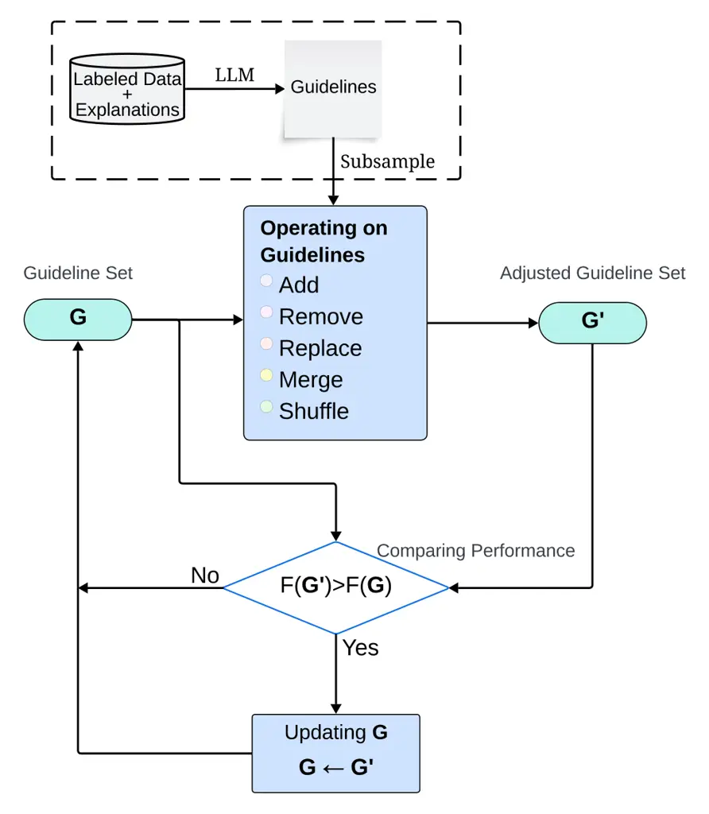
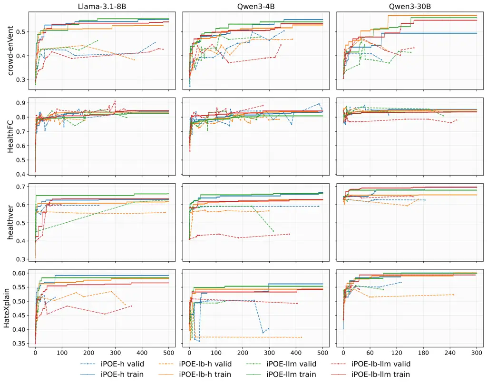
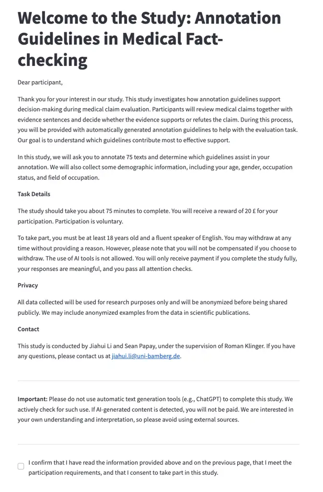
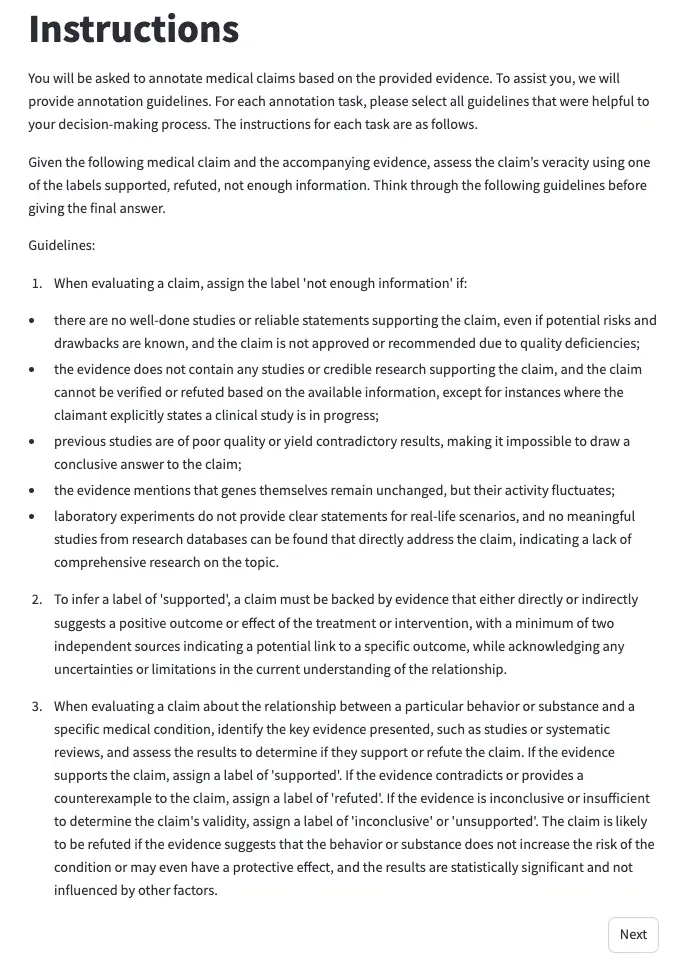
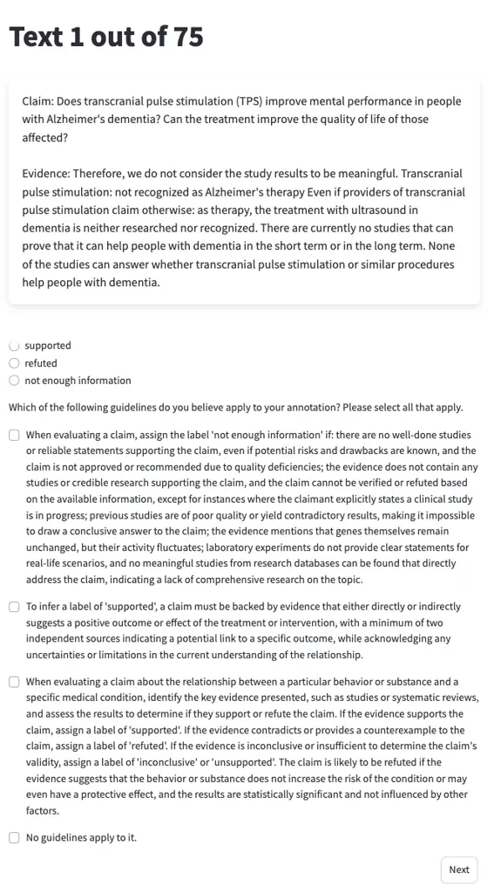

# iPOE: Interpretable Prompt Optimization via Explanations

Jiahui Li Affiliation: Fundamentals of Natural Language Processing,
University of Bamberg, Germany
Email: [jiahui.li@uni-bamberg.de](mailto:)    Yarik Menchaca Resendiz
Affiliation: Fundamentals of Natural Language Processing, University of
Bamberg, Germany Affiliation: Leibniz-Institut für Psychologie (ZPID),
Trier, Germany Email: [sean.papay@uni-bamberg.de](mailto:)    Sean Papay
Affiliation: Fundamentals of Natural Language Processing, University of
Bamberg, Germany Email: [roman.klinger@uni-bamberg.de](mailto:)    Roman
Klinger Affiliation: Fundamentals of Natural Language Processing,
University of Bamberg, Germany
Email: [ymr@leibniz-psychology.org](mailto:)

###### Abstract

Prompt optimization has often been framed as a discrete search problem
to find high-performing and robust instructions for a large language
model (LLM). However, the search result might not make it transparent
why and where specific prompt changes lead to performance gains. This is
in contrast to how humans are instructed for annotation tasks. Here,
researchers carefully design annotation guidelines, leading to enhanced
annotation consistency. Our paper aims at joining these two approaches
and introduces iPOE, a novel interpretable prompt optimization strategy
via explanations. We guide the prompt optimization process by
automatically created guidelines from explanations of annotation
decisions (either automatically generated or from humans). This set of
guidelines is furthermore optimized by a series of operations, including
removing, adding, shuffling, and merging. The resulting prompt includes
guidelines that instruct the annotation, making the decision process of
the LLM and the optimization transparent. It therefore supports also
laypeople in prompt optimization. In our experiments on four datasets,
we find that iPOE can improve over the evaluated baselines by up to
$`39\%`$ and LLM explanations can replace human explanations in the
proposed method. Moreover, our interpretability validation study
demonstrates that humans and LLMs substantially agree on which
guidelines contribute to their annotations, achieving a Cohen’s kappa
score between annotators and LLMs of up to $`0.68`$, $`0.80`$, and
$`0.95`$ for the emotion classification, medical fact-checking, and hate
speech detection tasks respectively.

This paper contains examples with offensive or hateful content.

## 1 Introduction

The effectiveness of large language models (LLMs) often relies on the
expertise of a prompt engineer (Mishra et al., 2022; Liu et al., 2023;
Tan et al., 2024). A challenge for them is prompt brittleness, wherein
minor modifications in prompt phrasing lead to substantial differences
in LLM outputs (Lu et al., 2022; Tang et al., 2024). One approach to
support the development of prompts are discrete search strategies to
optimize hard prompts that aim at identifying prompt variants yielding
improved performance (Pryzant et al., 2023; Prasad et al., 2023).
However, content-level modifications, such as incorporating explicit
task descriptions or guidance, have a greater impact on model
performance than lexical perturbations (Lampinen et al., 2022;
Yugeswardeenoo et al., 2024; Li et al., 2025).

Figure 1: The depiction of our proposed iPOE method to generate
guidelines as a prompt. The example prompts are bolded and the text is
quoted.

A similar strategy for improving human annotator performance is to
provide clearer instructions. Such instructions, the annotation
guidelines, are also often iteratively improved, by measuring
inter-annotator agreement (Griffitt and Strassel, 2016) and adapting
them if needed. Good instructions have a substantial impact on
annotation quality (Pradhan et al., 2022; Fazelpour and De-Arteaga,
2022). Interestingly, such annotation guidelines can also enhance
performance by mitigating bias and ambiguity for LLMs reasoning (Wang et
al., 2023).

This combination of using annotation guidelines for humans in LLMs is
arguably a mismatch. As LLMs are not human annotators, applying such
guidelines to a prompt does not guarantee the consistency of LLMs to
capture or adhere to concept definitions specified in these
guidelines (Zhang et al., 2023; Fonseca and Cohen, 2024). This
observation highlights the weakness of applying existing annotation
guidelines, which are designed by humans and targeted at humans,
directly to LLMs. Moreover, manually crafting high-quality guidelines is
itself a challenging task, requiring expertise not only in the task
domain but also in understanding model behavior (Reynolds and McDonell,
2021; Zamfirescu-Pereira et al., 2023).

We therefore propose to use the idea of iteratively refining guidelines,
as commonly done for humans, but correspondingly with LLMs. Our approach
iPOE (Interpretable Prompt Optimization via Explanations) derives
guidelines from explanations of annotation decisions. These decision
explanations are part of some datasets, but can also be automatically
created posthoc. We illustrate the approach in Figure 1: The output of
our method consists of an augmentation of an iteratively optimized set
of guidelines that extend an existing prompt for a given task in an
interpretable manner. All of our data and code are available at
[https://www.uni-bamberg.de/en/nlproc/projects/inprompt/](https://www.uni-bamberg.de/en/nlproc/projects/inprompt/).

## 2 Related Work

### 2.1 Annotation Guidelines for Humans

Traditional annotation process requires iterative refinement of
guidelines between researchers and annotators to ensure clarity of
tasks (Griffitt and Strassel, 2016). This process involves multiple
rounds of inspecting annotation disagreements, discussing with
annotators, and identifying patterns to improve the guidelines.

The final guidelines often consist of a detailed description of the
task, examples, and relevant criteria for particular cases. Cole (2011)
highlight the importance of knowledge formulation in guidelines,
revealing that humans’ understanding of a task evolves throughout the
process of information searching. The lack of specificity about precise
mechanisms can also bring implicit biases during the annotation process,
leading to invalid experimental designs (Fazelpour and De-Arteaga,
2022).

Although recent crowd-sourcing approaches make annotation more
accessible and cost-effective, they can also introduce additional
ambiguity. Pradhan et al. (2022) demonstrate that fine-grained
annotation guidelines can mitigate such ambiguity and improve data
quality. Similarly, Kulesza et al. (2014) propose structured labeling
solutions to enhance human annotation consistency for machine learning
systems.

### 2.2 Prompt Optimization

To address the limitation of manually designed prompts, early work
proposed to automatically create prompts for models (Shin et al., 2020).
They formulate prompt optimization as a discrete search problem.
Previous methods explored heuristic search, such as beam search for the
zero-shot re-ranking process (Cho et al., 2023), or the use of edit
operations including delete, swap, add, and paraphrase to navigate the
prompt space (Prasad et al., 2023). Similarly, Resendiz and Klinger
(2023) propose an automatic prompt optimization approach for
emotion-conditioned text generation by adding, removing, or replacing
tokens. Yang et al. (2024b) and Li and Klinger (2025) search for new
prompt candidates by edit-based and LLM rewriting methods supported by
human understanding on additional information. Evolutionary strategies
were also employed to balance exploration and exploitation in discrete
prompt search (Guo et al., 2025). However, their work lacks contextual
information about the task, and the limited search space does not help
mitigate potential biases in the task prompt. Therefore, we are inspired
to incorporate an expanded context space and frame the problem as
searching for an optimal set of guidelines.

Another major research thread leverages preference signals or structured
feedback. Pryzant et al. (2023) introduce natural language “gradients”
to critique prompts and guide optimization, while Do et al. (2024) ask
an LLM to propose edits based on the analysis of prompt-output pairs’
loss. Cheng et al. (2024) refine user prompts by incorporating human and
AI preferences, constructing pairs of the original instruction and its
optimized version to train a sequence-to-sequence instruction optimizer.
Our approach also aims to exploit such additional information either
provided by humans or LLMs, but instead to generate rules and guidelines
by learning from explanations.



Figure 2: The conceptual workflow of our iPOE approach. $`G`$ refers to
the current guideline set which is an empty set in the very beginning,
and $`G^{\prime}`$ is the updated guideline set from the operations that
achieve the best performance. $`F(\cdot)`$ refers to a performance
metric.

### 2.3 Annotation Guideline Use in Prompts

Building on top of effective human annotation process, recent work
focuses on exploiting annotator guidelines during the model development
process. These guidelines are a natural source of information, which
constitute high-quality information on the task. Sainz et al. (2024)
fine-tune models to comply with released guidelines by authors,
resulting in improved zero-shot information extraction performance. Wang
et al. (2023) show that expert-written instructions can enhance LLMs on
information extraction tasks, emphasizing the value of explicit task
guidance. In contrast, other studies express less confidence in directly
incorporating human annotation guidelines into model inputs. Zhang et
al. (2023) report only limited enhancement when integrating annotator
guidelines into prompts for LLMs. Fonseca and Cohen (2024) find that
LLMs exhibit inconsistent capabilities when leveraging their manually
designed annotation guidelines with conceptual definitions for
classification tasks. Thus, our work concentrates on automatically
constructing more comprehensive guidelines that adapt to model
understanding.

While language models are known to acquire sufficient conceptual
structure to generalize across related concepts (Patel and Pavlick,
2022), Min et al. (2022) observe that LLMs gain limited benefit from
input–label examples alone. Therefore, we exploit the generalization
abilities of LLMs to generate new annotation guidelines by learning from
provided samples along with explanations.

1: $`P`$: prompt prefix; $`D`$: training data; $`I`$: maximum
iterations; $`\mathcal{O}`$: guideline operators

2: $`R\leftarrow\mathrm{LLM}(D)`$ $`\triangleright`$ generate guidelines
pool

3: $`G\leftarrow\emptyset`$ $`\triangleright`$ current guideline set

4: $`S\leftarrow F(P\oplus G)`$ $`\triangleright`$ score of prompt
prefix concatenated with current guidelines

5: for $`i=1\ \mathbf{to}\ I`$ do

6:   $`g\sim\mathrm{Sample}(R)`$

7:   for all $`o\in\mathcal{O}`$ do

8:    $`G^{\prime}\leftarrow o(G,g)`$

9:    $`S^{\prime}\leftarrow F(P\oplus G^{\prime})`$

10:    if $`S^{\prime}>S`$ then

11:      $`G\leftarrow G^{\prime}`$

12:      $`S\leftarrow S^{\prime}`$

13:    end if

14:   end for

15: end for

16: return $`P\oplus G`$

Algorithm 1 Prompt Optimization with Guidelines

## 3 Methods

Figure 2 illustrates the conceptual workflow of our iPOE approach. The
labeled data along with its explanations is first converted to a
guideline pool. Then the workflow begins with a prompt prefix and
proceeds through a number of iterations to upgrade the guideline set.
For each iteration, multiple operations are applied with guidelines
sampled from the guideline pool. We also provide a formal explanation of
the method in Algorithm 1. In this section, we explain the prompt
optimization process and operations used to edit the guideline set in
details.

#### Iterative Optimization.

We first employ an LLM to produce rule-like guidelines from the training
data to obtain the guidelines pool $`R`$ for the optimization process.
Each guideline in the pool is generated by prompting the LLM with each
instance, gold label, and its explanation on why the label is selected,
which are either written by humans or LLMs. The meta-prompts used are
presented in Appendix A.1. The workflow begins with a prompt prefix
$`P`$ and the current guideline set $`G`$ is empty. In each iteration,
we subsample a small set of guidelines $`g`$ and perform a set of
guideline operators $`\mathcal{O}`$ on $`g`$ respectively. Among all
possible operations, we compute the performance scores evaluated on the
training data and attain the new guideline set $`G^{\prime}`$ that
achieves the highest performance:

```math
G^{\prime}=\operatorname*{arg\,max}_{\begin{subarray}{c}o\in\mathcal{O}\\
g\subset R\end{subarray}}F\!\left(P\oplus o(G,g)\right),
```

where $`F`$ denotes the performance metric and $`\oplus`$ refers to the
concatenation of two strings. The framework then checks whether the
winning operation yields an improvement:

```math
F(P\oplus G^{\prime})>F(P\oplus G).
```

If the candidate operation improves performance, the guidelines are
updated according to

```math
G\leftarrow G^{\prime}.
```

Otherwise, the update is rejected, and the system retains the current
guideline set. The above steps are repeated iteratively until a
predefined maximum iteration $`I`$.

#### Operations.

Each operation is performed on a set of selected guidelines which is
sampled from the generated guidelines database. We provide two sampling
strategies: no-control (iPOE) and label-control (iPOE-lb). The
no-control method refers to random sampling without any control of which
label the sampled guidelines belong to. The label-control method uses
uniform sampling according to the gold label of related guidelines,
which ensures that guidelines exist in the set for each label. The two
methods are employed differently in each iteration when a guideline set
is subsampled from the guideline pool, which only affect the ‘remove’
operation. The full list of operations is:

- •
  Add: Add the selected guidelines at the end of the current guideline
  set.
- •
  Remove: Remove $`n`$ guidelines in the current set randomly for the
  vanilla method, where $`n`$ is the number of selected guidelines, or
  $`n=1`$ if the current guideline set is smaller than the selected
  guideline set; remove one random guideline per label that exists in
  the selected guideline set for the label-control method.
- •
  Replace: Replace the guidelines which are removed in the ‘Remove’
  operation with the selected guidelines.
- •
  Merge: Merge the selected guidelines with the guidelines in the
  current set that share the same gold label using an LLM. The
  meta-prompts for merging guidelines are shown in Appendix A.1 and an
  example for this operation is provided in Appendix A.2.
- •
  Shuffle: Shuffle the order of guidelines in the current set.

## 4 Experiments

|          |                                                                                                                                                                                                                                                                                                                           |
| -------- | ------------------------------------------------------------------------------------------------------------------------------------------------------------------------------------------------------------------------------------------------------------------------------------------------------------------------- |
| Field    | Text                                                                                                                                                                                                                                                                                                                      |
| Instance | Text: I felt … when I had to do the dishes earlier. Label: boredom                                                                                                                                                                                                                                                        |
| Exp-h    | I hate the repetitive nature of dishes. Ugh.                                                                                                                                                                                                                                                                              |
| Gl-h     | Label the emotion as ’boredom’ when the text expresses a negative reaction to a repetitive, monotonous, or tedious task, such as doing dishes, that is performed without engagement or enjoyment, and when the speaker explicitly or implicitly conveys frustration or disdain toward the routine nature of the activity. |
| Exp-llm  | The label ’boredom’ was chosen because the text describes a mundane and routine task (doing the dishes) without any strong emotional connotation or excitement. This suggests a lack of engagement or interest, which is characteristic of boredom.                                                                       |
| Gl-llm   | When classifying emotions in text, select the label ’boredom’ if the text describes a mundane or routine task with a lack of strong emotional connotation or excitement, suggesting a lack of engagement or interest.                                                                                                     |

Table 1: An example for human-written and LLM-generated explanations and
corresponding guidelines. Instance: An instance text and gold label from
the crowd-enVent dataset; Exp-h: Human-written explanations; Exp-llm:
LLM-generated explanations; Gl-h: Guidelines produced from Exp-h;
Gl-llm: Guidelines produced from Exp-llm.

We evaluate our iPOE approach on four tasks across three LLMs. The
experiments involve both human-written and LLM-generated explanations to
validate the feasibility of replacing human effort with LLMs for
producing guidelines in the iPOE method. Table 1 provides an example of
these two explanation types and respective guidelines. The evaluation
covers two types of explanations: natural language explanations and
feature attributions, which are among the primary explanation types
collected and studied in explainability research. The optimization
process is conducted for five rounds in total per task to ensure the
robustness and stability of the results. In this section, we will
discuss the experimental settings and results in detail.

### 4.1 Experimental Setting

In this section, we first describe the datasets and tasks used in our
study, followed by the specific settings employed to obtain LLM
predictions. We then outline the baselines used to compare with the iPOE
methods. To validate the interpretability of our approach, we further
conduct a human study on the generated guidelines, compared with a
SHAP (Lundberg and Lee, 2017) based explainability method applied to
LLMs.

|              |       |       |      |     |
| ------------ | ----- | ----- | ---- | --- |
| Dataset      | Train | Va/Te | Exph | Typ |
| crowd-enVent | 5184  | 648   | 985  | Na  |
| HealthFC     | 600   | 75    | 600  | Na  |
| HealthVer    | 11464 | 1433  | —    | —   |
| HateXplain   | 9132  | 1142  | 9132 | Fe  |

Table 2: Statistics of the evaluated datasets. Train, Va/Te: Number of
retained instances for train, validation, and test splits. The
validation and test splits contain the same number of instances. Exph:
Number of available instances that are annotated with explanations; Typ:
Type of explanation; Na: Natural language explanation; Fe: Feature
attributions explanation.

#### Tasks.

We evaluate our approach on four English-language datasets from three
challenging domains in natural language processing: crowd-enVent
dataset (Troiano et al., 2023a) for emotion classification,
HealthFC (Vladika et al., 2024) and HealthVer (Sarrouti et al., 2021)
datasets for health fact-checking, and HateXplain for hate speech
detection (Mathew et al., 2021). The datasets crowd-enVent and HealthFC
provide explanations in natural language, while HateXplain offers
feature attributions as explanations. There are no human-written
explanations for the labeled data in HealthVer. All the datasets are
split into train, validation, and test sets in a proportion of 80%, 10%,
10% respectively. Their statistics are shown in Table 2.

For each dataset, we use human-written and LLM-generated explanations
for producing guidelines respectively. The explanations generated by
LLMs share the same type with corresponding human annotation.
Considering that HealthVer offers no human explanations but shares the
same task domain with HealthFC, we use guidelines derived from the human
annotation of HealthFC during the optimization process for HealthVer.

|              |          |           |           |
| ------------ | -------- | --------- | --------- |
| Dataset      | Qwen3-4B | Llama3-8B | Qwen3-30B |
| crowd-enVent | 296      | 592       | 1777      |
| HealthFC     | 171      | 343       | 1028      |
| HealthVer    | 327      | 655       | 1964      |
| HateXplain   | 261      | 521       | 1564      |

Table 3: Computational cost of our iPOE methods for three LLMs under
evaluated datasets. We report the time estimation (GPU hours) for one
whole optimization process including $`300`$ iterations, which we state
as one evaluation round.

#### LLMs.

We employ three LLMs capable of local deployment:
Llama-3.1-8B-Instruct (Patterson et al., 2022), Qwen3-4B-Instruct-2507
and Qwen3-30B-A3B-Instruct-2507 (Qwen, 2025).¹¹ 1
[https://huggingface.co/](https://huggingface.co/):
meta-llama/Llama-3.1-8B-Instruct, Qwen/Qwen3-4B-Instruct-2507,
Qwen/Qwen3-30B-A3B-Instruct-2507. All models are accessed and executed
using the HuggingFace library ecosystem. In order to invoke the
creativity of LLM generations, we enable stochastic decoding via
sampling for generating explanations and guidelines. Specifically, the
decoding configuration was selected to match typical deployments, with
top_p=0.9, temperature=0.6, and top_k=50. But the greedy decoding is
used for predicting labels to avoid the problem of LLM uncertainty.
Model predictions are elicited in a zero-shot fashion: for each
instance, the model is presented with the prompt, followed by the
instance text. The generated text is then parsed by attempting to
extract one of the requested labels from a .json format output. The meta
prompts used in our study are listed in Appendix A.1. The guideline
prompt is evaluated with F1-macro measure for both training iterations
and final testing. The guideline pool is generated from the training
splits for each dataset. Considering the computational constraints, the
performance score in each iteration is computed on the training splits
in a proportion of $`0.2`$, $`1.0`$, $`0.1`$, and $`0.1`$ for the
crowd-enVent, HealthFC, HealthVer, and HateXplain datasets respectively.
We set up the randomly sampled guideline number as $`3`$ per iteration
and the maximum optimization iteration as $`300`$ for each task per
evaluation round. The experiments are run on Nvidia A40 GPUs, with a
total estimation of $`9,500`$ GPU hours for each round. Table 3 reports
the computational cost separately for each model and dataset. By
comparison, the proposed approach holds comparable number of
optimization iterations compared to other prompt optimization
methods (Resendiz and Klinger, 2023; Yang et al., 2024a; Zhou et al.,
2023).

[TABLE]

Table 4: F1 scores of guideline prompts from different optimization
methods for three LLMs. V (vanilla): uses only the prefix prompt. R-h:
uses the prefix prompt and randomly selected guidelines generated from
human explanations. R-llm: uses the prefix prompt and randomly selected
guidelines generated from LLM explanations. H: uses human-written
guidelines (see Appendix A.5). Cot: uses chain-of-thought prompts (Wei
et al., 2022). IR: uses prompts generated from the instruction rewriting
method (Resendiz and Klinger, 2023). opro: uses LLMs as optimizers (Yang
et al., 2024a). iPOE-h: uses the prefix prompt and guidelines generated
from the iPOE method without label control using human explanations.
iPOE-lb-h: uses the prefix prompt and guidelines generated from the iPOE
method with label control using human explanations. iPOE-llm: uses the
prefix prompt and guidelines generated from the iPOE method without
label control using LLM explanations. iPOE-lb-llm: uses the prefix
prompt and guidelines generated from the iPOE method with label control
using LLM explanations; Fe: uses feature attributions to generate
guidelines; Na: uses natural language explanations to generate
guidelines. The proposed methods are introduced in Section 3, LLMs are
explained in Section 4.1, and the associated meta-prompts are displayed
in Appendix A.1.

#### Baselines.

To evaluate the effectiveness of our optimization process, we compare
the proposed prompt optimization approach against six baselines: (1)
Vanilla, which uses the prefix prompt without guidelines, (2) Random,
which uses a randomly selected guideline set whose size equals the
number of labels for each task, (3) Human-written guidelines (presented
in Appendix A.5), which are designed for the annotation process, (4)
Chain-of-thought prompts, which use ‘Let’s think step by step.’ as an
instruction (Wei et al., 2022), (5) Instruction rewriting, which
iteratively paraphrases prompts based on token-level search (Resendiz
and Klinger, 2023), and (6) OPRO, which leverages LLMs as
optimizers (Yang et al., 2024a).

#### Explainability study.

We collect a subset of the judgments for human evaluation on which
guidelines assist in their annotation. We evaluate on four different
variants of the optimized guideline sets with $`120`$ sampled instances
from the crowd-enVent and HateXplain test splits for the emotion
classification and hate speech detection tasks respectively. For the
health fact-checking task, we employ three variants of the optimized
guideline sets on the full test data of the HealthFC dataset. Due to the
high cost of human annotation and ethical reviews, the human study was
conducted by three of the authors. The average completion time for each
instance is approximately $`45`$ seconds and the total study time is
about $`5`$ hours for each annotator. We further implement an
explainability analysis based on the SHAP (Lundberg and Lee, 2017)
method to investigate which guidelines contribute to LLM prediction. The
guidelines used in the study are selected from the best performance
results from our proposed methods.

### 4.2 Results

In the following, we present the results and analysis of the experiments
described above. We begin by summarizing the performance of the iPOE
approach compared to the baseline methods. We select the best
performance results among the evaluated five optimization rounds for our
proposed methods. Next, we examine the effectiveness of the proposed
method when human explanations are replaced with explanations generated
by LLMs. We then report a case study in medical fact-checking to
evaluate whether guidelines derived from one data distribution can be
applied to another distribution within the same domain. Additionally, we
investigate whether different types of explanations influence the
quality of producing the guidelines. Finally, we qualitatively analyze
the evolution of the guideline set in one of the tasks.

|                                                                                 |            |            |            |
| ------------------------------------------------------------------------------- | ---------- | ---------- | ---------- |
| Text                                                                            | Gold       | Vanilla    | iPOE       |
| everything is pretentious when you are ignorant trailer trash inspirational     | normal     | hatespeech | normal     |
| miss my ghetto bitches                                                          | normal     | hatespeech | normal     |
| hiring a cleaning lady as a woman is ghetto debate your mom                     | normal     | hatespeech | normal     |
| looks like your average ghetto hopper                                           | normal     | offensive  | normal     |
| we went to the zoo to feed the niglet                                           | hatespeech | normal     | hatespeech |
| the muzrat euro marathon                                                        | hatespeech | normal     | hatespeech |
| why are men actually retarded                                                   | offensive  | hatespeech | offensive  |
| can not fight for shit lmao literally arabs can not fight for shit              | offensive  | hatespeech | offensive  |
| they must be a big minority in d.c. seeing \<number\> voted for the devil bitch | offensive  | hatespeech | offensive  |
| thank god no more of that chinaman and protea favourite tabraiz shamsi          | offensive  | hatespeech | offensive  |

Table 5: Example instances in which the vanilla baseline fails but the
iPOE method succeeds. The instances are selected from the HateXplain
dataset. Gold: the gold label from the original dataset; Vanilla: the
label predicted by the vanilla baseline; iPOE: the label predicted by
the iPOE method. The vanilla baseline uses only the prefix prompt
without guidelines. For these examples, the iPOE method incorporates
human explanations and the Llama-3.1-8B-Instruct model. The prefix
prompt and guidelines are provided in Appendix A.4.

#### Overall results.

Table 4 reports the overall F1 scores on the test data. For our iPOE
methods, we select the prompts which achieve the highest score on the
validation data. We also provide the training and validation learning
curves during the prompt optimization process in Appendix A.3. Across
all evaluated datasets and LLMs, our iPOE approach consistently
outperforms the baselines. On average, iPOE-h (human explanations
without label control) improves over vanilla, random, chain-of-thought,
human-written guidelines, instruction rewriting, and OPRO baselines by
$`34`$, $`39`$, $`32`$, $`25`$, $`24`$, and $`23`$ percentage points
(pp), respectively. iPOE-lb-h (human explanations with label control)
outperforms the six baselines by $`32`$, $`37`$, $`30`$, $`23`$, $`22`$,
and $`21`$ pp, respectively. These results suggest that label control
during the guideline subsampling process has only a minor impact on the
general performance. However, we do not view iPOE as competing or
conflicting with existing automatic prompt optimization methods. Our
proposed approach can be combined with other search-based prompt
optimization methods. For example, instruction-rewriting ones, iPOE can
benefit from polishing for more concise and minor redundant guidelines.
Considering gradient descent ones or optimization based on objective
functions, such as OPRO, we can incorporate their underlying principles
into our optimization algorithm.

#### Human explanations vs. LLM explanations.

To reduce human effort for the iPOE approach, we construct guidelines
from LLM-generated explanations. As shown in Table 4, iPOE-llm (LLM
explanations without label control) improves over vanilla, random (using
LLM explanations), chain-of-thought, human-written guidelines,
instruction rewriting, and OPRO baselines by $`34`$, $`32`$, $`33`$,
$`25`$, $`24`$, and $`23`$ pp, respectively, while iPOE-lb-llm (LLM
explanations with label control) achieves gains of $`33`$, $`31`$,
$`31`$, $`24`$, $`22`$, and $`21`$ pp, respectively. This indicates that
LLM-generated explanations can produce guidelines for the iPOE approach
with performance comparable to those derived from human-written
explanations. Qualitatively, we observe that guidelines derived from
human explanations exhibit similar patterns and logical rules to those
generated from LLM explanations. An example of emotion classification
task is illustrated in Table 1.

#### Out-of-distribution evaluation.

The datasets containing human-written explanations for health
fact-checking are scarce, and the selected HealthFC dataset is
relatively small. To strengthen the robustness of our evaluation for the
health fact-checking task, we specifically apply guidelines derived from
the HealthFC dataset to the HealthVer dataset, which does not provide
human explanations. Although both datasets address the same task domain,
they differ in data distributions. The HealthFC dataset primarily
focuses on German clinical trial claims, whereas the HealthVer dataset
centers on health-related claims about COVID-19. Our results show that
guidelines generated using the iPOE method can effectively support
out-of-distribution reasoning within the same domain. Moreover, the
out-of-distribution guidelines exhibit capabilities comparable to those
of the guidelines generated from the original distribution of the
HealthVer training data using LLM explanations. Both sets of guidelines
share similar patterns. However, the HealthVer guidelines frequently
include examples related to COVID-19.

#### Feature attributions vs. natural language explanations.

For hate speech detection, we compare the application of guidelines
derived from two explanation modalities including feature attributions
and natural language explanations. In our evaluations on emotion
classification and health fact-checking tasks, LLM-generated
explanations were shown to provide comparable support for guideline
generation. We therefore use LLMs to generate natural language
explanations from the labeled data in the HateXplain dataset, which
originally provides only feature attribution explanations. Our results
indicate that both explanation modalities yield guidelines with similar
patterns and comparable effectiveness during the optimization process.

#### Qualitative analysis.

To further compare the difference between the iPOE approach and the
baselines, we present several examples along with the predictions of the
iPOE-h and vanilla methods in Table 5. The associated prompts are
provided in Appendix A.4. For the hate speech detection task, we
specifically select $`10`$ instances in which the vanilla method fails
but the iPOE method succeeds. The examples illustrate incorrect
predictions generated by the vanilla method from three perspectives: (1)
instances labeled as ‘normal’ are misclassified as ‘hatespeech’ or
‘offensive’ text; (2) instances labeled as ‘hatespeech’ are predicted as
‘normal’; and (3) instances labeled as ‘offensive’ are wrongly viewed as
‘hatespeech’. In case (1), the guidelines provide clarifications for the
label ‘normal’ and include examples of expressions that may appear
ironic but are not hateful. In case (2), the guidelines list typical
derogatory terms associated with particular groups or individuals to
identify genuinely hateful content. In case (3), the guidelines present
specific rules and examples that help distinguish offensive content from
hate speech. Across all cases, the vanilla prompt lacks such
clarifications and examples, which likely contributes to the model’s
misunderstandings and resulting misclassifications.

Additionally, we provide an example of the iPOE development process
trained on the HealthVer dataset in Appendix A.6. We observe that the
guidelines produced by LLMs tend to be longer than the corresponding
explanations. The LLMs often supplement the guidelines with a formal
description of how to select a specific label, along with typical
instances and illustrative examples. We agree that this additional
information helps clarify the task and improves readability. In
addition, some guidelines not only describe the features of the selected
label but also explain how it differs from other labels, which assists
in reducing bias and ambiguity in the task. To investigate the effect of
incorporating richer guidelines during iterative search, we analyze the
number of guidelines included in the optimal prompts. We observe that
cases in which the number of generated guidelines exceeds the size of
the label set are rare. By plotting the frequency of each operation in
the optimization process, we find that add, remove, and replace
operations yield comparable contributions, while the merge operation
accounts for the largest proportion of edits across all tasks. This
operation rewrites multiple guidelines derived from the same gold label
into a more comprehensive yet concise form. Since the guidelines are
generated by LLMs and the merge operation is also performed by the same
LLM, we do not conduct additional experiments that remove the merge
operation or replace it with simple concatenation or summarization,
primarily due to the associated computational cost. Moreover, previous
studies have shown that prompt brittleness in recent LLMs is relatively
insensitive to semantically equivalent modifications (Li et al., 2025).
Based on a careful qualitative review, we observe that the guidelines
before and after the merge operation are not fundamentally different,
suggesting that the performance gains are only marginally influenced by
LLM-based rewriting.

|              |          |           |           |
| ------------ | -------- | --------- | --------- |
| Dataset      | Qwen3-4B | Llama3-8B | Qwen3-30B |
| crowd-enVent | .63      | .68       | .56       |
| HealthFC     | .65      | .80       | .74       |
| HateXplain   | .83      | .81       | .95       |

Table 6: Average Cohen’s kappa scores between humans and LLMs on
selected guidelines of the evaluated datasets for our explainability
study.

#### Interpretability validation.

We compare which guidelines contribute to annotation decisions between
humans and LLMs, and examine their inter-annotator agreement. We observe
that humans tend to focus on guidelines directly associated with their
selected label. In contrast, SHAP explanations indicate that multiple
guidelines can contribute to the LLM’s predictions. We hypothesize that
humans may primarily attend to guidelines supporting the chosen label
while ignoring those that help rule out alternative labels, whereas LLMs
incorporate both types of information. Overall, we obtain Cohen’s kappa
agreement scores of selected guidelines between humans and LLMs for the
evaluated tasks and LLMs, presented in Table 6. The kappa scores
indicate substantial agreement for the emotion classification, health
fact-checking, and hate speech detection tasks, thereby providing
evidence to some extent that humans partially parallel their
decision-making process with the model’s.

## 5 Conclusion and Future Work

We proposed interpretable prompt optimization as a novel approach to
produce guidelines using either human-written or LLM-generated
explanations. The guidelines are expected to support LLMs’ prediction.
To search for the optimal guideline set, we further iteratively apply a
series of operations including removing, adding, shuffling, and merging.
With this approach, we instruct the LLM’s annotation by effective
guidelines, offering a transparent decision process of the LLM and the
optimization.

Our results span three domains and suggest that iPOE can enhance
performance while producing prompts that are human-understandable and
interpretable. We demonstrate that LLM-generated explanations can
effectively replace human-written explanations within the proposed
approach, thereby reducing the need for costly human effort. Moreover,
the optimized guideline set achieves higher performance than
human-written annotation guidelines in LLM prediction. The
out-of-distribution evaluation also provides encouraging evidence that
iPOE can be applied to other domains where human annotations are
difficult to obtain.

The proposed approach has revealed several challenges that deserve
further investigation. There is a need to explore more efficient
methodologies for a faster convergence of the learning process.
Additionally, some optimal guideline sets contain duplicate guidelines
associated with the same label. The readability of our approach could be
improved by incorporating methods that effectively identify and
eliminate such redundancies.

## Limitations

Despite the promising performance of our approach, we observe several
limitations. First, the availability of human-written explanations,
especially feature attributions, is limited. Consequently, the
comparison between human-generated and LLM-generated explanations, as
well as across different explanation types, remains constrained in
scope. A more comprehensive analysis would require a more diverse
collection of human annotations. Second, due to computational
constraints, we do not evaluate the impact of varying numbers of sampled
guidelines in each optimization iteration to measure the sensitivity of
the proposed method to the sample size. Third, although the guideline
pool generated from human explanations is smaller than that generated
from LLM explanations while achieving comparable performance, further
ablation studies are needed to investigate the effect of guideline pool
size under the same source conditions. Lastly, a larger scale human
study would provide stronger validation of our interpretability claims,
although such studies are limited by associated costs.

## Ethical Considerations

The datasets used for our experiments are publicly available and we
ensure that they have been collected according to ethical standards
before employing them. We do not change the intentional use for the
evaluated datasets and LLMs. Our method does not contribute to the
republication or redistribution of any datasets and models. We believe
our findings provide valuable insights for future research in automatic
annotation processes using LLMs. We acknowledge that the evaluated
datasets involve potential ethical challenges. However, as our work does
not introduce a novel task and instead builds upon existing tasks, we do
not anticipate additional ethical concerns beyond those already
associated with prior work. The human study is conducted by the authors
of this paper. Besides, the paper presents examples including offensive
content or hate speech, which we give a warning in the beginning.
Additionally, ChatGPT (OpenAI, 2025) was used to improve code generation
for making figures and tables, as well as to assist with grammar and
vocabulary in the text of some paragraphs of this paper.

## Acknowledgments

This work is funded by the project INPROMPT (Interactive Prompt
Optimization with the Human in the Loop for Natural Language
Understanding Model Development and Intervention, funded by the German
Research Foundation, KL 2869/13–1, project number 521755488). We also
gratefully acknowledge the scientific support and HPC resources provided
by the Erlangen National High Performance Computing Center of the
Friedrich-Alexander-Universität Erlangen-Nürnberg under the BayernKI
project. BayernKI project funding is provided by Bavarian state
authorities.

## References

- Cheng et al. (2024) J. Cheng, X. Liu, K. Zheng, P. Ke, H. Wang, Y.
  Dong, J. Tang, and M. Huang Black-box prompt optimization: aligning
  large language models without model training. In Proceedings of the
  62nd Annual Meeting of the Association for Computational Linguistics
  (Volume 1: Long Papers), L. Ku, A. Martins, and V. Srikumar (Eds.),
  Bangkok, Thailand, pp. 3201–3219. External Links:
  [Link](https://aclanthology.org/2024.acl-long.176/),
  [Document](https://dx.doi.org/10.18653/v1/2024.acl-long.176) Cited by:
  §2.2.
- Cho et al. (2023) S. Cho, S. Jeong, J. y. Seo, and J. Park Discrete
  prompt optimization via constrained generation for zero-shot
  re-ranker. In Findings of the Association for Computational
  Linguistics: ACL 2023, A. Rogers, J. Boyd-Graber, and N. Okazaki
  (Eds.), Toronto, Canada, pp. 960–971. External Links:
  [Link](https://aclanthology.org/2023.findings-acl.61/),
  [Document](https://dx.doi.org/10.18653/v1/2023.findings-acl.61) Cited
  by: §2.2.
- Cole (2011) C. Cole A theory of information need for information
  retrieval that connects information to knowledge. J. Am. Soc. Inf.
  Sci. Technol. 62 (7), pp. 1216–1231. External Links: ISSN 1532-2882,
  [Link](https://doi.org/10.1002/asi.21541),
  [Document](https://dx.doi.org/10.1002/asi.21541) Cited by: §2.1.
- Do et al. (2024) X. L. Do, Y. Zhao, H. Brown, Y. Xie, J. X.
  Zhao, N. F. Chen, K. Kawaguchi, M. Shieh, and J. He Prompt
  optimization via adversarial in-context learning. In Proceedings of
  the 62nd Annual Meeting of the Association for Computational
  Linguistics (Volume 1: Long Papers), L. Ku, A. Martins, and V.
  Srikumar (Eds.), Bangkok, Thailand, pp. 7308–7327. External Links:
  [Link](https://aclanthology.org/2024.acl-long.395/),
  [Document](https://dx.doi.org/10.18653/v1/2024.acl-long.395) Cited by:
  §2.2.
- Fazelpour and De-Arteaga (2022) S. Fazelpour and M. De-Arteaga
  Diversity in sociotechnical machine learning systems. Big Data &
  Society 9 (1), pp. 20539517221082027. External Links:
  [Document](https://dx.doi.org/10.1177/20539517221082027),
  [Link](https://doi.org/10.1177/20539517221082027),
  https://doi.org/10.1177/20539517221082027 Cited by: §1, §2.1.
- Fonseca and Cohen (2024) M. Fonseca and S. Cohen Can large language
  models follow concept annotation guidelines? a case study on
  scientific and financial domains. In Findings of the Association for
  Computational Linguistics: ACL 2024, L. Ku, A. Martins, and V.
  Srikumar (Eds.), Bangkok, Thailand, pp. 8027–8042. External Links:
  [Link](https://aclanthology.org/2024.findings-acl.478/),
  [Document](https://dx.doi.org/10.18653/v1/2024.findings-acl.478) Cited
  by: §1, §2.3.
- Griffitt and Strassel (2016) K. Griffitt and S. Strassel The query of
  everything: developing open-domain, natural-language queries for BOLT
  information retrieval. In Proceedings of the Tenth International
  Conference on Language Resources and Evaluation (LREC’16), N.
  Calzolari, K. Choukri, T. Declerck, S. Goggi, M. Grobelnik, B.
  Maegaard, J. Mariani, H. Mazo, A. Moreno, J. Odijk, and S. Piperidis
  (Eds.), Portorož, Slovenia, pp. 3741–3747. External Links:
  [Link](https://aclanthology.org/L16-1593/) Cited by: §1, §2.1.
- Guo et al. (2025) Q. Guo, R. Wang, J. Guo, B. Li, K. Song, X. Tan, G.
  Liu, J. Bian, and Y. Yang EvoPrompt: connecting llms with evolutionary
  algorithms yields powerful prompt optimizers. External Links:
  2309.08532, [Link](https://arxiv.org/abs/2309.08532) Cited by: §2.2.
- Kulesza et al. (2014) T. Kulesza, S. Amershi, R. Caruana, D. Fisher,
  and D. Charles Structured labeling for facilitating concept evolution
  in machine learning. In Proceedings of the SIGCHI Conference on Human
  Factors in Computing Systems, CHI ’14, New York, NY, USA,
  pp. 3075–3084. External Links: ISBN 9781450324731,
  [Link](https://doi.org/10.1145/2556288.2557238),
  [Document](https://dx.doi.org/10.1145/2556288.2557238) Cited by: §2.1.
- Lampinen et al. (2022) A. Lampinen, I. Dasgupta, S. Chan, K.
  Mathewson, M. Tessler, A. Creswell, J. McClelland, J. Wang, and F.
  Hill Can language models learn from explanations in context?. In
  Findings of the Association for Computational Linguistics: EMNLP
  2022, Y. Goldberg, Z. Kozareva, and Y. Zhang (Eds.), Abu Dhabi, United
  Arab Emirates, pp. 537–563. External Links:
  [Link](https://aclanthology.org/2022.findings-emnlp.38/),
  [Document](https://dx.doi.org/10.18653/v1/2022.findings-emnlp.38)
  Cited by: §1.
- Li and Klinger (2025) J. Li and R. Klinger IPrOp: interactive prompt
  optimization for large language models with a human in the loop. In
  Proceedings of the 63rd Annual Meeting of the Association for
  Computational Linguistics (Volume 4: Student Research Workshop), J.
  Zhao, M. Wang, and Z. Liu (Eds.), Vienna, Austria, pp. 276–285.
  External Links: [Link](https://aclanthology.org/2025.acl-srw.18/),
  [Document](https://dx.doi.org/10.18653/v1/2025.acl-srw.18), ISBN
  979-8-89176-254-1 Cited by: §2.2.
- Li et al. (2025) J. Li, S. Papay, and R. Klinger Are humans as brittle
  as large language models?. In Proceedings of the 14th International
  Joint Conference on Natural Language Processing and the 4th Conference
  of the Asia-Pacific Chapter of the Association for Computational
  Linguistics, K. Inui, S. Sakti, H. Wang, D. F. Wong, P.
  Bhattacharyya, B. Banerjee, A. Ekbal, T. Chakraborty, and D. P. Singh
  (Eds.), Mumbai, India, pp. 2130–2155. External Links:
  [Link](https://aclanthology.org/2025.ijcnlp-long.116/), ISBN
  979-8-89176-298-5 Cited by: §1, §4.2.
- Liu et al. (2023) P. Liu, W. Yuan, J. Fu, Z. Jiang, H. Hayashi, and G.
  Neubig Pre-train, prompt, and predict: a systematic survey of
  prompting methods in natural language processing. ACM Comput. Surv. 55
  (9). External Links: ISSN 0360-0300,
  [Link](https://doi.org/10.1145/3560815),
  [Document](https://dx.doi.org/10.1145/3560815) Cited by: §1.
- Lu et al. (2022) Y. Lu, M. Bartolo, A. Moore, S. Riedel, and P.
  Stenetorp Fantastically ordered prompts and where to find them:
  overcoming few-shot prompt order sensitivity. In Proceedings of the
  60th Annual Meeting of the Association for Computational Linguistics
  (Volume 1: Long Papers), S. Muresan, P. Nakov, and A. Villavicencio
  (Eds.), Dublin, Ireland, pp. 8086–8098. External Links:
  [Link](https://aclanthology.org/2022.acl-long.556/),
  [Document](https://dx.doi.org/10.18653/v1/2022.acl-long.556) Cited by:
  §1.
- Lundberg and Lee (2017) S. M. Lundberg and S. Lee A unified approach
  to interpreting model predictions. In Advances in Neural Information
  Processing Systems, I. Guyon, U. V. Luxburg, S. Bengio, H. Wallach, R.
  Fergus, S. Vishwanathan, and R. Garnett (Eds.), Vol. 30, pp. .
  External Links:
  [Link](https://proceedings.neurips.cc/paper_files/paper/2017/file/8a20a8621978632d76c43dfd28b67767-Paper.pdf)
  Cited by: §4.1, §4.1.
- Mathew et al. (2021) B. Mathew, P. Saha, S. M. Yimam, C. Biemann, P.
  Goyal, and A. Mukherjee HateXplain: a benchmark dataset for
  explainable hate speech detection. Proceedings of the AAAI Conference
  on Artificial Intelligence 35 (17), pp. 14867–14875. External Links:
  [Link](https://ojs.aaai.org/index.php/AAAI/article/view/17745),
  [Document](https://dx.doi.org/10.1609/aaai.v35i17.17745) Cited by:
  §4.1.
- Melis et al. (2025) M. Melis, G. Lapesa, and D. Assenmacher A modular
  taxonomy for hate speech definitions and its impact on zero-shot LLM
  classification performance. In Proceedings of the 9th Workshop on
  Online Abuse and Harms (WOAH), A. Calabrese, C. de Kock, D.
  Nozza, F. M. Plaza-del-Arco, Z. Talat, and F. Vargas (Eds.), Vienna,
  Austria, pp. 490–521. External Links:
  [Link](https://aclanthology.org/2025.woah-1.45/), ISBN
  979-8-89176-105-6 Cited by: Table 10.
- Min et al. (2022) S. Min, X. Lyu, A. Holtzman, M. Artetxe, M.
  Lewis, H. Hajishirzi, and L. Zettlemoyer Rethinking the role of
  demonstrations: what makes in-context learning work?. In Proceedings
  of the 2022 Conference on Empirical Methods in Natural Language
  Processing, Y. Goldberg, Z. Kozareva, and Y. Zhang (Eds.), Abu Dhabi,
  United Arab Emirates, pp. 11048–11064. External Links:
  [Link](https://aclanthology.org/2022.emnlp-main.759/),
  [Document](https://dx.doi.org/10.18653/v1/2022.emnlp-main.759) Cited
  by: §2.3.
- Mishra et al. (2022) S. Mishra, D. Khashabi, C. Baral, and H.
  Hajishirzi Cross-task generalization via natural language
  crowdsourcing instructions. In Proceedings of the 60th Annual Meeting
  of the Association for Computational Linguistics (Volume 1: Long
  Papers), S. Muresan, P. Nakov, and A. Villavicencio (Eds.), Dublin,
  Ireland, pp. 3470–3487. External Links:
  [Link](https://aclanthology.org/2022.acl-long.244/),
  [Document](https://dx.doi.org/10.18653/v1/2022.acl-long.244) Cited by:
  §1.
- OpenAI (2025) OpenAI ChatGPT (gpt-4). Note:
  [https://chat.openai.com](https://chat.openai.com)Large language model
  Cited by: Ethical Considerations.
- Patel and Pavlick (2022) R. Patel and E. Pavlick Mapping language
  models to grounded conceptual spaces. In International Conference on
  Learning Representations, External Links:
  [Link](https://openreview.net/forum?id=gJcEM8sxHK) Cited by: §2.3.
- Patterson et al. (2022) D. Patterson, J. Gonzalez, U. Hölzle, Q.
  Le, C. Liang, L. Munguia, D. Rothchild, D. So, M. Texier, and J. Dean
  The carbon footprint of machine learning training will plateau, then
  shrink. External Links: 2204.05149,
  [Link](https://arxiv.org/abs/2204.05149) Cited by: §4.1.
- Pradhan et al. (2022) V. K. Pradhan, M. Schaekermann, and M. Lease In
  search of ambiguity: a three-stage workflow design to clarify
  annotation guidelines for crowd workers. Frontiers in Artificial
  Intelligence 5, pp. 828187. External Links:
  [Document](https://dx.doi.org/10.3389/frai.2022.828187),
  [Link](https://doi.org/10.3389/frai.2022.828187) Cited by: §1, §2.1.
- Prasad et al. (2023) A. Prasad, P. Hase, X. Zhou, and M. Bansal GrIPS:
  gradient-free, edit-based instruction search for prompting large
  language models. In Proceedings of the 17th Conference of the European
  Chapter of the Association for Computational Linguistics, A. Vlachos
  and I. Augenstein (Eds.), Dubrovnik, Croatia, pp. 3845–3864. External
  Links: [Link](https://aclanthology.org/2023.eacl-main.277/),
  [Document](https://dx.doi.org/10.18653/v1/2023.eacl-main.277) Cited
  by: §1, §2.2.
- Pryzant et al. (2023) R. Pryzant, D. Iter, J. Li, Y. Lee, C. Zhu,
  and M. Zeng Automatic prompt optimization with “gradient descent” and
  beam search. In Proceedings of the 2023 Conference on Empirical
  Methods in Natural Language Processing, H. Bouamor, J. Pino, and K.
  Bali (Eds.), Singapore, pp. 7957–7968. External Links:
  [Link](https://aclanthology.org/2023.emnlp-main.494/),
  [Document](https://dx.doi.org/10.18653/v1/2023.emnlp-main.494) Cited
  by: §1, §2.2.
- Qwen (2025) T. Qwen Qwen3 technical report. External Links:
  2505.09388, [Link](https://arxiv.org/abs/2505.09388) Cited by: §4.1.
- Resendiz and Klinger (2023) Y. M. Resendiz and R. Klinger
  Emotion-conditioned text generation through automatic prompt
  optimization. In Proceedings of the 1st Workshop on Taming Large
  Language Models: Controllability in the era of Interactive
  Assistants!, D. Hazarika, X. R. Tang, and D. Jin (Eds.), Prague, Czech
  Republic, pp. 24–30. External Links:
  [Link](https://aclanthology.org/2023.tllm-1.3/) Cited by: §2.2, §4.1,
  §4.1, Table 4.
- Reynolds and McDonell (2021) L. Reynolds and K. McDonell Prompt
  programming for large language models: beyond the few-shot paradigm.
  In Extended Abstracts of the 2021 CHI Conference on Human Factors in
  Computing Systems, CHI EA ’21, New York, NY, USA. External Links: ISBN
  9781450380959, [Link](https://doi.org/10.1145/3411763.3451760),
  [Document](https://dx.doi.org/10.1145/3411763.3451760) Cited by: §1.
- Sainz et al. (2024) O. Sainz, I. García-Ferrero, R. Agerri, O.
  Lacalle, G. Rigau, and E. Agirre GoLLIE: annotation guidelines improve
  zero-shot information-extraction. In International Conference on
  Learning Representations, B. Kim, Y. Yue, S. Chaudhuri, K.
  Fragkiadaki, M. Khan, and Y. Sun (Eds.), Vol. 2024, pp. 47083–47107.
  External Links:
  [Link](https://proceedings.iclr.cc/paper_files/paper/2024/file/cda04d7ea67ea1376bf8c6962d8541e0-Paper-Conference.pdf)
  Cited by: §2.3.
- Sarrouti et al. (2021) M. Sarrouti, A. Ben Abacha, Y. Mrabet, and D.
  Demner-Fushman Evidence-based fact-checking of health-related claims.
  In Findings of the Association for Computational Linguistics: EMNLP
  2021, M. Moens, X. Huang, L. Specia, and S. W. Yih (Eds.), Punta Cana,
  Dominican Republic, pp. 3499–3512. External Links:
  [Link](https://aclanthology.org/2021.findings-emnlp.297/),
  [Document](https://dx.doi.org/10.18653/v1/2021.findings-emnlp.297)
  Cited by: Table 10, §4.1.
- Shin et al. (2020) T. Shin, Y. Razeghi, R. L. Logan IV, E. Wallace,
  and S. Singh AutoPrompt: Eliciting Knowledge from Language Models with
  Automatically Generated Prompts. In Proceedings of the 2020 Conference
  on Empirical Methods in Natural Language Processing (EMNLP), B.
  Webber, T. Cohn, Y. He, and Y. Liu (Eds.), Online, pp. 4222–4235.
  External Links: [Link](https://aclanthology.org/2020.emnlp-main.346/),
  [Document](https://dx.doi.org/10.18653/v1/2020.emnlp-main.346) Cited
  by: §2.2.
- Tan et al. (2024) Z. Tan, D. Li, S. Wang, A. Beigi, B. Jiang, A.
  Bhattacharjee, M. Karami, J. Li, L. Cheng, and H. Liu Large language
  models for data annotation and synthesis: a survey. In Proceedings of
  the 2024 Conference on Empirical Methods in Natural Language
  Processing, Y. Al-Onaizan, M. Bansal, and Y. Chen (Eds.), Miami,
  Florida, USA, pp. 930–957. External Links:
  [Link](https://aclanthology.org/2024.emnlp-main.54/),
  [Document](https://dx.doi.org/10.18653/v1/2024.emnlp-main.54) Cited
  by: §1.
- Tang et al. (2024) R. Tang, C. Zhang, X. Ma, J. Lin, and F. Ture Found
  in the middle: permutation self-consistency improves listwise ranking
  in large language models. In Proceedings of the 2024 Conference of the
  North American Chapter of the Association for Computational
  Linguistics: Human Language Technologies (Volume 1: Long Papers), K.
  Duh, H. Gomez, and S. Bethard (Eds.), Mexico City, Mexico,
  pp. 2327–2340. External Links:
  [Link](https://aclanthology.org/2024.naacl-long.129/),
  [Document](https://dx.doi.org/10.18653/v1/2024.naacl-long.129) Cited
  by: §1.
- Troiano et al. (2023a) E. Troiano, L. Oberländer, and R. Klinger
  Dimensional modeling of emotions in text with appraisal theories:
  corpus creation, annotation reliability, and prediction. Computational
  Linguistics 49 (1), pp. 1–72. External Links:
  [Link](https://aclanthology.org/2023.cl-1.1/),
  [Document](https://dx.doi.org/10.1162/coli%5Fa%5F00461) Cited by:
  §4.1.
- Troiano et al. (2023b) E. Troiano, L. Oberländer, and R. Klinger
  Dimensional modeling of emotions in text with appraisal theories:
  corpus creation, annotation reliability, and prediction. Computational
  Linguistics 49 (1). External Links:
  [Document](https://dx.doi.org/10.1162/coli%5Fa%5F00461),
  [Link](https://doi.org/10.1162/coli_a_00461) Cited by: Table 10.
- Vladika et al. (2024) J. Vladika, P. Schneider, and F. Matthes
  HealthFC: verifying health claims with evidence-based medical
  fact-checking. In Proceedings of the 2024 Joint International
  Conference on Computational Linguistics, Language Resources and
  Evaluation (LREC-COLING 2024), N. Calzolari, M. Kan, V. Hoste, A.
  Lenci, S. Sakti, and N. Xue (Eds.), Torino, Italia, pp. 8095–8107.
  External Links: [Link](https://aclanthology.org/2024.lrec-main.709/)
  Cited by: §4.1.
- Wang et al. (2023) X. Wang, W. Zhou, C. Zu, H. Xia, T. Chen, Y.
  Zhang, R. Zheng, J. Ye, Q. Zhang, T. Gui, J. Kang, J. Yang, S. Li,
  and C. Du InstructUIE: multi-task instruction tuning for unified
  information extraction. External Links: 2304.08085,
  [Link](https://arxiv.org/abs/2304.08085) Cited by: §1, §2.3.
- Wei et al. (2022) J. Wei, X. Wang, D. Schuurmans, M. Bosma, B.
  Ichter, F. Xia, E. H. Chi, Q. V. Le, and D. Zhou Chain-of-thought
  prompting elicits reasoning in large language models. In Proceedings
  of the 36th International Conference on Neural Information Processing
  Systems, NIPS ’22, Red Hook, NY, USA. External Links: ISBN
  9781713871088 Cited by: §4.1, Table 4.
- Yang et al. (2024a) C. Yang, X. Wang, Y. Lu, H. Liu, Q. V. Le, D.
  Zhou, and X. Chen Large language models as optimizers. External Links:
  2309.03409, [Link](https://arxiv.org/abs/2309.03409) Cited by: §4.1,
  §4.1, Table 4.
- Yang et al. (2024b) M. Yang, M. Li, Y. Li, Z. Chen, C. Gao, J.
  Zhang, Y. Li, and F. Feng Dual-phase accelerated prompt optimization.
  In Findings of the Association for Computational Linguistics: EMNLP
  2024, Y. Al-Onaizan, M. Bansal, and Y. Chen (Eds.), Miami, Florida,
  USA, pp. 12163–12173. External Links:
  [Link](https://aclanthology.org/2024.findings-emnlp.709/),
  [Document](https://dx.doi.org/10.18653/v1/2024.findings-emnlp.709)
  Cited by: §2.2.
- Yugeswardeenoo et al. (2024) D. Yugeswardeenoo, K. Zhu, and S. O’Brien
  Question-analysis prompting improves LLM performance in reasoning
  tasks. In Proceedings of the 62nd Annual Meeting of the Association
  for Computational Linguistics (Volume 4: Student Research
  Workshop), X. Fu and E. Fleisig (Eds.), Bangkok, Thailand,
  pp. 402–413. External Links:
  [Link](https://aclanthology.org/2024.acl-srw.45/),
  [Document](https://dx.doi.org/10.18653/v1/2024.acl-srw.45), ISBN
  979-8-89176-097-4 Cited by: §1.
- Zamfirescu-Pereira et al. (2023) J.D. Zamfirescu-Pereira, R. Y.
  Wong, B. Hartmann, and Q. Yang Why johnny can’t prompt: how non-ai
  experts try (and fail) to design llm prompts. In Proceedings of the
  2023 CHI Conference on Human Factors in Computing Systems, CHI ’23,
  New York, NY, USA. External Links: ISBN 9781450394215,
  [Link](https://doi.org/10.1145/3544548.3581388),
  [Document](https://dx.doi.org/10.1145/3544548.3581388) Cited by: §1.
- Zhang et al. (2023) M. Zhang, H. Yan, Y. Zhou, and X. Qiu PromptNER: a
  prompting method for few-shot named entity recognition via k nearest
  neighbor search. External Links: 2305.12217,
  [Link](https://arxiv.org/abs/2305.12217) Cited by: §1, §2.3.
- Zhou et al. (2023) Y. Zhou, A. I. Muresanu, Z. Han, K. Paster, S.
  Pitis, H. Chan, and J. Ba Large language models are human-level prompt
  engineers. External Links: 2211.01910,
  [Link](https://arxiv.org/abs/2211.01910) Cited by: §4.1.

## Appendix A Appendix

### A.1 Meta prompts

Table 7 presents our manually designed meta prompts for generating
explanations and guidelines. In our prompt optimization process, we also
use a structured system prompt that enforces LLMs to output text in a
.json format.

[TABLE]

Table 7: Meta prompts to generate different types of explanations and
respective guidelines.

### A.2 An example for the ‘Merge’ operation

Table 8 illustrates an example for the ‘Merge’ operation introduced in
Section 3. This example is derived from the HealthFC dataset using
guidelines generated from human-written explanations by the
Llama-3.1-8B-Instruct model. The updated guideline set is the result of
merging the current guideline set and sample guidelines.

|                       |                                                                                                                                                                                                                                                                                                                                                                                                                                                                                                                                                                                                                                                                                                                                                                                                                                                                                                                                                                                                                                                                                                                                                                                                                                                                                                                                                                                                                                                                                                                                                                                                                                                                                                                                                                                                                                                                                                                                                                                                                                                                                                                                                                                                                                                                                                                                                                                    |
| --------------------- | ---------------------------------------------------------------------------------------------------------------------------------------------------------------------------------------------------------------------------------------------------------------------------------------------------------------------------------------------------------------------------------------------------------------------------------------------------------------------------------------------------------------------------------------------------------------------------------------------------------------------------------------------------------------------------------------------------------------------------------------------------------------------------------------------------------------------------------------------------------------------------------------------------------------------------------------------------------------------------------------------------------------------------------------------------------------------------------------------------------------------------------------------------------------------------------------------------------------------------------------------------------------------------------------------------------------------------------------------------------------------------------------------------------------------------------------------------------------------------------------------------------------------------------------------------------------------------------------------------------------------------------------------------------------------------------------------------------------------------------------------------------------------------------------------------------------------------------------------------------------------------------------------------------------------------------------------------------------------------------------------------------------------------------------------------------------------------------------------------------------------------------------------------------------------------------------------------------------------------------------------------------------------------------------------------------------------------------------------------------------------------------- |
| Field                 | Text                                                                                                                                                                                                                                                                                                                                                                                                                                                                                                                                                                                                                                                                                                                                                                                                                                                                                                                                                                                                                                                                                                                                                                                                                                                                                                                                                                                                                                                                                                                                                                                                                                                                                                                                                                                                                                                                                                                                                                                                                                                                                                                                                                                                                                                                                                                                                                               |
| Current Guideline Set | 1. Identify the claim being made, which in this case is whether cancer can be detected by dark field analysis of the blood. Determine if the evidence provided supports or refutes the claim; if the evidence is inconclusive, consider any limitations mentioned, such as the number of participants. Evaluate the credibility of the evidence, noting if a thorough search was conducted across multiple research databases and if the results were consistent. Assess the implications of the evidence on the claim, considering the potential consequences of a false diagnosis, such as uncertainty among those affected. Based on the evaluation, assign a label to the claim, such as "refuted" if the evidence indicates that the claim is false or unsupported, and provide a clear explanation for the chosen label. 2. To label a claim as supported, the evidence must provide a well-established and quantifiable benefit of the treatment (e.g., ’an average of four to five days’ faster healing) for a specific type of wound or condition (e.g., second-degree burns) that is consistent with the explanation and not contradicted by other information in the text. 3. label the task as "not enough information" if the provided text and its corresponding annotation indicate that the effectiveness or reliability of a medical intervention or measure (such as screening) is uncertain, inconclusive, or lacks solid data, as evident from phrases like "it is currently uncertain," "cannot reliably identify," or "not well established."                                                                                                                                                                                                                                                                                                                                                                                                                                                                                                                                                                                                                                                                                                                                                                                                                |
| Sampled Guidelines    | 1. To perform the medical language inference task, label a claim as ""not enough information"" when the evidence provided either lacks direct studies examining the healing effects of the method in question, or when existing evidence contradicts a fundamental assumption of the method, but does not provide conclusive proof of its efficacy or ineffectiveness. 2. Identify the claim and the evidence provided to support or refute it, then assess the quality and reliability of the evidence by looking for high-quality studies and expert opinions. Next, evaluate the key findings of the evidence, focusing on the comparison of the active ingredient rivaroxaban to other anticoagulants, and determine whether the evidence supports or refutes the claim. If the evidence shows that rivaroxaban has a lower risk of bleeding than other anticoagulants, or if there is no significant difference, then the claim is refuted. However, if the evidence suggests that rivaroxaban has a higher risk of bleeding than other anticoagulants, then the claim is supported. 3. Identify the claim being made, which should be a clear and concise statement about a medical topic. Locate the evidence provided to support or refute the claim, which should include references to credible sources, such as research papers. Evaluate the strength and relevance of the evidence, considering factors like the study design, sample size, and outcome measures. Assess the consistency and reliability of the findings, noting any limitations or potential biases in the evidence. Consider alternative explanations for the observed effects, accounting for potential confounding variables and the possibility of chance or coincidence. Determine the scope and applicability of the evidence, recognizing any gaps in the research, particularly regarding specific populations, such as women. Based on the evaluation of the evidence, decide whether the claim is supported, refuted, or remains uncertain, and provide a clear justification for the chosen label.                                                                                                                                                                                                                                                                                        |
| Updated Guideline Set | 1. To evaluate the claim about a medical topic, follow these steps: (1) identify the claim and locate the provided evidence, including references to credible sources; (2) assess the strength, relevance, and consistency of the evidence, considering factors like study design, sample size, outcome measures, limitations, and potential biases; (3) evaluate the scope and applicability of the evidence, accounting for gaps in the research, particularly regarding specific populations; (4) based on the evaluation, decide whether the claim is supported, refuted, or remains uncertain, and provide a clear justification; and (5) for specific claims about anticoagulants, such as rivaroxaban, assess the key findings and compare the active ingredient to other anticoagulants, refuting the claim if the evidence shows a lower risk of bleeding or no significant difference. 2. To label a claim, identify the claim being made and locate the evidence provided to support or refute it. Evaluate the strength and relevance of the evidence, considering factors like study design, sample size, and outcome measures. Assess the consistency and reliability of the findings, noting limitations and potential biases. Consider alternative explanations and the scope and applicability of the evidence. Determine whether the claim is supported, refuted, or remains uncertain based on the evaluation, and provide a clear justification for the chosen label. A claim is considered supported if the evidence provides a well-established and quantifiable benefit for a specific type of wound or condition that is consistent with the explanation and not contradicted by other information in the text. 3. Label the task as ’not enough information’ if the provided text and its corresponding annotation indicate that the effectiveness or reliability of a medical intervention or measure is uncertain, inconclusive, or lacks solid data, as evident from phrases like ’it is currently uncertain,’ ’cannot reliably identify,’ or ’not well established.’ This includes situations where the evidence lacks direct studies examining the healing effects of the method in question or when existing evidence contradicts a fundamental assumption of the method, but does not provide conclusive proof of its efficacy or ineffectiveness. |

Table 8: An example for the ‘Merge’ operation from the HealthFC dataset
using guidelines generated from human-written explanations by the
Llama-3.1-8B-Instruct model. The labels for generating corresponding
guidelines are bolded in the text.

### A.3 Learning curves of F1 scores for iPOE

Figure 3 plots the learning curves of F1 scores on the training and
validation sets for the proposed approach. The plots are arranged in a
$`4\times 3`$ grid, corresponding to four datasets and three LLMs.



Figure 3: Learning curves of F1 scores on the training and validation
sets for our iPOE approach. Each plot corresponds to a (dataset, LLM)
pair introduced in Section 4.1. LLM names are shown at the top, and
dataset names on the left. The legend for each method is displayed at
the bottom and is introduced in Section 3. iPOE-h: use the prefix prompt
and guidelines generated from the iPOE method without label control
using human explanations. iPOE-lb-h: use the prefix prompt and
guidelines generated from the iPOE method with label control using human
explanations. iPOE-llm: use the prefix prompt and guidelines generated
from the iPOE method without label control using LLM explanations.
iPOE-lb-llm: use the prefix prompt and guidelines generated from the
iPOE method with label control using LLM explanations.

### A.4 Example prompts for the vanilla and iPOE methods

In Section 4.2, we discuss $`10`$ instances for the hate speech
detection task where the vanilla baseline fails but our iPOE method
succeeds. We provide the prompts used in these two methods in Table 9.

|         |                                                                                                                                                                                                                                                                                                                                                                                                                                                                                                                                                                                                                                                                                                                                                                                                                                                                                                                                                                                                                                                                                                                                                                                                                                                                                                                                                                                                                                                                                                                                                                                                                                                                                                                                                                                                                                                                                                                                                                                                                                                                                                                                                                                                                                                                                                                                                                                                                                                                                                                                                                                                                                                                                                                                                                                                                                                                                                                                                                                                                                                                                                                                                                                                                                                                                                                                                                                                                                                                                                                                                                                                                                                                                                                                                                                                                                                                                                                                                                                                                                                                                                                                                                                                                                                                                                                                                                                                                                                                                                                                                                                                                                                                                                                                                                                                                                                                                                                                                          |
| ------- | -------------------------------------------------------------------------------------------------------------------------------------------------------------------------------------------------------------------------------------------------------------------------------------------------------------------------------------------------------------------------------------------------------------------------------------------------------------------------------------------------------------------------------------------------------------------------------------------------------------------------------------------------------------------------------------------------------------------------------------------------------------------------------------------------------------------------------------------------------------------------------------------------------------------------------------------------------------------------------------------------------------------------------------------------------------------------------------------------------------------------------------------------------------------------------------------------------------------------------------------------------------------------------------------------------------------------------------------------------------------------------------------------------------------------------------------------------------------------------------------------------------------------------------------------------------------------------------------------------------------------------------------------------------------------------------------------------------------------------------------------------------------------------------------------------------------------------------------------------------------------------------------------------------------------------------------------------------------------------------------------------------------------------------------------------------------------------------------------------------------------------------------------------------------------------------------------------------------------------------------------------------------------------------------------------------------------------------------------------------------------------------------------------------------------------------------------------------------------------------------------------------------------------------------------------------------------------------------------------------------------------------------------------------------------------------------------------------------------------------------------------------------------------------------------------------------------------------------------------------------------------------------------------------------------------------------------------------------------------------------------------------------------------------------------------------------------------------------------------------------------------------------------------------------------------------------------------------------------------------------------------------------------------------------------------------------------------------------------------------------------------------------------------------------------------------------------------------------------------------------------------------------------------------------------------------------------------------------------------------------------------------------------------------------------------------------------------------------------------------------------------------------------------------------------------------------------------------------------------------------------------------------------------------------------------------------------------------------------------------------------------------------------------------------------------------------------------------------------------------------------------------------------------------------------------------------------------------------------------------------------------------------------------------------------------------------------------------------------------------------------------------------------------------------------------------------------------------------------------------------------------------------------------------------------------------------------------------------------------------------------------------------------------------------------------------------------------------------------------------------------------------------------------------------------------------------------------------------------------------------------------------------------------------------------------------------------------- |
| Method  | Prompt                                                                                                                                                                                                                                                                                                                                                                                                                                                                                                                                                                                                                                                                                                                                                                                                                                                                                                                                                                                                                                                                                                                                                                                                                                                                                                                                                                                                                                                                                                                                                                                                                                                                                                                                                                                                                                                                                                                                                                                                                                                                                                                                                                                                                                                                                                                                                                                                                                                                                                                                                                                                                                                                                                                                                                                                                                                                                                                                                                                                                                                                                                                                                                                                                                                                                                                                                                                                                                                                                                                                                                                                                                                                                                                                                                                                                                                                                                                                                                                                                                                                                                                                                                                                                                                                                                                                                                                                                                                                                                                                                                                                                                                                                                                                                                                                                                                                                                                                                   |
| Vanilla | Classify the following text based on whether it contains abusive language using one of the labels hatespeech, offensive, normal.                                                                                                                                                                                                                                                                                                                                                                                                                                                                                                                                                                                                                                                                                                                                                                                                                                                                                                                                                                                                                                                                                                                                                                                                                                                                                                                                                                                                                                                                                                                                                                                                                                                                                                                                                                                                                                                                                                                                                                                                                                                                                                                                                                                                                                                                                                                                                                                                                                                                                                                                                                                                                                                                                                                                                                                                                                                                                                                                                                                                                                                                                                                                                                                                                                                                                                                                                                                                                                                                                                                                                                                                                                                                                                                                                                                                                                                                                                                                                                                                                                                                                                                                                                                                                                                                                                                                                                                                                                                                                                                                                                                                                                                                                                                                                                                                                         |
| iPOE    | Classify the following text based on whether it contains abusive language using one of the labels hatespeech, offensive, normal. Think through the following guidelines before giving the final answer. guidelines: 1. Assign the ’hatespeech’ label to a text if it contains a word or phrase that is explicitly derogatory or pejorative towards a particular group or individual, such as racial or ethnic slurs, as indicated by the presence of a feature attribution explanation that identifies a term like ’kike’ as the primary reason for the label choice. 2. explicit profanity or slurs, such as words with derogatory connotations towards a specific group, and aggressive or condescending language, including phrases that imply intellectual superiority or belittling of others. The presence of either feature, especially when used in a derogatory manner, is sufficient to warrant the ’offensive’ label. 3. When detecting hate speech, assign a label of ’normal’ if the text contains a feature attribution that is a pejorative term, but is used to describe a group or individual in a way that is intended to be ironic or critical, rather than hateful or derogatory. For example, if a word like ’ghetto’ is used to describe a name or a group in a way that is meant to highlight its perceived authenticity or lack of pretension, rather than to express contempt or disdain, then the text should be labeled as ’normal’. 4. To detect hate speech, identify and flag instances where derogatory terms such as ’illegal’, inflammatory labels like ’immigrants’, and phrases that convey exclusion or denial of identity, e.g., ’aren’t americans’, are used. Additionally, pay attention to grammatical irregularities, such as the use of possessive apostrophes in non-standard contexts, denoted by ”’. 5. To detect hate speech, identify and count instances of derogatory feature attributions such as slurs, insults, and ethnic or religious epithets, including but not limited to words with derogatory connotations like ’arsed’,’moslem’, and’shite’, and classify the text as hate speech if at least one such attribution is present. 6. Assign the label ’offensive’ if the text contains phrases that explicitly condone violence, promote discriminatory ideologies, or dehumanize specific groups, such as the mention of ’rape’ and ’abuse’ in relation to women, or if it expresses contempt towards entire societies, like ’western society is corrupt’ or describes certain groups as ’inferior’, and if the text is associated with a specific ideology or institution that is known to promote hate speech, like ’islam has faith schools’. 7. if a text contains words or phrases that explicitly target or demean a specific group based on their race, ethnicity, or religion, such as derogatory terms (’niggers’, ’jews’) or phrases that assign inferior roles or power (’only men have political power’), and the tone is threatening or aggressive (’obey or leave’, ’will volunteer for the ovens’), classify the text as hate speech. 8. To detect hate speech, identify instances where derogatory terms or slurs are used to target specific ethnic or national groups, as indicated by the presence of words like ’pakis’, which is a derogatory term for people of Pakistani descent. Consider the context and tone of the text, and if it contains language that is discriminatory, offensive, or incites hatred towards a particular group, classify it as hate speech. 9. Assign a label of ’offensive’ if the text contains words or phrases that express hatred or intolerance towards a particular group, such as’muslim’ or ’preachers’, and the tone is critical or dismissive, as indicated by phrases like ’are free to spout their hatred unhindered’. 10. To identify hate speech, look for the use of derogatory terms such as racial slurs (e.g. ’nigger’), explicit references to racist stereotypes (e.g.’magic negro’), and phrases that promote segregation or exclusion (e.g. ’be somewhere else’). Additionally, consider the context in which these terms are used, and whether they are accompanied by language that implies a desire to exclude or marginalize individuals based on their race or ethnicity. 11. When detecting hate speech, if the text contains words or phrases that are explicitly derogatory or pejorative towards a particular group or individual, such as ’kike’,’shill’, or phrases that reference conspiracy theories like ’the matrix’, and the overall tone of the text is hostile or exclusionary, classify the text as hate speech. 12. When detecting hate speech, consider the presence of derogatory terms or slurs that target individuals with disabilities, such as’retard’, and label the text as ’offensive’ if any of these terms are found, as they are widely recognized as hurtful and demeaning language. |

Table 9: An example for prompts used in the vanilla and iPOE methods
evaluated on the HateXplain dataset. The vanilla baseline is described
in Section 4.1. The iPOE prompt is created using human explanations by
the Llama-3.1-8B-Instruct model, which achieves the highest performance
on the validation data.

### A.5 Human-written Guidelines

In Section 4.2, we compare our proposed iPOE methods with multiple
baselines. We provide the human-written guidelines used as one of the
baselines in Table 10.

|                        |                                                                                                                                                                                                                                                                                                                                                                                                                                                                                                                                                                                                                                                                                                                                                                                                                                                                                                                                                                                                                         |
| ---------------------- | ----------------------------------------------------------------------------------------------------------------------------------------------------------------------------------------------------------------------------------------------------------------------------------------------------------------------------------------------------------------------------------------------------------------------------------------------------------------------------------------------------------------------------------------------------------------------------------------------------------------------------------------------------------------------------------------------------------------------------------------------------------------------------------------------------------------------------------------------------------------------------------------------------------------------------------------------------------------------------------------------------------------------- |
| Task                   | Guidelines                                                                                                                                                                                                                                                                                                                                                                                                                                                                                                                                                                                                                                                                                                                                                                                                                                                                                                                                                                                                              |
| Emotion Classification | Put yourself in the shoes of other people. The text describes events that occurred in the life of their authors. Don’t be surprised if they are not perfectly grammatical, or if you find that some words are missing. For each event, you will assess if it provoked an emotion in the experiencer, and if so, what emotion that was. Moreover, you will be asked how you think the experiencer assessed the event: you will read some statements and indicate how much you agree with each of them on a scale from 1 to 5. The writers of these texts have answered these questions in a previous survey. Your goal now is to guess the answer given by the writers as closely as possible. How confident are you about your answer (1-5)? How long do you think the event lasted (seconds; minutes; hours; days; weeks)? How long do you think the emotion lasted if the experiencer had any (seconds; minutes; hours; days; weeks; this event did not cause any emotion)? How intense do you think the emotion was? |
| Health Fact Checking   | The label NOT ENOUGH INFORMATION is used if the evidence is neutral or irrelevant to the claim. The evidence statement could be complete or incomplete. For the claims that include multiple pieces of information, the SUPPORTED label is considered if the evidence supports one of them and the other pieces of information were neutral. Similarly, the REFUTED label is considered if the evidence refutes one of the multiple pieces of information. For neutral (NOT ENOUGH INFORMATION) examples, we encourage you to select sentences that are relevant but do not contain enough information to make a decision.                                                                                                                                                                                                                                                                                                                                                                                              |
| Hate Speech Detection  | Hate speech is considered any kind of content that conveys malevolent intentions toward a group or an individual, and motivated by inherent characteristics that are attributed to that group and shared among its members such as race, color, ethnicity, gender, sexual orientation, nationality, religion, disability, social status, health conditions, or other characteristics. The outcome of Hate Speech could be the promotion of division among people, undermining of social cohesion in communities, inciting others to commit violence or discrimination, and could have consequences for individuals’ health and safety. However, even if it is offensive, it is not considered Hate Speech any content that attacks a person’s personality traits, ideas, or opinions. Hate Speech can also be implicit, portrayed as an indirect or coded language that uses Irony, Stereotypes, or Misinformation.                                                                                                     |

Table 10: Human-written guidelines used as a baseline. For the emotion
classification task, we use the original annotation guidelines provided
in the crowd-enVent dataset (Troiano et al., 2023b). The guidelines for
the health fact-checking task are adapted from the HealthVer dataset
paper (Sarrouti et al., 2021). For the hate speech detection task, we
employ annotation guidelines derived from expert definitions (Melis et
al., 2025).

### A.6 An example for guidelines development

We present an example for the iterative guidelines development process
trained on the HealthVer dataset and the Qwen3-4B-Instruct-2507 model
using the iPOE-llm method in table 11.

### A.7 Instructions of Survey for Human Study

We provide the screenshots of the consent and instruction pages guiding
our human study surveys. See Figure 4 and Figure 5 for the medical
fact-checking task as an example. An instance of the annotation case is
shown in Figure 6.

| Iteration | Operation | Guidelines                                                                                                                                                                                                                                                                                                                                                                                                                                                                                                                                                                                                                                                                                                                                                                                                                                                                                                                                                                                                                                                                                                                                                                                                                                                                                                                                                                                                                                                                                                                                                                                                                                                                                                                                                                                                                                                                                                                                                                                                                                                                   |
| --------- | --------- | ---------------------------------------------------------------------------------------------------------------------------------------------------------------------------------------------------------------------------------------------------------------------------------------------------------------------------------------------------------------------------------------------------------------------------------------------------------------------------------------------------------------------------------------------------------------------------------------------------------------------------------------------------------------------------------------------------------------------------------------------------------------------------------------------------------------------------------------------------------------------------------------------------------------------------------------------------------------------------------------------------------------------------------------------------------------------------------------------------------------------------------------------------------------------------------------------------------------------------------------------------------------------------------------------------------------------------------------------------------------------------------------------------------------------------------------------------------------------------------------------------------------------------------------------------------------------------------------------------------------------------------------------------------------------------------------------------------------------------------------------------------------------------------------------------------------------------------------------------------------------------------------------------------------------------------------------------------------------------------------------------------------------------------------------------------------------------- |
| 1         | add       | 1. If the evidence explicitly mentions or lists a cardiovascular or cerebrovascular condition, such as hypertension or stroke, as a predictor or risk factor for severe COVID-19 illness, and the claim states that such conditions may increase the risk of severe illness from COVID-19, then the claim is supported. This includes cases where hypertension or other related conditions are ranked among the strongest or significant predictors of severe illness, as stated in the evidence, even if other conditions like diabetes or obesity are also mentioned. 2. If the evidence discusses immunological mechanisms such as acquired immunity or protection against re-exposure to a virus, and does not address the subjective experience, duration, or physical/mental sensations associated with recovery from a viral infection, then the relationship between the claim and evidence is neutral because the evidence neither supports nor contradicts the claim about the feeling of recovery. The label should be ’Neutral’ when the evidence is scientifically relevant to immunity but irrelevant to the sensory or experiential aspects of recovery. 3. A claim that asserts both a supported effect (e.g., face masks reducing COVID-19 spread) and an unsupported or unmentioned effect (e.g., masks working against other pathogens) should be labeled ’not enough information’ if the evidence only supports the first part and provides no information about the second. The label ’Supports’ is only appropriate when the evidence directly and fully supports all components of the claim; otherwise, if any part of the claim is not addressed or cannot be verified by the evidence, the correct label is ’not enough information’.                                                                                                                                                                                                                                                                                                              |
| 4         | replace   | 1. If a claim asserts a strong, specific effect such as’significantly improving’ symptoms in a particular disease (e.g., COVID- for a treatment (e.g., Vitamin C), and the evidence only indicates potential benefit for respiratory viral infections or nutrient deficiency without specifying a significant improvement in symptoms for that specific condition, then the claim should be labeled as refuted because the strength and specificity of the claim exceed what is supported by the evidence. 2. If the evidence indicates that nicotine has a preventive or modulatory effect on an inflammatory response or other physiological process in the lungs, and this effect is presented as a plausible biological mechanism that could explain the protective effects of smoking, then the claim is supported. This includes cases where the evidence suggests a direct or indirect role of nicotine in reducing inflammation or modulating lung function, even in the context of smoking’s overall harm. 3. If the evidence provides a direct, quantitative relationship showing that an increase in temperature leads to a reduction in the daily growth rate of COVID-19 cases, even if the reduction is modest, then the claim that ’COVID-19 cases drop in warm weather, but not much’ is supported. This includes cases where temperature is identified as a key factor influencing case growth, with specific numerical data indicating a decrease in case rates per degree Celsius rise in temperature, regardless of the magnitude of the drop.                                                                                                                                                                                                                                                                                                                                                                                                                                                                                                           |
| 10        | merge     | 1. A claim is supported if the evidence provides a direct, quantitative, or plausible biological mechanism that aligns with the specificity and strength of the assertion—such as a demonstrated effect of temperature on case growth, a biological role of nicotine in modulating lung inflammation, or a specific, measurable benefit of a treatment on a defined condition. However, if the claim asserts a strong, specific effect (e.g., significantly improving symptoms of a particular disease) that is not directly or sufficiently supported by the evidence—especially when the evidence only indicates potential benefit in broader contexts—then the claim is refuted.                                                                                                                                                                                                                                                                                                                                                                                                                                                                                                                                                                                                                                                                                                                                                                                                                                                                                                                                                                                                                                                                                                                                                                                                                                                                                                                                                                                          |
| 14        | merge     | 1. A claim is supported if the evidence provides a direct, quantitative, or plausible biological mechanism that aligns with the specificity and strength of the assertion—such as a demonstrated effect of temperature on virus transmission, a biological role of a substance in modulating disease processes, or a specific, measurable benefit of a treatment on a defined condition. Claims of strong, specific effects—such as significantly improving symptoms of a particular disease—may be refuted if the evidence only suggests potential benefit in broader contexts. Additionally, claims that a vaccine developed for one condition offers non-specific protection against another disease—such as COVID-19—may be supported if the evidence indicates such protection could reduce transmission or save lives. Similarly, claims that specific climatological factors (like lower winter humidity) contribute to faster spread of a virus are considered supported when the evidence implies a relevant relationship between environmental conditions and viral transmission, even if not explicitly stated.                                                                                                                                                                                                                                                                                                                                                                                                                                                                                                                                                                                                                                                                                                                                                                                                                                                                                                                                                   |
| 18        | merge     | 1. A claim is supported if the evidence provides a direct, quantitative, or plausible biological mechanism that aligns with the specificity and strength of the assertion—such as a demonstrated effect of temperature on virus transmission, a biological role of a substance in modulating disease processes, or a specific, measurable benefit of a treatment on a defined condition. Claims of strong, specific effects—such as significantly improving symptoms of a particular disease—may be refuted if the evidence only suggests potential benefit in broader contexts. Claims of non-specific protection, such as a vaccine developed for one condition offering protection against another disease like COVID-19, are supported if the evidence indicates such protection could reduce transmission or save lives. Similarly, claims linking climatological factors (e.g., lower winter humidity) to faster virus spread are supported when the evidence shows a relevant relationship between environmental conditions and transmission, even if not explicitly stated. However, a claim that a condition increases risk for complications and includes a mention of risk reduction methods should be labeled ’Supports’ only if the evidence explicitly addresses both the increased risk and the availability or effectiveness of mitigation strategies; otherwise, it should be labeled ’not enough information’ due to the lack of substantiation for risk reduction methods.                                                                                                                                                                                                                                                                                                                                                                                                                                                                                                                                                                                |
| 34        | merge     | 1. A claim is supported if the evidence provides a direct, quantitative, or plausible biological mechanism that aligns with the specificity and strength of the assertion—such as a demonstrated effect of temperature on virus transmission, a biological role of a substance in modulating disease processes, or a specific, measurable benefit of a treatment on a defined condition. Claims of strong, specific effects—such as significantly improving symptoms of a particular disease—may be refuted if the evidence only suggests potential benefit in broader contexts. Claims of non-specific protection, such as a vaccine developed for one condition offering protection against another disease like COVID-19, are supported if the evidence indicates such protection could reduce transmission or save lives. Similarly, claims linking climatological factors (e.g., lower winter humidity) to faster virus spread are supported when the evidence shows a relevant relationship between environmental conditions and transmission, even if not explicitly stated. However, a claim that a condition increases risk for complications and includes a mention of risk reduction methods should be labeled ’Supports’ only if the evidence explicitly addresses both the increased risk and the availability or effectiveness of mitigation strategies; otherwise, it should be labeled ’not enough information’ due to the lack of substantiation for risk reduction methods.                                                                                                                                                                                                                                                                                                                                                                                                                                                                                                                                                                                |
| 39        | merge     | 1. A claim is supported if the evidence provides a direct, quantitative, or plausible biological mechanism that aligns with the specificity and strength of the assertion—such as a demonstrated effect of temperature on virus transmission, a biological role of a substance in modulating disease processes, or a specific, measurable benefit of a treatment on a defined condition. Claims of strong, specific effects—such as significantly improving symptoms of a particular disease—may be refuted if the evidence only suggests potential benefit in broader contexts. Claims of non-specific protection, such as a vaccine developed for one condition offering protection against another disease like COVID-19, are supported if the evidence indicates such protection could reduce transmission or save lives. Similarly, claims linking climatological factors (e.g., lower winter humidity) to faster virus spread are supported when the evidence shows a relevant relationship between environmental conditions and transmission, even if not explicitly stated. However, a claim that a condition increases risk for complications and includes a mention of risk reduction methods should be labeled ’Supports’ only if the evidence explicitly addresses both the increased risk and the availability or effectiveness of mitigation strategies; otherwise, it should be labeled ’not enough information’ due to the lack of substantiation for risk reduction methods.                                                                                                                                                                                                                                                                                                                                                                                                                                                                                                                                                                                |
| 43        | replace   | 1. A claim that a face mask will protect you from Covid-19 is supported if the evidence acknowledges or aligns with the medical understanding that masks can reduce transmission by blocking respiratory droplets, even if it notes limited usage or societal adoption. The label’refutes’ should only be applied when the evidence directly contradicts the protective efficacy of face masks, such as by claiming they are ineffective or have no impact on transmission. If the evidence merely points out low usage without challenging the protective function, the claim is supported and the label should be’supported’ rather than’refutes’.                                                                                                                                                                                                                                                                                                                                                                                                                                                                                                                                                                                                                                                                                                                                                                                                                                                                                                                                                                                                                                                                                                                                                                                                                                                                                                                                                                                                                         |
| 235       | merge     | 1. A claim that a face mask will protect you from Covid-19 is supported if the evidence acknowledges or aligns with the medical understanding that masks can reduce transmission by blocking respiratory droplets, even if it notes limited usage or societal adoption. The label’refutes’ should only be applied when the evidence directly contradicts the protective efficacy of face masks, such as by claiming they are ineffective or have no impact on transmission. If the evidence merely points out low usage without challenging the protective function, the claim is supported and the label should be’supported’ rather than’refutes’.                                                                                                                                                                                                                                                                                                                                                                                                                                                                                                                                                                                                                                                                                                                                                                                                                                                                                                                                                                                                                                                                                                                                                                                                                                                                                                                                                                                                                         |
| 316       | add       | 1. A claim that a face mask will protect you from Covid-19 is supported if the evidence acknowledges or aligns with the medical understanding that masks can reduce transmission by blocking respiratory droplets, even if it notes limited usage or societal adoption. The label’refutes’ should only be applied when the evidence directly contradicts the protective efficacy of face masks, such as by claiming they are ineffective or have no impact on transmission. If the evidence merely points out low usage without challenging the protective function, the claim is supported and the label should be’supported’ rather than’refutes’. 2. If the evidence states there is no supporting evidence to discourage the use of a medication (such as ibuprofen) in the context of symptoms like fever and COVID-19, the claim that the medication should be avoided because it can worsen the disease is refuted, as the evidence directly contradicts the claim’s validity by lacking any scientific basis to support the recommended avoidance. 3. If the evidence only describes the methods or tools used to assess mental health without providing any specific findings, data, or results related to the populations mentioned in the claim (such as youth, minorities, or essential workers), the label should be ’Neutral’ because the evidence does not support, contradict, or verify the claim; the absence of specific findings means the claim cannot be evaluated based on the provided information. 4. Label ’Supports’ when the evidence confirms or aligns with the claim regarding the origin of the virus (e.g., bat origin) and either provides indirect support through genomic clustering with bat or pangolin coronaviruses, while acknowledging that the specific intermediate animal transmitting the virus to humans remains unknown, as stated in the claim. The label should be assigned if the evidence does not contradict the claim and maintains consistency with the stated scientific uncertainty about the transmission pathway. |

Table 11: Guidelines development in the optimization process for the
HealthVer dataset with the iPOE-llm method using the
Qwen3-4B-Instruct-2507 model.



Figure 4: A screenshot of the content page for the medical fact-checking
survey.



Figure 5: A screenshot of the instruction page for the medical
fact-checking survey.



Figure 6: A screenshot example of the annotation task for the medical
fact-checking survey.
