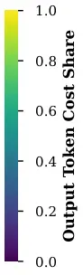

# MO-CAPO: Multi-Objective Cost-Aware Prompt Optimization

5DOI: [XXXXXXX.XXXXXXX](https://doi.org/XXXXXXX.XXXXXXX)Conference: Make
sure to enter the correct conference title from your rights confirmation
email; June 03–05, 2018; Woodstock,
NYISBN: 978-1-4503-XXXX-X/2018/06CCS: Computing methodologies Supervised
learning by classificationCCS: Computing methodologies Genetic
algorithmsCCS: Mathematics of computing Evolutionary
algorithmsCCS: Computing methodologies Heuristic function
constructionCCS: Computing methodologies Natural language generation

Jan Büssing Affiliation: LMU Munich, Munich, Germany email:
<jan.buessing@campus.lmu.de> , Moritz Schlager Note: These authors
contributed equally. Affiliation: Technical University of Munich (TUM),
Munich Center for Machine Learning (MCML), Munich, Germany email:
<moritz.schlager@tum.de> , Timo Heiß Affiliation: LMU Munich, Munich
Center for Machine Learning (MCML), Munich, Germany email:
<timo.heiss@stat.uni-muenchen.de> , Tom Zehle Affiliation: University of
Freiburg, ELLIS Institute Tübingen, Freiburg, Germany email:
<tom.zehle@tue.ellis.eu> and Matthias Feurer Affiliation: TU Dortmund
University, Lamarr Institute for Machine Learning and Artificial
Intelligence, Dortmund, Germany email: <matthias.feurer@tu-dortmund.de>

© none

###### Abstract.

Large language models (LLMs) achieve strong performance across a wide
range of tasks but are highly sensitive to prompt design, motivating the
need for automatic prompt optimization. Existing methods predominantly
focus on performance alone, ignoring competing objectives such as
inference cost or latency. At the same time, existing work on
multi-objective prompt optimization relies on off-the-shelf NSGA-II,
ignoring optimization efficiency. As a remedy, we introduce MO-CAPO, a
novel multi-objective prompt optimization algorithm that jointly
optimizes performance and inference cost while leveraging budget
allocation for cost-efficient optimization. We further propose a
deployment-oriented cost objective that captures the full computational
profile of LLM inference. We evaluate our approach across four tasks and
three LLMs and compare it to an NSGA-II-based multi-objective method and
state-of-the-art single-objective prompt optimizers. Results show that
MO-CAPO consistently identifies strong, robust, and diverse Pareto front
approximations while maintaining cost-efficiency. It outperforms the
NSGA-II baseline on 8 out of 12 cases in terms of the noisy R2 metric
and achieves competitive performances often already at a considerably
lower budget. The discovered solution sets span diverse performance-cost
trade-offs that are omitted by single-objective optimizers, yet the
top-performance candidates remain competitive with single-objective
solutions. Additionally, we conduct the first evaluation of
multi-objective machine learning experiments that considers
generalization and robustness through noisy R2 and approximation gap,
enabling a more realistic assessment of solution quality. MO-CAPO
enables practitioners to select from an efficiently discovered set of
multiple prompts offering different trade-offs between performance and
cost.

## 1. Introduction

Nowadays, large language models (LLMs) yield impressive results on a
wide variety of tasks (Radford et al., 2019; Ouyang et al., 2022;
Touvron et al., 2023). They can be adapted to solve new tasks simply
through a prompt as input, consisting of a textual instruction and
optionally few-shot examples (Brown et al., 2020; Liu et al., 2023).
However, the performance of an LLM on a given task is highly sensitive
to the quality and formulation of this prompt, as well as the selection
and order of few-shot examples (Zhao et al., 2021; Lu et al., 2022; Zhou
et al., 2023). Optimizing prompts can therefore substantially improve
performance (Zehle et al., 2025b). Because manual prompt engineering is
tedious and unreliable (Jiang et al., 2020; Liu et al., 2023), the field
of automatic prompt optimization has emerged (Cui et al., 2025; Li
et al., 2025).

Most existing prompt optimization algorithms focus solely on optimizing
performance. In practice, however, there are often several competing
objectives for which we want to optimize prompts, such as cost or
latency, in addition to performance (Murthy et al., 2025). At the same
time, the optimization process itself can be costly, as evaluating
prompts requires numerous LLM calls (Agarwal et al., 2024). CAPO (Zehle
et al., 2025b) recognizes both challenges, but primarily addresses the
cost-efficiency of the optimization process through a racing mechanism,
and considers the cost of a prompt only by penalizing its length. This
penalty is controlled by an a priori-chosen weight, and choosing an
appropriate weight is a non-trivial task for users. Existing
multi-objective prompt optimizers mostly rely on off-the-shelf NSGA-II
to discover trade-offs between multiple objectives, such as performance
and prompt length, and are not cost-efficient in their optimization
procedures (Yang and Li, 2023; Câmara et al., 2025; do Val Lopes and
Machado, 2025). In addition, costs are not only produced by prompt
length. With the rise of thinking models that leverage internal
reasoning (Guo et al., 2025; Jaech et al., 2024) and prompting
techniques such as chain-of-thought (Wei et al., 2022), output tokens
have become a considerable driver of cost and latency.

Figure 1. Prompts for Mistral-3.2-24B on Subj: CAPO is limited to a
single solution, whereas MO-CAPO discovers a Pareto front. The x-axis
denotes the average cost in US dollars per 1M calls with a prompt, the
y-axis its test set accuracy.

From an optimization perspective, prompt optimization can naturally be
viewed as an expensive black-box optimization problem (Zhou et al.,
2023; Cheng et al., 2024). The objective function (LLM performance under
a given prompt) can only be evaluated through costly LLM calls, while
its internal structure remains unknown. This setting closely resembles
established black-box optimization problems such as automatic algorithm
configuration  (Hutter et al., 2009, AAC;) and hyperparameter
optimization (HPO) in machine learning (Feurer and Hutter, 2019), where
function evaluations are likewise expensive. Moreover, these problems
are frequently multi-objective, e.g., trading off runtime vs. solution
quality in AAC (Blot et al., 2016), or performance vs. interpretability
in HPO (Karl et al., 2023). These fields have developed dedicated budget
allocation strategies specifically for multi-objective
optimization (Blot et al., 2016; Rook et al., 2025).

In this work, we propose a new multi-objective prompt optimization
method that builds on the evolutionary strategy of CAPO (Zehle et al.,
2025b), extends it to explicitly handle multiple objectives, and
integrates an intensification mechanism for budget allocation inspired
by the multi-objective AAC method MO-SMAC (Rook et al., 2025). Our main
contributions are as follows:

1.  (1)
    We introduce MO-CAPO, an a posteriori multi-objective prompt
    optimization algorithm that enables the discovery of full Pareto
    front approximations of prompts that balance performance and
    inference cost (see Fig. 1) while keeping optimization itself
    cost-efficient.
2.  (2)
    We propose a new objective function that accounts for the full
    computational profile of LLM inference by weighting input and output
    tokens, providing a realistic measure of deployment costs for modern
    LLMs.
3.  (3)
    We are the first study to conduct a large multi-objective
    generalization evaluation by studying optimistic and pessimistic HV,
    approximation gap (Feurer et al., 2023), and the noisy R2
    metric (Branke, 2025).
4.  (4)
    We compare our method against SOTA single-objective prompt
    optimizers and an NSGA-II-based baseline across multiple LLMs and
    tasks, demonstrating superiority in multi-objective metrics,
    efficiency, solution set diversity, and competitive top
    performances. We verify the effect of the algorithmic components and
    new cost objective in dedicated ablation studies.¹¹ 1 Code and
    experimental results are provided as supplementary material.

## 2. Notation and Problem Statement

Let $`p=(i,\boldsymbol{e})`$ be a prompt consisting of an instruction
$`i`$ from the instruction space $`\mathcal{I}`$ and an ordered tuple of
$`k`$ few-shot examples $`\boldsymbol{e}=(e_{1},\dots,e_{k})`$ from the
example space $`\mathcal{E}^{k}`$. The complete search space
$`\mathcal{P}=\mathcal{I}\times\bigcup_{k=0}^{k_{\max}}\mathcal{E}^{k}`$
includes prompts from zero to $`k_{\max}`$ shots. In automatic prompt
optimization, this search space (or subspace when only instructions are
tuned) is systematically explored using automatic optimization
strategies (Cui et al., 2025; Li et al., 2025; Wan et al., 2024).

Assume an instance $`x\in\mathcal{X}`$ with an associated ground truth
$`y\in\mathcal{Y}`$ from an unknown data-generating process $`P_{xy}`$.
Let $`\mathcal{D}={(x_{i},y_{i})}_{i=1}^{n}`$ denote a dataset of size
$`n`$ drawn from $`P_{xy}`$. We consider two disjoint instantiations: a
development set $`\mathcal{D}_{\text{dev}}`$ for optimization and a
holdout test set $`\mathcal{D}_{\text{test}}`$ for final evaluation.

An LLM is treated as a black-box function
$`\Phi:\mathcal{P}\times\mathcal{X}\to\mathcal{Y}`$ that maps a prompt
$`p\in\mathcal{P}`$ and an input instance $`x\in\mathcal{X}`$ to a
predicted output $`\hat{y}\in\mathcal{Y}`$.²² 2 In the following, we
differentiate between (1) the evaluation-LLM
$`\Phi_{\text{eval}}(p,x)`$, which returns the predictions $`\hat{y}`$
for an instance $`x`$ using $`p`$, and (2) the meta-LLM
$`\Phi_{\text{meta}}(p_{\text{meta}},i)`$, which is used to alter
instructions $`i`$ and $`\hat{y}`$ is again an instruction. Performance
is measured by a point-wise scoring function
$`\sigma:\mathcal{Y}\cup(\mathcal{Y}\times\mathcal{Y})\rightarrow\mathbb{R}`$
that evaluates each output independently and returns a numerical
score.³³ 3 This includes both supervised scenarios with available
ground-truth labels, where we can test, e.g., for exact match
$`\sigma(y,\hat{y})=\mathbb{I}_{[y=\hat{y}]}`$, or unsupervised
scenarios without ground-truth, where the scoring function can be an
LLM-as-a-Judge or a custom numerical reward function that maps the
LLM-output to a score to be maximized. In (single-objective) prompt
optimization, the goal is to find an optimal solution $`p`$ that
maximizes this score in expectation over the true unknown data
distribution $`P_{xy}`$:
$`\argmax_{p\in\mathcal{P}}\mathbb{E}_{(x,y)\sim P_{xy}}[\sigma(y,\Phi_{\text{eval}}(p,x))]`$.
In practice, we have to resort to maximizing an empirical score by
estimating it on the finite development set
$`\mathcal{D}_{\text{dev}}`$:

```math
\tilde{f}_{1}(p;\mathcal{D}_{\text{dev}})=\frac{1}{n_{\text{dev}}}\sum_{i=1}^{n_{\text{dev}}}\sigma(y_{i},\Phi_{\text{eval}}(p,x_{i})). \tag{1}
```

However, when optimizing prompts, there can be more than one objective
of interest. Often, the cost (computational or financial) of a prompt is
another important consideration (Zehle et al., 2025b; Câmara et al.,
2025; Yang and Li, 2023; do Val Lopes and Machado, 2025). Then the aim
is to reduce the expected costs, i.e.,
$`\argmin_{p\in\mathcal{P}}\mathbb{E}_{x\sim P_{x}}[c_{\Phi}(p;x)]`$ for
an LLM-specific cost function
$`c_{\Phi}:\mathcal{P}\times\mathcal{X}\to\mathbb{R}`$ as a direct
measure (e.g., API costs) or proxy (e.g., token count) for the cost of a
prompt. Estimating this empirically on $`\mathcal{D}_{\text{dev}}`$
yields:

```math
f_{2}(p;\mathcal{D}_{\text{dev}})=\frac{1}{n_{\text{dev}}}\sum_{i=1}^{n_{\text{dev}}}c_{\Phi}(p;x_{i}). \tag{2}
```

Further objectives $`f_{j}`$, such as additional metrics, can also be of
interest. The problem now becomes a multi-objective optimization (MOO)
problem. To maintain consistency with MOO conventions, we write
$`f_{1}(p;\mathcal{D}_{\text{dev}})=-\tilde{f}_{1}(p;\mathcal{D}_{\text{dev}})`$.
Let $`f:\mathcal{P}\rightarrow\mathbb{R}^{m}`$ be a vector-valued
objective function. The $`m`$-dimensional MOO problem (minimization
WLOG) is then defined as (Ehrgott, 2005; Emmerich and Deutz, 2018; Karl
et al., 2023):

```math
\argmin_{p\in\mathcal{P}}f(p;\mathcal{D}_{\text{dev}})=\argmin_{p\in\mathcal{P}}(f_{1}(p;\mathcal{D}_{\text{dev}}),f_{2}(p;\mathcal{D}_{\text{dev}}),\ldots,f_{m}(p;\mathcal{D}_{\text{dev}})). \tag{3}
```

Objectives $`f_{j}`$ can conflict; no single solution generally
minimizes all simultaneously. To compare solutions, the concept of
Pareto dominance is used. Let $`p_{1},p_{2}\in\mathcal{P}`$ be two
candidates and $`f(p_{1})`$ and $`f(p_{2})`$ their respective objective
vectors (omitting $`\mathcal{D}_{\text{dev}}`$ for brevity). $`p_{1}`$
Pareto dominates $`p_{2}`$ ($`p_{1}\prec p_{2}`$), iff:

```math
\forall i\in\{1,\ldots,m\}:f_{i}(p_{1})\leq f_{i}(p_{2})\land\exists j\in\{1,\ldots,m\}:f_{j}(p_{1})<f_{j}(p_{2}). \tag{4}
```

A candidate $`p^{*}`$ is Pareto-optimal if
$`\not\exists p^{\prime}\in\mathcal{P}`$ such that
$`p^{\prime}\prec p^{*}`$. The Pareto set
$`\mathcal{P}_{\text{par}}\subseteq\mathcal{P}`$ contains all
Pareto-optimal prompts. Its image
$`\mathcal{F}_{\text{par}}=f(\mathcal{P}_{\text{par}})`$ is the Pareto
front. In MOO, an optimization algorithm returns an approximation
$`\hat{\mathcal{P}}_{\text{par}}`$. Its quality is characterized by
convergence of
$`\hat{\mathcal{F}}_{\text{par}}=f(\hat{\mathcal{P}}_{\text{par}})`$ to
$`\mathcal{F}_{\text{par}}`$ and diversity across trade-offs (Karl
et al., 2023).

In this work, we focus on finding good approximations
$`\hat{\mathcal{P}}_{\text{par}}`$ for the $`2`$-dimensional prompt
optimization problem
$`\argmin_{p\in\mathcal{P}}f(p;\mathcal{D}_{\text{dev}})=\argmin_{p\in\mathcal{P}}(f_{1}(p;\mathcal{D}_{\text{dev}}),f_{2}(p;\mathcal{D}_{\text{dev}}))`$
with the objectives defined in (1) and (2), and the implicit goal to
generalize to the unseen test set $`\mathcal{D}_{\text{test}}`$.

## 3. Background & Related Work

### 3.1. Multi-objective optimization

Established literature on multi-objective optimization (MOO) exists
across several areas, including AAC (Blot et al., 2016; Rook et al., 2025) and HPO (Karl et al., 2023). A large body of work in MOO relies on
Multi-Objective Evolutionary Algorithms (MOEAs), which maintain a
population of candidate solutions and evolve them using selection,
variation, and survival operators (Karl et al., 2023). NSGA-II is a
widely adopted MOEA that ranks solutions via non-dominated sorting (NDS)
and employs crowding distance (CD) to preserve diversity along the
Pareto front (Deb et al., 2002). We explain both NDS and CD in more
detail in Appendix A.1. Alternative paradigms include archive-based
approaches such as SPEA2 (Zitzler et al., 2001) and indicator-based
methods such as SMS-EMOA (Beume et al., 2007), using hypervolume (HV)
contribution for selection.

Within multi-objective AAC, several methods extend established
single-objective algorithms. MO-ParamILS (Blot et al., 2016) adapts
ParamILS (Hutter et al., 2009) to the multi-objective setting by
maintaining an archive of non-dominated configurations and employing
iterated local search with adaptive evaluation strategies. MO-SMAC (Rook
et al., 2025) extends SMAC (Hutter et al., 2011) by introducing a
multi-objective acquisition strategy and intensification mechanism that
allocates evaluation effort adaptively and terminates dominated
configurations early. Its MO-Intensify routine compares challengers
against their nearest incumbent in objective space, terminates
evaluation early when dominated, and prunes the incumbent set using CD
to maintain Pareto front coverage.⁴⁴ 4 In this context, an incumbent
refers to a member of the incumbent set, which contains the currently
non-dominated solutions maintained by the algorithm as its evolving
Pareto front approximation.

Related ideas combining evolutionary search with budget allocation via
multi-fidelity approaches include TPOT-SH (Parmentier et al., 2019) for
AutoML pipeline construction and MO-DEHB (Awad et al., 2023), an
extension of DEHB (Awad et al., 2021), for multi-objective
hyperparameter optimization. Both integrate evolutionary operators with
a resource-allocation mechanism such as successive halving (Jamieson and
Talwalkar, 2016) or hyperband (Li et al., 2018). Racing-based
methods (Birattari et al., 2002; López-Ibáñez et al., 2016) such as
S-Race (Zhang et al., 2013) and its extensions (Miranda et al., 2015;
Zhang et al., 2015a) further explore statistically principled
elimination strategies for multi-objective settings.

### 3.2. Metrics in Multi-Objective Optimization

Assessing optimizer performance in multi-objective settings requires
careful consideration of both solution quality and stability across
runs. The hypervolume indicator
$`\mathrm{HV}(\hat{\mathcal{P}}_{\text{par}})`$, which measures the
volume of the region in objective space dominated by
$`\hat{\mathcal{P}}_{\text{par}}`$ w.r.t. a reference point $`r`$, is
typically used to quantify solution quality in terms of convergence to
and diversity along the Pareto front in a single scalar value (Zitzler
et al., 2003) (for details, see §A.1.1), but can obscure stability
aspects like generalization errors, selection effects, and stochastic
variability.

##### Approximation Gap for Generalization Robustness

In MOO for machine learning, solutions selected on the development set
$`\mathcal{D}_{\text{dev}}`$ may not generalize to test data
$`\mathcal{D}_{\text{test}}`$ due to estimation error on finite samples.
Solutions that were part of $`\hat{\mathcal{P}}_{\text{par}}`$ on
$`\mathcal{D}_{\text{dev}}`$ can be dominated on
$`\mathcal{D}_{\text{test}}`$. Using only the non-dominated solutions to
assess solution quality can lead to overestimation. In particular, HV
masks potential degradations when dominated solutions are included in
the volume.

To quantify the robustness of $`\hat{\mathcal{P}}_{\text{par}}`$, Feurer
et al. (2023) propose the approximation gap. Two sets are constructed:
an optimistic $`\hat{\mathcal{P}}_{\text{par}}^{\text{opt}}`$,
containing solutions from $`\hat{\mathcal{P}}_{\text{par}}`$ that remain
non-dominated on $`\mathcal{D}_{\text{test}}`$, and a pessimistic
$`\hat{\mathcal{P}}_{\text{par}}^{\text{pes}}`$ with solutions that do
not dominate any other in $`\hat{\mathcal{P}}_{\text{par}}`$. This
enables (1) method ranking when the optimistic HV of method $`B`$ falls
below the pessimistic of $`A`$, (2) Pareto dominance when the
pessimistic front of $`A`$ dominates the optimistic of $`B`$, and (3)
the approximation gap
$`\Delta_{\text{gap}}=\mathrm{HV}(\hat{\mathcal{P}}_{\text{par}}^{\text{opt}})-\mathrm{HV}(\hat{\mathcal{P}}_{\text{par}}^{\text{pes}})`$
with smaller gaps indicating more robust approximations.

##### Noisy R2 Metric for Measuring Selection Robustness

Single-objective evaluation protocols select the best solutions based on
performance on $`\mathcal{D}_{\text{dev}}`$ and report their performance
on $`\mathcal{D}_{\text{test}}`$, mirroring how practitioners select
solutions based on optimization performance and experience
generalization performance. While straightforward for a single
objective, MOO complicates this protocol: users select a single solution
from $`\hat{\mathcal{P}}_{\text{par}}`$ based on their preferences over
objective trade-offs. However, standard metrics like HV on
$`\mathcal{D}_{\text{test}}`$ evaluate the (aggregated) quality of the
entire solution set, potentially overstating practical performance when
the selected solution generalizes poorly.

To incorporate this selection step, Branke (2025) proposes the noisy R2
(nR2) metric. For each preference vector $`\boldsymbol{\lambda}_{i}`$
parameterizing a utility function $`U`$,⁵⁵ 5 The utility function $`U`$
maps multi-objective outcomes to a scalar value and is parameterized by
a preference vector $`\boldsymbol{\lambda}_{i}`$, which specifies the
trade-off preference between objectives. Potential utility functions
are, e.g., a weighted linear combination of the objectives or a
Chebychev utility with weights $`\boldsymbol{\lambda}_{i}`$. the
solution minimizing utility during optimization
$`p_{i}^{*}=\argmin_{p\in\hat{\mathcal{P}}_{\text{par}}}U(f(p;\mathcal{D}_{\text{dev}}),\boldsymbol{\lambda}_{i})`$
is selected, and its utility
$`U(f(p_{i}^{*};\mathcal{D}_{\text{test}}),\boldsymbol{\lambda}_{i})`$
is evaluated on test data. Averaging these values over many sampled
preference vectors yields nR2.

##### Empirical Attainment Surfaces for Stochastic Variability

Single Pareto fronts obscure performance stability across runs, while
plotting all fronts can be visually cluttered. Empirical Attainment
Surfaces (EAS) (Watanabe, 2023) aggregate $`S`$ runs into interpretable
front shapes with performance bands. The empirical attainment function
$`\alpha(\mathbf{y}):=\frac{1}{S}\sum_{s=1}^{S}\mathbb{I}[\hat{\mathcal{F}}_{\text{par}}^{s}\preceq\mathbf{y}]`$
measures the fraction of runs whose front approximation
$`\hat{\mathcal{F}}_{\text{par}}^{s}`$ weakly dominates $`\mathbf{y}`$
(i.e., at least as good as $`\mathbf{y}`$ in all objectives). The
$`L/S`$-EAS contains points with $`\alpha(\mathbf{y})\geq L/S`$, meaning
at least $`L`$ out of $`S`$ runs attained this surface. Plotting several
EAS, such as median, best ($`1/S`$), and worst ($`S/S`$), compactly
visualizes performance and variability: narrow bands signal stable
behavior across runs, wide bands reveal variability. However, like HV,
EAS are computed on the optimistic solution set and therefore mask the
generalization gap between $`\mathcal{D}_{\text{dev}}`$ and
$`\mathcal{D}_{\text{test}}`$. A narrow EAS band may suggest stable,
high-quality performance, but can conceal that some of the attained
solutions are dominated on unseen data.

### 3.3. Related Work on Prompt Optimization

Automatic prompt optimization is typically categorized into continuous
methods, learning soft prompts in embedding space, and discrete methods,
directly modifying textual prompts (Cui et al., 2025). Due to prompt
interpretability and their LLM-agnostic nature, we focus on discrete
methods.

Many discrete methods rely on a meta-LLM guided by a meta-prompt to
modify prompts. This includes Monte Carlo search like APE (Zhou et al.,
2023), evolutionary approaches like EvoPrompt (Guo et al., 2024) and
PromptBreeder (Fernando et al., 2024), using the meta-LLM for
evolutionary operators (Meyerson et al., 2024), or OPRO (Yang et al.,
2024), which employs the meta-LLM directly as optimizer with performance
histories in the meta-prompt. A complementary line of work applies
gradient-based optimization ideas to textual prompts, including
ProTeGi (Pryzant et al., 2023), TextGrad (Yuksekgonul et al., 2025), and
LLM-AutoDiff (Yin and Wang, 2025).

While these works optimize only instructions, i.e., over
$`\mathcal{P}=\mathcal{I}`$, recent approaches jointly optimize prompts
and few-shot examples (Agarwal et al., 2024; Zehle et al., 2025b). This
has been shown to yield strong synergies (Wan et al., 2024) and is used
by leading prompt optimizers such as MIPROv2 (Opsahl-Ong et al., 2024).
GEPA (Agrawal et al., 2025) instead uses reflective prompt evolution,
iteratively diagnosing failures from system trajectories and refining
high-level prompt rules, while outperforming MIPROv2. Both are included
in DSPy (Khattab et al., 2024).

In parallel, efficiency considerations have become central. EASE (Wu
et al., 2024) applies neural bandits to efficiently optimize few-shot
example selection and can be extended to jointly optimize examples and
instructions. CAPO (Zehle et al., 2025b) is an evolutionary approach
that combines instruction and few-shot optimization, integrates racing
to discard underperforming prompts early, and penalizes prompt length to
control inference cost. A recent comparison (Zehle et al., 2025a) shows
that CAPO can outperform SOTA optimizers like GEPA.

These optimizers are all single-objective optimizers targeting prompt
performance. Although GEPA (Agrawal et al., 2025) introduces a
multi-objective-inspired Pareto-based selection mechanism for population
diversity, the optimization is single-objective. CAPO (Zehle et al.,
2025b) as well as Promptomatix (Murthy et al., 2025) consider prompt
length as an additional objective, but use scalarization with a fixed
trade-off parameter that must be chosen a priori, which can be
challenging.

Nonetheless, there exist multi-objective methods that yield Pareto
fronts of prompts to trade off performance and length. InstOptima (Yang
and Li, 2023) uses NSGA-II with meta-prompts to optimize prompt
performance vs. length vs. perplexity. It includes separate mutation and
crossover for instructions and examples, and the meta-LLM is guided by
the parents’ performances. MOPrompt (Câmara et al., 2025) also optimizes
prompts for accuracy and token length with NSGA-II. This is also done
for joint model selection and prompt construction from predefined
blocks (do Val Lopes and Machado, 2025), but without proper evaluation
on unseen test data.

Other works consider alternative objective trade-offs. Survival of the
Safest (Sinha et al., 2024) proposes a multi-objective, feedback-based
mutation strategy to trade off performance and security, with the final
solution chosen via a weighted combination of the objectives.
EMO-Prompt (Baumann and Kramer, 2024) applies NSGA-II and SMS-EMOA with
meta-prompts for crossover and mutation, evaluated on story generation
with conflicting sentiment objectives. MOPO (Menchaca Resendiz and
Klinger, 2025) similarly employs NSGA-II for affective text generation.
FairPrompt (Shafqat et al., 2025) uses NSGA-II to select prompts that
jointly maximize semantic diversity, bias detection rate, and balanced
demographic coverage for fairness testing.

Using reinforcement learning strategies to tune small networks on top of
an LLM whose weights are frozen, MORL-Prompt (Jafari et al., 2024)
compares three different scalarization and indicator methods, while
Pareto Prompt Optimization (Zhao et al., 2025) proposes a
multi-objective weight update for the neural network. Both works focus
on optimizing performance and style metrics.

However, these works do not address the cost-efficiency of the
optimization process, despite the substantial cost of LLM evaluations,
and they lack rigorous multi-objective evaluation protocols.

##### Positioning of MO-CAPO

While the idea of trading off prompt quality and prompt length through
MOO is not new, we are the first to explicitly examine how to
efficiently arrive at solutions by incorporating a multi-objective
budget allocation mechanism from MO-AAC into evolutionary prompt
optimization. Moreover, we go beyond using prompt length as a proxy for
cost and explicitly consider input and output token usage, covering all
costs involved in LLM inference. In addition to algorithmic
contributions, we provide a systematic evaluation of Pareto front
approximations and how selected solutions generalize to unseen test
data, whereas prior work either picks a single solution by scalarizing
the objectives or omits a dedicated test-set analysis altogether. To the
best of our knowledge, this constitutes the first thorough evaluation of
multi-objective optimization for machine learning, extending the
preliminary work of Feurer et al. (2023) and applying the methodology
from Branke (2025).

## 4. Multi-Objective Cost-Aware Prompt Optimization

We introduce MO-CAPO, a multi-objective prompt optimization algorithm
that jointly optimizes performance and inference cost. Our approach
extends CAPO by moving from searching for the optimal solution at a
fixed trade-off to performing true multi-objective optimization. For
this purpose, we propose a deployment-oriented cost objective that
explicitly accounts for both input and output token consumption,
reflecting the full computational profile of modern LLM inference. In
addition, it integrates an intensification mechanism for budget
allocation in an evolutionary algorithm to ensure cost-efficient search.
Together, these components enable the discovery of robust Pareto front
approximations while maintaining high optimization efficiency.

### 4.1. Cost Objective

We propose
$`c_{\Phi}(p,x)=w_{\text{in}}tok_{\text{in}}(p;x)+w_{\text{out}}tok_{\text{out}}(p;x)`$
to measure the cost of a prompt candidate $`p`$ on an instance $`x`$.
Here, $`tok_{\text{in}}(p;x)`$ and $`tok_{\text{out}}(p;x)`$ represent
the number of input and output tokens processed by the LLM during
inference with $`p`$ on $`x`$. $`w_{\text{in}}`$ and $`w_{\text{out}}`$
are (potentially LLM-specific) weights. The corresponding cost-objective
on a dataset $`\mathcal{D}`$ is then:

```math
f_{2}(p;\mathcal{D})=\frac{1}{n}\sum_{i=1}^{n}\left[w_{\text{in}}tok_{\text{in}}(p;x_{i})+w_{\text{out}}tok_{\text{out}}(p;x_{i})\right]=w_{\text{in}}\widebar{tok_{\text{in}}}(p;\mathcal{D})+w_{\text{out}}\widebar{tok_{\text{out}}}(p;\mathcal{D}). \tag{5}
```

| Model           | $`w_{\text{in}}`$ |     | $`w_{\text{out}}`$ |     |
| --------------- | ----------------- | --- | ------------------ | --- |
| Mistral-3.2-24B | 0\.               | 08  | 0\.                | 32  |
| Qwen3-30B       | 0\.               | 11  | 0\.                | 41  |
| GPT-OSS-120B    | 0\.               | 12  | 0\.                | 49  |
| Claude Opus 4.6 | 2\.               | 72  | 25\.               | 43  |
| GPT-5.2 Pro     | 21\.              | 00  | 168\.              | 00  |

Table 1. Cost weights for various LLMs derived from OpenRouter. We
average prices per million tokens across all listed providers per model
(cf. §A.5).

This formulation allows accounting for the distinct computational
profiles of input and output tokens. In current autoregressive LLMs
input tokens are usually cheaper, as processed in parallel during
pre-fill, whereas output tokens are more expensive, as generation
proceeds sequentially through autoregressive decoding. Token weights are
defined based on the inference costs prior to optimization. For local
deployments, weights can be determined from latency metrics (e.g.,
time-to-first-token, tokens-per-second) combined with resource costs.
For deployments via vendor APIs, weights can be obtained from the
pricing structure. To illustrate this, we derive model-specific weights
$`w_{\text{in}}`$ and $`w_{\text{out}}`$ for exemplary LLMs from the
pricing data of all vendors listed on OpenRouter⁶⁶ 6 OpenRouter
([https://openrouter.ai](https://openrouter.ai)) is a unified API
platform providing access to over 400 AI models through a single
endpoint, passing through provider-native pricing with distinct input
and output rates. in Tab. 1. This serves as a proxy for inference costs
and reflects the distinct computational profiles described above. We
also employ these weights later in our experiments in §5.

### 4.2. A Multi-Objective Prompt Optimization Baseline Using NSGA-II

To represent the existing multi-objective prompt optimization methods
that use NSGA-II (Deb et al., 2002) in combination with a meta-LLM to
optimize prompts for a variety of objectives (as outlined in §3), we
introduce a baseline algorithm for our work, NSGA-II-PO. It uses NSGA-II
with the evolutionary operators from CAPO (Zehle et al., 2025b) to
optimize prompts consisting of instructions and few-shot examples for
both performance and our cost objective from §4.1.

In particular, it employs a binary tournament with front rank and CD as
selection criteria for parent selection, contrasting with CAPO’s random
selection. Environmental selection is performed via non-dominated
sorting (NDS) with crowding distance (CD) as a tie-breaker to include
partial fronts. We use a steady-state version of NSGA-II, recalculating
CD after each selection, since removing candidates alters neighbor
distances. Pseudo-code for this baseline is provided in §A.2.1.

### 4.3. MO-CAPO

We now present our new method MO-CAPO. It advances our baseline from
§4.2 by introducing a budget allocation mechanism to terminate the
evaluation of unpromising prompts early, given the high cost of
evaluations in prompt optimization. The method integrates and adapts
core concepts from NSGA-II (Deb et al., 2002), MO-SMAC (Rook et al.,
2025), and CAPO (Zehle et al., 2025b) to develop a cost-efficient
algorithm for multi-objective prompt optimization.

##### Overview

MO-CAPO follows a standard genetic algorithm (see Algorithm 1). After
prompt initialization and their initial evaluation, the algorithm
creates an incumbent set
$`\mathcal{P}_{\text{inc}}\subseteq\mathcal{P}_{\mu}`$ of non-dominated
solutions. In each iteration of the evolutionary loop, the genetic
operators crossover and mutate generate $`c`$ offspring
$`\mathcal{P}_{\text{off}}`$. Parents are selected based on binary
tournament selection. Each offspring enters an adapted version of
MO-SMAC’s intensification mechanism as a “challenger”, which is
progressively evaluated on additional data and compared against the
incumbent set. If a prompt survives intensification, it is added to
$`\mathcal{P}_{\text{inc}}`$. After $`T`$ iterations,
$`\mathcal{P}_{\text{inc}}`$ is returned as the final Pareto front
approximation. MO-CAPO differs from typical evolutionary algorithms and
MO-SMAC by retaining both a population $`\mathcal{P}_{\mu}`$ and a
dedicated incumbent set
$`\mathcal{P}_{\text{inc}}\subseteq\mathcal{P}_{\mu}`$.⁷⁷ 7 The
incumbent set differs conceptually from the first front identified by
non-dominated sorting, as it can contain candidates that are evaluated
for different budgets. The incumbent set serves as the current Pareto
front approximation and reference for intensification. However, in
contrast to MO-SMAC, rejected candidates cannot simply be all discarded
after early termination to retain sufficient genetic material for
crossover and mutation.⁸⁸ 8 Discarding all dominated solutions would
deplete genetic diversity and limit exploration, while using the
complete prompt history $`\mathcal{H}`$ would introduce all unpromising
candidates. Our separation into an evolving population and incumbent set
balances diversity preservation with efficient dominance-based pruning.
In the following, we describe each component in more detail. Full
algorithmic specifications are provided in §A.2.

1: datasets $`\mathcal{D}_{\text{dev}}`$ &
$`\mathcal{D}_{\text{shots}}`$, meta-LLM $`\Phi_{\text{meta}}`$,
evaluation-LLM $`\Phi_{\text{eval}}`$, initial instructions
$`\mathcal{I}_{0}=\{i_{1},\dots,i_{\mu}\}`$, population size $`\mu`$,
block size $`b`$, no. iterations $`T`$, no. crossovers per iteration
$`c`$, max. no. shots $`k_{\max}`$, input & output token-weights
$`w_{\text{in}}`$ & $`w_{\text{out}}`$, crossover-meta-prompt $`p_{C}`$,
mutation-meta-prompt $`p_{M}`$

2: Divide dataset $`\mathcal{D}_{\text{dev}}`$ into blocks
$`\mathcal{B}=\{B_{1},...,B_{z}\}`$ where $`|B_{i}|=b`$

3:
$`\mathcal{P}_{\mu}\leftarrow\hyperlink{func:initialize_population}{\textsc{initialize\_pop}(\mathcal{I}_{0},\mathcal{D}_{\text{shots}},k_{\max},\Phi_{\text{eval}})}`$

4: $`B\leftarrow\textsc{sample}(\mathcal{B})`$

5:
$`\mathcal{H}\leftarrow\textsc{evaluate}(\mathcal{P}_{\mu},B,\Phi_{\text{eval}},w_{\text{in}},w_{\text{out}})`$

6:
$`\mathcal{P}_{\text{inc}}\leftarrow\textsc{get\_non\_dominated}(\mathcal{P}_{\mu},\mathcal{H},B)`$

7:

for $`t=1`$ to $`T`$ do


8:
  
$`\mathcal{P}_{\text{off}}\leftarrow\hyperlink{func:cross_over}{\textsc{crossover}(\mathcal{P}_{\mu},\mathcal{H},\Phi_{\text{meta}},p_{C},c)}`$


9:
  
$`\mathcal{P}_{\text{off}}\leftarrow\hyperlink{func:mutate}{\textsc{mutate}(\mathcal{P}_{\text{off}},\Phi_{\text{meta}},\Phi_{\text{eval}},p_{M},\mathcal{D}_{\text{shots}},k_{\max})}`$


10:
  

for $`p_{\text{chal}}`$ in $`\mathcal{P}_{\text{off}}`$ do


11:
   
$`\mathcal{P}_{\text{inc}},\mathcal{P}_{\mu},\mathcal{H}\leftarrow\hyperlink{func:intensify}{\textsc{intensify}(\mathcal{P}_{\text{inc}},\mathcal{P}_{\mu},p_{\text{chal}},\mathcal{B},\Phi_{\text{eval}},\mathcal{H},w_{\text{in}},w_{\text{out}},\mu)}`$
  

12: return $`\mathcal{P}_{\text{inc}}`$

Algorithm 1 MO-CAPO: Multi-Objective Cost-Aware Prompt Optimization

##### Initialization

Following the original CAPO method, MO-CAPO partitions the development
set $`\mathcal{D}_{\text{dev}}`$ into blocks $`\mathcal{B}`$ of equal
size $`b`$ and creates an initial population $`\mathcal{P}_{\mu}`$ in
initialize*pop by augmenting the initial instructions
$`\mathcal{I}*{0}`$ with up to $`k*{\max}`$ randomly sampled few-shot
examples $`\boldsymbol{e}`$ (see §A.2 for details). Each prompt in
$`\mathcal{P}*{\mu}`$ is evaluated on the same single randomly sampled
block $`B`$, yielding their objective function vectors $`f(p;B)`$. Based
on these evaluations, the incumbent set $`\mathcal{P}\_{\text{inc}}`$ of
all non-dominated solutions is populated using NDS. A run history
$`\mathcal{H}`$ records all evaluations performed for each candidate on
each block to prevent redundant computations in future steps.

##### Parent Selection

We design the parent selection to favor candidates that are close to the
Pareto front, while preserving diversity and accounting for different
levels of evaluation. This differs from CAPO’s random parent selection.
MO-CAPO performs a binary tournament, adapted from NSGA-II to handle
heterogeneous evaluation levels. Two independent tournaments are
conducted to obtain distinct parents. In each tournament, two candidates
are sampled from $`\mathcal{P}_{\mu}`$ and compared: (1) If exactly one
candidate is an incumbent, it wins, favoring the candidate that
contributes to the Pareto front approximation. (2) If both candidates
are incumbents, the higher CD decides in order to maintain diversity of
the incumbent front. (3) If both are non-incumbents and share identical
evaluation levels, they are compared using NDS and CD. (4) For
non-incumbents with different evaluation levels, a weaker dominance
criterion from MO-ParamILS (Blot et al., 2016) is applied: if
$`\mathcal{B}_{p_{i}}\subset\mathcal{B}_{p_{j}}`$, $`p_{j}`$ wins if it
dominates $`p_{i}`$ on the subset $`\mathcal{B}_{p_{i}}`$. This ensures
a fair comparison, as candidates evaluated on fewer blocks could
otherwise appear superior by chance alone due to the high variance in
performance estimates from small samples. (5) When the previous criteria
do not provide a clear preference, random selection decides the winner
(for details, see §A.2).

##### Offspring Creation

The genetic operators crossover and mutate follow the established
mechanisms from CAPO (Zehle et al., 2025b). Instructions of the selected
parents are crossed using a meta-LLM, while the offspring’s few-shot
examples are sampled from the union of the parents’ few-shot pool,
creating $`c`$ offspring instructions in $`\mathcal{P}_{\text{off}}`$.
These are subsequently mutated by altering the instruction with a
meta-LLM and by randomly removing or adding examples (see §A.2).

1:

function
intensify($`\mathcal{P}_{\text{inc}},\mathcal{P}_{\mu},p_{\text{chal}},\mathcal{B},\Phi_{\text{eval}},\mathcal{H},w_{\text{in}},w_{\text{out}},\mu`$)


2:
  
$`\mathcal{B}_{\cap}\leftarrow\bigcap_{p\in\mathcal{P}_{\text{inc}}}\textsc{get\_evaluated\_blocks}(p,\mathcal{H})`$
$`\triangleright`$ Get shared evaluation basis


3:
  
$`\mathcal{B}_{\text{chal}}\leftarrow[\,]`$


4:
  
$`f_{\text{new}}\leftarrow(\infty,\dots,\infty)`$


5:
  

while true do


6:
   
$`f_{\text{old}}\leftarrow f_{\text{new}}`$


7:
   

repeat$`\triangleright`$ Progressively add block evaluations of
$`p_{\text{chal}}`$


8:
      
$`\mathcal{B}_{\text{chal}}\leftarrow\mathcal{B}_{\text{chal}}\cup\{\textsc{sample}(\mathcal{B}_{\cap}\setminus\mathcal{B}_{\text{chal}})\}`$


9:
      
$`\mathcal{H}\leftarrow\textsc{evaluate}(p_{\text{chal}},\mathcal{B}_{\text{chal}},\Phi_{\text{eval}},w_{\text{in}},w_{\text{out}})`$


10:
      
$`f_{\text{new}}\leftarrow\textsc{get\_objective\_values}(p_{\text{chal}},\mathcal{H},\mathcal{B}_{\text{chal}})`$


11:
   

until $`f_{\text{new}}\prec f_{\text{old}}`$ or
$`\mathcal{B}_{\cap}=\mathcal{B}_{\text{chal}}`$


12:
   

if $`\mathcal{B}_{\cap}=\mathcal{B}_{\text{chal}}`$ then
$`\triangleright`$ Case (b): temporal acceptance


13:
      
$`\mathcal{P}_{\mu}\leftarrow\mathcal{P}_{\mu}\cup\{p_{\text{chal}}\}`$


14:
      
$`\mathcal{P}_{\text{inc}}\leftarrow\textsc{get\_non\_dominated}(\mathcal{P}_{\text{inc}}\cup\{p_{\text{chal}}\},\mathcal{H},\mathcal{B}_{\text{chal}})`$
$`\triangleright`$ Re-assess incumbents


15:
      
break


16:
   

else$`\triangleright`$ Case (a): early rejection check


17:
      
$`p_{\text{inc}}\leftarrow\textsc{get\_closest\_inc}(\mathcal{P}_{\text{inc}},p_{\text{chal}},\mathcal{B}_{\text{chal}})`$


18:
      
$`f_{\text{inc}}\leftarrow\textsc{get\_objective\_values}(p_{\text{inc}},\mathcal{H},\mathcal{B}_{\text{chal}})`$


19:
      

if $`f_{\text{inc}}\prec f_{\text{new}}`$ then $`\triangleright`$ If
closest incumbent dominates, “reject” $`p_{\text{chal}}`$


20:
       
$`\mathcal{P}_{\mu}\leftarrow\mathcal{P}_{\mu}\cup\{p_{\text{chal}}\}`$


21:
       
break
           

22:
  

if $`|\mathcal{P}_{\mu}|>\mu`$ then $`\triangleright`$ Maintain
population size


23:
   
$`\mathcal{P}_{\mu},\mathcal{P}_{\text{inc}}\leftarrow\hyperlink{func:mocapo_envselection}{\textsc{environmental\_selection}(\mathcal{P}_{\mu},\mathcal{P}_{\text{inc}},\mathcal{H},\mu)}`$
  

24:
  
$`\mathcal{H}\leftarrow\hyperlink{func:mocapo_advinc}{\textsc{advance\_incumbents}(\mathcal{P}_{\text{inc}},\mathcal{H},\Phi_{\text{eval}},w_{\text{in}},w_{\text{out}})}`$
$`\triangleright`$ Advance incumbent


25:
  
return $`\mathcal{P}_{\text{inc}},\mathcal{P}_{\mu},\mathcal{H}`$


Algorithm 2 MO-CAPO: Intensification

##### Intensification

Similar to CAPO’s single-objective racing, we aim to avoid wasting
budget by evaluating weak candidates on the full data. To still enable
fair comparisons with the incumbent set, we evaluate challengers
progressively on more data blocks. The multi-objective intensification
mechanism in Algorithm 2 starts by identifying the common blocks
$`\mathcal{B}_{\cap}`$ on which all incumbents have been evaluated so
far. The challenger must be evaluated on this same subset before it can
be added to $`\mathcal{P}_{\text{inc}}`$. Therefore, it is evaluated
progressively on more blocks that are drawn at random from
$`\mathcal{B}_{\cap}`$. A comparison against the incumbents is triggered
either if (a) the challenger’s performance has improved, i.e., the new
objective vector $`f_{\text{new}}`$ after adding further evaluations
dominates the objective vector $`f_{\text{old}}`$ from the previous
comparison,⁹⁹ 9 A comparison is always triggered after the first block
evaluation as we initialize $`f_{\text{old}}=(\infty,\ldots,\infty)`$.
or (b) the challenger has been evaluated on all blocks from
$`\mathcal{B}_{\cap}`$. In case (a), the challenger is compared to the
closest incumbent¹⁰¹⁰ 10 The nearest incumbent is selected based on the
Euclidean distance in objective space, where objective vectors are
min-max normalized over all objective values seen during the
optimization process so far. Rook et al. (2025) argue that comparing
only against the closest incumbent instead of all incumbents reduces the
type I error, i.e., the error of falsely rejecting a good challenger
based on the comparison on only a subset of the data. on the
challenger’s blocks. If the challenger is dominated by the closest
incumbent, it is “rejected” in the sense that its intensification is
terminated and the challenger is not added to
$`\mathcal{P}_{\text{inc}}`$, but is still added to the population
$`\mathcal{P}_{\mu}`$ as genetic material. If it is not dominated, the
loop continues by adding further evaluations. In case (b), the
challenger survived the intensification loop and was evaluated on all
blocks in $`\mathcal{B}_{\cap}`$. It is added to the population and
temporarily to the set of potential incumbents. This set is re-evaluated
using NDS on the commonly evaluated blocks to ensure that only
non-dominated solutions remain in $`\mathcal{P}_{\text{inc}}`$.

Finally, we perform environmental selection (see next paragraph) to
maintain population size $`\mu`$. Moreover, we advance the evaluation of
the incumbent set. The incumbent with the fewest evaluations is
selected. If it lags behind in evaluations, it is evaluated on one of
the missing blocks. If all incumbents share the same block set, it is
evaluated on a new block sampled from $`\mathcal{B}`$. This mechanism
ensures comparable evaluation levels for the incumbents while gradually
expanding the evaluation basis as the optimization progresses.

##### Environmental Selection

Environmental selection ensures that the population size does not exceed
$`\mu`$ by eliminating poorly performing candidates from the population.
Candidates not in $`\mathcal{P}_{\text{inc}}`$ are removed
preferentially, as they are dominated. If such candidates exist and have
all been evaluated on the same blocks, NDS and CD are applied,
eliminating candidates from the worst front with CD as tie-breaker. If
such candidates do not share the same evaluation blocks, such a
comparison would not be reliable. In this case, candidates with the
fewest evaluations are discarded first, as their objective estimates are
based on less evidence. If this applies to multiple candidates, a random
elimination is performed among them. When only candidates in
$`\mathcal{P}_{\text{inc}}`$ remain, CD over $`\mathcal{B}_{\cap}`$ is
used as an elimination criterion to promote diversity among the front
(see §A.2).

## 5. Experimental Design

##### Setup

We evaluate MO-CAPO using three open-weight LLMs of different sizes and
organizational origins: GPT-OSS-120B (OpenAI, 2025), Qwen3-30B (Yang
et al., 2025), and Mistral-3.2-24B (Mistral AI Team, 2025). These model
sizes enable deployment on single-GPU instances while delivering strong
performance. Each experiment employs the same model for prompt
alteration ($`\Phi_{\text{meta}}`$) and evaluation
($`\Phi_{\text{eval}}`$). We provide the complete model specifications
in §A.3.1.

We employ four datasets spanning a diverse range of tasks, which vary in
domain, output cardinality, and reasoning complexity: (1) AG News
(4-class topic classification (Zhang et al., 2015b)), (2) GSM8K (grade
school math word problems (Cobbe et al., 2021)), (3) Subj (binary
subjectivity classification (Pang and Lee, 2004)), and (4) MBPP
(programming problems (Austin et al., 2021)). Each dataset is
partitioned into three subsets: a development set
$`\mathcal{D}_{\text{dev}}`$ of 300 instances for optimization, a
few-shot pool $`\mathcal{D}_{\text{shots}}`$ of 100 instances, and a
hold-out test set $`\mathcal{D}_{\text{test}}`$ of 500 instances for
generalization assessment. Detailed descriptions of datasets and
performance measures are provided in §A.3.2.

We benchmark the proposed MO-CAPO against the NSGA-II-PO baseline, as a
representative of existing multi-objective prompt optimizers, and
against unoptimized initial instructions. In addition, we compare
against three state-of-the-art single-objective prompt optimizers:
CAPO (Zehle et al., 2025b) (primary baseline as our method directly
builds upon it), EvoPromptGA (Guo et al., 2024) (widely known
evolutionary optimizer), and GEPA (Agrawal et al., 2025) (popular due to
implementation in DSPy). The evolutionary optimizers require ten initial
instructions as starting point, and GEPA a single initial instruction.
In addition, CAPO, MO-CAPO, and NSGA-II-PO use a textual task
description in the meta-prompts. For this, task descriptions and a pool
of 15 initial instructions per dataset are taken from Zehle et al.
(2025b) for datasets (1)-(3). For the new task (4), we manually create a
task description (cf. §A.4.1) and automatically generate an initial
instruction pool using Anthropic’s Claude (cf. §A.4.2). In each
optimization run, initial instructions for the optimizers are sampled
from this pool. The same ten sampled initial instructions are used as a
baseline for the comparison. Despite local LLM deployment, we use the
averaged API prices from Tab. 1 as a proxy for the model-specific token
weights $`w_{\text{in}}`$ and $`w_{\text{out}}`$. This choice allows
interpreting the cost objective value as the average potential API cost
in US dollars per 1M calls with this prompt. We provide an overview of
the parameterizations of all optimizers in §A.3.4.

Each experiment configuration is executed with three random seeds
controlling initial instruction sampling, dataset partitioning, LLM
decoding, and stochastic algorithm components. All optimization runs
terminate under a budget constraint of $`7.5\times 10^{6}`$ total tokens
consumed by $`\Phi_{\text{eval}}`$.

##### Evaluation

From the multi-objective optimizers and the initial instruction set, we
can naturally form Pareto fronts, which we evaluate using the
multi-objective nR2 and HV metrics.¹¹¹¹ 11 To ensure comparability of
objectives, optimizers, and seeds, we employ global min-max
normalization per dataset. The normalization bounds are derived from the
union of all incumbent solutions across development and test set scores
of all multi-objective optimizers and seeds. To obtain the nR2 metric,
we use the Chebychev utility (following  Branke (2025)) and average
across 500 uniformly sampled preference vectors. Moreover, we use EAS
plots from the package by Watanabe (2023). With $`S=3`$ runs per task,
we plot the $`2/3`$-EAS (median) as a line with bands spanning
$`1/3`$-EAS (best) and $`3/3`$-EAS (worst). Single-objective optimizers
naturally only yield a single incumbent in their last step. Therefore,
we evaluate single-objective methods solely in terms of their accuracy
and compare them with the maximum-accuracy solutions of the
multi-objective methods. Unless stated otherwise, reported metrics
represent the mean and standard deviation over three seeds, where
candidates are selected by their performance on
$`\mathcal{D}_{\text{dev}}`$, and their objective vectors are
subsequently evaluated on $`\mathcal{D}_{\text{test}}`$.

## 6. Results & Analysis

### 6.1. Benchmark Results

GSM8K Subj Model Optimizer nR2 $`\downarrow`$ HV*(opt) $`\uparrow`$
HV*(pes) $`\uparrow`$ Gap $`\downarrow`$ nR2 $`\downarrow`$ HV*(opt)
$`\uparrow`$ HV*(pes) $`\uparrow`$ Gap $`\downarrow`$ GPT-OSS-120B
Initial $`0.319_{\pm.078}`$ $`0.438_{\pm.121}`$ $`0.426_{\pm.115}`$
$`0.012_{\pm.021}`$ $`0.214_{\pm.023}`$ $`0.719_{\pm.047}`$
$`0.708_{\pm.043}`$ $`\mathbf{0.012}_{\pm.020}`$ NSGA-II-PO
$`0.098_{\pm.045}`$ $`0.973_{\pm.116}`$ $`0.920_{\pm.088}`$
$`0.053_{\pm.092}`$ $`0.098_{\pm.008}`$ $`0.987_{\pm.023}`$
$`\mathbf{0.966}_{\pm.022}`$ $`0.021_{\pm.004}`$ MO-CAPO
$`\mathbf{0.038}_{\pm.005}`$ $`\mathbf{1.150}_{\pm.020}`$
$`\mathbf{1.145}_{\pm.019}`$ $`\mathbf{0.005}_{\pm.007}`$
$`\mathbf{0.095}_{\pm.009}`$ $`\mathbf{0.998}_{\pm.009}`$
$`0.949_{\pm.024}`$ $`0.049_{\pm.033}`$ Mistral-3.2-24B Initial
$`0.387_{\pm.013}`$ $`0.352_{\pm.029}`$ $`0.352_{\pm.029}`$
$`\mathbf{0.000}_{\pm.000}`$ $`0.383_{\pm.071}`$ $`0.361_{\pm.153}`$
$`0.361_{\pm.153}`$ $`\mathbf{0.000}_{\pm.001}`$ NSGA-II-PO
$`0.122_{\pm.038}`$ $`0.920_{\pm.086}`$ $`0.896_{\pm.096}`$
$`0.024_{\pm.023}`$ $`0.130_{\pm.024}`$ $`0.880_{\pm.077}`$
$`0.842_{\pm.085}`$ $`0.038_{\pm.054}`$ MO-CAPO
$`\mathbf{0.110}_{\pm.034}`$ $`\mathbf{0.943}_{\pm.080}`$
$`\mathbf{0.930}_{\pm.073}`$ $`0.013_{\pm.015}`$
$`\mathbf{0.129}_{\pm.026}`$ $`\mathbf{0.898}_{\pm.093}`$
$`\mathbf{0.884}_{\pm.109}`$ $`0.014_{\pm.016}`$ Qwen3-30B Initial
$`0.374_{\pm.011}`$ $`0.361_{\pm.018}`$ $`0.361_{\pm.018}`$
$`\mathbf{0.000}_{\pm.000}`$ $`0.264_{\pm.061}`$ $`0.590_{\pm.126}`$
$`0.590_{\pm.126}`$ $`\mathbf{0.000}_{\pm.000}`$ NSGA-II-PO
$`0.343_{\pm.006}`$ $`0.399_{\pm.009}`$ $`0.399_{\pm.009}`$
$`\mathbf{0.000}_{\pm.000}`$ $`0.111_{\pm.023}`$ $`0.927_{\pm.061}`$
$`0.913_{\pm.079}`$ $`0.014_{\pm.020}`$ MO-CAPO
$`\mathbf{0.340}_{\pm.006}`$ $`\mathbf{0.410}_{\pm.018}`$
$`\mathbf{0.406}_{\pm.021}`$ $`0.004_{\pm.004}`$
$`\mathbf{0.106}_{\pm.005}`$ $`\mathbf{0.930}_{\pm.015}`$
$`\mathbf{0.925}_{\pm.022}`$ $`0.005_{\pm.006}`$

AG News MBPP Model Optimizer nR2 $`\downarrow`$ HV*(opt) $`\uparrow`$
HV*(pes) $`\uparrow`$ Gap $`\downarrow`$ nR2 $`\downarrow`$ HV*(opt)
$`\uparrow`$ HV*(pes) $`\uparrow`$ Gap $`\downarrow`$ GPT-OSS-120B
Initial $`0.052_{\pm.008}`$ $`1.086_{\pm.029}`$ $`1.010_{\pm.096}`$
$`0.076_{\pm.102}`$ $`0.429_{\pm.035}`$ $`0.278_{\pm.032}`$
$`0.259_{\pm.063}`$ $`0.019_{\pm.032}`$ NSGA-II-PO $`0.068_{\pm.025}`$
$`1.044_{\pm.046}`$ $`\mathbf{1.031}_{\pm.044}`$
$`\mathbf{0.014}_{\pm.022}`$ $`0.306_{\pm.011}`$ $`0.504_{\pm.077}`$
$`0.469_{\pm.023}`$ $`0.035_{\pm.054}`$ MO-CAPO
$`\mathbf{0.045}_{\pm.012}`$ $`\mathbf{1.116}_{\pm.045}`$
$`0.939_{\pm.276}`$ $`0.177_{\pm.238}`$ $`\mathbf{0.144}_{\pm.120}`$
$`\mathbf{0.840}_{\pm.293}`$ $`\mathbf{0.834}_{\pm.295}`$
$`\mathbf{0.005}_{\pm.005}`$ Mistral-3.2-24B Initial
$`\mathbf{0.177}_{\pm.047}`$ $`\mathbf{0.806}_{\pm.105}`$
$`\mathbf{0.806}_{\pm.105}`$ $`\mathbf{0.000}_{\pm.000}`$
$`0.196_{\pm.068}`$ $`0.731_{\pm.157}`$ $`0.671_{\pm.178}`$
$`0.060_{\pm.105}`$ NSGA-II-PO $`0.224_{\pm.066}`$ $`0.713_{\pm.137}`$
$`0.649_{\pm.168}`$ $`0.064_{\pm.063}`$ $`\mathbf{0.092}_{\pm.010}`$
$`\mathbf{0.995}_{\pm.038}`$ $`\mathbf{0.936}_{\pm.060}`$
$`\mathbf{0.059}_{\pm.069}`$ MO-CAPO $`0.231_{\pm.031}`$
$`0.704_{\pm.099}`$ $`0.457_{\pm.360}`$ $`0.247_{\pm.393}`$
$`0.107_{\pm.044}`$ $`0.979_{\pm.131}`$ $`0.859_{\pm.211}`$
$`0.120_{\pm.083}`$ Qwen3-30B Initial $`0.269_{\pm.020}`$
$`0.628_{\pm.040}`$ $`0.613_{\pm.046}`$ $`\mathbf{0.014}_{\pm.012}`$
$`0.380_{\pm.039}`$ $`0.392_{\pm.086}`$ $`0.331_{\pm.045}`$
$`0.061_{\pm.064}`$ NSGA-II-PO $`\mathbf{0.177}_{\pm.021}`$
$`\mathbf{0.826}_{\pm.063}`$ $`\mathbf{0.782}_{\pm.029}`$
$`0.044_{\pm.042}`$ $`\mathbf{0.144}_{\pm.046}`$
$`\mathbf{0.860}_{\pm.128}`$ $`\mathbf{0.848}_{\pm.119}`$
$`\mathbf{0.012}_{\pm.010}`$ MO-CAPO $`0.190_{\pm.027}`$
$`0.808_{\pm.067}`$ $`0.704_{\pm.082}`$ $`0.104_{\pm.134}`$
$`0.165_{\pm.027}`$ $`0.832_{\pm.102}`$ $`0.730_{\pm.104}`$
$`0.102_{\pm.100}`$

Table 2. Results for multi-objective prompt optimizers compared to
initial instructions across all datasets and models at 7.5M token
budget. nR2 measures convergence (lower is better). HV*(opt)
(optimistic) and HV*(pes) (pessimistic) measure Pareto front quality
(higher is better). Gap measures HV uncertainty (lower is better). Bold
indicates best value per model-dataset combination.

##### Comparison on Multi-objective Metrics.

First, we compare MO-CAPO with NSGA-II-PO and initial instructions after
the full budget in Table 2. According to the nR2 metric, MO-CAPO
achieves the best performance in 8 out of 12 model–dataset combinations,
while NSGA-II-PO leads in 3 cases. In these cases, MO-CAPO is still
within one standard deviation. In one setting (Mistral-3.2-24B on AG
News), the unoptimized initial instructions perform best. However, the
overall results on AG News show generally limited gains from
optimization, suggesting that its relatively lower task complexity leads
to saturation with the employed LLMs, while the more complex reasoning
and generation tasks benefit substantially from prompt optimization. On
those, we consistently outperform the initial instructions. This
underlines that prompt choice alone has a substantial impact on the
final performance–cost trade-off, and relying on manually designed or
default instructions leaves considerable untapped potential. Automatic
prompt optimization is therefore not merely beneficial, but often
necessary to obtain competitive solution sets in the multi-objective
setting.


These findings also reflect in other multi-objective metrics. In terms
of optimistic HV, MO-CAPO also achieves the highest value in 8 out of 12
model–dataset combinations. In particular, on MBPP, MO-CAPO achieves
performance improvements of up to a factor of 3 in HV compared to the
initial instructions (for GPT-OSS-120B), highlighting substantial gains.

We now also discuss the three decision criteria by Feurer et al. (2023)
(cf. §3.2). Following criterion (1), we find that MO-CAPO’s pessimistic
HV exceeds the optimistic HV of NSGA-II-PO in 5 out of 12 cases, while
the opposite relationship only occurs once. At the same time, MO-CAPO’s
pessimistic HV exceeds the optimistic HV of the initial instructions in
10 out of 12 cases, with only one opposite case. Regarding criterion
(2), we find that MO-CAPO pessimistic fronts dominate NSGA-II-PO
optimistic fronts on 5 out of 36 seeds, while the reverse case happens
only once.¹²¹² 12 For details, we refer to the supplementary material.
Lastly, criterion (3) assesses the robustness of a solution set. We
observe relatively small approximation gaps for both MO-CAPO and
NSGA-II-PO. This indicates that the discovered fronts generalize well
from development to test data and are not driven by a few unstable
boundary solutions. Notable exceptions appear on the saturated AG News
task and on MBPP for MO-CAPO. These findings are in line with those from
the original work introducing these metrics: domination of the
optimistic HV by the pessimistic HV is likely, but dominance of the
Pareto front is rather unlikely.

Overall, these results show that MO-CAPO consistently discovers strong,
robust Pareto fronts at a budget of 7.5M tokens, particularly on more
complex tasks, often outperforming its competitor.

##### Optimization Trajectories.

Despite promising results at the full token budget, we are also
interested in evaluations at intermediate budgets. The optimization
trajectories for nR2 in Figure 2 reveal that the cost-efficient design
of MO-CAPO enables it to produce competitive solutions already at small
budgets. Across the three selected representative settings, MO-CAPO is
always the first optimizer to finalize the first optimization step and
return an improved solution set. Moreover, it often reaches near-final
performances already well before $`4\times 10^{6}`$ tokens (Figure 2(a)
and 2(c)) and dominates NSGA-II-PO over the entire budget range, with
one exception for higher budgets in Figure 2(a). Particularly, in
Figure 2(b), MO-CAPO finds a solution set with
$`\text{nR2}\approx 0.17`$ on average already before 2M input tokens,
while NSGA-II-PO requires roughly thrice the budget for the same
performance. Within the first tokens, MO-CAPO sharply reduces nR2, while
NSGA-II-PO either improves slowly or remains largely flat. Trajectory
plots for the remaining settings in §A.9 confirm these findings.

Optimization trace of Mistral-32-24B on MBPP.

(a) Mistral-3.2-24B on MBPPOptimization trace of Mistral-32-24B on
MBPP.Optimization trace of Mistral-32-24B on MBPP for the nR2 indicator.
Both methods converge to a similar score, but MO-CAPO exhibits a higher
variance.

Optimization trace of GPT-OSS-120B on GSM8K.

(b) GPT-OSS-120B on GSM8KOptimization trace of GPT-OSS-120B on
GSM8K.Optimization trace of GPT-OSS-120B on GSM8K for the nR2 indicator.
MO-CAPO converges significantly faster to a lower score than NSGA-II-PO.

Optimization trace of Qwen3-30B on Subj.

(c) Qwen3-30B on SubjOptimization trace of Qwen3-30B on
Subj.Optimization trace of Qwen3-30B on Subj for the nR2 indicator.
MO-CAPO converges significantly faster than NSGA-II-PO and exhibits
substantially less variance.

Figure 2. Optimization trajectories for the nR2 indicator across three
dataset/model combinations. Lines and shaded regions denote mean $`\pm`$
std across three independent runs.


##### Attainment Surfaces.

The EAS plots in Figure 3 after the full budget provide more detailed
insights into the different objective trade-offs the final solutions
entail. We see that multi-objective optimizers find diverse fronts of
different trade-offs, covering both low-cost solutions with reasonable
accuracy and more costly high-accuracy solutions. The mostly narrow
bands of the EAS plots indicate relatively stable results across seeds.
Initial instructions are either limited to lower-cost areas or entirely
dominated, and MO-CAPO fronts often partly exceed or even dominate
NSGA-II-PO fronts. Although solutions found by single-objective
optimizers sometimes dominate solutions in the multi-objective fronts,
they clearly represent fixed trade-offs: for example, EvoPrompt, as an
instruction-only optimizer, finds only low-cost solutions with medium
performance in Figure 3(a), while CAPO yields the best performing but
also expensive solutions. MO-CAPO finds solutions in both areas and also
in between, which are highly relevant from a practical perspective: in
many deployment scenarios, marginal gains in accuracy do not justify
substantial increases in inference cost. By explicitly optimizing the
performance–cost trade-off, MO-CAPO provides practitioners with viable
low-cost alternatives that are ignored by performance-only methods.
Further EAS plots in §A.9 confirm these findings. Nonetheless, it is
important to consider that EAS mask the pessimistic HV as they only show
non-dominated solutions.


Empirical attainment surface for Mistral-3.2-24B on Subj.

(a) Mistral-3.2-24B on SubjEmpirical attainment surface for
Mistral-3.2-24B on Subj.Empirical attainment surface for Mistral-3.2-24B
on Subj. The attainment surfaces of MO-CAPO and NSGA-II-PO are very
similar, but MO-CAPO achieves a higher accuracy for higher token costs.
The initial instructions performs significantly worse, and the solution
of single-objective optimization algorithms CAPO, GEPA and EvoPromptGA
exhibit very different tradeoffs between accuracy and token costs.

Empirical attainment surface for GPO-OSS-120B on GSM8K.

(b) GPT-OSS-120B on GSM8KEmpirical attainment surface for GPO-OSS-120B
on GSM8K.Empirical attainment surface for GPO-OSS-120B on GSM8K. The
attainment surface of MO-CAPO dominates the attainment surface of
NSGA-II-PO. The initial instructions performs significantly worse, and
the solution of single-objective optimization algorithms CAPO, GEPA and
EvoPromptGA exhibit very different tradeoffs between accuracy and token
costs.

Figure 3. Empirical attainment surfaces for MO optimizer at a budget of
7.5M tokens. Lines indicate median attainment across three independent
seeds, shaded bands span minimum to maximum attainment, showing the
variability across seeds. For single-objective optimizers, we plot the
single solutions from each seed.

Few-shot example counts for Mistral-32-24B on Subj.

(a) Mistral-3.2-24B on SubjFew-shot example counts for Mistral-32-24B on
Subj.Few-shot example counts for Mistral-32-24B on Subj. The plot shows
the tradeoffs between token cost and test accuracy, and displays varying
tradeoffs when using zero and up to three few-shot examples.

Few-shot example counts for Qwen3-30B on MBPP.

(b) Qwen3-30B on MBPPFew-shot example counts for Qwen3-30B on
MBPP.Few-shot example counts for Qwen3-30B on MBPP. The plot shows the
tradeoffs between token cost and test accuracy, and displays varying
tradeoffs when using zero and up to four few-shot examples.
Interestingly, using more than one few-shot example does not lead to
improved performance.

Few-shot example counts for GPT-OSS-120B on GSM8K.

(c) GPT-OSS-120B on GSM8KFew-shot example counts for GPT-OSS-120B on
GSM8K.Few-shot example counts for GPT-OSS-120B on GSM8K. The plot shows
the tradeoffs between token cost and test accuracy, and displays varying
tradeoffs when using zero and one few-shot examples. Interestingly,
using more than one few-shot example does not lead to improved
performance, and there are two different clusters for prompt with zero
and one few-shot example.



Figure 4. Few-shot example counts for MO-CAPO for final incumbent set
members of all three random seeds. Reported objective values are
evaluated on the test set. Example counts are displayed as numbers, and
the color scale indicates the share of costs produced by output tokens.

##### Prompt Composition Analysis.

Next, we examine the diversity of the prompt compositions in the
solution sets. Prompts can be diverse in (i) the number of few-shot
examples, (ii) the instruction’s level of detail, and (iii) the
verbosity of the associated output (direct output vs. reasoning). We
analyze these aspects in Figure 4 by displaying the number of few-shot
examples in the prompt and the share of cost associated with the output
tokens vs. the input tokens. Regarding the number of few-shot examples,
we find that MO-CAPO often discovers a diverse set with varying numbers
of examples (e.g., between 0 and 3 in Figure 4(a)), where prompts with
more examples naturally incur higher costs. Nonetheless, prompts with
the same number of examples often incur different costs and even prompts
with fewer examples (e.g., zero-shot) can have higher costs than prompts
with more examples (e.g., one-shot; see Figure 4(a)), suggesting
differences in (ii) and (iii). For the ratio of input to output tokens,
we find small differences for prompts with the same example count and
large differences across tasks. Nonetheless, this analysis highlights
the diversity in prompt composition across the solution sets. Concrete
prompt examples are provided in §A.8.


Model Optimizer GSM8K Subj AG News MBPP GPT-OSS-120B Initial
$`0.495_{\pm.192}`$ $`0.741_{\pm.021}`$ $`0.856_{\pm.005}`$
$`0.072_{\pm.026}`$ CAPO $`0.871_{\pm.031}`$ $`0.858_{\pm.004}`$
$`\mathbf{0.869}_{\pm.011}`$ $`0.169_{\pm.021}`$ GEPA
$`0.857_{\pm.044}`$ $`0.870_{\pm.032}`$ $`0.863_{\pm.017}`$
$`0.253_{\pm.107}`$ EvoPromptGA $`0.584_{\pm.141}`$ $`0.744_{\pm.017}`$
$`0.861_{\pm.009}`$ $`0.080_{\pm.016}`$ NSGA-II-PO $`0.852_{\pm.009}`$
$`\mathbf{0.871}_{\pm.008}`$ $`0.855_{\pm.014}`$ $`0.165_{\pm.010}`$
MO-CAPO $`\mathbf{0.893}_{\pm.022}`$ $`0.869_{\pm.007}`$
$`0.867_{\pm.013}`$ $`\mathbf{0.257}_{\pm.062}`$ Mistral-3.2-24B Initial
$`0.463_{\pm.013}`$ $`0.673_{\pm.052}`$ $`0.859_{\pm.011}`$
$`0.304_{\pm.022}`$ CAPO $`\mathbf{0.752}_{\pm.020}`$
$`\mathbf{0.932}_{\pm.025}`$ $`0.844_{\pm.023}`$
$`\mathbf{0.331}_{\pm.002}`$ GEPA $`0.571_{\pm.146}`$
$`0.813_{\pm.069}`$ $`\mathbf{0.860}_{\pm.018}`$ $`0.318_{\pm.006}`$
EvoPromptGA $`0.439_{\pm.031}`$ $`0.779_{\pm.008}`$ $`0.856_{\pm.016}`$
$`0.301_{\pm.029}`$ NSGA-II-PO $`0.743_{\pm.045}`$ $`0.904_{\pm.014}`$
$`0.849_{\pm.014}`$ $`\mathbf{0.331}_{\pm.000}`$ MO-CAPO
$`0.751_{\pm.036}`$ $`0.919_{\pm.034}`$ $`0.848_{\pm.016}`$
$`0.320_{\pm.017}`$ Qwen3-30B Initial $`0.540_{\pm.022}`$
$`0.754_{\pm.044}`$ $`0.850_{\pm.009}`$ $`0.329_{\pm.006}`$ CAPO
$`\mathbf{0.665}_{\pm.025}`$ $`\mathbf{0.909}_{\pm.033}`$
$`\mathbf{0.900}_{\pm.014}`$ $`\mathbf{0.381}_{\pm.010}`$ GEPA
$`0.659_{\pm.024}`$ $`0.775_{\pm.078}`$ $`0.870_{\pm.004}`$
$`0.360_{\pm.026}`$ EvoPromptGA $`0.537_{\pm.010}`$ $`0.783_{\pm.019}`$
$`0.860_{\pm.029}`$ $`0.370_{\pm.004}`$ NSGA-II-PO $`0.657_{\pm.033}`$
$`0.885_{\pm.030}`$ $`0.893_{\pm.010}`$ $`0.372_{\pm.014}`$ MO-CAPO
$`0.662_{\pm.036}`$ $`0.885_{\pm.008}`$ $`0.885_{\pm.009}`$
$`0.369_{\pm.005}`$

Table 3. Accuracy achieved by each optimizer at 7.5M token budget (bold
= best accuracy per model-dataset). We select the best prompt based on
dev-performance and report the test-performance.

Critical difference diagram for test accuracy.

Figure 5. Critical difference diagram ($`\alpha=0.05`$) for test
accuracy. Ranks are computed per model–dataset combination based on
accuracy and averaged across seeds. Horizontal bars connect methods that
are not significantly different according to the Friedman test, followed
by a post-hoc Nemenyi test. Critical difference diagram for test
accuracy.Critical difference diagram for test accuracy. The ranks (from
best to worst) are CAPO, MO-CAPO, NSGA-II-PO, GEPA, EvoPromptGA and
Initial Instructions. Importantly, CAPO, MO-CAPO and NSGA-II-PO exhibit
a very similar performance.

##### Accuracy Comparison with Single-objective Optimizers.

Lastly, we examine how the maximum-accuracy prompts discovered by the
multi-objective methods compare with those of SOTA single-objective
optimizers. Table 3 confirms that MO-CAPO is highly competitive in terms
of accuracy, yielding the best performance in 2/12 cases and showing
results close to the best (mostly within one standard deviation) in the
remaining settings. This makes MO-CAPO ranked second on average, behind
CAPO and ahead of GEPA, as shown in the critical differences plot in
Figure 5. Importantly, this plot shows that at the $`\alpha=0.05`$
level, there are no significant differences in accuracy between our
multi-objective methods and the SOTA single-objective optimizers CAPO
and GEPA, as determined by a post-hoc Nemenyi test (Demšar, 2006;
Herbold, 2020). MO-CAPO significantly outperforms both EvoPrompt and the
initial instructions on this single objective.


### 6.2. Ablation Studies

To better understand the new components in MO-CAPO, we present ablation
studies of the intensification mechanism and the cost-objective, and
summarize results from ablations on minor components, such as the parent
selection mechanism.

GSM8K Subj Model Optimizer \#Cand B/Cand Iter1 (kTok) $`\downarrow`$
TT80 (%) $`\downarrow`$ \#Cand B/Cand Iter1 (kTok) $`\downarrow`$ TT80
(%) $`\downarrow`$ GPT-OSS-120B MO-CAPO $`209_{\pm\phantom{0}15}`$
$`3.0_{\pm.3}`$ $`\mathbf{\phantom{0}296}_{\pm\phantom{0}21}`$
$`\mathbf{\phantom{0}32.3}_{\pm 18.6}`$ $`237_{\pm\phantom{0}8}`$
$`3.3_{\pm.4}`$ $`\mathbf{\phantom{0}251}_{\pm\phantom{0}26}`$
$`\mathbf{\phantom{0}\phantom{0}3.3}_{\pm\phantom{00}.3}`$ NSGA-II-PO
$`\phantom{0}46_{\pm\phantom{0}8}`$ — $`2503_{\pm 278}`$
$`\phantom{0}90.8_{\pm\phantom{0}8.0}`$
$`\phantom{0}58_{\pm\phantom{0}7}`$ — $`2070_{\pm 169}`$
$`\phantom{0}27.3_{\pm\phantom{0}2.3}`$ Mistral-3.2-24B MO-CAPO
$`168_{\pm\phantom{0}18}`$ $`3.1_{\pm.3}`$
$`\mathbf{\phantom{0}332}_{\pm\phantom{0}53}`$
$`\mathbf{\phantom{0}\phantom{0}8.4}_{\pm\phantom{0}7.5}`$
$`442_{\pm\phantom{0}30}`$ $`3.4_{\pm.1}`$
$`\mathbf{\phantom{0}109}_{\pm\phantom{0}10}`$
$`\mathbf{\phantom{0}34.5}_{\pm 56.7}`$ NSGA-II-PO
$`\phantom{0}45_{\pm\phantom{0}10}`$ — $`2683_{\pm 356}`$
$`\phantom{0}37.3_{\pm\phantom{0}8.5}`$ $`155_{\pm\phantom{0}19}`$ —
$`\phantom{0}829_{\pm\phantom{0}34}`$ $`\phantom{0}37.8_{\pm 41.7}`$
Qwen3-30B MO-CAPO $`234_{\pm\phantom{0}94}`$ $`2.1_{\pm.5}`$
$`\mathbf{\phantom{0}350}_{\pm\phantom{0}39}`$
$`\mathbf{\phantom{0}\phantom{0}7.2}_{\pm\phantom{0}4.8}`$
$`530_{\pm 109}`$ $`3.0_{\pm.4}`$
$`\mathbf{\phantom{0}100}_{\pm\phantom{0}\phantom{0}7}`$
$`\mathbf{\phantom{0}\phantom{0}6.0}_{\pm\phantom{0}5.0}`$ NSGA-II-PO
$`\phantom{0}41_{\pm\phantom{0}6}`$ — $`2836_{\pm 156}`$
$`\phantom{0}37.1_{\pm\phantom{0}2.5}`$ $`187_{\pm\phantom{0}48}`$ —
$`\phantom{0}725_{\pm\phantom{0}44}`$ $`\phantom{0}25.8_{\pm 28.2}`$ AG
News MBPP GPT-OSS-120B MO-CAPO $`349_{\pm 170}`$ $`3.0_{\pm 1.0}`$
$`\mathbf{\phantom{0}187}_{\pm\phantom{0}23}`$
$`\mathbf{\phantom{0}\phantom{0}2.9}_{\pm\phantom{0}1.0}`$
$`218_{\pm\phantom{0}19}`$ $`2.9_{\pm.3}`$
$`\mathbf{\phantom{0}292}_{\pm\phantom{0}33}`$
$`\mathbf{\phantom{0}70.6}_{\pm 25.8}`$ NSGA-II-PO
$`\phantom{0}90_{\pm\phantom{0}4}`$ — $`1463_{\pm\phantom{0}28}`$
$`\phantom{0}19.0_{\pm\phantom{0}\phantom{0}.8}`$
$`\phantom{0}55_{\pm\phantom{0}2}`$ — $`2134_{\pm 143}`$
$`100.0_{\pm\phantom{0}\phantom{0}.0}`$ Mistral-3.2-24B MO-CAPO
$`513_{\pm 147}`$ $`2.9_{\pm.6}`$
$`\mathbf{\phantom{0}130}_{\pm\phantom{0}11}`$
$`\mathbf{\phantom{0}34.4}_{\pm 56.8}`$ $`233_{\pm\phantom{0}92}`$
$`2.7_{\pm 1.1}`$ $`\mathbf{\phantom{0}244}_{\pm\phantom{0}53}`$
$`\mathbf{\phantom{0}\phantom{0}4.0}_{\pm\phantom{0}2.0}`$ NSGA-II-PO
$`170_{\pm\phantom{0}32}`$ — $`1149_{\pm 138}`$
$`\phantom{0}42.8_{\pm 49.5}`$ $`\phantom{0}62_{\pm\phantom{0}12}`$ —
$`2003_{\pm 470}`$ $`\phantom{0}34.0_{\pm 13.2}`$ Qwen3-30B MO-CAPO
$`367_{\pm\phantom{0}14}`$ $`3.3_{\pm.6}`$
$`\mathbf{\phantom{0}133}_{\pm\phantom{0}25}`$
$`\mathbf{\phantom{0}\phantom{0}1.8}_{\pm\phantom{0}.3}`$
$`221_{\pm\phantom{0}42}`$ $`3.0_{\pm.6}`$
$`\mathbf{\phantom{0}221}_{\pm\phantom{0}28}`$
$`\phantom{0}90.2_{\pm 17.1}`$ NSGA-II-PO $`141_{\pm\phantom{0}36}`$ —
$`1064_{\pm\phantom{0}57}`$ $`\phantom{0}13.9_{\pm\phantom{0}.7}`$
$`\phantom{0}61_{\pm\phantom{0}6}`$ — $`1815_{\pm 330}`$
$`\mathbf{\phantom{0}74.7}_{\pm 35.5}`$

Table 4. Efficiency comparison between MO-CAPO and NSGA-II-PO across all
datasets and models at 7.5M token budget. \#Cand is the average number
of evaluated candidates. B/Cand is the average number of blocks on which
candidates were evaluated. Iter1 is the budget consumed (in thousand
tokens) when the first iteration is completed. TT80 is time-to-80%,
i.e., the budget (in % of the total budget) required to achieve 80% of
the final pessimistic HV. Bold values indicate the best per
model-dataset pair.

##### Impact of Intensification

Although we introduced NSGA-II-PO as a baseline for benchmarking, it
also serves as an ablation, since its main difference to MO-CAPO is the
intensification mechanism. Thus, a comparison isolates the contribution
of this budget-allocation component. The benchmark results (Table 2)
showed that MO-CAPO mostly outperforms NSGA-II-PO at the full budget,
and trajectory plots (Figure 2) demonstrated that MO-CAPO finds
competitive solution sets earlier – gains stemming from intensification
and partial evaluation, allocating the budget intelligently.

We now provide a more detailed analysis of the efficiency gains through
intensification in Table 4. First, the efficient budget allocation
allows MO-CAPO to discover up to a factor of $`5.7`$ more candidates,
enabling broader exploration of the search space. This is because it
performs only around 3 block evaluations (90 samples) per candidate on
average, whereas NSGA-II-PO without intensification always performs full
evaluations (300 samples). Moreover, Table 4 confirms that the average
budget required to yield a first solution set after the first step is
reduced by up to 88% through intensification and initial evaluation on
only a single block. In addition, MO-CAPO converges faster, often
requiring less than 1/3 of the token budget to achieve 80% of the final
performance. Without intensification, this takes substantially longer in
most cases. These findings confirm the intended effect of
intensification.


##### Effect of Cost Weights

Another novel component of MO-CAPO is the cost objective. We isolate the
influence of the input and output token weights by systematically
setting them to zero. The experiments are conducted on GSM8K and Subj
with Qwen3-30B and a budget of 7.5M tokens. For comparability, the nR2
metric is always computed using the default cost weights.

The results in Table 5 show that explicitly penalizing input tokens is
essential to control prompt length. When setting $`w_{\text{in}}=0`$,
input token usage increases dramatically compared to the default
(+118.9% on GSM8K and +225.7% on Subj). In contrast, removing only the
output penalty ($`w_{\text{out}}=0`$) has a comparatively modest effect
on output token usage (+0.93% on GSM8K and +38.8% on Subj). When both
weights are removed, the increase in input tokens remains high while the
changes in output are comparably small. This behavior is intuitive, as
the optimizer directly controls prompt length, while output length is
only indirectly influenced by the instruction design. The impact is also
reflected in the optimization quality. Removing the input penalty
substantially degrades nR2, while removing only the output penalty
leaves nR2 nearly unchanged, suggesting that input control is the
dominant driver of the cost objective. Since setting both cost weights
to 0 reduces MO-CAPO to a single-objective optimizer, we compare its
accuracy with other SOTA single-objective optimizers in §A.6. The
results show that it is the best-performing optimizer together with
CAPO, outperforming GEPA and EvoPrompt. This demonstrates its
applicability to single-objective settings.

Dataset Experiment Input (%) Output (%) nR2 $`\downarrow`$ GSM8K MO-CAPO
(default) - - $`\mathbf{0.340}_{\pm.006}`$ $`w_{\text{in}}=0`$
$`125.03_{\pm 48.14}`$ $`-6.14_{\pm 0.72}`$ $`0.434_{\pm.060}`$
$`w_{\text{out}}=0`$ $`\phantom{00}5.69_{\pm\phantom{0}8.90}`$
$`\phantom{00}0.93_{\pm 1.94}`$ $`0.363_{\pm.008}`$
$`w_{\text{in}}=0,w_{\text{out}}=0`$ $`112.50_{\pm 27.00}`$
$`-5.08_{\pm 1.08}`$ $`0.439_{\pm.071}`$ Subj MO-CAPO (default) - -
$`0.106_{\pm.005}`$ $`w_{\text{in}}=0`$ $`225.13_{\pm 38.11}`$
$`-0.45_{\pm 13.57}`$ $`0.210_{\pm.028}`$ $`w_{\text{out}}=0`$
$`\phantom{00}4.83_{\pm 14.23}`$ $`\phantom{0}40.90_{\pm 45.90}`$
$`\mathbf{0.105}_{\pm.003}`$ $`w_{\text{in}}=0,w_{\text{out}}=0`$
$`242.58_{\pm 36.19}`$ $`\phantom{0}10.37_{\pm\phantom{0}7.06}`$
$`0.219_{\pm.017}`$

Table 5. Token increase analysis for cost ablation experiments on
Qwen3-30B at 7.5M token budget. We measure the percentage increase in
average input/output token increase compared to MO-CAPO with cost
weights active. nR2 measures optimization quality (lower is better).


##### Further Ablations & Sensitivity Analysis

We further ablate the influence of the parent selection (see §A.6),
which shows rather limited impact. We also conduct a study on the
sensitivity of MO-CAPO to its hyperparameters (block size, population
size, number of crossovers; see §A.7), demonstrating that MO-CAPO is
relatively robust w.r.t. the examined hyperparameters, as performance
remains stable across a broad range of configurations.

## 7. Conclusion & Future Work

### 7.1. MO-CAPO: Summary, Implications & Future Directions

We introduced MO-CAPO, a multi-objective prompt optimization algorithm
that jointly optimizes performance and inference cost while explicitly
accounting for the high evaluation cost inherent in prompt optimization.
The method extends CAPO with true multi-objective optimization and
integrates a budget-aware intensification mechanism inspired by MO-SMAC,
enabling efficient exploration of the prompt search space under limited
evaluation budgets. In addition, we proposed a deployment-oriented cost
objective that captures both input and output token consumption,
providing a more realistic representation of inference cost than common
prompt-length proxies.

Extensive experiments across three LLMs and four tasks demonstrated that
MO-CAPO consistently discovers well-performing Pareto front
approximations. The method outperforms an NSGA-II-based baseline in the
majority of evaluated settings, mostly with substantial improvements
over initial, unoptimized instructions, as measured by multi-objective
metrics such as nR2 and optimistic and pessimistic HV. We demonstrated
that the discovered Pareto fronts exhibit high robustness in most cases
as measured by the approximation gap. Moreover, we showcased the
efficiency of MO-CAPO, which finds competitive solution sets at much
lower budgets compared to the NSGA-II baseline. We found that MO-CAPO
discovers a wide variety of performance-cost-trade-offs with both
competitive low-cost solutions and more costly but highly performant
prompts. The analyzed solution sets contain diverse prompt compositions
in terms of instruction length, the number of few-shot examples, and the
input/output token ratio. Importantly, incorporating cost does not
degrade performance. MO-CAPO remains competitive to SOTA
single-objective optimizer and sometimes even superior in terms of
accuracy rankings. Our ablation studies confirmed that intensification
is key to the method’s efficiency, enabling broader exploration and
faster convergence under a given budget. Furthermore, the proposed cost
objective, particularly the input token weight, proved essential for
controlling prompt cost.

##### Practical Implications

The cost-efficient multi-objective optimization provided by MO-CAPO is
particularly useful for practitioners, who can now choose from a diverse
set of solutions. In single-objective settings, they are constrained to
a single solution focused on accuracy. However, in many practical
settings, marginal accuracy gains do not justify a considerable increase
in inference costs. Practitioners can now select the most appropriate
trade-off for their use case themselves, from a diverse set of
trade-offs found efficiently.

##### Future Work

Future research can extend this line of work in several directions.
First, instead of scalarizing input and output tokens, these could be
treated as separate objectives, yielding higher-dimensional Pareto
fronts. Second, additional objectives such as robustness across
evaluation subsets, stability under stochastic decoding, inference
latency, or fairness considerations could be incorporated. Importantly,
MO-CAPO extends, in principle, to such other objectives without
modifying the algorithm itself. Last, integrating surrogate modeling may
further improve search efficiency in large prompt spaces.

### 7.2. Reflection on Metrics for Multi-Objective Generalization

Beyond the algorithmic contribution, a central aspect of our work was
the application of novel, not widely used metrics for measuring
multi-objective generalization: nR2 (Branke, 2025) and the so-called
optimistic and pessimistic HV (Feurer et al., 2023). In our case, this
evaluation better reflected the conditions practitioners face when
selecting prompts in practice by explicitly accounting for solution
robustness and stochastic variability.

More generally, we find that nR2 yields a single, easy-to-interpret
number, but when comparing two methods, it is unclear how their Pareto
front approximations compare. Similarly, comparing the pessimistic HV of
one method with the optimistic HV of another provides no information
about specific solutions on the Pareto front. However, this method
appears to provide more conservative results than nR2. We hypothesize
that, in many practical settings, when A’s pessimistic HV exceeds B’s
optimistic HV, then method A will also tend to achieve a lower nR2 than
method B. Dominance of A’s pessimistic Pareto front approximation over
B’s optimistic Pareto front approximation most likely is even stronger.

##### Future Work

Based on our findings, we think these metrics for multi-objective
generalization demand further study, as machine learning is moving
beyond solely performance-driven towards multi-objective settings.
Additionally, the empirical attainment surfaces require extension to
aggregate multiple optimistic and pessimistic Pareto fronts.

###### Acknowledgements.

Tom Zehle received funding by the European Union. This work was
supported by the European Union’s Horizon Europe research and innovation
programm under grant agreement No. 101214398 (ELLIOT).

### Author Contribution Statement

JB conceived the research idea, developed the algorithm, implemented a
prototype, conducted preliminary experiments, designed the evaluation
and visualizations, and drafted the manuscript. MS led the execution of
the experiments and the structured collection and evaluation of results.
TH led the writing of the manuscript and implemented the experimental
setup. TZ implemented the proposed algorithm and baseline methods, and
designed and implemented the benchmarks. MF conceived the research idea,
conducted literature research, and supervised the project. JB continued
to contribute to the processes led by the other authors throughout the
project. All authors contributed to reviewing and editing the
manuscript. This work originated in the Master’s thesis of JB, completed
under the supervision of MF.

## References

- Agarwal et al. (2024) Eshaan Agarwal, Joykirat Singh, Vivek Dani,
  Raghav Magazine, Tanuja Ganu, and Akshay Nambi. 2024. PromptWizard:
  Task-Aware Prompt Optimization Framework. _arXiv:2405.18369 \[cs.CL\]_
  (2024).
- Agrawal et al. (2025) Lakshya A. Agrawal, Shangyin Tan, Dilara Soylu,
  Noah Ziems, Rishi Khare, Krista Opsahl-Ong, Arnav Singhvi, Herumb
  Shandilya, Michael J. Ryan, Meng Jiang, Christopher Potts, Koushik
  Sen, Alexandros G. Dimakis, Ion Stoica, Dan Klein, Matei Zaharia, and
  Omar Khattab. 2025. GEPA: Reflective Prompt Evolution Can Outperform
  Reinforcement Learning. _arXiv:2507.19457 \[cs.CL\]_ (2025).
- Austin et al. (2021) Jacob Austin, Augustus Odena, Maxwell Nye,
  Maarten Bosma, Henryk Michalewski, David Dohan, Ellen Jiang, Carrie
  Cai, Michael Terry, Quoc Le, and Charles Sutton. 2021. Program
  Synthesis with Large Language Models. _arXiv:2108.07732 \[cs.PL\]_
  (2021).
- Awad et al. (2021) N. Awad, N. Mallik, and F. Hutter. 2021. DEHB:
  Evolutionary Hyperband for Scalable, Robust and Efficient
  Hyperparameter Optimization. In _Proceedings of the 30th International
  Joint Conference on Artificial Intelligence (IJCAI’21)_, Z. Zhou
  (Ed.). 2147–2153.
- Awad et al. (2023) Noor Awad, Ayushi Sharma, Philipp Muller, Janek
  Thomas, and Frank Hutter. 2023. MO-DEHB: Evolutionary-based Hyperband
  for Multi-Objective Optimization. _arXiv:2305.04502 \[cs.LG\]_ (2023).
- Baumann and Kramer (2024) Jill Baumann and Oliver Kramer. 2024.
  Evolutionary Multi-objective Optimization of Large Language Model
  Prompts for Balancing Sentiments. In _Applications of Evolutionary
  Computation_, Stephen Smith, João Correia, and Christian Cintrano
  (Eds.). Springer Nature Switzerland, Cham, 212–224.
- Beume et al. (2007) N. Beume, B. Naujoks, and M. Emmerich. 2007.
  SMS-EMOA: Multiobjective selection based on dominated hypervolume.
  _European Journal of Operational Research_ 181, 3 (2007), 1653–1669.
- Birattari et al. (2002) M. Birattari, T. Stützle, L. Paquete, and K.
  Varrentrapp. 2002. A Racing Algorithm for Configuring Metaheuristics.
  In _Proceedings of the Genetic and Evolutionary Computation Conference
  (GECCO’02)_, W. Langdon, E. Cantu-Paz, K. Mathias, R. Roy, D. Davis,
  R. Poli, K. Balakrishnan, V. Honavar, G. Rudolph, J. Wegener, L. Bull,
  M. Potter, A. Schultz, J. Miller, E. Burke, and N. Jonoska (Eds.).
  Morgan Kaufmann Publishers, 11–18.
- Blot et al. (2016) Aymeric Blot, Holger Hoos, Laetitia Jourdan, Marie
  Kessaci-Marmion, and Heike Trautmann. 2016. MO-ParamILS: A
  Multi-objective Automatic Algorithm Configuration Framework. In
  _Proceedings of the Tenth International Conference on Learning and
  Intelligent Optimization (LION’16)_ _(Lecture Notes in Computer
  Science)_, P. Festa, M. Sellmann, and J. Vanschoren (Eds.). Springer,
  32–47.
- Branke (2025) Juergen Branke. 2025. Performance Metrics for
  Multiobjective Optimization Under Noise. _IEEE Transactions on
  Evolutionary Computation_ 29, 4 (2025), 1449–1455.
- Brown et al. (2020) T. Brown, B. Mann, N. Ryder, M. Subbiah, J.
  Kaplan, P. Dhariwal, A. Neelakantan, P. Shyam, G. Sastry, A.
  Askell, S. Agarwal, A. Herbert-Voss, G. Krueger, T. Henighan, R.
  Child, A. Ramesh, D. Ziegler, J. Wu, C. Winter, …, and D.
  Amodei. 2020. Language Models are Few-Shot Learners. In _Proceedings
  of the 33rd International Conference on Advances in Neural Information
  Processing Systems (NeurIPS’20)_, H. Larochelle, M. Ranzato,
  R. Hadsell, M.-F. Balcan, and H. Lin (Eds.). Curran Associates,
  1877–1901.
- Cheng et al. (2024) Jiale Cheng, Xiao Liu, Kehan Zheng, Pei Ke,
  Hongning Wang, Yuxiao Dong, Jie Tang, and Minlie Huang. 2024.
  Black-Box Prompt Optimization: Aligning Large Language Models without
  Model Training. In _Proceedings of the 62nd Annual Meeting of the
  Association for Computational Linguistics (Volume 1: Long Papers)_,
  Lun-Wei Ku, Andre Martins, and Vivek Srikumar (Eds.). Association for
  Computational Linguistics, Bangkok, Thailand, 3201–3219.
- Cobbe et al. (2021) Karl Cobbe, Vineet Kosaraju, Mohammad Bavarian,
  Mark Chen, Heewoo Jun, Lukasz Kaiser, Matthias Plappert, Jerry Tworek,
  Jacob Hilton, Reiichiro Nakano, Christopher Hesse, and John
  Schulman. 2021. Training Verifiers to Solve Math Word Problems.
  _arXiv:2110.14168 \[cs.LG\]_ (2021).
- Cui et al. (2025) Wendi Cui, Jiaxin Zhang, Zhuohang Li, Hao Sun,
  Damien Lopez, Kamalika Das, Bradley A. Malin, and Sricharan
  Kumar. 2025. Heuristic-based Search Algorithm in Automatic
  Instruction-focused Prompt Optimization: A Survey. In _Findings of the
  Association for Computational Linguistics: ACL 2025_, Wanxiang Che,
  Joyce Nabende, Ekaterina Shutova, and Mohammad Taher Pilehvar (Eds.).
  Association for Computational Linguistics, Vienna, Austria,
  22093–22111.
- Câmara et al. (2025) Sara Câmara, Eduardo Luz, Valéria Carvalho,
  Ivan Reinaldo Meneghini, and Gladston Moreira. 2025. MOPrompt:
  Multi-objective Semantic Evolution for Prompt Optimization. In _Anais
  do XVI Simpósio Brasileiro de Tecnologia da Informação e da Linguagem
  Humana (STIL 2025)_ _(STIL 2025)_. Sociedade Brasileira de Computação,
  78–89.
- Deb et al. (2002) K. Deb, A. Pratap, S. Agarwal, and T.
  Meyarivan. 2002. A fast and elitist multiobjective genetic algorithm:
  NSGA-II. _IEEE Transactions on Evolutionary Computation_ 6, 2 (2002),
  182–197.
- Demšar (2006) Janez Demšar. 2006. Statistical Comparisons of
  Classifiers over Multiple Data Sets. _Journal of Machine Learning
  Research_ 7, 1 (2006), 1–30.
- do Val Lopes and Machado (2025) Cláudio Lúcio do Val Lopes and Lucca
  Machado. 2025. Assessing an evolutionary search engine for small
  language models, prompts, and evaluation metrics. _arXiv:2506.21512
  \[cs.NE\]_ (2025).
- Ehrgott (2005) Matthias Ehrgott. 2005. _Multicriteria optimization:
  with 88 figures and 12 tables_ (second edition ed.). Springer, Berlin
  Heidelberg New York.
- Emmerich and Deutz (2018) M. Emmerich and A. Deutz. 2018. A tutorial
  on multiobjective optimization: fundamentals and evolutionary methods.
  _Natural Computing_ 17, 3 (2018), 585–609.
- Fernando et al. (2024) Chrisantha Fernando, Dylan Banarse, Henryk
  Michalewski, Simon Osindero, and Tim Rocktäschel. 2024. Promptbreeder:
  self-referential self-improvement via prompt evolution. In
  _Proceedings of the 41st International Conference on Machine Learning
  (ICML’24)_ _(Proceedings of Machine Learning Research, Vol. 235)_,
  R. Salakhutdinov, Z. Kolter, K. Heller, A. Weller, N. Oliver,
  J. Scarlett, and F. Berkenkamp (Eds.). PMLR, 13481–13544.
- Feurer et al. (2023) Matthias Feurer, Katharina Eggensperger, Edward
  Bergman, Florian Pfisterer, Bernd Bischl, and Frank Hutter. 2023. Mind
  the Gap: Measuring Generalization Performance Across Multiple
  Objectives. In _Advances in Intelligent Data Analysis XXI_, Bruno
  Crémilleux, Sibylle Hess, and Siegfried Nijssen (Eds.). Springer
  Nature Switzerland, Cham, 130–142.
- Feurer and Hutter (2019) Matthias Feurer and Frank Hutter. 2019.
  Hyperparameter Optimization. In _Automated Machine Learning: Methods,
  Systems, Challenges_, Frank Hutter, Lars Kotthoff, and Joaquin
  Vanschoren (Eds.). Springer International Publishing, 3–33.
- Guo et al. (2025) Daya Guo, Dejian Yang, Haowei Zhang, Junxiao Song,
  Peiyi Wang, Qihao Zhu, Runxin Xu, Ruoyu Zhang, Shirong Ma, Xiao Bi,
  Xiaokang Zhang, Xingkai Yu, Yu Wu, Z. F. Wu, Zhibin Gou, Zhihong Shao,
  Zhuoshu Li, Ziyi Gao, Aixin Liu, …, and Zhen Zhang. 2025. DeepSeek-R1:
  Incentivizing Reasoning Capability in LLMs via Reinforcement Learning.
  _Nature_ 645 (2025), 633–638.
- Guo et al. (2024) Qingyan Guo, Rui Wang, Junliang Guo, Bei Li, Kaitao
  Song, Xu Tan, Guoqing Liu, Jiang Bian, and Yujiu Yang. 2024.
  Connecting Large Language Models with Evolutionary Algorithms Yields
  Powerful Prompt Optimizers. In _The Twelfth International Conference
  on Learning Representations (ICLR’24)_. ICLR. Published online:
  [iclr.cc](https://iclr.cc).
- Herbold (2020) Steffen Herbold. 2020. Autorank: A Python package for
  automated ranking of classifiers. _Journal of Open Source Software_ 5,
  48 (2020), 2173.
- Hutter et al. (2011) F. Hutter, H. Hoos, and K. Leyton-Brown. 2011.
  Sequential Model-Based Optimization for General Algorithm
  Configuration. In _Proceedings of the Fifth International Conference
  on Learning and Intelligent Optimization (LION’11)_ _(Lecture Notes in
  Computer Science, Vol. 6683)_, C. Coello (Ed.). Springer, 507–523.
- Hutter et al. (2009) F. Hutter, H. Hoos, K. Leyton-Brown, and T.
  Stützle. 2009. ParamILS: An Automatic Algorithm Configuration
  Framework. _Journal of Artificial Intelligence Research_ 36 (2009),
  267–306.
- Jaech et al. (2024) Aaron Jaech, Adam Kalai, Adam Lerer, Adam
  Richardson, Ahmed El-Kishky, Aiden Low, Alec Helyar, Aleksander Madry,
  Alex Beutel, Alex Carney, Alex Iftimie, Alex Karpenko, Alex Tachard
  Passos, Alexander Neitz, Alexander Prokofiev, Alexander Wei, Allison
  Tam, Ally Bennett, Ananya Kumar, …, and Zhuohan Li. 2024. OpenAI o1
  System Card. _arXiv:2412.16720 \[cs.AI\]_ (2024).
- Jafari et al. (2024) Yasaman Jafari, Dheeraj Mekala, Rose Yu, and
  Taylor Berg-Kirkpatrick. 2024. MORL-Prompt: An Empirical Analysis of
  Multi-Objective Reinforcement Learning for Discrete Prompt
  Optimization. In _Findings of the Association for Computational
  Linguistics: EMNLP 2024_. Association for Computational Linguistics,
  Miami, Florida, USA, 9878–9889.
- Jamieson and Talwalkar (2016) Kevin Jamieson and Ameet
  Talwalkar. 2016. Non-stochastic Best Arm Identification and
  Hyperparameter Optimization. In _Proceedings of the 19th International
  Conference on Artificial Intelligence and Statistics_ _(Proceedings of
  Machine Learning Research, Vol. 51)_, Arthur Gretton and Christian C.
  Robert (Eds.). PMLR, 240–248.
- Jiang et al. (2020) Zhengbao Jiang, Frank Xu, Jun Araki, and Graham
  Neubig. 2020. How Can We Know What Language Models Know? _Transactions
  of the Association for Computational Linguistics_ 8 (2020), 423–438.
- Karl et al. (2023) Florian Karl, Tobias Pielok, Julia Moosbauer,
  Florian Pfisterer, Stefan Coors, Martin Binder, Lennart Schneider,
  Janek Thomas, Jakob Richter, Michel Lang, Eduardo C. Garrido-Merchán,
  Juergen Branke, and Bernd Bischl. 2023. Multi-Objective Hyperparameter
  Optimization in Machine Learning – An Overview. _ACM Transactions of
  Evolutionary Learning and Optimization_ 3, 4 (2023), 16:1–16:50.
- Khattab et al. (2024) Omar Khattab, Arnav Singhvi, Paridhi Maheshwari,
  Zhiyuan Zhang, Keshav Santhanam, Sri Vardhamanan, Saiful Haq, Ashutosh
  Sharma, Thomas Joshi, Hanna Moazam, Heather Miller, Matei Zaharia, and
  Christopher Potts. 2024. DSPy: Compiling Declarative Language Model
  Calls into State-of-the-Art Pipelines. In _The Twelfth International
  Conference on Learning Representations (ICLR’24)_. ICLR. Published
  online: [iclr.cc](https://iclr.cc).
- Kwon et al. (2023) Woosuk Kwon, Zhuohan Li, Siyuan Zhuang, Ying Sheng,
  Lianmin Zheng, Cody Yu, Joseph Gonzalez, Hao Zhang, and Ion
  Stoica. 2023. Efficient Memory Management for Large Language Model
  Serving with PagedAttention. In _Proceedings of the 29th Symposium on
  Operating Systems Principles (SOSP ’23)_. Association for Computing
  Machinery, 611–626.
- Li et al. (2018) Lisha Li, Kevin Jamieson, Giulia DeSalvo, Afshin
  Rostamizadeh, and Ameet Talwalkar. 2018. Hyperband: A Novel
  Bandit-Based Approach to Hyperparameter Optimization. _Journal of
  Machine Learning Research_ 18, 185 (2018), 1–52.
- Li et al. (2025) Wenwu Li, Xiangfeng Wang, Wenhao Li, and Bo
  Jin. 2025. A Survey of Automatic Prompt Engineering: An Optimization
  Perspective. _arXiv:2502.11560 \[cs.AI\]_ (2025).
- Liu et al. (2023) Pengfei Liu, Weizhe Yuan, Jinlan Fu, Zhengbao Jiang,
  Hiroaki Hayashi, and Graham Neubig. 2023. Pre-train, Prompt, and
  Predict: A Systematic Survey of Prompting Methods in Natural Language
  Processing. _Comput. Surveys_ 55, 9 (2023), 195:1–195:35.
- López-Ibáñez et al. (2016) M. López-Ibáñez, J. Dubois-Lacoste, L.
  Caceres, M. Birattari, and T. Stützle. 2016. The irace package:
  Iterated racing for automatic algorithm configuration. _Operations
  Research Perspectives_ 3 (2016), 43–58.
- Lu et al. (2022) Yao Lu, Max Bartolo, Alastair Moore, Sebastian
  Riedel, and Pontus Stenetorp. 2022. Fantastically Ordered Prompts and
  Where to Find Them: Overcoming Few-Shot Prompt Order Sensitivity. In
  _Proceedings of the 60th Annual Meeting of the Association for
  Computational Linguistics (Volume 1: Long Papers)_, Smaranda Muresan,
  Preslav Nakov, and Aline Villavicencio (Eds.). Association for
  Computational Linguistics, 8086–8098.
- Menchaca Resendiz and Klinger (2025) Yarik Menchaca Resendiz and Roman
  Klinger. 2025. MOPO: Multi-Objective Prompt Optimization for Affective
  Text Generation. In _Proceedings of the 31st International Conference
  on Computational Linguistics_, Owen Rambow, Leo Wanner, Marianna
  Apidianaki, Hend Al-Khalifa, Barbara Di Eugenio, and Steven Schockaert
  (Eds.). Association for Computational Linguistics, Abu Dhabi, UAE,
  5588–5606.
- Meyerson et al. (2024) Elliot Meyerson, Mark J. Nelson, Herbie
  Bradley, Adam Gaier, Arash Moradi, Amy K. Hoover, and Joel
  Lehman. 2024. Language Model Crossover: Variation through Few-Shot
  Prompting. _ACM Transactions of Evolutionary Learning and
  Optimization_ 4, 4 (2024), 27:1–27:40.
- Miranda et al. (2015) P Miranda, Ricardo Silva, and RB
  Prudêncio. 2015. I/S-Race: An iterative multi-objective racing
  algorithm for the SVM parameter selection problem. In _22st European
  Symposium on Artificial Neural Networks, Computational Intelligence
  And Machine Learning, Bruges, April_. 23–24.
- Mistral AI Team (2025) Mistral AI Team. 2025. Mistral Small 3.1:
  Mistral AI.
  [https://mistral.ai/news/mistral-small-3-1](https://mistral.ai/news/mistral-small-3-1).
  Accessed: 2026-02-19.
- Murthy et al. (2025) Rithesh Murthy, Ming Zhu, Liangwei Yang, Jielin
  Qiu, Juntao Tan, Shelby Heinecke, Caiming Xiong, Silvio Savarese, and
  Huan Wang. 2025. Promptomatix: An Automatic Prompt Optimization
  Framework for Large Language Models. _arXiv:2507.14241 \[cs.CL\]_
  (2025).
- OpenAI (2025) OpenAI. 2025. gpt-oss-120b & gpt-oss-20b Model Card.
  _arXiv:2508.10925 \[cs.CL\]_ (2025).
- Opsahl-Ong et al. (2024) Krista Opsahl-Ong, Michael J Ryan, Josh
  Purtell, David Broman, Christopher Potts, Matei Zaharia, and Omar
  Khattab. 2024. Optimizing Instructions and Demonstrations for
  Multi-Stage Language Model Programs. In _Proceedings of the 2024
  Conference on Empirical Methods in Natural Language Processing
  (EMNLP)_, Yaser Al-Onaizan, Mohit Bansal, and Yun-Nung Chen (Eds.).
  Association for Computational Linguistics, 9340–9366.
- Ouyang et al. (2022) Long Ouyang, Jeff Wu, Xu Jiang, Diogo Almeida,
  Carroll L. Wainwright, Pamela Mishkin, Chong Zhang, Sandhini Agarwal,
  Katarina Slama, Alex Ray, John Schulman, Jacob Hilton, Fraser Kelton,
  Luke Miller, Maddie Simens, Amanda Askell, Peter Welinder, Paul
  Christiano, Jan Leike, and Ryan Lowe. 2022. Training language models
  to follow instructions with human feedback. In _Proceedings of the
  35th International Conference on Advances in Neural Information
  Processing Systems (NeurIPS’22)_, S. Koyejo, S. Mohamed, A. Agarwal,
  D. Belgrave, K. Cho, and A. Oh (Eds.). Curran Associates, 27730–27744.
- Pang and Lee (2004) Bo Pang and Lillian Lee. 2004. A Sentimental
  Education: Sentiment Analysis Using Subjectivity Summarization Based
  on Minimum Cuts. In _Proceedings of the 42nd Annual Meeting of the
  Association for Computational Linguistics (ACL-04)_. 271–278.
- Parmentier et al. (2019) Laurent Parmentier, Olivier Nicol, Laetitia
  Jourdan, and Marie-Eleonore Kessaci. 2019. TPOT-SH: A Faster
  Optimization Algorithm to Solve the AutoML Problem on Large Datasets.
  In _Proceedings of the 31st IEEE International Conference on Tools
  with Artificial Intelligence (ICTAI’19)_. IEEE Computer Society, IEEE,
  471–478.
- Pryzant et al. (2023) Reid Pryzant, Dan Iter, Jerry Li, Yin Lee,
  Chenguang Zhu, and Michael Zeng. 2023. Automatic Prompt Optimization
  with “Gradient Descent” and Beam Search. In _Proceedings of the 2023
  Conference on Empirical Methods in Natural Language Processing
  (EMNLP)_, Houda Bouamor, Juan Pino, and Kalika Bali (Eds.).
  Association for Computational Linguistics, 7957–7968.
- Radford et al. (2019) Alec Radford, Jeffrey Wu, Rewon Child, David
  Luan, Dario Amodei, and Ilya Sutskever. 2019. Language Models are
  Unsupervised Multitask Learners. _OpenAI blog_ 1, 8 (2019), 9.
- Rook et al. (2025) Jeroen G. Rook, Carolin Benjamins, Jakob Bossek,
  Heike Trautmann, Holger H. Hoos, and Marius Lindauer. 2025. MO-SMAC:
  Multi-objective Sequential Model-based Algorithm Configuration.
  _Evolutionary Computation_ 34, 1 (2025), 29–52. Publisher: MIT Press.
- Shafqat et al. (2025) Zunaira Shafqat, Atif Aftab Ahmed Jilani,
  Nigar Azhar Butt, Shafiq Ur Rehman, Muhammad Usman Khalid, and Volker
  Gruhn. 2025. FairPrompt: Efficient Multi-Objective Prompt Optimization
  for Fairness Testing in Conversational AI Systems. _IEEE Access_ 13
  (2025), 177615–177630.
- Sinha et al. (2024) Ankita Sinha, Wendi Cui, Kamalika Das, and Jiaxin
  Zhang. 2024. Survival of the Safest: Towards Secure Prompt
  Optimization through Interleaved Multi-Objective Evolution. In
  _Proceedings of the 2024 Conference on Empirical Methods in Natural
  Language Processing: Industry Track_, Franck Dernoncourt, Daniel
  Preoţiuc-Pietro, and Anastasia Shimorina (Eds.). Association for
  Computational Linguistics, Miami, Florida, US, 1016–1027.
- Touvron et al. (2023) Hugo Touvron, Thibaut Lavril, Gautier Izacard,
  Xavier Martinet, Marie-Anne Lachaux, Timothée Lacroix, Baptiste
  Rozière, Naman Goyal, Eric Hambro, Faisal Azhar, Aurelien Rodriguez,
  Armand Joulin, Edouard Grave, and Guillaume Lample. 2023. LLaMA: Open
  and Efficient Foundation Language Models. _arXiv:2302.13971 \[cs.CL\]_
  (2023).
- Wan et al. (2024) Xingchen Wan, Ruoxi Sun, Hootan Nakhost, and Sercan
  Arik. 2024. Teach Better or Show Smarter? On Instructions and
  Exemplars in Automatic Prompt Optimization. In _Proceedings of the
  37th International Conference on Advances in Neural Information
  Processing Systems (NeurIPS’24)_, A. Globerson, L. Mackey,
  D. Belgrave, A. Fan, U. Paquet, J. Tomczak, and C. Zhang (Eds.).
  Curran Associates, 58174–58244.
- Watanabe (2023) Shuhei Watanabe. 2023. Python Tool for Visualizing
  Variability of Pareto Fronts over Multiple Runs. _arXiv:2305.08852
  \[cs.AI\]_ (2023).
- Wei et al. (2022) Jason Wei, Xuezhi Wang, Dale Schuurmans, Maarten
  Bosma, Brian Ichter, Fei Xia, Ed Chi, Quoc Le, and Denny Zhou. 2022.
  Chain-of-thought prompting elicits reasoning in large language models.
  In _Proceedings of the 35th International Conference on Advances in
  Neural Information Processing Systems (NeurIPS’22)_, S. Koyejo,
  S. Mohamed, A. Agarwal, D. Belgrave, K. Cho, and A. Oh (Eds.). Curran
  Associates, Article 1800, 14 pages.
- Wu et al. (2024) Zhaoxuan Wu, Xiaoqiang Lin, Zhongxiang Dai, Wenyang
  Hu, Yao Shu, See-Kiong Ng, Patrick Jaillet, and Bryan Low. 2024.
  Prompt Optimization with EASE? Efficient Ordering-aware Automated
  Selection of Exemplars. In _Proceedings of the 37th International
  Conference on Advances in Neural Information Processing Systems
  (NeurIPS’24)_, A. Globerson, L. Mackey, D. Belgrave, A. Fan,
  U. Paquet, J. Tomczak, and C. Zhang (Eds.). Curran Associates,
  122706–122740.
- Yang et al. (2025) An Yang, Baosong Yang, Beichen Zhang, Binyuan Hui,
  Bo Zheng, Bowen Yu, Chengyuan Li, Dayiheng Liu, Fei Huang, Haoran Wei,
  Huan Lin, Jian Yang, Jianhong Tu, Jianwei Zhang, Jianxin Yang, Jiaxi
  Yang, Jingren Zhou, Junyang Lin, Kai Dang, …, and Zihan Qiu. 2025.
  Qwen2.5 Technical Report. _arXiv:2412.15115 \[cs.CL\]_ (2025).
- Yang et al. (2024) Chengrun Yang, Xuezhi Wang, Yifeng Lu, Hanxiao Liu,
  Quoc Le, Denny Zhou, and Xinyun Chen. 2024. Large Language Models as
  Optimizers. In _The Twelfth International Conference on Learning
  Representations (ICLR’24)_. ICLR. Published online:
  [iclr.cc](https://iclr.cc).
- Yang and Li (2023) Heng Yang and Ke Li. 2023. InstOptima: Evolutionary
  Multi-objective Instruction Optimization via Large Language
  Model-based Instruction Operators. In _Findings of the Association for
  Computational Linguistics: EMNLP 2023_. Association for Computational
  Linguistics, Singapore, 13593–13602.
- Yin and Wang (2025) Li Yin and Zhangyang Wang. 2025. LLM-AutoDiff:
  Auto-Differentiate Any LLM Workflow. _arXiv:2501.16673 \[cs.CL\]_
  (2025).
- Yuksekgonul et al. (2025) Mert Yuksekgonul, Federico Bianchi, Joseph
  Boen, Sheng Liu, Pan Lu, Zhi Huang, Carlos Guestrin, and James
  Zou. 2025. Optimizing generative AI by backpropagating language model
  feedback. _Nature_ 639, 8055 (2025), 609––616.
- Zehle et al. (2025a) Tom Zehle, Timo Heiß, Moritz Schlager, Matthias
  Aßenmacher, and Matthias Feurer. 2025a. promptolution: A Unified,
  Modular Framework for Prompt Optimization. _arXiv:2512.02840
  \[cs.CL\]_ (2025).
- Zehle et al. (2025b) Tom Zehle, Moritz Schlager, Timo Heiß, and
  Matthias Feurer. 2025b. CAPO: Cost-Aware Prompt Optimization. In
  _Proceedings of the Fourth International Conference on Automated
  Machine Learning_ _(Proceedings of Machine Learning Research,
  Vol. 293)_, Leman Akoglu, Carola Doerr, Jan N. van Rijn, Roman
  Garnett, and Jacob R. Gardner (Eds.). PMLR, 18/1–45.
- Zhang et al. (2013) Tiantian Zhang, Michael Georgiopoulos, and
  Georgios Anagnostopoulos. 2013. S-Race: a multi-objective racing
  algorithm. In _Proceedings of the Genetic and Evolutionary Computation
  Conference (GECCO’13)_, C. Blum and E. Alba (Eds.). ACM Press,
  1565–1572.
- Zhang et al. (2015a) Tiantian Zhang, Michael Georgiopoulos, and
  Georgios Anagnostopoulos. 2015a. SPRINT Multi-Objective Model Racing.
  In _Proceedings of the 2015 Annual Conference on Genetic and
  Evolutionary Computation_. Association for Computing Machinery,
  1383–1390.
- Zhang et al. (2015b) Xiang Zhang, Junbo Zhao, and Yann LeCun. 2015b.
  Character-level Convolutional Networks for Text Classification. In
  _Proceedings of the 28th International Conference on Advances in
  Neural Information Processing Systems (NeurIPS’15)_, C. Cortes,
  N. Lawrence, D. Lee, M. Sugiyama, and R. Garnett (Eds.). Curran
  Associates.
- Zhao et al. (2025) Guang Zhao, Byung-Jun Yoon, Gilchan Park, Shantenu
  Jha, Shinjae Yoo, and Xiaoning Qian. 2025. Pareto Prompt Optimization.
  In _International Conference on Learning Representations_.
- Zhao et al. (2021) Zihao Zhao, Eric Wallace, Shi Feng, Dan Klein, and
  Sameer Singh. 2021. Calibrate Before Use: Improving Few-shot
  Performance of Language Models. In _Proceedings of the 38th
  International Conference on Machine Learning (ICML’21)_ _(Proceedings
  of Machine Learning Research, Vol. 139)_, M. Meila and T. Zhang
  (Eds.). PMLR, 12697–12706.
- Zhou et al. (2023) Y. Zhou, A. Ioan Muresanu, Z. Han, K. Paster, S.
  Pitis, H. Chan, and J. Ba. 2023. Large Language Models are Human-Level
  Prompt Engineers. In _The Eleventh International Conference on
  Learning Representations (ICLR’23)_. ICLR. Published online:
  [iclr.cc](https://iclr.cc).
- Zitzler et al. (2001) Eckart Zitzler, Marco Laumanns, and Lothar
  Thiele. 2001. SPEA2: Improving the strength Pareto evolutionary
  algorithm. _TIK report_ 103 (2001).
- Zitzler et al. (2003) E. Zitzler, L. Thiele, M. Laumanns, C.M.
  Fonseca, and V.G. Da Fonseca. 2003. Performance assessment of
  multiobjective optimizers: an analysis and review. _IEEE Transactions
  on Evolutionary Computation_ 7, 2 (2003), 117–132.

## Appendix A Appendix

### A.1. Additional Background on Multi-Objective-Metrics

#### A.1.1. Hypervolume Indicator

To assess approximation quality without requiring the true front, the
Hypervolume (HV) Indicator is commonly used (Zitzler et al., 2003). For
approximation $`\hat{\mathcal{P}}_{\text{par}}`$ and reference point
$`r\in\mathbb{R}^{m}`$:

```math
\text{HV}_{r}(\hat{\mathcal{P}}_{\text{par}}):=\text{vol}_{m}\left(\bigcup_{p\in\hat{\mathcal{P}}_{\text{par}}}\text{domHC}_{r}(p)\right), \tag{6}
```

where
$`\text{domHC}_{r}(p):=\{u\in\mathbb{R}^{m}\mid f_{j}(p)\leq u_{j}\leq r_{j}\;\forall j\in\{1,\ldots,m\}\}`$
and $`r`$ dominates all $`\hat{\mathcal{P}}_{\text{par}}`$ points. HV is
strictly Pareto-compliant, meaning that any Pareto improvement strictly
increases the HV, and promotes convergence and diversity (Karl et al.,
2023).

#### A.1.2. Non-dominated Sorting

Non-Dominated Sorting (NDS) partitions a set of candidate solutions into
successive fronts according to Pareto dominance (Deb et al., 2002).
Given a set of solutions $`P`$, the first front $`F_{1}`$ consists of
all non-dominated solutions in $`P`$. After removing $`F_{1}`$ from
$`P`$, the second front $`F_{2}`$ contains the non-dominated solutions
among the remaining candidates, and the process is repeated until all
solutions are assigned to a front. A solution $`p_{1}`$ is dominating
another solution $`p_{2}`$ (denoted $`p_{1}\prec p_{2}`$) iff:

```math
f_{j}(p_{1})\leq f_{j}(p_{2})\;\;\forall j\in\{1,\dots,m\}\quad\text{and}\quad\exists j:f_{j}(p_{1})<f_{j}(p_{2}). \tag{7}
```

#### A.1.3. Crowding Distance

Since NDS does not provide a strict ordering within fronts, Crowding
Distance (CD) is commonly applied to break potential ties inside fronts
and to promote diversity (Deb et al., 2002). The crowding distance of a
solution $`i`$ is computed as

```math
\text{CD}_{i}=\sum_{j=1}^{m}\frac{f_{j}(p_{+})-f_{j}(p_{-})}{f_{j}^{\max}-f_{j}^{\min}}, \tag{8}
```

where $`p_{+}`$ and $`p_{-}`$ denote the neighboring solutions of $`p`$
in the sorted order for objective $`j`$. For a set of solutions within
the same non-dominated front, the crowding distance of each solution is
computed as the sum of normalized objective-wise distances to adjacent
solutions. Solutions located in less crowded regions obtain larger
crowding distances. During selection, candidates with higher CD are
preferred, encouraging a well-distributed approximation of the Pareto
front.

### A.2. Algorithm Details

#### A.2.1. NSGA-II-PO Algorithm Details

The full pseudo-code for our NSGA-II-PO baseline algorithm is given in
Algorithm 3. Initialization via initialize_pop (see Algorithm 4) with
the few-shot example generation is identical to CAPO. For few-shot
creation, this means that the input of each sampled example is
supplemented by reasoning as the corresponding output for the example,
providing richer information than a label alone. To generate reasoning,
the evaluation-LLM is prompted with the initial instruction to solve the
example input. The LLM response typically contains both reasoning and
prediction, which is used as output for the example. In case the LLM
fails to produce a correct prediction, the true label $`y`$ is used as
example output instead.

Furthermore, the evolutionary operators crossover and mutate (see
Algorithm 5) are adapted from Zehle et al. (2025b). To accommodate
binary tournament selection, the crossover operation is slightly
modified to take the objective vectors in $`\mathcal{F}_{\mu}`$ of the
candidates as additional input. Binary tournament selection can be
imagined as a simplified form of Algorithm 6, where
$`\mathcal{P}_{\text{inc}}=\emptyset`$ and all candidates have the same
(full) evaluation level. Then, the selection criterion in each
tournament reduces to the standard NSGA-II criteria: best front rank
with largest CD as a tie-breaker. The evaluate-function simply returns
the objective vectors of all provided candidates on given instances. In
case of NSGA-II-PO, all instances from the development set
$`\mathcal{D}_{\text{dev}}`$ are used. The function
environmental*selection can be imagined as a simplified form of
Algorithm 8, where $`\mathcal{P}*{\text{inc}}=\emptyset`$ and all
candidates have the same (full) evaluation level. Thus, the process
reduces to selection based on front rank with CD as a tie-breaker.

1: datasets $`\mathcal{D}_{\text{dev}}`$ &
$`\mathcal{D}_{\text{shots}}`$, meta-LLM $`\Phi_{\text{meta}}`$,
evaluation-LLM $`\Phi_{\text{eval}}`$, initial instructions
$`\mathcal{I}_{0}=\{i_{1},\dots,i_{\mu}\}`$, population size $`\mu`$,
no. iterations $`T`$, no. crossovers per iteration $`c`$, max. no.
few-shots $`k_{\max}`$, input & output token-weights $`w_{\text{in}}`$ &
$`w_{\text{out}}`$, crossover-meta-prompt $`p_{C}`$,
mutation-meta-prompt $`p_{M}`$

2:
$`\mathcal{P}_{\mu}\leftarrow\hyperlink{func:initialize_population}{\textsc{initialize\_pop}(\mathcal{I}_{0},\mathcal{D}_{\text{shots}},k_{\max},\Phi_{\text{eval}})}`$

3:
$`\mathcal{F}_{\mu}\leftarrow\textsc{evaluate}(\mathcal{P}_{\mu},\mathcal{D}_{\text{dev}},\Phi_{\text{eval}},w_{\text{in}},w_{\text{out}})`$

4:

for $`t=1`$ to $`T`$ do


5:
  
$`\mathcal{P}_{\text{off}}\leftarrow\hyperlink{func:cross_over}{\textsc{crossover}(\mathcal{P}_{\mu},\mathcal{F}_{\mu},\Phi_{\text{meta}},p_{C},c)}`$


6:
  
$`\mathcal{P}_{\text{off}}\leftarrow\hyperlink{func:mutate}{\textsc{mutate}(\mathcal{P}_{\text{off}},\Phi_{\text{meta}},\Phi_{\text{eval}},p_{M},\mathcal{D}_{\text{shots}},k_{\max})}`$


7:
  
$`\mathcal{F}_{\mu}\leftarrow\textsc{evaluate}(\mathcal{P}_{\text{off}},\mathcal{D}_{\text{dev}},\Phi_{\text{eval}},w_{\text{in}},w_{\text{out}})`$


8:
  
$`\mathcal{P}_{\mu}\leftarrow\textsc{environmental\_selection}(\mathcal{P}_{\mu}\cup\mathcal{P}_{\text{off}},\mathcal{F}_{\mu},\mu)`$


9: return $`\mathcal{P}_{\mu}`$

Algorithm 3 NSGA-II-PO: Multi-Objective Prompt Optimization with NSGA-II

#### A.2.2. MO-CAPO Algorithm Details

##### Boundary Cases

For readability and conciseness when introducing the MO-CAPO algorithm,
we omitted the handling of boundary cases during the optimization
process in §4. For completeness’ sake, we include them here:

Parent selection::  
When both tournaments yield the same winner, new tournaments are started
until a second distinct parent is yielded.

Intensification::  
In the rare case that a challenger already exists in
$`\mathcal{P}_{\text{inc}}`$, its intensification is skipped to avoid
duplicates. If it exists in $`\mathcal{P}_{\mu}`$ but not in
$`\mathcal{P}_{\text{inc}}`$, it is reactivated and intensified again,
starting from its cached evaluations in $`\mathcal{H}`$.

##### Function Specifications

Below, we provide detailed pseudo-code for the functions of the MO-CAPO
algorithm. For further descriptions, see §A.2.1.

1:

function
initialize*pop($`\mathcal{I}*{0},\mathcal{D}_{\text{shots}},k_{\max},\Phi\_{\text{eval}}`$)


2:
  

for $`i\in\mathcal{I}_{0}`$ do


3:
   
$`k\sim\text{Unif}(\{0,\dots,k_{\max}\})`$ $`\triangleright`$ Sample
number of few-shots


4:
   
$`\boldsymbol{e}\leftarrow\textsc{create\_shots}(\mathcal{D}_{\text{shots}},k,i,\Phi_{\text{eval}})`$
$`\triangleright`$ Create few-shots (cf. Zehle et al. (2025b))


5:
   
$`p\leftarrow(i,\boldsymbol{e})`$


6:
   
$`\mathcal{P}_{\mu}\leftarrow\textsc{append}(p,\mathcal{P}_{\mu})`$
  

7:
  
return $`\mathcal{P}_{\mu}`$


Algorithm 4 MO-CAPO & NSGA-II-PO: Initialization (from Zehle et al.
(2025b))

1:

function
crossover($`\mathcal{P}_{\mu},\mathcal{H},\Phi_{\text{meta}},p_{C},c`$)


2:
  
$`\mathcal{P}_{\text{off}}\leftarrow[]`$


3:
  

for $`j=1`$ to $`c`$ do


4:
   
$`p_{a},p_{b}\leftarrow\hyperlink{func:tournament_selection}{\textsc{tournament\_selection}(\mathcal{P}_{\mu},\mathcal{H})}`$
$`\triangleright`$ $`p_{a}=(i_{a},\boldsymbol{e_{a}})`$,
$`p_{b}=(i_{b},\boldsymbol{e_{b}})`$


5:
   
$`i_{\text{off}}\leftarrow\Phi_{\text{meta}}(p_{C}||i_{a}||i_{b})`$
$`\triangleright`$ Let meta-LLM cross the parent instructions


6:
   
$`\boldsymbol{e_{\text{off}}}\leftarrow\textsc{sample}(\boldsymbol{e_{a}}\cup\boldsymbol{e_{b}},\left\lfloor\frac{|\boldsymbol{e_{a}}|+|\boldsymbol{e_{b}}|}{2}\right\rfloor)`$
$`\triangleright`$ Sample offspring shots from parents’ shots


7:
   
$`p_{\text{off}}\leftarrow(i_{\text{off}},\boldsymbol{e_{\text{off}}})`$


8:
   
$`\mathcal{P}_{\text{off}}\leftarrow\textsc{append}(p_{\text{off}},\mathcal{P}_{\text{off}})`$
  

9:
  
return $`\mathcal{P}_{\text{off}}`$


10:

11:

function
mutate($`\mathcal{P}_{\text{off}},\Phi_{\text{meta}},\Phi_{\text{eval}},p_{M},\mathcal{D}_{\text{shots}},k_{\max}`$)


12:
  
$`\mathcal{P}_{\text{mut}}\leftarrow[]`$


13:
  

for $`p_{\text{off}}\in\mathcal{P}_{\text{off}}`$ do


14:
   
$`i_{\text{mut}}\leftarrow\Phi_{\text{meta}}(p_{M}\,\|\,i_{\text{off}})`$
$`\triangleright`$ Let meta-LLM mutate the instruction


15:
   
$`r\sim\text{Unif}(\{0,1,2\})`$ $`\triangleright`$ Select randomly one
of three cases


16:
   

if $`r=0\ \wedge\ |\boldsymbol{e_{\text{off}}}|<k_{\max}`$ then
$`\triangleright`$ Case 1: Create a new few-shot example


17:
      
$`\boldsymbol{e_{\text{new}}}\leftarrow\boldsymbol{e_{\text{off}}}\cup\textsc{create\_shots}(\mathcal{D}_{\text{shots}},1,i_{\text{mut}},\Phi_{\text{eval}})`$


18:
   

else if $`r=1\ \wedge\ |\boldsymbol{e_{\text{off}}}|>0`$ then
$`\triangleright`$ Case 2: Remove a few-shot example


19:
      
$`\boldsymbol{e_{\text{new}}}\leftarrow\textsc{sample}(\boldsymbol{e_{\text{off}}},|\boldsymbol{e_{\text{off}}}|-1)`$
   

20: $`\triangleright`$ Case 3: Keep no. few-shot examples unchanged

21:
   
$`p_{\text{mut}}\leftarrow\bigl(\,i_{\text{mut}},\;\textsc{shuffle}(\boldsymbol{e_{\text{new}}})\bigr)`$
$`\triangleright`$ In each case: shuffle example order


22:
   
$`\mathcal{P}_{\text{mut}}\leftarrow\textsc{append}(p_{\text{mut}},\mathcal{P}_{\text{mut}})`$
  

23:
  
return $`\mathcal{P}_{\text{mut}}`$


Algorithm 5 MO-CAPO & NSGA-II-PO: Evolutionary Operators (adapted from
Zehle et al. (2025b))

1:

function
tournament*selection($`\mathcal{P}*{\mu},\mathcal{P}\_{\text{inc}},\mathcal{H}`$)


2:
  

for $`i\in\{a,b\}`$ do


3:
   
$`p_{1},p_{2}\leftarrow\textsc{sample}(\mathcal{P}_{\mu},2)`$


4:
   

if ($`p_{1}\in\mathcal{P}_{\text{inc}}`$) xor
($`p_{2}\in\mathcal{P}_{\text{inc}}`$) then $`\triangleright`$ Case (1):
only one prompt is incumbent


5:
      
$`p_{i}\leftarrow\{p_{1},p_{2}\}\cap\mathcal{P}_{\text{inc}}`$
$`\triangleright`$ Incumbent is selected


6:
   

else if $`p_{1},p_{2}\in\mathcal{P}_{\text{inc}}`$ then
$`\triangleright`$ Case (2): both prompts are incumbents


7:
      
$`p_{i}\leftarrow\argmax_{p\in\{p_{1},p_{2}\}}\textsc{cd}(p)`$
$`\triangleright`$ Select prompt with larger CD


8:
   

else


9:
      
$`\mathcal{B}_{1},\mathcal{B}_{2}\leftarrow\textsc{get\_evaluated\_blocks}(p_{1},\mathcal{H}),\textsc{get\_evaluated\_blocks}(p_{2},\mathcal{H})`$


10:
      

if $`\mathcal{B}_{1}=\mathcal{B}_{2}`$ then$`\triangleright`$ Case (3):
non-incumbents with same evaluation level


11:
       
$`p_{i}\leftarrow\textsc{get\_best\_by\_nds\_cd}(\{p_{1},p_{2}\},\mathcal{H})`$
$`\triangleright`$ Select by better front rank / larger CD


12:
      

else if
$`\mathcal{B}_{1}\subset\mathcal{B}_{2}\land f(p_{2};\mathcal{B}_{1})\prec f(p_{1};\mathcal{B}_{1})`$
then $`\triangleright`$ Case (4): weaker dominance


13:
       
$`p_{i}\leftarrow p_{2}`$


14:
      

else if
$`\mathcal{B}_{2}\subset\mathcal{B}_{1}\land f(p_{1};\mathcal{B}_{2})\prec f(p_{2};\mathcal{B}_{2})`$
then $`\triangleright`$ Case (4): weaker dominance


15:
       
$`p_{i}\leftarrow p_{1}`$


16:
      

else$`\triangleright`$ Case (5): random selection


17:
       
$`p_{i}\leftarrow\textsc{Sample}(p_{1},p_{2})`$
           

18:
  
return $`p_{a},p_{b}`$


Algorithm 6 MO-CAPO: Tournament Selection

1:

function
advance*incumbents($`\mathcal{P}*{\text{inc}},\mathcal{B},\mathcal{H},\Phi*{\text{eval}},w*{\text{in}},w\_{\text{out}}`$)


2:
  
$`p_{\text{inc}}\leftarrow\argmin_{p\in\mathcal{P}_{\text{inc}}}\left|\textsc{get\_evaluated\_blocks}(p,\mathcal{H})\right|`$
$`\triangleright`$ Least evaluated incumbent


3:
  
$`\mathcal{B}_{\text{min}}\leftarrow\textsc{get\_evaluated\_blocks}(p_{\text{inc}},\mathcal{H})`$


4:
  

if
$`(\forall p_{i}\in\mathcal{P}_{\text{inc}}:\textsc{get\_evaluated\_blocks}(p_{i},\mathcal{H})=\mathcal{B}_{\text{min}})`$
then $`\triangleright`$ Incumbents share same block sets


5:
   
$`\mathcal{B}_{\text{rest}}\leftarrow\mathcal{B}\setminus\mathcal{B}_{\text{min}}`$
$`\triangleright`$ Expand: select previously unseen blocks


6:
  

else$`\triangleright`$ $`p_{\text{inc}}`$ lags behind


7:
   
$`\mathcal{B}_{\text{rest}}\leftarrow\bigcup_{p\in\mathcal{P}_{\text{inc}}}\textsc{get\_evaluated\_blocks}(p,\mathcal{H})\setminus\mathcal{B}_{\text{min}}`$
$`\triangleright`$ Catch up: select missing blocks
  

8:
  

if $`\mathcal{B}_{\text{rest}}\neq\emptyset`$ then


9:
   
$`B\leftarrow\textsc{sample}(\mathcal{B}_{\text{rest}})`$
$`\triangleright`$ Sample block from selection


10:
   
$`\mathcal{H}\leftarrow\textsc{evaluate}(p_{\text{inc}},B,\Phi_{\text{eval}},w_{\text{in}},w_{\text{out}})`$
$`\triangleright`$ Advance $`p_{\text{inc}}`$ on this block
  

11:
  
return $`\mathcal{H}`$


Algorithm 7 MO-CAPO: Advance Incumbents

1:

function
environmental*selection($`\mathcal{P}*{\mu},\mathcal{P}\_{\text{inc}},\mathcal{H},\mu`$)


2:
  

while $`|\mathcal{P}_{\mu}|>\mu`$ do $`\triangleright`$ As long as
population size is too large


3:
   

if $`|\mathcal{P}_{\text{inc}}|<|\mathcal{P}_{\mu}|`$ then
$`\triangleright`$ If non-incumbents exist 4: $`\triangleright`$ Case 1:
all non-incumbents have equal evaluation levels


5:
      

if
$`\exists\mathcal{B}_{\text{sub}}\subseteq\mathcal{B}:\forall p\in\mathcal{P}_{\mu}\setminus\mathcal{P}_{\text{inc}},\textsc{get\_evaluated\_blocks}(p,\mathcal{H})=\mathcal{B}_{\text{sub}}`$
then


6:
       
$`p_{\text{worst}}\leftarrow\textsc{get\_worst\_by\_nds\_cd}(\mathcal{P}_{\mu}\setminus\mathcal{P}_{\text{inc}},\mathcal{H})`$
$`\triangleright`$ Remove by front rank/CD


7:
      

else$`\triangleright`$ Case 2: non-incumbents have heterogeneous
evaluation levels


8:
       
$`p_{\text{worst}}\leftarrow\textsc{sample}(\argmin_{p\in\mathcal{P}_{\mu}\setminus\mathcal{P}_{\text{inc}}}\textsc{get\_evaluated\_blocks}(p,\mathcal{H}))`$
$`\triangleright`$ Eliminate randomly
      

9:
   

else$`\triangleright`$ If all remaining candidates are incumbents


10:
      
$`p_{\text{worst}}\leftarrow\textsc{get\_worst\_by\_cd}(\mathcal{P}_{\text{inc}},\mathcal{H})`$
$`\triangleright`$ Eliminate by lowest CD


11:
      
$`\mathcal{P}_{\text{inc}}\leftarrow\mathcal{P}_{\text{inc}}\setminus\{p_{\text{worst}}\}`$
   

12:
   
$`\mathcal{P}_{\mu}\leftarrow\mathcal{P}_{\mu}\setminus\{p_{\text{worst}}\}`$
  

13:
  
return $`\mathcal{P}_{\mu},\mathcal{P}_{\text{inc}}`$


Algorithm 8 MO-CAPO: Environmental Selection

### A.3. Experiment Details

#### A.3.1. Model Details

We report detailed IDs and revisions of the utilized LLMs from
HuggingFace in Table 6. To locally host the LLMs, we use vLLM
0.13.0 (Kwon et al., 2023) as a fast and easy-to-use library for LLM
inference and serving since it efficiently manages the required memory
and allows the usage of quantized models. Note that we restrict the
maximum output length to 3000, which is long enough for almost all
generations while still allowing for reasonably large batch sizes. The
optimal batch size is chosen by vLLM depending on available memory.

| Model           | Huggingface ID                                                                                                        | Revision                                 |
| --------------- | --------------------------------------------------------------------------------------------------------------------- | ---------------------------------------- |
| Mistral-3.2-24B | [mistralai/Mistral-Small-3.2-24B-Instruct-2506](https://huggingface.co/mistralai/Mistral-Small-3.2-24B-Instruct-2506) | 95a6d26c4bfb886c58daf9d3f7332c857cb27b43 |
| Qwen3-30B       | [Qwen/Qwen3-30B-A3B-Instruct-2507](https://huggingface.co/Qwen/Qwen3-30B-A3B-Instruct-2507)                           | 0d7cf23991f47feeb3a57ecb4c9cee8ea4a17bfe |
| GPT-OSS-120B    | [openai/gpt-oss-120b](https://huggingface.co/openai/gpt-oss-120b)                                                     | b5c939de8f754692c1647ca79fbf85e8c1e70f8a |

Table 6. Overview of the utilized LLMs.

#### A.3.2. Dataset Details

In our experiments, we utilize four datasets, all retrieved from
HuggingFace:

1.  (1)
    AG News (Zhang et al., 2015b): topic classification dataset with
    titles and descriptions of news articles that are to be assigned to
    either World, Sports, Business or Sci/Tech. The input $`x`$ is taken
    from the column “text”, the labels $`y`$ from the column
    “label_text”. Performance is evaluated using accuracy.
2.  (2)
    Subj (Pang and Lee, 2004): subjectivity classification dataset with
    movie reviews that are to be classified as either subjective or
    objective. The input $`x`$ is taken from the column “text”, the
    labels $`y`$ from the column “label_text”. Performance is evaluated
    using accuracy.
3.  (3)
    GSM8K (Cobbe et al., 2021): grade school math word problems
    requiring multi-step reasoning. We utilize the train and test split
    of the “main” subset, from which the column “question” is used as
    input $`x`$, the label $`y`$ is extracted from the “answer” after
    \####. Performance is evaluated using accuracy of exactly correct
    solutions.
4.  (4)
    MBPP (Austin et al., 2021): crowd-sourced Python programming
    problems, designed to be solvable by entry-level programmers,
    covering programming fundamentals and standard library
    functionality. Each problem consists of a “task description” used as
    input $`x`$, a code solution used as label $`y`$, and 3 automated
    test cases. Performance is measured by a reward function that runs
    the test cases associated with each instance in MBPP on the
    generated code and returns the fraction of passed tests. Note that
    this reward function does not require a label $`y`$, which is only
    used for few-shot example creation.

We provide detailed IDs and revisions of the utilized datasets in
Table 7. For $`\mathcal{D}_{\text{shots}}`$ and
$`\mathcal{D}_{\text{dev}}`$, 400 instances are sampled from the train
split without replacement. The first 300 points are used for
$`\mathcal{D}_{\text{dev}}`$, the remaining 100 for
$`\mathcal{D}_{\text{shots}}`$. For $`\mathcal{D}_{\text{test}}`$, 500
instances are sampled from the test split without replacement. These
sampling procedures are seeded using the random seed of the
corresponding experiment run.

| Dataset | Huggingface ID                                                                                 | Revision                                  | $`\mathbf{n_{\text{train}}}`$ | $`\mathbf{n_{\text{test}}}`$ | \#classes |
| ------- | ---------------------------------------------------------------------------------------------- | ----------------------------------------- | ----------------------------- | ---------------------------- | --------- |
| AG News | [SetFit/ag_news](https://huggingface.co/datasets/SetFit/ag_news)                               | ca5ba619eb034211db5-f70932b6702efd21e7c73 | 120k                          | 7.6k                         | 4         |
| Subj    | [SetFit/subj](https://huggingface.co/datasets/SetFit/subj)                                     | f3c1162e678417f664d-76b21864fdb87b0615fcf | 8.0k                          | 2.0k                         | 2         |
| GSM8K   | [openai/gsm8k](https://huggingface.co/datasets/openai/gsm8k)                                   | e53f048856ff4f594e95-9d75785d2c2d37b678ee | 7.5k                          | 1.3k                         | -         |
| MBPP    | [google-research-datasets/mbpp](https://huggingface.co/datasets/google-research-datasets/mbpp) | 4bb6404fdc6cacfda99d4ac4205087b89d32030c  | 474                           | 500                          | -         |

Table 7. Overview of the utilized HuggingFace datasets.

#### A.3.3. Hardware Details

All computations are performed on a GPU cluster. For each experiment
configuration, only a single GPU with at least 40GB of RAM (NVIDIA A100
or NVIDIA H100) is used to host the corresponding LLM. Experiments are
distributed across multiple instances for parallel execution.

#### A.3.4. Implementation Details

##### Answer Extraction

To reliably extract information from LLM output in our experiments, we
utilize marker-based extraction. Concretely, we parse the information in
html-style tags: offspring/mutated prompts are extracted between
\<prompt\>\</prompt\> markers and predictions between
\<final_answer\>\</final_answer\> markers in the LLM output. This
information is also included in the initial instructions and task
descriptions.

##### Optimizer Parametrization

For our experiments, we use the following default hyperparameters: We
parametrize our MO-CAPO algorithm with $`c=4`$, $`k_{\max}=5`$ and
$`b=30`$. By passing $`10`$ sampled initial prompts in the beginning, we
fix $`\mu=10`$. For NSGA-II-PO we use the same $`c`$, $`\mu`$, and
$`k_{\max}`$, while the blocksize $`b`$ is not required. The
model-specific input- and output token weights used in the cost
objective of MO-CAPO and NSGA-II-PO are those from Tab. 1.

For CAPO (Zehle et al., 2025b), we use the same $`c`$, $`\mu`$,
$`k_{\max}`$, and $`b`$. Additionally, we set $`\alpha=0.2`$ and
$`z_{\max}=10`$ (i.e., $`b\cdot z_{\max}=|\mathcal{D}_{\text{dev}}|`$),
and $`\gamma=0.05`$ (a prompt with the same length as the longest
initial prompt (instruction + examples) is penalized by 5%p) as in the
original paper.

For EvoPromptGA (Guo et al., 2024), we also use the same $`\mu`$,
following the recommendations of the original paper. For GEPA (Agrawal
et al., 2025), we use the original parametrization and provide one
randomly sampled instruction from our pool. For all optimizers, an
iteration limit of 2000 steps prevents excessively long runs when
algorithm convergence prevents budget exhaustion.

##### Optimizer Implementation

For CAPO and EvoPromptGA, we use (re-)implementations that are available
in the public prompt optimization library promptolution (Zehle et al.,
2025a). For GEPA, we wrap their original implementation¹³¹³ 13
[https://github.com/gepa-ai/gepa](https://github.com/gepa-ai/gepa)
(accessed: 2026-02-19) with small adaptations to ensure we can stop the
optimization loop within our budget constraints.

##### Budget Computation

We compute the input token budget usage by applying each LLM’s
respective tokenizer and counting the resulting number of tokens.
Similarly, the input and output costs are computed based on the number
of tokens produced by the respective tokenizer.

### A.4. Input Specifications and Templates

#### A.4.1. Task Descriptions

|                                                                                                                                                                                                                                                                              |
| ---------------------------------------------------------------------------------------------------------------------------------------------------------------------------------------------------------------------------------------------------------------------------- |
| AG News:                                                                                                                                                                                                                                                                     |
| The dataset contains news articles categorized into four classes: World, Sports, Business, and Sci/Tech. The task is to classify each news article into one of the four categories. The class will be extracted between the markers `<final_answer>`answer`</final_answer>`. |
| Subj:                                                                                                                                                                                                                                                                        |
| The dataset contains sentences labeled as either subjective or objective. The task is to classify each sentence as either subjective or objective. The class will be extracted between the markers `<final_answer>`answer`</final_answer>`.                                  |
| GSM8K:                                                                                                                                                                                                                                                                       |
| The dataset consists of grade school math word problems that require multi-step reasoning to solve. The task is to solve each word problem and provide the final answer. The final solution will be extracted between the markers `<final_answer>`answer`</final_answer>`.   |
| MBPP:                                                                                                                                                                                                                                                                        |
| The dataset consists of Python programming problems described in natural language. The task is to generate a Python function that correctly solves the given problem. The solution code will be extracted between the markers `<final_answer>`code`</final_answer>`.         |

Table 8. Manually created task descriptions used for CAPO, MO-CAPO and
NSGA-II-PO

#### A.4.2. Initial Instructions

Since all employed optimizers require initial instructions to start
from, we create a set of 15 initial instructions for each task. To
demonstrate that this requirement of initial instructions is not a major
limiting factor of the algorithms, we produce them in an automated
manner, prompting Anthropic’s Claude Sonnet
([https://claude.ai/](https://claude.ai/)) to create a diverse set of
initial instructions, making use of our task descriptions in
Appendix A.4.1. The full prompt template is provided in Table 9.

|                                                                                                                                                                                                                                                                                                                |
| -------------------------------------------------------------------------------------------------------------------------------------------------------------------------------------------------------------------------------------------------------------------------------------------------------------- |
| Please create diverse prompts for the following task. They should be linguistically diverse (but always in English) and have varying lengths and complexities. This means some consist only of a short sentence with a rather high-level description while others elaborate on the task in little more detail. |
| Task: `<task_description>`                                                                                                                                                                                                                                                                                     |
| Explicitly state this expected format as part of the prompts. Create overall 15 prompts within quotes as an array:                                                                                                                                                                                             |

Table 9. Prompt used to generate initial instructions with Anthropic’s
Claude Sonnet. The \<task_description\> placeholder is replaced with our
task description.

#### A.4.3. Meta-Prompt Templates

|                                                                     |
| ------------------------------------------------------------------- | -------------------------------------------------------------------------------------------------------------------------------------------------------------------------------------- |
| CAPO cross-over meta-prompt template:                               |
| You receive two prompts for the following task: `<task_description> | ` \\ Please merge the two prompts into a single coherent prompt. Maintain the key linguistic features from both original prompts: \\ Prompt 1: \textcolor{EvoPurple}{\verb\<mother\>\| |
| Prompt 2: `<father>                                                 | ` \\ \\ Return the new prompt in the following format: \\ {\verb\<prompt\>\| new prompt`</prompt>`.                                                                                    |
| CAPO mutation meta-prompt template:                                 |
| You receive a prompt for the following task: `<task_description>    | ` \\ Please rephrase the prompt, preserving its core meaning while substantially varying the linguistic style. \\ Prompt: \textcolor{EvoPurple}{\verb\<instruction\>\|                 |
|                                                                     |
| Return the new prompt in the following format:                      |
| `<prompt>`new prompt `</prompt>`                                    |

Table 10. List of all meta-prompt templates used in CAPO, MO-CAPO and
NSGA-II-PO.

### A.5. Token Costs

To parameterize the input- and output costs of our utilized models we
average the according prices from different vendors, when using the
models via an API interface. All prices are taken from OpenRouter.¹⁴¹⁴
14 https://openrouter.ai/ (accessed: 2026-01-19, 2026-03-01)

| Vendor    | Input Token Price | Output Token Price |
| --------- | ----------------- | ------------------ |
| Chutes    | \$0.06            | \$0.18             |
| DeepInfra | \$0.075           | \$0.20             |
| Parasail  | \$0.09            | \$0.60             |
| Mistral   | \$0.10            | \$0.30             |
| Average   | \$0.08            | \$0.32             |

Table 11. Mistral-3.2-24B pricing per million tokens across vendors on
OpenRouter (as of January 19, 2026). Prices in USD.

| Vendor               | Input Token Price | Output Token Price |
| -------------------- | ----------------- | ------------------ |
| Chutes               | \$0.08            | \$0.33             |
| AtlasCloud           | \$0.09            | \$0.30             |
| SiliconFlow          | \$0.09            | \$0.30             |
| Nebius Token Factory | \$0.10            | \$0.30             |
| Alibaba Cloud Int.   | \$0.20            | \$0.80             |
| Average              | \$0.11            | \$0.41             |

Table 12. Qwen3-30B pricing per million tokens across vendors on
OpenRouter (as of January 19, 2026). Prices in USD.

| Vendor               | Input Token Price | Output Token Price |
| -------------------- | ----------------- | ------------------ |
| DeepInfra            | \$0.039           | \$0.19             |
| Chutes               | \$0.04            | \$0.18             |
| GMICloud             | \$0.05            | \$0.25             |
| NovitaAI             | \$0.05            | \$0.25             |
| nCompass             | \$0.05            | \$0.28             |
| SiliconFlow          | \$0.05            | \$0.45             |
| Google Vertex        | \$0.09            | \$0.36             |
| Clarifai             | \$0.09            | \$0.36             |
| AtlasCloud           | \$0.10            | \$0.20             |
| Phala                | \$0.10            | \$0.49             |
| Baseten              | \$0.10            | \$0.50             |
| Parasail             | \$0.12            | \$0.75             |
| SambaNova            | \$0.14            | \$0.95             |
| Fireworks            | \$0.15            | \$0.60             |
| Amazon Bedrock       | \$0.15            | \$0.60             |
| Together             | \$0.15            | \$0.60             |
| Nebius Token Factory | \$0.15            | \$0.60             |
| Weights & Biases     | \$0.15            | \$0.60             |
| Groq                 | \$0.15            | \$0.60             |
| Crusoe               | \$0.15            | \$0.60             |
| DeepInfra (Turbo)    | \$0.15            | \$0.60             |
| Cerebras             | \$0.35            | \$0.75             |
| Average              | \$0.12            | \$0.49             |

Table 13. GPT-OSS-120B pricing per million tokens across vendors on
OpenRouter (as of January 19, 2026). Prices in USD.

| Vendor         | Input Token Price | Output Token Price |
| -------------- | ----------------- | ------------------ |
| Amazon Bedrock | \$2.42            | \$25.47            |
| Google         | \$2.85            | \$25.21            |
| Anthropic      | \$2.88            | \$25.62            |
| Average        | \$2.72            | \$25.43            |

Table 14. Claude Opus 4.6 pricing per million tokens across vendors on
OpenRouter (as of March 1, 2026). Prices in USD.

| Vendor  | Input Token Price | Output Token Price |
| ------- | ----------------- | ------------------ |
| OpenAI  | \$21.00           | \$168.00           |
| Average | \$21.00           | \$168.00           |

Table 15. GPT-5.2 Pro pricing per million tokens across vendors on
OpenRouter (as of March 1, 2026). Prices in USD.

### A.6. Further Ablation Studies

With the ablation configuration $`w_{\text{in}}=0,w_{\text{out}}=0`$,
MO-CAPO effectively reduces to a single-objective optimizer. Table 16
compares its performance to other single-objective prompt optimizers.
This setting provides a direct comparison between the intensification
procedure used in MO-CAPO and the racing mechanism employed by CAPO. As
shown in the table, both approaches achieve very similar overall
performance, outperforming the other optimizers and the initial
instructions.

|                                                | GSM8K                        | Subj                         |
| ---------------------------------------------- | ---------------------------- | ---------------------------- |
| Initial                                        | $`0.540_{\pm.022}`$          | $`0.754_{\pm.044}`$          |
| GEPA                                           | $`0.659_{\pm.024}`$          | $`0.775_{\pm.078}`$          |
| EvoPromptGA                                    | $`0.537_{\pm.010}`$          | $`0.783_{\pm.019}`$          |
| CAPO                                           | $`0.665_{\pm.025}`$          | $`\mathbf{0.909}_{\pm.033}`$ |
| MO-CAPO ($`w_{\text{in}}=0,w_{\text{out}}=0`$) | $`\mathbf{0.667}_{\pm.020}`$ | $`0.905_{\pm.012}`$          |

Table 16. Accuracy achieved by all single-objective optimizers at a
budget of 7.5M tokens (bold = best accuracy per dataset). The best
prompt is selected based on development performance and evaluated on the
test set. All experiments use Qwen3-30B.

Another minor design choice in MO-CAPO is the parent selection via
binary tournament with a weaker dominance criterion compared to CAPO’s
random selection. We ablate the parent selection mechanism by comparing
MO-CAPO’s tournament-based strategy against a variant without tournament
selection (random selection instead) and a variant without the weaker
dominance criterion in the tournament. These ablations are conducted on
GSM8K and Subj wih Qwen3-30B and a budget of 7.5M tokens. The results in
table 17 do not show any substantial performance differences compared to
MO-CAPO. On GSM8K, all variants achieve nearly identical nR2 values
(0.338–0.340) and very similar HV scores. On Subj, differences are
likewise minor: while the variant without weaker dominance attains
slightly higher optimistic and pessimistic HV, the default configuration
achieves the smallest approximation gap and comparable nR2.

GSM8K Subj Parametrization nR2 $`\downarrow`$ HV*(opt) $`\uparrow`$
HV*(pes) $`\uparrow`$ Gap $`\downarrow`$ nR2 $`\downarrow`$ HV*(opt)
$`\uparrow`$ HV*(pes) $`\uparrow`$ Gap $`\downarrow`$ MO-CAPO (default)
$`0.340_{\pm.006}`$ $`\mathbf{0.410}_{\pm.018}`$ $`0.406_{\pm.021}`$
$`0.004_{\pm.004}`$ $`\mathbf{0.106}_{\pm.005}`$ $`0.930_{\pm.015}`$
$`0.925_{\pm.022}`$ $`\mathbf{0.005}_{\pm.006}`$ w/o tournament
$`\mathbf{0.338}_{\pm.005}`$ $`0.409_{\pm.011}`$
$`\mathbf{0.408}_{\pm.014}`$ $`\mathbf{0.002}_{\pm.003}`$
$`0.112_{\pm.020}`$ $`0.922_{\pm.063}`$ $`0.914_{\pm.051}`$
$`0.009_{\pm.014}`$ w/o weaker dom. $`0.339_{\pm.004}`$
$`0.409_{\pm.011}`$ $`0.407_{\pm.007}`$ $`0.002_{\pm.004}`$
$`0.106_{\pm.015}`$ $`\mathbf{0.954}_{\pm.058}`$
$`\mathbf{0.939}_{\pm.060}`$ $`0.016_{\pm.026}`$

Table 17. Ablation study results for MO-CAPO on Qwen3-30B at 7.5M token
budget. nR2 (lower is better). HV*(opt) (optimistic) and HV*(pes)
(pessimistic) measure Pareto front quality (higher is better). Gap
measures HV uncertainty (lower is better). Bold indicates the best value
per metric and dataset.

### A.7. Hyperparameter Analysis

We investigate the sensitivity of the hyperparameters in MO-CAPO on
GSM8K and Subj with Qwen3-30B and a budget of 7.5M tokens. Results are
reported in Table 18.

Reducing the block size from the default $`b{=}30`$ to $`b{=}15`$ yields
a marginal improvement in nR2 and a smaller approximation gap on GSM8K,
while slightly degrading performance on Subj. However, all differences
are within one standard deviation, indicating no meaningful impact.

Varying the population size around the default $`\mu{=}10`$ shows a weak
positive trend with larger populations. Increasing to $`\mu{=}12`$
produces the best mean results on GSM8K across all metrics and modest
gains on Subj, whereas $`\mu{=}8`$ slightly underperforms. The
improvements are small, suggesting limited sensitivity within this
range. One might expect MOO to require a larger population size than
single-objective optimization to explore the increased number of
objectives. However, we are not aware of any studies on this, leaving
studies of even larger population sizes for future work.

Increasing the cross-over rate from $`c{=}4`$ to $`c{=}10`$ has a
negligible effect on GSM8K but yields small improvements on Subj in nR2
and HV metrics, at the cost of a slightly larger gap.

Overall, the method appears robust to moderate variations in
hyperparameters. No single change consistently improves performance
across both datasets, and most differences are small relative to the
observed variability, supporting the adequacy of the default
configuration.

GSM8K Subj Parametrization nR2 $`\downarrow`$ HV*(opt) $`\uparrow`$
HV*(pes) $`\uparrow`$ Gap $`\downarrow`$ nR2 $`\downarrow`$ HV*(opt)
$`\uparrow`$ HV*(pes) $`\uparrow`$ Gap $`\downarrow`$ $`b`$=15
$`\mathbf{0.337}_{\pm.003}`$ $`0.403_{\pm.016}`$ $`0.401_{\pm.017}`$
$`\mathbf{0.002}_{\pm.003}`$ $`0.126_{\pm.022}`$ $`0.882_{\pm.055}`$
$`0.878_{\pm.051}`$ $`\mathbf{0.003}_{\pm.006}`$ $`b`$=30 (default)
$`0.340_{\pm.006}`$ $`\mathbf{0.410}_{\pm.018}`$
$`\mathbf{0.406}_{\pm.021}`$ $`0.004_{\pm.004}`$
$`\mathbf{0.106}_{\pm.005}`$ $`\mathbf{0.930}_{\pm.015}`$
$`\mathbf{0.925}_{\pm.022}`$ $`0.005_{\pm.006}`$ $`\mu`$=8
$`0.342_{\pm.008}`$ $`0.403_{\pm.012}`$ $`0.401_{\pm.007}`$
$`0.003_{\pm.005}`$ $`0.116_{\pm.013}`$ $`0.911_{\pm.031}`$
$`0.900_{\pm.032}`$ $`0.010_{\pm.012}`$ $`\mu`$=10 (default)
$`0.340_{\pm.006}`$ $`0.410_{\pm.018}`$ $`0.406_{\pm.021}`$
$`0.004_{\pm.004}`$ $`0.106_{\pm.005}`$ $`0.930_{\pm.015}`$
$`0.925_{\pm.022}`$ $`\mathbf{0.005}_{\pm.006}`$ $`\mu`$=12
$`\mathbf{0.335}_{\pm.007}`$ $`\mathbf{0.413}_{\pm.002}`$
$`\mathbf{0.413}_{\pm.002}`$ $`\mathbf{0.000}_{\pm.000}`$
$`\mathbf{0.105}_{\pm.022}`$ $`\mathbf{0.946}_{\pm.070}`$
$`\mathbf{0.934}_{\pm.063}`$ $`0.012_{\pm.019}`$ $`c`$=4 (default)
$`\mathbf{0.340}_{\pm.006}`$ $`\mathbf{0.410}_{\pm.018}`$
$`0.406_{\pm.021}`$ $`0.004_{\pm.004}`$ $`0.106_{\pm.005}`$
$`0.930_{\pm.015}`$ $`0.925_{\pm.022}`$ $`\mathbf{0.005}_{\pm.006}`$
$`c`$=10 $`0.341_{\pm.005}`$ $`0.408_{\pm.009}`$
$`\mathbf{0.407}_{\pm.008}`$ $`\mathbf{0.001}_{\pm.001}`$
$`\mathbf{0.091}_{\pm.014}`$ $`\mathbf{0.986}_{\pm.051}`$
$`\mathbf{0.976}_{\pm.050}`$ $`0.010_{\pm.006}`$

Table 18. Hyperparameter analysis for MO-CAPO on GSM8K and Subj using
Qwen3-30B with a 7.5M token budget. All other hyperparameters are kept
default. We report nR2 (lower is better), HV*(opt), HV*(pes) (higher is
better), and the gap between those values (lower is better). Bold
indicates best value within each subgroup.

### A.8. Prompt Examples

| Best Performance Test Acc: 89.0% Input Costs: 22.69 Output Costs: 3.93                                                                                                                                                                                                                                                                                                                                         |
| -------------------------------------------------------------------------------------------------------------------------------------------------------------------------------------------------------------------------------------------------------------------------------------------------------------------------------------------------------------------------------------------------------------- |
| Instruction:                                                                                                                                                                                                                                                                                                                                                                                                   |
| For each sentence provided, determine whether it conveys verifiable information (objective) or reflects personal feelings, beliefs, or interpretations (subjective). Respond with only the appropriate label—‘subjective‘ or ‘objective‘—enclosed within \<final_answer\> and \</final_answer\> tags.                                                                                                          |
| Few-Shot Example 1:                                                                                                                                                                                                                                                                                                                                                                                            |
| Input: however to keep the image of him as a sex guru going he has to get more lessons from sharonna whom he begins to fall for despite using her .                                                                                                                                                                                                                                                            |
| Output: \<final_answer\>objective\</final_answer\>                                                                                                                                                                                                                                                                                                                                                             |
| +2 more examples                                                                                                                                                                                                                                                                                                                                                                                               |
| Balanced Test Acc: 76.2% Input Costs: 10.37 Output Costs: 3.98                                                                                                                                                                                                                                                                                                                                                 |
| Instruction:                                                                                                                                                                                                                                                                                                                                                                                                   |
| Classify the given sentence as either subjective or objective. Provide your response as solely the word ‘subjective‘ or ‘objective‘, enclosed within \<final_answer\> and \</final_answer\> tags.                                                                                                                                                                                                              |
| Few-Shot Example 1:                                                                                                                                                                                                                                                                                                                                                                                            |
| Input: the kind of film that grows on you upon reflection                                                                                                                                                                                                                                                                                                                                                      |
| Output: \<final_answer\>subjective\</final_answer\>                                                                                                                                                                                                                                                                                                                                                            |
| Lowest Cost Test Acc: 64.0% Input Costs: 5.31 Output Costs: 4.04                                                                                                                                                                                                                                                                                                                                               |
| Instruction:                                                                                                                                                                                                                                                                                                                                                                                                   |
| Determine if this sentence is subjective or objective and put your answer between \<final_answer\> tags.                                                                                                                                                                                                                                                                                                       |
| Best SO Prompt Test Acc: 87.2% Input Costs: 27.43 Output Costs: 3.93                                                                                                                                                                                                                                                                                                                                           |
| Instruction:                                                                                                                                                                                                                                                                                                                                                                                                   |
| Draw upon your sensitivity to language subtleties to determine whether each provided sentence conveys verifiable, neutral information (objective) or reflects personal perspectives, feelings, evaluations, or subjective viewpoints (subjective). Does the sentence present facts or convey opinion? Respond with your classification enclosed within the tags: \<final_answer\>your_answer\</final_answer\>. |
| Few-Shot Example 1:                                                                                                                                                                                                                                                                                                                                                                                            |
| Input: the film serves as a valuable time capsule to remind us of the devastating horror suffered by an entire people .                                                                                                                                                                                                                                                                                        |
| Output: \<final_answer\>subjective\</final_answer\>                                                                                                                                                                                                                                                                                                                                                            |
| +4 more examples                                                                                                                                                                                                                                                                                                                                                                                               |

Table 19. Prompt examples from the Pareto front obtained with MO-CAPO on
the Subj dataset using Mistral-3.2-24B, together with the best
single-objective prompt produced by CAPO. Each entry reports the
instruction and the first few-shot example of the corresponding prompt
(if existent), along with its test accuracy and inference cost. The
Pareto front is shown in Fig. 1, and the labeled solutions correspond to
the prompts listed below.

| Highest Performance Test Acc: 37.9% Input Costs: 23.99 Output Costs: 22.64                                                                                                                                                                                                                                                                                                                                                                                                                                                                                                                                                                                                                 |
| ------------------------------------------------------------------------------------------------------------------------------------------------------------------------------------------------------------------------------------------------------------------------------------------------------------------------------------------------------------------------------------------------------------------------------------------------------------------------------------------------------------------------------------------------------------------------------------------------------------------------------------------------------------------------------------------ |
| Instruction:                                                                                                                                                                                                                                                                                                                                                                                                                                                                                                                                                                                                                                                                               |
| Examine the natural language specification of a Python coding task. Your objective is to write a concise, correct, and efficient function that fully satisfies all stated conditions. Thoroughly analyze the requirements, account for potential edge cases, and deliver a solution that is both high-performing and easy to understand. Ensure the function is standalone, relies solely on Python’s built-in features, and adheres to clean coding standards. Provide a compact, error-free implementation enclosed precisely between the tags \<final_answer\> and \</final_answer\>. Do not include any additional commentary—only the function code should appear within the markers. |
| Few-Shot Example 1:                                                                                                                                                                                                                                                                                                                                                                                                                                                                                                                                                                                                                                                                        |
| Input: Write a function to multiply all the numbers in a list and divide with the length of the list.                                                                                                                                                                                                                                                                                                                                                                                                                                                                                                                                                                                      |
| Expected function name is multiply_num.                                                                                                                                                                                                                                                                                                                                                                                                                                                                                                                                                                                                                                                    |
| Output: \<final_answer\>def multiply_num(numbers):                                                                                                                                                                                                                                                                                                                                                                                                                                                                                                                                                                                                                                         |
| total = 1                                                                                                                                                                                                                                                                                                                                                                                                                                                                                                                                                                                                                                                                                  |
| for x in numbers:                                                                                                                                                                                                                                                                                                                                                                                                                                                                                                                                                                                                                                                                          |
| total \*= x                                                                                                                                                                                                                                                                                                                                                                                                                                                                                                                                                                                                                                                                                |
| return total/len(numbers)\</final_answer\>                                                                                                                                                                                                                                                                                                                                                                                                                                                                                                                                                                                                                                                 |
| Lowest Performance Test Acc: 35.3% Input Costs: 15.52 Output Costs: 37.13                                                                                                                                                                                                                                                                                                                                                                                                                                                                                                                                                                                                                  |
| Instruction:                                                                                                                                                                                                                                                                                                                                                                                                                                                                                                                                                                                                                                                                               |
| Here is a natural language description of a Python coding challenge. Your objective is to write a function in Python that accurately fulfills the specified task. After developing your solution, enclose the full code within \<final_answer\> and \</final_answer\> tags to ensure proper extraction.                                                                                                                                                                                                                                                                                                                                                                                    |
| Few-Shot Example 1:                                                                                                                                                                                                                                                                                                                                                                                                                                                                                                                                                                                                                                                                        |
| Input: Write a function to return true if the given number is even else return false.                                                                                                                                                                                                                                                                                                                                                                                                                                                                                                                                                                                                      |
| Expected function name is even_num.                                                                                                                                                                                                                                                                                                                                                                                                                                                                                                                                                                                                                                                        |
| Output: \<final_answer\>def even_num(x):                                                                                                                                                                                                                                                                                                                                                                                                                                                                                                                                                                                                                                                   |
| if x%2==0:                                                                                                                                                                                                                                                                                                                                                                                                                                                                                                                                                                                                                                                                                 |
| return True                                                                                                                                                                                                                                                                                                                                                                                                                                                                                                                                                                                                                                                                                |
| else:                                                                                                                                                                                                                                                                                                                                                                                                                                                                                                                                                                                                                                                                                      |
| return False\</final_answer\>                                                                                                                                                                                                                                                                                                                                                                                                                                                                                                                                                                                                                                                              |

Table 20. Prompt examples from the Pareto front obtained with MO-CAPO on
MBPP using Qwen3-30B, showing the highest- and lowest-performing prompts
identified during optimization. Each entry reports the instruction, a
representative example, test accuracy, and input/output costs. The
corresponding Pareto plot is shown in Fig. 4(b).

### A.9. Further Results

Optimization trace for Qwen3-30B on GSM8K.

Optimization trace for Qwen3-30B on GSM8K.Optimization trace for
Qwen3-30B on GSM8K for the nR2 indicator.

Optimization trace for GPT-OSS-120B on GSM8K.

Optimization trace for GPT-OSS-120B on GSM8K.Optimization trace for
GPT-OSS-120B on GSM8K for the nR2 indicator.

Optimization trace for Mistral-3-24B on GSM8K.

Optimization trace for Mistral-3-24B on GSM8K.Optimization trace for
Qwen3-30B on GSM8K for the nR2 indicator.

(a) Qwen-3-30B on GSM8K

(b) GPT-OSS-120B on GSM8K

(c) Mistral-3-24B on GSM8K

Optimization trace for Qwen3-30B on Subj.

Optimization trace for Qwen3-30B on Subj.Optimization trace for
Qwen3-30B on Subj for the nR2 indicator.

Optimization trace for GPT-OSS-120B on Subj.

Optimization trace for GPT-OSS-120B on Subj.Optimization trace for
GPT-OSS-120B on Subj for the nR2 indicator.

Optimization trace for Mistral-3-24B on Subj.

Optimization trace for Mistral-3-24B on Subj.Optimization trace for
Qwen3-30B on Subj for the nR2 indicator.

(d) Qwen-3-30B on Subj

(e) GPT-OSS-120B on Subj

(f) Mistral-3-24B on Subj

Optimization trace for Qwen3-30B on AGNews.

Optimization trace for Qwen3-30B on AGNews.Optimization trace for
Qwen3-30B on AGNews for the nR2 indicator.

Optimization trace for GPT-OSS-120B on AGNews.

Optimization trace for GPT-OSS-120B on AGNews.Optimization trace for
GPT-OSS-120B on AGNews for the nR2 indicator.

Optimization trace for Mistral-3-24B on AGNews.

Optimization trace for Mistral-3-24B on AGNews.Optimization trace for
Qwen3-30B on AGNews for the nR2 indicator.

(g) Qwen-3-30B on AG News

(h) GPT-OSS-120B on AG News

(i) Mistral-3-24B on AG News

Optimization trace for Qwen3-30B on MBPP.

Optimization trace for Qwen3-30B on MBPP.Optimization trace for
Qwen3-30B on MBPP for the nR2 indicator.

Optimization trace for GPT-OSS-120B on MBPP.

Optimization trace for GPT-OSS-120B on MBPP.Optimization trace for
GPT-OSS-120B on MBPP for the nR2 indicator.

Optimization trace for Mistral-3-24B on MBPP.

Optimization trace for Mistral-3-24B on MBPP.Optimization trace for
Qwen3-30B on MBPP for the nR2 indicator.

(j) Qwen-3-30B on MBPP

(k) GPT-OSS-120B on MBPP

(l) Mistral-3-24B on MBPP

Figure 6. Optimization trajectories for the nR2 metric across datasets
and models. Lines and shaded regions denote mean $`\pm`$ std across
three independent runs.

Empirical attainment surface for Qwen3-30B on GSM8K.

Empirical attainment surface for Qwen3-30B on GSM8K.Empirical attainment
surface for Qwen3-30B on GSM8K.

Empirical attainment surface for GPT-OSS-120B on GSM8K.

Empirical attainment surface for GPT-OSS-120B on GSM8K.Empirical
attainment surface for GPT-OSS-120B on GSM8K.

Empirical attainment surface for Mistral-3-24B on GSM8K.

Empirical attainment surface for Mistral-3-24B on GSM8K.Empirical
attainment surface for Mistral-3-24B on GSM8K.

(a) Qwen-3-30B on GSM8K

(b) GPT-OSS-120B on GSM8K

(c) Mistral-3-24B on GSM8K

Empirical attainment surface for Qwen3-30B on Subj.

Empirical attainment surface for Qwen3-30B on Subj.Empirical attainment
surface for Qwen3-30B on Subj.

Empirical attainment surface for GPT-OSS-120B on Subj.

Empirical attainment surface for GPT-OSS-120B on Subj.Empirical
attainment surface for GPT-OSS-120B on Subj.

Empirical attainment surface for Mistral-3-24B on Subj.

Empirical attainment surface for Mistral-3-24B on Subj.Empirical
attainment surface for Mistral-3-24B on Subj.

(d) Qwen-3-30B on Subj

(e) GPT-OSS-120B on Subj

(f) Mistral-3-24B on Subj

Empirical attainment surface for Qwen3-30B on AGNews.

Empirical attainment surface for Qwen3-30B on AGNews.Empirical
attainment surface for Qwen3-30B on AGNews.

Empirical attainment surface for GPT-OSS-120B on AGNews.

Empirical attainment surface for GPT-OSS-120B on AGNews.Empirical
attainment surface for GPT-OSS-120B on AGNews.

Empirical attainment surface for Mistral-3-24B on AGNews.

Empirical attainment surface for Mistral-3-24B on AGNews.Empirical
attainment surface for Mistral-3-24B on AGNews.

(g) Qwen-3-30B on AG News

(h) GPT-OSS-120B on AG News

(i) Mistral-3-24B on AG News

Empirical attainment surface for Qwen3-30B on MBPP.

Empirical attainment surface for Qwen3-30B on MBPP.Empirical attainment
surface for Qwen3-30B on MBPP.

Empirical attainment surface for GPT-OSS-120B on MBPP.

Empirical attainment surface for GPT-OSS-120B on MBPP.Empirical
attainment surface for GPT-OSS-120B on MBPP.

Empirical attainment surface for Mistral-3-24B on MBPP.

Empirical attainment surface for Mistral-3-24B on MBPP.Empirical
attainment surface for Mistral-3-24B on MBPP.

(j) Qwen-3-30B on MBPP

(k) GPT-OSS-120B on MBPP

(l) Mistral-3-24B on MBPP

Figure 7. Empirical attainment surfaces for solution sets across
datasets and models. Lines indicate median attainment across three
independent seeds. Shaded bands span minimum to maximum attainment.
