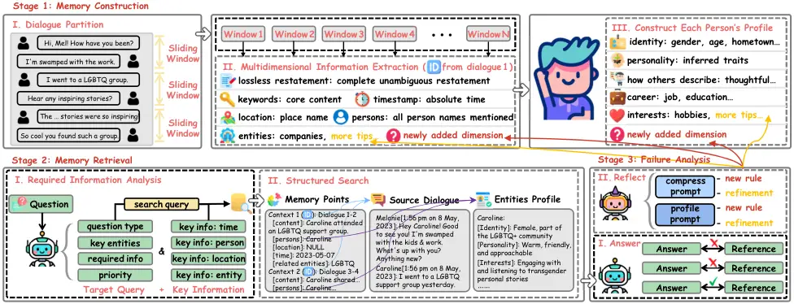
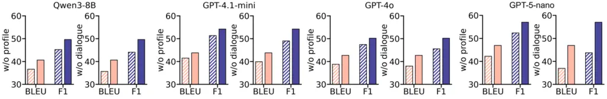
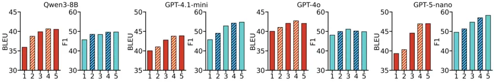
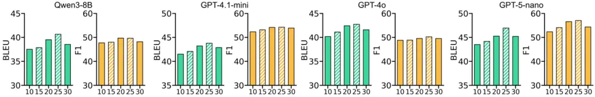
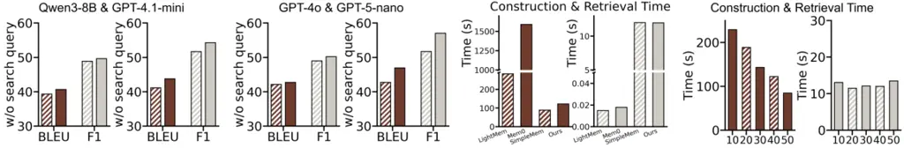
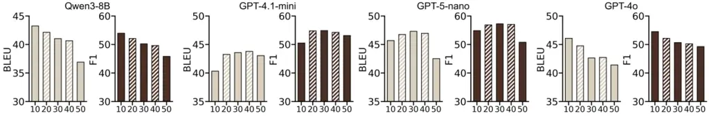
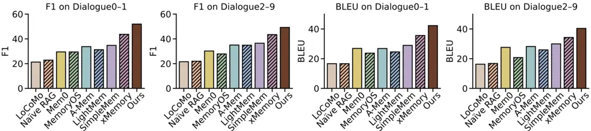

# Rethinking How to Remember: Beyond Atomic Facts in Lifelong LLM Agent Memory

Jingwei Sun Affiliation: TMLR Group, Hong Kong Baptist University
Email: <csjwsun@comp.hkbu.edu.hk>    Jianing Zhu ^(†)^(†)thanks: Equal
Contribution Affiliation: The University of Texas at Austin
Email: <bhanml@comp.hkbu.edu.hk>    Jiangchao Yao Affiliation: CMIC,
Shanghai Jiao Tong University Email: <jianing.zhu@austin.utexas.edu>   
Tongliang Liu Affiliation: Sydney AI Centre, The University of Sydney
Email: <sunarker@sjtu.edu.cn>    Bo Han ^(†)^(†)thanks: Correspondence
to Bo Han (bhanml@comp.hkbu.edu.hk). Affiliation: TMLR Group, Hong Kong
Baptist University Email: <tongliang.liu@sydney.edu.au>

###### Abstract

To enable reliable long-term interaction, LLM agents require a memory
system that can faithfully store, efficiently retrieve, and deeply
reason over accumulated dialogue history. Most existing methods adopt an
extracted fact based paradigm: handcrafted static prompts compress raw
dialogues into atomic facts, which are then stored, matched, and
injected into downstream reasoning. Nevertheless, such fact-centric
designs inevitably discard fine-grained details in original dialogues
and fail to support deep reasoning over scattered isolated facts.
Moreover, static prompts cannot maintain consistent extraction
granularity across diverse dialogue styles. To address these
limitations, we propose TriMem, which maintains three coexisting
representation granularities, including raw dialogue segments anchored
by source identifiers for storage fidelity, extracted atomic facts for
efficient memory retrieval, synthesized profiles that aggregate
dispersed facts into holistic semantic understanding for deep reasoning.
We further adopt TextGrad-based prompt optimization, which iteratively
refines extraction and profiling prompts via response quality feedback,
achieving lifelong evolution without any parameter updating. Extensive
experiments on LoCoMo and PerLTQA across multiple LLM backbones
demonstrate that TriMem consistently outperforms strong memory
baselines. The code is publicly available at
[https://TMLR-TriMem.github.io](https://TMLR-TriMem.github.io).

## 1 Introduction

The rapid development of large language models (LLMs) has driven
significant breakthroughs in agent technology Huang et al. (2024); Liu
et al. (2026a); Sun et al. (2026a), which has demonstrated remarkable
capabilities in a wide range of scenarios Sun et al. (2026b); Qin et al.
(2025); Tian et al. (2026). However, in practical applications,
constrained by the capacity of the context window, text overflow
inevitably occurs when it comes to long-context and multi-turn
interaction scenarios, leading to significant limitations in agents due
to the loss of key historical interaction information and broken context
logic Yan et al. (2025); Yu et al. (2025); Sheng et al. (2026). To
enable reliable long-term interaction, LLM agents require a robust
memory system to effectively manage and leverage historical experiences.

Recent research has extensively investigated the design of memory
modules for LLM agents Kang et al. (2025); Chhikara et al. (2025); Fang
et al. (2025); Liu et al. (2026b); Hu et al. (2026), with the
overarching goal of realizing three core functional capabilities:
storing information from historical interactions, retrieving relevant
memories upon query, and incorporating them into prompts to support
reasoning. As shown on the left side of Figure 1, existing systems
typically rely on extracted factual information generated by static
hand-written prompts to fulfill these three objectives. They only store
extracted key facts produced by fixed prompts, perform retrieval based
on similarity matching against these facts, and utilize the relevant
information to support reasoning, which naturally raises two critical
questions: Can extracted facts beneficially affect all three stages of
agent memory systems? and can static fixed prompts adaptively maintain
consistent and rational extraction granularity when facing highly
heterogeneous real-world dialogue scenarios?

In this paper, we start by highlighting two concerning phenomena:
extracted facts suffer from information loss, and reasoning for many
real-world questions relies on in-depth understanding rather than simple
fact matching. As shown in Figure 2, we analyze the performance of
existing memory systems from storage fidelity, retrieval efficiency, and
reasoning quality. The results demonstrate that although structured
factual information ensures efficient retrieval, some precise details
are inevitably lost since fact extraction necessarily compresses lengthy
dialogues into concise representations. Fortunately, the original
dialogue preserves complete information and can serve as an auxiliary
source to recover these unstored details. Furthermore, while some
questions can be answered using a single retrieved fact, others require
integrating scattered information to form a comprehensive understanding.
This suggests that a memory system should be capable of further
information integration and in-depth comprehension beyond discrete
factual pieces. Such a three-level architecture, consisting of raw
dialogue storage, extracted fact based retrieval, and
understanding-aided reasoning, offers potential for balancing the three
core functionalities of a memory system. We also illustrate that the
diversity of information styles leads to inconsistent extraction
granularity, which significantly degrade system performance. Therefore,
we require a mechanism that can continuously optimize prompts, enabling
the system to adaptively balance storage depth, retrieval efficiency,
and reasoning quality over time.


Figure 1: Comparison with previous systems. Our system establishes a
three-level architecture, which leverages raw dialogue to guarantee
information fidelity in storage, relies on key facts to enable efficient
retrieval, and provides in-depth understanding over the facts to ensure
the reliability of reasoning. The construction prompts are also
continuously optimized based on answer feedback.

Based on our findings in the analysis, we propose Tri-Granularity Memory
(TriMem), a memory architecture that maintains three coexisting
granularities of representation, including verbatim dialogues, extracted
facts, and synthesized profiles. In general, it builds source dialogue
identifiers to preserve pointers to original dialogue segments for each
compressed memory entry and employs a profile module that incrementally
integrates scattered facts during ingestion to form understanding (as
shown in the right part of Figure 1). On the one hand, considering the
insufficient retention of detailed information, a traceable link is
created for each compressed memory entry, which is directly associated
with the original dialogue from which the entry is derived. On the other
hand, considering the lack of in-depth understanding of factual
information, incremental profile is constructed based on the new
information of each window and pre-integrated understanding is provided
at reasoning time, thus eliminating the need to perform complex
comprehensive analysis among scattered facts. Furthermore, unlike
previous methods that utilize hand-written prompts, we employ
TextGrad-based prompt optimization Yuksekgonul et al. (2024) to
iteratively refine system prompts, thereby achieving the precise and
high-quality construction of the memory module. To demonstrate the
effectiveness of our method, we conduct extensive experiments on
commonly used benchmarks Maharana et al. (2024); Du et al. (2024) and
provide discussions on various ablations to justify the rationality. Our
main contributions are summarized as follows:

- $`\bullet`$
  Conceptually, we revisit the memory systems of LLM agents from a novel
  three-dimensional perspective, systematically exploring the
  limitations of existing paradigms spanning storage fidelity, indexing
  efficiency and reasoning quality (in Section 2).
- $`\bullet`$
  Technically, we propose TriMem, which innovatively introduces entity
  profile module to avoid shallow reasoning, preserves raw dialogue
  identifier to avoid detail loss and iteratively optimize system
  prompts to avoid performance fluctuation (in Section 3).
- $`\bullet`$
  Experimentally, we conduct extensive explorations to verify the
  effectiveness of TriMem under different scenarios, including the
  significant improvement across various benchmarks, compatibility with
  diverse model structure and model size, etc (in Section 4).


Figure 2: Analysis of existing agent memory systems. Although the
totally extracted fact based systems enable efficient retrieval, they
suffer from lossy storage and shallow reasoning. Additionally, the fixed
prompt words cannot be well applied to all contexts, which compromise
the performance.

## 2 Preliminary and Motivation

In this section, we review the preliminaries of conventional agent
memory systems (in Section 2.1), and conduct an in-depth analysis of the
inherent limitations of existing agent memory systems (in Section 2.2).
The experimental details of our analysis can be found in Appendix B.

### 2.1 Conventional Agent Memory Systems

We characterize the mainstream memory architecture Kang et al. (2025);
Chhikara et al. (2025); Liu et al. (2026b) into three core phases: (I)
Storage. Given a historical dialogue
$`\mathcal{H}=\left\{\left(r_{t},u_{t}\right)\right\}_{t=1}^{T}`$
consisting of $`T`$ turns of interaction between the user $`r`$ and
$`u`$, we first partition it into discrete windows
$`\mathcal{W}=\{w_{1},w_{2},...,w_{N}\}`$ following a specific
granularity $`g\in\{\text{turn},\text{session},\text{topic}\}`$. Key
factual information is then extracted by one LLM agent $`\phi`$ and
fixed extraction prompt $`\mathbf{p}_{e}`$ from each window to generate
memory entries
$`\mathcal{E}=\left\{e_{i}|e_{i}=\phi\left(\mathcal{W},\mathbf{p}_{e}\right)\right\}_{i=1}^{K}`$.
(II) Retrieval. Given question $`q`$, relevant entries are retrieved
from the memory bank through similarity matching
$`\mathcal{E}^{*}(q)=\text{top-}K_{e_{i}\in\mathcal{E}}\;\text{sim}(e_{i},k_{q})`$,
$`k_{q}`$ is either the question itself or query about the question,
such as keywords. (III) Reasoning. The retrieved entries are
concatenated with the question, which is subsequently fed into the
language model to generate a final response
$`a=\phi(\mathcal{E}^{*}(q),q)`$.

### 2.2 Analysis of Existing Systems

Efficient Retrieval. As illustrated in Figure 2, we compare one
representative system Liu et al. (2026b) with full-context based RAG
strategy Lewis et al. (2020), in terms of the ratio of successfully
retrieved question-related evidence. It can be seen that the extracted
fact based retrieval enables more efficient and accurate localization of
relevant memory entries. This alleviates the critical limitation of
full-context based retrieval, which tends to introduce massive
irrelevant and distracting content. For instance, when a query contains
the keyword career, the full-context based RAG strategy retrieves
massive sentences containing lexical variants such as job and career,
where redundant noise severely degrades retrieval efficiency. In
contrast, extracted facts are summarized across multi-turn dialogues,
thus enabling precise semantic matching and substantially improving
retrieval performance. However, the heavy reliance of subsequent phases
on these extracted fact introduces several limitations we examine next.

Lossy Storage. Although retrieval on extracted facts enables accurate
memory localization, the fact extraction process inevitably introduces
lossy compression of raw information, where fine-grained details are
discarded, resulting in inherent information incompleteness within
stored memory entries. As illustrated in Figure 2, we calculate the
coverage rate of reference answer token, it can be seen that the
extracted fact loss 14.5% more information than original dialogue. For
example, the modifier trans in the original dialogue is omitted and
compressed during fact extraction. This directly leads to a critical
issue: even if the system retrieves topically relevant entries, it still
fails to provide accurate and complete answers due to missing key
contextual details from raw dialogues. This implies that completely
abandoning raw dialogues and relying solely on extracted facts for
storage will result in permanent loss of semantic details. Such systems
become incapable of solving detail-dependent and high-precision
constrained queries, thus suffering from inevitable performance
degradation.

Shallow Reasoning. Beyond the aforementioned issue of irreversible
information loss during extraction, existing extracted fact based memory
systems additionally suffer from a fundamental capability bottleneck of
shallow reasoning. As illustrated in Figure 2, we test the reasoning
performance of those correctly retrieved questions. The results reveal
that the reasoning performance on multi-evidence questions is
considerably inferior to that on single-evidence ones, as
single-evidence questions mostly rely on explicit factual content and
can be answered by directly restating content in retrieved memory
entries. In contrast, multi-evidence questions demand deep understanding
of dispersed facts, such as emotional inference and logical induction.
This phenomenon adequately demonstrates that reasoning mechanisms solely
relying on extracted fact completely lack the ability of deep
comprehension towards entity semantic portraits or behavioral tendency
modeling, thereby severely hindering the comprehensive performance of
LLM agents in long-term interactions.

Suboptimal Prompt. In addition to the information loss and shallow
reasoning issues incurred by extracted facts, practical real-world
deployments further suffer from performance degradation caused by
unstable extraction granularity with fixed prompts. Realistic long-term
interactions involve highly diverse information styles, expression
patterns and content categories, whereas conventional systems rely on
static hand-written extraction prompts. Such fixed prompts fail to
adaptively accommodate heterogeneous dialogue content, making it
impossible to maintain consistent and rational fact extraction
granularity. As illustrated in Figure 2, we compare the reasoning
performance across dialogues between different speakers where the
performance severely fluctuate. For example, the Pomodoro technique is
sometimes explicitly mentioned by name, while in other cases it is
implicitly described as 25 minutes on and 5 minutes off. The fixed
prompt cannot recognize such high-level semantic concepts, resulting in
inconsistent extraction granularity. This discrepancy further degrades
the overall performance and stability of the memory system.

## 3 Method

In this section, we present TriMem, which constructs a three-level
architecture, from raw dialogue to extracted key factual information and
integrated profiles (in Section 3.1). Specially, we construct index
between raw dialogue and extracted fact to improve storage fidelity
while keeping retrieval efficiency (in Section 3.2), integrate scattered
facts to profiles to support understanding based reasoning (in
Section 3.3), optimize prompts via failure case analysis to realize
lifelong evolution (in Section 3.4).

### 3.1 Overall Pipeline

As shown in Figure 3, our framework consists of the following three core
components: (1) Given a set of dialogue, we extract factual information
and bind each fact with raw dialogue identifier and profile identifier
to implement memory construction. (2) Given a question, the agent first
analyzes the required information and keywords to generate search query.
It then matches with extracted facts to retrieve relevant memory, and
further obtains raw dialogues with full details and integrated profiles
via predefined index to complete memory retrieval. (3) According to the
reasoning performance, we invoke a powerful senior model to conduct
failure analysis and provide revision suggestions for system prompts. In
the following subsections, we will elaborate on these components in
detail.

### 3.2 Dense Storage with Efficient Retrieval

Same as conventional systems, we also perform fact extraction on
original dialogue. We first partition the raw dialogue $`\mathcal{H}`$
into a sequence of overlapping windows via a sliding window
$`f_{\text{seg}}`$:

```math
\mathcal{W}=f_{\text{seg}}(\mathcal{H};\,l,\,s)=\{w_{i}\}_{i=1}^{N},\quad w_{i}=\{(r_{t},u_{t})\}_{t=(i-1)s+1}^{\min(T,\,(i-1)s+l)}, \tag{1}
```

where $`l`$ denotes the window size, $`s`$ denotes the stride, and
$`N=\lceil(T-l)/s\rceil+1`$ is the total number of windows. The
overlapping design ensures that contextually related utterances spanning
window boundaries are not artificially severed, thereby preserving local
coherence for subsequent extraction. For each window $`w_{i}`$, we
employ an agent $`\phi`$ driven by extraction prompt $`\mathbf{p}_{e}`$,
the extraction prompt is composed of a task instruction and a
multi-dimensional schema:

```math
\mathbf{p}_{e}=\bigl[\,\text{instruction}\;\|\;\text{schema}:\{f_{\text{restate}},\,f_{\text{time}},\,f_{\text{person}},\,\ldots\}\,\bigr], \tag{2}
```

where each dimension corresponds to a dedicated extraction function
capturing a distinct semantic aspect of the dialogue content:
$`f_{\text{restate}}`$ performs lossless restatement to preserve
complete and unambiguous factual content, $`f_{\text{time}}`$ extracts
absolute temporal references, $`f_{\text{person}}`$ identifies all
persons mentioned in the window, and additional dimensions such as
location, keywords, and named entities can be flexibly incorporated into
the schema. This extensible multi-dimensional design ensures that
extraction covers diverse semantic granularities while remaining
adaptable to domain-specific requirements. Each extracted entry is thus
a structured tuple, i.e.,
$`e_{i}=\bigl(f_{\text{restate}}^{(i)},\,f_{\text{time}}^{(i)},\,f_{\text{person}}^{(i)},\,\ldots\bigr)`$.
Critically, unlike previous systems, we add an additional dimension
$`f_{\text{src}}`$ to the extraction prompt to obtain a source dialogue
identifier $`e_{i}.\mathrm{src}\triangleq\{r_{t},u_{t}\in w_{i}\}`$ for
each entry $`e_{i}`$ to address the lossy storage problem. Given
question $`q`$, the system first extracts a set of search query
$`k_{q}`$ from the question by analysing the required information and
relevant keywords. The top-$`K`$ most relevant entries are then
retrieved from $`\mathcal{E}`$ through similarity matching over
extracted fact
$`\mathcal{E}^{*}(q)=\operatorname{top-}K_{e_{i}\in\mathcal{E}}\;\operatorname{sim}(k_{q},\,e_{i})`$.
Each retrieved entry $`e_{i}\in\mathcal{E}^{*}(q)`$ can serve as an
anchor to recover all original details by the source identifier. In this
way, our system guarantees storage fidelity while keeping retrieval
efficiency.

### 3.3 Scattered Fact with Integrated Profile

To address the shallow reasoning problem, we construct structured
profiles over scattered fact. We first group extracted fact according to
different person $`p\in\mathcal{V}`$:

```math
\mathcal{E}_{p}=\{e_{i}\in\mathcal{E}\mid f_{\text{person}}^{(i)}=p\},\quad\forall p\in\mathcal{V}, \tag{3}
```

where $`\mathcal{V}=\bigcup_{i=1}^{K}f_{\text{person}}^{(i)}`$ denotes
the set of all identified persons. Then, driven by a profile prompt
$`\mathbf{p}_{\psi}`$, the person-specific entries are integrated and
synthesized into a structured profile
$`\mathrm{Prof}(p)=\phi(\mathcal{E}_{p},\mathbf{p}_{\psi})`$, which
captures multi-faceted entity-level understanding, including identity
attributes (e.g., gender, age, hometown), inferred personality traits,
career and educational background, interests and hobbies, as well as
interpersonal dynamics and behavioral tendencies. Ultimately, also
anchored by the retrieved entry, we can obtain integrated profiles
during reasoning through the person identifier. In this way, we can
provide agents with understanding over scattered facts to avoid shallow
reasoning.



Figure 3: Overview of TriMem. It segments historical dialogue into
windows, extracts multi-dimensional facts with traceable index, and
constructs entity profiles. Relevant memories are retrieved according to
queries, and prompts are continuously optimized via response feedback.

### 3.4 Lifelong Evolution with Optimized Prompt

In order to maintain the fine-grained consistency, we utilize
TextGrad Yuksekgonul et al. (2024) to optimize the prompts. Given the
retrieved context $`\mathcal{R}(q)`$, the system generates a response
via an answer generation prompt $`\mathbf{p}_{a}`$, whose output can be
compared against reference answers $`a^{*}`$ to obtain a quality signal.
We leverage this failure signal to continuously optimize the upstream
extraction prompt $`\mathbf{p}_{e}`$ and profile prompt
$`\mathbf{p}_{\psi}`$, treating them as joint trainable parameters
$`\boldsymbol{\theta}=(\mathbf{p}_{e},\mathbf{p}_{\psi})\in\Sigma^{*}\times\Sigma^{*}`$,
where $`\Sigma^{*}`$ denotes the space of natural language strings. The
complete optimization objective is:

```math
\boldsymbol{\theta}^{*}=\arg\min_{\boldsymbol{\theta}}\,\mathbb{E}_{(q,\,a^{*})\sim\mathcal{D}}\bigl[-\mathrm{Score}_{\mathrm{LLM}}\!\left(q,\,\mathrm{LLM}(q,\,\mathcal{R}(q)),\,a^{*}\right)\bigr]. \tag{4}
```

where $`\mathrm{Score}_{\mathrm{LLM}}`$ evaluates answer quality via an
LLM judge, compatible with metrics such as F1 and BLEU. Rather than
numerical gradients, TextGrad backpropagates the loss through natural
language editing suggestions given by LLM agent
$`\mathrm{TextGrad}_{\mathrm{LLM}}`$:

```math
\mathbf{g}_{e},\mathbf{g}_{\psi}=\frac{\partial\mathcal{L}}{\partial\boldsymbol{\theta}}=\mathrm{TextGrad}_{\mathrm{LLM}}\!\left(\mathcal{L},\,\boldsymbol{\theta}\right)\in\Sigma^{*}. \tag{5}
```

The prompts are then updated by applying these textual gradients as
rewriting instructions:
$`\mathbf{p}_{e}^{(t+1)}=\mathbf{p}_{e}^{(t)}\oplus\mathbf{g}_{e}^{(t)}`$,
$`\mathbf{p}_{\psi}^{(t+1)}=\mathbf{p}_{\psi}^{(t)}\oplus\mathbf{g}_{\psi}^{(t)}`$,
where $`\oplus`$ denotes the prompt editing operator. Through iterative
optimization, $`\mathbf{p}_{e}`$ progressively refines extraction
granularity to retain semantically valuable details, while
$`\mathbf{p}_{\psi}`$ improves its capacity to capture behavioral
patterns and entity-level understanding, enabling our system to
continuously evolve without manual prompt engineering.

## 4 Experiments

In this section, we provide comprehensive verification of TriMem. First,
we introduce several critical parts of experimental setups (in
Section 4.1). Second, we provide performance comparison and
compatibility experiments of Entity Profile with different previous
methods (in Section 4.2). Third, we conduct extensive ablation studies
to better understand our TriMem (in Section 4.3).

### 4.1 Experimental Setups

Baselines and Benchmarks. We compare our method with Naive RAG and
several competitive agent memory systems, including Mem0 Chhikara et al.
(2025), MemoryOS Kang et al. (2025), A-Mem Xu et al. (2025),
LightMem Fang et al. (2025), SimpleMem Liu et al. (2026b) and xMemory Hu
et al. (2026). For a fair comparison, we keep the original
hyperparameter setups of the comparative methods. The evaluation is
conducted on three representative benchmarks, including LoCoMo Maharana
et al. (2024), PerLTQA Du et al. (2024) and LongMemEval Wu et al.
(2025). More details of each memory system and benchmark, including
their evaluation settings and task characteristics, are provided in
Appendix A.

Implementation Details. We set the size of the window to 40 and stride
to 38. The Qwen3-embedding-0.6b Zhang et al. (2025b) model is utilized
to encode the extracted fact. During retrieval, the maximum number of
relevant entries is set to 25. The number of optimization rounds for
prompts is set to 4 to enable in-depth reasoning. We perform prompt
training on a small development subset of LoCoMo, consisting of
dialogue0 and dialogue1, using Qwen3-8B Yang et al. (2025), and then
directly apply the optimized prompts to the remaining dialogues, other
models and benchmarks. The failure analysis is conducted by Claude Opus
4.6 Anthropic (2026). The prompts used in our experiments are provided
in Appendix E.

### 4.2 Main Results

|              |           |          |       |          |       |            |       |           |       |         |       |       |
| ------------ | --------- | -------- | ----- | -------- | ----- | ---------- | ----- | --------- | ----- | ------- | ----- | ----- |
| Model        | Method    | MultiHop |       | Temporal |       | OpenDomain |       | SingleHop |       | Average |       | Token |
|              |           | BLEU     | F1    | BLEU     | F1    | BLEU       | F1    | BLEU      | F1    | BLEU    | F1    | Cost  |
| GPT-4.1-mini | LoCoMo    | 8.00     | 17.26 | 10.17    | 14.89 | 8.29       | 16.28 | 17.43     | 19.36 | 13.62   | 17.85 | 16863 |
|              | Naïve RAG | 11.49    | 13.24 | 20.52    | 28.80 | 11.79      | 10.75 | 22.85     | 30.29 | 19.59   | 25.64 | 1119  |
|              | Mem0      | 28.81    | 31.44 | 35.41    | 46.24 | 18.51      | 17.93 | 31.25     | 35.34 | 30.88   | 35.81 | 1153  |
|              | MemoryOS  | 16.46    | 24.02 | 34.78    | 46.52 | 14.89      | 19.58 | 36.18     | 43.92 | 30.95   | 39.30 | 936   |
|              | A-Mem     | 15.11    | 20.66 | 41.57    | 50.94 | 11.18      | 13.20 | 38.25     | 43.72 | 33.01   | 39.10 | 1276  |
|              | LightMem  | 32.93    | 40.33 | 47.53    | 55.23 | 18.31      | 21.91 | 37.68     | 48.39 | 37.66   | 46.69 | 695   |
|              | SimpleMem | 32.40    | 39.33 | 43.69    | 58.01 | 19.56      | 24.50 | 43.41     | 53.99 | 39.97   | 50.30 | 587   |
|              | Ours      | 35.20    | 42.59 | 49.56    | 64.72 | 36.86      | 43.88 | 45.25     | 55.36 | 43.79   | 54.26 | 1217  |
| GPT-4o       | LoCoMo    | 19.64    | 19.20 | 9.50     | 13.95 | 11.87      | 16.60 | 13.81     | 16.12 | 13.86   | 16.26 | 16863 |
|              | Naïve RAG | 14.36    | 15.35 | 11.48    | 16.17 | 9.03       | 9.09  | 26.67     | 35.03 | 20.15   | 25.88 | 1119  |
|              | Mem0      | 25.52    | 32.36 | 32.48    | 42.70 | 14.50      | 18.50 | 30.02     | 39.84 | 28.74   | 37.74 | 1195  |
|              | MemoryOS  | 22.52    | 31.76 | 38.31    | 47.08 | 12.91      | 18.06 | 38.26     | 43.67 | 33.81   | 40.60 | 944   |
|              | A-Mem     | 20.90    | 26.12 | 35.39    | 48.64 | 10.74      | 12.33 | 37.11     | 42.08 | 32.14   | 38.67 | 1152  |
|              | LightMem  | 35.30    | 45.16 | 43.60    | 58.57 | 10.56      | 23.20 | 36.72     | 46.60 | 36.26   | 47.37 | 677   |
|              | SimpleMem | 31.34    | 35.58 | 35.78    | 46.96 | 18.96      | 17.01 | 37.11     | 43.94 | 34.64   | 41.36 | 627   |
|              | Ours      | 40.36    | 46.00 | 51.39    | 60.41 | 39.27      | 50.15 | 40.61     | 47.78 | 42.73   | 50.23 | 1272  |
| GPT-5-nano   | LoCoMo    | 20.45    | 19.04 | 12.69    | 16.56 | 13.83      | 20.85 | 13.50     | 15.23 | 14.62   | 16.56 | 16863 |
|              | Naïve RAG | 10.13    | 13.29 | 8.78     | 13.09 | 9.25       | 12.24 | 20.29     | 28.44 | 15.34   | 21.46 | 1119  |
|              | Mem0      | 22.55    | 28.58 | 35.52    | 48.82 | 18.33      | 16.75 | 28.99     | 35.65 | 28.51   | 35.92 | 1074  |
|              | MemoryOS  | 10.74    | 23.50 | 32.50    | 39.71 | 10.02      | 20.30 | 34.28     | 40.34 | 28.09   | 35.88 | 952   |
|              | A-Mem     | 15.54    | 20.11 | 27.23    | 32.43 | 10.86      | 12.55 | 27.26     | 31.91 | 24.09   | 28.65 | 1175  |
|              | LightMem  | 28.63    | 38.21 | 39.72    | 55.51 | 18.79      | 22.74 | 31.19     | 42.01 | 31.73   | 42.93 | 723   |
|              | SimpleMem | 25.42    | 33.28 | 32.15    | 45.75 | 20.77      | 24.31 | 39.65     | 46.71 | 34.30   | 42.65 | 655   |
|              | Ours      | 34.86    | 45.25 | 42.45    | 57.05 | 33.55      | 40.52 | 54.26     | 62.88 | 46.96   | 57.04 | 1256  |

Table 1: Performance on the LoCoMo benchmark with High-Capability
Models. TriMem achieves outstanding performance across different models
while maintaining high efficiency.

|                  |           |          |       |          |       |            |       |           |       |         |       |       |
| ---------------- | --------- | -------- | ----- | -------- | ----- | ---------- | ----- | --------- | ----- | ------- | ----- | ----- |
| Model            | Method    | MultiHop |       | Temporal |       | OpenDomain |       | SingleHop |       | Average |       | Token |
|                  |           | BLEU     | F1    | BLEU     | F1    | BLEU       | F1    | BLEU      | F1    | BLEU    | F1    | Cost  |
| Qwen3-8B         | LoCoMo    | 12.67    | 20.54 | 12.32    | 18.55 | 10.59      | 14.39 | 19.76     | 23.78 | 16.34   | 21.51 | 16863 |
|                  | Naïve RAG | 13.75    | 15.83 | 8.86     | 13.53 | 9.68       | 10.77 | 21.57     | 28.76 | 16.75   | 22.10 | 1119  |
|                  | Mem0      | 28.32    | 30.07 | 23.15    | 26.15 | 11.79      | 15.15 | 30.75     | 34.97 | 27.54   | 30.10 | 1140  |
|                  | MemoryOS  | 14.38    | 22.72 | 18.67    | 22.79 | 11.06      | 13.52 | 25.65     | 33.52 | 21.22   | 28.06 | 911   |
|                  | A-Mem     | 16.02    | 21.08 | 28.10    | 37.51 | 14.01      | 14.19 | 33.60     | 40.77 | 28.01   | 34.83 | 1180  |
|                  | LightMem  | 22.84    | 32.54 | 37.62    | 48.37 | 18.05      | 19.02 | 23.03     | 31.37 | 25.73   | 34.36 | 740   |
|                  | SimpleMem | 23.39    | 30.39 | 24.66    | 34.51 | 14.04      | 15.39 | 35.73     | 41.26 | 29.81   | 36.25 | 608   |
|                  | xMemory   | 28.44    | 39.13 | 28.65    | 35.41 | 17.76      | 21.57 | 40.66     | 50.57 | 34.49   | 43.51 | 2230  |
|                  | Ours      | 33.09    | 41.22 | 38.71    | 53.13 | 30.59      | 37.64 | 45.10     | 52.52 | 40.66   | 49.65 | 1339  |
| Llama-3.1-8B-Ins | LoCoMo    | 13.73    | 23.36 | 13.15    | 20.30 | 11.54      | 19.42 | 18.64     | 25.86 | 16.15   | 23.84 | 16863 |
|                  | Naïve RAG | 14.31    | 16.18 | 7.63     | 12.28 | 9.09       | 11.58 | 22.99     | 31.02 | 17.33   | 23.18 | 1119  |
|                  | Mem0      | 13.27    | 16.40 | 8.26     | 12.62 | 7.45       | 8.45  | 21.75     | 31.28 | 16.49   | 23.24 | 1085  |
|                  | MemoryOS  | 13.57    | 22.63 | 19.18    | 23.31 | 10.59      | 13.01 | 23.46     | 31.05 | 19.95   | 26.77 | 964   |
|                  | A-Mem     | 15.80    | 22.84 | 23.79    | 36.19 | 11.19      | 12.51 | 31.19     | 37.86 | 25.58   | 33.18 | 1340  |
|                  | LightMem  | 13.19    | 19.64 | 16.93    | 28.06 | 17.39      | 20.68 | 27.62     | 41.06 | 22.11   | 33.16 | 758   |
|                  | SimpleMem | 18.81    | 26.22 | 21.15    | 30.44 | 15.81      | 18.77 | 26.79     | 31.23 | 23.47   | 29.37 | 674   |
|                  | xMemory   | 21.89    | 31.24 | 21.78    | 26.84 | 12.37      | 16.62 | 27.75     | 41.36 | 24.47   | 34.94 | 2375  |
|                  | Ours      | 25.42    | 34.56 | 25.98    | 32.36 | 28.40      | 32.71 | 35.76     | 43.20 | 31.37   | 38.70 | 1388  |

Table 2: Performance on the LoCoMo benchmark with Efficient Models.
TriMem still achieves superior performance-efficiency balance with
representative efficient models.

|              |          |                     |        |           |                  |                     |        |           |
| ------------ | -------- | ------------------- | ------ | --------- | ---------------- | ------------------- | ------ | --------- |
| Method       | Qwen3-8B |                     |        |           | Llama-3.1-8B-Ins |                     |        |           |
|              | Profile  | Social Relationship | Events | Dialogues | Profile          | Social Relationship | Events | Dialogues |
| Full-Context | 65.80    | 56.72               | 52.75  | 18.51     | 52.46            | 54.58               | 47.54  | 17.27     |
| Mem0         | 89.56    | 76.46               | 66.48  | 27.59     | 73.04            | 72.29               | 57.14  | 26.31     |
| LightMem     | 64.93    | 78.00               | 73.03  | 47.01     | 53.85            | 74.08               | 69.21  | 44.72     |
| SimpleMem    | 88.12    | 82.40               | 79.87  | 42.09     | 84.64            | 76.46               | 70.39  | 37.90     |
| TriMem       | 92.46    | 83.23               | 85.72  | 55.79     | 92.17            | 82.28               | 78.17  | 45.01     |

Table 3: Performance comparison on the PerLTQA benchmark. All values
report the LLM-judged correctness score (%), where gpt-4.1-mini
evaluates whether each predicted answer matches the ground truth. TriMem
achieves the best performance across different sub-tasks.

|              |          |               |                  |                     |                          |                           |         |
| ------------ | -------- | ------------- | ---------------- | ------------------- | ------------------------ | ------------------------- | ------- |
| Method       | Temporal | Multi-Session | Knowledge-Update | Single-Session-User | Single-Session-Assistant | Single-Session-Preference | Average |
| Full-context | 27.06%   | 30.08%        | 41.03%           | 47.14%              | 32.14%                   | 60.00%                    | 39.57%  |
| Mem0         | 40.60%   | 50.37%        | 69.23%           | 87.14%              | 48.21%                   | 63.33%                    | 59.81%  |
| LightMem     | 85.71%   | 47.37%        | 92.30%           | 88.57%              | 21.43%                   | 76.67%                    | 68.67%  |
| SimpleMem    | 83.46%   | 60.92%        | 79.48%           | 85.71%              | 75.00%                   | 76.67%                    | 76.87%  |
| TriMem       | 79.70%   | 72.18%        | 91.03%           | 94.29%              | 91.07%                   | 80.00%                    | 82.80%  |

Table 4: Performance comparison on the LongMemEval benchmark. We report
the LLM-judged correctness score of different memory systems with
GPT-4.1-mini. TriMem achieves the best overall performance while
exhibiting consistently competitive results across different sub-tasks.

Performance on High-Capability Models. In Table 1, we compare
representative agent memory systems to validate the effectiveness of
TriMem. Results demonstrate that our method consistently outperforms
prior approaches when integrated with various high-capability models,
including GPT-4o Hurst et al. (2024), GPT-4.1-mini Achiam et al. (2023)
and GPT-5-nano Singh et al. (2025). Meanwhile, to illustrate the
information density of TriMem, we report the average tokens consumption
of retrieved contexts. It can be seen that our system only consumes
around 1.2k tokens. Although retrieving raw dialogues and entity
profiles slightly increases the token overhead, it brings substantial
performance gains.

Compatibility with Efficient Models. To evaluate the capability of
TriMem to support small-parameter efficient models, we conduct
experiments on lightweight models including Qwen3-8B Yang et al. (2025)
and Llama-3.1-8B-Instruct Grattafiori et al. (2024). As shown in
Table 2, our system still achieves substantial performance improvements.
Unlike xMemory Hu et al. (2026), which only supports limited open-source
models due to its requirement for model output logits, TriMem is
compatible with models of various parameter sizes. This verifies the
extensive superiority and broad applicability of our method.

Generalization on Different Datasets. PerLTQA and LongMemEval are also
widely adopted benchmarks for long-term agent QA. PerLTQA consists of
multi-dimensional evaluations covering personal profiles, social
relationship, historical events and dialogue memories. LongMemEval
evaluates five core memory abilities, including information extraction,
multi-session reasoning, knowledge updates, temporal reasoning, and
abstention. To comprehensively validate the effectiveness of our
proposed method, we additionally report experimental results on these
two datasets in Table 3 and Table 4, which demonstrates the strong
generalization ability of TriMem.

### 4.3 Ablation and Further Analysis

Ablation of Profile and Raw Dialogue. To verify the necessity of entity
profiles and raw dialogues for reasoning reliability and storage
fidelity, we conduct ablation experiments on LoCoMo by removing these
two contextual components. The results are presented in Figure 4, it can
be seen that the agent suffers a noticeable performance drop when either
component is excluded. This demonstrates that incorporating entity
profiles and raw dialogues is a reasonable design which effectively
boosts the overall capability of agent memory systems. More detailed
results can be found in Appendix D.1.

Impact of Varying Evolution Step. We perform multi-step iterative
evolution of prompt. To evaluate the impact of different evolution steps
on overall system performance, we conduct an ablation study by
increasing the number of update steps from 1 to 5. As shown in Figure 5,
the performance gradually improves with the increase of evolution steps,
and reaches the optimal level when the number of steps is set to 4.
Further updates lead to excessive refinement of the prompt’s
granularity, which may exceed the model’s capability boundary and result
in performance degradation. Therefore, we set the number of evolution
steps to 4. Visualization of update process can be found in
Appendix D.2.

Performance in Different Retrieval Numbers. In Figure 6, we present the
performance of our method when retrieving different numbers of memory
entries. It can be observed that when the number of retrieved memory
entries is too low, key information may fail to be effectively
retrieved, resulting in suboptimal system performance. When the number
of retrieved entries is excessively high, irrelevant redundant
information is likely to be introduced, interfering with model reasoning
and leading to performance degradation. Overall, setting the number of
retrieved memory entries to 25 is a reasonable choice. Visualization of
the retrieved memory entries can be found in Appendix D.3.



Figure 4: Ablation of profile and raw dialogue module. Incorporating
entity profile and raw dialogue shows the best results, which
demonstrates the rationality of our design.



Figure 5: Impact of varying evolution step. Appropriate update steps
lead to overall improvements, while further updates result in excessive
refinement, which negatively affects the performance.



Figure 6: Performance in different retrieval numbers. The results show
that the performance is optimal when the number is 25, and performance
degrades when the number is too low or too high.

Necessity of Search Query. In the retrieval phase, instead of directly
relying on the original question for retrieval, we prompt the agent to
first analyze the required information and keywords of the question, and
then perform retrieval based on the analysis results. To verify the
necessity of this module, we compare the system performance with and
without search query in Figure 7. The experimental results show that
although the generation process of search query increase the retrieval
time, the performance is significantly improved after adding the search
query, indicating that the search query helps the model achieve more
accurate retrieval, thus confirming the necessity of this module. We
show some obtained search queries of different questions in
Appendix D.4.

Comparison with Diverse Window Size. To compare the system performance
under different window sizes, we present the performance comparison with
various window settings in Figure 8. It can be observed that, although
the model can also achieve good performance with smaller windows, the
number of communications with the agent significantly increases. As
shown on the right side of Figure 7, although the inference time is not
affected, the memory construction time highly extends. Therefore, to
balance system performance and efficiency, we finally set the window
size to 40. Examples of information extraction under different window
sizes can be found in Appendix D.5.

Detailed Results on Two Subsets of LoCoMo. As illustrated in
Section 4.1, prompt evolution was conducted exclusively on dialogue0 and
dialogue1 of LoCoMo using Qwen3-8B. To evaluate the generalizability of
the selected prompts, we report TriMem’s performance with Qwen3-8B on
two LoCoMo subsets in Figure 9. TriMem consistently outperforms the
baselines on both subsets, indicating that prompt optimization does not
overfit to the two development dialogues.



Figure 7: Necessity of search query and efficiency analysis. Although
the introduction of search query increases the retrieval time, it
greatly improve the system performance. The smaller window size increase
the memory construction time, therefore we set the size to 40 to
maintain the efficiency, which enabling competitive construction time
comparing with previous methods.



Figure 8: Ablation of window size. The memory system can also achieve
great performance with smaller size. However, considering the
efficiency, we finally set the window size to 40.



Figure 9: Details on two subsets. The memory system can consistently
achieve better performance on both subsets, indicating the stability and
generalization ability of our prompt evolution method.

## 5 Related Work

Memory Systems for LLM Agents. Long-term memory has emerged as a key
capability for LLM agents engaged in multi-session interactions, with
most existing systems organized around three functional stages: memory
construction, memory retrieval, and memory-supported reasoning. For
memory construction, Mem0 (Chhikara et al., 2025), A-Mem (Xu et al.,
2025), and MemoryOS (Kang et al., 2025) prompt LLMs to extract atomic
facts from dialogues and consolidate them via dynamic updates or
hierarchical stores. For memory retrieval, methods from Naive RAG (Lewis
et al., 2020) to xMemory (Hu et al., 2026) match queries with fact
embeddings through similarity search. For memory-supported reasoning,
retrieved facts are concatenated into the prompt as contextual
supplements (Liu et al., 2026b; Fang et al., 2025). Despite their
differences, these systems share a common design choice: extracted facts
serve as the atomic unit across all three stages, i.e., what is stored,
what is matched, and what is injected into the prompt. This fact-centric
pipeline risks losing fidelity to the original dialogue and limits the
agent’s ability to handle queries that require holistic understanding
rather than discrete fact lookup. In contrast, our work revisits the
role of each stage, establishing index between extracted facts and
source dialogues to ensure storage fidelity and constructing entity
profiles from these facts to support comprehension-oriented reasoning
that goes beyond fact recall. This perspective also clarifies why the
three stages should not be designed in isolation: the granularity of
what is stored constrains what can be retrieved, and the granularity of
what is retrieved in turn dictates the kind of reasoning the agent can
perform downstream. Treating the three stages as a single pipeline with
consistent yet multi-level representations, rather than three
independently optimized modules over the same atomic unit, is therefore
central to our design.

Lifelong Evolution Agents. Lifelong evolution has emerged as a key
capability for LLM agents that need to improve from accumulated
experience. One prominent line formulates this as a reinforcement
learning problem: MemAgent (Yu et al., 2025) reshapes long-context LLMs
into multi-conversation memory agents, MemBuilder (Shen et al., 2026)
reinforces memory construction with attributed dense rewards,
AgentFold (Ye et al., 2025) learns proactive context management for
long-horizon web agents, MemGen (Zhang et al., 2025a) weaves generative
latent memories into self-evolving agents, and MEM1 (Zhou et al., 2025)
jointly synergizes memory and reasoning for efficient execution. While
effective, these methods all require RL-based parameter updates that
disrupt the original pretrained weights, incur substantial training
cost, and are impractical when only API-accessible models are available.
Motivated by these limitations, a complementary line pursues lifelong
evolution without altering model parameters: Voyager (Wang et al., 2023)
maintains a skill library of executable code, ExpeL (Zhao et al., 2024)
distills cross-task experience into natural-language rules, and
MemSkill (Zhang et al., 2026) learns task-agnostic skill memories that
transfer to unseen tasks. In line with this paradigm, our work applies
TextGrad (Yuksekgonul et al., 2024) to evolve the fact extraction and
entity profile construction prompts, achieving lifelong adaptability
without tuning parameters. Compared with skill or rule based
externalizations that target the agent’s action space, prompt-level
evolution directly reshapes how raw experience is parsed into memory,
which is particularly suited to memory systems whose behavior is largely
determined by the extraction and synthesis prompts rather than by a
fixed policy.

## 6 Conclusion

In this work, we revisit the design of memory systems for LLM agents and
identify three concrete limitations of the prevailing extracted fact
based paradigm: lossy storage, shallow reasoning, and suboptimal prompts
under heterogeneous dialogue styles. Motivated by these findings, we
propose TriMem, which maintains three coexisting representation
granularities, including verbatim dialogues for storage fidelity, atomic
facts for retrieval efficiency and progressively synthesized profiles
for deep reasoning. TextGrad-based prompt optimization is further
employed to enable lifelong evolution. Extensive experiments on LoCoMo
and PerLTQA across various LLMs confirm the effectiveness of our method.
We hope TriMem can bring new insights for future researches on agent
memory system.

## Acknowledgments

JWS and BH were supported by RGC Research Fellow Scheme No.
RFS2627-2S02, RGC Young Collaborative Research Grant No. C2005-24Y, RGC
General Research Fund No. 12202026, RGC General Research Fund No.
12200725, NSFC Major Research Plan No. 92570109, NSFC General Program
No. 62376235, Guangdong and Hong Kong Universities “1+1+1” Joint
Research Collaboration Scheme, HKBU Faculty Niche Research Areas No.
RC-FNRA-IG/25-26/SCI/05, and HKBU CSD Departmental Incentive Scheme. JCY
is supported by National Natural Science Foundation of China (No.
62676245), the Lingang Laboratory (Grant No. LGL-8889-01), STCSM (No.
22DZ2229005) and 111 plan (No. BP0719010). TLL was partially supported
by the following Australian Research Council projects: DP260102466,
FT220100318, DP220102121, LP220100527, LP220200949.

## References

- Achiam et al. (2023) J. Achiam, S. Adler, S. Agarwal, L. Ahmad, I.
  Akkaya, F. L. Aleman, D. Almeida, J. Altenschmidt, S. Altman, S.
  Anadkat, et al. Gpt-4 technical report. arXiv preprint
  arXiv:2303.08774. Cited by: §4.2.
- Anthropic (2026) Anthropic Claude opus 4.6 system card. Technical
  report Anthropic. External Links:
  [Link](https://www.anthropic.com/claude-opus-4-6-system-card) Cited
  by: §4.1.
- Chhikara et al. (2025) P. Chhikara, D. Khant, S. Aryan, T. Singh,
  and D. Yadav Mem0: building production-ready ai agents with scalable
  long-term memory. arXiv preprint arXiv:2504.19413. Cited by: Appendix
  A, §1, §2.1, §4.1, §5.
- Du et al. (2024) Y. Du, H. Wang, Z. Zhao, B. Liang, B. Wang, W.
  Zhong, Z. Wang, and K. Wong Perltqa: a personal long-term memory
  dataset for memory classification, retrieval, and fusion in question
  answering. In Proceedings of the 10th SIGHAN Workshop on Chinese
  Language Processing (SIGHAN-10), pp. 152–164. Cited by: Appendix A,
  §1, §4.1.
- Fang et al. (2025) J. Fang, X. Deng, H. Xu, Z. Jiang, Y. Tang, Z.
  Xu, S. Deng, Y. Yao, M. Wang, S. Qiao, et al. Lightmem: lightweight
  and efficient memory-augmented generation. arXiv preprint
  arXiv:2510.18866. Cited by: Appendix A, §1, §4.1, §5.
- Grattafiori et al. (2024) A. Grattafiori, A. Dubey, A. Jauhri, A.
  Pandey, A. Kadian, A. Al-Dahle, A. Letman, A. Mathur, A. Schelten, A.
  Vaughan, et al. The llama 3 herd of models. arXiv preprint
  arXiv:2407.21783. Cited by: §4.2.
- Hu et al. (2026) Z. Hu, Q. Zhu, H. Yan, Y. He, and L. Gui Beyond rag
  for agent memory: retrieval by decoupling and aggregation. arXiv
  preprint arXiv:2602.02007. Cited by: Appendix A, §1, §4.1, §4.2, §5.
- Huang et al. (2024) X. Huang, W. Liu, X. Chen, X. Wang, H. Wang, D.
  Lian, Y. Wang, R. Tang, and E. Chen Understanding the planning of llm
  agents: a survey. arXiv preprint arXiv:2402.02716. Cited by: §1.
- Hurst et al. (2024) A. Hurst, A. Lerer, A. P. Goucher, A. Perelman, A.
  Ramesh, A. Clark, A. Ostrow, A. Welihinda, A. Hayes, A. Radford, et
  al. Gpt-4o system card. arXiv preprint arXiv:2410.21276. Cited by:
  §4.2.
- Kang et al. (2025) J. Kang, M. Ji, Z. Zhao, and T. Bai Memory os of ai
  agent. In Proceedings of the 2025 Conference on Empirical Methods in
  Natural Language Processing, pp. 25972–25981. Cited by: Appendix A,
  §1, §2.1, §4.1, §5.
- Lewis et al. (2020) P. Lewis, E. Perez, A. Piktus, F. Petroni, V.
  Karpukhin, N. Goyal, H. Küttler, M. Lewis, W. Yih, T. Rocktäschel, et
  al. Retrieval-augmented generation for knowledge-intensive nlp tasks.
  Advances in neural information processing systems 33, pp. 9459–9474.
  Cited by: Appendix A, §2.2, §5.
- Liu et al. (2026a) D. Liu, Y. Yu, J. Zhang, G. Chen, Q. Lin, H.
  Zhu, L. Huang, Y. Zhou, P. Wang, S. Shao, et al. Frontier ai risk
  management framework in practice: a risk analysis technical report v1. 5. arXiv preprint arXiv:2602.14457. Cited by: §1.
- Liu et al. (2026b) J. Liu, Y. Su, P. Xia, S. Han, Z. Zheng, C. Xie, M.
  Ding, and H. Yao SimpleMem: efficient lifelong memory for llm agents.
  arXiv preprint arXiv:2601.02553. Cited by: Appendix A, §1, §2.1, §2.2,
  §4.1, §5.
- Maharana et al. (2024) A. Maharana, D. Lee, S. Tulyakov, M. Bansal, F.
  Barbieri, and Y. Fang Evaluating very long-term conversational memory
  of llm agents. In Proceedings of the 62nd Annual Meeting of the
  Association for Computational Linguistics (Volume 1: Long Papers),
  pp. 13851–13870. Cited by: Appendix A, Appendix A, §1, §4.1.
- Qin et al. (2025) Y. Qin, Y. Ye, J. Fang, H. Wang, S. Liang, S.
  Tian, J. Zhang, J. Li, Y. Li, S. Huang, et al. Ui-tars: pioneering
  automated gui interaction with native agents. arXiv preprint
  arXiv:2501.12326. Cited by: §1.
- Shen et al. (2026) Z. Shen, Z. Wu, F. Lai, S. Lian, and Y. Rao
  MemBuilder: reinforcing llms for long-term memory construction via
  attributed dense rewards. arXiv preprint arXiv:2601.05488. Cited by:
  §5.
- Sheng et al. (2026) L. Sheng, Y. Zhang, W. Ma, Y. Shi, T. Huang, X.
  Wang, A. Zhang, K. Shen, and T. Chua When to memorize and when to
  stop: gated recurrent memory for long-context reasoning. arXiv
  preprint arXiv:2602.10560. Cited by: §1.
- Singh et al. (2025) A. Singh, A. Fry, A. Perelman, A. Tart, A.
  Ganesh, A. El-Kishky, A. McLaughlin, A. Low, A. Ostrow, A. Ananthram,
  et al. Openai gpt-5 system card. arXiv preprint arXiv:2601.03267.
  Cited by: §4.2.
- Sun et al. (2026a) J. Sun, J. Zhu, Y. Li, T. Liu, X. HU, and B. Han
  AgentHijack: benchmarking computer use agent robustness to common
  environment corruptions. In Forty-third International Conference on
  Machine Learning, External Links:
  [Link](https://openreview.net/forum?id=0H5Im3Xvuf) Cited by: §1.
- Sun et al. (2026b) J. Sun, J. Zhu, J. Yao, G. Niu, M. Sugiyama, and B.
  Han Bilateral information-aware test-time adaptation for
  vision-language models. In The Fourteenth International Conference on
  Learning Representations, External Links:
  [Link](https://openreview.net/forum?id=vv8EcCoBfr) Cited by: §1.
- Tian et al. (2026) H. Tian, X. Feng, Z. Zhao, X. Zhu, R. Yan, and B.
  Han Multi-agent debate with memory masking. arXiv preprint
  arXiv:2603.20215. Cited by: §1.
- Wang et al. (2023) G. Wang, Y. Xie, Y. Jiang, A. Mandlekar, C.
  Xiao, Y. Zhu, L. Fan, and A. Anandkumar Voyager: an open-ended
  embodied agent with large language models. arXiv preprint
  arXiv:2305.16291. Cited by: §5.
- Wu et al. (2025) D. Wu, H. Wang, W. Yu, Y. Zhang, K. Chang, and D. Yu
  LongMemEval: benchmarking chat assistants on long-term interactive
  memory. External Links: 2410.10813,
  [Link](https://arxiv.org/abs/2410.10813) Cited by: Appendix A, §4.1.
- Xu et al. (2025) W. Xu, Z. Liang, K. Mei, H. Gao, J. Tan, and Y. Zhang
  A-mem: agentic memory for llm agents. arXiv preprint arXiv:2502.12110.
  Cited by: Appendix A, §4.1, §5.
- Yan et al. (2025) S. Yan, X. Yang, Z. Huang, E. Nie, Z. Ding, Z.
  Li, X. Ma, J. Bi, K. Kersting, J. Z. Pan, et al. Memory-r1: enhancing
  large language model agents to manage and utilize memories via
  reinforcement learning. arXiv preprint arXiv:2508.19828. Cited by: §1.
- Yang et al. (2025) A. Yang, A. Li, B. Yang, B. Zhang, B. Hui, B.
  Zheng, B. Yu, C. Gao, C. Huang, C. Lv, et al. Qwen3 technical report.
  arXiv preprint arXiv:2505.09388. Cited by: §4.1, §4.2.
- Ye et al. (2025) R. Ye, Z. Zhang, K. Li, H. Yin, Z. Tao, Y. Zhao, L.
  Su, L. Zhang, Z. Qiao, X. Wang, et al. AgentFold: long-horizon web
  agents with proactive context management. arXiv preprint
  arXiv:2510.24699. Cited by: §5.
- Yu et al. (2025) H. Yu, T. Chen, J. Feng, J. Chen, W. Dai, Q. Yu, Y.
  Zhang, W. Ma, J. Liu, M. Wang, et al. Memagent: reshaping long-context
  llm with multi-conv rl-based memory agent. arXiv preprint
  arXiv:2507.02259. Cited by: §1, §5.
- Yuksekgonul et al. (2024) M. Yuksekgonul, F. Bianchi, J. Boen, S.
  Liu, Z. Huang, C. Guestrin, and J. Zou Textgrad: automatic"
  differentiation" via text. arXiv preprint arXiv:2406.07496. Cited by:
  §1, §3.4, §5.
- Zhang et al. (2025a) G. Zhang, M. Fu, and S. Yan Memgen: weaving
  generative latent memory for self-evolving agents. arXiv preprint
  arXiv:2509.24704. Cited by: §5.
- Zhang et al. (2026) H. Zhang, Q. Long, J. Bao, T. Feng, W. Zhang, H.
  Yue, and W. Wang MemSkill: learning and evolving memory skills for
  self-evolving agents. arXiv preprint arXiv:2602.02474. Cited by: §5.
- Zhang et al. (2025b) Y. Zhang, M. Li, D. Long, X. Zhang, H. Lin, B.
  Yang, P. Xie, A. Yang, D. Liu, J. Lin, et al. Qwen3 embedding:
  advancing text embedding and reranking through foundation models.
  arXiv preprint arXiv:2506.05176. Cited by: §4.1.
- Zhao et al. (2024) A. Zhao, D. Huang, Q. Xu, M. Lin, Y. Liu, and G.
  Huang Expel: llm agents are experiential learners. In Proceedings of
  the AAAI Conference on Artificial Intelligence, Vol. 38,
  pp. 19632–19642. Cited by: §5.
- Zhou et al. (2025) Z. Zhou, A. Qu, Z. Wu, S. Kim, A. Prakash, D.
  Rus, J. Zhao, B. K. H. Low, and P. P. Liang Mem1: learning to
  synergize memory and reasoning for efficient long-horizon agents.
  arXiv preprint arXiv:2506.15841. Cited by: §5.

## Reproducibility Statement

To ensure the reproducibility of the experimental results, we provide
the source code on this link:
[https://TMLR-TriMem.github.io](https://TMLR-TriMem.github.io). In the
following, we summarize some critical factors that facilitate
reproduction.

- $`\bullet`$
  Datasets. The datasets we used are all publicly accessible, which is
  introduced in Section 4.1. Following previous work, we test four QA
  categories on LoCoMo, including MultiHop, Temporal, OpenDomain and
  SingleHop.
- $`\bullet`$
  Assumption. We set up our experiments to agent memory scenario, where
  a well-pretrained open-source or close-source large language model is
  available. At every moment, the agent receives a piece of information.
  It needs to store it in the memory module to assist with potential
  future reasoning. During the memory process, the agent cannot obtain
  the relevant information of the problem, it can only rely on the
  analysis of the original information for memory storage.
- $`\bullet`$
  Environment. All experiments are conducted on NVIDIA 4090-24GB GPUs
  with Python 3.10.

## Appendix A Details about Baselines and Benchmarks

In this section, we provide details about the baselines and
corresponding hyperparameters, as well as other related benchmarks that
are used in our work.

#### Full-Context (LoCoMo) \[14\].

The entire conversation history is concatenated and fed directly into
the LLM’s context window as a single long prompt, without any
compression or retrieval. This approach serves as an accuracy upper
bound since the model has access to all available information, but it
incurs prohibitively high token costs and latency that scale linearly
with conversation length, rendering it impractical for real-world
long-horizon deployments.

#### Naive RAG \[11\].

All dialogue turns are chunked into fixed-size segments, embedded using
a text encoder, and indexed in a vector store. At inference time, the
top-$`k`$ most similar chunks to the current query are retrieved by
cosine similarity and concatenated into the prompt for answer
generation. No memory consolidation, update, or deletion is performed;
the retrieved context is the raw stored text.

#### Mem0 \[3\].

Mem0 is a scalable memory-centric architecture that dynamically
extracts, consolidates, and retrieves salient information from ongoing
multi-session conversations. For each new message pair, an LLM
extraction function identifies candidate facts, which are then compared
against existing memories to determine whether to ADD, UPDATE, DELETE,
or NOOP. Retrieved memories are prepended to the prompt at inference
time. An enhanced variant, $`\text{Mem0}^{g}`$, further represents
memories as nodes in a directed graph to capture relational structures
among conversational elements.

#### MemoryOS \[10\].

MemoryOS draws inspiration from operating system memory management to
propose a hierarchical storage architecture for AI agents, comprising
short-term memory (STM), mid-term memory (MTM), and long-term personal
memory (LPM). STM-to-MTM updates follow a dialogue-chain-based FIFO
principle, while MTM-to-LPM promotion uses a segmented page organization
strategy with a heat-score mechanism that balances visit frequency and
recency. A persona module captures evolving user preferences through
personalized trait extraction.

#### A-Mem \[24\].

A-Mem is an agentic memory system inspired by the Zettelkasten method,
which organizes memories as dynamically interlinked notes rather than
fixed schema. When a new memory is added, the system generates a
comprehensive note with structured attributes—contextual descriptions,
keywords, and tags—then analyzes the historical memory repository to
establish semantic links with relevant prior notes. A memory evolution
mechanism allows newly integrated memories to trigger updates to the
contextual representations of existing notes, enabling the memory
network to continuously refine its organization.

#### LightMem \[5\].

LightMem is an efficiency-oriented memory system modeled after the
Atkinson-Shiffrin human memory model. It organizes memory into three
complementary stages: a cognition-inspired sensory memory that filters
irrelevant content via lightweight compression and groups it by topic; a
topic-aware short-term memory that consolidates topic-based groups into
structured summaries; and a long-term memory with sleep-time update that
decouples consolidation from online inference through an asynchronous
offline process. LightMem is designed to dramatically reduce token usage
and API calls while maintaining competitive QA accuracy.

#### SimpleMem \[13\].

SimpleMem is an efficient lifelong memory framework built on semantic
lossless compression. It adopts a three-stage pipeline: (1) Semantic
Structured Compression, which applies entropy-aware filtering to distill
raw dialogues into compact, multi-view indexed memory units with
resolved coreferences and absolute timestamps; (2) Online Semantic
Synthesis, an intra-session process that integrates related units into
higher-level abstract representations to eliminate redundancy; and (3)
Intent-Aware Retrieval Planning, which infers search intent to
dynamically determine retrieval scope and construct precise context
efficiently. Memory is indexed using dense semantic embeddings, sparse
BM25, and SQL-based metadata storage.

#### xMemory \[7\].

xMemory addresses the mismatch between standard RAG assumptions and the
properties of agent memory, which forms a bounded, coherent dialogue
stream with high inter-chunk correlation rather than a diverse
heterogeneous corpus. It builds a hierarchy of intact memory units and
maintains a high-level node organization via a sparsity-semantics
objective that guides memory split and merge operations. At inference
time, xMemory retrieves top-down, first selecting a compact, diverse set
of themes and semantic summaries for multi-fact queries, then expanding
to episodes and raw messages only when doing so reduces the reader’s
uncertainty.

#### LoCoMo \[14\].

LoCoMo is a benchmark for evaluating very long-term conversational
memory in LLM agents. Conversations are constructed via a machine-human
hybrid pipeline in which LLM-based agents, grounded on persona
statements and temporal event graphs, generate multi-session dialogues
that are subsequently verified and edited by human annotators. Each
conversation spans up to 35 sessions with an average of 300 turns and 9K
tokens. The evaluation suite covers three tasks: question answering
(with five reasoning categories: single-hop, multi-hop, temporal,
open-domain, and adversarial), event graph summarization, and
multi-modal dialogue generation.

#### PerLTQA \[4\].

PerLTQA is a personalized long-term memory QA benchmark inspired by the
cognitive psychology distinction between semantic and episodic memory.
The dataset covers several memory types, including character profiles,
social relationships, events, dialogues and contains 8,593 questions
across 30 characters. Evaluation is structured around three subtasks:
Memory Classification (determining which memory type is relevant to a
query), Memory Retrieval (fetching pertinent memory entries), and Memory
Synthesis (generating a final answer by fusing retrieved memories). The
benchmark specifically probes the interaction among different memory
types, which prior work had largely overlooked.

#### LongMemEval \[23\].

LongMemEval is a benchmark designed to evaluate the long-term
interactive memory capabilities of chat assistants. It contains 500
manually curated questions embedded in coherent and length-configurable
user-assistant interaction histories, with two standard settings
covering approximately 115K tokens and 1.5M tokens, respectively. The
benchmark evaluates five core memory abilities: information extraction,
multi-session reasoning, knowledge updates, temporal reasoning, and
abstention. Questions require models to recall and synthesize
information distributed across task-oriented dialogue sessions, track
changes in user information over time, and reason over both explicit
temporal expressions and session timestamps. Its scalable history
construction further enables evaluation under substantially longer
interaction contexts than previous memory benchmarks.

## Appendix B More Experimental Details

In Section 2, we analyse the limitation of existing agent memory
systems, we provide the details of these experiments here.

### B.1 Retrieval Efficiency

For retrieval efficiency experiment, following the setting of SimpleMem,
we compute the embedding of extracted lossless restatements for the
extraced fact based retrieval. For full-context based retrieval, we
split raw dialogues into 5-turn chunks and embed the text of each chunk.
When retrieving the top-k entries, we collect all covered dialogue IDs
and check whether these retrieved IDs intersect with the ground-truth
evidence dialogue IDs. We adopt the standard Hit@k metric as follows:

```math
\text{Hit@}k=\frac{1}{|Q|}\sum_{q\in Q}\mathbb{1}\bigl[(\text{cov}_{k}(q)\cap E_{q})\neq\varnothing\bigr], \tag{6}
```

where $`Q`$ is the set of all questions on LoCoMo, $`E_{q}`$ and
$`\text{cov}_{k}(q)`$ is the dialogue IDs of ground-truth evidence and
retrieved entries perspectively. We set $`k=5`$ when conducting
experiments.

### B.2 Storage Completeness

For the storage completeness experiment, we first tokenize the reference
answer of each QA sample and retain only content tokens by removing
stopwords. We then construct the token set of the full raw dialogue and
the token set of extracted facts, and compute their coverage ratio over
the token set of the reference answer:

```math
\text{Cov}_{H}=\frac{|\text{required\_tokens}\cap H|}{|\text{required\_tokens}|}, \tag{7}
```

where H is the token set of raw dialogue or extracted facts.

### B.3 Reasoning Performance

For the reasoning performance experiment on questions requiring
different numbers of evidence, we first filter out samples with
retrieval failure based on the results of the retrieval efficiency
experiment. We then separately evaluate the reasoning performance of
questions with exactly one evidence and those with more than one
evidence. The results demonstrate that even if scattered individual
facts are successfully retrieved, the model still struggles to answer
complex synthetic questions that require multi-fact fusion and
reasoning.

For the reasoning performance experiment on questions over dialogues
between different users, we just compare the reasoning performance of
different samples as each sample was constructed on the dialogues
between different users in LoCoMo.

## Appendix C Discussion

### C.1 Limitation and Future Work

In this paper, we have systematically identified three critical
limitations of the prevailing extracted fact based paradigm in agent
memory systems, including lossy storage, shallow reasoning, and
suboptimal prompts under heterogeneous dialogue styles. Meanwhile, we
have conducted an in-depth discussion and revealed the potential
advantages of maintaining three coexisting representation granularities,
including raw dialogues, extracted facts, and synthesized profiles, for
balancing storage fidelity, retrieval efficiency, and reasoning quality.
However, it is undeniable that the research findings presented in this
paper still have certain limitations.

Firstly, although the current implementation of entity profile
construction has been able to achieve relatively satisfactory results in
supporting deep reasoning, there is still room for further exploration.
Specifically, is it possible to further extend the profile construction
beyond person-level entities to higher-order relational structures, such
as event chains, social networks, or temporal trajectories, so as to
achieve more comprehensive semantic understanding? This question points
out a new exploration direction for future researches.

In addition, the TextGrad-based prompt optimization strategy we proposed
is mainly constructed based on response-level feedback signals. In
future researches, the focus can be placed on providing more precise and
fine-grained optimization mechanisms, such as incorporating intermediate
retrieval feedback or step-wise reasoning trajectory supervision, so as
to further improve and optimize the lifelong evolution capability of the
memory system.

### C.2 Broader Impact

As a fundamental capability for LLM agents, the design of memory systems
that can faithfully store, efficiently retrieve, and deeply reason over
accumulated dialogue history is of paramount importance for the
successful deployment of reliable agent applications in real-world
scenarios. Especially in long-horizon interaction fields such as
personalized assistants, healthcare consultation, and educational
tutoring, the loss of key historical information or the inability to
integrate scattered facts is highly likely to lead to unreliable
responses with serious consequences. In view of this, it is particularly
necessary and urgent to enhance the comprehensive capability of memory
systems on long-term dialogue data.

Our research highlights a crucial yet long-overlooked issue in existing
agent memory systems: these methods typically rely solely on extracted
atomic facts as the unit across storage, retrieval, and reasoning
stages. Such a fact-centric paradigm is likely to inadvertently cause
information loss and shallow reasoning over scattered facts.

To address this problem, the method we proposed ingeniously establishes
a three-level architecture that maintains coexisting representation
granularities. Specifically, by leveraging traceable indices to raw
dialogues for storage fidelity and synthesized profiles for
understanding-aided reasoning, it effectively eliminates the adverse
effects of lossy compression and isolated factual pieces. A series of
comprehensive and in-depth experiments have fully verified the
effectiveness and good compatibility of this method across diverse model
backbones and benchmarks, strongly indicating that the tri-granularity
memory architecture we designed is a highly promising new paradigm that
can effectively support long-term agent interactions. This achievement
undoubtedly provides a new perspective and profound insights for future
research in the field of agent memory systems, and is expected to drive
further development and innovation in this field.

## Appendix D Additional Experimental Results

### D.1 Ablation of Profile and Raw Dialogue

This section provides detailed quantitative results of the ablation
experiments for entity profiles and raw dialogues, complementing the
summary results in the main text. All experiments are conducted on the
LoCoMo dataset, covering four typical task types: MultiHop, Temporal,
OpenDomain, and SingleHop. Two key evaluation metrics are adopted: BLEU
and F1-score. We compare the performance of our full TriMem model (Ours)
with its ablation variants that remove entity profiles (w/o profile) or
raw dialogues (w/o dialogue), across four backbone models (GPT-4.1-mini,
GPT-4o, GPT-5-nano, and Qwen3-8B) to ensure the generalization of our
conclusions. Table 5 presents the detailed ablation results of removing
entity profiles. It can be observed that the performance of all backbone
models degrades significantly when entity profiles are excluded, which
fully confirms the necessity of entity profiles for enhancing reasoning
reliability. Table 6 presents the detailed ablation results of removing
raw dialogues. Consistent with the entity profile ablation, removing raw
dialogues also leads to a noticeable performance decline across all
backbone models, which confirms the necessity of raw dialogues for
ensuring storage fidelity and supplementing fine-grained information.

|              |             |          |       |          |       |            |       |           |       |         |       |
| ------------ | ----------- | -------- | ----- | -------- | ----- | ---------- | ----- | --------- | ----- | ------- | ----- |
| Model        | Method      | MultiHop |       | Temporal |       | OpenDomain |       | SingleHop |       | Average |       |
|              |             | BLEU     | F1    | BLEU     | F1    | BLEU       | F1    | BLEU      | F1    | BLEU    | F1    |
| GPT-4.1-mini | w/o profile | 30.92    | 39.01 | 48.35    | 57.80 | 27.03      | 34.31 | 44.12     | 55.03 | 41.52   | 51.38 |
|              | Ours        | 35.20    | 42.59 | 49.56    | 64.72 | 36.86      | 43.88 | 45.25     | 55.36 | 43.79   | 54.26 |
| GPT-4o       | w/o profile | 38.98    | 43.55 | 46.52    | 57.16 | 26.24      | 40.63 | 37.26     | 45.85 | 38.82   | 47.46 |
|              | Ours        | 40.36    | 46.00 | 51.39    | 60.41 | 39.27      | 50.15 | 40.61     | 47.78 | 42.73   | 50.23 |
| GPT-5-nano   | w/o profile | 30.64    | 41.29 | 38.41    | 52.90 | 25.48      | 32.36 | 49.55     | 58.18 | 42.26   | 52.38 |
|              | Ours        | 34.86    | 45.25 | 42.45    | 57.05 | 33.55      | 40.52 | 54.26     | 62.88 | 46.96   | 57.04 |
| Qwen3-8B     | w/o profile | 32.36    | 36.68 | 38.43    | 50.56 | 28.02      | 38.16 | 37.82     | 46.89 | 36.34   | 45.24 |
|              | Ours        | 33.09    | 41.22 | 38.71    | 53.13 | 30.59      | 37.64 | 45.10     | 52.52 | 40.66   | 49.65 |

Table 5: Detailed results of entity profile ablation study.

|              |              |          |       |          |       |            |       |           |       |         |       |
| ------------ | ------------ | -------- | ----- | -------- | ----- | ---------- | ----- | --------- | ----- | ------- | ----- |
| Model        | Method       | MultiHop |       | Temporal |       | OpenDomain |       | SingleHop |       | Average |       |
|              |              | BLEU     | F1    | BLEU     | F1    | BLEU       | F1    | BLEU      | F1    | BLEU    | F1    |
| GPT-4.1-mini | w/o dialogue | 31.88    | 39.20 | 48.66    | 57.25 | 30.61      | 39.50 | 40.34     | 50.26 | 39.92   | 49.02 |
|              | Ours         | 35.20    | 42.59 | 49.56    | 64.72 | 36.86      | 43.88 | 45.25     | 55.36 | 43.79   | 54.26 |
| GPT-4o       | w/o dialogue | 37.61    | 41.34 | 50.19    | 59.98 | 30.19      | 41.11 | 34.37     | 42.00 | 38.00   | 45.57 |
|              | Ours         | 40.36    | 46.00 | 51.39    | 60.41 | 39.27      | 50.15 | 40.61     | 47.78 | 42.73   | 50.23 |
| GPT-5-nano   | w/o dialogue | 31.23    | 38.46 | 49.50    | 58.37 | 25.08      | 30.71 | 35.44     | 41.45 | 36.95   | 43.76 |
|              | Ours         | 34.86    | 45.25 | 42.45    | 57.05 | 33.55      | 40.52 | 54.26     | 62.88 | 46.96   | 57.04 |
| Qwen3-8B     | w/o dialogue | 32.93    | 40.33 | 35.04    | 48.08 | 20.94      | 36.59 | 38.53     | 44.64 | 35.68   | 44.07 |
|              | Ours         | 33.09    | 41.22 | 38.71    | 53.13 | 30.59      | 37.64 | 45.10     | 52.52 | 40.66   | 49.65 |

Table 6: Detailed results of raw dialogue ablation study.

### D.2 Visualization of Prompt Evolution

In this section, we visualize three concrete TextGrad-style evolution
traces, each showing how a specific failure case in early rounds drove
the addition of a tip to the extraction prompt or profile-construction
prompt. It can be seen that the prompts become increasingly detailed,
such as normalizing temporal references to absolute dates, avoiding
multi-fact dialogues collapse into single summary entry and keep exact
adjectives when construct profile.

Figure 10: Visualization of prompt evolution. As evolution progresses,
the prompts become more refined.

### D.3 Content of Retrieval Entries

In this section, we visualize the content of the retrieval entries, the
most relevant entries have been marked with star. It can be seen that
our system can precisely retrieve relevant memory to support agent
reasoning.

Figure 11: Content of retrieval entries. TriMem realizes precise
retrieval when handling different questions.

### D.4 Example of Search Query

In this section, we visualize the example of search query, including the
generated target query and the required key information. It can be seen
that through the required information analysis, TriMem can break down
the problem, enabling a more accurate search.

Figure 12: Example of search query. Each question is divided into
detailed required information during analysis process.

### D.5 Performance of Different Window Size

In this section, we visualize the extraction performance with different
window size. It can be seen that with a larger window, the extractor
either drops low-salience facts entirely or merges several atomic facts
into a single bloated entry, even though the extraction prompt
explicitly forbids merging. Therefore, it is reasonable for us to set
the window size to 40 in the maintext to avoid low quality extraction.

Figure 13: Performance of different window size. Larger window size
leads to lower extraction quality.

## Appendix E System Prompts

In this section, we provide the prompts used in our experiment,
including prompts used for memory construction, memory retrieval,
question reasoning, llm judge and prompt evolution.

### E.1 Prompt for Memory Extraction


### E.2 Prompt for Profile Construction


### E.3 Prompt for Target Query Generation


### E.4 Prompt for Key Information Analysis


### E.5 Prompt for Question Reasoning


### E.6 Prompt for LLM Judge


### E.7 Prompt for Prompts Evolution


## NeurIPS Paper Checklist

1.  1.  Claims
2.  Question: Do the main claims made in the abstract and introduction
    accurately reflect the paper’s contributions and scope?
3.  Answer: \[Yes\]
4.  Justification: In both the abstract section and the introduction
    chapter, we have presented a clear and comprehensive account of our
    contributions in a rigorous and detailed manner. This ensures that
    readers can quickly and accurately grasp the core points and
    innovative aspects of our work.
5.  Guidelines:
    - •
      The answer \[N/A\] means that the abstract and introduction do not
      include the claims made in the paper.
    - •
      The abstract and/or introduction should clearly state the claims
      made, including the contributions made in the paper and important
      assumptions and limitations. A \[No\] or \[N/A\] answer to this
      question will not be perceived well by the reviewers.
    - •
      The claims made should match theoretical and experimental results,
      and reflect how much the results can be expected to generalize to
      other settings.
    - •
      It is fine to include aspirational goals as motivation as long as
      it is clear that these goals are not attained by the paper.

6.  2.  Limitations
7.  Question: Does the paper discuss the limitations of the work
    performed by the authors?
8.  Answer: \[Yes\]
9.  Justification: In Appendix C.1, we have discussed the limitations of
    this work.
10. Guidelines:
    - •
      The answer \[N/A\] means that the paper has no limitation while
      the answer \[No\] means that the paper has limitations, but those
      are not discussed in the paper.
    - •
      The authors are encouraged to create a separate “Limitations”
      section in their paper.
    - •
      The paper should point out any strong assumptions and how robust
      the results are to violations of these assumptions (e.g.,
      independence assumptions, noiseless settings, model
      well-specification, asymptotic approximations only holding
      locally). The authors should reflect on how these assumptions
      might be violated in practice and what the implications would be.
    - •
      The authors should reflect on the scope of the claims made, e.g.,
      if the approach was only tested on a few datasets or with a few
      runs. In general, empirical results often depend on implicit
      assumptions, which should be articulated.
    - •
      The authors should reflect on the factors that influence the
      performance of the approach. For example, a facial recognition
      algorithm may perform poorly when image resolution is low or
      images are taken in low lighting. Or a speech-to-text system might
      not be used reliably to provide closed captions for online
      lectures because it fails to handle technical jargon.
    - •
      The authors should discuss the computational efficiency of the
      proposed algorithms and how they scale with dataset size.
    - •
      If applicable, the authors should discuss possible limitations of
      their approach to address problems of privacy and fairness.
    - •
      While the authors might fear that complete honesty about
      limitations might be used by reviewers as grounds for rejection, a
      worse outcome might be that reviewers discover limitations that
      aren’t acknowledged in the paper. The authors should use their
      best judgment and recognize that individual actions in favor of
      transparency play an important role in developing norms that
      preserve the integrity of the community. Reviewers will be
      specifically instructed to not penalize honesty concerning
      limitations.

11. 3.  Theory assumptions and proofs
12. Question: For each theoretical result, does the paper provide the
    full set of assumptions and a complete (and correct) proof?
13. Answer: \[N/A\]
14. Justification: This paper does not include theoretical results.
15. Guidelines:
    - •
      The answer \[N/A\] means that the paper does not include
      theoretical results.
    - •
      All the theorems, formulas, and proofs in the paper should be
      numbered and cross-referenced.
    - •
      All assumptions should be clearly stated or referenced in the
      statement of any theorems.
    - •
      The proofs can either appear in the main paper or the supplemental
      material, but if they appear in the supplemental material, the
      authors are encouraged to provide a short proof sketch to provide
      intuition.
    - •
      Inversely, any informal proof provided in the core of the paper
      should be complemented by formal proofs provided in appendix or
      supplemental material.
    - •
      Theorems and Lemmas that the proof relies upon should be properly
      referenced.

16. 4.  Experimental result reproducibility
17. Question: Does the paper fully disclose all the information needed
    to reproduce the main experimental results of the paper to the
    extent that it affects the main claims and/or conclusions of the
    paper (regardless of whether the code and data are provided or not)?
18. Answer: \[Yes\]
19. Justification: In Experimental Setups section and Appendix, we have
    provided all the necessary information without reservation, ensuring
    that other researchers can accurately repeat our experiments, thus
    verifying and further exploring the research findings.
20. Guidelines:
    - •
      The answer \[N/A\] means that the paper does not include
      experiments.
    - •
      If the paper includes experiments, a \[No\] answer to this
      question will not be perceived well by the reviewers: Making the
      paper reproducible is important, regardless of whether the code
      and data are provided or not.
    - •
      If the contribution is a dataset and/or model, the authors should
      describe the steps taken to make their results reproducible or
      verifiable.
    - •
      Depending on the contribution, reproducibility can be accomplished
      in various ways. For example, if the contribution is a novel
      architecture, describing the architecture fully might suffice, or
      if the contribution is a specific model and empirical evaluation,
      it may be necessary to either make it possible for others to
      replicate the model with the same dataset, or provide access to
      the model. In general. releasing code and data is often one good
      way to accomplish this, but reproducibility can also be provided
      via detailed instructions for how to replicate the results, access
      to a hosted model (e.g., in the case of a large language model),
      releasing of a model checkpoint, or other means that are
      appropriate to the research performed.
    - •
      While NeurIPS does not require releasing code, the conference does
      require all submissions to provide some reasonable avenue for
      reproducibility, which may depend on the nature of the
      contribution. For example
      1.  (a)
          If the contribution is primarily a new algorithm, the paper
          should make it clear how to reproduce that algorithm.
      2.  (b)
          If the contribution is primarily a new model architecture, the
          paper should describe the architecture clearly and fully.
      3.  (c)
          If the contribution is a new model (e.g., a large language
          model), then there should either be a way to access this model
          for reproducing the results or a way to reproduce the model
          (e.g., with an open-source dataset or instructions for how to
          construct the dataset).
      4.  (d)
          We recognize that reproducibility may be tricky in some cases,
          in which case authors are welcome to describe the particular
          way they provide for reproducibility. In the case of
          closed-source models, it may be that access to the model is
          limited in some way (e.g., to registered users), but it should
          be possible for other researchers to have some path to
          reproducing or verifying the results.

21. 5.  Open access to data and code
22. Question: Does the paper provide open access to the data and code,
    with sufficient instructions to faithfully reproduce the main
    experimental results, as described in supplemental material?
23. Answer: \[Yes\]
24. Justification: To facilitate relevant researchers in smoothly
    conducting explorations and verifications based on the ideas of our
    experiments, we have specifically and completely provided all the
    necessary codes for the experiments in the anonymous link.
25. Guidelines:
    - •
      The answer \[N/A\] means that paper does not include experiments
      requiring code.
    - •
      Please see the NeurIPS code and data submission guidelines
      ([https://neurips.cc/public/guides/CodeSubmissionPolicy](https://neurips.cc/public/guides/CodeSubmissionPolicy))
      for more details.
    - •
      While we encourage the release of code and data, we understand
      that this might not be possible, so \[No\] is an acceptable
      answer. Papers cannot be rejected simply for not including code,
      unless this is central to the contribution (e.g., for a new
      open-source benchmark).
    - •
      The instructions should contain the exact command and environment
      needed to run to reproduce the results. See the NeurIPS code and
      data submission guidelines
      ([https://neurips.cc/public/guides/CodeSubmissionPolicy](https://neurips.cc/public/guides/CodeSubmissionPolicy))
      for more details.
    - •
      The authors should provide instructions on data access and
      preparation, including how to access the raw data, preprocessed
      data, intermediate data, and generated data, etc.
    - •
      The authors should provide scripts to reproduce all experimental
      results for the new proposed method and baselines. If only a
      subset of experiments are reproducible, they should state which
      ones are omitted from the script and why.
    - •
      At submission time, to preserve anonymity, the authors should
      release anonymized versions (if applicable).
    - •
      Providing as much information as possible in supplemental material
      (appended to the paper) is recommended, but including URLs to data
      and code is permitted.

26. 6.  Experimental setting/details
27. Question: Does the paper specify all the training and test details
    (e.g., data splits, hyperparameters, how they were chosen, type of
    optimizer) necessary to understand the results?
28. Answer: \[Yes\]
29. Justification: We have not only presented all the detailed
    information of the experimental setup, but also conducted in-depth
    and professional analyses for each group of experiments, providing
    solid and powerful support for the reliability of the research
    conclusions.
30. Guidelines:
    - •
      The answer \[N/A\] means that the paper does not include
      experiments.
    - •
      The experimental setting should be presented in the core of the
      paper to a level of detail that is necessary to appreciate the
      results and make sense of them.
    - •
      The full details can be provided either with the code, in
      appendix, or as supplemental material.

31. 7.  Experiment statistical significance
32. Question: Does the paper report error bars suitably and correctly
    defined or other appropriate information about the statistical
    significance of the experiments?
33. Answer: \[Yes\]
34. Justification: We have comprehensively and exhaustively reported all
    the necessary information to reproduce experimental data. In
    addition, to ensure the repeatability of the experiment and the
    consistency of the results, we have provided exactly the same
    hyperparameter setting in the anonymous link, enabling other
    researchers to accurately reproduce the entire experimental process.
35. Guidelines:
    - •
      The answer \[N/A\] means that the paper does not include
      experiments.
    - •
      The authors should answer \[Yes\] if the results are accompanied
      by error bars, confidence intervals, or statistical significance
      tests, at least for the experiments that support the main claims
      of the paper.
    - •
      The factors of variability that the error bars are capturing
      should be clearly stated (for example, train/test split,
      initialization, random drawing of some parameter, or overall run
      with given experimental conditions).
    - •
      The method for calculating the error bars should be explained
      (closed form formula, call to a library function, bootstrap, etc.)
    - •
      The assumptions made should be given (e.g., Normally distributed
      errors).
    - •
      It should be clear whether the error bar is the standard deviation
      or the standard error of the mean.
    - •
      It is OK to report 1-sigma error bars, but one should state it.
      The authors should preferably report a 2-sigma error bar than
      state that they have a 96% CI, if the hypothesis of Normality of
      errors is not verified.
    - •
      For asymmetric distributions, the authors should be careful not to
      show in tables or figures symmetric error bars that would yield
      results that are out of range (e.g., negative error rates).
    - •
      If error bars are reported in tables or plots, the authors should
      explain in the text how they were calculated and reference the
      corresponding figures or tables in the text.

36. 8.  Experiments compute resources
37. Question: For each experiment, does the paper provide sufficient
    information on the computer resources (type of compute workers,
    memory, time of execution) needed to reproduce the experiments?
38. Answer: \[Yes\]
39. Justification: In the Experiment section and Appendix, we have
    comprehensively and meticulously elaborated on the computer
    resources.
40. Guidelines:
    - •
      The answer \[N/A\] means that the paper does not include
      experiments.
    - •
      The paper should indicate the type of compute workers CPU or GPU,
      internal cluster, or cloud provider, including relevant memory and
      storage.
    - •
      The paper should provide the amount of compute required for each
      of the individual experimental runs as well as estimate the total
      compute.
    - •
      The paper should disclose whether the full research project
      required more compute than the experiments reported in the paper
      (e.g., preliminary or failed experiments that didn’t make it into
      the paper).

41. 9.  Code of ethics
42. Question: Does the research conducted in the paper conform, in every
    respect, with the NeurIPS Code of Ethics
    [https://neurips.cc/public/EthicsGuidelines](https://neurips.cc/public/EthicsGuidelines)?
43. Answer: \[Yes\]
44. Justification: The research conducted in the paper conforms, in
    every respect, with the NeurIPS Code of Ethics.
45. Guidelines:
    - •
      The answer \[N/A\] means that the authors have not reviewed the
      NeurIPS Code of Ethics.
    - •
      If the authors answer \[No\] , they should explain the special
      circumstances that require a deviation from the Code of Ethics.
    - •
      The authors should make sure to preserve anonymity (e.g., if there
      is a special consideration due to laws or regulations in their
      jurisdiction).

46. 10. Broader impacts
47. Question: Does the paper discuss both potential positive societal
    impacts and negative societal impacts of the work performed?
48. Answer: \[Yes\]
49. Justification: In Appendix C.2, we have discussed the potential
    broader impact of this paper.
50. Guidelines:
    - •
      The answer \[N/A\] means that there is no societal impact of the
      work performed.
    - •
      If the authors answer \[N/A\] or \[No\] , they should explain why
      their work has no societal impact or why the paper does not
      address societal impact.
    - •
      Examples of negative societal impacts include potential malicious
      or unintended uses (e.g., disinformation, generating fake
      profiles, surveillance), fairness considerations (e.g., deployment
      of technologies that could make decisions that unfairly impact
      specific groups), privacy considerations, and security
      considerations.
    - •
      The conference expects that many papers will be foundational
      research and not tied to particular applications, let alone
      deployments. However, if there is a direct path to any negative
      applications, the authors should point it out. For example, it is
      legitimate to point out that an improvement in the quality of
      generative models could be used to generate Deepfakes for
      disinformation. On the other hand, it is not needed to point out
      that a generic algorithm for optimizing neural networks could
      enable people to train models that generate Deepfakes faster.
    - •
      The authors should consider possible harms that could arise when
      the technology is being used as intended and functioning
      correctly, harms that could arise when the technology is being
      used as intended but gives incorrect results, and harms following
      from (intentional or unintentional) misuse of the technology.
    - •
      If there are negative societal impacts, the authors could also
      discuss possible mitigation strategies (e.g., gated release of
      models, providing defenses in addition to attacks, mechanisms for
      monitoring misuse, mechanisms to monitor how a system learns from
      feedback over time, improving the efficiency and accessibility of
      ML).

51. 11. Safeguards
52. Question: Does the paper describe safeguards that have been put in
    place for responsible release of data or models that have a high
    risk for misuse (e.g., pre-trained language models, image
    generators, or scraped datasets)?
53. Answer: \[N/A\]
54. Justification: The paper poses no such risks.
55. Guidelines:
    - •
      The answer \[N/A\] means that the paper poses no such risks.
    - •
      Released models that have a high risk for misuse or dual-use
      should be released with necessary safeguards to allow for
      controlled use of the model, for example by requiring that users
      adhere to usage guidelines or restrictions to access the model or
      implementing safety filters.
    - •
      Datasets that have been scraped from the Internet could pose
      safety risks. The authors should describe how they avoided
      releasing unsafe images.
    - •
      We recognize that providing effective safeguards is challenging,
      and many papers do not require this, but we encourage authors to
      take this into account and make a best faith effort.

56. 12. Licenses for existing assets
57. Question: Are the creators or original owners of assets (e.g., code,
    data, models), used in the paper, properly credited and are the
    license and terms of use explicitly mentioned and properly
    respected?
58. Answer: \[Yes\]
59. Justification: All used assets in the paper are properly credited,
    with explicit mentions of their licenses and terms of use, in full
    compliance with the recommended guidelines.
60. Guidelines:
    - •
      The answer \[N/A\] means that the paper does not use existing
      assets.
    - •
      The authors should cite the original paper that produced the code
      package or dataset.
    - •
      The authors should state which version of the asset is used and,
      if possible, include a URL.
    - •
      The name of the license (e.g., CC-BY 4.0) should be included for
      each asset.
    - •
      For scraped data from a particular source (e.g., website), the
      copyright and terms of service of that source should be provided.
    - •
      If assets are released, the license, copyright information, and
      terms of use in the package should be provided. For popular
      datasets,
      [paperswithcode.com/datasets](https://paperswithcode.com/datasets)
      has curated licenses for some datasets. Their licensing guide can
      help determine the license of a dataset.
    - •
      For existing datasets that are re-packaged, both the original
      license and the license of the derived asset (if it has changed)
      should be provided.
    - •
      If this information is not available online, the authors are
      encouraged to reach out to the asset’s creators.

61. 13. New assets
62. Question: Are new assets introduced in the paper well documented and
    is the documentation provided alongside the assets?
63. Answer: \[N/A\]
64. Justification: The paper does not release new assets.
65. Guidelines:
    - •
      The answer \[N/A\] means that the paper does not release new
      assets.
    - •
      Researchers should communicate the details of the
      dataset/code/model as part of their submissions via structured
      templates. This includes details about training, license,
      limitations, etc.
    - •
      The paper should discuss whether and how consent was obtained from
      people whose asset is used.
    - •
      At submission time, remember to anonymize your assets (if
      applicable). You can either create an anonymized URL or include an
      anonymized zip file.

66. 14. Crowdsourcing and research with human subjects
67. Question: For crowdsourcing experiments and research with human
    subjects, does the paper include the full text of instructions given
    to participants and screenshots, if applicable, as well as details
    about compensation (if any)?
68. Answer: \[N/A\]
69. Justification: The paper does not involve crowdsourcing nor research
    with human subjects.
70. Guidelines:
    - •
      The answer \[N/A\] means that the paper does not involve
      crowdsourcing nor research with human subjects.
    - •
      Including this information in the supplemental material is fine,
      but if the main contribution of the paper involves human subjects,
      then as much detail as possible should be included in the main
      paper.
    - •
      According to the NeurIPS Code of Ethics, workers involved in data
      collection, curation, or other labor should be paid at least the
      minimum wage in the country of the data collector.

71. 15. Institutional review board (IRB) approvals or equivalent for
        research with human subjects
72. Question: Does the paper describe potential risks incurred by study
    participants, whether such risks were disclosed to the subjects, and
    whether Institutional Review Board (IRB) approvals (or an equivalent
    approval/review based on the requirements of your country or
    institution) were obtained?
73. Answer: \[N/A\]
74. Justification: The paper does not involve crowdsourcing nor research
    with human subjects.
75. Guidelines:
    - •
      The answer \[N/A\] means that the paper does not involve
      crowdsourcing nor research with human subjects.
    - •
      Depending on the country in which research is conducted, IRB
      approval (or equivalent) may be required for any human subjects
      research. If you obtained IRB approval, you should clearly state
      this in the paper.
    - •
      We recognize that the procedures for this may vary significantly
      between institutions and locations, and we expect authors to
      adhere to the NeurIPS Code of Ethics and the guidelines for their
      institution.
    - •
      For initial submissions, do not include any information that would
      break anonymity (if applicable), such as the institution
      conducting the review.

76. 16. Declaration of LLM usage
77. Question: Does the paper describe the usage of LLMs if it is an
    important, original, or non-standard component of the core methods
    in this research? Note that if the LLM is used only for writing,
    editing, or formatting purposes and does _not_ impact the core
    methodology, scientific rigor, or originality of the research,
    declaration is not required.
78. Answer: \[Yes\]
79. Justification: LLMs are core components of TriMem, serving as the
    agent for fact extraction, profile construction, prompt optimization
    via TextGrad, and final reasoning. The specific models used are
    listed in Section 4.1, and all system prompts are provided in
    Appendix E.
80. Guidelines:
    - •
      The answer \[N/A\] means that the core method development in this
      research does not involve LLMs as any important, original, or
      non-standard components.
    - •
      Please refer to our LLM policy in the NeurIPS handbook for what
      should or should not be described.
