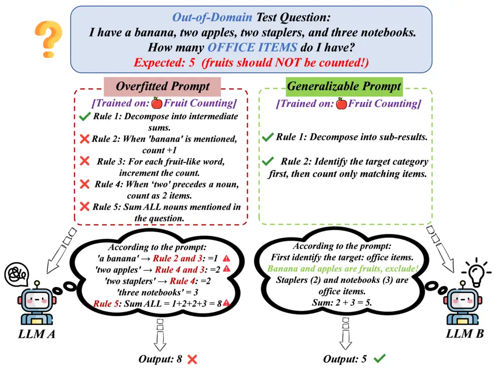
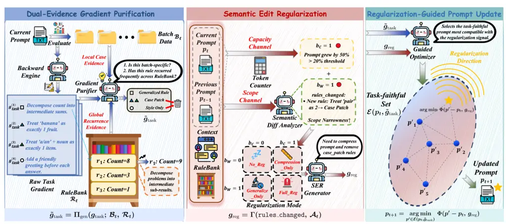
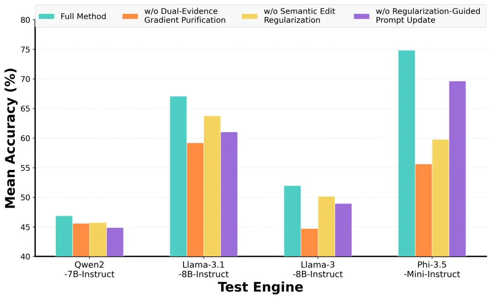
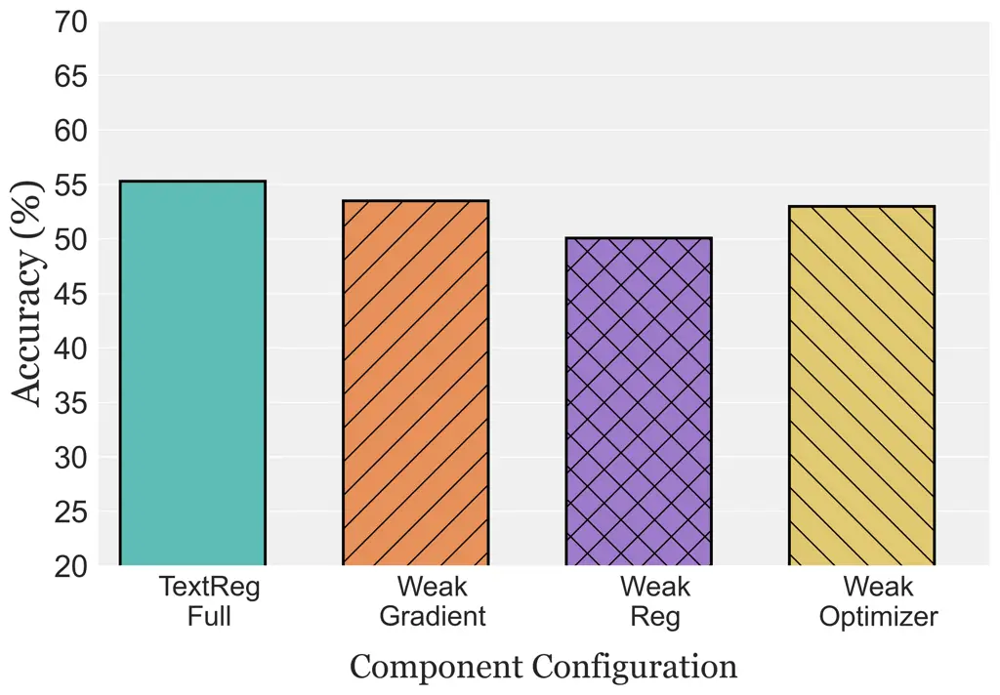
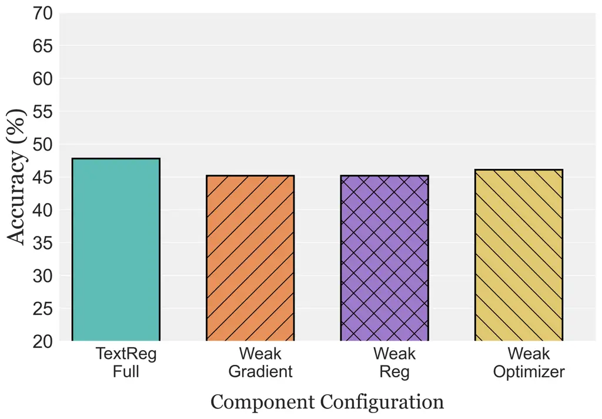
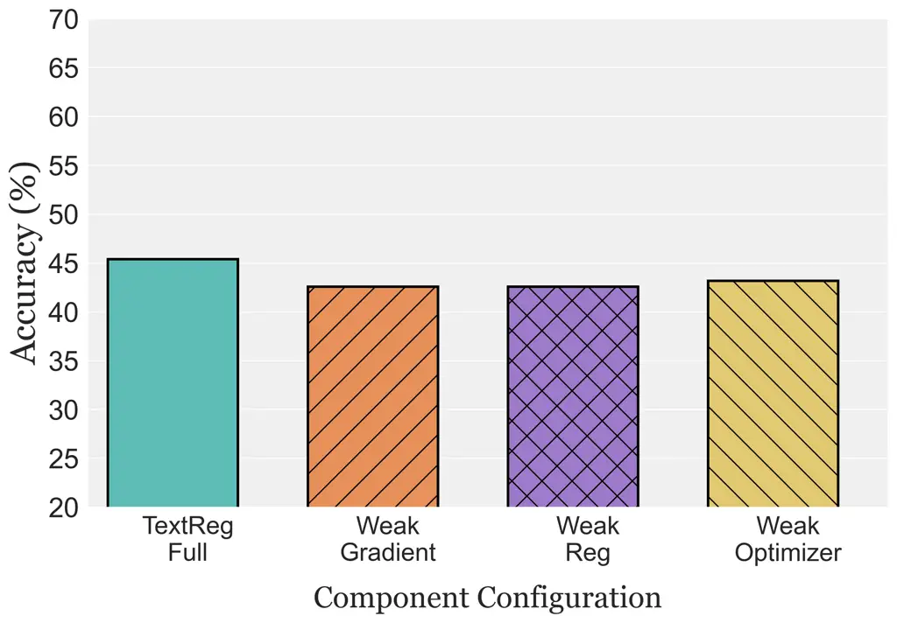
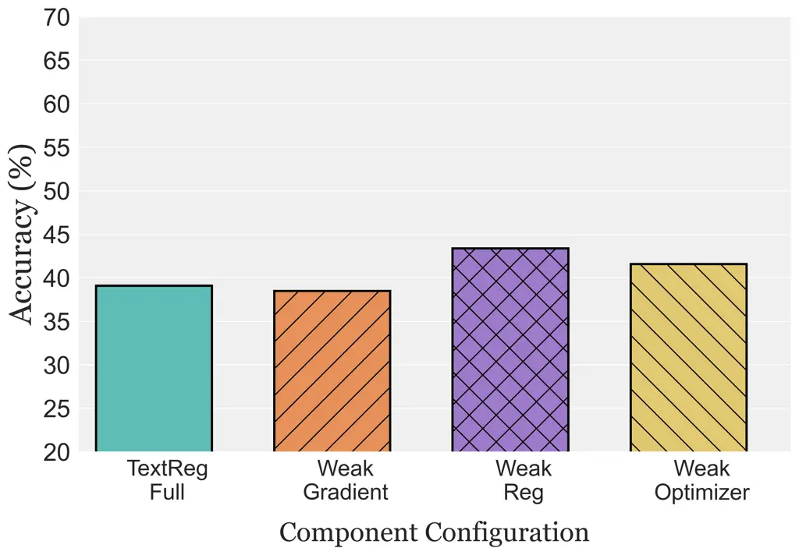

![[Uncaptioned
image]](arxiv-2605-21318v2--0bd983ef281c.figures/figure-1.webp)![[Uncaptioned
image]](arxiv-2605-21318v2--0bd983ef281c.figures/figure-2.webp)

 

TextReg: Mitigating Prompt Distributional Overfitting  
via Regularized Text-Space Optimization

Lucheng Fu¹, Ye Yu², Yiyang Wang¹, Yiqiao Jin¹,  
Haibo Jin², B. Aditya Prakash^(1†), Haohan Wang^(2†)  
¹Georgia Institute of Technology   ²University of Illinois
Urbana-Champaign  
Website: [https://textreg.github.io/](https://textreg.github.io/)  
GitHub:
[https://github.com/luchengfu6/TextReg](https://github.com/luchengfu6/TextReg)
²²footnotetext: Corresponding authors.  
   Contact: luchengfu@gatech.edu

###### Abstract

Large language models (LLMs) are highly sensitive to the prompts used to
specify task objectives and behavioral constraints. Many recent prompt
optimization methods iteratively rewrite prompts using LLM-generated
feedback, but the resulting prompts often become longer, accumulate
narrow sample-specific rules, and generalize poorly beyond the training
distribution. We study this failure mode as _prompt distributional
overfitting_ and argue that it reflects a lack of representation control
in discrete text-space optimization. We formalize this view through
_representational inefficiency_, a dual-factor measure that decomposes
prompt inefficiency into capacity cost and scope narrowness, attributing
distributional prompt overfitting to their coupled growth during
optimization. We propose TextReg, a regularization framework that
realizes a soft-penalty objective through regularized textual gradients,
combining Dual-Evidence Gradient Purification, Semantic Edit
Regularization, and Regularization-Guided Prompt Update. Across multiple
reasoning benchmarks, TextReg substantially improves out-of-distribution
(OOD) generalization, with accuracy gains of up to +11.8% over TextGrad
and +16.5% over REVOLVE.

## 1  Introduction

Large language models (LLMs) have exhibited strong performance on a wide
variety of reasoning and generation tasks \[1, 2, 3, 4\], with the input
prompt serving as the central interface that specifies task objectives,
output formats, and behavioral constraints \[5, 6\]. This sensitivity to
prompting has motivated the development of _prompt optimization_ \[7,
8\], which aims to automatically refine prompts through data-driven
structure discovery and feedback, thereby reliably eliciting desired
behavior and reducing manual trial-and-error in prompt design. Recent
approaches iteratively refine prompts using natural-language feedback
from LLM evaluators \[7, 9\] and have achieved promising empirical
improvements. Despite these gains, optimized prompts often suffer from
poor generalization beyond the training data: as optimization proceeds,
prompts may become longer, accumulate case-specific instructions, and
become more sensitive to input variations \[10\], a failure mode known
as _prompt distributional overfitting_ \[11\]. This failure manifests
along two coupled dimensions: prompts not only expand in length as new
rules, exceptions, examples, and stylistic constraints are appended, but
also narrow in scope as the appended content drifts toward fragmented
sample-dependent patches rather than compact general principles.
Existing prompt optimizers provide little control over either dimension.

We view a prompt as a structured representation of task knowledge,
composed of behavioral rules expressed in natural language; an ideal
prompt should encode broadly applicable principles in a compact form,
rather than fit training examples through an expanding set of
special-case instructions. We formulate this failure mode through the
lens of _representational inefficiency_: from this perspective,
unconstrained optimization violates this principle in two coupled ways.
First, increasing prompt length raises the _capacity cost_—longer
prompts consume more context budget and make it harder for the model to
reliably locate and leverage relevant instructions, given that LLMs’
effective context window is limited \[12, 13, 14\]. Second, prompts can
suffer from _rule narrowing_: they accumulate rules that reduce training
loss but apply only to a narrow subset of inputs, functioning as ad hoc
patches rather than reusable task principles. These two factors jointly
lead to representational inefficiency, arising from the interaction
between the capacity cost incurred by prompt length and the scope waste
among its constituent rules. As they compound, an increasing fraction of
the prompt’s capacity is wasted on information that contributes little
to generalization, suggesting that prompt distributional overfitting
\[11\] is fundamentally a failure of representation efficiency, rather
than merely an artifact of optimization dynamics.



Figure 1: Problem Illustration. We illustrate prompt distributional
overfitting in prompt optimization: I) conventional methods often
produce long prompts saturated with narrow rules (left), which degrade
on OOD inputs. II) Our goal is to instead yield compact prompts composed
of broadly applicable rules (right), achieving stronger OOD
generalization.

In classical machine learning, overfitting is commonly mitigated by
regularization that controls model complexity. However, applying this
perspective to prompt optimization is non-trivial: the optimization is
non-differentiable, with feedback generated by LLM evaluators and
updates produced by LLM rewriting.

To address this challenge, we propose TextReg, a regularization
framework that improves prompt optimization through a regularized
textual-gradient view: prompt updates should follow both a task
direction that improves empirical performance and a regularization
direction that constrains the growth of representational inefficiency.
TextReg realizes this view through three stages. _Dual-Evidence Gradient
Purification_ constructs a purified task gradient by combining local
batch evidence and RuleBank recurrence evidence to distinguish
case-specific patches from broadly applicable rules. _Semantic Edit
Regularization_ estimates how recent prompt edits change the capacity
cost and scope waste, converting the observed degradation into a textual
regularization gradient. _Regularization-Guided Prompt Update_ then uses
this gradient to steer prompt rewriting toward task-consistent edits
that avoid unnecessary increases in representational inefficiency. Our
contributions are threefold:

- ❶
  Formalizing Representational Inefficiency. We formulate prompt
  distributional overfitting as a failure of representation efficiency
  in discrete text-space optimization, and introduce _representational
  inefficiency_—a dual-factor measure capturing the interaction between
  capacity cost from prompt length growth and scope waste from rule
  narrowing.
- ❷
  Regularized Text-Space Prompt Optimization. We propose TextReg, a
  regularization framework that realizes a soft-penalty objective in
  discrete text space through three complementary stages—Dual-Evidence
  Gradient Purification, Semantic Edit Regularization, and
  Regularization-Guided Prompt Update. TextReg explicitly controls the
  growth of representational inefficiency during optimization, producing
  prompts that generalize beyond the training distribution.
- ❸
  Improved Out-of-Distribution Generalization. Through extensive
  experiments across multiple reasoning benchmarks, we demonstrate that
  TextReg consistently outperforms existing prompt optimization methods
  on out-of-distribution (OOD) generalization across both datasets and
  test engines, validating that controlling representational
  inefficiency mitigates prompt distributional overfitting.

## 2  Related Work

#### Prompt optimization.

Reasoning-oriented prompting techniques such as CoT \[15\],
self-consistency \[16\], ReAct \[17\], PoT \[18\], and ToT \[19\]
improve LLM reasoning by structuring the inference process. Automated
prompt optimization discovers effective prompts algorithmically.
Approaches range from discrete token- or edit-based methods such as
AutoPrompt \[20\] and RLPrompt \[21\] to LLM-based methods such as APE
\[22\], EvoPrompt \[23\], Promptbreeder \[24\], and DSPy \[25\]. The
most relevant methods use feedback from LLM evaluators to guide
iterative rewriting. APO \[7\] treats LLM-generated critiques as
discrete-space gradients, TextGrad \[9\] formalizes textual
differentiation through arbitrary computational graphs, and REVOLVE
\[26\] tracks response evolution across optimization steps. SIPDO \[27\]
complements this direction by coupling prompt optimization with
synthetic data generation. Although these methods have shown empirical
gains, they primarily use task feedback to improve performance and do
not explicitly regularize representational inefficiency during
optimization.

#### Prompt robustness and overfitting.

Recent work shows that prompt-based systems can be fragile under wording
changes, semantic perturbations, adversarial paraphrases, and
distribution shifts, as well as in long-context settings \[10, 12, 13\].
Robust prompt optimization methods address related issues by accounting
for distribution shifts \[28\] or using sharpness-aware prompt evolution
to improve paraphrase invariance \[29\]. However, prompt overfitting
remains a distinct failure mode in feedback-based optimization: prompts
may improve on training feedback while accumulating narrow,
sample-specific instructions that fail to transfer. APO \[7\] and
TextGrad \[9\] report this mismatch between training improvements and
generalization. DLPO \[30\] mitigates overfitting through static
simplification instructions, while REMO \[31\] uses external memory and
meta-reflection. TextReg treats prompt overfitting as a problem of
controlling prompt representations: we formalize it through
representational inefficiency and regularize optimization trajectories
based on observed structural changes.

#### Regularization for generalization.

Regularization can improve generalization in machine learning by
controlling effective model capacity. Examples include weight decay
\[32, 33\], dropout \[34, 35\], LASSO and elastic net \[36, 37\], and
early stopping \[38\]. Continuous prompt learning offers another way to
limit the parameters optimized for a task: soft-prompt and prompt-tuning
methods learn prompt embeddings and have been studied in few-shot
settings \[39, 40, 41\]. TextReg regularizes natural-language prompts by
jointly controlling capacity cost and scope narrowness, rather than
constraining model parameters, continuous prompt embeddings, or prompt
length alone.

## 3  Problem Formulation

### 3.1 Problem Setup and Notation

We consider a black-box language model $`\mathcal{M}`$ that maps an
input $`x`$ and a textual prompt $`p`$ to an output
$`\mathcal{M}(p,x)`$. Let $`\mathcal{P}`$ denote the space of valid
prompts. Given a dataset $`\mathcal{D}=\{(x_{i},y_{i})\}_{i=1}^{N}`$, we
define the empirical task risk of a prompt as

```math
\mathcal{L}_{\mathcal{D}}(p)=\frac{1}{|\mathcal{D}|}\sum_{(x,y)\in\mathcal{D}}\ell\big(\mathcal{M}(p,x),y\big), \tag{1}
```

where $`\ell(\cdot,\cdot)`$ is a task-specific loss, possibly induced by
an evaluator in generative settings. Standard prompt optimization seeks
a prompt $`p\in\mathcal{P}`$ that minimizes
$`\mathcal{L}_{\mathcal{D}_{\text{train}}}(p)`$.

### 3.2 Prompt Distributional Overfitting and Generalization

Optimizing Eq. 1 does not guarantee generalization beyond the training
distribution. For a target distribution $`\mathcal{D}^{\prime}`$ that
differs from $`\mathcal{D}_{\text{train}}`$, we define the
generalization gap as

```math
\Delta(p;\mathcal{D}^{\prime})=\mathcal{L}_{\mathcal{D}^{\prime}}(p)-\mathcal{L}_{\mathcal{D}_{\text{train}}}(p). \tag{2}
```

#### Prompt Distributional Overfitting.

Prompt distributional overfitting occurs when optimization reduces
$`\mathcal{L}_{\mathcal{D}_{\text{train}}}(p)`$ while increasing
$`\Delta(p;\mathcal{D}^{\prime})`$. Empirically, this behavior is often
accompanied by structural growth of the prompt, including increased
length and the accumulation of narrow, sample-specific instructions.

#### Connection to classical overfitting.

This phenomenon parallels classical overfitting in that additional
representational capacity can fit increasingly narrow patterns at the
expense of generalization. We focus specifically on OOD generalization:
an optimized prompt may continue to perform well on held-out samples
from the source distribution while degrading on harder task variants or
related-but-shifted tasks.

### 3.3 Representational Inefficiency

For analysis, we view a prompt $`p`$ as encoding a set of semantically
distinct behavioral directives $`R(p)=\{r_{1},\ldots,r_{k}\}`$. A
directive may describe a reasoning procedure, behavioral constraint, or
other task-relevant instruction; this decomposition is analytical and
does not require the prompt itself to be written as an explicit list of
rules.

#### Generalization scope.

Although optimization is performed on $`\mathcal{D}_{\text{train}}`$, we
want the resulting prompt to remain useful over an input space
$`\mathcal{X}`$ that preserves the underlying task while varying in
surface form, scale, or difficulty. For a directive $`r_{i}`$, we define
its generalization scope as

```math
s(r_{i})\triangleq\mathbb{E}_{x\sim\mathcal{X}}\big[\rho_{r_{i}}(x)\big]\in[0,1], \tag{3}
```

where $`\rho_{r_{i}}(x)`$ measures the degree to which $`r_{i}`$ is
relevant to input $`x`$. Let
$`\bar{s}(p)=\frac{1}{|R(p)|}\sum_{r_{i}\in R(p)}s(r_{i})`$ denote the
average scope of the prompt.

For example, in object counting, a general procedure that applies across
inputs has high scope, whereas an instruction tied to a particular
entity has low scope:


#### Inefficiency measure.

We define the representational inefficiency of a prompt as

```math
\mathcal{I}(p)=\underbrace{|p|_{\text{tok}}}_{\text{capacity cost }C(p)}\cdot\underbrace{\big(1-\bar{s}(p)\big)}_{\text{scope narrowness }W(p)}. \tag{4}
```

Here, $`C(p)`$ captures the context capacity consumed by the prompt,
while $`W(p)`$ captures the degree to which its directives fail to
provide broadly applicable guidance. The multiplicative form emphasizes
their interaction: additional prompt capacity is increasingly
inefficient when it is devoted to narrowly applicable instructions.
Thus, $`\mathcal{I}(p)`$ is high when a prompt is simultaneously long
and dominated by low-scope directives.

### 3.4 Regularized Text-Space Prompt Optimization

Standard prompt optimization minimizes Eq. 1 without explicitly
controlling how the prompt representation evolves. To formalize the
desired trade-off, we consider the idealized regularized objective

```math
\min_{p\in\mathcal{P}}\quad\mathcal{L}_{\mathcal{D}_{\text{train}}}(p)+\lambda\,\mathcal{I}(p), \tag{5}
```

where $`\lambda\geq 0`$ conceptually controls the trade-off between task
performance and representational efficiency.

Importantly, Eq. 5 should be understood as a conceptual regularization
objective that characterizes the desired trade-off between task
performance and representational efficiency. In discrete text space,
however, its two structural components have different operational
properties: capacity cost is directly observable through prompt length,
whereas scope narrowness is semantic and depends on how broadly
individual directives apply across the task distribution. This
distinction motivates treating representational inefficiency through
complementary structural signals rather than as a single directly
measurable scalar.

This formulation therefore provides a principled view of what should be
controlled during prompt optimization, while leaving the concrete
realization of these controls to the optimization procedure introduced
next.

## 4  Method

### 4.1 Overview

Rather than numerically optimizing Eq. 5, TextReg operationalizes its
task and regularization components through natural-language update
signals. At optimization step $`t`$, it constructs a purified task
signal $`\tilde{g}_{\text{task}}`$ and, when structural degradation is
detected, a regularization signal $`g_{\text{reg}}`$. The next prompt is
produced by an LLM-based rewrite operator

```math
p_{t+1}=\mathcal{U}\big(p_{t};\,\tilde{g}_{\text{task}},g_{\text{reg}}\big), \tag{6}
```

where $`\mathcal{U}`$ integrates the two signals in natural language
rather than through numerical gradient addition. We use “gradient” in
the textual-optimization sense: these signals specify update directions
in language and are not numerical derivatives or vectors.

As illustrated in Figure 2, TextReg proceeds through three complementary
stages. Stage 1 (Dual-Evidence Gradient Purification) filters raw task
gradients using local batch evidence and global RuleBank recurrence
evidence. Stage 2 (Semantic Edit Regularization) monitors the capacity
and scope channels of representational inefficiency and constructs
$`g_{\text{reg}}`$ when degradation is detected. Stage 3
(Regularization-Guided Prompt Update) coordinates task and
regularization guidance while preserving task-faithful corrections.

The key design is to control representational inefficiency at both the
_feedback_ and _edit_ levels. Stage 1 acts before rewriting by
suppressing feedback likely to produce narrow or redundant instructions,
whereas Stage 2 inspects the realized prompt transition and corrects
capacity or scope degradation that still emerges during rewriting. Stage
3 then mediates these structural corrections without sacrificing
task-relevant updates. This separation allows TextReg to regulate both
how optimization signals are formed and how they are ultimately
expressed in the prompt, directly targeting the two sources of
inefficiency, $`C(p)`$ and $`W(p)`$.



Figure 2: Overview of TextReg, which proceeds in three stages. (a) Left:
Dual-Evidence Gradient Purification filters the raw task gradient using
local batch and RuleBank recurrence evidence, yielding
$`\tilde{g}_{\text{task}}`$. (b) Middle: Semantic Edit Regularization
detects capacity and scope degradation and synthesizes the
regularization signal $`g_{\text{reg}}`$. (c) Right:
Regularization-Guided Prompt Update rewrites $`p_{t}`$ into $`p_{t+1}`$
using both task and regularization guidance.

### 4.2 Dual-Evidence Gradient Purification

Prompt optimization can introduce narrow corrections tied to particular
training examples, increasing scope narrowness $`W(p)`$, as well as
redundant or stylistic updates that increase capacity cost $`C(p)`$
without adding useful behavior. Dual-Evidence Gradient Purification
filters such feedback before it enters the prompt rewrite.

For a task gradient $`g_{\text{task}}`$ produced from mini-batch
$`\mathcal{B}_{t}\subset\mathcal{D}_{\text{train}}`$, we write

```math
\tilde{g}_{\text{task}}=\Pi_{\text{gen}}\big(g_{\text{task}};\,\mathcal{B}_{t},\,\mathcal{R}_{t}\big), \tag{7}
```

where $`\Pi_{\text{gen}}`$ is an LLM-realized conditional projection and
$`\mathcal{R}_{t}`$ is RuleBank.

#### Local case evidence.

The current mini-batch indicates whether a proposed correction is overly
specific to the examples that produced it. Feedback closely tied to
particular entities, quantities, surface patterns, or rare edge
conditions is treated as negative evidence for generalization because it
is likely to introduce a narrow case patch.

#### Global recurrence evidence.

To complement local evidence, TextReg maintains

```math
\mathcal{R}_{t}=\{(r,m_{t}(r)):r\in\mathcal{U}_{t}\}, \tag{8}
```

where $`r`$ is a canonical behavioral directive and $`m_{t}(r)`$ records
how often it has matched previously accepted purified gradients.
Accepted gradients are canonicalized and either matched to an existing
entry or inserted as a new directive, allowing semantically equivalent
corrections to accumulate recurrence evidence across surface forms.

The true scope $`s(r)`$ is not numerically estimated during
optimization. Instead, $`m_{t}(r)`$ acts only as a _soft prior_:
repeatedly recovered directives receive stronger support for generality
than one-off corrections, without assuming a numerical mapping from
recurrence to scope or using a hard threshold.

#### Purification decision.

Combining local specificity and recurrence evidence,
$`\Pi_{\text{gen}}`$ classifies each gradient as a GENERALIZED*RULE,
CASE_PATCH, or STYLE_ONLY. Generalized corrections are retained and
rewritten into concise, broadly applicable instructions, while
case-specific and purely stylistic feedback is discarded. When multiple
gradients are produced, all retained instructions are concatenated into
$`\tilde{g}*{\text{task}}`$.

Thus, Stage 1 controls representational inefficiency at its source:
local evidence suppresses sample-specific patches, while recurrence
evidence favors stable task-level structure.

### 4.3 Semantic Edit Regularization

Gradient purification filters feedback before rewriting, but the LLM
optimizer may still introduce verbosity, redundancy, or new
case-specific instructions. Semantic Edit Regularization (SER) therefore
monitors the realized transition $`(p_{t-1},p_{t})`$ for degradation in
the two structural channels of $`\mathcal{I}(p)=C(p)W(p)`$.

#### Capacity diagnostic.

Capacity change is directly observable from token length:

```math
\rho_{C}(p_{t})=\frac{C(p_{t})-C(p_{t-1})}{C(p_{t-1})},\qquad b_{C}(p_{t})=\mathbb{I}\big[\rho_{C}(p_{t})>\tau_{C}\big], \tag{9}
```

where $`\tau_{C}`$ prevents regularization from reacting to negligible
length fluctuations.

#### Scope diagnostic.

Scope narrowness is semantic and cannot be measured directly. SER
therefore estimates only its direction of change using an LLM-based
semantic diff analyzer:

```math
M_{\Delta}\big(p_{t-1},p_{t},\mathcal{R}_{t},\mathcal{G}_{t}\big)\rightarrow\big(\texttt{rules\_changed},\widehat{\operatorname{sgn}}(\Delta W)\big), \tag{10}
```

where rules_changed records directives introduced, removed, or modified
by the edit, and $`\widehat{\operatorname{sgn}}(\Delta W)\in\{+,-,0\}`$
indicates whether scope narrowness appears to have increased, decreased,
or remained unchanged. RuleBank provides historical context for
distinguishing recurring task-level directives from isolated case
patches. The scope trigger is

```math
b_{W}(p_{t})=\mathbb{I}\left[\widehat{\operatorname{sgn}}(\Delta W)=+\right]. \tag{11}
```

SER then forms the active regularization channels

```math
\mathcal{A}_{t}=\{C:b_{C}(p_{t})=1\}\cup\{W:b_{W}(p_{t})=1\}, \tag{12}
```

corresponding to joint compression and generalization, compression only,
generalization only, or no regularization.

The two diagnostics play complementary roles. The capacity channel
provides a precise structural signal but cannot distinguish useful
expansion from case-specific growth, whereas the scope channel captures
semantic narrowing but is necessarily estimated rather than directly
measured. Combining them allows SER to distinguish different forms of
representational drift and activate only the corresponding correction,
instead of applying a uniform compression or generalization penalty to
every update.

#### Textual regularization signal.

An LLM-realized controller $`\Gamma`$ converts the active channels and
semantic changes into

```math
g_{\text{reg}}=\Gamma\big(\texttt{rules\_changed},\mathcal{A}_{t}\big)\in\mathcal{G}_{\text{text}}\cup\{\varnothing\}. \tag{13}
```

Capacity degradation induces compression guidance, while scope
degradation induces guidance to generalize or remove narrow case
patches. When neither channel is active, $`g_{\text{reg}}=\varnothing`$.

Thus, capacity degradation is measured exactly, whereas scope
degradation is estimated only directionally. SER does not numerically
evaluate $`W(p)`$ or $`\mathcal{I}(p)`$, and intervenes only when the
realized edit provides evidence of structural degradation.

|                        |          |                                                              |                                                             |                                                             |                                                                  |                                                             |                                                             |
| ---------------------- | -------- | ------------------------------------------------------------ | ----------------------------------------------------------- | ----------------------------------------------------------- | ---------------------------------------------------------------- | ----------------------------------------------------------- | ----------------------------------------------------------- |
|                        |          | Logical Ded. 3obj                                            |                                                             | Tracking Shuf. 3obj                                         |                                                                  | GSM8K                                                       |                                                             |
| Test Engine            | Method   | 5obj                                                         | 7obj                                                        | 5obj                                                        | 7obj                                                             | SVAMP                                                       | MultiArith                                                  |
| Qwen2 -7B-Instruct     | CoT      | $`51.6_{\color[rgb]{0,0.65,0.31}\uparrow 0.3}`$              | $`47.4_{\color[rgb]{0,0.65,0.31}\uparrow 0.8}`$             | $`\underline{42.0}_{\color[rgb]{0,0.65,0.31}\uparrow 3.8}`$ | $`33.9_{\color[rgb]{0,0.65,0.31}\uparrow 0.8}`$                  | $`\underline{89.8}_{\color[rgb]{0,0.65,0.31}\uparrow 0.5}`$ | $`94.7_{\color[rgb]{0.91,0.59,0.48}\downarrow 1.1}`$        |
|                        | TextGrad | $`51.3`$                                                     | $`46.6`$                                                    | $`38.2`$                                                    | $`33.1`$                                                         | $`89.3`$                                                    | $`95.8`$                                                    |
|                        | REVOLVE  | $`\underline{54.4}_{\color[rgb]{0,0.65,0.31}\uparrow 3.1}`$  | $`\underline{47.6}_{\color[rgb]{0,0.65,0.31}\uparrow 1.0}`$ | $`40.3_{\color[rgb]{0,0.65,0.31}\uparrow 2.1}`$             | $`\mathbf{40.2_{\color[rgb]{0,0.65,0.31}\uparrow 7.1}}`$         | $`89.2_{\color[rgb]{0.91,0.59,0.48}\downarrow 0.1}`$        | $`\underline{96.2}_{\color[rgb]{0,0.65,0.31}\uparrow 0.4}`$ |
|                        | TextReg  | $`\mathbf{55.3_{\color[rgb]{0,0.65,0.31}\uparrow 4.0}}`$     | $`\mathbf{47.8_{\color[rgb]{0,0.65,0.31}\uparrow 1.2}}`$    | $`\mathbf{45.4_{\color[rgb]{0,0.65,0.31}\uparrow 7.2}}`$    | $`\underline{39.1}_{\color[rgb]{0,0.65,0.31}\uparrow 6.0}`$      | $`\mathbf{90.1_{\color[rgb]{0,0.65,0.31}\uparrow 0.8}}`$    | $`\mathbf{96.5_{\color[rgb]{0,0.65,0.31}\uparrow 0.7}}`$    |
| Llama-3.1 -8B-Instruct | CoT      | $`59.7_{\color[rgb]{0.91,0.59,0.48}\downarrow 0.1}`$         | $`50.4_{\color[rgb]{0,0.65,0.31}\uparrow 0.0}`$             | $`58.8_{\color[rgb]{0.91,0.59,0.48}\downarrow 10.9}`$       | $`48.5_{\color[rgb]{0.91,0.59,0.48}\downarrow 18.2}`$            | $`\mathbf{85.5_{\color[rgb]{0,0.65,0.31}\uparrow 0.7}}`$    | $`\underline{96.0}_{\color[rgb]{0,0.65,0.31}\uparrow 0.0}`$ |
|                        | TextGrad | $`\underline{59.8}`$                                         | $`50.4`$                                                    | $`69.7`$                                                    | $`\underline{66.7}`$                                             | $`84.8`$                                                    | $`\underline{96.0}`$                                        |
|                        | REVOLVE  | $`57.7_{\color[rgb]{0.91,0.59,0.48}\downarrow 2.1}`$         | $`\underline{50.6}_{\color[rgb]{0,0.65,0.31}\uparrow 0.2}`$ | $`\underline{76.0}_{\color[rgb]{0,0.65,0.31}\uparrow 6.3}`$ | $`65.4_{\color[rgb]{0.91,0.59,0.48}\downarrow 1.3}`$             | $`84.6_{\color[rgb]{0.91,0.59,0.48}\downarrow 0.2}`$        | $`95.3_{\color[rgb]{0.91,0.59,0.48}\downarrow 0.7}`$        |
|                        | TextReg  | $`\mathbf{61.1_{\color[rgb]{0,0.65,0.31}\uparrow 1.3}}`$     | $`\mathbf{51.0_{\color[rgb]{0,0.65,0.31}\uparrow 0.6}}`$    | $`\mathbf{79.7_{\color[rgb]{0,0.65,0.31}\uparrow 10.0}}`$   | $`\mathbf{76.6_{\color[rgb]{0,0.65,0.31}\uparrow 9.9}}`$         | $`\mathbf{85.5_{\color[rgb]{0,0.65,0.31}\uparrow 0.7}}`$    | $`\mathbf{96.7_{\color[rgb]{0,0.65,0.31}\uparrow 0.7}}`$    |
| Llama-3 -8B-Instruct   | CoT      | $`\underline{52.6}_{\color[rgb]{0,0.65,0.31}\uparrow 10.5}`$ | $`\underline{48.8}_{\color[rgb]{0,0.65,0.31}\uparrow 7.7}`$ | $`35.6_{\color[rgb]{0.91,0.59,0.48}\downarrow 10.3}`$       | $`36.5_{\color[rgb]{0.91,0.59,0.48}\downarrow 1.5}`$             | $`83.7_{\color[rgb]{0,0.65,0.31}\uparrow 0.5}`$             | $`94.7_{\color[rgb]{0,0.65,0.31}\uparrow 0.0}`$             |
|                        | TextGrad | $`42.1`$                                                     | $`41.1`$                                                    | $`45.9`$                                                    | $`38.0`$                                                         | $`83.2`$                                                    | $`94.7`$                                                    |
|                        | REVOLVE  | $`51.5_{\color[rgb]{0,0.65,0.31}\uparrow 9.4}`$              | $`\underline{48.8}_{\color[rgb]{0,0.65,0.31}\uparrow 7.7}`$ | $`\underline{46.1}_{\color[rgb]{0,0.65,0.31}\uparrow 0.2}`$ | $`\underline{41.8}_{\color[rgb]{0,0.65,0.31}\uparrow 3.8}`$      | $`\mathbf{83.9_{\color[rgb]{0,0.65,0.31}\uparrow 0.7}}`$    | $`94.7_{\color[rgb]{0,0.65,0.31}\uparrow 0.0}`$             |
|                        | TextReg  | $`\mathbf{53.3_{\color[rgb]{0,0.65,0.31}\uparrow 11.2}}`$    | $`\mathbf{52.0_{\color[rgb]{0,0.65,0.31}\uparrow 10.9}}`$   | $`\mathbf{54.3_{\color[rgb]{0,0.65,0.31}\uparrow 8.4}}`$    | $`\mathbf{48.3_{\color[rgb]{0,0.65,0.31}\uparrow 10.3}}`$        | $`\mathbf{83.9_{\color[rgb]{0,0.65,0.31}\uparrow 0.7}}`$    | $`\mathbf{94.9_{\color[rgb]{0,0.65,0.31}\uparrow 0.2}}`$    |
| Phi-3.5 -Mini-Instruct | CoT      | $`\underline{57.0}_{\color[rgb]{0,0.65,0.31}\uparrow 10.9}`$ | $`\underline{50.5}_{\color[rgb]{0,0.65,0.31}\uparrow 4.1}`$ | $`\underline{89.6}_{\color[rgb]{0,0.65,0.31}\uparrow 6.0}`$ | $`89.1_{\color[rgb]{0.91,0.59,0.48}\downarrow 3.7}`$             | $`\mathbf{90.4_{\color[rgb]{0,0.65,0.31}\uparrow 9.8}}`$    | $`\mathbf{97.0_{\color[rgb]{0,0.65,0.31}\uparrow 10.2}}`$   |
|                        | TextGrad | $`46.1`$                                                     | $`46.4`$                                                    | $`83.6`$                                                    | $`\mathbf{92.8}`$                                                | $`80.6`$                                                    | $`86.8`$                                                    |
|                        | REVOLVE  | $`43.4_{\color[rgb]{0.91,0.59,0.48}\downarrow 2.7}`$         | $`38.7_{\color[rgb]{0.91,0.59,0.48}\downarrow 7.7}`$        | $`86.8_{\color[rgb]{0,0.65,0.31}\uparrow 3.2}`$             | $`87.7_{\color[rgb]{0.91,0.59,0.48}\downarrow 5.1}`$             | $`87.0_{\color[rgb]{0,0.65,0.31}\uparrow 6.4}`$             | $`\underline{95.1}_{\color[rgb]{0,0.65,0.31}\uparrow 8.3}`$ |
|                        | TextReg  | $`\mathbf{57.9_{\color[rgb]{0,0.65,0.31}\uparrow 11.8}}`$    | $`\mathbf{55.2_{\color[rgb]{0,0.65,0.31}\uparrow 8.8}}`$    | $`\mathbf{94.1_{\color[rgb]{0,0.65,0.31}\uparrow 10.5}}`$   | $`\underline{92.2}_{\color[rgb]{0.91,0.59,0.48}\downarrow 0.6}`$ | $`\underline{88.5}_{\color[rgb]{0,0.65,0.31}\uparrow 7.9}`$ | $`94.7_{\color[rgb]{0,0.65,0.31}\uparrow 7.9}`$             |

Table 1: Cross-dataset and cross-model generalization results. We report
out-of-domain test accuracy (%), averaged over four independent
optimization seeds, and the relative improvement over TextGrad. The best
and second-best results are highlighted with bold and underline,
respectively.

### 4.4 Regularization-Guided Prompt Update

After the first two stages, TextReg obtains $`\tilde{g}_{\text{task}}`$
and, when needed, $`g_{\text{reg}}`$. The final stage uses
regularization to shape _how_ the task correction is realized while
keeping task fidelity primary.

This separation between task fidelity and structural preference is
important: regularization should shape the form of an update without
suppressing a correction that is necessary for task performance. Stage 3
therefore treats $`\tilde{g}_{\text{task}}`$ as defining what must be
changed, while $`g_{\text{reg}}`$ constrains how that change should be
expressed. This asymmetry preserves the optimization objective while
discouraging the unnecessary prompt expansion and narrow rule
accumulation associated with distributional overfitting.

This design also avoids forcing every beneficial update toward shorter
or more generic wording. A task-relevant instruction may legitimately
increase prompt length or introduce a specialized distinction, and
TextReg does not suppress such changes solely because they affect
$`C(p)`$ or $`W(p)`$. Regularization instead acts as a preference over
task-faithful rewrites, intervening only when a structurally more
efficient realization is available.

Let $`\mathcal{E}(p_{t},\tilde{g}_{\text{task}})`$ denote the
_task-faithful set_: conceptually, prompt rewrites that faithfully
implement $`\tilde{g}_{\text{task}}`$. Within this set, regularization
favors an edit most compatible with $`g_{\text{reg}}`$:

```math
p_{t+1}=\arg\min_{p^{\prime}\in\mathcal{E}(p_{t},\tilde{g}_{\text{task}})}\Phi\big(p^{\prime}-p_{t},\,g_{\text{reg}}\big), \tag{14}
```

where $`\Phi`$ denotes incompatibility between the semantic edit and the
active regularization guidance, and $`p^{\prime}-p_{t}`$ denotes the
semantic edit rather than literal vector subtraction.

Equation 14 is a conceptual characterization of the rewrite preference
implemented by $`\mathcal{U}`$, not an explicitly enumerated numerical
optimization: TextReg does not construct $`\mathcal{E}`$ or evaluate
$`\Phi`$ as a scalar. Instead, the optimizer LLM realizes this
preference directly in natural language.

This task-dominance fallback prevents regularization from becoming a
hard structural constraint. Together, the three stages control which
feedback enters optimization, detect structural drift after rewriting,
and coordinate task improvement with structural guidance, thereby
operationalizing Eq. 5 without directly evaluating $`\mathcal{I}(p)`$ or
its gradients.

## 5  Experiments

We assess TextReg along three dimensions: Q1: does it outperform
existing prompt optimization methods on out-of-distribution
generalization across datasets and test engines (Section 5.2)? Q2: how
does each component contribute to the overall performance (Section 5.3)?
Q3: how robust is it when individual components are degraded or replaced
with weaker variants (Section 5.4)?

### 5.1 Experimental Setup

#### Tasks and Datasets.

We evaluate TextReg on six datasets from the Big Bench Hard benchmark
\[42, 43\]—Logical Deduction (Three / Five / Seven Objects) and Tracking
Shuffled Objects (Three / Five / Seven Objects), as well as three
arithmetic datasets: GSM8K \[44\], SVAMP \[45\], and MultiArith \[46,
47\]. Prompts are optimized on Logical Deduction (Three Objects),
Tracking Shuffled Objects (Three Objects), and GSM8K, and evaluated for
cross-dataset generalization on the remaining datasets: the harder
variants Logical Deduction (Five / Seven Objects) and Tracking Shuffled
Objects (Five / Seven Objects) for the BBH tasks, and SVAMP and
MultiArith for the arithmetic tasks. Our primary metric is Accuracy
(Acc), measured by exact match string on the final answer \[9\]. Further
datasets and implementation details are in Appendix A.

#### LLM Backends.

Our experiments are conducted on four open-source LLM backends as test
engines: Qwen2-7B-Instruct \[48\], Phi-3.5-Mini-Instruct \[49\],
Llama-3-8B-Instruct, and Llama-3.1-8B-Instruct \[50\]. For prompt
optimization, we use Qwen2.5-7B-Instruct \[51\] as the forward engine
that executes prompts on training samples, and GPT-4o \[52\] as the
shared backward engine that performs all LLM-driven optimization
operations. This shared configuration applies uniformly to TextReg and
all baselines, to ensure a fair and controlled comparison. The optimized
prompts are then evaluated on the four test engines above.

#### Counterparts.

We compare TextReg against three baselines: Zero-shot Chain-of-Thought
(CoT) \[53, 15\], TextGrad \[9\], and REVOLVE \[26\].

#### Evaluation Protocol.

Every entry in Table 1 for TextGrad, REVOLVE, and TextReg is the mean
over four optimization runs with independent seeds: each run optimizes
its own prompt, and all resulting prompts are evaluated on the same test
set of each dataset with greedy decoding. CoT uses the same fixed prompt
evaluated under the same protocol.

### 5.2 Main Results

To answer Q1, Table 1 reports cross-dataset and cross-model
generalization results, where prompts optimized on three source tasks
are evaluated out-of-distribution across four downstream test engines.
TextReg consistently achieves the best or second-best accuracy on nearly
all (test engine, dataset) pairs, outperforming both TextGrad and
REVOLVE in the large majority of cells. The advantage is most pronounced
on harder variants of the source task: on Tracking Shuffled Objects,
TextReg improves over TextGrad by +10.0 (5obj) and +9.9 (7obj) on
Llama-3.1-8B-Instruct, and by +8.4 (5obj) and +10.3 (7obj) on
Llama-3-8B-Instruct. Notably, baseline methods often degrade
out-of-distribution accuracy below that of the unoptimized CoT prompt—on
Phi-3.5-Mini-Instruct, REVOLVE underperforms CoT on all six
datasets—directly exposing the prompt overfitting problem that motivates
our work, while TextReg preserves and extends the generalization
benefits of CoT. This robustness holds across heterogeneous test engines
spanning different architectures and instruction-tuning recipes,
confirming that mitigating prompt overfitting is a model-agnostic
property of the optimization procedure.

### 5.3 Ablation Study



Figure 3: Ablation study of the $`3`$ core components of TextReg:
Gradient Purification, Semantic Edit Regularization, and
Regularization-Guided Update. Each bar reports mean out-of-distribution
accuracy (%) across four OOD tasks (Tracking Shuffled Objects 5/7 obj,
Logical Deduction 5/7 obj) on each test engine. Section 5.3 presents
analyses.

To address Q2, we disable each of TextReg’s three components in turn
(Figure 3). Each bar reports mean out-of-distribution accuracy across
four OOD tasks—Tracking Shuffled Objects (5/7 obj) and Logical Deduction
(5/7 obj)—using prompts optimized on the corresponding 3-object source
tasks. Full TextReg achieves the highest accuracy on all four test
engines, and removing any of Dual-Evidence Gradient Purification,
Semantic Edit Regularization, or Regularization-Guided Update produces a
clear and consistent drop. This confirms that the three components are
jointly necessary: source-level gradient filtering, post-edit
inefficiency diagnosis, and regularization-guided rewriting each
contribute non-redundantly to mitigating prompt distributional
overfitting.

### 5.4 Resilience Study



(a) Logical Ded. 5 obj



(b) Logical Ded. 7 obj



(c) Tracking Shuf. 5obj



(d) Tracking Shuf. 7obj

Figure 4: Resilience analysis of TextReg under role-wise engine
degradation, where each of the three LLM-driven roles in the
optimization pipeline is replaced one at a time with a weaker
Qwen2.5-7B-Instruct model. For an in-depth analysis, please refer to
Section 5.4.

To probe TextReg’s resilience (Q3), we replace one of three LLM-driven
roles at a time with a substantially weaker LLM: Gradient (textual
feedback, gradient purification, RuleBank rule extraction),
Regularization (semantic edit analysis $`M_{\Delta}`$, regularization
gradient synthesis), or Optimizer (prompt rewriting from both signals).
Starting from the All-Strong baseline where all three roles use GPT-4o,
we downgrade each role in turn to Qwen2.5-7B-Instruct. As shown in
Figure 4, TextReg retains strong performance under all three weakenings,
with only minor accuracy drops; on the hardest variant Tracking Shuffled
Objects (7 obj), Weak Regularization and Weak Optimizer even surpass
All-Strong, indicating that TextReg’s regularization signal is
structural rather than capability-bound and that parts of the
optimization loop can be served by lightweight models.

## 6  Conclusion

We frame prompt distributional overfitting as a failure of
representational efficiency: optimized prompts may reduce training loss
by expanding in length and accumulating narrow, sample-specific rules,
hurting OOD generalization. We formalize this through _representational
inefficiency_, the interaction between capacity cost and scope
narrowness, and propose TextReg, which controls its growth through
Dual-Evidence Gradient Purification, Semantic Edit Regularization, and
Regularization-Guided Prompt Update. TextReg improves OOD generalization
over existing methods across multiple reasoning benchmarks. Our
evaluation focuses primarily on single-turn reasoning with well-defined
behavioral rules. Appendix F provides preliminary results on open-ended
generation, broader generation tasks, multi-turn prompts, and agent
instructions remain directions for future work. In these settings, rule
structure can be less explicit and capacity cost may be shared across
turns.

## References

- \[1\] T. Brown, B. Mann, N. Ryder, M. Subbiah, J. D. Kaplan, P.
  Dhariwal, A. Neelakantan, P. Shyam, G. Sastry, A. Askell, et
  al. (2020) Language models are few-shot learners. Advances in neural
  information processing systems 33, pp. 1877–1901. Cited by: §1.
- \[2\] J. Achiam, S. Adler, S. Agarwal, L. Ahmad, I. Akkaya, F. L.
  Aleman, D. Almeida, J. Altenschmidt, S. Altman, S. Anadkat, et
  al. (2023) Gpt-4 technical report. arXiv preprint arXiv:2303.08774.
  Cited by: §1.
- \[3\] G. Team, R. Anil, S. Borgeaud, J. Alayrac, J. Yu, R. Soricut, J.
  Schalkwyk, A. M. Dai, A. Hauth, K. Millican, et al. (2023) Gemini: a
  family of highly capable multimodal models. arXiv preprint
  arXiv:2312.11805. Cited by: §1.
- \[4\] A. Grattafiori, A. Dubey, A. Jauhri, A. Pandey, A. Kadian, A.
  Al-Dahle, A. Letman, A. Mathur, A. Schelten, A. Vaughan, et al. (2024)
  The llama 3 herd of models. arXiv preprint arXiv:2407.21783. Cited by:
  §1.
- \[5\] Y. Wang, Y. Jin, A. Cabral, and J. Hester (2026) MASCOT: towards
  multi-agent socio-collaborative companion systems. arXiv:2601.14230.
  Cited by: §1.
- \[6\] Y. Wang, C. Chen, T. Lin, V. Raj, J. Kimball, A. Cabral, and J.
  Hester (2026) Companioncast: a multi-agent conversational ai framework
  with spatial audio for social co-viewing experiences. ACM CHI 2026
  Workshop on Human-Agent Collaboration. Cited by: §1.
- \[7\] R. Pryzant, D. Iter, J. Li, Y. Lee, C. Zhu, and M. Zeng (2023)
  Automatic prompt optimization with “gradient descent” and beam search.
  In EMNLP, pp. 7957–7968. Cited by: §1, §2, §2.
- \[8\] X. Wan, R. Sun, H. Nakhost, and S. Ö. Arık (2024) Teach better
  or show smarter? on instructions and exemplars in automatic prompt
  optimization. NeurIPS 37, pp. 58174–58244. Cited by: §1.
- \[9\] M. Yuksekgonul, F. Bianchi, J. Boen, S. Liu, Z. Huang, C.
  Guestrin, and J. Zou (2024) Textgrad: automatic" differentiation" via
  text. arXiv preprint arXiv:2406.07496. Cited by: 1st item, 2nd item,
  §A.1, §A.4, §1, §2, §2, §5.1, §5.1.
- \[10\] J. Zhuo, S. Zhang, X. Fang, H. Duan, D. Lin, and K. Chen (2024)
  ProSA: assessing and understanding the prompt sensitivity of llms. In
  Findings of the Association for Computational Linguistics: EMNLP 2024,
  pp. 1950–1976. Cited by: §1, §2.
- \[11\] M. U. Khattak, S. T. Wasim, M. Naseer, S. Khan, M. Yang,
  and F. S. Khan (2023) Self-regulating prompts: foundational model
  adaptation without forgetting. In ICCV, pp. 15190–15200. Cited by: §1,
  §1.
- \[12\] M. Levy, A. Jacoby, and Y. Goldberg (2024) Same task, more
  tokens: the impact of input length on the reasoning performance of
  large language models. In Proceedings of the 62nd Annual Meeting of
  the Association for Computational Linguistics (Volume 1: Long Papers),
  pp. 15339–15353. Cited by: §1, §2.
- \[13\] N. F. Liu, K. Lin, J. Hewitt, A. Paranjape, M. Bevilacqua, F.
  Petroni, and P. Liang (2024) Lost in the middle: how language models
  use long contexts. Transactions of the association for computational
  linguistics 12, pp. 157–173. Cited by: §1, §2.
- \[14\] Y. Jin, K. Sharma, V. Rakesh, Y. Dou, M. Pan, M. Das, and S.
  Kumar (2026) SARA: selective and adaptive retrieval-augmented
  generation with context compression. In ACL, Cited by: §1.
- \[15\] J. Wei, X. Wang, D. Schuurmans, M. Bosma, F. Xia, E. Chi, Q. V.
  Le, D. Zhou, et al. (2022) Chain-of-thought prompting elicits
  reasoning in large language models. Advances in neural information
  processing systems 35, pp. 24824–24837. Cited by: 1st item, §2, §5.1.
- \[16\] X. Wang, J. Wei, D. Schuurmans, Q. Le, E. Chi, S. Narang, A.
  Chowdhery, and D. Zhou (2022) Self-consistency improves chain of
  thought reasoning in language models. arXiv preprint arXiv:2203.11171.
  Cited by: §2.
- \[17\] S. Yao, J. Zhao, D. Yu, N. Du, I. Shafran, K. Narasimhan,
  and Y. Cao (2022) React: synergizing reasoning and acting in language
  models. arXiv preprint arXiv:2210.03629. Cited by: §2.
- \[18\] W. Chen, X. Ma, X. Wang, and W. W. Cohen (2022) Program of
  thoughts prompting: disentangling computation from reasoning for
  numerical reasoning tasks. arXiv preprint arXiv:2211.12588. Cited by:
  §2.
- \[19\] S. Yao, D. Yu, J. Zhao, I. Shafran, T. Griffiths, Y. Cao,
  and K. Narasimhan (2023) Tree of thoughts: deliberate problem solving
  with large language models. Advances in neural information processing
  systems 36, pp. 11809–11822. Cited by: §2.
- \[20\] T. Shin, Y. Razeghi, R. L. Logan IV, E. Wallace, and S.
  Singh (2020) Autoprompt: eliciting knowledge from language models with
  automatically generated prompts. In Proceedings of the 2020 conference
  on empirical methods in natural language processing (EMNLP),
  pp. 4222–4235. Cited by: §2.
- \[21\] M. Deng, J. Wang, C. Hsieh, Y. Wang, H. Guo, T. Shu, M.
  Song, E. Xing, and Z. Hu (2022) Rlprompt: optimizing discrete text
  prompts with reinforcement learning. In Proceedings of the 2022
  Conference on Empirical Methods in Natural Language Processing,
  pp. 3369–3391. Cited by: §2.
- \[22\] Y. Zhou, A. I. Muresanu, Z. Han, K. Paster, S. Pitis, H. Chan,
  and J. Ba (2022) Large language models are human-level prompt
  engineers. In The eleventh international conference on learning
  representations, Cited by: §2.
- \[23\] Q. Guo, R. Wang, J. Guo, B. Li, K. Song, X. Tan, G. Liu, J.
  Bian, and Y. Yang (2023) Connecting large language models with
  evolutionary algorithms yields powerful prompt optimizers. arXiv
  preprint arXiv:2309.08532. Cited by: §2.
- \[24\] C. Fernando, D. Banarse, H. Michalewski, S. Osindero, and T.
  Rocktäschel (2023) Promptbreeder: self-referential self-improvement
  via prompt evolution. arXiv preprint arXiv:2309.16797. Cited by: §2.
- \[25\] O. Khattab, A. Singhvi, P. Maheshwari, Z. Zhang, K.
  Santhanam, S. Vardhamanan, S. Haq, A. Sharma, T. T. Joshi, H. Moazam,
  et al. (2023) Dspy: compiling declarative language model calls into
  self-improving pipelines. arXiv preprint arXiv:2310.03714. Cited by:
  Appendix B, §2.
- \[26\] P. Zhang, H. Jin, L. Hu, X. Li, L. Kang, M. Luo, Y. Song,
  and H. Wang (2024) Revolve: optimizing ai systems by tracking response
  evolution in textual optimization. arXiv preprint arXiv:2412.03092.
  Cited by: 3rd item, §A.3, §2, §5.1.
- \[27\] Y. Yu, Y. Yu, P. Zhang, K. Wei, H. Luo, and H. Wang (2025)
  Sipdo: closed-loop prompt optimization via synthetic data feedback.
  arXiv preprint arXiv:2505.19514. Cited by: §2.
- \[28\] M. Li, W. Wang, F. Feng, Y. Cao, J. Zhang, and T. Chua (2023)
  Robust prompt optimization for large language models against
  distribution shifts. In Proceedings of the 2023 Conference on
  Empirical Methods in Natural Language Processing, pp. 1539–1554. Cited
  by: §2.
- \[29\] G. Wan, L. Fu, H. Liu, Y. Jin, H. Y. Leong, E. H. Jiang, H.
  Geng, J. Bi, Y. Ma, X. Tang, et al. (2025) Beyond magic words:
  sharpness-aware prompt evolving for robust large language models with
  tare. arXiv preprint arXiv:2509.24130. Cited by: §2.
- \[30\] D. Peng, Y. Zhou, Q. Chen, J. Liu, J. Chen, L. Qin, and W.
  Che (2025) Dlpo: towards a robust, efficient, and generalizable prompt
  optimization framework from a deep-learning perspective. arXiv
  preprint arXiv:2503.13413. Cited by: Appendix B, §2.
- \[31\] C. Wu and Z. Qu (2025) Reflection-enhanced meta-optimization
  integrating textgrad-style prompt optimization with memory-driven
  self-evolution. arXiv preprint arXiv:2508.18749. Cited by: Appendix B,
  §2.
- \[32\] A. E. Hoerl and R. W. Kennard (1970) Ridge regression: biased
  estimation for nonorthogonal problems. Technometrics 12 (1),
  pp. 55–67. Cited by: §2.
- \[33\] A. Krogh and J. Hertz (1991) A simple weight decay can improve
  generalization. Advances in neural information processing systems 4.
  Cited by: §2.
- \[34\] L. Wan, M. Zeiler, S. Zhang, Y. Le Cun, and R. Fergus (2013)
  Regularization of neural networks using dropconnect. In International
  conference on machine learning, pp. 1058–1066. Cited by: §2.
- \[35\] N. Srivastava, G. Hinton, A. Krizhevsky, I. Sutskever, and R.
  Salakhutdinov (2014) Dropout: a simple way to prevent neural networks
  from overfitting. The journal of machine learning research 15 (1),
  pp. 1929–1958. Cited by: §2.
- \[36\] R. Tibshirani (1996) Regression shrinkage and selection via the
  lasso. Journal of the Royal Statistical Society Series B: Statistical
  Methodology 58 (1), pp. 267–288. Cited by: §2.
- \[37\] H. Zou and T. Hastie (2005) Regularization and variable
  selection via the elastic net. Journal of the Royal Statistical
  Society Series B: Statistical Methodology 67 (2), pp. 301–320. Cited
  by: §2.
- \[38\] R. Caruana, S. Lawrence, and C. Giles (2000) Overfitting in
  neural nets: backpropagation, conjugate gradient, and early stopping.
  Advances in neural information processing systems 13. Cited by: §2.
- \[39\] X. L. Li and P. Liang (2021) Prefix-tuning: optimizing
  continuous prompts for generation. In Proceedings of the 59th Annual
  Meeting of the Association for Computational Linguistics and the 11th
  International Joint Conference on Natural Language Processing (Volume
  1: Long Papers), pp. 4582–4597. Cited by: §2.
- \[40\] B. Lester, R. Al-Rfou, and N. Constant (2021) The power of
  scale for parameter-efficient prompt tuning. In Proceedings of the
  2021 conference on empirical methods in natural language processing,
  pp. 3045–3059. Cited by: §2.
- \[41\] X. Liu, K. Ji, Y. Fu, W. Tam, Z. Du, Z. Yang, and J.
  Tang (2022) P-tuning: prompt tuning can be comparable to fine-tuning
  across scales and tasks. In Proceedings of the 60th Annual Meeting of
  the Association for Computational Linguistics (Volume 2: Short
  Papers), pp. 61–68. Cited by: §2.
- \[42\] M. Suzgun, N. Scales, N. Schärli, S. Gehrmann, Y. Tay, H. W.
  Chung, A. Chowdhery, Q. Le, E. Chi, D. Zhou, et al. (2023) Challenging
  big-bench tasks and whether chain-of-thought can solve them. In
  Findings of the Association for Computational Linguistics: ACL 2023,
  pp. 13003–13051. Cited by: 1st item, §5.1.
- \[43\] A. Srivastava, A. Rastogi, A. Rao, A. A. M. Shoeb, A. Abid, A.
  Fisch, A. R. Brown, A. Santoro, A. Gupta, A. Garriga-Alonso, et
  al. (2023) Beyond the imitation game: quantifying and extrapolating
  the capabilities of language models. Transactions on machine learning
  research. Cited by: 1st item, §5.1.
- \[44\] K. Cobbe, V. Kosaraju, M. Bavarian, M. Chen, H. Jun, L.
  Kaiser, M. Plappert, J. Tworek, J. Hilton, R. Nakano, et al. (2021)
  Training verifiers to solve math word problems. arXiv preprint
  arXiv:2110.14168. Cited by: 2nd item, §5.1.
- \[45\] A. Patel, S. Bhattamishra, and N. Goyal (2021) Are nlp models
  really able to solve simple math word problems?. In Proceedings of the
  2021 conference of the North American chapter of the association for
  computational linguistics: human language technologies, pp. 2080–2094.
  Cited by: 3rd item, §5.1.
- \[46\] S. Roy and D. Roth (2015) Solving general arithmetic word
  problems. In Proceedings of the 2015 conference on empirical methods
  in natural language processing, pp. 1743–1752. Cited by: 4th item,
  §5.1.
- \[47\] R. Koncel-Kedziorski, S. Roy, A. Amini, N. Kushman, and H.
  Hajishirzi (2016) MAWPS: a math word problem repository. In
  Proceedings of the 2016 conference of the north american chapter of
  the association for computational linguistics: human language
  technologies, pp. 1152–1157. Cited by: 4th item, §5.1.
- \[48\] A. Yang, B. Yang, B. Hui, B. Zheng, B. Yu, C. Zhou, C. Li, C.
  Li, D. Liu, F. Huang, et al. (2024) Qwen2 technical report. eprint
  arXiv: 2407.10671. Cited by: §A.3, §5.1.
- \[49\] M. Abdin, J. Aneja, H. Awadalla, A. Awadallah, A. A. Awan, N.
  Bach, A. Bahree, A. Bakhtiari, J. Bao, H. Behl, et al. (2024) Phi-3
  technical report: a highly capable language model locally on your
  phone, 2024. arXiv:2404.14219 2, pp. 6. Cited by: §A.3, §5.1.
- \[50\] A. Dubey, A. Jauhri, A. Pandey, A. Kadian, A. Al-Dahle, A.
  Letman, A. Mathur, A. Schelten, A. Yang, A. Fan, et al. (2024) The
  llama 3 herd of models. arXiv:2407.21783. Cited by: §A.3, §5.1.
- \[51\] A. Yang, B. Yang, B. Zhang, B. Hui, B. Zheng, B. Yu, C. Li, D.
  Liu, F. Huang, H. Wei, et al. (2024) Qwen2. 5 technical report. arXiv
  e-prints, pp. arXiv–2412. Cited by: §A.3, §E.3, §5.1.
- \[52\] OpenAI (2025) GPT-4o. External Links:
  [Link](https://chat.openai.com/) Cited by: §A.3, §5.1.
- \[53\] T. Kojima, S. S. Gu, M. Reid, Y. Matsuo, and Y. Iwasawa (2022)
  Large language models are zero-shot reasoners. Advances in neural
  information processing systems 35, pp. 22199–22213. Cited by: 1st
  item, §5.1.
- \[54\] C. Yang, X. Wang, Y. Lu, H. Liu, Q. V. Le, D. Zhou, and X.
  Chen (2024) Large language models as optimizers. In International
  Conference on Learning Representations, Vol. 2024, pp. 12028–12068.
  Cited by: Appendix B.
- \[55\] K. Opsahl-Ong, M. J. Ryan, J. Purtell, D. Broman, C. Potts, M.
  Zaharia, and O. Khattab (2024) Optimizing instructions and
  demonstrations for multi-stage language model programs. In Proceedings
  of the 2024 Conference on Empirical Methods in Natural Language
  Processing, pp. 9340–9366. Cited by: Appendix B.
- \[56\] T. Zehle, M. Schlager, T. Heiß, and M. Feurer (2025) CAPO:
  cost-aware prompt optimization. arXiv preprint arXiv:2504.16005. Cited
  by: Appendix B.
- \[57\] D. Rein, B. L. Hou, A. C. Stickland, J. Petty, R. Y. Pang, J.
  Dirani, J. Michael, and S. R. Bowman (2023) Gpqa: a graduate-level
  google-proof q&a benchmark. arXiv preprint arXiv:2311.12022. Cited by:
  Appendix F.
- \[58\] B. Y. Lin, W. Zhou, M. Shen, P. Zhou, C. Bhagavatula, Y. Choi,
  and X. Ren (2020) CommonGen: a constrained text generation challenge
  for generative commonsense reasoning. In Findings of the Association
  for Computational Linguistics: EMNLP 2020, pp. 1823–1840. Cited by:
  Appendix F.

## Appendix A Experimental Details

### A.1 Dataset Details

This section elaborates on the datasets summarized in Section 5.1. We
conduct experiments on nine reasoning datasets that span symbolic and
arithmetic domains, deliberately chosen so that each source task has
well-defined harder or related variants for testing cross-dataset
generalization. Following common practice in prompt optimization \[9\],
we report strict string-based exact-match accuracy throughout. Each
dataset is described below.

- •
  Big-Bench Hard (BBH) \[42, 43\]. A suite of 23 challenging multi-step
  reasoning tasks from BIG-Bench on which prior language models fell
  short of average human performance. We draw two task families from
  BBH, each with three difficulty levels parameterized by the number of
  objects involved:
  - –
    Logical Deduction (3 / 5 / 7 Objects): Deduce the order of a
    sequence of objects from clues describing their spatial
    relationships and placements, then answer a query about the inferred
    ordering.
  - –
    Tracking Shuffled Objects (3 / 5 / 7 Objects): Given the initial
    positions of a set of objects and a sequence of pairwise swaps
    applied to them, determine the final position of a specified object.

  Prompts are optimized on the 3-object variant of each family and
  evaluated out-of-distribution on the 5- and 7-object variants,
  allowing us to measure how well optimized prompts transfer to harder
  instances of the same task structure. For the 3-object variants used
  as source tasks, we follow TextGrad \[9\] and adopt a 50 / 100 / 100
  train / validation / test split.

- •
  GSM8K \[44\]. A widely used benchmark of linguistically diverse
  grade-school math word problems requiring multi-step arithmetic. We
  use it as the source task for arithmetic optimization.
- •
  SVAMP \[45\]. A challenge benchmark constructed by applying targeted
  variations to existing math word problems, designed to probe
  robustness rather than surface pattern matching.
- •
  MultiArith \[46, 47\]. A set of multi-step arithmetic word problems
  requiring the composition of multiple elementary operations.

### A.2 Counterpart Details

We summarize the three baselines compared against TextReg.

- •
  Zero-shot Chain-of-Thought (CoT) \[53, 15\]. A foundational baseline
  that prompts the model with cues such as “Think step-by-step” to
  elicit multi-step reasoning prior to producing the final answer.
- •
  TextGrad \[9\]. A first-order optimization method that uses
  natural-language feedback from an evaluator LLM as a “textual
  gradient”, iteratively refining the prompt from immediate, local
  feedback signals.
- •
  REVOLVE \[26\]. An optimization method that builds on first-order
  techniques by tracking how model responses evolve across iterations.
  Through this historical context, REVOLVE seeks more stable
  optimization and avoids the local optima that often trap methods
  relying solely on single-step feedback.

### A.3 Implementation Details

The experimental pipeline follows Section 5.1 and applies uniformly to
TextReg and all baselines. Prompt execution is performed by
Qwen2.5-7B-Instruct \[51\] as the forward engine, while GPT-4o \[52\]
acts as the shared backward engine responsible for all LLM-driven
optimization operations (gradient generation, purification, semantic
edit analysis, regularization synthesis, and prompt rewriting).
Optimized prompts are evaluated on four open-source test engines:
Qwen2-7B-Instruct \[48\], Phi-3.5-Mini-Instruct \[49\],
Llama-3-8B-Instruct, and Llama-3.1-8B-Instruct \[50\].

For iterative optimization, we adopt the same training budget across all
methods, using a batch size of 3 over 12 optimization iterations (36
training samples in total), matching the protocol established in REVOLVE
\[26\]. For LLM generation, we allow a maximum of 2000 new tokens with a
top-$`p`$ of 0.99, and set the decoding temperature to 0 throughout to
ensure reproducibility. TextReg’s only hyperparameter, the relative
length-growth threshold $`\tau_{C}`$ for the capacity channel of
Semantic Edit Regularization, is set to $`\tau_{C}=0.2`$ in all
experiments. The only deviation from REVOLVE’s protocol is on GSM8K: we
relax the validation acceptance criterion by $`1\%`$ (i.e., a prompt
update is accepted whenever validation accuracy does not drop by more
than $`1\%`$), since under the strict monotone criterion the prompt
almost never updates on this task; this relaxation is applied uniformly
to all methods.

All experiments are conducted on a server with six NVIDIA A100 80GB
GPUs.

Unless stated otherwise, every reported number for TextGrad, REVOLVE,
and TextReg is the mean over four independent optimization seeds, each
of which produces a separately optimized prompt; CoT uses the same fixed
prompt evaluated over four runs. OOD evaluation uses the full released
splits: 250 examples for each BBH variant, 1,000 for SVAMP, and 600 for
MultiArith. The 100-example splits above are the held-out source-task
test sets used for the in-distribution results in Appendix D.

### A.4 Initial Prompts

All methods and all seeds start from the same fixed, task-agnostic
prompt for each task. The initializations are inherited from the
zero-shot prompts released with TextGrad \[9\] and are not tuned for any
method: GSM8K uses the released prompt unchanged, and the two BBH tasks
use the same wording with only the answer-format clause adapted to
multiple-choice outputs. Appendix E.2 studies how sensitive the results
are to this choice.


## Appendix B Attribution of the Gains: Compute Budget and Additional Optimizers

The OOD gains in Tab. 1 could arise from factors other than
regularization, including additional backward-engine calls, limited
baseline coverage, or prompt-length control alone. We examine each
possibility in turn. Over a complete 12-step run, TextReg uses 174
backward calls, compared with 84 for TextGrad and REVOLVE, due to
gradient purification, RuleBank canonicalization, semantic diff
analysis, and regularization synthesis. This increases the GPT-4o cost
from \$0.63 for TextGrad to \$0.98 for TextReg and adds approximately
13% to the wall-clock time, while the shorter prompts reduce solver
input tokens by 36% during optimization.

#### Matched budget.

To isolate the effect of additional compute, we rerun TextGrad and
REVOLVE with a task-only best-of-$`N`$ search. At each step, eight
candidate rewrites are sampled and one additional call selects among
them using task fidelity alone, without any notion of length, scope, or
generality. This yields 180 backward calls per run, slightly more than
the 174 used by TextReg.

#### Additional optimizers.

We further compare against OPRO \[54\], DSPy-MIPROv2 \[25, 55\], DLPO
\[30\], REMO \[31\], and a CAPO-style length penalty \[56\] attached to
the TextGrad backbone. DLPO uses its official implementation, while REMO
is re-implemented from the paper using its mistake notebook, top-$`k=5`$
retrieval, and meta-controller. For the CAPO-style control, candidate
scores are penalized according to prompt length using CAPO’s default
coefficient $`\gamma=0.05`$, normalized by the maximum prompt length
observed within the run. We attach this penalty to TextGrad rather than
run the full population-based CAPO pipeline so that the starting prompt,
search procedure, and optimization setting remain controlled, isolating
the effect of constant length regularization.

|                     |                |          |                                |          |                       |                      |                      |          |           |                   |
| ------------------- | -------------- | -------- | ------------------------------ | -------- | --------------------- | -------------------- | -------------------- | -------- | --------- | ----------------- |
|                     | Default budget |          | Matched budget (best-of-$`N`$) |          | Additional optimizers |                      |                      |          |           |                   |
| OOD Dataset         | TextGrad       | REVOLVE  | TextGrad                       | REVOLVE  | OPRO                  | MIPROv2              | DLPO                 | REMO     | CAPO-pen. | TextReg           |
| Logical Ded. 5obj   | $`49.8`$       | $`51.8`$ | $`\underline{54.9}`$           | $`53.6`$ | $`53.2`$              | $`\underline{54.9}`$ | $`54.8`$             | $`53.6`$ | $`54.8`$  | $`\mathbf{56.9}`$ |
| Logical Ded. 7obj   | $`46.1`$       | $`46.4`$ | $`\underline{50.1}`$           | $`47.6`$ | $`46.9`$              | $`46.9`$             | $`47.4`$             | $`48.1`$ | $`48.5`$  | $`\mathbf{51.5}`$ |
| Tracking Shuf. 5obj | $`59.4`$       | $`62.3`$ | $`63.0`$                       | $`57.9`$ | $`59.7`$              | $`58.6`$             | $`\underline{67.9}`$ | $`61.1`$ | $`60.2`$  | $`\mathbf{68.4}`$ |
| Tracking Shuf. 7obj | $`57.7`$       | $`58.8`$ | $`\underline{63.6}`$           | $`53.0`$ | $`54.5`$              | $`56.1`$             | $`61.3`$             | $`57.2`$ | $`58.6`$  | $`\mathbf{64.1}`$ |

Table 2: Attribution of the OOD gains. Out-of-distribution accuracy (%)
averaged over the four test engines for the default-budget baselines,
matched-budget best-of-$`N`$ controls (180 backward calls per run vs.
174 for TextReg), and five additional comparison methods. The best and
second-best results are highlighted with bold and underline,
respectively.

TextReg achieves the highest mean accuracy on all four OOD evaluations
in Tab. 2. Matching the call budget improves TextGrad substantially but
does not close the gap, while REVOLVE benefits only on Logical
Deduction. The CAPO-style length penalty, DLPO, and REMO also remain
below TextReg. Together, these controls indicate that the gains cannot
be explained by additional LLM calls, limited baseline coverage, or
length control alone.

## Appendix C Prompt Growth and OOD Accuracy during Optimization

The regularization objective in Eq. 5 motivates controlling prompt
growth when additional capacity does not translate into transferable
performance. Tab. 3 tracks prompt length and OOD accuracy along the
optimization trajectory. TextGrad grows monotonically from 41 to 351
tokens, while its OOD accuracy fluctuates and ultimately falls below
that of the starting prompt. In contrast, TextReg keeps growth bounded,
reaching 135–160 tokens, and improves OOD accuracy by 5.5–6.6 points at
steps 3–6 while retaining a 5.0-point gain at the final step. REVOLVE
produces similarly compact prompts but consistently weaker OOD accuracy,
showing that prompt length alone does not explain the improvement.
RuleBank is also actively reused: a run ends with 27.4 canonical rules
on average, and 79% of accepted rule mentions match an existing entry
rather than creating a new one.

|          |               |          |                      |                      |                      |                      |
| -------- | ------------- | -------- | -------------------- | -------------------- | -------------------- | -------------------- |
| Method   | Metric        | Step 0   | Step 3               | Step 6               | Step 9               | Step 12              |
| TextGrad | Prompt tokens | $`41`$   | $`246`$              | $`264`$              | $`289`$              | $`351`$              |
|          | OOD Acc (%)   | $`42.0`$ | $`43.0`$             | $`\underline{42.3}`$ | $`43.2`$             | $`39.8`$             |
| REVOLVE  | Prompt tokens | $`41`$   | $`98`$               | $`121`$              | $`128`$              | $`131`$              |
|          | OOD Acc (%)   | $`42.0`$ | $`\underline{45.4}`$ | $`42.2`$             | $`\underline{44.0}`$ | $`\underline{43.9}`$ |
| TextReg  | Prompt tokens | $`41`$   | $`135`$              | $`139`$              | $`152`$              | $`160`$              |
|          | OOD Acc (%)   | $`42.0`$ | $`\mathbf{47.5}`$    | $`\mathbf{48.6}`$    | $`\mathbf{48.1}`$    | $`\mathbf{47.0}`$    |

Table 3: Prompt length and OOD accuracy along the optimization
trajectory. Intermediate prompts at step $`t`$ are evaluated on the
7-object OOD variants; values are averaged over the two BBH source tasks
and two test engines (Qwen2-7B-Instruct and Llama-3-8B-Instruct). For
Steps 3–12, the best and second-best OOD accuracies are highlighted with
bold and underline, respectively; all methods share the same Step-0
accuracy.

## Appendix D In-Distribution Performance and the ID–OOD Trade-off

Regularization can trade some in-distribution (ID) fit for OOD
robustness. Tab. 4 reports held-out source-task accuracy using
Qwen2.5-7B-Instruct, the optimization forward engine, as the test
engine. On the two BBH source tasks, TextReg is on average about two
points below TextGrad in ID accuracy, while these tasks also show its
largest OOD improvements: +7.1/+5.4 points on Logical Deduction 5/7
objects and +9.0/+6.4 on Tracking Shuffled Objects 5/7 objects, averaged
over the four test engines in Tab. 1. On GSM8K, TextReg incurs no ID
loss. Moreover, all three optimizers improve over the starting prompt on
the BBH source tasks (91.0 on Logical Deduction and 84.5 on Tracking),
showing that TextReg does not simply revert to the seed prompt. The
component-wise ID effects are consistent with the OOD ablations in
Figure 3: removing Semantic Edit Regularization raises ID accuracy from
88.8 to 90.1 but weakens OOD robustness, whereas removing Gradient
Purification lowers ID accuracy to 85.8 and also harms OOD performance.

|          |                      |                      |                      |
| -------- | -------------------- | -------------------- | -------------------- |
| Method   | Logical Ded. 3obj    | Tracking Shuf. 3obj  | GSM8K                |
| TextGrad | $`\mathbf{92.2}`$    | $`\mathbf{89.8}`$    | $`\underline{90.9}`$ |
| REVOLVE  | $`\underline{91.8}`$ | $`\underline{86.0}`$ | $`\underline{90.9}`$ |
| TextReg  | $`91.5`$             | $`\underline{86.0}`$ | $`\mathbf{91.5}`$    |

Table 4: In-distribution accuracy (%) on the source tasks. Held-out test
split of each source task, with Qwen2.5-7B-Instruct as the test engine.
The best and second-best results per column are highlighted with bold
and underline, respectively.

## Appendix E Robustness of the Gains

We next test whether the main findings remain robust to the backward
engine, prompt initialization, test engine, and protocol choices.

### E.1 Fully Weak Backward Pipeline

While Sec. 5.4 weakens one LLM-driven role at a time, here all three
roles—gradient processing, semantic edit regularization, and prompt
rewriting—use Qwen2.5-7B-Instruct simultaneously. TextGrad and REVOLVE
use the same weak backward engine under the same protocol. Across the
eight BBH cells on Qwen2-7B-Instruct and Llama-3-8B-Instruct, All-Weak
TextReg retains 91–102% of its All-Strong accuracy from Tab. 1. In the
four matched comparisons shown in Tab. 5, it ranks first in three and
remains within one point of the best in the fourth, while producing
substantially shorter prompts. These results suggest that the observed
regularization effect does not depend on GPT-4o alone.

|                      |                     |                      |                      |                            |
| -------------------- | ------------------- | -------------------- | -------------------- | -------------------------- |
| Test Engine          | OOD Dataset         | TextGrad             | REVOLVE              | TextReg                    |
| Qwen2 -7B-Instruct   | Logical Ded. 5obj   | $`52.6`$             | $`\underline{52.8}`$ | $`\mathbf{53.7}`$          |
|                      | Tracking Shuf. 5obj | $`\mathbf{46.6}`$    | $`45.3`$             | $`\underline{45.8}`$       |
| Llama-3 -8B-Instruct | Logical Ded. 5obj   | $`\underline{51.8}`$ | $`46.5`$             | $`\mathbf{52.6}`$          |
|                      | Tracking Shuf. 5obj | $`49.4`$             | $`\underline{50.0}`$ | $`\mathbf{52.1}`$          |
| Final prompt tokens  |                     | $`448\text{--}572`$  | $`146\text{--}189`$  | $`\mathbf{57\text{--}84}`$ |

Table 5: Comparison under the All-Weak pipeline. OOD accuracy (%) when
every LLM-driven role of every optimizer uses Qwen2.5-7B-Instruct,
together with the range of final prompt lengths. For accuracy, the best
and second-best results are highlighted with bold and underline; the
shortest prompt range is shown in bold.

### E.2 Dependence on the Initial Prompt

The default 41-token seed in Appendix A.4 is short and generic, which
could favor a method that regularizes toward compact prompts. We
therefore re-optimize Tracking Shuffled Objects (3 objects) from two
richer, task-agnostic initializations and evaluate on the 5- and
7-object variants. As shown in Tab. 6, TextReg achieves the highest mean
in seven of eight cells. TextGrad also continues to expand substantially
from these richer seeds: starting from 55 and 57 words, its final
prompts average 144 and 314 words, whereas TextReg ends between 104 and
140 words.


|                      |                |                     |                      |                      |                      |
| -------------------- | -------------- | ------------------- | -------------------- | -------------------- | -------------------- |
| Test Engine          | Initialization | OOD Dataset         | TextGrad             | REVOLVE              | TextReg              |
| Qwen2 -7B-Instruct   | Hand-written   | Tracking Shuf. 5obj | $`\underline{45.0}`$ | $`42.2`$             | $`\mathbf{47.8}`$    |
|                      |                | Tracking Shuf. 7obj | $`33.4`$             | $`\underline{35.2}`$ | $`\mathbf{35.4}`$    |
|                      | Structured     | Tracking Shuf. 5obj | $`\mathbf{44.6}`$    | $`43.2`$             | $`\underline{44.0}`$ |
|                      |                | Tracking Shuf. 7obj | $`\underline{41.4}`$ | $`38.4`$             | $`\mathbf{41.6}`$    |
| Llama-3 -8B-Instruct | Hand-written   | Tracking Shuf. 5obj | $`43.8`$             | $`\underline{48.6}`$ | $`\mathbf{54.8}`$    |
|                      |                | Tracking Shuf. 7obj | $`40.8`$             | $`\underline{41.0}`$ | $`\mathbf{44.6}`$    |
|                      | Structured     | Tracking Shuf. 5obj | $`45.6`$             | $`\underline{45.8}`$ | $`\mathbf{50.8}`$    |
|                      |                | Tracking Shuf. 7obj | $`41.4`$             | $`\underline{42.6}`$ | $`\mathbf{47.0}`$    |

Table 6: OOD accuracy (%) under alternative initial prompts. Prompts are
optimized on Tracking Shuffled Objects 3obj from the hand-written and
structured initializations above. The best and second-best results are
highlighted with bold and underline, respectively.

### E.3 Test Engines and Protocol Sensitivity

#### Stronger and aligned test engines.

Evaluating the main-run prompts on Qwen2.5-32B-Instruct \[51\], we find
that TextReg remains best on all four BBH transfers: 91.6/88.0 on
Logical Deduction 5/7 objects and 99.2/96.5 on Tracking Shuffled Objects
5/7 objects, compared with 90.6/85.8 and 97.7/95.0 for TextGrad and
90.1/85.3 and 97.7/94.9 for REVOLVE. Tracking is close to ceiling for
all methods; the clearest margin appears on the less-saturated Logical
Deduction 7-object setting, where TextReg leads by more than two points.
The ranking also persists when the forward and test engines are aligned:
on Tracking Shuffled Objects 7 objects, TextReg reaches 50.8 with
Llama-3-8B-Instruct (47.6 for TextGrad, 46.6 for REVOLVE) and 93.3 with
Phi-3.5-Mini-Instruct (91.6 and 90.9).

#### Capacity threshold.

$`\tau_{C}`$ is the only numeric hyperparameter of TextReg: RuleBank
insertion and matching are LLM judgments, while recurrence enters
purification as a soft prior rather than a hard threshold. Sweeping
$`\tau_{C}`$ over $`\{0.05,0.1,0.2,0.3,0.4,0.5\}`$ on the two BBH source
tasks changes 7-object OOD accuracy, averaged over the four test
engines, by at most 2.5 points (54.6–57.1), while final prompt length
remains between 152 and 181 tokens. This suggests that performance is
not highly sensitive to the exact threshold.

#### GSM8K acceptance tolerance.

The 1% validation-acceptance tolerance on GSM8K (Appendix A.3) is
applied identically to all methods. Under strict non-degradation, each
method accepts only 0–3 of the 12 updates, leaving the resulting prompts
close to initialization. The corresponding SVAMP/MultiArith accuracies,
averaged over the four test engines, are 87.2/97.1 for TextReg,
86.9/96.7 for REVOLVE, and 86.8/96.4 for TextGrad. Thus, the ranking is
unchanged, indicating that the GSM8K-transfer results in Tab. 1 are not
driven by the 1% tolerance.

## Appendix F Beyond Symbolic and Arithmetic Reasoning

To test whether the observed behavior is specific to symbolic and
arithmetic reasoning, we extend the same optimization protocol to
GPQA-main \[57\], a knowledge-intensive science QA benchmark, and
CommonGen \[58\], a concept-to-sentence generation task. We use GPT-4o
as the backward engine and Qwen2.5-7B-Instruct as both solver and test
engine for 12 optimization steps. GPQA uses a 50/100/298
train/validation/test split and exact-match accuracy on the answer
letter; CommonGen outputs are judged by GPT-4o for complete concept
coverage and fluency. As shown in Tab. 7, TextReg achieves the highest
GPQA accuracy with less prompt growth than TextGrad. On CommonGen,
TextGrad and REVOLVE both fall below the starting prompt, whereas
TextReg improves over it while producing the shortest final prompt.
These results provide preliminary evidence that the phenomenon and its
mitigation extend beyond the original reasoning benchmarks.

|           |                    |                 |          |                      |                   |
| --------- | ------------------ | --------------- | -------- | -------------------- | ----------------- |
| Task      | Metric             | Starting Prompt | TextGrad | REVOLVE              | TextReg           |
| GPQA-main | Accuracy (%)       | $`30.6`$        | $`32.0`$ | $`\underline{33.2}`$ | $`\mathbf{33.9}`$ |
|           | Final prompt words | $`33`$          | $`193`$  | $`158`$              | $`158`$           |
| CommonGen | Judged acc. (%)    | $`87.0`$        | $`83.0`$ | $`\underline{84.0}`$ | $`\mathbf{88.0}`$ |
|           | Final prompt words | $`31`$          | $`93`$   | $`54`$               | $`48`$            |

Table 7: Knowledge-intensive QA and open-ended generation. Test
performance (%) after optimization and final prompt word count.
GPQA-main is scored by exact match of the answer letter; CommonGen
reports the percentage of outputs judged by GPT-4o to cover all concepts
fluently. For task performance, the best and second-best optimizer
results are highlighted with bold and underline, respectively.

## Appendix G Prompt Details

This section presents the LLM-driven prompt templates used by TextReg’s
three stages: gradient purification (Stage 1), semantic edit
regularization (Stage 2), and regularization-guided prompt update (Stage
3).

### G.1 Dual-Evidence Gradient Purification ($`\Pi_{\text{gen}}`$)

This prompt drives the LLM realizing $`\Pi_{\text{gen}}`$. It classifies
each raw textual gradient as a generalizable rule, narrow case patch, or
purely stylistic edit, and synthesizes the retained gradient into a
concise behavioral principle. The RuleBank is exposed to the LLM as a
historical recurrence prior.


### G.2 RuleBank Canonicalization

This prompt extracts canonical mid-level rules from each accepted
purified gradient and either increments an existing RuleBank entry or
inserts a new one, maintaining the mention*count statistics that serve
as the empirical proxy $`\widehat{s}*{t}(r)`$.


### G.3 Semantic Diff Analyzer ($`M_{\Delta}`$)

This prompt drives the LLM realizing $`M_{\Delta}`$. It compares the
previous and current prompts at the rule level, classifies each change,
and outputs an overall specificity direction that determines which
entries appear in $`\mathcal{A}_{t}`$. The prompt defaults to CASE_PATCH
unless strong RuleBank or cross-context support is present.


### G.4 Regularization Gradient Generator ($`\Gamma`$)

This prompt drives the LLM realizing $`\Gamma`$. It translates the
active regularization directions $`\mathcal{A}_{t}`$ into concrete
structural directives referencing specific rules in the current prompt.
The prompt routes among four modes corresponding to elements of
$`\mathcal{A}_{t}`$: STRONG*REGULARIZATION ($`\{C,W\}`$),
COMPRESSION_ONLY ($`\{C\}`$), GENERALIZE_ONLY ($`\{W\}`$), or
NO_REGULARIZATION ($`\mathcal{A}*{t}=\varnothing`$, in which case the
prompt is skipped).


### G.5 Regularization-Guided Prompt Update — System Prompt

This is the system message sent to the optimizer LLM at every prompt
rewriting step.


### G.6 Regularization-Guided Prompt Update — User Message Trailing

This trailing instruction is appended to the optimizer’s user message,
implementing the task-faithful selection of Eq. 14: when task and
regularization feedback target the same region, merge them into one
edit; when they target different regions, apply both; when they
conflict, fold the task fix into the reg-aware shape, and only as a last
resort prioritize the task item over a specific reg item.


### G.7 Regularization-Guided Prompt Update — User Message Skeleton

The user-message skeleton is sent at every rewriting step. The
{reg*section} placeholder is filled with the \<REG_FEEDBACK\> block when
$`g*{\text{reg}}\neq\varnothing`$, and replaced by an empty string
otherwise.


