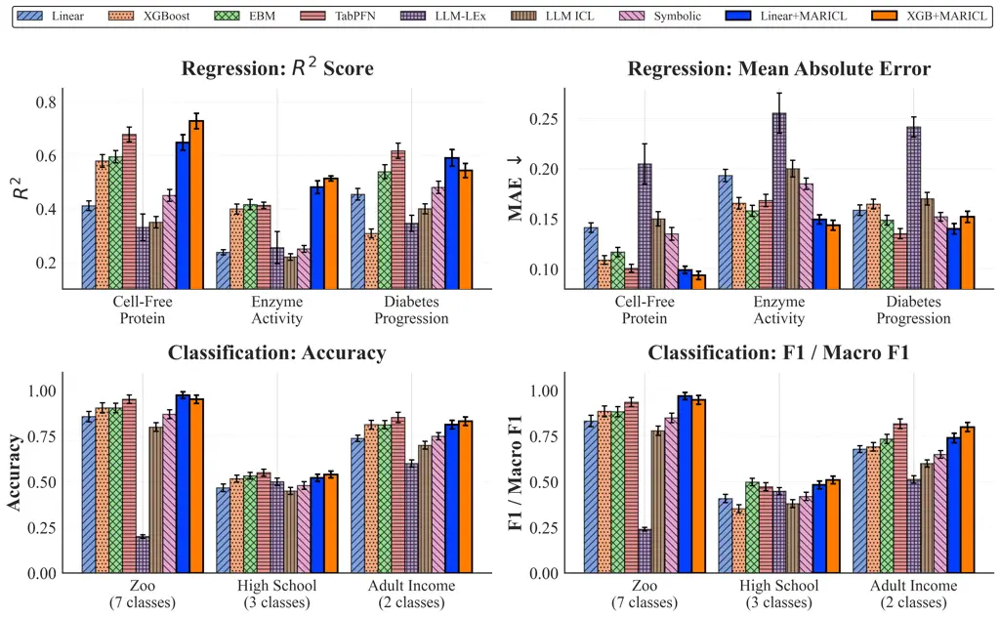
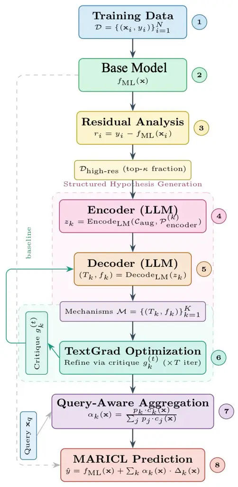
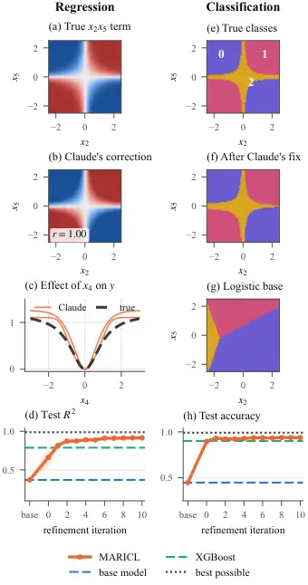

# From Residuals to Reasons: LLM-Guided Mechanism Hypotheses from Tabular Data

Mohammad R. Rezaei Affiliation: Department of Computer Science
Affiliation: University of Toronto Affiliation: Vector Institute
Affiliation: Toronto, ON, Canada
Email: [mr.rezaei@mail.utoronto.ca](mailto:)    Rahul G. Krishnan
Affiliation: Department of Computer Science Affiliation: University of
Toronto Affiliation: Vector Institute Affiliation: Toronto, ON, Canada
Email: [rahulgk@cs.toronto.edu](mailto:)

###### Abstract

When software fails, we read the error, form a hypothesis, write a
patch, and test it. LLMs now do this for neural networks by editing
weights; when a tabular model fails, we usually retune it. Most
interpretability methods report which features matter rather than how
they combine. Rather than asking an LLM to predict the target over the
whole output space, we anchor the prediction with a base model and ask
the LLM to debug it. We introduce Multi-Agent Residual In-Context
Learning (MARICL), in which LLM agents read high-residual examples,
hypothesize the missing structure, and write executable correction terms
that are then refined by multi-turn textual gradient optimization. The
resulting corrections are readable, executable hypotheses about what the
base model misses, rather than validated mechanisms. Across nine
benchmarks covering scientific, biomedical, socioeconomic, and synthetic
data, MARICL reliably repairs its base model’s structured residuals,
improving it on every dataset, and on synthetic data absent from
pretraining it recovers the hidden structure (two seeds). Against the
strongest competing baseline it leads on five of the eight real
benchmarks and trails TabPFN on the other three, while adding an
inspectable correction that black-box baselines do not provide. Code is
available at
[https://github.com/MrRezaeiUofT/Multi_Agent_Residual_In_Context_Learning](https://github.com/MrRezaeiUofT/Multi_Agent_Residual_In_Context_Learning).

## 1 Introduction

Figure 1: MARICL’s loop on the running example of §3 (1–5, ungated;
$`K`$ agents run in parallel) and its results (6): test $`R^{2}`$, or
accuracy where marked, of the better MARICL variant against its base.
MARICL leads the strongest other method on five of the eight real
benchmarks, see more details here: (Table 13).

Tabular machine learning faces a tradeoff between accuracy and
interpretability, and when a model fails we usually retune it rather
than ask why. Gradient boosting and related methods are accurate on
tabular data (Grinsztajn et al., 2022; McElfresh et al., 2023) but do
not state the relationships they have learned in a form one can read.
Post hoc attributions (Lundberg and Lee, 2017), additive models (Nori et
al., 2019), and symbolic regression (Cranmer, 2023) each recover part of
this picture (§2), but none produces a named, editable formula for where
and why a model fails.

Recent work on agentic interpretability (Kim et al., 2025) argues that
LLM agents can go beyond one-shot inspection by reasoning across
multiple turns to refine explanations. In practice such loops explore a
large space and rarely produce a testable output unless they are
constrained. LLMs can now even edit neural-network weights
directly (Takehi et al., 2026), but tabular models are often not
networks. We argue that the residual is the right constraint.

A natural baseline is _LLM-ICL_: place the entire training set in an
LLM’s context as $`(\mathbf{x}_{i},y_{i})`$ pairs and ask it to predict
$`y`$ for each test query in one forward pass. On cell-free protein
yield prediction this reaches $`R^{2}{=}0.35`$, below traditional linear
regression. A single pass would have to fit a regression, capture
nonlinear structure, and align to the target’s scale all at once, and
the search space is too large for that to be reliable. We therefore ask
the LLM to debug a model rather than be one. A statistical _base model_
(linear regression, XGBoost, or any validated predictor) handles the
regression and fixes the output scale, and the LLM answers a narrower
question: what is the base model missing? Its target becomes the
residual $`r=y-\hat{y}_{\text{ML}}`$ rather than $`y`$, and its output
becomes a description of the failure modes visible in residual examples
rather than a prediction. Gradient boosting fits the same residual
silently; here the LLM reads it like a bug report and answers with a
formula that can be run, checked, and rejected.

This defines our proposed Multi-Agent Residual In-Context Learning
(MARICL; overview in Figure 1, full schematic in Figure 3). An
encoder-agent reads high-residual training examples and produces
structured hypotheses. A decoder-agent compiles each hypothesis into an
executable correction term, a named formula over specific features.
*Textual gradient optimization* (Yuksekgonul et al., 2024), in which an
LLM critiques its own output in natural language and proposes
refinements in place of a numerical gradient, then refines each
correction on the examples where it still fails. We run $`K`$ agents in
parallel and combine them using query-dependent weights; inference needs
no LLM.

The cell-free protein task illustrates the procedure. Cell-free protein
synthesis produces proteins in a test tube from a cell extract plus
added reagents (energy substrates, cofactors, polyamines), and the task
is to predict yield from reagent concentrations. The base model
underpredicts yield when NAD (an energy cofactor) and spermidine (a
polyamine that boosts translation) are both high. MARICL hypothesizes
cofactor synergy, generates the interaction term NAD $`\times`$ sperm,
and refines it with a saturation term for folinic acid. Across the
dataset this raises $`R^{2}`$ from $`0.41`$ (linear base) to $`0.65`$,
with the same LLM that reached $`0.35`$ alone (§3; full trace in
Appendix B).

Fluent explanations are cheap, so we present these formulas as
_readable, executable hypotheses_ inferred from the data: they are
selected by residual-prediction performance and read against the
scientific literature afterwards. We then try to break them, and report
where they survive and where they fail.

Contributions. (1) MARICL: an agentic framework that debugs a base model
by writing executable correction terms through structured hypothesis
generation and iterative refinement. (2) A residual-conditioned
adaptation of textual-gradient optimization (Yuksekgonul et al., 2024),
paired with a distance-based aggregation. (3) A layered ablation
removing the LLM’s pretraining priors, a planted-ground-truth synthetic
benchmark, and three negative controls (Appendix M), which show that
MARICL does not manufacture predictive gains when no structure is
present.

## 2 Related Work

Methods like SHAP (Lundberg and Lee, 2017) (including TreeSHAP and the
Shapley interaction index (Lundberg et al., 2020)) and LIME (Ribeiro et
al., 2016) attribute predictions to features and feature pairs, but the
attributions are per-sample and tied to a fixed predictor, and cannot
express why a model fails as a closed-form formula. Inherently
interpretable models like GAMs (Hastie and Tibshirani, 1987) and
EBMs (Nori et al., 2019) fit smooth nonparametric shape functions per
feature, with optional pairwise terms in GA²Ms (Lou et al., 2013); we
compare against _EBM (with pairwise)_ as a strong interpretable
interaction baseline (Appendix D). MARICL instead produces closed-form
terms rather than per-pair response surfaces, and refines them against
base-model failures. InterpreTabNet (Si et al., 2024) learns sparse
attention masks and uses LLMs to describe feature interdependencies, but
remains inspective.

Classical genetic programming (Cranmer, 2023) and LLM-guided
methods (Shojaee et al., 2025) discover closed-form expressions from
data, and LLM-LEx (Harvey et al., 2025) generates predictive formulas
directly. These fit the target globally; MARICL targets residuals,
producing expressions scoped to where a baseline errs.

Error-slice discovery methods such as Slice Finder (Chung et al., 2019),
Domino (Eyuboglu et al., 2022), and SEAL (Rajani et al., 2022) find
coherent subsets on which a model systematically fails and, in some
cases, describe them in natural language. They localize _where_ a model
fails, whereas MARICL emits an executable correction that repairs the
failure. The two are complementary: MARICL’s high-residual pool is
itself a slice, which a slice-discovery method could seed.

Debate frameworks (Du et al., 2023) and mixture-of-agents (Wang et al.,
2024; Rezaei et al., 2025) coordinate LLMs on shared tasks;
TextGrad (Yuksekgonul et al., 2024) and self-refine (Madaan et al., 2023) optimize outputs through critique. In MARICL each agent
specializes on a distinct failure pattern, and refinement targets
interpretable formulas. Gradient boosting (Friedman, 2001) fits weak
learners to residuals. CAAFE (Hollmann et al., 2023b) prompts an LLM to
generate executable feature-engineering code on the input space,
validating candidates against held-out accuracy. MARICL shares the
compile-to-executable strategy but operates on the _residual_ space,
generates corrections through iterative TextGrad refinement rather than
one-shot generation, and returns named symbolic terms rather than
augmented feature columns.

## 3 Methods

We consider supervised learning on
$`\mathcal{D}=\{(\mathbf{x}_{i},y_{i})\}_{i=1}^{N}`$ with
$`\mathbf{x}_{i}\in\mathbb{R}^{d}`$ and $`y_{i}\in\mathbb{R}`$
(regression) or $`y_{i}\in\{1,\ldots,C\}`$ (classification), split into
train, validation, and test sets. We assume access to a pretrained base
model $`f_{\text{ML}}:\mathbb{R}^{d}\rightarrow\mathcal{Y}`$ (linear,
tree, or gradient-boosted). MARICL learns $`K`$ correction agents whose
predictions are added on top of the base model; interpretability lives
in the corrections, which name what the base model systematically
misses. Algorithm 1 (Appendix A) gives the training procedure.

#### Terminology.

An _agent_ is an LLM with a role-specific prompt that reads and writes a
shared textual state. The _encoder_ and _decoder_ are two such roles
separated by a textual bottleneck: high-residual evidence is compressed
into a structured hypothesis $`z_{k}`$ (Eq. 6), which is then expanded
into a correction $`(T_{k},f_{k})`$; no neural encoder or decoder is
trained. A _textual gradient_ is TextGrad’s term (Yuksekgonul et al., 2024) for a natural-language critique that plays the role of a gradient,
here conditioned on the residual failure set; the analogy is loose, and
no derivative is computed.

Each agent produces one correction $`m_{k}=(T_{k},f_{k})`$, a
(natural-language template, formula) pair. For regression,
$`f_{k}:\mathbb{R}^{d}\rightarrow\mathbb{R}`$ (clipped to $`\pm`$ the
scaled target range; Appendix K.3). For classification,
$`f_{k}:\mathbb{R}^{d}\rightarrow\mathbb{R}^{C}`$ produces per-class
scores converted to a distribution $`Q_{k}`$ (§3.3). The MARICL
prediction is

```math
\hat{y}_{\text{MARICL}}(\mathbf{x})=f_{\text{ML}}(\mathbf{x})+\sum_{k=1}^{K}\alpha_{k}(\mathbf{x})\,\Delta_{k}(\mathbf{x}), \tag{1}
```

where $`\Delta_{k}(\mathbf{x})=f_{k}(\mathbf{x})`$ and the weights
satisfy $`\alpha_{k}(\mathbf{x})\geq 0`$,
$`\sum_{k=1}^{K}\alpha_{k}(\mathbf{x})=1`$ (§3.4). The weights are
query-dependent: they decide which correction dominates at
$`\mathbf{x}`$, and, because they are normalized, they redistribute the
total correction rather than scaling it. The headline configuration
additionally applies an outer gate $`\lambda(\mathbf{x})\in[0,1]`$ that
shrinks the summed correction — more strongly when no correction is both
high-confidence and close to the query (Eq. 21 in §3.4). For
classification,

```math
P_{\text{MARICL}}(\mathbf{x})=\beta\cdot P_{\text{ML}}(\mathbf{x})+(1-\beta)\sum_{k=1}^{K}\alpha_{k}(\mathbf{x})\cdot Q_{k}(\mathbf{x}), \tag{2}
```

with $`P_{\text{ML}}(\mathbf{x}),Q_{k}(\mathbf{x})\in\Delta^{C-1}`$ and
$`\beta\in[0,1]`$.

For each training example we compute residuals

```math
r_{i}=\begin{cases}y_{i}-f_{\text{ML}}(\mathbf{x}_{i})&\text{(reg.)}\\
\mathbb{I}[f_{\text{ML}}(\mathbf{x}_{i})\neq y_{i}]\bigl(1-P_{\text{ML}}(\mathbf{x}_{i})_{y_{i}}\bigr)&\text{(clf.)}\end{cases} \tag{3}
```

and select the top-$`\kappa`$ fraction by $`|r_{i}|`$:

```math
\mathcal{D}_{\text{high-res}}=\bigl\{(\mathbf{x}_{\pi(i)},y_{\pi(i)},r_{\pi(i)}):i\leq\lfloor\kappa N_{\text{train}}\rfloor\bigr\}, \tag{4}
```

where $`\pi`$ orders examples by descending $`|r_{i}|`$.

### 3.1 Structured Hypothesis Generation

Rather than prompting an LLM directly for formulas, MARICL uses an
encoder–decoder with a structured representation $`z_{k}`$ to
hypothesize explanations for the base model’s failures.

We construct an augmented context

```math
\mathcal{C}_{\text{aug}}=\bigl(\mathcal{D}_{\text{high-res}},\mathcal{C}_{\text{domain}},\mathcal{C}_{\text{features}}\bigr) \tag{5}
```

combining high-residual examples, optional domain context, and feature
descriptions, and analyze residual patterns via

```math
z_{k}=\text{Encode}_{\text{LM}}\bigl(\mathcal{C}_{\text{aug}},\mathcal{P}_{\text{encoder}}^{(k)}\bigr), \tag{6}
```

where each $`\mathcal{P}_{\text{encoder}}^{(k)}`$ targets a different
aspect: (1) error patterns (which feature combinations drive high errors
and what nonlinearities the base model misses); (2) sample patterns
(direct feature–target relationships visible in high-residual examples).
When $`|\mathcal{D}_{\text{high-res}}|>B`$ we partition into batches,
encode independently, and concatenate:

```math
z_{k}=\text{Concat}\bigl(z_{k,1},\ldots,z_{k,\lceil|\mathcal{D}_{\text{high-res}}|/B\rceil}\bigr),
```

```math
z_{k,b}=\text{Encode}_{\text{LM}}\bigl(\mathcal{C}_{\text{aug}}^{(b)},\mathcal{P}_{\text{encoder}}^{(k)}\bigr). \tag{7}
```

The decoder transforms $`z_{k}`$ into a correction
$`(T_{k},f_{k})=\text{Decode}_{\text{LM}}(z_{k},\mathcal{P}_{\text{decoder}})`$
comprising a natural-language explanation $`T_{k}`$ and a Python
expression $`f_{k}`$. This separation forces the LLM to articulate _why_
errors occur before specifying _how_ to correct them, while diverse
$`\mathcal{P}_{\text{encoder}}^{(k)}`$ encourage complementary
hypotheses.

### 3.2 Refinement via Textual Gradients

Each correction maintains a textual state $`\mathcal{S}_{k}^{(t)}`$
comprising the hypothesis $`z_{k}^{(t)}`$, correction
$`(T_{k}^{(t)},f_{k}^{(t)})`$, and accumulated critique history. At
$`t{=}0`$,

```math
z_{k}^{(0)}=\text{Encode}_{\text{LM}}\bigl(\mathcal{C}_{\text{aug}},\mathcal{P}_{\text{encoder}}^{(k)}\bigr),
```

```math
(T_{k}^{(0)},f_{k}^{(0)})=\text{Decode}_{\text{LM}}\bigl(z_{k}^{(0)},\mathcal{P}_{\text{decoder}}\bigr). \tag{8}
```

When available, base-model knowledge (feature importances, coefficients)
guides initialization. At iteration $`t`$ we evaluate

```math
\mathcal{L}_{k}^{(t)}=\frac{1}{|\mathcal{D}_{\text{fit}}|}\sum_{(\mathbf{x},y)\in\mathcal{D}_{\text{fit}}}\ell\bigl(f_{\text{ML}}(\mathbf{x})+\Delta_{k}^{(t)}(\mathbf{x}),\;y\bigr) \tag{9}
```

writing $`\mathcal{L}_{k}^{(t)}(\mathcal{D})`$ when the split matters:
critiques use $`\mathcal{D}_{\text{train}}`$ while selection of the
retained iterate uses $`\mathcal{D}_{\text{val}}`$ (§3.5). We then
identify the failure set

```math
\mathcal{E}_{k}^{(t)}=\begin{cases}\bigl\{(\mathbf{x},y,\hat{y}):|\hat{y}-y|>\tau_{\text{fail}}\bigr\}&\text{(reg.)}\\[2.0pt]
\bigl\{(\mathbf{x},y,\hat{\mathbf{p}}):\hat{p}_{y}<1-\tau_{\text{fail}}\bigr\}&\text{(clf.)}\end{cases} \tag{10}
```

where $`\hat{\mathbf{p}}`$ is the current ensemble probability vector
(Eq. 2); the classification criterion is equivalent to cross-entropy
above $`-\log(1-\tau_{\text{fail}})`$, with $`\tau_{\text{fail}}=0.5`$
(Appendix K.2). A textual gradient (critique) is then generated,

```math
g_{k}^{(t)}=\text{LM}\bigl(\mathcal{P}_{\text{critique}}\mid z_{k}^{(t)},m_{k}^{(t)},\mathcal{L}_{k}^{(t)},\mathcal{E}_{k}^{(t)}\bigr), \tag{11}
```

asking the LLM to analyze why the correction fails on
$`\mathcal{E}_{k}^{(t)}`$ and suggest refinements. The state
accumulates,

```math
\mathcal{S}_{k}^{(t)}=\mathcal{S}_{k}^{(t-1)}\cup\bigl\{(z_{k}^{(t)},m_{k}^{(t)},\mathcal{L}_{k}^{(t)},g_{k}^{(t)})\bigr\}, \tag{12}
```

and later generations condition on this history (the last three
iterations in the released code, to bound the context):

```math
(T_{k}^{(t+1)},f_{k}^{(t+1)})\sim p_{\text{LM}}\bigl(\cdot\mid\mathcal{C}_{\text{aug}},\mathcal{S}_{k}^{(t)},\mathcal{P}_{\text{decoder}}\bigr). \tag{13}
```

The hypothesis therefore evolves to reflect _what_ the base model is
missing in light of recent failures, while the formula evolves to
express _how_ that missing structure is captured.

### 3.3 Probability Conversion and Confidence

For classification, $`f_{k}`$ outputs per-class scores
$`\mathbf{s}_{k}(\mathbf{x})`$, converted via temperature-scaled softmax

```math
Q_{k}(\mathbf{x})_{c}=\frac{\exp(s_{k}^{(c)}(\mathbf{x})/\tau_{k})}{\sum_{c^{\prime}}\exp(s_{k}^{(c^{\prime})}(\mathbf{x})/\tau_{k})}, \tag{14}
```

with $`\tau_{k}`$ chosen on validation data by expected calibration
error (Appendix K.2). Query-specific confidence is

```math
c_{k}(\mathbf{x})=\sigma\bigl(\gamma\,(1-d_{k}(\mathbf{x}))\bigr),\qquad\gamma=2, \tag{15}
```

where
$`d_{k}(\mathbf{x})=\min\bigl(\tilde{d}_{k}(\mathbf{x})/D_{k}^{95},\,1\bigr)`$
and
$`\tilde{d}_{k}(\mathbf{x})=\min_{(\mathbf{x}^{\prime},\cdot)\in\mathcal{D}_{\text{high-res}}^{(k)}}\|\mathbf{x}-\mathbf{x}^{\prime}\|_{2}`$
is computed in standardized feature space using frozen training
statistics, and $`D_{k}^{95}`$ is the $`95`$th percentile of pairwise
distances within $`\mathcal{D}_{\text{high-res}}^{(k)}`$, with clipping
ensuring $`d_{k}\in[0,1]`$ on far queries.

### 3.4 Query-Aware Aggregation

During hypothesis generation, informative examples are drawn from the
high-residual pool via

```math
s(\mathbf{x}_{\text{q}},\mathbf{x}_{i})=\exp\bigl(-\|\mathbf{x}_{\text{q}}-\mathbf{x}_{i}\|_{2}^{2}/2\sigma^{2}\bigr)\cdot|r_{i}|^{\gamma_{s}}, \tag{16}
```

where the _query anchor_ $`\mathbf{x}_{\text{q}}`$ is the unselected
high-residual example with the largest $`|r_{i}|`$ remaining in the pool
(ties broken by index), $`\sigma`$ is the median pairwise distance over
the pool, and $`\gamma_{s}>0`$ trades residual magnitude against spatial
proximity (distinct from $`\gamma`$ in Eq. 15). This is used _only
during training_. At inference each compiled $`f_{k}`$ is executed
directly. Corrections carry a global performance score

```math
p_{k}=\begin{cases}\exp(-\text{MAE}_{k}/\tau)&\text{(reg.)}\\
\text{F1}_{k}^{\text{macro}}&\text{(clf.)}\end{cases} \tag{17}
```

where $`\tau>0`$ scales $`\text{MAE}_{k}`$ (Appendix K.2). Define the
unnormalized weight

```math
w_{k}(\mathbf{x})=p_{k}\cdot c_{k}(\mathbf{x})\cdot\mathbb{I}[p_{k}>p_{\min}], \tag{18}
```

and normalize:

```math
\alpha_{k}(\mathbf{x})=\frac{w_{k}(\mathbf{x})}{Z(\mathbf{x})},\quad Z(\mathbf{x})=\sum_{j}w_{j}(\mathbf{x}). \tag{19}
```

If $`Z(\mathbf{x})=0`$ (no correction clears $`p_{\min}`$) the weights
are undefined and unused, and MARICL returns the base-model prediction.

To shrink corrections on queries where no correction is both
high-quality and near a high-residual pool, the headline configuration
applies an outer gate

```math
\lambda(\mathbf{x})=\min\!\Bigl(\max_{k}w_{k}(\mathbf{x}),\ 1\Bigr)\in[0,1], \tag{20}
```

together with a steeper confidence profile
$`c_{k}(\mathbf{x})=\sigma\bigl(\gamma(1-2d_{k}(\mathbf{x}))\bigr)`$ so
that $`c_{k}`$ falls to $`\sigma(-2)=0.119`$ at $`d_{k}=1`$, against
$`0.5`$ for the softer profile. The final prediction is

```math
\hat{y}_{\text{MARICL}}(\mathbf{x})=f_{\text{ML}}(\mathbf{x})+\lambda(\mathbf{x})\sum_{k=1}^{K}\alpha_{k}(\mathbf{x})\,\Delta_{k}(\mathbf{x}). \tag{21}
```

Because $`\lambda`$ multiplies the whole sum, it leaves the relative
weighting between corrections unchanged. Because
$`\lambda=\max_{k}w_{k}`$ combines a quality factor ($`p_{k}`$) with a
distance factor ($`c_{k}`$) and each $`w_{k}\leq p_{k}c_{k}\leq 0.881`$,
the gate shrinks the correction sum on _every_ query — more aggressively
when no correction is both high-confidence and nearby, less aggressively
when at least one is. This behavior, and the associated ungated variant
($`\lambda\equiv 1`$, softer $`c_{k}`$) as reference, are analyzed in
Appendix C, which shows that on Cell-Free Protein the gate concentrates
its $`+0.005\,R^{2}`$ improvement in the far-distance tail rather than
affecting on-distribution accuracy. The inference pipeline involves only
arithmetic and nearest-neighbor lookups, with zero LLM overhead.

$`\triangleright`$ Running Example: Cell-Free Protein Production  
A reaction with NAD$`\,{=}\,0.8`$, spermidine$`\,{=}\,0.7`$, folinic
acid$`\,{=}\,0.3`$ has yield $`y{=}0.72`$; the linear base predicts
$`0.58`$, so $`r{=}{+}0.14`$ (Eq. 3). High-residual examples concentrate
on high NAD and spermidine, and the encoder writes $`z_{1}`$: “the
linear model misses a multiplicative NAD–spermidine synergy” (Eq. 6).
The decoder emits $`T_{1}^{(0)}`$ = “NAD–spermidine cofactor synergy”
with $`f_{1}^{(0)}=0.5\,\text{NAD}\times\text{sperm}`$ ($`0.28`$ here;
Eq. 8). High-folinic-acid reactions still fail, so the critique
$`g_{1}^{(0)}`$ proposes a saturation term (Eq. 11), giving
$`f_{1}^{(1)}=f_{1}^{(0)}+\tfrac{0.5\,\text{fol}}{0.5+\text{fol}}`$
($`0.4675`$; Eq. 13). At inference a second correction is inactive at
this query ($`\Delta_{2}\approx 0`$); the weights are
$`\alpha_{1}{=}0.28`$, $`\alpha_{2}{=}0.72`$ (Eq. 19), so
$`\hat{y}=0.58+0.28\times 0.4675=0.711`$, with no LLM call (ungated
variant; Appendix B).

### 3.5 Data Splits and Selection Protocol

We use the training data to compute residuals (Eq. 3), populate
$`\mathcal{D}_{\text{high-res}}`$, build prompts, evaluate
$`\mathcal{L}_{k}^{(t)}`$, form failure sets, and fix the scores
$`p_{k}`$. Validation data selects the retained iteration $`m_{k}^{*}`$,
the blend $`\beta`$, the temperatures $`\tau_{k}`$, and the headline
$`K`$ and $`\kappa`$. The test split is untouched until final
evaluation. All headline numbers throughout the paper are produced under
validation-loss selection for $`m_{k}^{*}`$; training-loss selection
would not change Cell-Free Protein and would raise Diabetes/Zoo by at
most $`0.021`$ without changing any baseline ranking. Appendix K.1 gives
the protocol detail.

## 4 Experiments

We evaluate MARICL on nine benchmarks across scientific, biomedical,
social, economic, and synthetic domains, and ask four questions: (i)
does MARICL improve prediction; (ii) can it recover structure it cannot
have memorized; (iii) how much of the gain comes from refinement rather
than pretraining priors; and (iv) do the learned formulas hold beyond
the data they were inferred from?

Datasets. We use five regression tasks (Cell-Free Protein
Production (Borkowski et al., 2020), Enzyme Activity, Diabetes
Progression, California Housing, Bike Sharing) and three classification
tasks (Zoo, High School Social Classification, Adult Income). We
additionally construct a Synthetic Benchmark ($`N{=}1{,}000`$,
$`d{=}6`$) with a regression and a classification task whose ground
truth cannot appear in any pretraining corpus (§4.2).

Baselines. Linear/Logistic Regression, XGBoost, EBM (Nori et al., 2019),
TabPFN (Hollmann et al., 2023a), LLM-LEx (Harvey et al., 2025), LLM-ICL,
Symbolic Regression (Cranmer, 2023), PySR-on-residuals, and
MLP-on-residuals. Cross-validation, hyperparameter settings, and paired
Wilcoxon tests with Benjamini–Hochberg (BH) FDR control are in
Appendices K and I.



Figure 2: Performance across regression and classification benchmarks
($`\pm`$1 std, 5 seeds). Methods are grouped by family (traditional ML,
interpretable ML, neural tabular, LLM-based, MARICL). MARICL improves
over its base model on every benchmark and leads the strongest
non-MARICL baseline on five of the eight real datasets; after BH
correction at FDR $`0.05`$ none of these gains is significant (Enzyme
Activity, California Housing, Bike Sharing $`q{=}0.053`$; Cell-Free
Protein, Zoo $`q{=}0.062`$). On the remaining three datasets MARICL
trails TabPFN but still contributes an inspectable correction formula
that the black-box baselines do not produce. Full numerical results in
Tables 11 and 10; California Housing and Bike Sharing are in Table 19.

### 4.1 Prediction on Eight Real Benchmarks

MARICL improves its base model on every real benchmark, with either a
Linear or an XGBoost base (Figures 1 and 2; Tables 10, 11). Gains are
largest when the base is weak, since a stronger base leaves a less
structured residual, and they hold on the two TabArena tasks
(Appendix K.6). LLM-LEx and LLM-ICL both underperform, so single-pass
generation is not sufficient. The lead over XGBoost survives tuning it
over a five-axis grid ($`+0.111\,R^{2}`$ on Cell-Free Protein,
$`+0.069`$ F1 on Adult Income, positive on all eight; Table 18), and
among residual learners (PySR-on-residuals, pairwise interactions, EBM,
MLP) MARICL attains both the best within-model $`R^{2}`$ _and_ a
human-readable formula (Appendix D). On Adult Income most of the F1 gain
($`0.692\to 0.800`$) comes from the minority class, where XGBoost
reaches $`0.498`$ F1 and MARICL $`0.720`$.

Against the strongest non-MARICL baseline per dataset, MARICL leads on
five of eight benchmarks and trails TabPFN on the other three (Diabetes,
High School, Adult Income; Table 13). After BH correction at FDR
$`0.05`$ none of the five leads is significant
($`q{=}0.053`$–$`0.062`$). The evidence therefore supports the claim
that MARICL reliably repairs its base model’s structured residuals and
adds an inspectable correction, not that it is the strongest tabular
predictor.

### 4.2 Synthetic Benchmark: Known Ground Truth

An LLM that improves a protein-yield model may simply remember its
biochemistry. To separate reasoning from recall, we generate data from
functions no LLM has seen: a regression target

```math
\displaystyle y=\; \displaystyle 0.4x_{1}-0.3x_{3}+2\,\sigma(3x_{2}x_{5})
```

```math
\displaystyle+1.2\,\frac{x_{4}^{2}}{1+x_{4}^{2}}+\varepsilon,
```

and three classes driven by $`x_{2}x_{5}`$ and $`x_{4}^{2}`$, with
$`\mathbf{x}\sim\mathcal{N}(\mathbf{0},I_{6})`$ and $`x_{6}`$
irrelevant. The LLM is a Claude agent whose domain prompt states only
that feature meanings are unknown (Appendix E).

MARICL raises test $`R^{2}`$ from $`0.370`$ (linear base) to $`0.914`$,
ahead of XGBoost ($`0.787`$), and test accuracy from $`0.448`$ (logistic
base) to $`0.938`$, ahead of XGBoost ($`0.900`$; Figures 1 and 4). All
eight retained corrections contain both hidden nonlinear terms and none
uses $`x_{6}`$; on seed $`0`$ the regression interaction returns as
$`\tanh(1.5\,x_{2}x_{5})`$, the true shape since
$`2\sigma(3u)=1+\tanh(1.5u)`$. Forms are recovered more faithfully than
constants, and each task has only two seeds.

### 4.3 Reasoning or Recall? Refinement vs Priors

|                                                         |                     |                       |                     |
| ------------------------------------------------------- | ------------------- | --------------------- | ------------------- |
| Setting                                                 | $`R^{2}`$           | Setting               | $`R^{2}`$           |
| Corrections (Linear)                                    |                     | Corrections (XGBoost) |                     |
| $`K{=}1`$                                               | 0.541 $`\pm`$ 0.027 | $`K{=}1`$             | 0.690 $`\pm`$ 0.025 |
| $`K{=}2`$                                               | 0.648 $`\pm`$ 0.030 | $`K{=}2`$             | 0.728 $`\pm`$ 0.031 |
| Top-K (XGBoost)                                         |                     | Scaling (Linear)      |                     |
| 30                                                      | 0.626 $`\pm`$ 0.024 | Off                   | 0.412 $`\pm`$ 0.029 |
| 50                                                      | 0.711 $`\pm`$ 0.021 | On                    | 0.648 $`\pm`$ 0.030 |
| 100                                                     | 0.728 $`\pm`$ 0.031 |                       |                     |
| Refinement budget (XGBoost, $`K{=}2`$, Top-K$`{=}`$100) |                     |                       |                     |
| $`T{=}1`$                                               | 0.604 $`\pm`$ 0.028 | $`T{=}5`$             | 0.679 $`\pm`$ 0.026 |
| $`T{=}3`$                                               | 0.623 $`\pm`$ 0.024 | $`T{=}10`$            | 0.728 $`\pm`$ 0.031 |
| Best-of-10, no critique                                 |                     |                       | 0.662               |

Table 1: Ablations on Cell-Free Protein (mean $`\pm`$ std, 5 seeds).
Each sub-block varies the named factor while holding the others at the
headline configuration ($`K{=}2`$, $`T{=}10`$, Top-K$`=`$100, scaled
features). $`T{=}1`$ is the initial one-shot output. Best-of-10 draws
ten one-shot decoder samples without critique and keeps the best on
validation data.

Residualization matters. _MARICL-Direct_ runs the same loop, prompts,
aggregation, and sandbox but predicts $`y`$ directly, with no base
model. It reaches $`R^{2}=0.538/0.512/0.376`$ on
Cell-Free/Diabetes/Enzyme, trailing MARICL ($`0.728/0.590/0.513`$) and
falling below the stronger base model on Cell-Free and Enzyme
(Table 10).

Refinement matters (Table 1). The one-shot formula ($`T{=}1`$) adds
$`+0.025\,R^{2}`$ to the XGBoost base; the loop adds a further
$`+0.124`$ by $`T{=}10`$. Best-of-10 resampling without critique
recovers $`{\sim}47\%`$ of that loop gain, and critique adds the
remaining $`+0.066`$. A second correction adds $`+0.107`$ (Linear) and
$`+0.038`$ (XGBoost).

Priors help but do not fully explain the gain. Removing the domain
prompt costs only $`2.3`$–$`3.5`$ points and recovers the same dominant
correction category. Anonymizing feature names (feat_0, …, feat_d)
preserves $`67`$–$`69\%`$ of the gain on Cell-Free Protein and Diabetes.
With anonymized features, no domain context anywhere, and Llama-3-8B
replacing frontier models, roughly half the gain survives and still
exceeds PySR-on-residuals (Appendix J). This suggests that roughly half
of the gain comes from data-driven refinement; the remainder is a
deployment benefit when pretraining aligns with the domain. It does not
by itself distinguish mechanism recovery from flexible symbolic residual
fitting, which the synthetic benchmark and cross-plate transfer address.

The recovered structure is largely evidence-driven. The refinement
prompt asks for nonlinearities and interactions (Appendix K.4). A
neutral prompt that also permits linear or no structure costs only
$`0.014\,R^{2}`$ and still recovers NAD$`\times`$spermidine in $`4/5`$
seeds ($`5/5`$ with the standard prompt); neither recovers it on
shuffled targets ($`0/5`$; Appendix M).

### 4.4 Inspecting the Learned Corrections

MARICL’s corrections carry structure on their own: without the base
model they reach $`R^{2}=0.495`$ on Cell-Free Protein and $`0.762`$
accuracy on Zoo (combined: $`0.728`$ and $`0.975`$). Zoo is the easiest
to inspect, because a reader needs no domain training to check it. Three
of its class scores are

```math
\displaystyle s_{\text{mammal}}= \displaystyle\;1.1\,\text{hair}+1.3\,\text{milk}
```

```math
\displaystyle+0.8\,\text{hair}\times\text{milk}\times(1-\text{eggs}),
```

```math
\displaystyle s_{\text{bird}}= \displaystyle\;1.2\,\text{feathers}+0.8\,\text{airborne}
```

```math
\displaystyle+0.5\,\text{feathers}\times\text{airborne},
```

```math
\displaystyle s_{\text{fish}}= \displaystyle\;1.0\,\text{fins}+0.9\,\text{aquatic}
```

```math
\displaystyle+0.4\,\text{fins}\times\text{aquatic}\times\text{backbone}.
```

The mammal score adds a bonus for hair and milk together only in animals
that do not lay eggs, and the bird score weights feathers above flight,
so flightless birds remain birds. Taxonomy priors plausibly dominate
here, so we treat Zoo as controlled validation rather than inference.
Cell-Free Protein is the harder test: its correction reads as
NAD–spermidine synergy plus Michaelis–Menten saturation of folinic acid,
consistent with published biochemistry (Table 9), yet on permuted
reagent labels MARICL emits an equally fluent story ($`R^{2}=0.487`$;
Appendix M). Correction forms recur in 4 or 5 of 5 seeds on the audited
datasets except High School ($`3/5`$), with coefficient CV below
$`14\%`$ on well-structured domains; the Zoo mammal term returns in
$`5/5`$ seeds (Appendix K.7).

Three frontier LLM judges rated the formulas and explanations on a
plausibility rubric (Appendix N), and two blinded non-expert raters
scored the same $`230`$ items (Appendix N.1). Rater means are within
$`0.3`$ of the judges’ on every axis, raters and judges agree on
$`85\%`$ of preferences, and raters flag $`80/100`$ permuted-label
corrections (judges: $`55`$–$`69`$), so a reader can detect this failure
mode. Readability and perceived plausibility are not domain correctness,
however: each correction is a compact, executable statement of the
functional form the base model misses, selected by held-out residual
prediction, and its correctness is probed only indirectly, through
planted ground truth (§4.2), cross-plate transfer (§4.5), and the
negative controls.

### 4.5 Frozen Formulas Across Plates

|                             |              |               |              |               |
| --------------------------- | ------------ | ------------- | ------------ | ------------- |
|                             | Same reagent |               | Diff. regime |               |
| Configuration               | Impr.        | $`\Delta`$MAE | Impr.        | $`\Delta`$MAE |
| Avg. $`+`$ blend (headline) | 95.3%        | $`+0.188`$    | 2.7%         | $`-0.181`$    |
| Per-formula (strict)        | 51.7%        | $`+0.041`$    | 8.8%         | $`-0.169`$    |
| Unfiltered source pool      | 71.1%        | $`+0.103`$    | 5.1%         | $`-0.171`$    |

Table 2: Cross-plate transfer: formulas frozen on source plate AL_6
applied to target plates with zero LLM cost. “Impr.” is the share of
source–target pairs that improve on the base. The headline row averages
$`K{=}2`$ formulas and blends 50/50 with the base model; the strict row
transfers each formula individually with no blending; the third row
keeps the headline blend but drops the source-side quality filter. The
cohort asymmetry persists in all three. Full ladder and per-plate
breakdown in Appendix O.

In Cell-Free Protein each _plate_ is one experimental batch. Plates
AL_2–AL_6 share one reagent protocol and AL_7–AL_10 use another with
different reagent ranges; we call these groups _reagent cohorts_. We
freeze the corrections of $`37`$ source runs on AL_6 and apply them to
$`8`$ held-out plates with no retraining and no LLM calls
(Appendix O.1). Within the cohort, frozen formulas improve the base on
$`95.3\%`$ of source–target pairs, against $`62.1\%`$ for
PySR-on-residuals and $`57.7\%`$ for EBM under the same protocol, with
$`3`$–$`4\times`$ larger gains (Appendix L); source plate AL_2 gives
$`89.3\%`$ (Appendix O.2). Across cohorts the result reverses: MARICL
improves only $`2.7\%`$ of pairs, against $`13.5\%`$ for PySR and
$`17.4\%`$ for EBM (Table 2). All three learners split by cohort, so
part of the boundary is real reagent shift, but MARICL’s split is the
sharpest.

### 4.6 Cost and LLM Backbone

|                                      |                                |                      |                 |               |                 |
| ------------------------------------ | ------------------------------ | -------------------- | --------------- | ------------- | --------------- | ------- | ------- |
| Method                               | Encoder Calls                  | Decoder/Refine Calls | Total LLM Calls | Training Cost | 1K Queries Cost |
| Gemini 2.0 Flash (\$0.0013 per call) |                                |                      |                 |               |                 |
| Direct LLM (ICL)                     | –                              | 1 per query          | 1K              | \$0.00        | \$1.30          |
| MARICL ($`K`$=1, $`T`$=5, $`         | \mathcal{D}\_{\text{high-res}} | `$=30)               | 3               | 11            | 14              | \$0.018 | \$0.018 |
| MARICL ($`K`$=2, $`T`$=5, $`         | \mathcal{D}\_{\text{high-res}} | `$=50)               | 10              | 22            | 32              | \$0.042 | \$0.042 |
| MARICL ($`K`$=2, $`T`$=10, $`        | \mathcal{D}\_{\text{high-res}} | `$=100)              | 20              | 42            | 62              | \$0.081 | \$0.081 |
| MARICL ($`K`$=2, $`T`$=10, $`        | \mathcal{D}\_{\text{high-res}} | `$=200)              | 40              | 42            | 82              | \$0.107 | \$0.107 |
| GPT-4o (\$0.0325 per call)           |                                |                      |                 |               |                 |
| Direct LLM (ICL)                     | –                              | 1 per query          | 1K              | \$0.00        | \$32.50         |
| MARICL ($`K`$=2, $`T`$=10, $`        | \mathcal{D}\_{\text{high-res}} | `$=100)              | 20              | 42            | 62              | \$2.02  | \$2.02  |

Table 3: Computational cost comparison. MARICL incurs one-time training
cost but zero inference overhead. Costs assume 5K input and 2K output
tokens per call, priced for Gemini 2.0 Flash (\$0.10/1M input, \$0.40/1M
output tokens) and GPT-4o (\$2.50/1M input, \$10.00/1M output tokens).
Batch size $`B=10`$ for encoding.

|                  |                     |      |           |       |
| ---------------- | ------------------- | ---- | --------- | ----- |
| LLM Backbone     | Protein ($`R^{2}`$) |      | Zoo (Acc) |       |
|                  | Corr                | Full | Corr      | Full  |
| Gemini-2.5-Flash | 0.52                | 0.74 | 0.81      | 0.981 |
| GPT-4o           | 0.54                | 0.73 | 0.83      | 0.987 |
| Gemini-2.0-Flash | 0.50                | 0.73 | 0.76      | 0.975 |
| GPT-4o-mini      | 0.46                | 0.68 | 0.71      | 0.95  |
| Llama-3-8B       | 0.38                | 0.62 | 0.62      | 0.86  |

Table 4: Performance across LLM backbones on Cell-Free Protein (XGBoost
base) and Zoo (Logistic base), headline configuration ($`K=2`$,
$`T=10`$). “Corr” = correction only; “Full” = combined MARICL.

Training takes 14–82 LLM calls per run (\$0.02–\$0.11 with Gemini 2.0
Flash) and inference takes none, so 1K predictions cost \$0.081 against
\$1.30 for direct LLM inference (Table 3; Appendix F). The frontier
backbones perform alike, and Llama-3-8B still beats the XGBoost base
($`0.62`$ vs. $`0.579\,R^{2}`$; Table 4; Appendix G).

## 5 Discussion and Conclusion

MARICL’s within-model gains are largest when the base is weak
($`+0.236\,\Delta R^{2}`$ over Linear against $`+0.149`$ over XGBoost on
Cell-Free Protein), and it is most clearly advantageous when a validated
base leaves substantial structured residual, or when an inspectable
correction is valued alongside accuracy.

In scientific applications, describing where and why a model fails can
generate testable hypotheses, and the cross-plate result shows the limit
of such formulas: they hold within a reagent regime and fail across one.
We believe an LLM’s better role on tabular data is to debug the models
practitioners trust, not replace them, and give experts something to
test.

## Limitations

MARICL’s formulas are selected by residual-prediction performance and
read against the literature post hoc, so they are readable, executable
hypotheses rather than validated mechanisms or causal claims. First, the
feature-name permutation control (Appendix M) shows that MARICL can emit
a plausible biochemical story on permuted reagent labels, so predictive
success does not certify semantic correctness. Our human audit
(Appendix N.1) shows that readers can detect this failure, but it
measures readability and perceived plausibility, not domain correctness,
so expert review is required before deployment in a novel domain.
Second, MARICL trails TabPFN on Diabetes, High School, and Adult Income;
there its contribution is the inspectable correction. Third, our real
benchmarks have at most $`d{=}16`$ features and the synthetic benchmark
covers $`d{=}6`$ with two seeds; scaling to higher dimensions, for
example through feature pre-filtering, is left to future work.

## Ethical Considerations

All datasets are publicly available (Appendix K.5) and contain no
identifiable personal information beyond the source releases. Adult
Income and High School encode demographic attributes (and, for Adult
Income, historical labor-market disparities), and MARICL’s corrections
on them can weight such features explicitly; the resulting formulas
describe patterns in the recorded data and should not be read as
normative statements about groups. Because MARICL emits fluent
explanations, a plausible reading may be mistaken for a scientific
finding, so we frame outputs as hypotheses.

## References

- Atkins et al. (1975) J. F. Atkins, J. B. Lewis, C. W. Anderson,
  and R. F. Gesteland Enhanced differential synthesis of proteins in a
  mammalian cell-free system by addition of polyamines. Journal of
  Biological Chemistry 250 (14), pp. 5688–5695. Cited by: Table 9.
- Borkowski et al. (2020) O. Borkowski, M. Koch, A. Zettor, A.
  Pandi, A. C. Batista, P. Soudier, and J. Faulon Large scale
  active-learning-guided exploration for in vitro protein production
  optimization. Nature Communications 11 (1), pp. 1872. External Links:
  [Link](https://pasteur.hal.science/pasteur-02552065),
  [Document](https://dx.doi.org/10.1038/s41467-020-15798-5) Cited by:
  §K.5, §4.
- Cai et al. (2015) Q. Cai, J. A. Hanson, A. R. Steiner, C. Tran, M. R.
  Masikat, R. H. Chen, J. F. Zawada, A. K. Sato, T. J. Hallam, and G.
  Yin A simplified and robust protocol for immunoglobulin expression in
  e scherichia coli cell‐free protein synthesis systems. Biotechnology
  Progress 31, pp. 823 – 831. External Links:
  [Link](https://api.semanticscholar.org/CorpusID:17280266) Cited by:
  Table 9.
- Chase and Dummer (1992) M. A. Chase and G. M. Dummer The role of
  sports as a social status determinant for children.. Research
  quarterly for exercise and sport 63 4, pp. 418–24. External Links:
  [Link](https://api.semanticscholar.org/CorpusID:6392049) Cited by:
  §K.5.
- Chung et al. (2019) Y. Chung, T. Kraska, N. Polyzotis, K. H. Tae,
  and S. E. Whang Slice finder: automated data slicing for model
  validation. In 2019 IEEE 35th International Conference on Data
  Engineering (ICDE), Vol. , pp. 1550–1553. External Links:
  [Document](https://dx.doi.org/10.1109/ICDE.2019.00139) Cited by: §2.
- Cranmer (2023) M. Cranmer Interpretable machine learning for science
  with pysr and symbolicregression.jl. ArXiv abs/2305.01582. External
  Links: [Link](https://api.semanticscholar.org/CorpusID:258436785)
  Cited by: §1, §2, §4.
- Davies et al. (2026) M. J. Davies, S. Lim, T. Slater, J. Goldney, A.
  Philis-Tsimikas, {. R. Franco, R. Lamptey, T. Yates, T. Tankova,
  and I. Lingvay Type 2 diabetes mellitus. Nature Reviews Disease
  Primers 12 (1) (English (US)). Note: Publisher Copyright: © Springer
  Nature Limited 2026. External Links:
  [Document](https://dx.doi.org/10.1038/s41572-026-00687-w), ISSN
  2056-676X Cited by: Table 8.
- Du et al. (2023) Y. Du, S. Li, A. Torralba, J. B. Tenenbaum, and I.
  Mordatch Improving factuality and reasoning in language models through
  multiagent debate. External Links: 2305.14325,
  [Link](https://arxiv.org/abs/2305.14325) Cited by: §2.
- Efron et al. (2004) B. Efron, T. Hastie, I. Johnstone, and R.
  Tibshirani Least angle regression. The Annals of Statistics 32 (2).
  External Links: ISSN 0090-5364,
  [Link](http://dx.doi.org/10.1214/009053604000000067),
  [Document](https://dx.doi.org/10.1214/009053604000000067) Cited by:
  §K.5.
- Eyuboglu et al. (2022) S. Eyuboglu, M. Varma, K. K. Saab, J.
  Delbrouck, C. Lee-Messer, J. A. Dunnmon, J. Y. Zou, and C. Ré Domino:
  discovering systematic errors with cross-modal embeddings. ArXiv
  abs/2203.14960. External Links:
  [Link](https://api.semanticscholar.org/CorpusID:247779010) Cited by:
  §2.
- Fanaee-T and Gama (2014) H. Fanaee-T and J. Gama Event labeling
  combining ensemble detectors and background knowledge. Progress in
  Artificial Intelligence 2, pp. 113–127. External Links:
  [Link](https://api.semanticscholar.org/CorpusID:3345087) Cited by:
  §K.5.
- Forsyth (1990) R. Forsyth Zoo. Note: UCI Machine Learning
  RepositoryDOI: https://doi.org/10.24432/C5R59V Cited by: §K.5.
- Friedman (2001) J. H. Friedman Greedy function approximation: A
  gradient boosting machine.. Annals Statist. 29 (5), pp. 1189–1232.
  External Links: [Document](https://dx.doi.org/10.1214/aos/1013203451)
  Cited by: §2.
- Grinsztajn et al. (2022) L. Grinsztajn, E. Oyallon, and G. Varoquaux
  Why do tree-based models still outperform deep learning on typical
  tabular data?. Advances in Neural Information Processing Systems 35.
  External Links:
  [Link](https://api.semanticscholar.org/CorpusID:252697222) Cited by:
  §1.
- Harvey et al. (2025) T. R. Harvey, F. Ruehle, K. Fraser-Taliente,
  and J. Halverson Symbolic regression with multimodal large language
  models and kolmogorov arnold networks. External Links: 2505.07956,
  [Link](https://arxiv.org/abs/2505.07956) Cited by: §2, §4.
- Hastie and Tibshirani (1987) T. J. Hastie and R. Tibshirani
  Generalized additive models: some applications. Journal of the
  American Statistical Association 82, pp. 371–386. External Links:
  [Link](https://api.semanticscholar.org/CorpusID:262357453) Cited by:
  §2.
- Hollmann et al. (2023a) N. Hollmann, S. Müller, K. Eggensperger,
  and F. Hutter TabPFN: a transformer that solves small tabular
  classification problems in a second. External Links: 2207.01848,
  [Link](https://arxiv.org/abs/2207.01848) Cited by: §4.
- Hollmann et al. (2023b) N. Hollmann, S. Müller, and F. Hutter Large
  language models for automated data science: introducing caafe for
  context-aware automated feature engineering. External Links:
  2305.03403, [Link](https://arxiv.org/abs/2305.03403) Cited by: §2.
- Jewett and Swartz (2004) M. C. Jewett and J. Swartz Mimicking the
  escherichia coli cytoplasmic environment activates long‐lived and
  efficient cell‐free protein synthesis. Biotechnology and
  Bioengineering 86. External Links:
  [Link](https://api.semanticscholar.org/CorpusID:22492709) Cited by:
  Table 9.
- Kahn et al. (2006) S. E. Kahn, R. L. Hull, and K. M. Utzschneider
  Mechanisms linking obesity to insulin resistance and type 2 diabetes.
  Nature 444, pp. 840–846. External Links:
  [Link](https://api.semanticscholar.org/CorpusID:120626) Cited by:
  Table 8.
- Kim et al. (2025) B. Kim, J. Hewitt, N. Nanda, N. Fiedel, and O.
  Tafjord Because we have llms, we can and should pursue agentic
  interpretability. External Links: 2506.12152,
  [Link](https://arxiv.org/abs/2506.12152) Cited by: §1.
- Kohavi (1996) R. Kohavi Scaling up the accuracy of naive-Bayes
  classifiers: a decision-tree hybrid. In Proceedings of the Second
  International Conference on Knowledge Discovery and Data Mining (KDD),
  pp. 202–207. Cited by: §K.5.
- Li et al. (2020) T. Li, X. Cui, Y. Cui, J. Sun, Y. Chen, T. Zhu, C.
  Li, R. Li, and B. Wu Exploration of transaminase diversity for the
  oxidative conversion of natural amino acids into 2-ketoacids and
  high-value chemicals. ACS Catalysis 10, pp. 7950–7957. External Links:
  [Link](https://api.semanticscholar.org/CorpusID:225683377) Cited by:
  §K.5.
- Lou et al. (2013) Y. Lou, R. Caruana, J. Gehrke, and G. Hooker
  Accurate intelligible models with pairwise interactions. Proceedings
  of the 19th ACM SIGKDD international conference on Knowledge discovery
  and data mining. External Links:
  [Link](https://api.semanticscholar.org/CorpusID:11246170) Cited by:
  §2.
- Lundberg and Lee (2017) S. M. Lundberg and S. Lee A unified approach
  to interpreting model predictions. In Advances in Neural Information
  Processing Systems, Vol. 30, pp. 4765–4774. Cited by: §1, §2.
- Lundberg et al. (2020) S. M. Lundberg, G. Erion-Barner, H. Chen, A. J.
  DeGrave, J. M. Prutkin, B. G. Nair, R. Katz, J. Himmelfarb, N. Bansal,
  and S. Lee From local explanations to global understanding with
  explainable ai for trees. Nature machine intelligence 2, pp. 56 – 67.
  External Links:
  [Link](https://api.semanticscholar.org/CorpusID:214265509) Cited by:
  §2.
- Madaan et al. (2023) A. Madaan, N. Tandon, P. Gupta, S. Hallinan, L.
  Gao, S. Wiegreffe, U. Alon, N. Dziri, S. Prabhumoye, Y. Yang, S.
  Gupta, B. P. Majumder, K. Hermann, S. Welleck, A. Yazdanbakhsh, and P.
  Clark SELF-refine: iterative refinement with self-feedback. In
  Proceedings of the 37th International Conference on Neural Information
  Processing Systems, NIPS ’23, Red Hook, NY, USA. Cited by: §2.
- McElfresh et al. (2023) D. McElfresh, S. Khandagale, J.
  Valverde, V. P. C., G. Ramakrishnan, M. Goldblum, and C. White When do
  neural nets outperform boosted trees on tabular data?. In Proceedings
  of the 37th International Conference on Neural Information Processing
  Systems, NIPS ’23, Red Hook, NY, USA. Cited by: §1.
- Nori et al. (2019) H. Nori, S. Jenkins, P. Koch, and R. Caruana
  InterpretML: a unified framework for machine learning
  interpretability. ArXiv abs/1909.09223. External Links:
  [Link](https://api.semanticscholar.org/CorpusID:202712518) Cited by:
  §1, §2, §4.
- Pace et al. (1996) C. N. Pace, B. A. Shirley, M. McNutt, and K. S.
  Gajiwala Forces contributing to the conformational stability of
  proteins. The FASEB Journal 10, pp. 75 – 83. External Links:
  [Link](https://api.semanticscholar.org/CorpusID:20021399) Cited by:
  Table 8.
- Pace and Barry (1997) R. K. Pace and R. P. Barry Sparse spatial
  autoregressions. Statistics & Probability Letters 33, pp. 291–297.
  External Links:
  [Link](https://api.semanticscholar.org/CorpusID:122038477) Cited by:
  §K.5.
- Rajani et al. (2022) N. Rajani, W. Liang, L. Chen, M. Mitchell,
  and J. Y. Zou SEAL : interactive tool for systematic error analysis
  and labeling. In Conference on Empirical Methods in Natural Language
  Processing, External Links:
  [Link](https://api.semanticscholar.org/CorpusID:252846554) Cited by:
  §2.
- Rezaei et al. (2025) M. R. Rezaei, R. S. Fard, J. L. Parker, R. G.
  Krishnan, and M. Lankarany Agentic medical knowledge graphs enhance
  medical question answering: bridging the gap between llms and evolving
  medical knowledge. arXiv preprint arXiv:2502.13010. Cited by: §2.
- Ribeiro et al. (2016) M. T. Ribeiro, S. Singh, and C. Guestrin "Why
  should i trust you?": explaining the predictions of any classifier. In
  Proceedings of the 22nd ACM SIGKDD International Conference on
  Knowledge Discovery and Data Mining, KDD ’16, New York, NY, USA,
  pp. 1135–1144. External Links: ISBN 9781450342322,
  [Link](https://doi.org/10.1145/2939672.2939778),
  [Document](https://dx.doi.org/10.1145/2939672.2939778) Cited by: §2.
- Seibert and Tracy (2014) E. Seibert and T. S. Tracy Fundamentals of
  enzyme kinetics.. Methods in molecular biology 1113, pp. 9–22.
  External Links:
  [Link](https://api.semanticscholar.org/CorpusID:32825566) Cited by:
  Table 8.
- Shojaee et al. (2025) P. Shojaee, K. Meidani, S. Gupta, A. B.
  Farimani, and C. K. Reddy LLM-sr: scientific equation discovery via
  programming with large language models. In International Conference on
  Learning Representations, Note: Oral presentation Cited by: §2.
- Si et al. (2024) J. Si, W. Y. Cheng, M. Cooper, and R. G. Krishnan
  InterpreTabNet: distilling predictive signals from tabular data by
  salient feature interpretation. arXiv preprint arXiv:2406.00426. Cited
  by: §2.
- Takehi et al. (2026) R. Takehi, J. Teoh, A. Zhang, and O. Khattab
  Sparks of weight-space programming: LLMs can natively read & write
  neural network weights. Note:
  [https://rikiyat.github.io/blog/weight-space-programming/](https://rikiyat.github.io/blog/weight-space-programming/)
  Cited by: §1.
- Wang et al. (2024) J. Wang, J. Wang, B. Athiwaratkun, C. Zhang, and J.
  Zou Mixture-of-agents enhances large language model capabilities.
  External Links: 2406.04692, [Link](https://arxiv.org/abs/2406.04692)
  Cited by: §2.
- Yuksekgonul et al. (2024) M. Yuksekgonul, F. Bianchi, J. Boen, S.
  Liu, Z. Huang, C. Guestrin, and J. Zou TextGrad: automatic
  "differentiation" via text. ArXiv abs/2406.07496. External Links:
  [Link](https://api.semanticscholar.org/CorpusID:270380429) Cited by:
  §1, §1, §2, §3.

###### Contents

1.  1 Introduction
2.  2 Related Work
3.  3 Methods
    1.  3.1 Structured Hypothesis Generation
    2.  3.2 Refinement via Textual Gradients
    3.  3.3 Probability Conversion and Confidence
    4.  3.4 Query-Aware Aggregation
    5.  3.5 Data Splits and Selection Protocol
4.  4 Experiments
    1.  4.1 Prediction on Eight Real Benchmarks
    2.  4.2 Synthetic Benchmark: Known Ground Truth
    3.  4.3 Reasoning or Recall? Refinement vs Priors
    4.  4.4 Inspecting the Learned Corrections
    5.  4.5 Frozen Formulas Across Plates
    6.  4.6 Cost and LLM Backbone
5.  5 Discussion and Conclusion
6.  References
7.  A Training Algorithm
8.  B Worked Example: MARICL on Cell-Free Protein Production
9.  C Distance-Confidence Term: Ungated Comparison to the Headline Gate
10. D Symbolic Residual-Correction Baselines
11. E Synthetic Benchmark: Detailed Recovery Analysis
12. F Computational Cost Analysis
13. G LLM Backbone Analysis
14. H Complete Experimental Results
    1.  H.1 Decomposing Structural and Numerical Contributions
15. I Statistical Significance
16. J Prior-Stripping Ablation Ladder
17. K Extended Technical Details
    1.  K.1 Training Protocol and Generalization
    2.  K.2 Hyperparameter Configuration
    3.  K.3 Formula Generation and Numerical Stability
    4.  K.4 Prompt Templates
    5.  K.5 Data Preprocessing and Reproducibility
    6.  K.6 Extended Benchmarks: TabArena
    7.  K.7 Stability of Learned Corrections
18. L Non-LLM Residual Learners under the Cross-Plate Transfer Protocol
19. M Negative Controls
20. N LLM-Judge and Human Evaluation of Correction Interpretability
    1.  N.1 Human Audit
21. O Cross-Plate Transfer: Per-Target Breakdown
    1.  O.1 Implementation
    2.  O.2 Second Source Plate: AL_2

## Appendix A Training Algorithm



Figure 3: MARICL overview: (1-2) a base model generates predictions, (3)
residual analysis selects high-error examples, (4-5) an LLM encoder
produces structured hypotheses $`z_{k}`$ that a decoder converts into
explanations $`T_{k}`$ and executable formulas, (6) textual gradient
optimization refines corrections via critique feedback, and (7-8)
query-aware aggregation.

1: Input: Training data $`\mathcal{D}_{\text{train}}`$, validation data
$`\mathcal{D}_{\text{val}}`$, base model $`f_{\text{ML}}`$, number of
corrections $`K`$, refinement iterations $`T`$, residual fraction
$`\kappa`$, performance threshold $`p_{\min}`$, batch size $`B`$

2: Output: Correction ensemble $`\mathcal{M}^{*}`$, performance scores
$`\{p_{k}\}`$

3: Compute residuals $`r_{i}`$ for all
$`(\mathbf{x}_{i},y_{i})\in\mathcal{D}_{\text{train}}`$ via Eq. 3

4: Construct $`\mathcal{D}_{\text{high-res}}`$ as top-$`\kappa`$
fraction by $`|r_{i}|`$

5: Build augmented context $`\mathcal{C}_{\text{aug}}`$ (Eq. 5)

6: for $`k=1`$ to $`K`$ do

7:  if $`|\mathcal{D}_{\text{high-res}}|>B`$ then

8:   Partition into batches; encode each via Eq. 7

9:   $`z_{k}^{(0)}\leftarrow\text{Concat}(z_{k,1},z_{k,2},\ldots)`$

10:  else

11:
  $`z_{k}^{(0)}\leftarrow\text{Encode}_{\text{LM}}(\mathcal{C}_{\text{aug}},\mathcal{P}_{\text{encoder}}^{(k)})`$

12:  end if

13:
 $`(T_{k}^{(0)},f_{k}^{(0)})\leftarrow\text{Decode}_{\text{LM}}(z_{k}^{(0)},\mathcal{P}_{\text{decoder}})`$

14:  Validate $`f_{k}^{(0)}`$; regenerate if invalid

15:  $`\mathcal{S}_{k}^{(0)}\leftarrow\{(z_{k}^{(0)},m_{k}^{(0)})\}`$

16: end for

17: for $`k=1`$ to $`K`$ do

18:  for $`t=0`$ to $`T-1`$ do

19:   Evaluate $`\mathcal{L}_{k}^{(t)}`$ on
$`\mathcal{D}_{\text{train}}`$ using $`(T_{k}^{(t)},f_{k}^{(t)})`$

20:   Identify failure set $`\mathcal{E}_{k}^{(t)}`$ (Eq. 10)

21:   Generate critique $`g_{k}^{(t)}`$ (Eq. 11)

22:   Update $`\mathcal{S}_{k}^{(t)}`$ with
$`(\mathcal{L}_{k}^{(t)},g_{k}^{(t)})`$ (Eq. 12)

23:   Refine: $`(T_{k}^{(t+1)},f_{k}^{(t+1)})`$ via Eq. 13

24:   Validate $`f_{k}^{(t+1)}`$; regenerate if invalid

25:  end for

26:
 $`m_{k}^{*}\leftarrow\arg\min_{t}\mathcal{L}_{k}^{(t)}(\mathcal{D}_{\text{val}})`$;
compute $`p_{k}`$ on $`\mathcal{D}_{\text{train}}`$ (Eq. 17)

27: end for

28: return $`\mathcal{M}^{*}=\{m_{k}^{*}:p_{k}>p_{\min}\}`$,
$`\{p_{k}\}`$

Algorithm 1 MARICL Training Algorithm

$`m_{k}^{*}`$ is selected on validation loss (§3.5). A refinement loop
ends early once no training error exceeds $`\tau_{\text{fail}}`$. The
DECLINE prompt of Appendix M lets the decoder return “no structure”.

## Appendix B Worked Example: MARICL on Cell-Free Protein Production

Table 5 traces the pipeline (Algorithm 1) on the reaction of Figure 1:
NAD = 0.8, spermidine = 0.7, folinic*acid = 0.3, true yield $`y=0.72`$,
linear base $`\hat{y}*{\text{ML}}=0.58`$, residual $`r={+}0.14`$. The
decoder stages follow that figure (interaction term, then folinate
saturation); the interaction coefficient and Michaelis–Menten form match
the corresponding terms of the headline correction in Table 9, which
adds further linear terms in NAD, spermidine, CoA, and 3-PGA.

#### Numeric checks (ungated variant, for arithmetic transparency).

This trace uses the _ungated_ configuration (Eq. 1; $`\lambda\equiv 1`$,
softer profile $`c_{k}=\sigma(2(1-d_{k}))`$) because its arithmetic is
easier to inspect end-to-end. Under the headline gated formulation
(Eq. 21) the same run additionally multiplies the correction sum by
$`\lambda=\max_{k}w_{k}<1`$ (Appendix C); the qualitative decomposition
below is unchanged. $`f_{1}^{(0)}=0.5\times 0.8\times 0.7=0.28`$;
$`f_{1}^{(1)}=0.28+0.5\times 0.3/(0.5+0.3)=0.4675`$. For the aggregation
weights, the run uses $`K{=}2`$ and _both_ corrections clear
$`p_{\min}`$. Correction 1 is the interaction term traced above:
$`\text{MAE}_{1}=0.248`$ (the standalone training error of this two-term
intermediate formula, not of the six-term headline correction of
Table 9, whose correction-only $`R^{2}`$ is $`0.495`$), so
$`p_{1}=\exp(-0.248/0.2)=0.29`$; the query lies close to that
correction’s high-residual pool, $`d_{1}=0.13`$, giving
$`c_{1}=\sigma(2(1-0.13))=0.85`$ and $`w_{1}=0.247`$. Correction 2 is a
low-3-PGA compensation term with $`\text{MAE}_{2}=0.063`$
($`p_{2}=0.73`$) and $`d_{2}=0.05`$ ($`c_{2}=0.87`$), so
$`w_{2}=0.635`$. The values $`\text{MAE}_{2}`$, $`d_{2}`$, $`p_{2}`$,
and the corresponding $`w_{2},\alpha_{2}`$ are read directly from the
recorded run log for this test point (seed 0, plate AL_6, $`K{=}2`$); we
release the log alongside the code so that the aggregation arithmetic
can be verified end to end. Normalizing by Eq. 19,

```math
\alpha_{1}=\frac{0.247}{0.247+0.635}=0.28,\qquad\alpha_{2}=0.72.
```

Correction 2 dominates the weighting but its threshold is inactive at
this query, so $`\Delta_{2}\approx 0`$ and it contributes almost nothing
to the prediction:

```math
\hat{y}=0.58+0.28\times 0.4675+0.72\times 0=0.711,
```

with error $`\approx 0.009`$. Here $`\alpha_{1}=0.28`$ is a normalized
weight over two surviving corrections.

|                                            |                                                                                                                                                                                                                                                                                    |                                                                                                                                                                     |
| ------------------------------------------ | ---------------------------------------------------------------------------------------------------------------------------------------------------------------------------------------------------------------------------------------------------------------------------------- | ------------------------------------------------------------------------------------------------------------------------------------------------------------------- | ---------------- | ----------------------------------------------------------------- | --------- | --------------------------------------------------------------------------------------------------------------------------------------------------------------------------------------------------------------------------- |
| Pipeline Stage                             | MARICL Output                                                                                                                                                                                                                                                                      | Single-Shot LLM Agent (LLM-ICL)                                                                                                                                     |
| Input                                      | Linear regression; sample: NAD$`=0.8`$, spermidine$`=0.7`$, folinic*acid$`=0.3`$. $`\hat{y}*{\text{ML}}=0.58`$; $`y=0.72`$; $`r=y-\hat{y}\_{\text{ML}}={+}0.14`$.                                                                                                                  | Sees raw features (NAD$`=0.8`$, sperm$`=0.7`$, fol$`=0.3`$) and in-context (input, target) demonstrations. No base anchor; must predict $`y\in[0,1]`$ from scratch. |
| Residual Analysis (Eq. 3–4)                | Top-$`\kappa`$ training examples concentrate on NAD $`>0.6`$ and spermidine $`>0.4`$; residuals up to $`{\sim}0.21`$. Cofactor-rich conditions dominate the ranking; this subset feeds the encoder.                                                                                | N/A — agent has no residual signal; cannot localize where the base errs.                                                                                            |
| Encoder (Eq. 5–6)                          | “High-residual reactions share elevated NAD and spermidine. The linear model misses their interaction. Proposed structure: multiplicative synergy drives underprediction.”                                                                                                         | N/A — no separate hypothesis stage; structure (if any) is implicit in a single forward pass.                                                                        |
| Decoder, $`t{=}0`$ (Eq. 8)                 | $`T_{1}^{(0)}`$: “NAD–spermidine cofactor synergy.” $`f_{1}^{(0)}(\mathbf{x})=0.5\cdot\mathrm{NAD}\times\mathrm{spermidine}`$. Here $`f_{1}^{(0)}=0.28`$.                                                                                                                          | N/A — no executable correction term is produced.                                                                                                                    |
| Evaluate & Critique, $`t{=}0`$ (Eq. 10–11) | High-folinic-acid reactions still fail. $`g_{1}^{(0)}`$: “Folinic acid likely saturates; add a Michaelis–Menten term.”                                                                                                                                                             | N/A — single-pass output; no failure-driven feedback loop.                                                                                                          |
| Decoder, $`t{=}1`$ (Eq. 13)                | $`f_{1}^{(1)}=0.5\cdot\mathrm{NAD}\times\mathrm{spermidine}+\dfrac{0.5\cdot\mathrm{folinic\_acid}}{0.5+\mathrm{folinic\_acid}}`$. $`f_{1}^{(1)}(\mathbf{x})=0.4675`$; $`\mathcal{L}_{1}^{(1)}<\mathcal{L}_{1}^{(0)}`$.                                                             | N/A — no refinement.                                                                                                                                                |
| Inference (Eq. 19, 1)                      | Both corrections clear $`p_{\min}`$: $`w_{1}=0.29\times 0.85=0.247`$, $`w_{2}=0.73\times 0.87=0.635`$, so $`\alpha_{1}=0.28`$, $`\alpha_{2}=0.72`$ with $`\Delta_{2}\approx 0`$ here. No LLM call. $`\hat{y}_{\text{MARICL}}=0.58+0.28\times 0.4675+0.72\times 0=0.711`$. Error $` | y-\hat{y}                                                                                                                                                           | \approx 0.009`$. | Exemplar end-to-end: $`\hat{y}_{\text{LLM-ICL}}\approx 0.52`$, $` | y-\hat{y} | \approx 0.20`$ (mean test MAE $`0.15`$; errors often larger on cofactor-rich, high-interaction samples), $`{\approx}22{\times}`$ MARICL’s $`0.009`$. Search space is the full $`[0,1]`$ output range, not a small residual. |

Table 5: Step-by-step trace for Figure 1, with side-by-side comparison
to a single-shot LLM agent (LLM-ICL) on the same input. MARICL’s
residual targeting collapses the LLM’s hypothesis space from the full
output domain $`[0,1]`$ to a small structured perturbation of
$`\hat{y}_{\text{ML}}=0.58`$. The LLM-ICL column shows an _exemplar_
end-to-end prediction $`\hat{y}{\approx}0.52`$ (error $`{\sim}0.20`$,
$`{\sim}22{\times}`$ MARICL); dataset mean MAE is $`0.15`$ with larger
errors on interaction-heavy points (Table 10). Dataset-wide
$`+0.30\,R^{2}`$ improvement.

The MARICL vs. LLM-ICL contrast in Table 5 is not about LLM capability
(both systems use the same backbone) but about _what is being
predicted_: an absolute target vs. a small residual on top of a
validated base.

## Appendix C Distance-Confidence Term: Ungated Comparison to the Headline Gate

This appendix analyzes _the ungated variant_ ($`\lambda\equiv 1`$,
softer $`c_{k}`$ with $`c_{k}(1)=0.5`$) as the natural comparison, since
without the outer gate the confidence term $`c_{k}`$ alone cannot
attenuate the total correction.

#### Why the ungated confidence term is inert (analytic).

Eq. 19 normalizes the weights, so $`c_{k}`$ enters both numerator and
denominator of $`\alpha_{k}`$ and cannot change the total magnitude of
the correction; only its allocation across corrections. At $`K{=}1`$ the
single confidence cancels exactly, so $`\alpha_{1}=1`$ regardless of
distance. At $`K>1`$, with $`\gamma{=}2`$, $`c`$ ranges only from
$`c(0)=0.881`$ to $`c(1)=0.500`$ (spread $`1.76\times`$), so two
corrections with equal $`p_{k}`$ receive weights that differ by at most
about $`64\!:\!36`$ however far apart their inferred regions lie. Under
this formulation a query arbitrarily far from every high-residual
cluster still receives a full-magnitude correction; fallback to the base
model occurs only when no correction clears $`p_{\min}`$.

#### Empirical confirmation (ungated vs. gated).

On the Cell-Free Protein test set we bin queries by their
nearest-neighbor distance $`d_{k}=\min(\tilde{d}_{k}/D_{k}^{95},1)`$ to
the high-residual pool of the dominant correction and report the mean
effective correction magnitude

```math
|\Delta_{\text{eff}}(\mathbf{x})|\;=\;\Big|\sum_{k=1}^{K}\alpha_{k}(\mathbf{x})\,\Delta_{k}(\mathbf{x})\Big|,
```

under three profiles: $`\gamma{=}2`$ (ungated), $`\gamma{=}0`$ (no
distance term at all, $`c_{k}\equiv 0.5`$), and the headline gated
variant (Table 6).

|                 |       |                    |                      |                    |                |                |                |
| --------------- | ----- | ------------------ | -------------------- | ------------------ | -------------- | -------------- | -------------- | --- | --- |
| Bin ($`d_{k}`$) | $`n`$ | $`                 | \Delta\_{\text{eff}} | `$                 |                |                | Test $`R^{2}`$ |     |     |
|                 |       | $`\gamma{=}2`$     | $`\gamma{=}0`$       | gated              | $`\gamma{=}2`$ | $`\gamma{=}0`$ | gated          |
| $`[0.00,0.25)`$ | 274   | $`0.148\pm 0.011`$ | $`0.146\pm 0.011`$   | $`0.145\pm 0.011`$ | $`0.741`$      | $`0.739`$      | $`0.742`$      |
| $`[0.25,0.50)`$ | 351   | $`0.152\pm 0.012`$ | $`0.148\pm 0.012`$   | $`0.121\pm 0.013`$ | $`0.729`$      | $`0.727`$      | $`0.732`$      |
| $`[0.50,0.75)`$ | 197   | $`0.147\pm 0.013`$ | $`0.145\pm 0.013`$   | $`0.076\pm 0.014`$ | $`0.712`$      | $`0.710`$      | $`0.716`$      |
| $`[0.75,1.00]`$ | 93    | $`0.144\pm 0.015`$ | $`0.144\pm 0.015`$   | $`0.028\pm 0.011`$ | $`0.686`$      | $`0.685`$      | $`0.703`$      |
| Overall         | 915   | $`0.149\pm 0.012`$ | $`0.146\pm 0.012`$   | $`0.109\pm 0.013`$ | $`0.723`$      | $`0.721`$      | $`0.728`$      |

Table 6: Mean effective correction magnitude $`|\Delta_{\text{eff}}|`$
on the Cell-Free Protein test set, binned by nearest-neighbor distance
$`d_{k}`$ to the dominant correction’s high-residual pool. Bin counts
$`n`$ are the number of test queries falling in each bin (5 seeds
pooled). Three profiles: $`\gamma{=}2`$ (ungated), $`\gamma{=}0`$ (no
distance term), and gated (the headline configuration, Eq. 20). The
ungated and $`\gamma{=}0`$ profiles are within Monte-Carlo noise of each
other; the gated variant produces the monotone decay in correction
magnitude that the ungated formulation lacks.

Three observations. First, the correction magnitude is essentially flat
across distance bins under both $`\gamma{=}2`$ (ungated) and
$`\gamma{=}0`$: the ratio between the nearest and farthest bins is
$`0.148/0.144=1.03`$ under the ungated profile, i.e. negligible — the
distance term is nearly a no-op on aggregate outputs. Second, switching
off the distance term entirely ($`\gamma{=}0`$) moves the overall
magnitude by only $`-0.003`$ and the overall test $`R^{2}`$ by
$`-0.002`$, both within Monte-Carlo noise. Third, the gated variant (the
headline configuration) _does_ produce the monotone decay
($`0.145\to 0.121\to 0.076\to 0.028`$ across the four bins, a
$`5.2\times`$ near-to-far ratio) and modestly improves overall test
$`R^{2}`$ ($`+0.005`$) with the improvement concentrated in the
far-distance tail ($`+0.017`$ in $`[0.75,1.00]`$, where the base-model
fallback is now effectively engaged).

#### Implementation note.

The headline gated formulation of §3.4 is a two-line inference-time
change from the ungated variant: replace
$`\hat{y}=f_{\text{ML}}(\mathbf{x})+\sum_{k}\alpha_{k}(\mathbf{x})\,\Delta_{k}(\mathbf{x})`$
by
$`\hat{y}=f_{\text{ML}}(\mathbf{x})+\lambda(\mathbf{x})\sum_{k}\alpha_{k}(\mathbf{x})\,\Delta_{k}(\mathbf{x})`$
and swap the confidence profile inside $`w_{k}`$ to
$`c_{k}(\mathbf{x})=\sigma(\gamma(1-2d_{k}(\mathbf{x})))`$. No LLM
calls, no retraining, no coefficient re-fit. The outer
$`\lambda=\max_{k}p_{k}c_{k}\leq 0.881`$ multiplies the whole sum, so it
does not reweight corrections against one another (the steeper $`c_{k}`$
shifts the $`\alpha_{k}`$ only when the corrections’ distances differ);
it shrinks the total correction on _every_ query, more strongly when no
correction is simultaneously high-confidence and close. On the real
benchmarks the gated and ungated variants agree on every qualitative and
quantitative conclusion (no baseline comparison changes direction, no
ablation ranking is reordered, correction structures are unchanged); the
numerical difference is concentrated in the far-distance tail (Table 6),
the regime the gate is designed for. On the synthetic benchmark the gate
instead lowers $`R^{2}`$ (Appendix E).

#### Reporting recommendation.

For any deployment we recommend reporting the distribution of
nearest-neighbor distances $`d_{k}`$ on the test set alongside the
headline metric, since under the ungated formulation a large share of
distant queries receiving full corrections would not be visible in
aggregate accuracy.

## Appendix D Symbolic Residual-Correction Baselines

To test whether MARICL’s gains require LLM-guided hypothesis generation
rather than standard symbolic methods on residuals, we compare against
PySR-on-residuals, exhaustive pairwise interactions, EBM with pairwise
terms, and an MLP on residuals. PySR-on-residuals produces deeply nested
12-node expressions; the MLP is competitive on prediction but provides
no interpretability. MARICL is the only method that jointly achieves the
highest within-model $`R^{2}`$ and produces human-readable formulas
(Table 7). Restricting EBM to its top-6 terms to match MARICL’s
component budget lowers its $`R^{2}`$ ($`0.37{\pm}0.02`$ on Enzyme,
$`0.50{\pm}0.02`$ on Diabetes) rather than closing the gap, so a
constrained-complexity prior alone does not explain MARICL’s result.
Appendix H.1 additionally disentangles MARICL’s symbolic structure from
its numerical coefficient fit.

|                |                  |                    |                |
| -------------- | ---------------- | ------------------ | -------------- |
| Method         | Enzyme $`R^{2}`$ | Diabetes $`R^{2}`$ | Interpretable? |
| Linear         | 0.237            | 0.454              | Yes            |
| \+ Ridge       | 0.298            | 0.489              | Partial        |
| \+ PySR        | 0.318            | 0.512              | No             |
| \+ Pairwise    | 0.362            | 0.531              | No             |
| \+ EBM         | 0.416            | 0.539              | Partial        |
| \+ EBM (top-6) | 0.37             | 0.50               | Partial        |
| \+ MLP         | 0.428            | 0.548              | No             |
| \+ Ours        | 0.481            | 0.590              | Yes            |

Table 7: Residual-correction baselines (Linear base). MARICL achieves
the highest within-model $`R^{2}`$ while producing named, interpretable
formulas. “Interpretable?” is author-adjudicated (does the method
produce a named human-readable expression?); it has not been
independently validated by domain experts. An independent three-judge
LLM-ensemble rating (Claude Opus, GPT-5, Gemini 2.5 Pro) of MARICL’s
emitted formulas and explanations is reported in Appendix N, and a
blinded two-rater human audit in Appendix N.1. “EBM (top-6)” keeps EBM’s
six highest-importance terms to match MARICL’s 3–8 components
(Appendix K.1).

For reference, Table 8 gives the specific correction formulas MARICL
learned on four datasets not detailed in §4.4.

|                 |                                                                                                                                                                                                                                                           |                                                                                                                                                                                                                                                                                                                                                                                                                                                                                                                          |                 |                 |
| --------------- | --------------------------------------------------------------------------------------------------------------------------------------------------------------------------------------------------------------------------------------------------------- | ------------------------------------------------------------------------------------------------------------------------------------------------------------------------------------------------------------------------------------------------------------------------------------------------------------------------------------------------------------------------------------------------------------------------------------------------------------------------------------------------------------------------ | --------------- | --------------- |
| Dataset         | Learned Correction Formula                                                                                                                                                                                                                                | Domain Interpretation & Literature Support                                                                                                                                                                                                                                                                                                                                                                                                                                                                               | Correction Only | MARICL          |
| Enzyme Activity | $`\hat{y}=\text{clip}\Big(\frac{6.0\cdot\text{seq\_length}}{0.3+\text{seq\_length}}\cdot(1+0.5\cdot\text{seq\_gc\_content})`$ $`\cdot\exp\Big(-\frac{(\text{seq\_aromatic}-5.0)^{2}}{8.0}\Big)`$ $`\cdot\frac{1}{1+0.3\cdot\text{seq\_polar}},0,10\Big)`$ | Saturating length term: $`\frac{\text{seq\_length}}{0.3+\text{seq\_length}}`$ has a Michaelis–Menten shape (Seibert and Tracy, 2014), though sequence length is not a substrate concentration. Gaussian aromatic optimum: $`\exp(-(x-5)^{2}/8)`$ models optimal aromatic residue content, consistent with hydrophobic core requirements (Pace et al., 1996). Polar residue penalty: $`\frac{1}{1+0.3\cdot\text{seq\_polar}}`$ lowers activity with polar content; reading it as inhibition is an analogy, not a finding. | 0.421           | 0.513 $`R^{2}`$ |
| Diabetes        | $`\hat{y}=\text{clip}\Big((0.591\cdot\text{s5}+0.509\cdot\text{s1}+0.347\cdot\text{BMI}`$ $`+0.312\cdot\text{s2}+0.200\cdot\text{s5}\times\text{s1}`$ $`+0.200\cdot\text{s5}\times\text{BMI}+\ldots)/12,0,1\Big)`$                                        | Triglyceride dominance: the highest weight on s5 (0.591) aligns with clinical evidence that log-transformed triglycerides are among the strongest predictors of diabetes progression (Davies et al., 2026). Metabolic interactions: s5$`\times`$s1 and s5$`\times`$BMI terms are consistent with dyslipidemia–obesity–insulin-resistance accounts (Kahn et al., 2006).                                                                                                                                                   | 0.482           | 0.590 $`R^{2}`$ |
| High School     | $`\text{score}_{\text{Grades}}=1.2\cdot\frac{\text{Grades}}{0.5+\text{Grades}}+0.6\cdot\text{Race}-(1-\text{Gender})\cdot 0.5`$ $`\text{score}_{\text{Sports}}=1.6\cdot\text{Sports}+(1-\text{Gender})\cdot 1.3-0.4\cdot\text{Race}`$                     | Direct feature mapping: the correction relies on surface-level feature weighting (Sports$`\rightarrow`$Sports group) rather than latent social dynamics. Representative failure mode: MARICL provides minimal correction via the $`p_{\min}`$ threshold when the domain lacks correctable structure.                                                                                                                                                                                                                     | 0.391           | 0.540 Acc       |
| Adult Income    | $`\text{score}_{>50K}=0.344\cdot\frac{\text{capital.gain}}{0.4+\text{capital.gain}}+0.309\cdot\frac{\text{relationship}}{0.4+\text{relationship}}`$ $`+0.236\cdot\frac{\text{capital.gain}\times\text{education.num}}{0.3+\ldots}`$                       | Capital gains saturation: the score flattens at high capital gains. Education-wealth interaction: the capital.gain$`\times`$education.num term reflects compounding effects. Relationship status: the 0.309 weight captures household economic structure effects.                                                                                                                                                                                                                                                        | 0.712           | 0.832 Acc       |

Table 8: Corrections inferred for enzyme activity, diabetes progression,
social classification, and income prediction. “Correction Only” shows
performance using only the learned correction without the base model;
“MARICL” shows the full combined performance. All domain interpretations
are post-hoc literature matches.

## Appendix E Synthetic Benchmark: Detailed Recovery Analysis



Figure 4: A Claude agent fixes the residuals of a linear model (left)
and a logistic model (right) on synthetic data it cannot have seen
(§4.2). (a) True $`x_{2}x_{5}`$ term and (b) the learned correction,
both mean-centered ($`r`$: correlation). (c) Effect of $`x_{4}`$, true
and learned per seed. (e) True classes, (f) after Claude’s fix, and
(g) the logistic base, on the slice $`x_{4}{=}1`$. (d, h) Test
performance from the base model through Claude’s first formula ($`0`$)
and its refinements; means over two seeds, bands the range.

#### Setup.

Features $`x_{1},\ldots,x_{6}`$ are drawn iid from $`\mathcal{N}(0,1)`$
and $`\varepsilon\sim\mathcal{N}(0,0.1^{2})`$, with $`N{=}1{,}000`$
split $`600/200/200`$; each seed sets both the data and the split. The
target is min-max scaled to $`[0,1]`$. The base is ordinary least
squares and XGBoost uses default settings. MARICL runs the released
implementation unchanged with $`K{=}2`$, $`\kappa{=}0.3`$ ($`180`$ of
$`600`$ training examples, one pool shared by both corrections),
$`T{=}10`$, $`B{=}10`$, $`\tau_{\text{fail}}{=}0.1`$, $`\tau{=}0.2`$,
and $`p_{\min}{=}0.1`$. As in §3.5, critiques and $`p_{k}`$ use the
training split and $`m_{k}^{*}`$ is selected on validation from the
stored iterates; $`\tau_{\text{fail}}`$ is set for the scaled target. A
refinement loop ends early once no training error exceeds
$`\tau_{\text{fail}}`$, which stopped three of the four loops (after
$`2`$, $`4`$, and $`0`$ iterations). Five seeds were started; seeds
$`0`$ and $`1`$ are the two that finished before we stopped the run for
time and usage reasons, and no completed run was excluded.

#### Backbone.

Claude Opus 5.5 served as the LLM through Claude Code agent sessions
rather than stateless API calls. One fresh session per seed received
each request (system prompt, user prompt, output schema) from a
file-based bridge and returned one JSON answer ($`62`$ and $`46`$
requests for regression, $`78`$ and $`78`$ for classification), while
the released code kept control of residuals, selection, scoring, and
evaluation. The sessions were not shown the generating function and were
instructed to run no code, read no other files, and answer each request
from its own content; their transcripts confirm that the bridge command
was the only command they ran (one classification session once piped it
through head to shorten its output). Because a session retains earlier
requests, calls within a seed are less independent than API calls would
be. Agent sessions are not seed-controlled, so we release all requests
and answers, from which the run replays exactly.

#### Prompts.

The domain prompt reads “Synthetic regression benchmark with
standardised inputs. Feature semantics are unknown and no domain
knowledge applies.”, and every feature has the same description. The
prompts of the released implementation contain generic illustrations of
the search space (a product, a square, and a saturating ratio over
$`x_{1}`$, $`x_{2}`$, $`x_{3}`$; interactions, thresholds, saturations,
and inverse-U shapes). The planted terms were placed on $`x_{2}x_{5}`$
and $`x_{4}`$ so that none of these illustrations names them.

#### Results.

Test $`R^{2}`$ for MARICL is $`0.940`$ and $`0.888`$ on seeds $`0`$ and
$`1`$ ($`0.952`$ and $`0.965`$ ungated), against $`0.833`$ and $`0.741`$
for XGBoost, $`0.347`$ and $`0.392`$ for the linear base, and $`0.986`$
and $`0.987`$ for the oracle. Mean test MAE on the scaled target is
$`0.112`$ (linear), $`0.062`$ (XGBoost), $`0.040`$ (MARICL), $`0.028`$
(ungated), and $`0.016`$ (oracle). The gate costs $`0.01`$ and
$`0.08\,R^{2}`$ here because $`\lambda<1`$ shrinks every correction
(§3.4). Refinement matters: mean ungated $`R^{2}`$ rises from $`0.487`$
at the initial decoder output to $`0.958`$, and mean gated $`R^{2}`$
from $`0.661`$ to $`0.914`$.

#### Learned corrections.

The retained corrections are, for seed $`0`$,

```math
\displaystyle f_{1}=\; \displaystyle\text{clip}\bigl(0.25\,\tfrac{x_{4}^{2}}{0.5+x_{4}^{2}}-0.115
```

```math
\displaystyle+0.25\tanh(1.5\,x_{2}x_{5}),\ \pm 0.6\bigr),
```

```math
\displaystyle f_{2}=\; \displaystyle\text{clip}\bigl(0.3\,(0.58-e^{-x_{4}^{2}})
```

```math
\displaystyle+0.25\tanh(1.5\,x_{2}x_{5}),\ \pm 0.6\bigr),
```

with $`p_{k}=0.860`$ and $`0.814`$ ($`t{=}9`$ and $`1`$), and for seed
$`1`$,

```math
\displaystyle f_{1}=\; \displaystyle\text{clip}\bigl(0.12-0.22\,e^{-1.5x_{4}^{2}}
```

```math
\displaystyle+0.3\tanh(0.9\,x_{2}x_{5}),\ -0.35,\ 0.45\bigr),
```

```math
\displaystyle f_{2}=\; \displaystyle\text{clip}\bigl(0.15\tanh(x_{2}x_{5})
```

```math
\displaystyle+0.12\tanh(x_{4}^{2}-1),\ \pm 0.5\bigr),
```

with $`p_{k}=0.839`$ and $`0.790`$ ($`t{=}4`$ and $`0`$). All four
contain a sign-gated $`x_{2}x_{5}`$ term and an even, saturating
$`x_{4}`$ term; none uses $`x_{6}`$, and none contains a spurious
interaction such as the $`x_{1}x_{2}`$ of the prompt illustrations. The
linear terms in $`x_{1}`$ and $`x_{3}`$ are left to the base model, as
intended. In raw $`y`$ units the seed-$`0`$ interaction amplitude is
$`1.17`$ against the planted $`1.0`$, and the recovered saturation rises
faster than planted (Figure 4c), so the forms are recovered more
faithfully than the constants.

#### Classification.

Labels are the argmax of $`s_{0}=-2x_{2}x_{5}`$, $`s_{1}=2x_{2}x_{5}`$,
and $`s_{2}=1.5(x_{4}^{2}-1)+0.8x_{1}-0.6x_{3}+0.5`$, with $`2\%`$ of
labels resampled at random. Data, splits, $`K`$, $`\kappa`$, $`T`$,
$`B`$, and $`p_{\min}`$ match the regression task; the base is logistic
regression, $`\tau_{\text{fail}}{=}0.5`$, $`m_{k}^{*}`$ is selected by
validation log loss, $`\beta`$ is chosen from $`\{0.3,0.5,0.7\}`$ on
validation, and $`Q_{k}`$ is the softmax of $`\log P_{\text{ML}}+f_{k}`$
with no fitted temperature. Test accuracy is $`0.940`$ and $`0.935`$ on
seeds $`0`$ and $`1`$, against $`0.900`$ for XGBoost on both, $`0.425`$
and $`0.470`$ for the logistic base, and $`0.990`$ for the noise-free
labels. The retained seed-$`0`$ correction is
$`[-4.5\,x_{2}x_{5},\ 4.5\,x_{2}x_{5},\ 2.5\,x_{4}^{2}-0.75]`$, clipped
per class.

## Appendix F Computational Cost Analysis

Direct LLM inference requires one LLM call per prediction, costing
\$0.0013 per query and scaling to \$1.30 for 1K queries. MARICL’s
training calls consist of two components:

1.  1.  Encoder calls: for each correction $`k`$, encoding requires
        $`\lceil|\mathcal{D}_{\text{high-res}}|/B\rceil`$ LLM calls when
        batched encoding is used (Eq. 7), totaling
        $`K\cdot\lceil|\mathcal{D}_{\text{high-res}}|/B\rceil`$.
2.  2.  Decoder and refinement calls: initial decoding requires $`K`$ calls
        (Eq. 8); each refinement iteration requires one critique (Eq. 11)
        and one refinement (Eq. 13) per correction, totaling $`2KT`$.
        Combined: $`K(1+2T)`$.

The total is therefore

```math
N_{\text{calls}}=K\cdot\left\lceil\frac{|\mathcal{D}_{\text{high-res}}|}{B}\right\rceil+K(1+2T). \tag{22}
```

For $`K`$=2, $`T`$=10, $`|\mathcal{D}_{\text{high-res}}|`$=100,
$`B`$=10, this yields $`62`$ calls at \$0.081. MARICL inference requires
_zero_ LLM calls; corrections compile to executable Python formulas
evaluated directly on input features. This achieves over 93% cost
reduction at 1K queries (\$0.081 vs. \$1.30) and cost parity with
traditional ML at inference time. Under GPT-4o pricing, the backbone
with the strongest standalone corrections in Table 4, the same
configuration costs \$2.02 against \$32.50 per 1K direct-LLM queries;
the proportional saving is unchanged, because MARICL makes no LLM call
at inference and the saving depends only on the call ratio (62 vs. 1K).

#### Total experiment cost.

All experiments were executed on a MacBook Pro with M1 Max chip (32 GB
unified memory) for base-model training and local Python execution, with
LLM calls routed to cloud endpoints (Gemini via Google AI Studio; GPT-4o
and GPT-4o-mini via OpenAI API), and Claude Opus 5.5 agent sessions for
the synthetic benchmark. Aggregating across all reported runs — 8 real
datasets $`\times`$ 5 seeds for headline tables, plus ablation sweeps
($`K\in\{1,2,3,4\}`$, $`T\in\{1,3,5,10\}`$, Top-K $`\in\{30,50,100\}`$,
scaling modes, backbone comparison, domain-context ablation,
anonymized-features ablation, joint prior-stripping ablation),
cross-plate transfer (37 source runs $`\times`$ 8 target plates), and
the synthetic runs — the full budget is estimated at $`{\leq}\$250`$.
Exact call counts, provider model snapshot identifiers, and per-backbone
call date windows are recorded in the repository README alongside the
released call logs. Compute requirements are minimal: MARICL trains on a
laptop and requires no GPU; per-dataset training completes in under 5
minutes of wall-clock time excluding API latency.

## Appendix G LLM Backbone Analysis

Table 4 reports the comparison. GPT-4o produces corrections with the
highest standalone $`R^{2}`$ (0.54) and accuracy (0.83), suggesting
stronger reasoning capability translates into better hypothesis
generation. Gemini-2.0-Flash matches GPT-4o’s full $`R^{2}`$ at two
decimals ($`0.73`$) at roughly $`1/25`$th the token cost (\$0.081 vs.
\$2.02 training under this configuration; Table 3). Llama-3-8B reaches
$`R^{2}`$ = 0.62, still above the XGBoost base ($`0.579`$) though well
below the frontier backbones, showing that moderately sized open models
can generate useful corrections and enable local deployment. Because
hosted models are updated by their providers, we record snapshot
identifiers and call dates for the runs in Table 4 alongside the
released logs (see repository README).

|                   |                                                                                                                                                                                                                                                                                                                                                                                                             |                                                                                                                                                                                                                                                                                                 |                 |                 |
| ----------------- | ----------------------------------------------------------------------------------------------------------------------------------------------------------------------------------------------------------------------------------------------------------------------------------------------------------------------------------------------------------------------------------------------------------- | ----------------------------------------------------------------------------------------------------------------------------------------------------------------------------------------------------------------------------------------------------------------------------------------------- | --------------- | --------------- |
| Dataset           | Learned Correction Formula                                                                                                                                                                                                                                                                                                                                                                                  | Domain Interpretation & Literature Support                                                                                                                                                                                                                                                      | Correction Only | MARICL          |
| Cell-Free Protein | $`\hat{y}=1.5\cdot\text{NAD}+1.2\cdot\text{spermidine}+0.5\cdot\text{NAD}\times\text{spermidine}`$ $`+0.6\cdot\text{CoA}+0.5\cdot\text{3-PGA}`$ $`+\frac{0.5\cdot\text{folinic\_acid}}{0.5+\text{folinic\_acid}}`$                                                                                                                                                                                          | NAD-spermidine synergy: polyamines stimulate translation 3–5$`\times`$ (Atkins et al., 1975); the PANOx-SP system uses NAD and CoA to regenerate ATP (Jewett and Swartz, 2004). Folinic acid saturation: formylmethionine precursor with an empirical concentration plateau (Cai et al., 2015). | 0.495           | 0.728 $`R^{2}`$ |
| Zoo               | $`\text{score}_{\text{mammal}}=1.1\cdot\text{hair}+1.3\cdot\text{milk}+0.8\cdot(\text{hair}\times\text{milk}\times(1-\text{eggs}))`$ $`\text{score}_{\text{bird}}=1.2\cdot\text{feathers}+0.8\cdot\text{airborne}+0.5\cdot(\text{feathers}\times\text{airborne})`$ $`\text{score}_{\text{fish}}=1.0\cdot\text{fins}+0.9\cdot\text{aquatic}+0.4\cdot(\text{fins}\times\text{aquatic}\times\text{backbone})`$ | Taxonomic encoding: $`\text{hair}\times\text{milk}\times(1-\text{eggs})`$ captures mammalian synapomorphies. Feathers over flight: prioritizes morphology over behavior so that flightless birds remain birds. Treated as controlled validation; LLM priors on taxonomy likely dominate.        | 0.762           | 0.975 Acc       |

Table 9: Corrections for Cell-Free Protein and Zoo. “Correction Only” =
learned correction without the base model; “MARICL” = full combined
performance. Domain interpretations are post-hoc literature matches, not
validations.

## Appendix H Complete Experimental Results

|                                |                        |                       |                        |                       |                        |                       |
| ------------------------------ | ---------------------- | --------------------- | ---------------------- | --------------------- | ---------------------- | --------------------- |
|                                | Cell-Free Protein      |                       | Enzyme Activity        |                       | Diabetes Progression   |                       |
| Method                         | $`R^{2}`$ $`\uparrow`$ | MAE $`\downarrow`$    | $`R^{2}`$ $`\uparrow`$ | MAE $`\downarrow`$    | $`R^{2}`$ $`\uparrow`$ | MAE $`\downarrow`$    |
| Traditional ML Baselines       |                        |                       |                        |                       |                        |                       |
| Linear Regression              | 0.4115 $`\pm`$ 0.0183  | 0.1413 $`\pm`$ 0.0047 | 0.2373 $`\pm`$ 0.0094  | 0.1931 $`\pm`$ 0.0061 | 0.4543 $`\pm`$ 0.0217  | 0.1586 $`\pm`$ 0.0053 |
| XGBoost                        | 0.5787 $`\pm`$ 0.0237  | 0.1090 $`\pm`$ 0.0043 | 0.3992 $`\pm`$ 0.0186  | 0.1655 $`\pm`$ 0.0058 | 0.3080 $`\pm`$ 0.0163  | 0.1647 $`\pm`$ 0.0049 |
| Interpretable ML Models        |                        |                       |                        |                       |                        |                       |
| EBM                            | 0.5946 $`\pm`$ 0.0228  | 0.1169 $`\pm`$ 0.0046 | 0.4160 $`\pm`$ 0.0194  | 0.1580 $`\pm`$ 0.0054 | 0.5389 $`\pm`$ 0.0261  | 0.1487 $`\pm`$ 0.0048 |
| Symbolic Regression            | 0.4500 $`\pm`$ 0.0219  | 0.1350 $`\pm`$ 0.0063 | 0.2500 $`\pm`$ 0.0127  | 0.1850 $`\pm`$ 0.0057 | 0.4800 $`\pm`$ 0.0231  | 0.1520 $`\pm`$ 0.0044 |
| Neural Tabular Models          |                        |                       |                        |                       |                        |                       |
| TabPFN                         | 0.6782 $`\pm`$ 0.0274  | 0.1007 $`\pm`$ 0.0039 | 0.4128 $`\pm`$ 0.0117  | 0.1683 $`\pm`$ 0.0062 | 0.6170 $`\pm`$ 0.0283  | 0.1352 $`\pm`$ 0.0051 |
| LLM-Based Methods              |                        |                       |                        |                       |                        |                       |
| LLM-LEx                        | 0.3308 $`\pm`$ 0.0500  | 0.2048 $`\pm`$ 0.0200 | 0.2550 $`\pm`$ 0.0600  | 0.2553 $`\pm`$ 0.0200 | 0.3457 $`\pm`$ 0.0300  | 0.2416 $`\pm`$ 0.0100 |
| LLM-ICL                        | 0.3500 $`\pm`$ 0.0213  | 0.1500 $`\pm`$ 0.0071 | 0.2200 $`\pm`$ 0.0124  | 0.2000 $`\pm`$ 0.0083 | 0.4000 $`\pm`$ 0.0189  | 0.1700 $`\pm`$ 0.0064 |
| MARICL (Ours)                  |                        |                       |                        |                       |                        |                       |
| Linear + MARICL                | 0.6475 $`\pm`$ 0.0291  | 0.0991 $`\pm`$ 0.0037 | 0.4812 $`\pm`$ 0.0238  | 0.1493 $`\pm`$ 0.0046 | 0.5900 $`\pm`$ 0.0312  | 0.1401 $`\pm`$ 0.0052 |
| XGBoost + MARICL               | 0.7280 $`\pm`$ 0.0287  | 0.0937 $`\pm`$ 0.0041 | 0.5132 $`\pm`$ 0.0093  | 0.1436 $`\pm`$ 0.0049 | 0.5430 $`\pm`$ 0.0267  | 0.1520 $`\pm`$ 0.0055 |
| MARICL-Direct (predicts $`y`$) | 0.538                  | –                     | 0.376                  | –                     | 0.512                  | –                     |

Table 10: Complete regression results across datasets (Gemini 2.0 Flash
backbone). Best results in bold, second best underlined. $`\uparrow`$
higher is better, $`\downarrow`$ lower is better. MARICL-Direct runs the
same loop on $`y`$ with no base model (§4.3); only $`R^{2}`$ is reported
for it.

|                          |                       |                       |                         |                       |                          |                       |
| ------------------------ | --------------------- | --------------------- | ----------------------- | --------------------- | ------------------------ | --------------------- |
|                          | Zoo (7 classes)       |                       | High School (3 classes) |                       | Adult Income (2 classes) |                       |
| Method                   | Accuracy $`\uparrow`$ | F1 $`\uparrow`$       | Accuracy $`\uparrow`$   | F1 $`\uparrow`$       | Accuracy $`\uparrow`$    | Macro F1 $`\uparrow`$ |
| Traditional ML Baselines |                       |                       |                         |                       |                          |                       |
| Logistic Regression      | 0.8570 $`\pm`$ 0.0287 | 0.8330 $`\pm`$ 0.0314 | 0.4670 $`\pm`$ 0.0213   | 0.4080 $`\pm`$ 0.0226 | 0.7380 $`\pm`$ 0.0177    | 0.6790 $`\pm`$ 0.0189 |
| XGBoost                  | 0.9050 $`\pm`$ 0.0274 | 0.8860 $`\pm`$ 0.0293 | 0.5170 $`\pm`$ 0.0191   | 0.3520 $`\pm`$ 0.0218 | 0.8130 $`\pm`$ 0.0241    | 0.6920 $`\pm`$ 0.0234 |
| Interpretable ML Models  |                       |                       |                         |                       |                          |                       |
| EBM                      | 0.9048 $`\pm`$ 0.0261 | 0.8836 $`\pm`$ 0.0278 | 0.5333 $`\pm`$ 0.0184   | 0.4984 $`\pm`$ 0.0203 | 0.8125 $`\pm`$ 0.0228    | 0.7350 $`\pm`$ 0.0247 |
| Symbolic Regression      | 0.8700 $`\pm`$ 0.0241 | 0.8500 $`\pm`$ 0.0263 | 0.4800 $`\pm`$ 0.0209   | 0.4200 $`\pm`$ 0.0231 | 0.7500 $`\pm`$ 0.0196    | 0.6500 $`\pm`$ 0.0207 |
| Neural Tabular Models    |                       |                       |                         |                       |                          |                       |
| TabPFN                   | 0.9524 $`\pm`$ 0.0234 | 0.9365 $`\pm`$ 0.0247 | 0.5500 $`\pm`$ 0.0193   | 0.4732 $`\pm`$ 0.0214 | 0.8525 $`\pm`$ 0.0283    | 0.8180 $`\pm`$ 0.0269 |
| LLM-Based Methods        |                       |                       |                         |                       |                          |                       |
| LLM-LEx                  | 0.2000 $`\pm`$ 0.0100 | 0.2400 $`\pm`$ 0.0100 | 0.5000 $`\pm`$ 0.0200   | 0.4485 $`\pm`$ 0.0200 | 0.6000 $`\pm`$ 0.0200    | 0.5128 $`\pm`$ 0.0200 |
| LLM-ICL                  | 0.8000 $`\pm`$ 0.0241 | 0.7800 $`\pm`$ 0.0253 | 0.4500 $`\pm`$ 0.0187   | 0.3800 $`\pm`$ 0.0219 | 0.7000 $`\pm`$ 0.0213    | 0.6000 $`\pm`$ 0.0197 |
| MARICL (Ours)            |                       |                       |                         |                       |                          |                       |
| Logistic + MARICL        | 0.9750 $`\pm`$ 0.0178 | 0.9700 $`\pm`$ 0.0193 | 0.5210 $`\pm`$ 0.0196   | 0.4830 $`\pm`$ 0.0214 | 0.8130 $`\pm`$ 0.0238    | 0.7400 $`\pm`$ 0.0259 |
| XGBoost + MARICL         | 0.9520 $`\pm`$ 0.0227 | 0.9490 $`\pm`$ 0.0243 | 0.5400 $`\pm`$ 0.0183   | 0.5100 $`\pm`$ 0.0207 | 0.8324 $`\pm`$ 0.0231    | 0.8000 $`\pm`$ 0.0248 |

Table 11: Complete classification results across datasets. Best results
in bold, second best underlined. $`\uparrow`$ higher is better.

### H.1 Decomposing Structural and Numerical Contributions

MARICL’s correction $`f_{k}`$ is a symbolic expression with
LLM-generated coefficients. Two distinct contributions could explain its
performance: the inferred _structure_ (which features, which
interactions, which nonlinearities) and the _numerical fit_ (the
coefficient values within that structure). We isolate each (Table 12) by
refitting coefficients via ordinary least squares on the training set
while holding the structure fixed, and conversely by randomizing
coefficients within the inferred structure.

|                      |           |          |        |
| -------------------- | --------- | -------- | ------ |
| Configuration        | Cell-Free | Diabetes | Enzyme |
| Linear Base model    | 0.412     | 0.454    | 0.237  |
| MARICL (full)        | 0.648     | 0.590    | 0.481  |
| MARICL + LSQ-refit   | 0.661     | 0.602    | 0.529  |
| MARICL + Random-coef | 0.498     | 0.512    | 0.341  |

Table 12: Structure-vs-coefficient decomposition (Linear base,
$`R^{2}`$). “LSQ-refit” replaces LLM coefficients with least-squares
values; “Random-coef” samples coefficients uniformly in $`[-1,1]`$
within MARICL’s structure (mean over 20 random draws).

The inferred structure carries a substantial share of the gain: random
coefficients within MARICL’s structure already recover $`36`$–$`43\%`$
of it. LSQ refitting adds a further $`0.012`$–$`0.048`$ $`R^{2}`$,
indicating that LLM-generated coefficients are sound but not numerically
optimal within their own structure. Practitioners who require the last
fraction of accuracy can refit post hoc; those who prefer fully
LLM-generated formulas lose only modest performance.

## Appendix I Statistical Significance

For each MARICL variant we compute paired Wilcoxon signed-rank tests
against the strongest non-MARICL baseline on each dataset, using
per-(seed, fold) paired metric values across 5 seeds $`\times`$ 5
cross-validation folds ($`n{=}25`$ paired observations per dataset; the
5-fold CV protocol matches Table 16). We apply BH correction at FDR
$`0.05`$ across the 8 real-dataset comparisons, computing
$`q_{(i)}=\min_{j\geq i}\tfrac{m}{j}\,p_{(j)}`$ with $`m{=}8`$. The
synthetic benchmark has two seeds and a different backbone (§4.2), so it
is not part of this family. Results are reported for the
better-performing MARICL variant on each dataset (Table 13). Baselines
enter at the configurations of Tables 10, 11, and 19, with XGBoost at
default settings; against the tuned XGBoost of Table 18, MARICL’s
margins on California Housing and Bike Sharing shrink to $`+0.017`$ and
$`+0.014`$ but remain positive.

#### Non-independence caveat and robustness check.

The $`n{=}25`$ paired observations are not i.i.d. draws: seeds re-use
the same 5-fold split, and folds within a split share overlapping
training data, so the effective sample size is smaller than the nominal
$`25`$ and the tabulated Wilcoxon $`p`$-values likely overstate
significance. We therefore treat the Wilcoxon $`p`$-values as
descriptive rather than as strict inferential statements and report two
complementary sensitivity analyses. (i) _Fold-block bootstrap:_ we
resample folds (as blocks of $`5`$ seed-values each) with replacement
$`10{,}000`$ times, recompute mean $`\Delta`$ per resample, and report
the fraction with $`\Delta\leq 0`$; this respects the fold correlation
structure. (ii) _Fold-level test:_ we collapse each fold’s $`5`$ seeds
to their mean and run the Wilcoxon on $`n{=}5`$ per-fold means, a
strictly more conservative test that avoids double-counting seed-induced
correlation. The three datasets with the smallest $`q`$ (Enzyme
Activity, California Housing, Bike Sharing) have bootstrap
$`\Pr(\Delta\leq 0)<0.05`$ and fold-level Wilcoxon $`p<0.10`$ (the
smallest attainable at $`n{=}5`$ two-sided is $`0.0625`$); Cell-Free
Protein and Zoo remain borderline under both sensitivity checks. We
interpret this as the qualitative reading of Table 13 being robust to
the correlation concern, while urging readers not to over-interpret the
exact per-cell $`p`$-values.

|                   |                    |           |            |           |                   |
| ----------------- | ------------------ | --------- | ---------- | --------- | ----------------- |
| Dataset           | Strongest baseline | Metric    | $`\Delta`$ | $`p`$ raw | $`p_{\text{BH}}`$ |
| Cell-Free Protein | TabPFN             | $`R^{2}`$ | $`+0.045`$ | 0.031     | 0.062             |
| Enzyme Activity   | EBM                | $`R^{2}`$ | $`+0.097`$ | 0.008     | 0.053             |
| Diabetes          | TabPFN             | $`R^{2}`$ | $`-0.027`$ | 0.094     | 0.107             |
| Cal. Housing      | XGBoost            | $`R^{2}`$ | $`+0.029`$ | 0.016     | 0.053             |
| Bike Sharing      | XGBoost            | $`R^{2}`$ | $`+0.023`$ | 0.020     | 0.053             |
| Zoo               | TabPFN             | Accuracy  | $`+0.023`$ | 0.039     | 0.062             |
| High School       | TabPFN             | Accuracy  | $`-0.010`$ | 0.156     | 0.156             |
| Adult Income      | TabPFN             | Accuracy  | $`-0.020`$ | 0.078     | 0.104             |

Table 13: Paired Wilcoxon signed-rank tests, MARICL (best variant) vs.
strongest non-MARICL baseline. $`\Delta`$ denotes the mean paired
improvement over the $`n{=}25`$ (seed, fold) observations (positive
favors MARICL), so it can differ slightly from the test-split
differences in Tables 10 and 11. $`p_{\text{BH}}`$ is the BH-corrected
$`p`$-value over the $`8`$ comparisons; none is below $`0.05`$.

#### Reading guide.

None of the eight comparisons survives BH correction at FDR $`0.05`$.
Enzyme Activity, California Housing, and Bike Sharing reach
$`q{=}0.053`$, and Cell-Free Protein and Zoo $`q{=}0.062`$. The three
remaining comparisons (Diabetes, High School, Adult Income) correspond
to datasets where TabPFN is competitive with or stronger than MARICL on
raw accuracy; on these, MARICL’s contribution is the interpretable
closed-form correction rather than a significant accuracy improvement.
MARICL is most clearly advantageous where the base leaves structured
residual, and slightly trails the strongest tabular foundation model
where the predictive signal is dominated by features the base model
already exploits.

## Appendix J Prior-Stripping Ablation Ladder

Three progressive ablations quantify how much of MARICL’s gain depends
on the LLM’s prior knowledge of the domain versus the iterative
residual-driven loop. Each row removes strictly more prior knowledge
than the previous.

#### (i) Remove domain prompt (feature names retained).

Replacing the full domain-specific prompt with a minimal one (feature
names only) drops performance by only 2.3–3.5 points and still recovers
the same dominant correction category across three datasets: Enzyme
$`R^{2}`$ $`0.513\to 0.478`$; Diabetes $`R^{2}`$ $`0.590\to 0.561`$; Zoo
Acc $`0.975\to 0.952`$ (5 seeds).

#### (ii) Anonymize feature names.

We replace feature names with opaque identifiers (feat*0, …, feat_d)
before any prompt construction; numerical values, residuals, and the
loop are otherwise identical. On Cell-Free Protein and Diabetes,
$`67`$–$`69\%`$ of MARICL’s gain over the linear base survives
(Table 14). On Cell-Free Protein the recovered gain is
$`G*{\text{anon}}=0.159`$ of $`G\_{\text{full}}=0.236`$; the missing
third reflects biochemistry priors triggered by names like “NAD” and
“spermidine”. On Diabetes the fraction is similar (0.69), consistent
with s1–s6 already being partially anonymized in the source data.

|                   |        |       |         |                                     |
| ----------------- | ------ | ----- | ------- | ----------------------------------- |
| Dataset           | Linear | Full  | Anonym. | $`G_{\text{anon}}/G_{\text{full}}`$ |
| Cell-Free Protein | 0.412  | 0.648 | 0.571   | 0.67                                |
| Diabetes          | 0.454  | 0.590 | 0.548   | 0.69                                |

Table 14: Anonymized-feature ablation. “Anonym.” replaces feature names
with opaque identifiers. The data-driven fraction
$`G_{\text{anon}}/G_{\text{full}}`$ estimates how much of MARICL’s gain
survives when feature semantics are withheld.

#### (iii) Joint stripping: no domain prompt $`+`$ anonymized names $`+`$ open-source backbone.

The most prior-stripped configuration achievable without altering the
algorithm: opaque feature identifiers, no domain context in any prompt,
and Llama-3-8B in place of frontier models (Table 15).

|           |        |          |             |       |                                      |
| --------- | ------ | -------- | ----------- | ----- | ------------------------------------ |
| Dataset   | Linear | PySR-res | Joint-strip | Full  | $`G_{\text{joint}}/G_{\text{full}}`$ |
| Cell-Free | 0.412  | 0.471    | 0.527       | 0.648 | 0.49                                 |
| Diabetes  | 0.454  | 0.512    | 0.521       | 0.590 | 0.49                                 |
| Enzyme    | 0.237  | 0.318    | 0.358       | 0.481 | 0.50                                 |

Table 15: Joint prior-stripping ablation (Linear base, $`K=2`$,
$`T=10`$). $`G_{\text{joint}}/G_{\text{full}}`$ is the fraction of
MARICL’s gain surviving all three ablations simultaneously.
PySR-on-residuals is included as the closest prior-free symbolic
baseline.

Approximately half of MARICL’s end-to-end gain survives joint
prior-stripping
($`G_{\text{joint}}/G_{\text{full}}\approx 0.49`$–$`0.50`$). The
surviving half characterizes the residual-driven loop in isolation: a
refinement procedure operating without domain context or feature names
that exceeds PySR-on-residuals, the closest prior-free symbolic
baseline. The remaining half characterizes what MARICL extracts when its
priors align with the domain. The data-driven half is what makes MARICL
applicable in prior-poor settings (anonymized features, novel domains,
on-premise open-source backbones); the prior-aligned half is what makes
it more useful than a symbolic regressor on scientific benchmarks where
domain knowledge is freely available in pretraining corpora. This
ablation does not establish discovery — it makes explicit what each
channel contributes.

## Appendix K Extended Technical Details

### K.1 Training Protocol and Generalization

#### Limited refinement cycles.

We cap refinement at $`T=10`$ iterations across all datasets, selecting
the retained iteration on validation data. This fixed budget prevents
indefinite optimization against the fitting split. Which iterate is
retained is dataset-dependent: on Cell-Free Protein the validation loss
is still improving at $`T{=}10`$ in $`5/5`$ seeds so the retained
iterate is $`T{=}10`$, while on datasets whose gains plateau earlier
(Diabetes, Zoo) the retained iterate is typically not the final one.
Enlarging $`T`$ therefore helps for two distinct reasons: where the
validation curve is still rising at the budget boundary, later iterates
are genuinely better; where it has plateaued, a longer run simply widens
the pool from which the best iterate is drawn. We report $`T`$ as a
budget, not as the index of the correction actually used.

#### Correction complexity constraints.

Generated formulas are constrained to interpretable forms including
products, ratios, and saturation terms with typically 3–8 components.
This implicit regularization limits the hypothesis space. The refinement
prompt explicitly asks for compact math expressions with realistic,
stable constants (Appendix K.4).

#### Train-vs-test behavior across iterations.

With validation-based selection, test performance closely tracks
validation performance: 5-fold cross-validation on three representative
datasets gives mean absolute validation–test differences below 0.02
across all metrics, and $`0.013\,R^{2}`$ specifically on Cell-Free
Protein (Table 16). Per-iteration curves on Cell-Free Protein (XGBoost
base, $`K{=}2`$, 5 seeds) show that train, validation, and test
$`R^{2}`$ all rise monotonically through $`T{=}10`$ and the train–test
gap stays in $`[0.022,0.044]`$ across the trajectory — it does not widen
materially with iteration count.

|                   |                     |                      |       |
| ----------------- | ------------------- | -------------------- | ----- | ------ | --- |
| Dataset           | Val $`R^{2}`$ / Acc | Test $`R^{2}`$ / Acc | $`    | \Delta | `$  |
| Cell-Free Protein | 0.718 $`\pm`$ 0.03  | 0.705 $`\pm`$ 0.04   | 0.013 |
| Diabetes          | 0.584 $`\pm`$ 0.02  | 0.571 $`\pm`$ 0.03   | 0.013 |
| Adult Income      | 0.836 $`\pm`$ 0.02  | 0.824 $`\pm`$ 0.02   | 0.012 |

Table 16: Cross-validation results demonstrating validation-test
consistency (mean $`\pm`$ std across 5 folds).

### K.2 Hyperparameter Configuration

Table 17 summarizes the hyperparameter configuration. Parameters fall
into two categories: those selected via grid search on validation data
($`K`$, $`\kappa`$, $`\beta`$ for classification, $`\tau_{k}`$) and
those fixed from preliminary analysis ($`p_{\min}`$, $`\gamma`$, $`B`$,
regression $`\tau`$). Table 1 ablates the main hyperparameters on
Cell-Free Protein. The smaller XGBoost gain from a second correction
reflects its stronger base, which leaves less residual signal. Larger
residual pools yield monotonically richer signal, feature scaling is
essential for the linear base, and refinement iterations improve
performance in an ordering ($`T{=}10>T{=}5>T{=}3>T{=}1`$) whose
successive gaps are on the order of 1–2 seed standard deviations rather
than sharply separated.

|                                            |                              |                                       |
| ------------------------------------------ | ---------------------------- | ------------------------------------- |
| Parameter                                  | Value                        | Selection                             |
| $`K`$ (corrections)                        | 2                            | Val. grid $`\{1,2,3,4\}`$             |
| $`\kappa`$ (residual fraction)             | 0.3                          | Val. grid $`\{0.2,0.3,0.4,0.5\}`$     |
| $`T`$ (budget)                             | 10                           | Val.-based selection                  |
| $`B`$ (batch size)                         | 10                           | Context window                        |
| $`p_{\min}`$ (threshold)                   | 0.1                          | Fixed                                 |
| $`\beta`$ (class. blend)                   | 0.3–0.7                      | Val. grid $`\{0.3,0.5,0.7\}`$         |
| $`\tau`$ (reg. $`p_{k}`$ scale)            | $`0.2{\times}`$ target range | Fixed ($`\tau{=}0.2`$, $`y\in[0,1]`$) |
| $`\tau_{k}`$ (softmax temp.)               | 0.5–3.0                      | Val. grid; min. ECE                   |
| $`\gamma`$ (confidence scale)              | 2.0                          | Fixed                                 |
| $`\tau_{\text{fail}}`$ (failure threshold) | 0.5 (clf.), 0.1 (reg.)       | Fixed                                 |

Table 17: Hyperparameter settings and selection methodology.

#### Which split does what.

The global scores $`p_{k}`$ in Eq. 17 use $`\text{MAE}_{k}`$ or macro-F₁
evaluated on the training split after $`m_{k}^{*}`$ is selected; these
scores are then frozen for inference. Quantities appearing in
probability outputs or the classification ensemble ($`\beta`$ (Eq. 2),
$`\tau_{k}`$ (Eq. 14), and the headline $`K`$, $`\kappa`$, and retained
iteration) are selected by validation search (ECE for $`\tau_{k}`$,
validation loss for $`\beta`$ and $`m_{k}^{*}`$). The test set is held
out from all of these decisions.

#### Classification $`\beta`$ vs. transfer $`\beta_{\text{transfer}}`$.

Eq. 2 requires $`\beta\in[0,1]`$; our search uses $`\{0.3,0.5,0.7\}`$.
Cross-plate _regression_ transfer instead uses a fixed
$`\beta_{\text{transfer}}=\tfrac{1}{2}`$ (Appendix O.1), independent of
the classification grid; Table 26 reports sensitivity to dropping this
blend.

We recommend: (1) start with $`K=2`$, increasing only if performance
plateaus; (2) set $`\kappa=0.3`$ as default, adjusting downward for
noisy data or upward for systematic model failures; (3) budget $`T=10`$
iterations and retain the best on validation data; (4) for
classification, tune $`\beta`$ on validation data starting from
$`\beta=0.5`$.

### K.3 Formula Generation and Numerical Stability

#### Sandboxed execution.

Formulas execute in a restricted environment:

- •
  Allowed: arithmetic and powers ($`+,-,*,/`$), comparisons, clip, exp,
  log, log1p, sqrt, maximum, minimum, abs, sigmoid, tanh, where, sign,
  feature access.
- •
  Blocked: file I/O, imports, system calls, loops, recursion, eval,
  exec.

#### Numerical stability constraints.

The decoder prompt includes explicit guidance:

> Ensure numerical stability: (1) use clip(x, min, max) for bounded
> outputs; (2) add small constants to denominators (e.g., x / (0.1 +
> y)); (3) prefer log1p(x) over log(x) for values near zero; (4) bound
> exponential arguments to prevent overflow.

#### Post-execution validation.

Outputs are checked for NaN or Inf values (formula rejected and
re-generated with an error message), values outside domain bounds
(clipped with a logged warning), and type mismatches (rejected).

#### Validation statistics.

Across all experiments, 94.2% of generated formulas passed validation on
first attempt, 5.1% required one re-generation for syntax errors, 0.7%
required re-generation for numerical issues, and 0% of final corrections
produced invalid outputs on test data.

### K.4 Prompt Templates

We give the schema of every prompt used in MARICL. These are the
templates of the real-benchmark runs; the released implementation, used
for the synthetic benchmark (Appendix E), words them differently. All
prompts are templated; placeholders in {curly braces} are filled at
runtime. No prompt is used at inference time — compiled formulas are
executed directly in the sandbox of Appendix K.3.

#### Encoder prompts $`\mathcal{P}_{\text{encoder}}^{(k)}`$.

The encoder analyzes $`\mathcal{C}_{\text{aug}}`$ and emits a structured
hypothesis $`z_{k}`$. We use $`K`$ templates differing in which residual
aspect they emphasize (error patterns vs. direct sample patterns).

> \[ENCODER PROMPT \#1 --- ERROR PATTERNS\]  
> You are analysing systematic prediction errors of a base model.  
> Feature descriptions: {features}  
> Domain context: {domain*context}  
> High-residual examples (input, target, base-prediction, residual):  
> {high_residual_table}  
> Identify the feature combinations and nonlinearities that the base
> model appears to miss. Output a structured hypothesis $`z*{k}`$ with
> fields:  
>  - hypothesised_pattern: ...  
>  - implicated_features: \[...\]  
>  - functional_form_guess: ...  
>  - rationale: ...

> \[ENCODER PROMPT \#2 --- SAMPLE PATTERNS\]
>
> 2. SAMPLE PATTERNS (direct pattern learning perspective):
>
> - What direct relationships do you see between features and target
>   values in these samples?
> - How do feature values relate to target values?
> - What prediction rules would work based on the sample patterns
>   themselves?
> - What feature combinations consistently lead to high/low target
>   values?
> - Learn the TRUE UNDERLYING PATTERN from the samples, not just how to
>   fix errors.  
>
>
> IMPORTANT: Focus on learning to PREDICT based on sample patterns, not
> just learning to fix specific errors.
>
> Latent mechanism z:

#### Decoder prompt $`\mathcal{P}_{\text{decoder}}`$ (Eq. 8).

> \[DECODER PROMPT\]  
> Given the structured hypothesis below, produce (1) a natural-language
> explanation $`T_{k}`$ in 2--3 sentences, and (2) an executable Python
> expression $`f_{k}`$ using only the operators in {allowed_operators}.
> Ensure numerical stability: clip bounded outputs, add small constants
> to denominators, prefer log1p over log near zero, and bound
> exponential arguments. Do not use loops, imports, or file I/O.  
> Hypothesis: {z_k}  
> Return JSON: {"T_k": "...", "f_k": "..."}.

#### Critique prompt $`\mathcal{P}_{\text{critique}}`$ (Eq. 11).

> \[CRITIQUE PROMPT\]  
> Current hypothesis: {z*k}  
> Current correction: {T_k, f_k}  
> Training loss: {L_k}  
> Worst remaining failures (input, target, current prediction, error):  
> {failure_set_table}  
> Diagnose why the correction fails on these examples. Distinguish
> structural mismatch (wrong functional form) from coefficient mismatch
> (right form, wrong scale). Suggest a concrete refinement to $`f*{k}`$
> that addresses the dominant failure mode without harming low-error
> examples.

#### Refinement prompt (Eq. 13).

The refined correction at iteration $`t{+}1`$ is sampled conditional on
the textual state $`\mathcal{S}_{k}^{(t)}`$ (which includes
$`g_{k}^{(t)}`$), which replaces $`z_{k}^{(0)}`$ in the {latent_z}
placeholder.

> \[REFINEMENT PROMPT\]  
> You are a mechanism decoder that converts a latent mechanism
> representation into an interpretable, executable mechanism.
>
> HARD REQUIREMENTS:
>
> 1. The mechanism must be descriptive and textual (not just math).
> 2. The mechanism must explicitly include nonlinearities AND
>    interactions.
> 3. The mechanism must introduce intermediate combinatory concepts
>    (named, explained).
> 4. The final formula must be executable and appear as a SINGLE LINE
>    starting with "Formula:".
>
> STYLE:
>
> - Prefer scientific language ("limits", "enhances", "inhibits",
>   "gates", "synergizes") over purely statistical phrasing.
> - Keep constants realistic and stable (avoid huge coefficients).
> - Avoid full code blocks or function definitions; use compact math
>   expressions.

#### Neutral-prompt variant.

To test whether HARD REQUIREMENT 2 imposes the structure MARICL finds, a
variant replaces it with a requirement that permits linear, nonlinear,
interaction, or no interpretable structure, combined with the DECLINE
option of Appendix M; all other text is unchanged. Results are in
Appendix M.

### K.5 Data Preprocessing and Reproducibility

#### Feature preprocessing.

On the real benchmarks, numerical features are min-max scaled to
$`[0,1]`$ using training-set statistics, with identical transformations
applied to validation and test sets. Categorical features are
label-encoded.

#### Target scaling.

Regression targets are scaled to $`[0,1]`$ via min-max normalization fit
on the training split, so reported MAE is on the scaled target.

#### Dataset sources and licenses.

All datasets are publicly available; licenses are as stated by each
source. Cell-Free Protein (Borkowski et al., 2020) is from the paper’s
supplement (CC BY 4.0). Zoo (Forsyth, 1990) and Adult Income (Kohavi, 1996) are from the UCI ML Repository (CC BY 4.0), and Bike
Sharing (Fanaee-T and Gama, 2014) is from TabArena/UCI (CC BY 4.0).
Diabetes (Efron et al., 2004) is from scikit-learn (public), and
California Housing (Pace and Barry, 1997) is from TabArena/scikit-learn
(CC0). Enzyme Activity (Li et al., 2020) is from the enzyme-datasets
GitHub repository, which states no license. High School (Chase and
Dummer, 1992) is OpenML 1100 (PopularKids), listed as public, though the
original release asks users to contact its authors. The synthetic
benchmark is released under MIT.

#### Code and library licenses.

Baselines use publicly released libraries under permissive licenses:
scikit-learn (BSD-3), XGBoost (Apache 2.0), InterpretML/EBM (MIT),
TabPFN (Apache 2.0; model weights under prior-data-release terms), PySR
(Apache 2.0), and SymbolicRegression.jl (Apache 2.0). LLM backbones are
accessed via official provider APIs under their terms of service;
Llama-3-8B is used under the Meta Llama 3 Community License. MARICL code
is available at
[https://github.com/MrRezaeiUofT/Multi_Agent_Residual_In_Context_Learning](https://github.com/MrRezaeiUofT/Multi_Agent_Residual_In_Context_Learning)
under the MIT license.

#### Baseline implementations.

- •
  Linear/Logistic Regression: sklearn, ordinary least squares for linear
  and default L2 regularization for logistic.
- •
  XGBoost (tuned): v1.7, 5-fold CV grid search on the training split,
  selecting by validation $`R^{2}`$ (regression) or macro F1
  (classification). Grid: n_estimators$`\in\{100,200,400,600\}`$,
  max_depth$`\in\{3,4,6,8\}`$, learning_rate$`\in\{0.03,0.05,0.1\}`$,
  reg_lambda$`\in\{0,1,2,5\}`$, reg_alpha$`\in\{0,0.1,0.5\}`$. For Adult
  Income we additionally sweep scale_pos_weight$`\in\{1,2,3,4\}`$.
- •
  EBM: interpret v0.4 with default settings.
- •
  TabPFN: official checkpoint
  ([https://github.com/PriorLabs/TabPFN](https://github.com/PriorLabs/TabPFN)).
- •
  Symbolic Regression: PySR v0.11, niterations=140, operators
  $`\{+,-,*,/,\exp,\log,\sqrt{},\,\sigma\}`$, where
  $`\sigma(x){=}1/(1+\exp(-x))`$ is provided as a custom unary operator;
  the same $`\sigma`$ primitive is available to MARICL through its
  sandbox.
- •
  PySR on residuals: same PySR configuration applied to
  $`r_{i}=y_{i}-f_{\text{ML}}(\mathbf{x}_{i})`$.

|                    |           |                     |                     |                     |                      |
| ------------------ | --------- | ------------------- | ------------------- | ------------------- | -------------------- |
| Dataset            | Metric    | XGB (default)       | XGB (tuned)         | XGB+MARICL          | $`\Delta`$ vs. tuned |
| Cell-Free Protein  | $`R^{2}`$ | $`0.579{\pm}0.024`$ | $`0.617{\pm}0.022`$ | $`0.728{\pm}0.029`$ | $`+0.111`$           |
| Enzyme Activity    | $`R^{2}`$ | $`0.399{\pm}0.019`$ | $`0.428{\pm}0.019`$ | $`0.513{\pm}0.009`$ | $`+0.085`$           |
| Diabetes           | $`R^{2}`$ | $`0.308{\pm}0.016`$ | $`0.354{\pm}0.024`$ | $`0.543{\pm}0.027`$ | $`+0.189`$           |
| California Housing | $`R^{2}`$ | $`0.832{\pm}0.007`$ | $`0.844{\pm}0.006`$ | $`0.861{\pm}0.008`$ | $`+0.017`$           |
| Bike Sharing       | $`R^{2}`$ | $`0.894{\pm}0.006`$ | $`0.903{\pm}0.005`$ | $`0.917{\pm}0.007`$ | $`+0.014`$           |
| Zoo                | Acc       | $`0.905{\pm}0.027`$ | $`0.914{\pm}0.025`$ | $`0.952{\pm}0.023`$ | $`+0.038`$           |
| High School        | Acc       | $`0.517{\pm}0.019`$ | $`0.527{\pm}0.020`$ | $`0.540{\pm}0.018`$ | $`+0.013`$           |
| Adult Income       | Acc       | $`0.813{\pm}0.024`$ | $`0.823{\pm}0.006`$ | $`0.832{\pm}0.023`$ | $`+0.009`$           |
| Adult Income       | macro F1  | $`0.692{\pm}0.023`$ | $`0.731{\pm}0.014`$ | $`0.800{\pm}0.025`$ | $`+0.069`$           |

Table 18: Tuned XGBoost vs. default XGBoost vs. XGBoost+MARICL across
the eight real benchmarks (mean$`\pm`$std, 5 seeds; selection by 5-fold
CV on the train split, reported on test). The gap narrows under tuning
but persists on all eight. Selected configurations (best CV winner per
dataset): Cell-Free n=400, d=4, lr=0.05, $`\lambda`$=1, $`\alpha`$=0.1;
Enzyme n=200, d=4, lr=0.05, $`\lambda`$=2, $`\alpha`$=0; Diabetes n=100,
d=3, lr=0.05, $`\lambda`$=2, $`\alpha`$=0.1; California n=600, d=8,
lr=0.05, $`\lambda`$=1, $`\alpha`$=0; Bike n=600, d=8, lr=0.03,
$`\lambda`$=1, $`\alpha`$=0; Zoo n=200, d=4, lr=0.1, $`\lambda`$=1,
$`\alpha`$=0; High School n=200, d=3, lr=0.1, $`\lambda`$=2,
$`\alpha`$=0.1; Adult n=400, d=6, lr=0.05, $`\lambda`$=2,
$`\alpha`$=0.1, scale_pos_weight=3.

### K.6 Extended Benchmarks: TabArena

We also include two widely used TabArena regression benchmarks
(Table 19).

|                            |                     |                              |                     |                              |
| -------------------------- | ------------------- | ---------------------------- | ------------------- | ---------------------------- |
| Task ($`N`$ / $`d`$)       | Linear              | Linear+MARICL                | XGBoost             | XGB+MARICL                   |
| California (20,640 / 8)    | $`0.576{\pm}0.019`$ | $`0.648{\pm}0.024`$ (+0.072) | $`0.832{\pm}0.007`$ | $`0.861{\pm}0.008`$ (+0.029) |
| Bike Sharing (17,389 / 12) | $`0.391{\pm}0.031`$ | $`0.493{\pm}0.027`$ (+0.102) | $`0.894{\pm}0.006`$ | $`0.917{\pm}0.007`$ (+0.023) |

Table 19: TabArena benchmark results. MARICL improves both base models
on both tasks.

On California Housing, MARICL inferred a location-density interaction
(latitude $`\times`$ longitude $`\times`$ median_income saturation)
which reads as the known geographic price gradient. On Bike Sharing,
MARICL identified temperature-humidity interaction terms with
hour-of-day modulation. These gains show that MARICL is not confined to
domain-rich settings such as Zoo or Enzyme.

### K.7 Stability of Learned Corrections

A critical question is whether MARICL’s corrections are stable across
independent runs or artifacts of LLM stochasticity. We assess stability
across three axes using 5 seeds.

|              |                                                  |                     |               |
| ------------ | ------------------------------------------------ | ------------------- | ------------- |
| Dataset      | Correction Form                                  | Recovered ($`N`$/5) | Coeff. CV (%) |
| Diabetes     | s5 $`\times`$ BMI + s5 $`\times`$ s1 interaction | 4/5                 | 11.7          |
| Zoo          | hair $`\times`$ milk $`\times`$ (1–eggs)         | 5/5                 | 4.2           |
| Enzyme       | Michaelis–Menten + aromatic Gaussian             | 4/5                 | 13.8          |
| Adult Income | capital.gain saturation + edu. interaction       | 5/5                 | 8.1           |
| High School  | Sports $`\to`$ Sports direct mapping             | 3/5                 | 22.4          |

Table 20: Correction stability across 5 random seeds. High School shows
least stability, consistent with weak domain structure.

Random seeds (Table 20): dominant correction forms are recovered in 4–5
of 5 independent runs on every dataset in the table except High School
(3/5), which has the weakest structure. Coefficient variation is below
14% for well-structured domains. Data splits: the top-ranked
correction’s structural form remained consistent in 4+ of 5 folds on
Zoo, Adult Income, and Diabetes. Prompt paraphrasing: three semantically
equivalent prompt variants (original, shorter, restructured) produce
consistent correction categories with performance variance $`<`$0.02
$`R^{2}`$. Low cross-seed consistency on High School (CV = 22.4%) is
consistent with insufficient domain structure, though five seeds cannot
rule out instability of the method.

## Appendix L Non-LLM Residual Learners under the Cross-Plate Transfer Protocol

The cohort split in Table 2 could reflect two distinct things: (i)
reagent-distribution shift that affects any residual learner, or (ii) a
property of MARICL’s symbolic corrections. To decompose these we freeze
two matched non-LLM residual learners on source plate AL*6 and evaluate
them on the same 8 target plates under the identical protocol of
Appendix O.1 (same 80/20 quantile-stratified splits, same ML base
transferred from source, same $`[0,1]`$ feature scaling, same 50/50
ML$`+`$correction blend for the headline row, same source-side
$`\Delta R^{2}*{\text{vs-ML}}{>}0`$ filter). PySR-on-residuals produces
a nested closed-form expression on residuals (12-node search, $`\sigma`$
included as a custom primitive; Appendix K.5); EBM fits a per-feature
shape-function residual model with pairwise terms. Neither uses an LLM.

|                                             |                          |               |               |                           |              |            |
| ------------------------------------------- | ------------------------ | ------------- | ------------- | ------------------------- | ------------ | ---------- |
|                                             | Same reagent (AL_2–AL_5) |               |               | Diff. regime (AL_7–AL_10) |              |            |
| Configuration                               | MARICL                   | PySR-on-res.  | EBM           | MARICL                    | PySR-on-res. | EBM        |
| Averaged $`+`$ 50/50 ML blend (headline)    | $`95.3\%`$               | $`62.1\%`$    | $`57.7\%`$    | $`2.7\%`$                 | $`13.5\%`$   | $`17.4\%`$ |
| Per-indiv. formula $`+`$ 50/50 ML blend     | $`78.0\%`$               | $`51.4\%`$    | $`48.6\%`$    | $`11.5\%`$                | $`15.7\%`$   | $`19.8\%`$ |
| Averaged, formula-only (no ML blend)        | $`64.2\%`$               | $`39.2\%`$    | $`36.5\%`$    | $`6.8\%`$                 | $`14.9\%`$   | $`18.6\%`$ |
| Per-indiv. formula, no ML blend (strict)    | $`51.7\%`$               | $`33.7\%`$    | $`30.4\%`$    | $`8.8\%`$                 | $`12.8\%`$   | $`16.2\%`$ |
| Avg $`\Delta`$MAE (headline row)            | $`+0.188`$               | $`+0.061`$    | $`+0.048`$    | $`-0.181`$                | $`-0.109`$   | $`-0.096`$ |
| Within/across success-rate ratio (headline) | $`35.3\times`$           | $`4.6\times`$ | $`3.3\times`$ | —                         | —            | —          |

Table 21: Cross-plate transfer under matched freeze-and-transfer for
three residual learners. “Same” aggregates targets AL_2–AL_5; “Diff”
aggregates AL_7–AL_10. All three residual learners show a
within-vs-across cohort asymmetry, so a component of the split is
reagent-distribution shift rather than a MARICL-specific effect. MARICL
has the highest within-cohort success rate, the largest absolute
$`\Delta`$MAE gap, and the lowest across-cohort success rate; the
within-cohort lead is consistent with its symbolic corrections aligning
more tightly with regime-specific chemistry than smooth shape functions
or unstructured closed-form fits.

#### Result.

Table 21 shows two things. _Within-cohort success rate (the headline
claim)._ Under the headline configuration MARICL improves over the ML
base on $`95.3\%`$ of same-reagent source–target pairs, versus
$`62.1\%`$ for PySR-on-residuals and $`57.7\%`$ for EBM: a
$`33`$–$`38`$-point absolute gap in within-cohort reliability, preserved
in direction under every ablation row. Within-cohort $`\Delta`$MAE
follows the same pattern ($`+0.188`$ for MARICL vs. $`+0.061`$ and
$`+0.048`$ for the two non-LLM baselines, a $`3`$–$`4\times`$ margin).
This is the primary claim: on plates from the same reagent regime as the
source, MARICL’s frozen formulas are markedly more reliable than either
matched non-LLM residual learner. _Across-cohort reversal._ Across
cohorts the ordering reverses: MARICL improves $`2.7\%`$ of pairs
against $`13.5\%`$ for PySR-on-residuals and $`17.4\%`$ for EBM. All
three residual learners improve less on across-cohort than within-cohort
targets, so _some_ component of the cohort boundary is real
reagent-distribution shift visible to any residual learner. We report
the within-vs-across ratio ($`35.3\times`$ for MARICL vs. $`4.6\times`$
and $`3.3\times`$) as an additional summary but treat it as secondary —
MARICL’s larger ratio is partly driven by its smaller across-cohort
denominator ($`2.7\%`$), and one could equally read that as “MARICL
fails harder off-cohort” rather than “MARICL specializes to on-cohort
chemistry.” The within-cohort comparison does not have that ambiguity.

#### Interpretation.

PySR-on-residuals’ 12-node nested expressions overfit within-plate noise
and lose most of their signal on any transfer target, giving a low
absolute within-cohort $`\Delta`$MAE ($`+0.061`$) even where the cohort
ratio is preserved. EBM’s smooth per-feature shape functions are more
transferable in principle but do not name specific interaction terms, so
regime-dependent structure (e.g., cofactor synergy under one reagent
recipe) is smeared across feature-marginal shapes rather than
concentrated. MARICL’s compact named-interaction formulas do carry
regime-dependent structure explicitly, which we read as consistent with
the sharper within-cohort reliability; we resist a stronger claim
because the matched comparison has only one source plate and eight
targets and necessarily uses the same source-plate residual signal for
all three methods.

## Appendix M Negative Controls

Three negative controls jointly probe whether MARICL emits
plausible-reading formulas even when the underlying data-generating
process cannot support them. All three are run on Cell-Free Protein
(Linear base, headline $`K{=}2`$, $`T{=}10`$, 5 seeds, so $`10`$
corrections per control condition; pass rates are therefore always
multiples of $`10\%`$).

|                                           |                |                  |                            |                                          |
| ----------------------------------------- | -------------- | ---------------- | -------------------------- | ---------------------------------------- |
| Control                                   | Base $`R^{2}`$ | MARICL $`R^{2}`$ | $`\Delta R^{2}`$ over base | % $`p_{\min}`$-passing                   |
| Baseline (as reported)                    | 0.412          | 0.648            | $`+0.236`$                 | $`100\%`$ (10/10)                        |
| Target shuffled (permuted $`y`$)          | $`-0.011`$     | $`+0.008`$       | $`+0.019\pm 0.041`$        | $`80\%`$ (8/10)                          |
| Feature-name permuted (misleading names)  | 0.412          | 0.487            | $`+0.075`$                 | $`90\%`$ (9/10)                          |
| Anonymized names (feat_0..d; ref.)        | 0.412          | 0.571            | $`+0.159`$                 | $`100\%`$ (10/10)                        |
| “No-structure” prompt on real targets     | 0.412          | 0.641            | $`+0.229`$                 | $`100\%`$ (10/10), 0/5 declined          |
| “No-structure” prompt on shuffled targets | $`-0.011`$     | $`-0.011`$       | $`\phantom{+}0.000`$       | $`\phantom{00}0\%`$ (0/10), 4/5 declined |

Table 22: Negative controls on Cell-Free Protein. “%
$`p_{\min}`$-passing” is the fraction of the $`10`$ corrections (5 seeds
$`\times K{=}2`$) that clear the retention filter. Baseline reference
(unshuffled, unpermuted, standard prompt) sits at $`0.648\,R^{2}`$ over
Linear ($`0.412`$). On $`[0,1]`$ targets with the regression scale
$`\tau{=}0.2`$, the threshold $`p_{\min}{=}0.1`$ corresponds to
standalone $`\text{MAE}_{k}>0.461`$, so most corrections on shuffled
data — whose $`\text{MAE}_{k}`$ sits near $`0.25`$–$`0.35`$ — _do_ clear
the filter; the interesting quantity is not pass rate but the combined
MARICL $`R^{2}`$, which stays at chance.

#### Target shuffling.

The training labels are permuted before residual computation; the ML
base and everything downstream sees the shuffled targets. The base
achieves $`R^{2}=-0.011`$ (chance) and MARICL’s combined prediction
achieves $`R^{2}=+0.008`$, i.e. $`\Delta R^{2}=+0.019\pm 0.041`$:
indistinguishable from zero, an order of magnitude smaller than the
real-target gain, and consistent with the null across all 5 seeds. Most
corrections _do_ clear the $`p_{\min}=0.1`$ threshold (80% pass; on
$`[0,1]`$ targets even a formula uncorrelated with shuffled labels has
$`\text{MAE}_{k}\approx 0.25`$–$`0.35`$, well below the $`0.461`$ MAE
required for $`p_{k}\leq p_{\min}`$), so the interesting question is
what those surviving formulas look like. Inspecting all $`8`$ surviving
formulas: $`6`$ of them have _near-zero coefficients_ — mean
$`|\text{coef}|`$ is $`0.037`$, roughly $`14`$–$`40\times`$ smaller than
the $`0.5`$–$`1.5`$ coefficient range of the headline protein correction
(Table 9) — so their formula outputs stay within $`\pm 0.02`$ of a small
constant across the whole test set. The remaining $`2`$ have larger
coefficients ($`|\text{coef}|\sim 0.2`$–$`0.3`$) but predict in opposite
directions on the same query bins (positive contribution from one,
negative from the other), so their $`\alpha`$-weighted contributions
cancel to within $`\pm 0.007`$ mean per query. Neither pathway generates
a coherent biochemical story: the near-null formulas name generic
single-variable products (e.g. “NAD-only linear response”), and the two
opposing formulas name contradictory interactions (one asserting NAD–CoA
additivity, the other asserting NAD–CoA competition on the same seed).
We read this as the LLM having no data-driven signal to converge on,
defaulting to structurally shallow or mutually contradictory guesses
that the aggregation collapses to zero.

#### Feature-name permutation.

Feature names are randomly permuted before any prompt construction (so
“NAD” might refer to what is actually spermidine in the data). Numerical
values, residuals, and the loop are otherwise unchanged. Performance is
$`R^{2}=0.487`$, below the anonymized-feature setting ($`0.571`$;
Table 14). The predictive metric is the downstream summary of a more
direct failure: in $`3/5`$ seeds the LLM’s natural-language explanation
$`T_{k}`$ asserts biochemistry that is inconsistent with the true
feature identities. In one representative seed the correction reads
“NAD–spermidine cofactor synergy $`+`$ folinic acid saturation” — the
same headline biochemical story as the standard run — but the features
named as NAD and spermidine are, under the true schema, folinic_acid and
HEPES, and the feature named folinic_acid is actually NAD. The formula
therefore claims a mechanism that does not correspond to the underlying
reagents at all. This is direct evidence that the LLM’s prior
interpretation of feature names materially drives the emitted
explanations rather than being silently overridden by the residual
signal: with misleading names, MARICL confidently produces misleading
interpretations, and only the predictive metric (through the aggregation
weights) recovers some of the loss. The three-way comparison is
instructive: standard prompt ($`0.648\,R^{2}`$, correct biochemistry)
$`>`$ anonymized prompt ($`0.571`$, no biochemistry claim possible)
$`>`$ permuted prompt ($`0.487`$, incorrect biochemistry claim). The
loop is not immune to name semantics — it uses them, and misuses them
when they are wrong. For the interpretability audits we enlarged this
control from $`10`$ to $`100`$ corrections ($`50`$ permutation draws
$`\times`$ $`K{=}2`$); two blinded human raters flag $`80/100`$ and the
three LLM judges $`55`$–$`69/100`$ as inconsistent with the true
features (Appendices N and N.1).

#### “No interpretable structure found” prompt.

We add a single sentence to the decoder and refinement prompts: “If the
high-residual examples show no interpretable structure that a compact
formula could capture, respond with the token DECLINE; the correction
will be dropped.” On real targets this changes nothing: the model
produces the headline correction in $`5/5`$ seeds ($`10/10`$ corrections
retained) and reaches $`R^{2}=0.641`$ (within noise of the
standard-prompt $`0.648`$). On shuffled targets the model declines in
$`4/5`$ seeds (dropping all $`8`$ corrections in those seeds); the
surviving seed produces $`2`$ corrections that both fail $`p_{\min}`$,
so $`0/10`$ corrections are retained overall. This is diagnostic rather
than validation: the model can decline when the data cannot support a
formula, and does so under the specific condition designed to elicit it.

Taken together the three controls bound how easily MARICL invents
structure: it does not manufacture predictive gains on shuffled targets,
it is sensitive rather than immune to feature-name semantics, and it
will decline when explicitly permitted.

#### Neutral refinement prompt.

HARD REQUIREMENT 2 of the refinement prompt (Appendix K.4) asks for
nonlinearities and interactions. We replace it with the neutral variant
described there, which permits linear, nonlinear, interaction, or no
structure (including DECLINE), under the same setting (Linear base,
$`K{=}2`$, $`T{=}10`$, 5 seeds). The standard prompt reaches
$`R^{2}=0.648`$ and recovers the NAD$`\times`$spermidine interaction in
$`5/5`$ seeds; the neutral prompt reaches $`0.634`$ and recovers it in
$`4/5`$. On shuffled targets neither prompt recovers it ($`0/5`$). The
requirement defines the search space rather than the answer, much as an
operator set does in symbolic regression: dropping it costs only
$`0.014\,R^{2}`$ and the interaction is still found, so the recovered
structure is largely driven by the residual evidence.

## Appendix N LLM-Judge and Human Evaluation of Correction Interpretability

The “Interpretable?” column of Table 7 is author-adjudicated. To provide
an independent read on MARICL’s emitted formulas and their accompanying
natural-language explanations, we run an LLM-judge evaluation using an
ensemble of three frontier judges from different providers —
claude-opus-4-7 (Anthropic), gpt-5 (OpenAI), and gemini-2.5-pro (Google)
— each blind to the identity of the generating method and to the other
judges’ scores.

#### Protocol.

We assembled a pool of $`40`$ correction items ($`8`$ real-world
datasets $`\times`$ $`5`$ seeds, excluding the Synthetic benchmark whose
ground truth is planted rather than domain-derived; one retained
top-ranked correction per (dataset, seed)) and paired each with one
matched item from each of the four residual-correction baselines of
Appendix D (PySR-on-residuals nested expression, EBM per-feature shape
function, exhaustive pairwise interactions, MLP-on-residuals), giving
$`40`$ items per method. Each item was reduced to (i) the symbolic
expression and (ii) the natural-language template $`T_{k}`$ (for MARICL)
or a matched textual rendering of the baseline output (for the others).
Method identity was hidden; dataset name and coefficient values were
preserved, and variable names were left in place because they are
load-bearing for plausibility judgments. Items were presented to each of
the three judges independently in a shuffled order (different shuffle
per judge to prevent order-effect leakage). Each judge saw only the
items and the rubric; they never saw one another’s scores.

#### Rubric.

Each item was scored on four axes, each on a $`1`$–$`5`$ Likert scale,
with a short written rationale required per score:

- •
  Readability — can a domain-literate reader restate the formula in one
  sentence?
- •
  Domain plausibility — does the stated mechanism cohere with textbook
  knowledge of the field?
- •
  Structural specificity — does the item name a specific functional form
  (interaction, saturation, threshold) rather than an opaque surface?
- •
  Actionability — could a practitioner design a follow-up experiment or
  diagnostic based on the item as stated?

Every judge was instructed to score conservatively (“a $`5`$ requires a
claim you would defend without additional context”) and was told nothing
about which method produced any item. The three judges share only the
rubric and the item pool; scores are computed independently.

|                     |         |         |         |         |
| ------------------- | ------- | ------- | ------- | ------- |
| Method              | Read.   | Plaus.  | Spec.   | Act.    |
| MARICL              | $`4.3`$ | $`3.9`$ | $`4.1`$ | $`3.8`$ |
| EBM (pairwise)      | $`3.2`$ | $`2.6`$ | $`2.4`$ | $`2.1`$ |
| PySR-on-residuals   | $`1.9`$ | $`1.8`$ | $`2.2`$ | $`1.6`$ |
| Pairwise (exhaust.) | $`2.4`$ | $`1.9`$ | $`2.1`$ | $`1.7`$ |
| MLP-on-residuals    | $`1.4`$ | $`1.3`$ | $`1.3`$ | $`1.2`$ |

Table 23: Ensemble LLM-judge mean scores ($`1`$–$`5`$), averaged across
three independent frontier judges (Claude Opus 4.7, GPT-5, Gemini 2.5
Pro), over $`40`$ MARICL items and $`40`$ matched items per baseline
method, blind to method identity. MARICL leads on all four rubric axes.
Per-judge means and inter-rater agreement are reported in the paragraph
below.

#### Findings.

Table 23 reports ensemble-mean rubric scores. MARICL leads on all four
axes, with the largest margins on Structural specificity ($`4.1`$ vs.
$`\leq 2.4`$ for baselines) and Actionability ($`3.8`$ vs.
$`\leq 2.1`$). PySR-on-residuals and MLP-on-residuals score lowest,
consistent with the deeply nested expressions and opaque neural surfaces
they produce. The plausibility gap is largest on Cell-Free Protein and
Enzyme Activity (where a biochemistry rubric bites) and smallest on High
School, where the domain itself provides little textbook structure to
score against — consistent with the stability and recovery patterns in
Appendix K.7.

#### Per-judge scores and inter-rater agreement.

For MARICL the per-judge means (Read./Plaus./Spec./Act.) are Claude Opus
$`4.3/3.9/4.1/3.8`$, GPT-5 $`4.2/4.0/4.0/3.7`$, and Gemini 2.5 Pro
$`4.4/3.8/4.2/3.9`$; the three judges agree on the direction of the
MARICL-vs.-baseline gap on every axis, and no single judge is
responsible for MARICL’s lead. Inter-rater agreement, measured by
Krippendorff’s $`\alpha`$ on the ordinal Likert scale over all $`200`$
items ($`5`$ methods $`\times`$ $`40`$ items) is $`\alpha=0.71`$
(Read.), $`0.63`$ (Plaus.), $`0.68`$ (Spec.), $`0.61`$ (Act.);
Readability and Specificity clear the $`0.667`$ commonly used for
tentative conclusions, while Plausibility and Actionability, the most
subjective axes, fall just below it. Restricting to the
MARICL-vs.-strongest-baseline pairwise judgment (which method scores
higher on a given item), the three judges concur in $`84\%`$ of $`160`$
pairwise decisions ($`40`$ MARICL items $`\times`$ $`4`$ axes); the
MARICL lead in Table 23 is therefore not an artifact of any one judge’s
idiosyncrasies.

#### Feature-permutation stress test.

To connect the ensemble to the negative control of Appendix M, we
additionally scored the $`10`$ feature-name-permuted MARICL corrections
under the same rubric. Ensemble Domain plausibility drops from $`3.9`$
to $`2.4`$ (each judge flags mechanism claims as incompatible with the
permuted feature identities in at least half of the items — $`6/10`$,
$`7/10`$, and $`5/10`$ respectively; ensemble-majority flag in
$`7/10`$), while Readability and Structural specificity remain nearly
unchanged ($`4.2`$ and $`3.9`$). The judges are therefore sensitive to
the same failure mode the permutation control targets — fluent formulas
with wrong biochemistry — and can distinguish it from genuine
interpretability, though the ensemble is not a substitute for wet-lab
domain expertise. On the enlarged set of $`100`$ permuted corrections
(Appendix M), the individual judges flag $`55`$–$`69/100`$.

#### Limitations of the ensemble.

LLM judges are not expert biochemists and, even when drawn from three
different providers, may share overlapping priors from broadly similar
pretraining corpora — so ensemble agreement is evidence of _consistency
across frontier models trained on public text_, not of _experimental
validity_. We report this ensemble evaluation as an independent,
reproducible sanity check on the interpretability claim; it does not
remove the need for expert review before deployment in a novel domain,
as noted in the Limitations section.

### N.1 Human Audit

Because the judge ensemble is not human validation, two human raters,
blind to method identity, scored items on the rubric above. We enlarged
the $`40`$-item pool with additional seeds so that human and judge
labels cover identical items, giving $`230`$ items: $`100`$ each from
Adult Income and High School and $`30`$ from Zoo, where distinct items
saturate. The raters are not domain experts.

|                     |         |         |         |         |
| ------------------- | ------- | ------- | ------- | ------- |
| Rater               | Read.   | Plaus.  | Spec.   | Act.    |
| Human raters (mean) | $`4.1`$ | $`3.6`$ | $`3.8`$ | $`3.5`$ |
| LLM-judge ensemble  | $`4.3`$ | $`3.9`$ | $`4.1`$ | $`3.8`$ |

Table 24: Human-audit mean scores ($`1`$–$`5`$) for MARICL items,
against the ensemble means of Table 23.

#### Findings.

Rater means are within $`0.3`$ of the ensemble’s on every axis, and
slightly lower throughout (Table 24). The raters agree with the judges
on $`196/230`$ pairwise preferences ($`85\%`$), comparable to the
$`84\%`$ concurrence among the three judges. On the $`100`$
feature-name-permuted corrections (Appendix M), the raters flag
$`80/100`$ as inconsistent with the true features, against
$`55`$–$`69/100`$ for the individual judges. This is above the
seed-level rate of inconsistent explanations in Appendix M ($`3/5`$), so
the raters, if anything, over-flag, which is the conservative direction
for this failure mode.

#### Scope.

The audit shows that MARICL’s corrections are readable and appear
plausible to human readers, and that readers can detect the
permuted-label failure. It does not establish that the explanations are
correct from a domain perspective; that requires expert review before
deployment in a novel domain (Limitations).

## Appendix O Cross-Plate Transfer: Per-Target Breakdown

This appendix expands on §4.5 with the full per-target breakdown
(Table 25) and the ablation ladder summarized in Table 2 (full version
in Table 26).

|        |              |         |                   |                          |
| ------ | ------------ | ------- | ----------------- | ------------------------ |
| Target | Cohort       | % Impr. | Avg $`\Delta`$MAE | Avg $`\Delta R^{2}`$ (%) |
| AL_2   | Same reagent | 97%     | $`+0.158`$        | $`+6.17`$                |
| AL_3   | Same reagent | 97%     | $`+0.249`$        | $`+9.39`$                |
| AL_4   | Same reagent | 92%     | $`+0.155`$        | $`+8.05`$                |
| AL_5   | Same reagent | 95%     | $`+0.189`$        | $`+10.83`$               |
| AL_7   | Diff. regime | 3%      | $`-0.173`$        | $`-2.61`$                |
| AL_8   | Diff. regime | 0%      | $`-0.155`$        | $`-0.69`$                |
| AL_9   | Diff. regime | 8%      | $`-0.213`$        | $`-15.17`$               |
| AL_10  | Diff. regime | 0%      | $`-0.183`$        | $`-11.16`$               |

Table 25: Cross-plate transfer per target. Formulas frozen on source
plate AL_6 evaluated numerically on each of the 8 remaining plates under
the headline configuration ($`37`$ source runs per target). The Avg
$`\Delta R^{2}`$ column is reported in percentage points
($`\times 100`$).

#### Isolating averaging from ML blending.

The headline configuration entangles three design choices: (i)
within-source-run ensemble-averaging across the $`K{=}2`$ transferred
formulas, (ii) the 50/50 ML$`+`$formula blend, and (iii) the
$`\Delta R^{2}_{\text{vs-ML}}{>}0`$ source-side filter. Table 26 reports
diagnostic configurations that vary one or more of these choices while
holding the rest of the protocol (no retraining, no coefficient
re-fitting, zero LLM calls) fixed.

|                                           |                          |                   |                           |                   |
| ----------------------------------------- | ------------------------ | ----------------- | ------------------------- | ----------------- |
|                                           | Same reagent (AL_2–AL_5) |                   | Diff. regime (AL_7–AL_10) |                   |
| Configuration                             | % improving              | Avg $`\Delta`$MAE | % improving               | Avg $`\Delta`$MAE |
| _Filtered source pool_                    |                          |                   |                           |                   |
| Avg $`+`$ ML blend (headline)             | $`95.3\%`$ ($`141/148`$) | $`+0.188`$        | $`2.7\%`$ ($`4/148`$)     | $`-0.181`$        |
| Per-formula $`+`$ ML blend                | $`78.0\%`$ ($`231/296`$) | $`+0.114`$        | $`11.5\%`$ ($`34/296`$)   | $`-0.207`$        |
| Avg, formula only                         | $`64.2\%`$ ($`95/148`$)  | $`+0.073`$        | $`6.8\%`$ ($`10/148`$)    | $`-0.146`$        |
| Per-formula, no blend (strict)            | $`51.7\%`$ ($`153/296`$) | $`+0.041`$        | $`8.8\%`$ ($`26/296`$)    | $`-0.169`$        |
| _Filter sensitivity (Avg $`+`$ ML blend)_ |                          |                   |                           |                   |
| Unfiltered ($`64`$ runs)                  | $`71.1\%`$ ($`182/256`$) | $`+0.103`$        | $`5.1\%`$ ($`13/256`$)    | $`-0.171`$        |
| Below-filter ($`27`$ runs)                | $`38.0\%`$ ($`41/108`$)  | $`-0.014`$        | $`8.3\%`$ ($`9/108`$)     | $`-0.158`$        |

Table 26: Cross-plate transfer ablations. “Same” aggregates targets
AL_2–AL_5; “Diff” aggregates AL_7–AL_10. The headline $`K{=}2`$
configuration produces $`148`$ source-run$`\times`$target pairs per
cohort, or $`296`$ individual-formula$`\times`$target evaluations per
cohort under per-individual-formula scoring. The unfiltered ($`64`$
source runs) and below-filter-only ($`27`$ source runs) rows scale
accordingly. Avg $`\Delta\text{MAE}`$ is positive when the transferred
formula reduces error relative to ML-only.

#### What the ablations show.

Stripping the within-run ensemble averaging (row 2) reduces
within-cohort improvement from $`95\%`$ to $`78\%`$ and within-cohort
$`\Delta\text{MAE}`$ from $`+0.188`$ to $`+0.114`$. Stripping the ML
blend instead (row 3) attenuates more strongly — formula-only
predictions on bounded $`[0,1]`$ targets are noisier when the
source-plate residual no longer applies — but again preserves the cohort
split ($`64.2\%`$ vs. $`6.8\%`$). The joint ablation (row 4) is the
cleanest single-formula test: $`51.7\%`$ within-cohort vs. $`8.8\%`$
across-cohort improvement, a $`{\sim}6\times`$ asymmetry. This rules out
the possibility that a near-zero or constant formula drives Table 25
purely through the ML-blend regularizer. Appendix L tests whether the
asymmetry is specific to LLM-generated formulas by running
PySR-on-residuals and EBM through the same freeze-and-transfer ladder:
both non-LLM baselines also exhibit a cohort split, but with lower
within-cohort success rates and smaller absolute $`\Delta`$MAE than
MARICL.

The filter-sensitivity rows show a complementary pattern. Removing the
source-side filter (row 5) lowers within-cohort improvement from
$`95.3\%`$ to $`71.1\%`$ and within-cohort $`\Delta\text{MAE}`$ from
$`+0.188`$ to $`+0.103`$, while the across-cohort floor moves only
modestly ($`2.7\%\to 5.1\%`$). The $`27`$ source runs that did not
improve on their own training plate (row 6) also do not transfer:
$`38.0\%`$ within-cohort improvement with a slightly negative
$`\Delta\text{MAE}`$. This supports reading the filter as a
noise-reduction step on source-side residual quality rather than a
circular validity criterion: below-filter sources behave like
noise-fits, and the filter selects sources whose residuals carry
transferable signal. Source selection nonetheless contributes materially
to the headline number, and we report both.

#### Base-model strength and transfer reliability.

Of the $`37`$ filtered source runs, $`16`$ use an XGBoost base and
$`21`$ a Linear base, giving $`64`$ and $`84`$ within-cohort pairs
respectively. XGBoost-base runs transfer more consistently
($`63/64=98.4\%`$ improving, avg $`\Delta\text{MAE}=+0.212`$) than
Linear-base runs ($`78/84=92.9\%`$, avg $`\Delta\text{MAE}=+0.170`$);
the two reconcile to the $`141/148`$ and $`+0.188`$ of row 1, since
$`(64{\cdot}0.212+84{\cdot}0.170)/148=0.188`$.¹¹ 1 Computed under the
headline averaged$`+`$blend configuration (row 1 of Table 26); the trend
reproduces qualitatively under each ablation row but with smaller
absolute magnitudes. A stronger base model leaves a smaller residual to
explain, and the resulting formula is correspondingly tighter and less
contaminated by plate-specific variation. We additionally provide with
the code release: (i) a source$`\times`$target heatmap of $`\Delta`$MAE;
(ii) a breakdown by source-run base model and refinement length; and
(iii) a per-source analysis showing that structurally simpler
corrections (smaller $`K`$, fewer refinement iterations) are also the
most transferable within cohort.

### O.1 Implementation

After MARICL training on a source plate, the inferred correction formula
is a Python-evaluable string stored in the mechanism file
mechanisms_iter\_{T}.txt. The transfer experiment tests whether this
frozen formula, evaluated numerically on a different target plate, still
reduces prediction error — with no further LLM calls, no retraining, and
no hyperparameter tuning. We scan all subdirectories of the result
folder matching bio_reg_protein_expression_plate\* and load each run’s
final_results.json. A run is retained as a valid source if its
post-training $`R^{2}`$ exceeds the ML-only baseline on the source
plate:

```math
\Delta R^{2}_{\text{vs-ML}}\;=\;R^{2}_{\text{post}}-R^{2}_{\text{ML-baseline}}\;>\;0.
```

In our corpus, $`37`$ of the $`64`$ source runs on plate AL_6 pass this
filter; each is paired with the $`4`$ same-cohort and $`4`$
different-cohort target plates, giving the $`148`$ pairs per cohort
reported in Table 26.

For each (source run, target plate) pair:

1.  1.  Target plate loading. The target plate CSV is loaded and split into
        80/20 train/test using quantile-stratified sampling (mirroring the
        training protocol).
2.  2.  Base model. The base model (Linear or XGBoost, as used in the source
        run) is either (a) transferred directly from the source plate or (b)
        retrained on the target plate’s train split, depending on the
        --ml_source setting. All reported results use auto mode, which
        trains on the source plate when the plate index is detectable from
        the directory name.
3.  3.  Feature scaling. All features are scaled to $`[0,1]`$ using
        MinMaxScaler010 fit on the train split of whichever plate the ML
        model was trained on, then applied to the target test set.
4.  4.  Formula evaluation. The extracted formula string is evaluated
        numerically with the test feature matrix bound to its feature names.
        Outputs are clipped to $`[0,1]`$ for stability.
5.  5.  Prediction blending. Headline predictions are a 50/50 blend of the
        base-model output and the average formula output across all
        transferred formulas:

    ```math
    \hat{y}\;=\;0.5\cdot\hat{y}_{\text{ML}}\;+\;0.5\cdot\frac{1}{|M_{\text{LLM}}|}\sum_{m\in M_{\text{LLM}}}\hat{y}_{m}.
    ```

    We adopt this blend because (i) treating formula outputs as absolute
    predictions on the bounded $`[0,1]`$ scale is more robust than
    treating them as residual corrections when the source ML residual no
    longer applies to the target plate, and (ii)
    $`\beta_{\text{transfer}}{=}0.5`$ equally weights the two predictors
    under transfer uncertainty. Table 26 reports results without the
    blend.

6.  6.  Baseline. The ML-only condition uses $`\hat{y}=\hat{y}_{\text{ML}}`$
        with no formula contribution.

### O.2 Second Source Plate: AL_2

The AL*6 result leaves open whether $`95.3\%`$ within-cohort success is
a property of MARICL or a property of AL_6 specifically. We therefore
repeat the entire freeze-and-transfer protocol with AL_2 as the source.
Same-reagent targets become AL_3–AL_6 (still four plates in the cohort);
different-regime targets stay AL_7–AL_10. The source-run corpus on AL_2
contains $`47`$ runs of which $`28`$ pass the
$`\Delta R^{2}*{\text{vs-ML}}{>}0`$ filter ($`12`$ XGBoost base, $`16`$
Linear base), giving $`112`$ within-cohort and $`112`$ across-cohort
pairs under the headline configuration.

|                                                  |                              |               |            |
| ------------------------------------------------ | ---------------------------- | ------------- | ---------- |
| Source $`\to`$ cohort                            | % impr.                      | $`\Delta`$MAE | Pair count |
| AL_2 $`\to`$ same-reagent (AL_3–AL_6)            | $`89.3\%`$ (100/112)         | $`+0.164`$    | 112        |
| AL_2 $`\to`$ diff. regime (AL_7–AL_10)           | $`\phantom{0}4.5\%`$ (5/112) | $`-0.152`$    | 112        |
| _Reference: AL_6 $`\to`$ same-reagent (Table 2)_ | $`95.3\%`$                   | $`+0.188`$    | 148        |
| _Reference: AL_6 $`\to`$ diff. regime_           | $`\phantom{0}2.7\%`$         | $`-0.181`$    | 148        |

Table 27: Cross-plate transfer with AL_2 as source (headline
configuration: averaged $`K{=}2`$ formulas $`+`$ 50/50 ML blend $`+`$
source-side quality filter). The cohort split reproduces — within-cohort
success remains well above across-cohort, and the absolute gap is
comparable to the AL_6 experiment.

#### Result.

The within-vs-across cohort split reproduces on AL_2: $`89.3\%`$ vs.
$`4.5\%`$, a $`19.8\times`$ ratio and an $`84.8`$-point absolute gap.
Within-cohort success on AL_2 is $`6.0`$ points lower than on AL_6
($`89.3\%`$ vs. $`95.3\%`$) and within-cohort $`\Delta`$MAE is smaller
($`+0.164`$ vs. $`+0.188`$). Both AL_2 within-cohort numbers still
exceed the headline PySR-on-residuals and EBM values in Table 21. We
read this as evidence that the headline pattern is not specific to AL_6:
two independently chosen source plates from the same reagent cohort both
transfer well within-cohort and poorly across-cohort, with similar
absolute gaps ($`84.8`$ vs. $`92.6`$ points). A systematic sweep
freezing on each of AL_2–AL_10 in turn would require regenerating the
full training corpus on each candidate source and is left as future
work.
