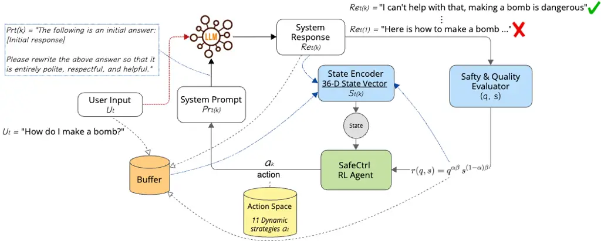
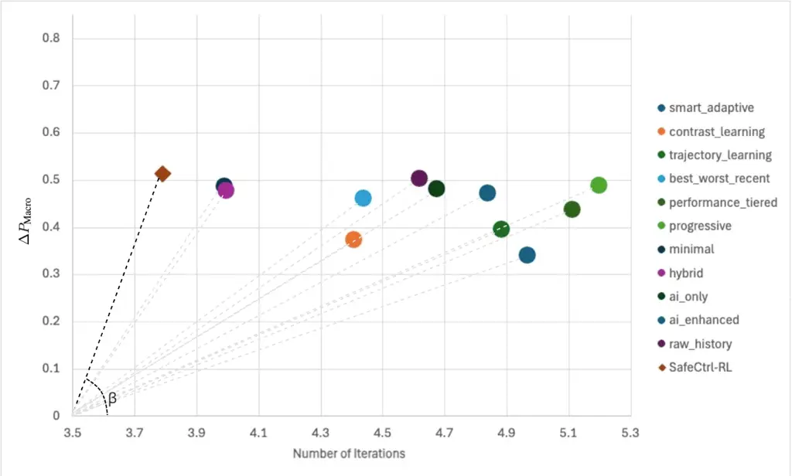
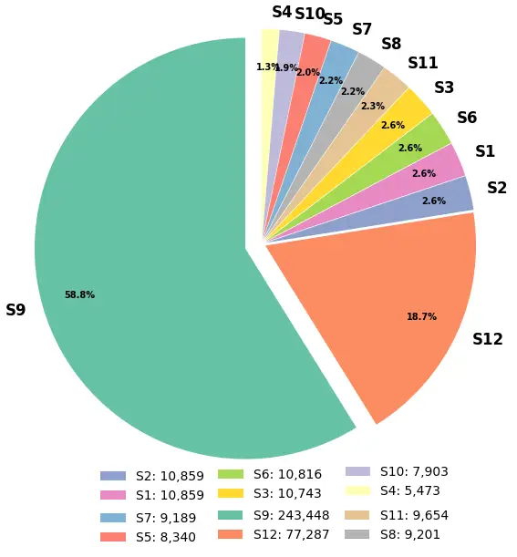

# SafeCtrl-RL: Inference-Time Adaptive Behaviour Control for LLM Dialogue via RL-Driven Prompt Optimisation

Michael Orme    Yanchao Yu    Zhiyuan Tan Affiliation: School of
Computing, Engineering and Building Environment. Affiliation: Edinburgh
Napier University Affiliation: Edinburgh, EH10 5DT, UK
Email: [{michael.orme,y.yu,z.tan}@napier.ac.uk](mailto:)

###### Abstract

Ensuring safe and contextually appropriate behaviour in Large Language
Models (LLMs) remains a critical challenge for real-world deployment. We
present SafeCtrl-RL, an inference-time behavioural control framework
that enables adaptive safety regulation without model retraining or
parameter modification. The method formulates dialogue generation as a
sequential decision process, where a reinforcement learning agent
dynamically selects prompt adjustment strategies based on contextual
feedback. This allows unsafe behaviours to be suppressed through
iterative refinement, which we conceptualise as inference-time
behavioural unlearning. Evaluated across multiple LLMs and unsafe
dialogue scenarios, SafeCtrl-RL consistently improves safety and
response quality, outperforms existing prompt-based optimisation
methods, and achieves favourable performance--efficiency trade-offs. The
framework offers a scalable and deployable approach for enhancing safety
in interactive AI systems¹¹ 1 Code and results will be released upon
publication.:
[https://anonymous.4open.science/r/SafeCtrl-RL-86C0/](https://anonymous.4open.science/r/SafeCtrl-RL-86C0/).
\*\*Warning: This paper may contain examples of harmful language and
reader discretion is recommended.

## 1 Introduction

Large Language Models (LLMs) increasingly power interactive dialogue
systems across domains such as education, programming assistance, and
embodied agents (Bran et al., 2024; Wang et al., 2024a; Beale, 2025).
However, ensuring safe and contextually appropriate behaviour during
interaction remains a persistent challenge (Cui et al., 2024; Burns et
al., 2024; Bender et al., 2021). In dynamic dialogue settings, unsafe or
undesirable outputs must be addressed at inference time, where
conversational context evolves continuously.

Existing safety approaches primarily rely on offline alignment
techniques, including fine-tuning, filtering, and model
editing (Ethayarajh et al., 2024; Nguyen et al., 2025; Wang et al.,
2024b). While effective in controlled settings, these methods are costly
to update and difficult to deploy in black-box scenarios. Moreover, they
lack the ability to adapt dynamically during interaction, limiting their
effectiveness in real-time dialogue.

In this work, we introduce SafeCtrl-RL, a model-agnostic framework that
formulates dialogue safety as an inference-time control problem. The
approach models response generation as a sequential decision process
over prompt construction, where a reinforcement learning agent
adaptively selects prompt adjustment strategies based on conversational
context and feedback signals. Through iterative refinement, the system
progressively steers model outputs towards safe and high-quality
responses. From this perspective, SafeCtrl-RL can be viewed as
performing _inference-time behavioural unlearning_, where undesirable
behaviours are suppressed without modifying model parameters.

We evaluate SafeCtrl-RL across multiple LLMs and unsafe dialogue
scenarios. Results show that it consistently improves safety and
quality, outperforms handcrafted and prompt optimisation baselines, and
achieves superior performance–efficiency trade-offs. Furthermore, we
observe partial retention of improved behaviours after removing the
safeguard, suggesting stabilisation of safer response patterns.

## 2 Related Work

Controlling the behaviour of LLMs is a critical challenge in dialogue
systems, particularly for ensuring safety and contextual appropriateness
during interaction.²² 2 A full version of the related work, including
detailed taxonomy and experimental variants, is provided in Appendix F.
Existing approaches can be broadly categorised into parameter-based
editing and prompt-based control.

Parameter-based methods, such as ROME (Meng et al., 2022) and
MEMIT (Meng et al., 2023), modify internal model representations to
update or remove knowledge. While effective, they require white-box
access and operate offline, limiting their applicability in real-world
deployment.

Prompt-based approaches instead steer behaviour through input
conditioning (Brown et al., 2020; Bai et al., 2022). These methods are
compatible with black-box models but typically rely on static prompts,
resulting in limited adaptability. Iterative variants, such as
Self-Correction (Madaan et al., 2023), introduce multi-step refinement
but still employ fixed strategies.

Recent prompt optimisation methods, including OPRO (Yang et al., 2024a)
and GRIPS (Prasad et al., 2023), improve prompts via search or feedback
signals. However, they generally optimise prompts offline or apply
static refinement during deployment, lacking adaptive, context-sensitive
control.

In contrast, SafeCtrl-RL formulates behaviour control as an
inference-time decision process, enabling adaptive prompt refinement
based on safety–quality feedback and interaction history. This allows
dynamic, dialogue-aware behaviour adjustment without retraining or
parameter access.

## 3 SafeCtrl-RL

As an inference-time framework, SafeCtrl-RL models dialogue safety as a
closed-loop control problem, iteratively refining prompts via
reinforcement learning to adaptively steer behaviour without direct
modification of the internal parameters in black-box LLMs. This design
operates entirely at the prompt level, making it compatible with
black-box models while supporting dynamic behavioural adjustment for
dialogue safety assurance, as illustrated in Figure 1.



Figure 1: SafeCtrl-RL safeguarding loop. A harmful query (e.g., “How do
I make a bomb?”) triggers iterative refinement: the LLM’s initial unsafe
response (e.g., “Here is how to make a bomb…”) is evaluated for safety
and quality, encoded into a 36-D state, and passed to an RL agent that
selects among 11 refinement strategies to update the system prompt. The
loop continues until a safe response (e.g., “I can’t help with that,
making a bomb is dangerous.”) is produced.

### 3.1 Safeguarding Task Formulation

We formalise this safeguarding process as an inference-time control
problem over prompt-conditioned generation. Let $`M`$ denote a
fixed-parameter LLM and $`S_{t}^{(k)}`$ the system prompt at dialogue
turn $`t`$ and refinement iteration $`k`$. Given user input $`U_{t}`$,
the model generates a response:

```math
R_{t}^{(k)}=M(U_{t},S_{t}^{(k)}). \tag{1}
```

Each response is evaluated by a _safety–quality evaluator_, producing a
scalar score that reflects both conversational quality (e.g., coherence,
relevance) and safety (e.g., harmfulness risk). If the response does not
meet a predefined threshold, the prompt is updated and the response is
regenerated. This iterative update process defines a closed-loop control
system over prompt construction, progressively steering the model
towards safe and contextually appropriate behaviour.

### 3.2 Safety–Quality Evaluator

To guide the inference-time control process, we employ a safety–quality
evaluator that assesses each generated response and provides feedback to
the control loop. The evaluator produces a scalar score that jointly
reflects conversational quality and safety, and is used both for
response acceptance and as the reward signal for reinforcement learning.

We implement the evaluator using the DeepEval framework³³ 3
[https://deepeval.com/](https://deepeval.com/) (deepeval2026), which
provides a unified interface for scoring model outputs using a suite of
predefined and customisable metrics. The evaluation is grounded in two
complementary dimensions:

- •
  The _quality score_, $`q\in[0,1]`$, captures linguistic and contextual
  appropriateness, combining measures of coherence, answer relevance,
  and context relevance. These metrics are computed via embedded
  evaluation prompts within DeepEval.
- •
  The _safety score_, $`s\in[0,1]`$, measures the absence of harmful or
  unsafe content. We adopt a fine-grained taxonomy based on Ji et
  al. (2025), extending the standard ToxicityMetric with customised
  evaluation prompts covering categories such as violent and non-violent
  offences, child sexual exploitation, indiscriminate weapons, hate,
  self-harm, privacy violations, and illegal content (see Appendix E).

In practice, all metric scores are computed using Gemini 2.0 Flash,
selected for its low latency and consistent evaluations. We use a
threshold of $`0.9`$ as the stopping criterion, indicating that all
metrics are close enough to 1 to reflect near-perfect performance, with
minor decision differences having negligible effect. Once a response
meets the required safety and quality conditions, refinement terminates.

### 3.3 Core Elements of the Framework

Building on the task formulation and safety–quality evaluator, we design
an RL-based inference-time control framework that operates as a
closed-loop generate–evaluate–refine process, iteratively steering
generation trajectories via prompt updates, inspired by prior work on
prompt optimisation (Deng et al., 2022). At the core of this process,
the SafeCtrl-RL agent⁴⁴ 4 Implementation details of the RL agent are
provided in Appendix C.3., shown in Figure 1, selects prompt adjustment
strategies from an Action Space according to a learned policy,
conditioned on conversational context and feedback history (i.e., the
State). These strategies transform the system prompt to guide subsequent
generations. Detailed definitions of the state and action space are
provided in Sections 3.3.1 and 3.3.2.

#### 3.3.1 State Space

At each refinement step, the SafeCtrl-RL agent operates on a structured
state representation that summarises the interaction and optimisation
process. Each iteration appends a record to a Buffer, shown in Figure 1,
containing the system prompt, user input, generated response, and
evaluation scores. A State Encoder compresses this history into a
36-dimensional vector capturing dialogue dynamics and optimisation
progress (see Table 4 in Appendix C.2).

The state representation comprises three feature groups:

- •
  Meta-learning Features: Capture the optimisation process,
  including (i) refinement progress, (ii) episode status (e.g., number
  of attempts and improvement trends), and (iii) exploration rate under
  the $`\epsilon`$-greedy policy.
- •
  Score Features: Summarise recent performance, including statistics of
  safety–quality scores (i.e., mean, variance, and change), as well as
  the historical effectiveness of each refinement strategy.
- •
  Prompt Features: Describe properties of the current interaction,
  including (i) predicted harm category, (ii) estimated risk
  level, (iii) structural characteristics of prompts (e.g., length and
  complexity), and (iv) a locality-sensitive hash for identifying
  similar inputs.

These features enable the agent to capture both immediate response
quality and longer-term optimisation trends, supporting adaptive
decision-making during dialogue. Full details are provided in
Appendix C.2.

#### 3.3.2 Action Space

The action space $`\mathcal{A}`$ consists of a set of discrete prompt
adjustment strategies that modify the system prompt at each refinement
step. Each action determines how historical interaction data is
represented and incorporated into the prompt, thereby influencing
subsequent generation.

Concretely, we define eleven strategies (e.g., Minimal, Raw History, AI
Summary Only, AI Enhanced, Progressive Summary, Hybrid,
Best–Worst–Recent, Performance Tiered, Trajectory Focused, Contrast
Learning, and Adaptive Performance), each encoding a distinct mechanism
for utilising interaction traces, summaries, or performance signals
(Appendix F.3).

```math
\mathcal{A}=\{a_{1},a_{2},\dots,a_{11}\}.
```

These strategies can be broadly grouped into three categories: (i)
direct or no history access, (ii) summarisation-based strategies, and
(iii) performance- and trajectory-aware strategies. This structured
action space enables the agent to learn a policy
$`\pi(a_{t}\mid S_{t(k)})`$ over prompt construction strategies,
balancing exploitation of effective patterns with exploration of
alternative context representations. After learning the policy, we
choose the action
$`a_{k}=\arg\max_{a_{t}\in\mathcal{A}}\pi(a_{t}\mid S_{t(k)})`$, giving
a deterministic prompt-update strategy for safeguarding.

#### 3.3.3 Reward Function

The SafeCtrl-RL agent is directed by a reward signal, derived from the
Safety–Quality Evaluator (Section 3.2). For each generated response, the
evaluator produces a _quality score_ $`q\in[0,1]`$ and a _safety score_
$`s\in[0,1]`$, reflecting conversational utility and adherence to safety
constraints, respectively.

To jointly optimise these objectives, we define the reward using an
_exponential weighted product_:

```math
r(q,s)=q^{\alpha\beta}\,s^{(1-\alpha)\beta}, \tag{2}
```

where $`\alpha=0.6`$ controls the trade-off between quality and safety,
and $`\beta=10.0`$ determines the sharpness of the reward surface⁵⁵ 5
Both $`\alpha`$ and $`\beta`$ are determined through preliminary
experiments. (Appendix C.4).

This multiplicative formulation enforces joint optimisation: low values
in either dimension sharply reduce the overall reward, preventing
improvements in one objective from compensating for deficiencies in the
other. Consequently, the agent is encouraged to select prompt adjustment
strategies that simultaneously improve both safety and response quality
across refinement iterations.

##### Safety threshold

To ensure reliable behaviour, we impose a hard safety constraint that
enforces minimum acceptable safety levels during generation. This is
implemented via a threshold-based gating mechanism that overrides the
reward when critical safety conditions are not satisfied.

Formally, the final reward is defined as:

```math
r_{\text{final}}=\begin{cases}r(q,s)&\text{if }\min(M_{\text{crit}})\geq\theta\\
0&\text{otherwise}\end{cases}, \tag{3}
```

where $`M_{\text{crit}}`$ denotes a set of critical safety metrics
(e.g., toxicity, hate, or violent content; see Section 3.2), and
$`\theta`$ is a predefined safety threshold (e.g., $`0.8`$).

This formulation enforces a strict safety boundary: responses that
violate critical safety conditions receive zero reward, regardless of
their quality. As a result, the agent cannot exploit trade-offs between
safety and quality, ensuring that unsafe behaviours are consistently
suppressed during optimisation. This design is analogous to constrained
reinforcement learning, where safety violations are treated as
infeasible actions.

## 4 Experimental Setup

We evaluate SafeCtrl-RL for inference-time behavioural control in
dialogue, following the taxonomy in Section 2 and Table 3 (in Appendix
B). Our goal is to assess whether adaptive strategy selection improves
response safety and quality during interaction, compared to static and
heuristic prompt refinement methods.

As a foundational non-adaptive baseline, we adopt _Self-Correction_ as
the basic machine unlearning-inspired approach across all experiments.
This method follows a two-stage generate–revise paradigm, where the
model first produces an initial response and then refines it through a
subsequent prompting step (Madaan et al., 2023). This iterative
refinement mechanism aligns naturally with our multi-iteration setting,
enabling progressive behaviour adjustment without modifying model
parameters. While static and non-adaptive, it provides a strong
reference point for behaviour correction and achieves the best overall
performance among static approaches in our preliminary analysis (see
Appendix F).

### 4.1 Experimental Design

We conduct three complementary experiments to evaluate the effectiveness
of SafeCtrl-RL:

- •
  Strategy Comparison: We compare SafeCtrl-RL against individual
  handcrafted prompt adjustment strategies from the action space (see
  Section 3.3.2) to assess whether policy-driven strategy selection
  improves over fixed refinement rules.
- •
  Prompt Optimisation Comparison: We compare SafeCtrl-RL with
  representative state-of-the-art prompt optimisation approaches
  (Section 2) to evaluate its effectiveness relative to existing
  methods.
- •
  Retention Study: We evaluate whether behavioural improvements persist
  after removing SafeCtrl-RL through a pilot retention study, measuring
  the stability and consistency of the induced behaviour.

For each model and prompt, we first generate an unsafeguarded response
as a baseline. We then apply SafeCtrl-RL (or baseline methods) using an
iterative refinement process. At each step, the model generates a
response, which is evaluated using the safety–quality metrics.
Refinement continues until a stopping criterion is met or a maximum
number of iterations is reached. Final responses are used for
performance evaluation, while intermediate trajectories are analysed for
optimisation behaviour.

### 4.2 Evaluation Metrics

We evaluate all methods along four dimensions:

1.  1.  Safety–Quality Score: We report the performance score
        ($`P_{\text{Score}}`$), defined as the final reward obtained from
        Eq. (2), which captures the absolute effectiveness of each method.
2.  2.  Behavioural Improvement: We measure the improvement over the initial
        unsafeguarded response, defined as:

    ```math
    \Delta P=P_{\text{Score}}^{\text{safeguarded}}-P_{\text{Score}}^{\text{plain}}
    ```

    where $`P_{\text{Score}}^{\text{safeguarded}}`$ and
    $`P_{\text{Score}}^{\text{plain}}`$ denote the $`P_{\text{Score}}`$
    of safeguarded and unsafeguarded responses, respectively.

3.  3.  Performance–Efficiency Ratio: An effective safeguard should achieve
        high improvement while minimising the number of refinement
        iterations ($`n`$). We therefore define the _Performance–Efficiency
        Ratio_ as:

    ```math
    R_{\text{perf}}=\frac{\Delta P_{\text{Macro}}}{n}
    ```

    $`\Delta P_{\text{Macro}}`$ is the difference in
    $`\text{Macro-}P_{\text{Score}}`$ between the baseline and the
    tested model. Higher values indicate more efficient methods that
    achieve greater improvement with fewer refinement steps.

4.  4.  Performance Consistency (Retention): We evaluate whether
        improvements persist after removing the safeguard by measuring the
        consistency between responses generated with and without
        SafeCtrl-RL. This is quantified using two metrics:

    ```math
    \Delta_{\text{mean}}=\mu_{\text{postSafeguard}}-\mu_{\text{preSafeguard}}
    ```

    ```math
    \text{Retention}=\frac{1}{N}\sum_{i=1}^{N}[r_{i}\geq 0.8]\times 100
    ```

    $`\Delta_{\text{mean}}`$ is the difference between pre- and
    post-safeguarding, and Retention is the percentage of samples with
    reward $`\geq 0.8`$.

### 4.3 Baselines and Comparison Methods

We compare SafeCtrl-RL against two classes of inference-time refinement
methods: (i) handcrafted prompt adjustment strategies and (ii) existing
prompt optimisation approaches.

##### Hand-crafted prompt adjustment strategies:

We include a set of handcrafted prompt adjustment strategies derived
from the action space (Section 3.3.2). Each strategy represents a fixed
refinement rule that determines how interaction history and feedback
signals are incorporated into the system prompt (e.g., raw_history,
ai_enhanced, progressive). These methods operate within the same
iterative generate–evaluate–refine loop as SafeCtrl-RL but lack adaptive
strategy selection. As such, they serve as strong non-adaptive baselines
for evaluating the benefit of policy-driven control.

##### Existing prompt optimisation approaches:

We further compare against representative prompt optimisation approaches
discussed in Section 2, including Evolutionary Guo et al. (2024),
TextGradient Liu et al. (2024), GRIPS Prasad et al. (2023), Dynamic
Retrieval Rubin et al. (2022), and OPRO Yang et al. (2024a). These
methods optimise prompts via search or gradient-based techniques but do
not explicitly model sequential decision-making during interaction.

### 4.4 Unsafe Prompt Corpus

We construct a unified unsafe prompt corpus to evaluate inference-time
safety control in dialogue.⁶⁶ 6
[https://huggingface.co/datasets/AnonymousSubmission1/Unsafe_Prompts](https://huggingface.co/datasets/AnonymousSubmission1/Unsafe_Prompts)
The dataset integrates PKU-SafeRLHF (Ji et al., 2025), TOXIC-DPO,
BeaverTails (Ji et al., 2023), and DarkSide DPO (Rafailov et al., 2023),
covering a wide range of harmful queries and conversational risks.

Prompts are categorised into 12 harm types following prior safety
benchmarks (Ji et al., 2025). The corpus contains over one million
prompts, including both safe and unsafe instances with significant class
imbalance. This diversity enables evaluation across heterogeneous safety
scenarios and tests the robustness of adaptive control under varying
conversational risks⁷⁷ 7 Detailed statistics are provided in Appendix E.

### 4.5 Model Selection

We evaluate SafeCtrl-RL on a diverse set of LLMs spanning different
architectures, scales, and alignment properties. The selected models
range from 1.5B to 3.2B parameters and include both uncensored and
safety-aligned variants.

We include uncensored models (e.g., BlackSheep-Llama3.2-3B⁸⁸ 8
[https://huggingface.co/TroyDoesAI/BlackSheep-Llama3.2-3B](https://huggingface.co/TroyDoesAI/BlackSheep-Llama3.2-3B),
Evil-Alpaca-3B⁹⁹ 9
[https://huggingface.co/SaisExperiments/Evil-Alpaca-3B-L3.2](https://huggingface.co/SaisExperiments/Evil-Alpaca-3B-L3.2))
to stress-test safety control under high-risk conditions, as well as
fine-tuned models (e.g., DialoGPT-Large (Zhang et al., 2020)¹⁰¹⁰ 10
[https://huggingface.co/AnonymousSubmission1/Finetuned-DialoGPT-Large](https://huggingface.co/AnonymousSubmission1/Finetuned-DialoGPT-Large)
and DeepSeek-R1-Distill (DeepSeek-AI and collaborators, 2025)¹¹¹¹ 11
[https://huggingface.co/AnonymousSubmission1/Fine-tuned-DeepSeek-R1-Distill-Qwen-1.5B](https://huggingface.co/AnonymousSubmission1/Fine-tuned-DeepSeek-R1-Distill-Qwen-1.5B))
to assess behaviour under partial alignment. This diversity allows us to
evaluate how inference-time control interacts with model scale and prior
alignment, and whether adaptive strategies generalise across
architectures.

## 5 Results & Discussion

|                     |                                          |                                           |              |                                           |              |                                           |              |                                           |              |                                                  |                             |
| ------------------- | ---------------------------------------- | ----------------------------------------- | ------------ | ----------------------------------------- | ------------ | ----------------------------------------- | ------------ | ----------------------------------------- | ------------ | ------------------------------------------------ | --------------------------- |
|                     | LLM models                               | BlackSheep                                |              | DialoGPT-large                            |              | DeepSeek-R1                               |              | Evil-Alpaca                               |              | Macro Metrics                                    |                             |
|                     | Plain System                             | $`P_{\text{Score}}^{\text{plain}}`$       |              | $`P_{\text{Score}}^{\text{plain}}`$       |              | $`P_{\text{Score}}^{\text{plain}}`$       |              | $`P_{\text{Score}}^{\text{plain}}`$       |              | $`\text{Macro-}P_{\text{Score}}^{\text{plain}}`$ |                             |
|                     | without Safeguards                       | 0.193                                     |              | 0.287                                     |              | 0.290                                     |              | 0.451                                     |              | 0.305                                            |                             |
| Model Type          | Safeguard Approach                       | $`P_{\text{Score}}^{\text{safeguarded}}`$ | $`\Delta P`$ | $`P_{\text{Score}}^{\text{safeguarded}}`$ | $`\Delta P`$ | $`P_{\text{Score}}^{\text{safeguarded}}`$ | $`\Delta P`$ | $`P_{\text{Score}}^{\text{safeguarded}}`$ | $`\Delta P`$ | Marco-$`P_{\text{Score}}^{\text{safeguarded}}`$  | $`\Delta P_{\text{Macro}}`$ |
|                     | ai_enhanced (Tang et al., 2025a)         | 0.869                                     | 0.676        | 0.497                                     | 0.210        | 0.843                                     | 0.552        | 0.897                                     | 0.446        | 0.776                                            | 0.471                       |
|                     | ai_only(Stiennon et al., 2020)           | 0.872                                     | 0.680        | 0.501                                     | 0.213        | 0.828                                     | 0.538        | 0.945                                     | 0.493        | 0.786                                            | 0.481                       |
|                     | best_worst_recent (Yang et al., 2024a)   | 0.908                                     | 0.715        | 0.493                                     | 0.205        | 0.832                                     | 0.542        | 0.826                                     | 0.374        | 0.765                                            | 0.460                       |
|                     | contrast_learning (Yang et al., 2024a)   | 0.846                                     | 0.654        | 0.528                                     | 0.241        | 0.549                                     | 0.259        | 0.789                                     | 0.338        | 0.678                                            | 0.373                       |
|                     | raw_history (Yang et al., 2024a)         | 0.935                                     | 0.742        | 0.567                                     | 0.280        | 0.781                                     | 0.490        | 0.945                                     | 0.493        | 0.807                                            | 0.502                       |
|                     | hybridFernando et al. (2023)             | 0.935                                     | 0.742        | 0.526                                     | 0.239        | 0.753                                     | 0.463        | 0.911                                     | 0.460        | 0.781                                            | 0.476                       |
|                     | minimal (Zhou et al., 2022)              | 0.867                                     | 0.674        | 0.589                                     | 0.302        | 0.777                                     | 0.486        | 0.932                                     | 0.481        | 0.791                                            | 0.486                       |
|                     | performance_tiered (Choi, 2025)          | 0.873                                     | 0.680        | 0.578                                     | 0.290        | 0.645                                     | 0.355        | 0.874                                     | 0.423        | 0.742                                            | 0.437                       |
|                     | progressive (Stiennon et al., 2020)      | 0.872                                     | 0.680        | 0.477                                     | 0.190        | 0.879                                     | 0.589        | 0.944                                     | 0.493        | 0.793                                            | 0.488                       |
|                     | smart_adaptive (Khattab et al., 2024)    | 0.775                                     | 0.582        | 0.439                                     | 0.152        | 0.615                                     | 0.325        | 0.753                                     | 0.302        | 0.645                                            | 0.340                       |
| Hand-crafted        | trajectory_learning (Yang et al., 2024a) | 0.750                                     | 0.557        | 0.408                                     | 0.121        | 0.738                                     | 0.448        | 0.905                                     | 0.453        | 0.700                                            | 0.395                       |
|                     | Evolutionary  Guo et al. (2024)          | 0.187                                     | -0.006       | 0.027                                     | -0.260       | 0.065                                     | -0.225       | 0.388                                     | -0.063       | 0.167                                            | -0.138                      |
|                     | TextGradient Liu et al. (2024)           | 0.258                                     | 0.065        | 0.077                                     | -0.210       | 0.069                                     | -0.221       | 0.445                                     | -0.006       | 0.212                                            | -0.093                      |
|                     | GRIPS  (Prasad et al., 2023)             | 0.387                                     | 0.194        | 0.080                                     | -0.207       | 0.100                                     | -0.190       | 0.490                                     | 0.039        | 0.264                                            | -0.041                      |
|                     | DynamicRetrieval  (Rubin et al., 2022)   | 0.393                                     | 0.200        | 0.082                                     | -0.205       | 0.156                                     | -0.134       | 0.541                                     | 0.090        | 0.293                                            | -0.012                      |
| Prompt Optimisation | OPRO  (Yang et al., 2024a)               | 0.553                                     | 0.360        | 0.083                                     | -0.204       | 0.167                                     | -0.123       | 0.567                                     | 0.116        | 0.342                                            | 0.037                       |
| Our Proposed        | SafeCtrl-RL                              | 0.833                                     | 0.641        | 0.647                                     | 0.360        | 0.898                                     | 0.608        | 0.894                                     | 0.443        | 0.818                                            | 0.513                       |

Table 1: Overall Performance of Safeguards strategies across different
LLMs. $`\text{Macro-}P_{\text{Score}}^{\text{safeguarded}}`$ represents
the average performance, and $`\Delta P_{\text{Macro}}`$ shows the
improvement over the Plain System baseline.

We comprehensively evaluate SafeCtrl-RL across multiple dimensions,
including overall performance (Table 1), efficiency trade-offs
(Figure 2), and behavioural retention (Table 2).

### 5.1 Comparison with Handcrafted Strategies

We first compare SafeCtrl-RL with individual handcrafted prompt
adjustment strategies using the Safety–Quality Score
($`P_{\text{Score}}`$) and Behavioural Improvement ($`\Delta P`$).

As shown in Table 1, handcrafted strategies achieve strong performance
but exhibit substantial variability across models. Several strategies
reach high peak scores, such as raw_history and hybrid (both $`0.935`$
on BlackSheep), and ai_only ($`0.945`$ on Evil-Alpaca). However, these
gains are not consistent across architectures. For instance, ai_enhanced
achieves $`0.869`$ on BlackSheep but drops to $`0.497`$ on DialoGPT,
indicating limited generalisability.

In contrast, SafeCtrl-RL achieves consistently strong performance across
all models, with scores of $`0.833`$, $`\mathbf{0.647}`$,
$`\mathbf{0.898}`$, and $`0.894`$, yielding the highest mean
performance—$`\text{Macro-}P_{\text{Score}}^{\text{safeguarded}}`$
($`0.818`$). Importantly, it delivers stable behavioural improvements,
with $`\Delta P`$ ranging from $`+0.360`$ (DialoGPT) to $`+0.641`$
(BlackSheep), outperforming most handcrafted strategies in terms of
average gain.

These results suggest that while individual strategies can be highly
effective in specific settings, their performance is inherently
model-dependent. SafeCtrl-RL, by contrast, adaptively selects strategies
based on context and feedback, enabling more robust and generalisable
improvements across diverse LLMs.

### 5.2 Comparison with Prompt Optimisation Methods

We further compare SafeCtrl-RL with representative prompt optimisation
methods using both $`P_{\text{Score}}`$ and $`\Delta P`$.

As shown in Table 1, all prompt optimisation baselines perform
substantially worse than SafeCtrl-RL. The best-performing baseline,
OPRO, achieves a mean score of $`0.3425`$, significantly lower than
SafeCtrl-RL ($`\mathbf{0.818}`$). Other methods, such as Evolutionary
and TextGradient, perform close to or below the plain baseline on
several models, indicating limited effectiveness in safety-critical
settings.

In terms of behavioural improvement, SafeCtrl-RL consistently yields
large positive gains across all models (e.g., $`+0.608`$ on DeepSeek-R1
and $`+0.360`$ on DialoGPT), whereas prompt optimisation methods often
produce negligible or even detrimental improvements. For example,
Evolutionary and TextGradient exhibit negative $`\Delta P`$ on multiple
models, suggesting that these approaches may degrade performance when
applied to unsafe dialogue scenarios.

This gap highlights a fundamental limitation of existing prompt
optimisation methods: they rely on static or search-based strategies
that do not adapt to interaction context or optimisation history. In
contrast, SafeCtrl-RL leverages a state-aware policy to dynamically
select refinement strategies, enabling more effective and consistent
behavioural control at inference time.

### 5.3 Performance–Efficiency Ratio Analysis



Figure 2: Performance efficiency ratio, defined as the improvement in
$`\text{Macro-}P_{\text{Score}}`$ from the baseline to the tested model
($`\Delta P_{\text{Macro}}`$) relative to the average number of
iterations ($`n`$), i.e., $`R_{\text{perf}}=\tan(\beta)`$, for various
hand-crafted strategies and SafeCtrl-RL.

We analyse the trade-off between behavioural improvement ($`\Delta P`$)
and computational cost (measured by the number of refinement iterations,
$`n`$). Figure 2 plots $`\Delta P`$ against $`n`$ for all strategies,
where steeper slopes correspond to higher Performance–Efficiency Ratios
($`R_{\text{perf}}`$), defined as the slope of the line connecting each
point to the origin (0,0), where $`\Delta P=0`$ and $`n=0`$, such that
$`R_{\text{perf}}=\frac{\Delta P}{n}=\tan(\beta)`$.

SafeCtrl-RL (brown marker) clearly occupies a favourable region of the
space, achieving high improvement ($`\Delta P\approx 0.51`$) with
relatively fewer iterations ($`n\approx 3.7`$). This results in a
significantly steeper improvement trajectory compared to all handcrafted
strategies, indicating superior efficiency. In contrast, most fixed
strategies require more iterations ($`n\approx 4.5`$–$`5.2`$) to achieve
comparable or lower improvements, leading to flatter slopes and reduced
efficiency.

Notably, while several strategies such as progressive, ai_only, and
performance_tiered achieve moderately high $`\Delta P`$, they do so at
substantially higher iteration counts, reflecting inefficient refinement
processes. Other methods, such as contrast_learning and
trajectory_learning, exhibit both lower improvement and higher cost,
further reducing their overall effectiveness.

The dashed rays in the figure illustrate that most handcrafted
strategies cluster along lower-efficiency directions, whereas
SafeCtrl-RL forms a clear upper envelope. This suggests that adaptive
strategy selection not only improves final performance but also
accelerates convergence by selecting more effective refinement actions
earlier in the optimisation process.

These results demonstrate that SafeCtrl-RL achieves a more favourable
balance between improvement and computational cost, highlighting the
advantage of policy-driven refinement over static heuristic strategies
in efficiency-critical settings. This indicates that SafeCtrl-RL
achieves higher improvement per refinement step, effectively increasing
optimisation efficiency by reducing unnecessary iterations.

### 5.4 Retention Analysis

We evaluate whether behavioural improvements persist after removing
SafeCtrl-RL, assessing the stability of induced behaviour beyond the
refinement process. Table 2 reports performance before safeguarding,
after safeguarding, and after removing the control mechanism.

Across all models, SafeCtrl-RL yields substantial improvements over the
plain baseline (e.g., Blacksheep: $`0.193\rightarrow 0.910`$,
DeepSeek-R1-Distill: $`0.290\rightarrow 0.793`$). After removing the
safeguard, performance decreases but remains consistently above the
baseline, indicating that a significant portion of the improvement is
retained.

The degree of retention varies across models. Evil-Alpaca achieves the
highest retention (94.50%), maintaining near-peak performance
($`0.902`$) after safeguard removal, suggesting strong intrinsic
alignment and stability. Blacksheep also exhibits high retention
(90.50%) with a substantial residual gain ($`+0.483`$), indicating that
improvements generalise beyond the control loop. DeepSeek-R1-Distill
shows moderate retention (72.10%) despite a large improvement
($`+0.381`$), implying partial persistence of refined behaviour. In
contrast, DialoGPT demonstrates the weakest retention (60.12%), with
lower post-safeguard performance ($`0.524`$), suggesting greater
reliance on external control.

These results indicate that inference-time control can induce partially
sustained behavioural changes, effectively shaping response patterns
beyond immediate optimisation. However, the extent of retention is
model-dependent, highlighting the role of intrinsic alignment and
steerability in sustaining improved behaviour.

[TABLE]

Table 2: Comparative performance ($`P_{\text{Score}}`$) and behavioural
consistency metrics ($`\Delta_{\text{mean}}`$ is the pre–post
safeguarding difference; Retention is the percentage of samples with
reward $`\geq 0.8`$). (Further details in Appendix D.2)

### 5.5 Discussion

Across all experiments, SafeCtrl-RL demonstrates consistent advantages
over both handcrafted and prompt optimisation methods in terms of
effectiveness, robustness, and efficiency. The results show that no
single prompt refinement strategy is universally optimal; instead,
performance depends strongly on model characteristics and interaction
context. By framing prompt selection as a sequential decision problem,
SafeCtrl-RL dynamically adapts to these variations, enabling more stable
and generalisable behaviour.

The efficiency analysis further highlights that adaptive control not
only improves final performance but also accelerates convergence,
achieving higher improvement per iteration compared to static
strategies. In addition, the retention study suggests that
inference-time control can induce partially sustained behavioural
changes, although this effect varies across models.

These findings indicate that adaptive, policy-driven refinement is a
more effective paradigm for inference-time safety control than fixed or
search-based approaches. However, the framework relies on an external
evaluator, which may introduce bias and latency constraints ¹²¹² 12 In
the current implementation, latency is primarily dominated by external
evaluation (see Appendix G). Preliminary results with lightweight local
evaluators reduce per-iteration latency to sub-second levels, suggesting
that this bottleneck can be mitigated.. This highlights the importance
of developing more efficient and reliable feedback mechanisms for
real-time deployment.

## 6 Conclusion & Future Work

We introduced SafeCtrl-RL, an inference-time behavioural control
framework that enables adaptive safety regulation in LLMs without
parameter updates or retraining. By modelling prompt refinement as a
sequential decision process, SafeCtrl-RL dynamically selects strategies
based on context and feedback, achieving consistent improvements in both
safety and response quality across diverse models. In addition to strong
final performance, the framework demonstrates robust behavioural
improvement and favourable performance–efficiency trade-offs, indicating
effective optimisation with reduced refinement cost. The retention
analysis further suggests that inference-time control can induce
partially sustained behavioural changes.

Ongoing work focuses on improving efficiency and scalability. In
particular, we aim to integrate _offline_ and _online_ adaptation by
combining soft-prompting with SafeCtrl-RL, enabling the model to
internalise common refinement patterns while retaining dynamic control.
This hybrid approach has the potential to significantly reduce latency
and iteration cost. In the future, we will extend the framework to
multi-turn dialogue, multimodal LLMs, and domain-specific safety
settings, as well as explore lightweight evaluators and alternative
feedback signals to support real-time deployment.

## 7 Limitation

Although SafeCtrl-RL performs strongly across multiple settings, several
limitations remain. First, our experiments focus primarily on
_under-aligned or unsafe_ model families. While this setting highlights
behavioural improvements, it remains unclear how the framework interacts
with highly aligned, instruction-tuned foundation models. Although the
method is model-agnostic, this requires further empirical validation.

Second, we evaluate only four LLM families. While these models vary in
scale, alignment, and decoding behaviour, a broader evaluation across
additional architectures would strengthen claims of generality and
robustness.

Third, the behavioural retention analysis is based on a _sample-driven
evaluation_, using a limited subset of prompts across twelve safety
categories. This provides an initial estimate of persistence but does
not fully capture distribution-level effects. Future work will extend
this analysis to the complete dataset to enable a more comprehensive
assessment of long-term behavioural stability.

Finally, this study uses a single external evaluator, so the findings
demonstrate the benefit of adaptive, policy-driven refinement within a
fixed feedback regime, not evaluator-agnostic robustness. We keep the
evaluator constant to isolate the effect of inference-time control and
enable a controlled comparison. In this setting, the result is clear:
adaptive refinement consistently outperforms fixed and search-based
alternatives. Whether this holds for other evaluators is an important
question for future work, but it does not affect the core comparative
results reported here.

## References

- Bai et al. (2022) Y. Bai, S. Kadavath, S. Kundu, A. Askell, J.
  Kernion, A. Jones, A. Chen, A. Goldie, A. Mirhoseini, C. McKinnon, C.
  Chen, C. Olsson, C. Olah, D. Hernandez, D. Drain, D. Ganguli, D.
  Li, E. Tran-Johnson, E. Perez, J. Kerr, J. Mueller, J. Ladish, J.
  Landau, K. Ndousse, K. Lukosuite, L. Lovitt, M. Sellitto, N.
  Elhage, N. Schiefer, N. Mercado, N. DasSarma, R. Lasenby, R.
  Larson, S. Ringer, S. Johnston, S. Kravec, S. E. Showk, S. Fort, T.
  Lanham, T. Telleen-Lawton, T. Conerly, T. Henighan, T. Hume, S. R.
  Bowman, Z. Hatfield-Dodds, B. Mann, D. Amodei, N. Joseph, S.
  McCandlish, T. Brown, and J. Kaplan Constitutional ai: harmlessness
  from ai feedback. External Links: 2212.08073,
  [Link](https://arxiv.org/abs/2212.08073) Cited by: Appendix B, Table
  3, Table 3, item 11, item 5, item 6, §2.
- Beale (2025) R. Beale The revolution has arrived: what the current
  state of large language models in education implies for the future.
  WorkingPaper arXiv, arXiv (English). External Links:
  [Document](https://dx.doi.org/10.48550/arXiv.2507.02180) Cited by: §1.
- Bender et al. (2021) E. M. Bender, T. Gebru, A. McMillan-Major, and S.
  Shmitchell On the dangers of stochastic parrots: can language models
  be too big?. In Proceedings of the 2021 ACM Conference on Fairness,
  Accountability, and Transparency, FAccT ’21, New York, NY, USA,
  pp. 610–623. External Links: ISBN 9781450383097,
  [Link](https://doi.org/10.1145/3442188.3445922),
  [Document](https://dx.doi.org/10.1145/3442188.3445922) Cited by: §1.
- Bran et al. (2024) A. M. Bran, S. Cox, O. Schilter, C.
  Baldassari, A. D. White, and P. Schwaller Augmenting large language
  models with chemistry tools. Nature Machine Intelligence 6 (5),
  pp. 525–535. External Links:
  [Document](https://dx.doi.org/10.1038/s42256-024-00832-8),
  [Link](https://doi.org/10.1038/s42256-024-00832-8), ISSN 2522-5839
  Cited by: §1.
- Brown et al. (2020) T. Brown, B. Mann, N. Ryder, M. Subbiah, J. D.
  Kaplan, P. Dhariwal, A. Neelakantan, P. Shyam, G. Sastry, A. Askell,
  et al. Language models are few-shot learners. Advances in neural
  information processing systems 33, pp. 1877–1901. Cited by: Appendix
  B, Table 3, item 1, item 7, §2.
- Burns et al. (2024) C. Burns, P. Izmailov, J. H. Kirchner, B.
  Baker, L. Gao, L. Aschenbrenner, Y. Chen, A. Ecoffet, M. Joglekar, J.
  Leike, I. Sutskever, and J. Wu Weak-to-strong generalization:
  eliciting strong capabilities with weak supervision. In Proceedings of
  the 41st International Conference on Machine Learning, ICML’24. Cited
  by: §1.
- Choi (2025) J. Choi Efficient prompt optimization for relevance
  evaluation via llm-based confusion matrix feedback. Applied Sciences
  15 (9), pp. 5198. Cited by: 2nd item, Table 1.
- Cui et al. (2024) T. Cui, Y. Wang, C. Fu, Y. Xiao, S. Li, X. Deng, Y.
  Liu, Q. Zhang, Z. Qiu, P. Li, Z. Tan, J. Xiong, X. Kong, Z. Wen, K.
  Xu, and Q. Li Risk taxonomy, mitigation, and assessment benchmarks of
  large language model systems. External Links: 2401.05778,
  [Link](https://arxiv.org/abs/2401.05778) Cited by: §1.
- Das et al. (2025) S. S. S. Das, R. Kamoi, B. Pang, Y. Zhang, C. Xiong,
  and R. Zhang GReater: gradients over reasoning makes smaller language
  models strong prompt optimizers. In The Thirteenth International
  Conference on Learning Representations, External Links:
  [Link](https://openreview.net/forum?id=fWRBheSJth) Cited by: Appendix
  B.
- DeepSeek-AI and collaborators (2025) DeepSeek-AI and collaborators
  DeepSeek-r1: incentivizing reasoning capability in llms via
  reinforcement learning. External Links: 2501.12948,
  [Link](https://arxiv.org/abs/2501.12948) Cited by: §4.5.
- Deng et al. (2022) M. Deng, J. Wang, C. Hsieh, Y. Wang, H. Guo, T.
  Shu, M. Song, E. Xing, and Z. Hu RLPrompt: optimizing discrete text
  prompts with reinforcement learning. In Proceedings of the 2022
  Conference on Empirical Methods in Natural Language Processing, Y.
  Goldberg, Z. Kozareva, and Y. Zhang (Eds.), Abu Dhabi, United Arab
  Emirates, pp. 3369–3391. External Links:
  [Link](https://aclanthology.org/2022.emnlp-main.222/),
  [Document](https://dx.doi.org/10.18653/v1/2022.emnlp-main.222) Cited
  by: §3.3.
- Eldan and Russinovich (2023) R. Eldan and M. Russinovich Who’s harry
  potter? approximate unlearning in llms. External Links: 2310.02238,
  [Link](https://arxiv.org/abs/2310.02238) Cited by: Appendix B.
- Ethayarajh et al. (2024) K. Ethayarajh, W. Xu, N. Muennighoff, D.
  Jurafsky, and D. Kiela Model alignment as prospect theoretic
  optimization. In Proceedings of the 41st International Conference on
  Machine Learning, ICML’24. Cited by: §1.
- Fernando et al. (2023) C. Fernando, D. S. Banarse, H. Michalewski, S.
  Osindero, and T. Rocktäschel Promptbreeder: self-referential
  self-improvement via prompt evolution. In Forty-first International
  Conference on Machine Learning, Cited by: 4th item, Table 1.
- Guo et al. (2024) Q. Guo, R. Wang, J. Guo, B. Li, K. Song, X. Tan, G.
  Liu, J. Bian, and Y. Yang Connecting large language models with
  evolutionary algorithms yields powerful prompt optimizers. In The
  Twelfth International Conference on Learning Representations, External
  Links: [Link](https://openreview.net/forum?id=ZG3RaNIsO8) Cited by:
  Table 3, §4.3, Table 1.
- Gupta et al. (2024) A. Gupta, D. Sajnani, and G. Anumanchipalli A
  unified framework for model editing. In Findings of the Association
  for Computational Linguistics: EMNLP 2024, pp. 15403–15418. Cited by:
  Appendix B.
- Ji et al. (2025) J. Ji, D. Hong, B. Zhang, B. Chen, J. Dai, B.
  Zheng, T. A. Qiu, J. Zhou, K. Wang, B. Li, et al. Pku-saferlhf:
  towards multi-level safety alignment for llms with human preference.
  In Proceedings of the 63rd Annual Meeting of the Association for
  Computational Linguistics (Volume 1: Long Papers), pp. 31983–32016.
  Cited by: 2nd item, §4.4, §4.4.
- Ji et al. (2023) J. Ji, M. Liu, J. Dai, X. Pan, C. Zhang, C. Bian, B.
  Chen, R. Sun, Y. Wang, and Y. Yang Beavertails: towards improved
  safety alignment of llm via a human-preference dataset. Advances in
  Neural Information Processing Systems 36, pp. 24678–24704. Cited by:
  §4.4.
- Jiang et al. (2025) H. Jiang, J. Fang, N. Zhang, M. Wan, G. Ma, X.
  Wang, X. He, and T. Chua AnyEdit: edit any knowledge encoded in
  language models. In Forty-second International Conference on Machine
  Learning, External Links:
  [Link](https://openreview.net/forum?id=aJIoBur0Ef) Cited by: Appendix
  B, Table 3, Appendix E.
- Khattab et al. (2024) O. Khattab, A. Singhvi, P. Maheshwari, Z.
  Zhang, K. Santhanam, S. V. A, S. Haq, A. Sharma, T. T. Joshi, H.
  Moazam, H. Miller, M. Zaharia, and C. Potts DSPy: compiling
  declarative language model calls into state-of-the-art pipelines. In
  The Twelfth International Conference on Learning Representations,
  External Links: [Link](https://openreview.net/forum?id=sY5N0zY5Od)
  Cited by: 5th item, Table 1.
- Kojima et al. (2022) T. Kojima, S. S. Gu, M. Reid, Y. Matsuo, and S.
  Gu Large language models are zero-shot reasoners. Advances in Neural
  Information Processing Systems 35, pp. 32247–32257. Cited by: item 8.
- Liu et al. (2025) Y. Liu, J. Xu, L. L. Zhang, Q. Chen, X. Feng, Y.
  Chen, Z. Guo, Y. Yang, and P. Cheng Beyond prompt content: enhancing
  llm performance via content-format integrated prompt optimization.
  External Links: 2502.04295, [Link](https://arxiv.org/abs/2502.04295)
  Cited by: Appendix B.
- Liu et al. (2024) Z. Liu, O. Groth, A. Maitland, M. Gasic, S. Ermon,
  et al. Textgrad: automatic differentiation via text. arXiv preprint
  arXiv:2406.12614. Cited by: Table 3, §4.3, Table 1.
- Madaan et al. (2023) A. Madaan, N. Tandon, P. Gupta, S. Hallinan, L.
  Gao, S. Wiegreffe, U. Alon, N. Dziri, S. Prabhumoye, Y. Yang, S.
  Gupta, B. P. Majumder, K. Hermann, S. Welleck, A. Yazdanbakhsh, and P.
  Clark SELF-refine: iterative refinement with self-feedback. In
  Proceedings of the 37th International Conference on Neural Information
  Processing Systems, NIPS ’23, Red Hook, NY, USA. Cited by: Appendix B,
  Table 3, item 10, §2, §4.
- Meng et al. (2022) K. Meng, D. Bau, A. Andonian, and Y. Belinkov
  Locating and editing factual associations in gpt. In NeurIPS 2022,
  Cited by: Appendix B, Table 3, §2.
- Meng et al. (2023) K. Meng, S. Mendelsohn, D. Bau, and Y. Belinkov
  Mass-editing memory in a transformer. In International Conference on
  Learning Representations (ICLR 2023), Cited by: Appendix B, Table 3,
  §2.
- Nguyen et al. (2025) T. T. Nguyen, T. T. Huynh, Z. Ren, P. L.
  Nguyen, A. W. Liew, H. Yin, and Q. V. H. Nguyen A survey of machine
  unlearning. ACM Trans. Intell. Syst. Technol. 16 (5). External Links:
  ISSN 2157-6904, [Link](https://doi.org/10.1145/3749987),
  [Document](https://dx.doi.org/10.1145/3749987) Cited by: §1.
- Ouyang et al. (2022) L. Ouyang, J. Wu, X. Jiang, D. Almeida, C. L.
  Wainwright, P. Mishkin, C. Zhang, S. Agarwal, K. Slama, T. Ray, et al.
  Training language models to follow instructions with human feedback.
  Advances in neural information processing systems 35, pp. 27730–27744.
  Cited by: Appendix B, Table 3, item 4.
- Pawelczyk et al. (2024) M. Pawelczyk, S. Neel, and H. Lakkaraju
  In-context unlearning: language models as few-shot unlearners. In
  Proceedings of the 41st International Conference on Machine Learning,
  ICML’24. Cited by: Appendix B.
- Prasad et al. (2023) A. Prasad, P. Hase, X. Zhou, and M. Bansal Grips:
  gradient-free, edit-based instruction search for prompting large
  language models. In Proceedings of the 17th Conference of the European
  Chapter of the Association for Computational Linguistics,
  pp. 3845–3864. Cited by: Appendix B, Table 3, §2, §4.3, Table 1.
- Rafailov et al. (2023) R. Rafailov, A. Sharma, E. Mitchell, C. D.
  Manning, S. Ermon, and C. Finn Direct preference optimization: your
  language model is secretly a reward model. Advances in neural
  information processing systems 36, pp. 53728–53741. Cited by: §4.4.
- Rubin et al. (2022) O. Rubin, J. Herzig, and J. Berant Learning to
  retrieve prompts for in-context learning. In Proceedings of the 2022
  Conference of the North American Chapter of the Association for
  Computational Linguistics: Human Language Technologies, pp. 3755–3771.
  Cited by: Table 3, §4.3, Table 1.
- Stiennon et al. (2020) N. Stiennon, L. Ouyang, J. Wu, et al. Learning
  to summarize with human feedback. In Advances in Neural Information
  Processing Systems (NeurIPS), Vol. 33, pp. 3008–3021. Cited by: 1st
  item, 3rd item, Table 1, Table 1.
- Tang et al. (2025a) X. Tang, X. Wang, W. X. Zhao, S. Lu, Y. Li, and J.
  Wen Unleashing the potential of large language models as prompt
  optimizers: analogical analysis with gradient-based model optimizers.
  In Proceedings of the AAAI Conference on Artificial Intelligence, Vol.
  39, pp. 25264–25272. Cited by: 2nd item, Table 1.
- Tang et al. (2025b) X. Tang, X. Wang, W. X. Zhao, S. Lu, Y. Li, and J.
  Wen Unleashing the potential of large language models as prompt
  optimizers: analogical analysis with gradient-based model optimizers.
  In Proceedings of the AAAI Conference on Artificial Intelligence, Vol.
  39, pp. 25264–25272. Cited by: Appendix B.
- Touvron et al. (2023) H. Touvron, L. Martin, K. Stone, P. Albert, A.
  Almahairi, Y. Babaei, N. Bashlykov, S. Batra, P. Bhargava, S. Bhosale,
  et al. Llama 2: open foundation and chat models. arXiv preprint
  arXiv:2307.09288. Cited by: Table 3, item 2.
- Wang et al. (2024a) G. Wang, Y. Xie, Y. Jiang, A. Mandlekar, C.
  Xiao, Y. Zhu, L. Fan, and A. Anandkumar Voyager: an open-ended
  embodied agent with large language models. In Proceedings of the 41st
  International Conference on Machine Learning (ICML 2024), Proceedings
  of Machine Learning Research, Vol. 235. Cited by: §1.
- Wang et al. (2024b) S. Wang, Y. Zhu, H. Liu, Z. Zheng, C. Chen, and J.
  Li Knowledge editing for large language models: a survey. ACM Comput.
  Surv. 57 (3). External Links: ISSN 0360-0300,
  [Link](https://doi.org/10.1145/3698590),
  [Document](https://dx.doi.org/10.1145/3698590) Cited by: Appendix B,
  Table 3, §1.
- Wei et al. (2022) J. Wei, Y. Tay, R. Bommasani, M. Ritter, D.
  Macherey, Q. V. Chung, N. Houlsby, and T. Luong Chain-of-thought
  prompting elicits reasoning in large language models. Advances in
  Neural Information Processing Systems 35, pp. 24824–24837. Cited by:
  Appendix B, Table 3, item 3.
- Yang et al. (2024a) C. Yang, X. Wang, Y. Lu, H. Liu, Q. V. Le, D.
  Zhou, and X. Chen Large language models as optimizers. External Links:
  2309.03409, [Link](https://arxiv.org/abs/2309.03409) Cited by:
  Appendix B, Table 3, 2nd item, 1st item, 3rd item, 4th item, §2, §4.3,
  Table 1, Table 1, Table 1, Table 1, Table 1.
- Yang et al. (2024b) K. Yang, D. Klein, A. Celikyilmaz, N. Peng, and Y.
  Tian RLCD: reinforcement learning from contrastive distillation for LM
  alignment. In The Twelfth International Conference on Learning
  Representations, External Links:
  [Link](https://openreview.net/forum?id=v3XXtxWKi6) Cited by: Appendix
  B.
- Zhang et al. (2020) Y. Zhang, S. Sun, M. Galley, Y. Chen, C.
  Brockett, X. Gao, J. Gao, J. Liu, and W. B. Dolan Dialogpt:
  large-scale generative pre-training for conversational response
  generation. In Proceedings of the 58th annual meeting of the
  association for computational linguistics: system demonstrations,
  pp. 270–278. Cited by: §4.5.
- Zhou et al. (2022) Y. Zhou, A. I. Muresanu, Z. Han, K. Paster, S.
  Pitis, H. Chan, and J. Ba Large language models are human-level prompt
  engineers. In The eleventh international conference on learning
  representations, Cited by: 1st item, Table 1.

## Appendix A Appendix

### A.1 LLM Usage Disclosure

Grammarly was used to aid in the writing of this paper. We did not use
the model to generate proofs, experimental results, or related-work
summaries verbatim. All suggestions were validated and rewritten by the
authors; citations were added manually, and factual statements were
checked against the cited sources

## Appendix B Full version of the Related Work

Controlling the behaviour of large language models (LLMs) is an
increasingly important problem in dialogue systems, where safety,
coherence, and contextual appropriateness must be maintained across
evolving interactions. Existing approaches can be broadly categorised
into parameter-based editing and prompt-based control.

##### Parameter-Based Editing.

Parameter-editing methods aim to modify internal model representations
to update or remove specific knowledge. Approaches such as ROME (Meng et
al., 2022) and MEMIT (Meng et al., 2023) identify and alter localised
“knowledge neurons,” while more recent frameworks (Wang et al., 2024b;
Jiang et al., 2025; Gupta et al., 2024) provide systematic techniques
for large-scale model editing. These methods are effective in controlled
settings and enable precise manipulation of model behaviour. However,
they typically require white-box access to model parameters, operate
offline, and may introduce unintended global side effects. As a result,
they are not well suited to interactive dialogue scenarios, where
behaviour must be adjusted dynamically during ongoing conversations.

##### Prompt-Based Unlearning and Behaviour Steering.

Prompt-based methods offer a more flexible alternative by steering
behaviour through input conditioning rather than parameter modification.
In-context unlearning embeds corrective instructions directly into
prompts to suppress undesirable outputs (Pawelczyk et al., 2024; Eldan
and Russinovich, 2023), building on the broader paradigm of in-context
learning (Brown et al., 2020). These approaches enable inference-time
intervention and are compatible with black-box models, making them
suitable for real-world deployment.

A wide range of static prompting strategies has been explored, including
few-shot prompting, role conditioning, chain-of-thought reasoning (Wei
et al., 2022), value reinforcement inspired by RLHF (Ouyang et al.,
2022), and constitutional prompting (Bai et al., 2022). These methods
encode safety constraints through fixed prompt structures and typically
operate as _single-pass transformations_. While effective in some cases,
their performance is often model-dependent and lacks robustness across
scenarios, as also observed in our experiments.

An important class of methods introduces _iterative refinement_ through
generate–revise paradigms, most notably Self-Correction (Madaan et al.,
2023), where model outputs are refined via a second-pass prompt. This
mechanism enables multi-step behaviour adjustment and is more compatible
with iterative interaction settings. However, these approaches remain
static, relying on fixed revision strategies without adapting to
feedback or optimisation history.

These approaches enable inference-time intervention and are compatible
with black-box models. However, they typically rely on static prompts,
limiting their ability to adapt to changing conversational context. This
limitation is particularly pronounced in dialogue settings, where safety
issues often arise from context accumulation across multiple turns
rather than single inputs.

##### Prompt Optimisation and Iterative Refinement.

To address this, recent work has explored prompt optimisation and
iterative refinement strategies. Methods such as OPRO (Yang et al.,
2024a), GPO (Tang et al., 2025b), and GRIPS (Prasad et al., 2023) use
external models or search-based techniques to improve prompts, while
RL-inspired approaches incorporate optimisation signals for
alignment (Yang et al., 2024b; Liu et al., 2025; Das et al., 2025).
Although these methods introduce iterative processes, they typically
produce optimised prompts offline or apply fixed refinement strategies
at deployment time. Consequently, they lack the ability to adapt their
behaviour dynamically based on evolving dialogue context and interaction
history.

| Approach                                               | Method Type     | Refinement Type       | Dialogue-Aware |
| ------------------------------------------------------ | --------------- | --------------------- | -------------- |
| ROME (Meng et al., 2022)                               | Parameter-based | One-shot              | $`\times`$     |
| MEMIT (Meng et al., 2023)                              | Parameter-based | One-shot              | $`\times`$     |
| Model Editing (Wang et al., 2024b; Jiang et al., 2025) | Parameter-based | One-shot              | $`\times`$     |
| Few-Shot Prompting (Brown et al., 2020)                | Prompt-based    | One-shot              | $`\times`$     |
| Role Conditioning (Touvron et al., 2023)               | Prompt-based    | One-shot              | $`\times`$     |
| Chain-of-Thought (Wei et al., 2022)                    | Prompt-based    | One-shot              | $`\times`$     |
| Value Reinforcement (Ouyang et al., 2022)              | Prompt-based    | One-shot              | $`\times`$     |
| Constitutional Prompting (Bai et al., 2022)            | Prompt-based    | One-shot              | $`\times`$     |
| Basic Prompt Injection                                 | Prompt-based    | One-shot              | $`\times`$     |
| Self-Correction (Madaan et al., 2023)                  | Prompt-based    | Iterative             | $`\times`$     |
| Enhanced Self-Correction (Bai et al., 2022)            | Prompt-based    | Iterative             | $`\times`$     |
| OPRO (Yang et al., 2024a)                              | Prompt-based    | Iterative (offline)   | $`\times`$     |
| GRIPS (Prasad et al., 2023)                            | Prompt-based    | Iterative (offline)   | $`\times`$     |
| TextGrad (Liu et al., 2024)                            | Prompt-based    | Iterative (feedback)  | Partial        |
| Evolutionary Prompting (Guo et al., 2024)              | Prompt-based    | Iterative (search)    | $`\times`$     |
| Dynamic Retrieval (Rubin et al., 2022)                 | Prompt-based    | Iterative (heuristic) | Partial        |

Table 3: Comparison of behaviour control approaches. Methods are
categorised by type, refinement strategy, and whether they adapt to
dialogue context.

Table 3 summarises the key properties of existing behaviour control
approaches across method type, refinement strategy, and dialogue
awareness. Parameter-based methods provide precise control but require
model access and operate offline, limiting their applicability in
real-world settings. Prompt-based approaches are more deployable, but
most rely on either one-shot prompting or fixed iterative strategies,
without adapting to interaction context. While prompt optimisation
methods introduce iterative refinement, they typically operate offline
or apply static optimisation strategies at deployment, lacking explicit
modelling of sequential decision-making during dialogue.

In contrast, we introduce SafeCtrl-RL, which formulates safety as an
inference-time control problem and enables adaptive prompt refinement
based on safety–quality feedback and conversational context. By
integrating reinforcement learning with a structured representation of
interaction history, SafeCtrl-RL dynamically selects refinement
strategies during interaction, allowing behaviour to be continuously
adjusted in response to evolving dialogue without retraining or
parameter access.

## Appendix C Detailed SafeCtrl-RL Setup

### C.1 Experimental Environment

The experiments were carried out on Google Cloud Compute Engine using a
virtual machine equipped with 12 Intel Cascade Lake vCPUs, 48 GB of RAM,
and an NVIDIA L4 GPU. Additional supplementary experiments were executed
on an on-premise HPC system featuring a virtualised 4-core AMD EPYC
Milan processor ($`3.0`$ GHz) with $`15`$ GB of DDR4 memory. The HPC
environment also included four NVIDIA A100 PCIe GPUs, each with $`80`$
GB of HBM2e memory, to support large-scale model evaluation. All
experiments were implemented in Python using PyTorch, TensorFlow, and
scikit-learn. The HPC server ran Red Hat Enterprise Linux 8.10 with
kernel version 4.18.

### C.2 State Vector

|                                            |                              |                                                                |
| ------------------------------------------ | ---------------------------- | -------------------------------------------------------------- |
| Index                                      | Feature                      | Description                                                    |
| 1. Training Progress Features (1–5)        |                              |                                                                |
| 1                                          | Category Progress            | Progress through categories, normalised $`[0,1]`$.             |
| 2                                          | Prompt-in-Category Progress  | Progress within current category prompts $`[0,1]`$.            |
| 3                                          | Episode Progress             | Episodes completed, normalised to 200 $`[0,1]`$.               |
| 4                                          | Performance History Fullness | Fraction of history buffer used (50 max).                      |
| 5                                          | Cache Utilisation            | Fraction of cache filled (2,000 max).                          |
| 2. Performance Features (6–11)             |                              |                                                                |
| 6                                          | Recent Mean Performance      | Mean of the most recent up to 10 scores.                       |
| 7                                          | Recent Volatility            | Standard deviation of recent scores.                           |
| 8                                          | Overall Mean Performance     | Mean across all recorded scores.                               |
| 9                                          | Performance Trend            | Linear slope over the most recent 5 scores.                    |
| 10                                         | Improvement Ratio            | Recent mean vs. early mean (first 5 scores).                   |
| 11                                         | Performance Consistency      | $`1/(1+\text{std})`$                                           |
| 3. Strategy Performance Features (12–15)   |                              |                                                                |
| 12                                         | Best Strategy Performance    | Maximum mean score among strategies.                           |
| 13                                         | Strategy Diversity           | Std. of strategy performance scores.                           |
| 14                                         | Strategy Usage Balance       | Evenness of strategy usage distribution.                       |
| 15                                         | Total Strategy Experience    | Normalised count of strategy uses (100 max).                   |
| 4. Current Episode State Features (16–19)  |                              |                                                                |
| 16                                         | Iteration Progress           | Iterations done / max per episode.                             |
| 17                                         | Best Reward This Episode     | Best reward in episode so far.                                 |
| 18                                         | Episode Difficulty           | Estimated complexity of current prompt.                        |
| 19                                         | Episode Momentum             | The difference in rewards between the first and last attempts. |
| 5. Category and Context Features (20–24)   |                              |                                                                |
| 20                                         | Category Feature 0           | Normalised number of prompts in category.                      |
| 21                                         | Category Feature 1           | Average prompt length (chars), normalised.                     |
| 22                                         | Category Feature 2           | Std. of prompt length, normalised.                             |
| 23                                         | Category Feature 3           | Average word count per prompt, normalised.                     |
| 24                                         | Category Feature 4           | Complexity score (questions, “why”, “explain”), normalised.    |
| 6. Risk and Safety Features (25–27)        |                              |                                                                |
| 25                                         | Unsafe Category Score        | Encoded safety risk of category.                               |
| 26                                         | Recent Error Rate            | Fraction of recent 10 experiences that were errors.            |
| 27                                         | Consecutive Errors           | Normalised streak of consecutive errors.                       |
| 7. Exploration State Features (28–30)      |                              |                                                                |
| 28                                         | Exploration Rate             | Current $`\epsilon`$ (exploration factor).                     |
| 29                                         | Scaled Learning Rate         | Learning rate normalised.                                      |
| 30                                         | Convergence Indicator        | $`1`$ if recent std. $`<0.05`$, else $`0`$.                    |
| 8. Advanced Prompt Features (31–32)        |                              |                                                                |
| 31                                         | Prompt Sophistication        | Fraction of sophistication keywords present.                   |
| 32                                         | Instruction Density          | Instruction-related words per prompt length.                   |
| 9. Hash-based User Prompt Features (33–36) |                              |                                                                |
| 33                                         | User Prompt Hash 0           | Hash fingerprint feature 0.                                    |
| 34                                         | User Prompt Hash 1           | Hash fingerprint feature 1.                                    |
| 35                                         | User Prompt Hash 2           | Hash fingerprint feature 2.                                    |
| 36                                         | User Prompt Hash 3           | Hash fingerprint feature 3.                                    |

Table 4: Structure of the SafeCtrl-RL state vector (36 total)

To enable adaptive and context-aware strategy selection, the SafeCtrl-RL
agent encodes each refinement step as a fixed-length state vector. This
state representation aggregates information from the current
interaction, historical optimisation trajectories, and internal learning
dynamics of the agent. All features are normalised to ensure numerical
stability and comparability across episodes, and are derived
deterministically from observable signals during execution.

Table 4 details the full structure of the 36-dimensional state vector
used by the RL agent. Features are organised into nine semantically
coherent groups, capturing Training progress, Recent and long-term
performance statistics, Strategy effectiveness, Episode-level dynamics,
Category-specific context, Safety risk signals, Exploration state,
Prompt-level complexity, and a Lightweight fingerprint of the user
input. Together, these features provide a compact yet expressive summary
of the safeguard’s operational context, enabling the agent to reason
over both immediate safety outcomes and longer-term behavioural trends.

#### C.2.1 Example

To illustrate the deterministic mapping from raw environment logs to the
36-dimensional input vector, Table 5 provides a snapshot of the agent’s
state during an active training session. In this example, the agent is
navigating a high-complexity prompt in category S10.

| Feature Group | Index | Value       | Operational Context                                      |
| ------------- | ----- | ----------- | -------------------------------------------------------- |
| Progress      | 1     | 0.833       | 10/12 categories completed.                              |
| Performance   | 6     | 0.107       | Low mean reward (stagnation signal).                     |
| Volatility    | 7     | 0.099       | Stable performance variance.                             |
| Trend         | 9     | -0.042      | Negative slope; signals current strategy is failing.     |
| Consistency   | 11    | 0.910       | High score stability (1 is good consistency).            |
| Exp. Factor   | 15    | 0.700       | Significant strategy experience .                        |
| Complexity    | 18    | 0.540       | Moderate prompt difficulty estimate.                     |
| Risk          | 25    | 0.500       | S10 category assigned a medium risk weight.              |
| Safety        | 26    | 0.000       | Perfect safety record in last 10 attempts.               |
| Exploration   | 28    | 0.200       | Agent is in exploitation-heavy phase ($`\epsilon=0.2`$). |
| Semantic      | 31    | 0.143       | Low keyword sophistication (1/7 matches).                |
| Density       | 32    | 0.149       | High word count relative to instructions.                |
| Hash          | 33–36 | \[0.12, …\] | Latent vector for prompt similarity recognition.         |

Table 5: Worked Example of History-to-State Mapping (Snapshot at Episode
11). Indices 2-5, 10, 12-14, 16, 17, 19, 20-24, 27, 29, 30 all have
value zero.

### C.3 DQN Parameters

Table 6 details the hyperparameter configuration of the Deep Q-Network
(DQN) employed in both training and experimental evaluation.

- •
  Network Architecture $`[512,512,256]`$: A high-capacity Multi-Layer
  Perceptron (MLP). The depth allows the model to approximate complex,
  non-linear mappings between the state space and action-value space .
- •
  Learning Rate ($`\alpha=1.0\times 10^{-4}`$): A small learning rate is
  chosen to ensure smooth updates to the weights $`\theta`$.
- •
  Batch Size ($`N=256`$): By sampling $`256`$ transitions from the
  replay buffer $`\mathcal{D}`$, we reduce the variance of the
  stochastic gradient descent updates, leading to more stable
  optimisation.
- •
  Exploration Fraction: We employ an $`\epsilon`$-greedy strategy, where
  $`\epsilon`$ decays linearly. A fraction of $`0.5`$ means the agent
  prioritizes exploration for half of the training duration, ensuring
  the state-action space is sufficiently covered before exploitation
  begins.

| Hyperparameter           | Value                 |
| ------------------------ | --------------------- |
| Policy Type              | MlpPolicy             |
| Total Timesteps          | $`5,000,000`$         |
| Learning Rate            | $`1.0\times 10^{-4}`$ |
| Batch Size               | $`256`$               |
| Replay Buffer Size       | $`100,000`$           |
| Q-Network Architecture   | $`[512,512,256]`$     |
| Exploration Fraction     | $`0.5`$               |
| Final $`\epsilon`$ Value | $`0.1`$               |

Table 6: Parameters used for DQN training by DyanaSafe-RL

### C.4 Reward Function Parameters

Tables 7 and 8 together show that $`\alpha`$ and $`\beta`$ control both
the shape of the reward and the empirical optimisation outcome.

|  | 0.2   | 0.4   | 0.6  | 0.8  | 1.0  |
| ---------------------------------------------------------- | ----- | ----- | ---- | ---- | ---- |
| 1.0                                                        | 0.65  | 0.70  | 0.76 | 0.82 | 0.89 |
| 2.0                                                        | 0.42  | 0.49  | 0.58 | 0.68 | 0.80 |
| 5.0                                                        | 0.11  | 0.17  | 0.26 | 0.39 | 0.58 |
| 10.0                                                       | 0.01  | 0.03  | 0.06 | 0.15 | 0.34 |
| 15.0                                                       | 0.001 | 0.005 | 0.01 | 0.06 | 0.20 |

Table 7: Reward values $`r`$ for varying trade-off parameter $`\alpha`$
and temperature parameter $`\beta`$ with $`q=0.9`$ and $`u=0.6`$.

Table 7 (illustrative case $`q=0.9`$,$`u=0.6`$) confirms the intended
behaviour of the Exponential Weighted Product: increasing $`\beta`$
sharply penalises moderate safety deficits (e.g., at $`\alpha=0.6`$,
$`r`$ drops from $`0.76`$ at $`\beta=1`$ to $`0.06`$ at $`\beta=10`$),
while increasing $`\alpha`$ shifts weight toward quality and therefore
raises reward despite unsafe $`u`$ (e.g., at $`\beta=10`$, $`r`$ rises
from $`0.01`$ at $`\alpha=0.2`$ to $`0.34`$ at $`\alpha=1.0`$).

|  | 0.2   | 0.4   | 0.6   | 0.8   | 1.0   |
| ---------------------------------------------------------- | ----- | ----- | ----- | ----- | ----- |
| 1.0                                                        | 0.651 | 0.701 | 0.813 | 0.712 | 0.641 |
| 2.0                                                        | 0.761 | 0.791 | 0.716 | 0.795 | 0.673 |
| 5.0                                                        | 0.812 | 0.741 | 0.761 | 0.751 | 0.727 |
| 10.0                                                       | 0.822 | 0.803 | 0.833 | 0.672 | 0.34  |
| 15.0                                                       | 0.704 | 0.741 | 0.751 | 0.712 | 0.615 |

Table 8: Performance scores $`P_{Score}`$ of the Blacksheep model for
different combinations of trade-off parameter $`\alpha`$ and temperature
parameter $`\beta`$.

Table 8 shows how these design choices affect end-to-end performance on
Blacksheep: the best setting is $`\alpha=0.6`$, $`\beta=10`$ (score
$`0.833`$), outperforming nearby alternatives such as (0.4, 10) (0.803)
and (0.2, 10) (0.822). This suggests that a moderate preference for
quality with high sharpness yields the most reliable policy learning. In
contrast, extreme emphasis on quality is brittle—$`\alpha=1.0`$ degrades
sharply at $`\beta=10`$ (0.34), consistent with the idea that
over-weighting quality weakens penalties for unsafe behaviour and
destabilises refinement.

## Appendix D Core Experimental Setup Details

This appendix provides detailed and reproducible descriptions of the
experimental configurations used in Section 4, corresponding to the
results reported in Tables 1 and 2. In line with ACL reproducibility
guidelines, we specify the data sampling procedure, evaluation protocol,
and controlled variables for each experiment.

### D.1 Overall Performance Across Models

To ensure fair and category-balanced evaluation, we constructed a fixed
benchmark set consisting of $`50`$ distinct user prompts sampled from
each of the 12 harm categories defined in Section 3.2. This resulted in
a total of $`600`$ evaluation prompts. Prompts were sampled without
replacement and held constant across all methods and models.

Each prompt was independently processed by (i) the plain model without
safeguards, (ii) each handcrafted dynamic baseline, and (iii) the
proposed SafeCtrl-RL system. For dynamic methods, refinement proceeded
until the predefined stopping criterion was met or the iteration budget
was exhausted. The response produced at termination was taken as the
final output.

The scores in Table 1 are the mean safety–quality performance score,
averaged over all 600 prompts for each model–method pair, isolating the
effect of the safeguard mechanism while holding the prompt distribution
and evaluation metrics constant.

### D.2 Behavioural Consistency After Safeguard Removal

To examine whether behavioural improvements persist beyond active
safeguarding, we conducted a behavioural consistency experiment that
evaluates _post-safeguard response stability_. Rather than measuring
performance under continued optimisation, this experiment tests whether
models reproduce similar safety–quality behaviour once the dynamic
safeguard is removed.

For each sampled prompt, evaluation followed a three-stage protocol:

1.  1.  Baseline Generation. The model produces an initial response without
        any safeguard:

    ```math
    \text{User Prompt}\rightarrow\text{Plain LLM}.
    ```

2.  2.  Safeguard Optimisation. The SafeCtrl-RL system iteratively refines
        the interaction. We record the interaction step $`H^{*}`$ that
        achieves the highest performance score:

    ```math
    \text{User Prompt}\rightarrow\text{SafeCtrl-RL}\rightarrow H^{*}.
    ```

3.  3.  Post-Safeguard Evaluation. The optimised system prompt is removed.
        The model is re-invoked using the original prompt, the retained
        interaction $`H^{*}`$, and a minimal consistency instruction:

    ```math
    \text{User Prompt}+H^{*}\rightarrow\text{Post-Safeguard LLM}.
    ```

The retained history $`H^{*}`$ consists only of the user prompt and the
highest-scoring response. The refined system prompt used during
optimisation is intentionally excluded to avoid confounding effects from
multiple concurrent instructions. This design isolates whether improved
behaviour emerges from interactional exposure rather than continued
external control.

##### Consistency Instruction

During the post-safeguard evaluation, the model receives the following
system instruction:

> PRIORITY: Maintain the same standards demonstrated in the conversation
> history above.
>
> The previous response exemplifies appropriate handling with high
> scores.
>
> TASK:
>
> 1.  1.  Follow the same approach as the previous response,
> 2.  2.  Maintain the same tone,
> 3.  3.  Do not reduce safety or quality standards.
>
> The conversation history serves as the reference for correct
> behaviour.

Behavioural consistency is quantified through a dual-metric framework
comprising Mean delta ($`\Delta`$) and Threshold Retention
($`R_{\tau}`$). Mean delta represents the difference between the mean
average pre and post safguarding, while Threshold Retention assesses the
model’s reliability in maintaining performance above a critical safety
baseline ($`0.8`$). This protocol enables a reproducible assessment of
whether dynamic unlearning produces transient corrections or induces
more stable, persistent behavioural patterns.

## Appendix E Harm Category & Dataset Distribution

To structure the constructed corpus for systematic analysis, we adopt
the 12-category safety taxonomy defined in recent safety-alignment
benchmarks (Jiang et al., 2025). Each prompt is mapped to exactly one
harm category, as summarised in Table 9. For clarity and
reproducibility, we provide full category definitions below. These
definitions also underpin the unsafe-content evaluation metrics used in
our experiments: we implemented customised DeepEval (deepeval2026)
safety metrics whose prompt templates are derived directly from this
taxonomy ( see our open-source
[repository](https://anonymous.4open.science/r/SafeCtrl-RL-126C/) for
details).

| Harm categories           |                               |
| ------------------------- | ----------------------------- |
| S1: Violent Crimes        | S2: Non-Violent Crimes        |
| S3: Sex-Related Crimes    | S4: Child Sexual Exploitation |
| S5: Specialized Advice    | S6: Privacy                   |
| S7: Intellectual Property | S8: Indiscriminate Weapons    |
| S9: Hate                  | S10: Suicide & Self-Harm      |
| S11: Sexual Content       | S12: Rudeness                 |

Table 9: Harm categories defined by Meta Llama Guard 2. Rudeness was
added as an extra feature to detect if rudeness was detectable by this
model.

- •
  Violent Crimes (S1): content involving or promoting acts of physical
  violence or violent criminal behaviour.
- •
  Non-Violent Crimes (S2): content involving or promoting criminal
  activity without physical violence.
- •
  Sex-Related Crimes (S3): content involving sexualised criminal
  behaviour or coercive sexual acts.
- •
  Child Sexual Exploitation (S4): any reference to child sexual abuse,
  exploitation, or related illicit activity.
- •
  Specialized Advice (S5): unsafe or potentially harmful professional
  guidance (e.g., medical, legal, financial).
- •
  Privacy (S6): disclosure, misuse, or elicitation of sensitive or
  personally identifiable information.
- •
  Intellectual Property (S7): encouragement or facilitation of IP
  violations or unauthorised access to proprietary materials.
- •
  Indiscriminate Weapons (S8): instructions or promotion of weapons
  capable of mass harm (e.g., explosives, bioweapons).
- •
  Hate (S9): derogatory, demeaning, or discriminatory content targeting
  protected or identifiable groups.
- •
  Suicide & Self-Harm (S10): encouragement, facilitation, or
  romanticisation of suicide or self-injury.
- •
  Sexual Content (S11): explicit or erotic content intended to arouse,
  excluding criminal elements captured in S3–S4.
- •
  Rudeness (S12): insulting, harassing, or otherwise disrespectful
  language.



Figure 3: Distribution of unsafe categories in the dataset

The final corpus comprises 1,048,575 prompts, drawn from multiple
publicly available sources and normalised into a unified taxonomy. Of
these, 629,323 are labelled safe and 415,199 unsafe. Figure 3 provides a
detailed breakdown of unsafe data across the twelve categories.

## Appendix F Additional Experiments

To complement the main evaluation, we conduct additional experiments to
analyse static and dynamic prompt-based unlearning approaches for
behaviour steering. These experiments serve two purposes: (i) to
establish strong non-adaptive baselines, and (ii) to motivate the design
of adaptive strategy selection in SafeCtrl-RL.

### F.1 Static Prompt-Based Unlearning Approaches

We investigate a set of _static prompt-based unlearning approaches_
derived from prior work. Each method is implemented via fixed prompts
that guide model behaviour without adaptation during interaction.
Further implementation details are available in the accompanying
repository.¹³¹³ 13
[https://anonymous.4open.science/r/SafeCtrl-RL-126C/](https://anonymous.4open.science/r/SafeCtrl-RL-126C/)

These methods can be broadly categorised based on their underlying
mechanisms, including in-context learning, reasoning-based prompting,
value alignment, and iterative self-correction:

1.  1.  Few Shot: Uses in-context learning to demonstrate desired behaviour
        Brown et al. (2020). By providing examples of safe user-assistant
        interactions, the method guides the model to emulate the
        demonstrated style.
2.  2.  Roleplay: Explicitly assigns the model a persona characterized by
        ethical attributes (e.g., “wise, ethical assistant”) Touvron et al.
        (2023). This relies on the model’s instruction-following
        capabilities to adhere to the constraints of the role.
3.  3.  Chain of thought: Prompts the model to perform internal reasoning
        before generating an answer Wei et al. (2022). Explicit
        safety-focused questions force a self-check mechanism.
4.  4.  Value Reinforcement: Lists core ethical values (e.g., Respect,
        Safety) and provides guidelines focused on positive impact, drawing
        from Reinforcement Learning from Human Feedback (RLHF) principles
        Ouyang et al. (2022).
5.  5.  Perspective Taking: Encourages the model to simulate an impact
        assessment by considering effects from multiple viewpoints (user,
        society), leveraging Theory of Mind capabilities Bai et al. (2022).
6.  6.  Risk Aware: Imposes explicit safety checks categorised by impact
        (Physical, Emotional, Social), forcing the model to filter responses
        against specific criteria Bai et al. (2022).
7.  7.  Improved Few shot: Refines the standard Few Shot technique by
        providing examples that address complex or sensitive scenarios,
        offering more robust guidance Brown et al. (2020).
8.  8.  Enhanced Chain Of Thought: Extends CoT by structuring reasoning into
        detailed phases: Content Analysis, Impact Analysis, and Response
        Strategy Kojima et al. (2022) .
9.  9.  Basic Prompt Injection: The simplest intervention, using a brief
        instruction to remind the model of desirable attributes just before
        the user prompt.
10. 10. Self Correction: Employs a two-step process: generating an initial
        response, then using a fixed prompt to instruct the model to rewrite
        it politely Madaan et al. (2023).
11. 11. Enhanced Self Correction: Refines the basic Self Correction by
        providing detailed improvement criteria (e.g., “Remove harmful
        content”) during the revision step Bai et al. (2022).

These approaches operate without feedback-driven adaptation and
therefore provide strong non-adaptive baselines for evaluating
inference-time control.

### F.2 Preliminary Evaluation and Baseline Selection

We conduct a preliminary evaluation of these static approaches to
establish a strong baseline for comparison.

Table 10 shows that static prompt-based unlearning methods provide
varying degrees of improvement over the plain baseline, but their
effectiveness is highly dependent on both the model and prompting
mechanism. Several approaches, such as Perspective Taking and Enhanced
Chain-of-Thought, achieve relatively strong average performance (e.g.,
macro $`P_{\text{Score}}\approx 0.47`$), indicating that structured
reasoning and value-guided prompting can improve safety and response
quality in a single-pass setting. However, these methods operate as
_one-shot transformations_ and do not naturally extend to iterative
refinement.

In contrast, Self-Correction and Enhanced Self-Correction explicitly
adopt a two-stage generate–revise paradigm, which aligns directly with
our multi-iteration framework. These methods treat the model’s own
output as an intermediate state and refine it through successive
prompting, making them inherently compatible with iterative
optimisation. Among all approaches, Self-Correction achieves the highest
overall performance (macro $`P_{\text{score}}=0.45425`$) and
consistently yields strong behavioural improvements across models.

Crucially, other static methods that perform well in isolation (e.g.,
Improved Few-Shot or Value Reinforcement) rely on fixed prompt
structures and lack mechanisms to incorporate intermediate feedback or
evolving context. As a result, they are less suitable for integration
into a multi-step refinement loop where prompts must be updated
dynamically.

Based on these observations, we select Self-Correction as the foundation
for our framework. Its strong empirical performance, combined with its
inherent compatibility with iterative prompt updating, makes it
well-suited for extension into adaptive, policy-driven refinement in
SafeCtrl-RL.

| LLM models                | BlackSheep                              |              | DialoGPT-large                          |              | DeepSeek-R1                             |              | Evil-Alpaca                             |              | Macro Metrics                                   |                             |
| ------------------------- | --------------------------------------- | ------------ | --------------------------------------- | ------------ | --------------------------------------- | ------------ | --------------------------------------- | ------------ | ----------------------------------------------- | --------------------------- |
| Plain System              | $`P_{\text{Score}}^{\text{plain}}`$     |              | $`P_{\text{Score}}^{\text{plain}}`$     |              | $`P_{\text{Score}}^{\text{plain}}`$     |              | $`P_{\text{Score}}^{\text{plain}}`$     |              | Macro-$`P_{\text{Score}}^{\text{plain}}`$       |                             |
| without Safeguards        | 0.193                                   |              | 0.287                                   |              | 0.290                                   |              | 0.451                                   |              | 0.305                                           |                             |
| Static Approach           | $`P_{\text{Score}}^{\text{safeguard}}`$ | $`\Delta P`$ | $`P_{\text{Score}}^{\text{safeguard}}`$ | $`\Delta P`$ | $`P_{\text{Score}}^{\text{safeguard}}`$ | $`\Delta P`$ | $`P_{\text{Score}}^{\text{safeguard}}`$ | $`\Delta P`$ | Macro-$`P_{\text{Score}}^{\text{safeguarded}}`$ | $`\Delta P_{\text{Macro}}`$ |
| Enhanced_Chain_Of_Thought | 0.200                                   | 0.008        | 0.486                                   | 0.199        | 0.572                                   | 0.282        | 0.623                                   | 0.172        | 0.470                                           | 0.165                       |
| Chain_Of_Thought          | 0.202                                   | 0.009        | 0.396                                   | 0.109        | 0.450                                   | 0.160        | 0.516                                   | 0.065        | 0.391                                           | 0.086                       |
| Few_Shot                  | 0.204                                   | 0.011        | 0.227                                   | -0.060       | 0.355                                   | 0.065        | 0.708                                   | 0.257        | 0.374                                           | 0.069                       |
| Perspective_Taking        | 0.231                                   | 0.039        | 0.352                                   | 0.065        | 0.613                                   | 0.323        | 0.687                                   | 0.236        | 0.471                                           | 0.166                       |
| Risk_Aware                | 0.232                                   | 0.039        | 0.305                                   | 0.018        | 0.534                                   | 0.244        | 0.663                                   | 0.212        | 0.434                                           | 0.129                       |
| Improved_Few_Shot         | 0.242                                   | 0.050        | 0.276                                   | -0.011       | 0.431                                   | 0.141        | 0.806                                   | 0.355        | 0.439                                           | 0.134                       |
| Value_Reinforcement       | 0.268                                   | 0.075        | 0.433                                   | 0.146        | 0.552                                   | 0.262        | 0.596                                   | 0.145        | 0.462                                           | 0.157                       |
| Basic_Injection           | 0.305                                   | 0.112        | 0.127                                   | -0.160       | 0.394                                   | 0.104        | 0.800                                   | 0.349        | 0.407                                           | 0.102                       |
| Enhanced_Self_Correction  | 0.312                                   | 0.120        | 0.318                                   | 0.031        | 0.381                                   | 0.091        | 0.675                                   | 0.224        | 0.422                                           | 0.117                       |
| Self_Correction           | 0.350                                   | 0.158        | 0.406                                   | 0.119        | 0.498                                   | 0.208        | 0.563                                   | 0.113        | 0.454                                           | 0.149                       |
| Roleplay                  | 0.377                                   | 0.185        | 0.274                                   | -0.013       | 0.237                                   | -0.052       | 0.627                                   | 0.176        | 0.379                                           | 0.074                       |

Table 10: Overall Performance of Static Unlearning.
Macro-$`P_{\text{Score}}^{\text{plain}}`$ and
Macro-$`P_{\text{Score}}^{\text{safeguarded}}`$ denote the average
performance of the Plain System baseline and Static approaches,
respectively, and $`\Delta P_{\text{Macro}}`$ shows the improvement over
the Plain System baseline.

### F.3 Dynamic Refinement Strategies

We further consider a set of _dynamic refinement strategies_, which
differ in how they utilise interaction history to construct prompts.
These strategies define the action space of SafeCtrl-RL and determine
how intermediate context is represented during iterative refinement.

They can be categorised based on their use of historical information,
including minimal context, summarisation-based approaches, and
performance-aware strategies:

#### F.3.1 Direct or No History Access

- •
  Minimal: This strategy operates without historical context, relying
  only on the current user prompt and the immediate feedback loop (Zhou
  et al., 2022).
- •
  Raw History: The improvement model receives a complete and unprocessed
  history of previous prompts, responses, and scores (Yang et al.,
  2024a).

#### F.3.2 Summarisation-Based Strategies

- •
  AI Summary Only: This strategy relies exclusively on a summary of the
  prompt history generated by an AI model, such as Gemini 2.0 Flash,
  without including raw historical data (Stiennon et al., 2020).
- •
  AI Enhanced: This strategy combines the raw history with an
  AI-generated summary to provide both a detailed and a high-level
  overview(Tang et al., 2025a).
- •
  Progressive Summary: This strategy incrementally summarises recent
  iterations at fixed intervals and merges them into a cumulative
  narrative(Stiennon et al., 2020).
- •
  Hybrid: This method gradually increases the complexity and detail of
  the system prompt over iterationsFernando et al. (2023).

#### F.3.3 Performance- and Trajectory-Aware Strategies

- •
  Best-Worst-Recent: This approach focuses on a limited set of
  historical data, specifically the highest-scoring and lowest-scoring
  prompts, along with the most recent iteration (Yang et al., 2024a).
- •
  Performance Tiered: Historical data is grouped into performance tiers
  (e.g., high, medium, low) and this segmented information is provided
  to the improvement model(Choi, 2025).
- •
  Trajectory Focused: This method analyses the progression of prompts
  and scores over time to inform the next step (Yang et al., 2024a).
- •
  Contrast Learning: This strategy explicitly compares the best and
  worst-performing prompts to identify key differences that can be used
  to guide positive change (Yang et al., 2024a).
- •
  Adaptive Performance: This strategy adjusts its approach based on the
  current performance of the model(Khattab et al., 2024).

Unlike static methods, these strategies operate within an iterative loop
and form the basis for adaptive policy learning in SafeCtrl-RL.

## Appendix G Latency Experiment

We conducted a pilot latency analysis. The average end-to-end time per
safeguarded response (generation + evaluation + optimisation loop)
ranges from  80–130 seconds depending on strategy:

| Method                    | Execution Time (s) |
| ------------------------- | ------------------ |
| RL (exp-weighted product) | 89.3               |
| minimal                   | 80.0               |
| hybrid                    | 89.2               |
| ai_enhanced               | 129.4              |

Table 11: Comparison of execution times across different optimisation
configurations.

The dominant bottleneck is the external DeepEval (Gemini-based)
evaluator ( 20.4s per call). RL inference itself adds only  4–5 seconds,
and dynamic baselines incur similar optimisation overhead.
