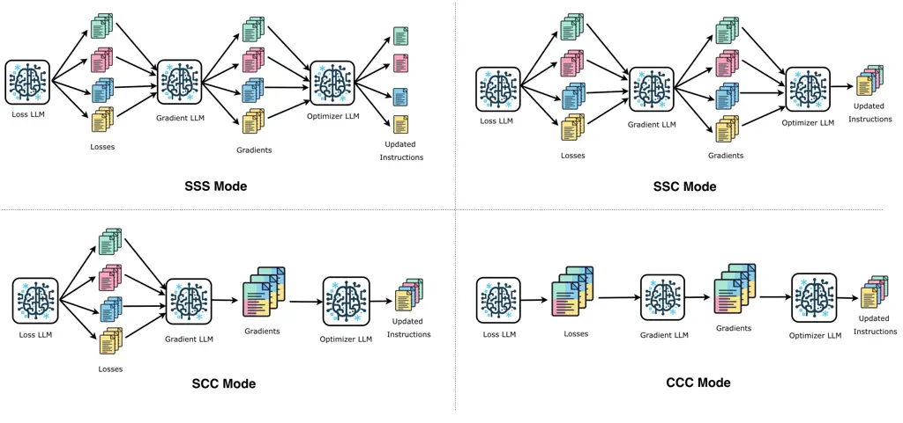
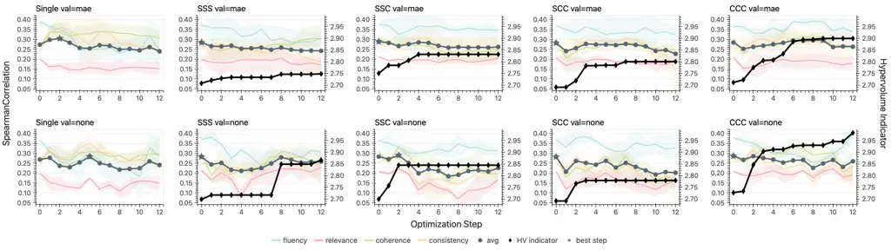
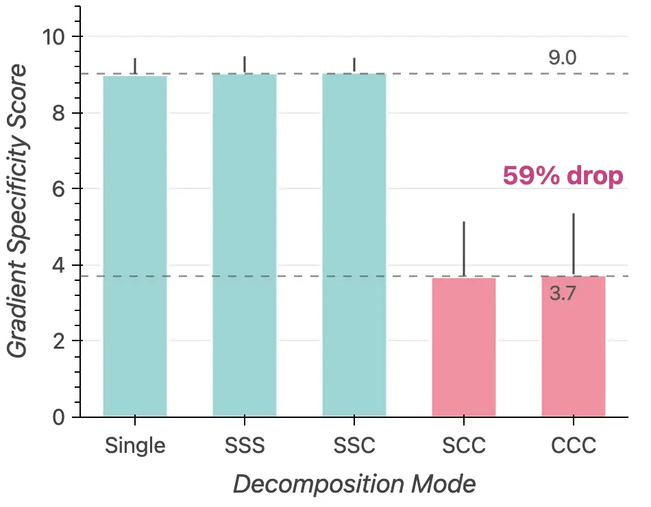
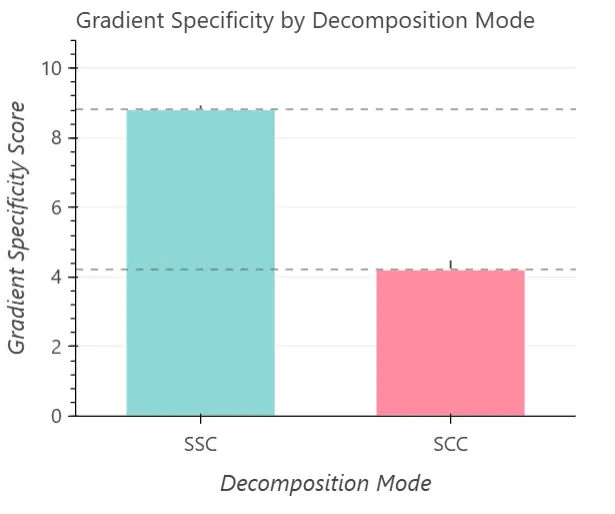
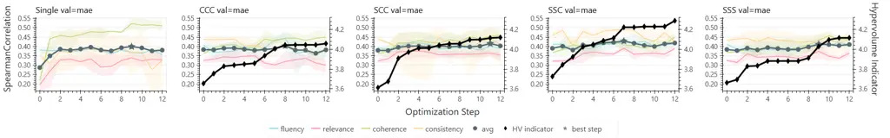
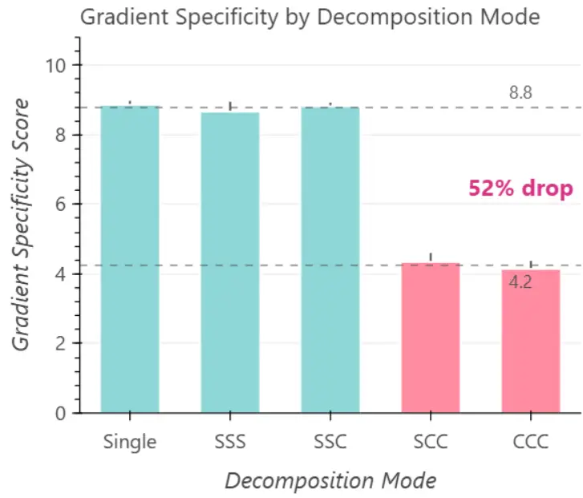

# When Gradients Collide: Failure Modes of Multi-Objective Prompt Optimization for LLM Judges

Parth Darshan ^(†)^(†)thanks: Equal contribution. ^(†)Research lead and
corresponding author. Author was employed at Amazon when this work was
conducted, but the work was performed independently and did not use
Amazon data, resources or confidential information. Affiliation: IIT
Jodhpur Email: [b22cs040@iitj.ac.in](mailto:)    Abhishek Divekar
Email: [adivekar@amazon.com](mailto:) Affiliation: Amazon

###### Abstract

Customizing an LLM judge to a specific problem or domain often involves
optimizing its prompt across multiple evaluation criteria
simultaneously. Textual gradient methods automate this for a single
judge criterion, however they produce natural-language critiques, not
numerical vectors. Thus, the conflict-resolution toolkit of multi-task
learning (PCGrad, MGDA) does not apply to this multi-objective textual
gradient setting. We extend TextGrad to the multi-objective setting and
test four decomposition modes of textual gradient optimizers by varying
how much cross-objective information the loss, gradient and optimizer
LLMs share. We find the gradient’s task-focus drops by 59% (9.0 to 3.7
out of 10) when the gradient LLM must provide feedback on multiple
criteria jointly. Separately, we observe that naively combining
single-objective optimized instructions into a single prompt degrades
Spearman $`\rho`$ from 0.305 to 0.220 ($`-0.085`$). These results
identify two separable failure modes: optimization-time _gradient
dilution_ and inference-time _instruction interference_, which together
constrain the design space for multi-objective judge optimization using
textual feedback.¹¹ 1 Code, data and prompts available at
[https://github.com/adivekar-utexas/when-gradients-collide](https://github.com/adivekar-utexas/when-gradients-collide)

## 1 Introduction

Figure 1: Overview of the optimization pipeline. Each step consists of
four stages: (1) the task model predicts scores, (2) the loss LLM
critiques predictions against ground truth, (3) the gradient LLM
converts critiques into instruction edits, and (4) the optimizer LLM
rewrites the prompt. The decomposition mode determines whether each
stage operates per-task (Separate) or over all tasks jointly (Combined).
Only the per-task instruction text is updated; the prompt skeleton and
output format remain frozen throughout optimization.

Modern judges, whether human or LLMs, are used to evaluate text along
multiple quality dimensions at once. SummEval (Fabbri et al., 2021)
scores summaries on four dimensions simultaneously; MT-Bench (Zheng et
al., 2023) spans eight categories from coding to roleplay. Kim et al.
(2024) developed Prometheus 2 specifically because existing evaluators
“do not possess the ability to evaluate based on _custom evaluation
criteria_”. Prompt optimization methods like TextGrad (Yüksekgönül et
al., 2025), OPRO (Yang et al., 2024), and GEPA (Agrawal et al., 2026)
can improve prompts for LLM judges automatically, but they optimize a
single objective. Whether they extend to multi-objective judges, where
one prompt must score several evaluation dimensions at once, remains
less studied.

The core challenge is structural. When multi-task deep learning models
encounter conflicting task gradients, methods like PCGrad (Yu et al., 2020) and MGDA (Sener and Koltun, 2018) resolve conflicts via projection
or constrained optimization. The conflict-resolution tools of numerical
multi-task learning do not apply directly, because textual gradients
lack the vector-space structure these methods require. As textual
gradients are natural-language strings, they do not have equivalent
concepts of magnitude, inner products, or linear subspaces. The
instruction “Make the coherence rubric more specific” cannot be
numerically projected against “simplify the fluency criteria”.

Prior work addresses related problems but not this intersection. For
example, intra-task feedback quality has been studied: recently Chu et
al. (2026) identify _rule dilution_, when heterogeneous error modes are
aggregated within a single optimization step, and Melcer et al. (2025)
show that the gradient analogy does not accurately explain why Automatic
Prompt Optimization (APO) methods succeed. Multi-objective prompt
optimization also exists: Jafari et al. (2024) find that MGDA
underperforms volume-based alternatives for discrete prompt tokens.
Multi-task judge _training_ is studied extensively (Whitehouse et al.,
2026; Yang et al., 2026; Wang et al., 2025), but these methods update
weights, not prompts. To our knowledge, no prior work studies
multi-objective judge _prompt_ optimization using textual gradients.

We propose and test four plausible decomposition modes of textual
gradient optimization for multi-objective judges: SSS, SSC, SCC, CCC,
where the naming encodes whether each pipeline stage (loss, gradient,
optimizer) processes tasks separately (S) or combined (C). We also
introduce two process-level diagnostics: _gradient specificity_ (how
targeted each gradient is to a single task) and _feedback adherence_
(whether the optimizer follows the gradient). We evaluate on SummEval
(Fabbri et al., 2021) with four criteria, using two validation gate
settings (MAE gating and no gating).

Our results reveal a consistent structure in how and why multi-criteria
prompt optimization stagnates. In 6 of 10 configurations with Qwen3
judges, optimization never exceeds the initial generic prompt (§5,
Table 1); only Single-Task with val=mae improves ($`+0.031`$ Spearman at
step 2). Our diagnostics localize this effect: gradient specificity
drops by 59% ($`9.0`$ to $`3.7`$) when the gradient LLM processes all
tasks jointly §6.1, Table 4). Feedback adherence remains high (7.8 to
8.8), indicating that the optimizer incorporates the gradient’s
suggestions regardless of their specificity. A separate oracle
experiment shows that even independently optimal per-task instructions
_degrade_ from 0.305 to 0.220 ($`-0.085`$ Spearman) when combined into
one prompt (§6.3, Table 3). These results identify two separable failure
modes: optimization-time _gradient dilution_ and inference-time
_instruction interference_.

Our contributions are as follows: (1) we present an empirical study of
multi-criteria textual gradient optimization for LLM judges across four
decomposition modes (§4, §5, Table 1); (2) we propose two process-level
diagnostics (_gradient specificity_ and _feedback adherence_) that
localize issues in optimization to gradient quality, not optimizer
compliance (§6.1, Figure 3, Table 2). (3) we conduct an
oracle-instruction experiment which isolates inference-time _instruction
interference_ as a failure mode distinct from optimization-time dilution
(§6.3, Table 3).

## 2 Related Work

Textual Gradient Methods. Early methods in Prompt optimization used
scalar signals: OPRO (Yang et al., 2024) rewrites prompts by
conditioning on (prompt, score) histories, and APE (Zhou et al., 2023)
generates candidates from demonstrations and selects the highest-scoring
variant. ProTeGi (Pryzant et al., 2023) replaced scalar signals with
textual gradients: natural-language critiques that guide prompt
rewrites. TextGrad (Yüksekgönül et al., 2025) extended this to
multi-component computation graphs, propagating critiques through LLM
pipelines in analogy to backpropagation.

Subsequent work has questioned the gradient analogy. GPO (Tang et al., 2025) decomposed textual optimization into two factors (update direction
and update method), drawing analogies to gradient, momentum, and
learning rate, but found that adding a reflection step hurts
performance. Melcer et al. (2025) showed empirically that the gradient
decomposition (the chain-rule structure central to the analogy) does not
consistently improve prompt optimization, and that the gradient metaphor
does not accurately explain why APO methods succeed. GEPA (Agrawal et
al., 2026) evolves language programs via reflective mutation with Pareto
selection. To our knowledge, all methods above optimize a single
objective and none provide a mechanism to observe or control how
per-task feedback interacts during optimization.

Multi-Objective Prompt Optimization. Multi-objective prompt optimization
is a nascent area with two distinct approaches. Population-based methods
maintain a Pareto front of candidate prompts: MOPO (Menchaca Resendiz
and Klinger, 2025) applies NSGA-II (Deb et al., 2002) with LLM-based
mutation to affective text generation, and ParetoPrompt (Zhao et al., 2025) decomposes objectives into scalarized subproblems.
MORL-Prompt (Jafari et al., 2024) adapts multi-objective reinforcement
learning to discrete prompt tokens but found that MGDA (Sener and
Koltun, 2018) underperforms the simpler product-of-rewards at balancing
competing objectives. Evolutionary approaches include EvoPrompt (Guo et
al., 2024) for single-objective and Baumann and Kramer (2024) for
multi-objective sentiment balancing. These methods operate at the
candidate-selection level: they choose which prompts to keep from a
population. To our knowledge, none of the above studies how per-task
feedback interacts within a single textual gradient trajectory, which is
the setting we investigate.

LLM-as-a-Judge Evaluation. MT-Bench and Chatbot Arena (Zheng et al., 2023) established the paradigm of LLM-based evaluation where human
annotation is expensive. Subsequent works use a fixed prompt to improve
judge quality through tuning weights on rubric-grounded data (Kim et
al., 2024), reinforcement learning (Whitehouse et al., 2026), debiasing
(Yang et al., 2026), and preference optimization (Wang et al., 2025). A
parallel line of work optimizes the evaluation prompt itself. CARO (Chu
et al., 2026) identifies rule dilution when heterogeneous error modes
are aggregated into a single optimization step. RRD (Shen et al., 2026)
recursively decomposes rubrics to improve coverage and remove
redundancy. MPO (Sharma and Henley, 2026) applies section-local textual
gradients to individual prompt components (role, context, constraints)
independently. MAPGD (Han et al., 2025) coordinates multiple gradient
agents, using semantic similarity to resolve conflicting edits. All
these operate on a single evaluation objective, or decompose along axes
other than evaluation criteria. None jointly optimizes a judge prompt
across multiple criteria while preserving per-task gradient
observability (i.e., the ability to trace how each criterion’s feedback
shaped each rewrite), the setting we study.

|             | MAE validation |             |            |       | No validation |             |            |       |
| ----------- | -------------- | ----------- | ---------- | ----- | ------------- | ----------- | ---------- | ----- |
| Mode        | Initial        | Best (step) | $`\Delta`$ | HVI   | Initial       | Best (step) | $`\Delta`$ | HVI   |
| Single-Task | 0.274          | 0.305 (2)   | +0.031     | —     | 0.269         | 0.284 (5)   | +0.015     | —     |
| SSS         | 0.284          | 0.284 (0)   | +0.000     | 2.749 | 0.283         | 0.283 (0)   | +0.000     | 2.867 |
| SSC         | 0.289          | 0.289 (0)   | +0.000     | 2.832 | 0.283         | 0.291 (2)   | +0.007     | 2.845 |
| SCC         | 0.282          | 0.282 (0)   | +0.000     | 2.801 | 0.282         | 0.282 (0)   | +0.000     | 2.779 |
| CCC         | 0.285          | 0.296 (9)   | +0.012     | 2.900 | 0.287         | 0.287 (0)   | +0.000     | 2.983 |

Table 1: Main results on SummEval using Qwen3. We measure the
task-averaged Spearman correlation (mean over $`N\!=\!3`$ runs).
$`\Delta`$ is the improvement from the initial prompt to the best step.
HVI is the hypervolume indicator at step 12 (higher $`=`$ more
Pareto-diverse prompts). We evaluate four decomposition modes (SSS
through CCC) plus a single-task optimization baseline (Single-Task),
covering the full spectrum from separate to joint optimization. In 6 of
10 configurations, the initial generic prompt (“Rate from 1 to 5”) is
never exceeded.

## 3 Method: Multi-objective TextGrad

TextGrad pipeline. We implement a 4-stage optimization loop based on
TextGrad Yüksekgönül et al. (2025). At each step, a task LLM predicts
objective-scores for a minibatch of examples using the current prompt. A
loss LLM critiques the predictions by comparing them to ground-truth
annotations and produces a natural-language “loss” for each example
(called a reflection by some authors). A gradient LLM aggregates the
per-example losses into a “textual gradient”: a structured set of
instruction-level edit suggestions. We restrict gradients to 3
paragraphs. An optimizer LLM rewrites the prompt based on the gradient.
Only the per-objective instructions are modified; the prompt skeleton
(role preamble, output format, few-shot examples) is frozen throughout
(see Appendix E for the full initial prompt and an example of optimized
instructions). This design isolates the effect of objective-level
instruction modifications from possible confounds introduced by
structural prompt changes.

Decomposition modes. We extend TextGrad to the multi-objective setting
stagewise. As shown in Figure 1, we parameterize the multi-objective
interaction via a 3-letter decomposition code. Each letter denotes
whether a stage operates in Separate (per-task) or Combined
(all-tasks-joint) mode, applied to the loss, gradient, and optimizer
stages respectively.

Four modes span the design space. SSS operates all three stages
independently per task. SSC computes loss and gradient per task, but the
optimizer receives all four gradients simultaneously and rewrites the
prompt in a single call. SCC computes only the loss per task; the
gradient LLM receives critiques from all four tasks and produces a
unified set of edits. CCC operates all stages jointly. We also include a
Single-Task baseline in which each objective is optimized in a
completely independent run, and evaluated through its own forward pass;
i.e., the reported Spearman is the average of four per-criterion
evaluations, each using a prompt specialized to a single objective.

The key architectural boundary lies between SSC and SCC. In SSC, the
gradient LLM sees one task at a time. In SCC, it must reconcile feedback
from all four tasks into a coherent edit plan.

Validation Gating. We evaluate two validation strategies. Under val=mae,
a candidate prompt is accepted only if its mean absolute error on a
held-out validation set does not exceed that of the current prompt. This
acts as a monotonic filter that prevents prompt-regression. Under no
validation gate, every candidate is accepted unconditionally; we can
observe the optimization trajectory without gating. For each
configuration, we run 3 independent trials with different random seeds,
each for 12 optimization steps. We report the mean and standard
deviation of task-averaged Spearman $`\bar{\rho}`$ across the 3 runs.

## 4 Experimental Setup

Datasets. We evaluate on SummEval (Fabbri et al., 2021), a summarization
meta-evaluation benchmark. The original dataset contains source news
articles, each paired with summaries from 16 different summarization
systems, with expert annotations from multiple annotators per pair. We
randomly subsample this into 160 pairs for training (used as
optimization batches) and 480 pairs for held-out evaluation. Each pair
is scored on four dimensions (fluency, relevance, coherence,
consistency) on a 1-5 scale.

These four dimensions are the tasks in our multi-task optimization
setting: the judge prompt must produce accurate scores across all four
simultaneously. We report Spearman rank correlation ($`\rho`$) between
predicted and human scores as the primary metric, following prior work
on LLM-based evaluation (Liu et al., 2023). Unless stated otherwise, all
reported results are task-averaged Spearman, the arithmetic mean of
per-task $`\rho`$ values across the four dimensions.

Models. Our main results are evaluated on the Qwen3 family (Yang et al., 2025) using Qwen3-8B as the task LLM and Qwen3-235B-A22B as others. We
use a higher optimizer temperature ($`T=0.7`$) to encourage diverse
rewrites, and a lower loss and gradient temperatures ($`T=0.3`$) promote
consistent critiques. For the task LLM we set $`T=1.0`$ to allow
resampling in case of JSON formatting errors. In Appendix D, we show
results on DeepSeek v4 Flash and Pro (DeepSeek-AI, 2026).

Figure 2: Per-task Spearman $`\rho`$ for each optimization steps on
SummEval with Qwen3. We average over $`N\!=\!3`$ runs (shaded bands show
min to max). Each column shows one of the five decomposition modes. On
the top row we apply validation-MAE to gate prompts at each step, while
bottom row has no gating. Gray line indicates task-averaged $`\rho`$;
stars mark best step. Black diamonds (right axis) denote the hypervolume
indicator for the prompt-candidates accumulated over steps. Without
validation gating, multi-task modes degrade, and with it, they plateau.

## 5 Results

Table 1 reports task-averaged Spearman $`\rho`$ for each decomposition
mode and validation configuration, averaged over $`N\!=\!3`$ runs. In 6
of 10 configurations, the best prompt is the initial generic prompt
(“Rate from 1 to 5”): optimization either fails to improve or actively
degrades performance. The only multi-task mode that improves is CCC with
MAE validation and SSC without validation, which achieve modest gain
over 12 steps. Only the single-task baseline with MAE validation
achieves meaningful improvement: $`+0.031`$ Spearman at step 2 (Table 1,
bold). This confirms that the TextGrad pipeline can improve
individual-task prompts when gradient signal is not contaminated by
cross-task information.

We plot optimization trajectories in Figure 2, revealing the dynamics
behind these aggregates. Without a validation gate (val=none, bottom
row), SSC drops from 0.283 to 0.184 by step 7; SCC shows comparable
degradation. The optimizer proposes changes that improve the
training-batch loss but harm held-out generalization. MAE validation
partially mitigates this by rejecting spurious updates. With the
validation gate active (top row), trajectories flatten rather than
decline: the gate prevents catastrophic degradation but cannot
compensate for uninformative gradients.

Performance degrades roughly as Single-Task $`>`$ SSS, SSC, SCC, CCC
without validation gating. This is consistent with the hypothesis that
increasing cross-task coupling amplifies gradient dilution. The pattern
is non-monotonic under MAE validation, however: CCC slightly outperforms
SSC. Full coupling may occasionally produce complementary gradients that
survive the validation gate. The process-level diagnostics in §6
disentangle these effects.

Despite stagnation in Spearman, the hypervolume indicator (HVI) shows an
increasing trend. For CCC, HVI grows continuously; the optimizer
discovers diverse specialist prompts that expand the Pareto front, even
when no single prompt dominates the initialization on all four tasks.
Menchaca Resendiz and Klinger (2025) report a similar pattern:
multi-objective prompt optimization expands the Pareto front at modest
per-objective cost. In our setting, however, the per-task degradation is
substantially larger when coupling is high.

We rerun with DeepSeek v4 under MAE validation in Appendix D, where we
observe better absolute improvements in Spearman through optimization
due to stronger models, but a similar trend: the improvement through
prompt optimization is most effective for single-objective
optimizations.

## 6 Analysis

The results in §5 establish _that_ multi-objective textual gradient
prompt optimization lags compared to single-task; this section
investigates _why_. We identify two separable failure modes:
optimization-time _gradient dilution_ (§6.1) and inference-time
_instruction interference_ (§6.3). We report the evaluation prompts in
Appendix F for reproducibility.

Figure 3: Gradient specificity (1 to 10 scale, higher is more
task-focused) by decomposition mode.

### 6.1 Gradient Specificity and Dilution

To measure gradient quality directly, we evaluate each textual gradient
for _task-focus_: the degree to which its improvement suggestions target
a single evaluation criterion rather than offering generic advice. An
LLM evaluator (Claude Sonnet 4.6, Anthropic (2026)) rates each gradient
on a 1 to 10 scale. A score of 10 means the gradient addresses exactly
one task’s rubric; a score of 1 means it’s so generic it could apply to
any task (see Appendix F for the evaluation prompt). This diagnostic
tests the cross-objective analogue of Chu et al.’s rule-dilution
hypothesis. Concretely, we ask: does combining multiple evaluation
criteria in a single gradient call dilute the criteria-specific signal?

We evaluate all gradients from steps 1 to 12 across all four modes. A
sharp transition is present (Figure 3). Per-task modes (Single, SSS,
SSC), where each gradient LLM call processes exactly one task, achieve a
mean specificity of 9.0 ($`\pm`$0.3; Table 4, top rows). Cross-task
modes (SCC, CCC), where the gradient LLM processes all four tasks in a
single call, drop to 3.7 ($`\pm`$0.5; Table 4, bottom rows), a 59%
reduction with zero overlap between the two groups.

Our gradient dilution results extend Chu et al.’s within-criterion
finding to the cross-criterion setting. Chu et al. (2026) show that
aggregating heterogeneous error modes in a single optimization step
degrades rubric accuracy; we observe an analogous effect when multiple
task gradients are combined in a single gradient call, degrading the
per-task optimization signal. A per-task breakdown (Table 4) reveals
that consistency is most diluted, while coherence retains moderate
focus. This possibly occurs because coherence rubrics share
surface-level vocabulary with the generic “writing quality” feedback the
gradient LLM defaults to under multi-task load.

To confirm this cliff is structural when moving from per-task to
cross-task gradients, in Appendix C we switch only the gradient LLM to a
stronger LLM (DeepSeek-V4-Pro) while continuing to use Qwen3 for the
other steps. We observe the same SSC to SCC specificity drop.
Appendix D.2 replicates the overall gradient-specificity analysis using
DeepSeek for all modes, showing the same per-task vs. cross-task
gradient dilution pattern.

| Mode        | MAE validation    | No validation     |
| ----------- | ----------------- | ----------------- |
| Single-Task | 8.70 $`\pm`$ 0.47 | 8.53 $`\pm`$ 0.60 |
| SSS         | 8.84 $`\pm`$ 0.44 | 8.72 $`\pm`$ 0.54 |
| SSC         | 7.94 $`\pm`$ 0.80 | 7.83 $`\pm`$ 0.78 |
| SCC         | 8.08 $`\pm`$ 1.03 | 7.76 $`\pm`$ 1.49 |
| CCC         | 7.90 $`\pm`$ 1.62 | 8.01 $`\pm`$ 1.28 |

Table 2: Feedback adherence scores (1 to 10 scale, mean $`\pm`$ std over
all objectives, runs, and steps). All modes achieve high adherence,
ruling out optimizer non-compliance as an explanation for multi-task
optimization failure.

### 6.2 Feedback Adherence

We also measure _feedback adherence_: the degree to which the optimizer
LLM incorporates the textual gradient into its instruction edits
(Table 2). We prompt Claude Sonnet 4.6 evaluator to output an adherence
score on a 10-point scale (refer Appendix F for the prompt).

Across all modes and validation settings, adherence is uniformly high
(7.8 to 8.8 on a 10-point scale), confirming that the optimizer
faithfully implements whatever gradient it receives, even when those
suggestions are generic rather than criterion-specific. This indicates
the ceiling to multi-objective judge prompt optimization is gradient
quality rather than optimizer compliance.

| Method      | Fl.   | Rel.  | Coh.  | Con.  | Avg $`\rho`$ |
| ----------- | ----- | ----- | ----- | ----- | ------------ |
| Initial     | 0.366 | 0.208 | 0.308 | 0.256 | 0.284        |
| Single-Task | 0.350 | 0.168 | 0.338 | 0.363 | 0.305        |
| Cherry-pick | 0.303 | 0.257 | 0.215 | 0.105 | 0.220        |

Table 3: Oracle cherry-pick experiment (MAE validation). For each task,
the single-task instruction with the highest test-set metric is selected
and combined into one multi-task prompt. Despite oracle selection,
combined instructions degrade below the individually optimized
single-task performance, demonstrating inference-time instruction
interference. We report both task-level and average $`\rho`$ for the
multi-task prompt.

### 6.3 Inference-Time Instruction Interference

Gradient dilution explains why SCC and CCC fail to optimize effectively,
but it does not explain why SSS and SSC optimizations also stagnate.
These per-task modes produce highly specific gradients and
high-adherence prompt updates, yet still fail to improve over the
initialization. To diagnose this, we design an oracle cherry-pick
experiment that isolates the _inference-time_ component of multi-task
failure. For each task, we select the single best instruction across all
single-task optimization runs (the instruction with the highest held-out
Spearman $`\rho`$ for that task), then combine these four oracle-optimal
instructions into one multi-task prompt and evaluate on the full test
set.

We see that oracle-optimal instructions _degrade_ when combined
(Table 3), achieving 0.22 average Spearman, a drop of 0.085 from the
single-task optimized performance of 0.305. In Appendix B we explore
more variants by using different metrics to select the best instruction
per task, and observe the same effect. These instructions each
individually outperform the baseline on their respective tasks, but
combining them produces performance strictly worse than the generic
initial prompt.

The primary mechanism appears to be instruction-length asymmetry.
Optimization produces over-specified rubrics for some tasks (the fluency
instruction expands to $`\sim`$800 tokens with detailed scoring anchors)
while leaving others under-specified (the relevance instruction remains
at $`\sim`$4 tokens of the initial prompt). When packed into a single
prompt, verbose instructions receive disproportionate attention relative
to brief ones at inference time.

This finding strengthens a result from Shen et al. (2026), who observe
that naive rubric construction degrades GPT-4o preference-judgment
accuracy by 13 points on JudgeBench. The degradation we observe is
larger and occurs with oracle-selected rather than naively constructed
instructions. Shen et al.’s result shows that _bad_ rubrics hurt. Ours
shows that individually _good_ rubrics can hurt when combined. This
implies that instruction interference is not resolvable by improving
per-task optimization alone.

## 7 Conclusion

Multi-criteria textual gradient optimization for LLM judges exhibits two
failure points that our decomposition study and process-level
diagnostics expose. These are systematic failures, corresponding to
distinct pipeline stages and affect different decomposition modes: (i)
Gradient dilution operates at optimization time. When the gradient LLM
must reconcile feedback from multiple criteria in a single call, its
suggestions lose task-specificity (59% drop; Appendix Table 4). The
optimizer propagates the low-specificity signal through to the final
prompt; (ii) Instruction interference operates at inference time.
Independently optimized per-task instructions degrade when combined into
one prompt (Table 3) because instruction-length asymmetry causes verbose
rubrics to receive disproportionate attention relative to brief ones.

For practitioners customizing judges to domain-specific criteria (Kim et
al., 2024), these results indicate architectural changes are required
before the multi-objective setting can work reliably. Addressing either
failure mode alone is insufficient. Separate judge calls per criterion
eliminates interference but multiplies inference cost. Conflict-aware
gradient resolution adapted from numerical multi-task learning (Yu et
al., 2020; Liu et al., 2021) could address dilution if textual gradients
can be meaningfully embedded and projected. Our proposed diagnostics
(gradient specificity and feedback adherence) provide the measurement
tools to evaluate either approach.

## 8 Future Work

Our findings open several concrete directions to broader research on
customized LLM evaluation.

Statistically reliable LLM diagnostics with PPI. Our diagnostics are
LLM-judged, introducing an evaluator-bias. Prediction-Powered
Inference (Angelopoulos et al., 2023; Boyeau et al., 2025) combines a
small human-judged set with a large LLM-judged set to produce provably
unbiased estimates; the hierarchical PPI extension of Divekar and
Majumder (2026) is directly applicable here, since annotations are
per-gradient but the quantity of interest is the per-mode mean. This
would allow us to report the specificity gap as a confidence interval
and scale diagnostics to hundreds of runs without scaling human
annotation linearly.

Synthetic task generation for aligned criteria. A new direction is to
_synthesize the criteria themselves_ rather than treat them as fixed.
Persona-driven synthesis at billion-person scale (Chan et al., 2024; Yu
et al., 2023) and instruction-data generation with controlled
diversity (Divekar and Durrett, 2024; Kowshik et al., 2024) can produce
synthetic objectives that are complementary for optimization. If the
synthesized tasks are mutually aligned by construction, the combined
gradient should suffer less semantic drift, raising gradient focus and
potentially mitigating both failure modes at their source.

Multi-objective critics for agentic workflows. Multi-objective judge
prompts could serve as critics in agentic LLM systems, where a critic
must track several quality dimensions of tool-use trajectories at
once (Ding, 2026; Chuang et al., 2026; Rudman et al., 2026). Applying
our optimization pipeline to such critics raises an open question: do
gradient dilution and instruction interference still emerge when
criteria are tool-grounded and partially verifiable, or does
verifiability yield more robust gradients? Our diagnostics provide a
principled way to measure this.

Mitigations. Our diagnostics motivate concrete mitigations. For
_gradient dilution_, a specificity-aware router could fallback to
per-task gradient LLM when a multi-task LLM specificity drops below
threshold, capturing CCC’s hypervolume without losing task-focus. For
_instruction interference_, we propose two avenues: (i) next-token
attention masking for per-criterion output generation (eliminating
interference as no cost), and (ii) length-aware instruction synthesis
that normalizes rubric length during optimization so no single criterion
dominates the attention budget.

## Limitations

Our experiments are scoped to SummEval as it provides expert human
annotations on four clearly separable criteria. Other benchmarks would
validate our identified failure modes: BRIGHTER (Muhammad et al., 2025)
tests whether dilution scales with task count and crosses language
boundaries; ASAP++ (Mathias and Bhattacharyya, 2018) (per-trait
essay-grading rubrics) tests whether the SCC to CCC gradient specificity
cliff transfers beyond summarization; EMSCAD (Vidros et al., 2017),
GitBugs (Patil et al., 2026), test heterogeneous classification criteria
rather than ordinal quality scales.

Other prompt optimization paradigms may exhibit different multi-task
dynamics, though our diagnostics are algorithm-agnostic and can be
applied to any textual gradient approach.

Our sample size ($`N\!=\!3`$ runs) limits statistical power, and we
restrict our claims to effect sizes that are robust at this sample size
(e.g., the 59% specificity drop and $`-0.085`$ cherry-pick degradation).
Finally, gradient specificity and feedback adherence are scored by an
LLM evaluator, which introduces a potential confound.

## Ethics Statement

Optimized judge prompts inherit biases present in the underlying LLMs
and in the human annotations used for evaluation; practitioners should
audit optimized prompts before deploying them in sensitive evaluation
contexts (e.g., content moderation or hiring). Our code and diagnostics
will be released under an open-source license to support
reproducibility.

## References

- Agrawal et al. (2026) L. A. Agrawal, S. Tan, D. Soylu, N. Ziems, R.
  Khare, K. Opsahl-Ong, A. Singhvi, H. Shandilya, M. J. Ryan, M.
  Jiang, C. Potts, K. Sen, A. G. Dimakis, I. Stoica, D. Klein, M.
  Zaharia, and O. Khattab GEPA: reflective prompt evolution can
  outperform reinforcement learning. In The Fourteenth International
  Conference on Learning Representations, External Links:
  [Link](https://openreview.net/forum?id=RQm2KQTM5r) Cited by: §1, §2.
- Angelopoulos et al. (2023) A. N. Angelopoulos, S. Bates, C.
  Fannjiang, M. I. Jordan, and T. Zrnic Prediction-powered inference.
  Science 382 (6671), pp. 669–674. External Links:
  [Document](https://dx.doi.org/10.1126/science.adi6000),
  [Link](https://doi.org/10.1126/science.adi6000) Cited by: §8.
- Anthropic (2026) Anthropic Introducing claude sonnet 4.6. Note:
  Anthropic Blog External Links:
  [Link](https://www.anthropic.com/news/claude-sonnet-4-6) Cited by:
  §6.1.
- Baumann and Kramer (2024) J. Baumann and O. Kramer Evolutionary
  multi-objective optimization of large language model prompts for
  balancing sentiments. In Applications of Evolutionary Computation
  (EvoApplications), pp. 212–224. External Links:
  [Document](https://dx.doi.org/10.1007/978-3-031-56855-8%5F13) Cited
  by: §2.
- Boyeau et al. (2025) P. Boyeau, A. N. Angelopoulos, T. Li, N.
  Yosef, J. Malik, and M. I. Jordan AutoEval done right: using synthetic
  data for model evaluation. In Forty-second International Conference on
  Machine Learning, External Links:
  [Link](https://openreview.net/forum?id=S8kbmk12Oo) Cited by: §8.
- Chan et al. (2024) X. Chan, X. Wang, D. Yu, H. Mi, and D. Yu Scaling
  synthetic data creation with 1,000,000,000 personas. arXiv preprint
  arXiv:2406.20094. External Links:
  [Link](https://arxiv.org/abs/2406.20094) Cited by: §8.
- Chu et al. (2026) Y. Chu, H. Li, K. Yang, Y. Copur-Gencturk, J.
  Krajcik, N. Shin, and J. Tang Confusion-aware rubric optimization for
  LLM-based automated grading. arXiv preprint arXiv:2603.00451. Cited
  by: §1, §2, §6.1, §6.1.
- Chuang et al. (2026) Y. Chuang, C. Kulkarni, A. Chiu, A. Thangali, Z.
  Pan, S. Shekhar, Y. Ge, Y. Li, U. Kona, L. Pang, and P. Mehrotra
  Toward scalable verifiable reward: proxy state-based evaluation for
  multi-turn tool-calling llm agents. External Links: 2602.16246,
  [Link](https://arxiv.org/abs/2602.16246) Cited by: §8.
- Deb et al. (2002) K. Deb, A. Pratap, S. Agarwal, and T. Meyarivan A
  fast and elitist multiobjective genetic algorithm: NSGA-II. IEEE
  transactions on evolutionary computation 6 (2), pp. 182–197. Cited by:
  §2.
- DeepSeek-AI (2026) DeepSeek-AI DeepSeek-v4: towards highly efficient
  million-token context intelligence. Cited by: Appendix C, §4.
- Ding (2026) L. Ding AdaRubric: task-adaptive rubrics for reliable llm
  agent evaluation and reward learning. External Links: 2603.21362,
  [Link](https://arxiv.org/abs/2603.21362) Cited by: §8.
- Divekar and Durrett (2024) A. Divekar and G. Durrett SynthesizRR:
  generating diverse datasets with retrieval augmentation. In
  Proceedings of the 2024 Conference on Empirical Methods in Natural
  Language Processing, EMNLP 2024, Miami, FL, USA, November 12-16, 2024,
  pp. 19200–19227. External Links:
  [Link](https://aclanthology.org/2024.emnlp-main.1071/),
  [Document](https://dx.doi.org/10.18653/v1/2024.emnlp-main.1071) Cited
  by: §8.
- Divekar and Majumder (2026) A. Divekar and A. Majumder PRECISE:
  reducing the bias of LLM evaluations using prediction-powered ranking
  estimation. In Proceedings of the AAAI Conference on Artificial
  Intelligence (IAAI Track), Vol. 40, pp. 39929–39938. External Links:
  [Document](https://dx.doi.org/10.1609/aaai.v40i47.41427),
  [Link](https://doi.org/10.1609/aaai.v40i47.41427) Cited by: §8.
- Fabbri et al. (2021) A. R. Fabbri, W. Kryściński, B. McCann, C.
  Xiong, R. Socher, and D. Radev SummEval: re-evaluating summarization
  evaluation. Transactions of the Association for Computational
  Linguistics 9, pp. 391–409. External Links:
  [Link](https://aclanthology.org/2021.tacl-1.24/),
  [Document](https://dx.doi.org/10.1162/tacl%5Fa%5F00373) Cited by: §1,
  §1, §4.
- Guo et al. (2024) Q. Guo, R. Wang, J. Guo, B. Li, K. Song, X. Tan, G.
  Liu, J. Bian, and Y. Yang Connecting large language models with
  evolutionary algorithms yields powerful prompt optimizers. In The
  Twelfth International Conference on Learning Representations, External
  Links: [Link](https://openreview.net/forum?id=ZG3RaNIsO8) Cited by:
  §2.
- Han et al. (2025) Y. Han, B. Liu, Z. Zhou, G. Liu, Z. Zhang, Y.
  Yang, W. Wang, I. Shi, Yunyan, L. He, and T. Shi MAPGD: multi-agent
  prompt gradient descent for collaborative prompt optimization. In
  NeurIPS 2025 Workshop on Scaling Environments for Agents, External
  Links: [Link](https://openreview.net/forum?id=FywYwwH5z9) Cited by:
  §2.
- Jafari et al. (2024) Y. Jafari, D. Mekala, R. Yu, and T.
  Berg-Kirkpatrick MORL-prompt: an empirical analysis of multi-objective
  reinforcement learning for discrete prompt optimization. In Findings
  of the Association for Computational Linguistics: EMNLP 2024, Y.
  Al-Onaizan, M. Bansal, and Y. Chen (Eds.), Miami, Florida, USA,
  pp. 9878–9889. External Links:
  [Link](https://aclanthology.org/2024.findings-emnlp.577/),
  [Document](https://dx.doi.org/10.18653/v1/2024.findings-emnlp.577)
  Cited by: §1, §2.
- Kim et al. (2024) S. Kim, J. Suk, S. Longpre, B. Y. Lin, J. Shin, S.
  Welleck, G. Neubig, M. Lee, K. Lee, and M. Seo Prometheus 2: an open
  source language model specialized in evaluating other language models.
  In Proceedings of the 2024 Conference on Empirical Methods in Natural
  Language Processing, pp. 4334–4353. External Links:
  [Document](https://dx.doi.org/10.18653/v1/2024.emnlp-main.248),
  [Link](https://aclanthology.org/2024.emnlp-main.248/) Cited by: §1,
  §2, §7.
- Kowshik et al. (2024) S. S. Kowshik, A. Divekar, and V. Malik
  CorrSynth: A correlated sampling method for diverse dataset generation
  from LLMs. In Proceedings of the 2024 Conference on Empirical Methods
  in Natural Language Processing, EMNLP 2024, Miami, FL, USA, November
  12-16, 2024, pp. 16076–16095. External Links:
  [Link](https://aclanthology.org/2024.emnlp-main.899/),
  [Document](https://dx.doi.org/10.18653/v1/2024.emnlp-main.899) Cited
  by: §8.
- Liu et al. (2021) B. Liu, X. Liu, X. Jin, P. Stone, and Q. Liu
  Conflict-averse gradient descent for multi-task learning. In Advances
  in Neural Information Processing Systems, pp. 18878–18890. Cited by:
  §7.
- Liu et al. (2023) Y. Liu, D. Iter, Y. Xu, S. Wang, R. Xu, and C. Zhu
  G-eval: nlg evaluation using gpt-4 with better human alignment. ArXiv
  abs/2303.16634. External Links:
  [Link](https://api.semanticscholar.org/CorpusID:257804696) Cited by:
  §4.
- Mathias and Bhattacharyya (2018) S. Mathias and P. Bhattacharyya
  ASAP++: enriching the ASAP automated essay grading dataset with essay
  attribute scores. In Proceedings of the Eleventh International
  Conference on Language Resources and Evaluation, LREC 2018, Miyazaki,
  Japan, May 7-12, 2018, External Links:
  [Link](http://www.lrec-conf.org/proceedings/lrec2018/summaries/373.html)
  Cited by: Limitations.
- Melcer et al. (2025) D. Melcer, Q. Chen, W. Chiang, S. Garg, P. Garg,
  and C. Bock Textual gradients are a flawed metaphor for automatic
  prompt optimization. arXiv preprint arXiv:2512.13598. Cited by: §1,
  §2.
- Menchaca Resendiz and Klinger (2025) Y. Menchaca Resendiz and R.
  Klinger MOPO: multi-objective prompt optimization for affective text
  generation. In Proceedings of the 31st International Conference on
  Computational Linguistics, O. Rambow, L. Wanner, M. Apidianaki, H.
  Al-Khalifa, B. D. Eugenio, and S. Schockaert (Eds.), Abu Dhabi, UAE,
  pp. 5588–5606. External Links:
  [Link](https://aclanthology.org/2025.coling-main.375/) Cited by: §2,
  §5.
- Muhammad et al. (2025) S. H. Muhammad, N. Ousidhoum, I.
  Abdulmumin, J. P. Wahle, T. Ruas, M. Beloucif, C. de Kock, N.
  Surange, D. Teodorescu, I. S. Ahmad, D. I. Adelani, A. F.
  Aji, F. D. M. A. Ali, I. Alimova, V. Araujo, N. Babakov, N. Baes, A.
  Bucur, A. Bukula, G. Cao, R. Tufiño, R. Chevi, C. I. Chukwuneke, A.
  Ciobotaru, D. Dementieva, M. S. Gadanya, R. Geislinger, B. Gipp, O.
  Hourrane, O. Ignat, F. I. Lawan, R. Mabuya, R. Mahendra, V.
  Marivate, A. Panchenko, A. Piper, C. H. P. Ferreira, V. Protasov, S.
  Rutunda, M. Shrivastava, A. C. Udrea, L. D. A. Wanzare, S. Wu, F. V.
  Wunderlich, H. M. Zhafran, T. Zhang, Y. Zhou, and S. M. Mohammad
  BRIGHTER: BRIdging the gap in human-annotated textual emotion
  recognition datasets for 28 languages. In Proceedings of the 63rd
  Annual Meeting of the Association for Computational Linguistics
  (Volume 1: Long Papers), W. Che, J. Nabende, E. Shutova, and M. T.
  Pilehvar (Eds.), Vienna, Austria, pp. 8895–8916. External Links:
  [Link](https://aclanthology.org/2025.acl-long.436/),
  [Document](https://dx.doi.org/10.18653/v1/2025.acl-long.436), ISBN
  979-8-89176-251-0 Cited by: Limitations.
- Patil et al. (2026) A. Patil, S. Tao, and A. Jadon GitBugs: bug
  reports for duplicate detection, retrieval augmented generation,
  triage, and more. External Links: 2504.09651,
  [Link](https://arxiv.org/abs/2504.09651) Cited by: Limitations.
- Pryzant et al. (2023) R. Pryzant, D. Iter, J. Li, Y. Lee, C. Zhu,
  and M. Zeng Automatic prompt optimization with “gradient descent” and
  beam search. In Proceedings of the 2023 Conference on Empirical
  Methods in Natural Language Processing, H. Bouamor, J. Pino, and K.
  Bali (Eds.), Singapore, pp. 7957–7968. External Links:
  [Link](https://aclanthology.org/2023.emnlp-main.494/),
  [Document](https://dx.doi.org/10.18653/v1/2023.emnlp-main.494) Cited
  by: §2.
- Rudman et al. (2026) W. Rudman, A. Divekar, K. Jain, S.
  Joseph, S. S. R. Offner, M. Lease, K. Mahowald, G. Durrett, and J. J.
  Li VESTA: visual exploration with statistical tool agents. External
  Links: 2606.00384, [Link](https://arxiv.org/abs/2606.00384) Cited by:
  §8.
- Sener and Koltun (2018) O. Sener and V. Koltun Multi-task learning as
  multi-objective optimization. In Advances in Neural Information
  Processing Systems, S. Bengio, H. Wallach, H. Larochelle, K.
  Grauman, N. Cesa-Bianchi, and R. Garnett (Eds.), Vol. 31, pp. .
  External Links:
  [Link](https://proceedings.neurips.cc/paper_files/paper/2018/file/432aca3a1e345e339f35a30c8f65edce-Paper.pdf)
  Cited by: §1, §2.
- Sharma and Henley (2026) P. Sharma and A. Z. Henley Modular prompt
  optimization: optimizing structured prompts with section-local textual
  gradients. arXiv preprint arXiv:2601.04055. Cited by: §2.
- Shen et al. (2026) W. F. Shen, X. Qiu, C. Whitehouse, L. Alazraki, S.
  Goel, F. Barbieri, T. Willi, A. Mathur, and I. Leontiadis Rethinking
  rubric generation for improving LLM judge and reward modeling for
  open-ended tasks. arXiv preprint arXiv:2602.05125. Cited by: §2, §6.3.
- Tang et al. (2025) X. Tang, X. Wang, W. X. Zhao, S. Lu, Y. Li, and J.
  Wen Unleashing the potential of large language models as prompt
  optimizers: analogical analysis with gradient-based model optimizers.
  In Proceedings of the Thirty-Ninth AAAI Conference on Artificial
  Intelligence, External Links:
  [Link](https://doi.org/10.1609/aaai.v39i24.34713),
  [Document](https://dx.doi.org/10.1609/aaai.v39i24.34713) Cited by: §2.
- Vidros et al. (2017) S. Vidros, C. Kolias, G. Kambourakis, and L.
  Akoglu Automatic detection of online recruitment frauds:
  characteristics, methods, and a public dataset. Future Internet 9 (1),
  pp. 6. External Links:
  [Document](https://dx.doi.org/10.3390/fi9010006),
  [Link](https://doi.org/10.3390/fi9010006) Cited by: Limitations.
- Wang et al. (2025) P. Wang, A. Xu, Y. Zhou, C. Xiong, and S. Joty
  Direct judgement preference optimization. In Proceedings of the 2025
  Conference on Empirical Methods in Natural Language Processing,
  pp. 1979–2009. External Links:
  [Document](https://dx.doi.org/10.18653/v1/2025.emnlp-main.103),
  [Link](https://aclanthology.org/2025.emnlp-main.103/) Cited by: §1,
  §2.
- Whitehouse et al. (2026) C. Whitehouse, T. Wang, P. Yu, X. Li, J.
  Weston, I. Kulikov, and S. Saha J1: incentivizing thinking in
  LLM-as-a-judge via reinforcement learning. In The Fourteenth
  International Conference on Learning Representations, External Links:
  [Link](https://openreview.net/forum?id=dnJEHl6DI1) Cited by: §1, §2.
- Yang et al. (2025) A. Yang, A. Li, B. Yang, B. Zhang, B. Hui, B.
  Zheng, B. Yu, C. Gao, C. Huang, C. Lv, C. Zheng, D. Liu, F. Zhou, F.
  Huang, F. Hu, H. Ge, H. Wei, H. Lin, J. Tang, J. Yang, J. Tu, J.
  Zhang, J. Yang, J. Yang, J. Zhou, J. Zhou, J. Lin, K. Dang, K. Bao, K.
  Yang, L. Yu, L. Deng, M. Li, M. Xue, M. Li, P. Zhang, P. Wang, Q.
  Zhu, R. Men, R. Gao, S. Liu, S. Luo, T. Li, T. Tang, W. Yin, X.
  Ren, X. Wang, X. Zhang, X. Ren, Y. Fan, Y. Su, Y. Zhang, Y. Zhang, Y.
  Wan, Y. Liu, Z. Wang, Z. Cui, Z. Zhang, Z. Zhou, and Z. Qiu Qwen3
  technical report. External Links: 2505.09388,
  [Link](https://arxiv.org/abs/2505.09388) Cited by: §4.
- Yang et al. (2026) B. Yang, L. Feng, Y. Chen, Y. Zhang, X. Xu, and S.
  Li FairJudge: an adaptive, debiased, and consistent LLM-as-a-judge.
  arXiv preprint arXiv:2602.06625. Cited by: §1, §2.
- Yang et al. (2024) C. Yang, X. Wang, Y. Lu, H. Liu, Q. V. Le, D. Zhou,
  and X. Chen Large language models as optimizers. In International
  Conference on Learning Representations, B. Kim, Y. Yue, S.
  Chaudhuri, K. Fragkiadaki, M. Khan, and Y. Sun (Eds.), Vol. 2024,
  pp. 12028–12068. External Links:
  [Link](https://proceedings.iclr.cc/paper_files/paper/2024/file/3339f19c5fcee3ad74502947a32be9e6-Paper-Conference.pdf)
  Cited by: §1, §2.
- Yu et al. (2020) T. Yu, S. Kumar, A. Gupta, S. Levine, K. Hausman,
  and C. Finn Gradient surgery for multi-task learning. In Advances in
  Neural Information Processing Systems, H. Larochelle, M. Ranzato, R.
  Hadsell, M.F. Balcan, and H. Lin (Eds.), Vol. 33, pp. 5824–5836.
  External Links:
  [Link](https://proceedings.neurips.cc/paper_files/paper/2020/file/3fe78a8acf5fda99de95303940a2420c-Paper.pdf)
  Cited by: §1, §7.
- Yu et al. (2023) Y. Yu, Y. Zhuang, J. Zhang, Y. Meng, A. J. Ratner, R.
  Krishna, J. Shen, and C. Zhang Large language model as attributed
  training data generator: a tale of diversity and bias. arXiv preprint
  arXiv:2306.15895. External Links:
  [Link](https://arxiv.org/abs/2306.15895) Cited by: §8.
- Yüksekgönül et al. (2025) M. Yüksekgönül, F. Bianchi, J. Boen, S.
  Liu, P. Lu, Z. Huang, C. Guestrin, and J. Zou Optimizing generative AI
  by backpropagating language model feedback. Nature 639 (8055),
  pp. 609–616. External Links:
  [Document](https://dx.doi.org/10.1038/s41586-025-08661-4),
  [Link](https://www.nature.com/articles/s41586-025-08661-4) Cited by:
  §1, §2, §3.
- Zhao et al. (2025) G. Zhao, B. Yoon, G. Park, S. Jha, S. Yoo, and X.
  Qian Pareto prompt optimization. In The Thirteenth International
  Conference on Learning Representations, External Links:
  [Link](https://openreview.net/forum?id=HGCk5aaSvE) Cited by: §2.
- Zheng et al. (2023) L. Zheng, W. Chiang, Y. Sheng, S. Zhuang, Z.
  Wu, Y. Zhuang, Z. Lin, Z. Li, D. Li, E. Xing, H. Zhang, J. E.
  Gonzalez, and I. Stoica Judging LLM-as-a-judge with MT-bench and
  chatbot arena. In Thirty-seventh Conference on Neural Information
  Processing Systems Datasets and Benchmarks Track, External Links:
  [Link](https://openreview.net/forum?id=uccHPGDlao) Cited by: §1, §2.
- Zhou et al. (2023) Y. Zhou, A. I. Muresanu, Z. Han, K. Paster, S.
  Pitis, H. Chan, and J. Ba Large language models are human-level prompt
  engineers. In The Eleventh International Conference on Learning
  Representations, External Links:
  [Link](https://openreview.net/forum?id=92gvk82DE-) Cited by: §2.

## Appendix A Per-Task Gradient Specificity

Table 4 shows gradient specificity broken down by task for the
combined-gradient modes (SCC, CCC). Averaged across SCC and CCC,
consistency is the most diluted dimension (specificity 2.5), while
coherence retains moderate focus (5.0). This suggests that the gradient
LLM’s attention is not uniformly distributed across tasks when
processing them simultaneously.

| Mode                      | Fl. | Rel. | Coh. | Con. | Avg |
| ------------------------- | --- | ---- | ---- | ---- | --- |
| Per-task gradient modes   |     |      |      |      |     |
| Single                    | 8.9 | 8.9  | 9.1  | 9.0  | 9.0 |
| SSS                       | 9.0 | 9.0  | 9.1  | 9.0  | 9.0 |
| SSC                       | 9.0 | 9.1  | 9.1  | 9.0  | 9.0 |
| Cross-task gradient modes |     |      |      |      |     |
| SCC                       | 3.0 | 4.3  | 4.8  | 2.6  | 3.7 |
| CCC                       | 3.2 | 4.3  | 5.1  | 2.4  | 3.8 |

Table 4: Gradient specificity by task (mean over both val settings, all
runs and steps). Per-task modes maintain uniformly high specificity. In
all-task modes, consistency is most diluted and coherence retains
moderate focus.

## Appendix B Cherry-Pick Experiment: All Variants

Table 5 shows all six cherry-pick variants (three selection metrics and
two validation settings). All variants degrade below the initial generic
baseline, confirming that inference-time instruction interference is
robust across metric choices.

| Validation               | Selection metric | Avg $`\rho`$ |
| ------------------------ | ---------------- | ------------ |
| Initial prompt (generic) |                  | 0.284        |
| MAE                      | Spearman         | 0.220        |
| MAE                      | Off-by-one       | 0.232        |
| MAE                      | MAE              | 0.231        |
| None                     | Spearman         | 0.120        |
| None                     | Off-by-one       | 0.200        |
| None                     | MAE              | 0.172        |

Table 5: All cherry-pick variants. Every oracle combination degrades
below the initial generic baseline. The worst case (val=none, Spearman
selection) additionally shows zero fluency correlation.

## Appendix C Gradient Specificity Under Gradient-Model Swap

We swap the gradient LLM backbone to DeepSeek-V4-Pro (DeepSeek-AI, 2026)
while keeping the task, loss, and optimizer LLMs in the Qwen3 family and
holding the rest of the pipeline fixed. As shown in Figure 4, SSC
remains high ($`8.82\pm 0.10`$) while SCC drops sharply
($`4.22\pm 0.26`$, a 52% reduction), indicating that gradient dilution
persists under a cross-family gradient model.

Figure 4: Gradient specificity for SSC vs. SCC after swapping the
gradient LLM to DeepSeek-V4-Pro while keeping the other stages on Qwen3.
SSC remains high ($`8.82\pm 0.10`$) while SCC drops to $`4.22\pm 0.26`$,
a 52% reduction.

Figure 5: Per-task Spearman $`\rho`$ for each optimization steps on
SummEval with DeepSeek v4. Notation same as Figure 2.

| Mode        | Initial | Best (step) | $`\Delta`$ | HVI   |
| ----------- | ------- | ----------- | ---------- | ----- |
| Single-Task | 0.287   | 0.403 (9)   | +0.117     | —     |
| SSS         | 0.384   | 0.421 (9)   | +0.037     | 4.264 |
| SSC         | 0.390   | 0.429 (7)   | +0.039     | 4.436 |
| SCC         | 0.379   | 0.418 (11)  | +0.039     | 4.331 |
| CCC         | 0.383   | 0.409 (7)   | +0.026     | 4.282 |

Table 6: Main results under the MAE validation gate for the DeepSeek
backbone. We measure the task-averaged Spearman correlation (mean over
$`N\!=\!3`$ runs). Notation same as Table 1.

## Appendix D DeepSeek v4 Results

We repeat our analysis on DeepSeek v4 models (DeepSeek-v4-Flash as the
task LLM; DeepSeek-V4-Pro for loss, gradient, and optimizer LLMs). These
provide a stronger starting point for the task-following and
optimization steps. We use the MAE validation gate and run $`N\!=\!3`$
seeds.

### D.1 Overall Performance

Table 6 summarizes performance at step 12. We observe a stronger
backbone for the task and optimization LLMs result in a superior
increase from the initial prompt. Multi-objective modes start from a
stronger initialization ($`\rho\approx 0.38`$) and reach best
avg $`\rho`$ between $`0.409`$ and $`0.429`$. SSC attains the best
avg $`\rho`$ and the highest HVI. However, we observe that the trend
sustains as before, with the improvement through prompt optimization
being highest for single-objective optimizations.

Figure 5 plots the per-task optimization trajectories. Unlike the Qwen3
setting, where multi-objective modes stagnated at or below the initial
prompt (Figure 2), the DeepSeek backbone yields consistent improvement
from initialization.

The pattern of improvement, however, mirrors the main results:
Single-Task achieves the largest gain across steps, while the
multi-objective modes show flatter trajectories. The stronger optimizer
LLM lifts all modes substantially, but it does not close the gap between
single-objective and multi-objective optimization.

Per-task traces remain bounded within narrower bands than their Qwen3
counterparts, consistent with the observation that a stronger task model
produces more stable evaluation dynamics.

Figure 6: Gradient specificity by decomposition mode under DeepSeek.

### D.2 Gradient Specificity

With DeepSeek, the gradient dilution cliff persists: per-task gradient
modes (Single/SSS/SSC) remain highly task-focused (mean $`8.78`$
specificity), while joint-gradient modes (SCC/CCC) drop to mean $`4.25`$
(a $`52\%`$ reduction), indicating that combining criteria in a single
gradient call yields substantially more generic feedback. As shown in
Figure 6, gradient specificity remains high for per-task gradient modes,
while joint-gradient modes exhibit a sharp drop under the DeepSeek
configuration.

## Appendix E Multi-Objective Judge Prompt Template

Our multi-criteria prompt has two parts: a frozen skeleton (evaluation
directive, output format) and mutable per-task instructions (the
“Instructions” section).

Only the per-task instructions are updated during optimization; the
skeleton remains fixed throughout all 12 steps. Our skeleton is specific
to SummEval but may be easily adapted to other problems.

After optimization, the per-task instructions expand substantially.
Below is an example from a SSS run (MAE validation, step 1), showing how
the optimizer rewrites the generic one-line instructions into detailed,
criterion-specific rubrics.

## Appendix F Diagnostic Evaluation Prompts

Below we include the prompts used for task-level diagnostics. Both
diagnostics are evaluated post-hoc by Claude Sonnet 4.6.

### F.1 Gradient Specificity Evaluator

The following prompt rates each textual gradient on a 1 to 10 scale for
task-specificity:

### F.2 Feedback Adherence Evaluator

The following prompt measures how well the optimizer incorporated each
gradient into its instruction edit:

