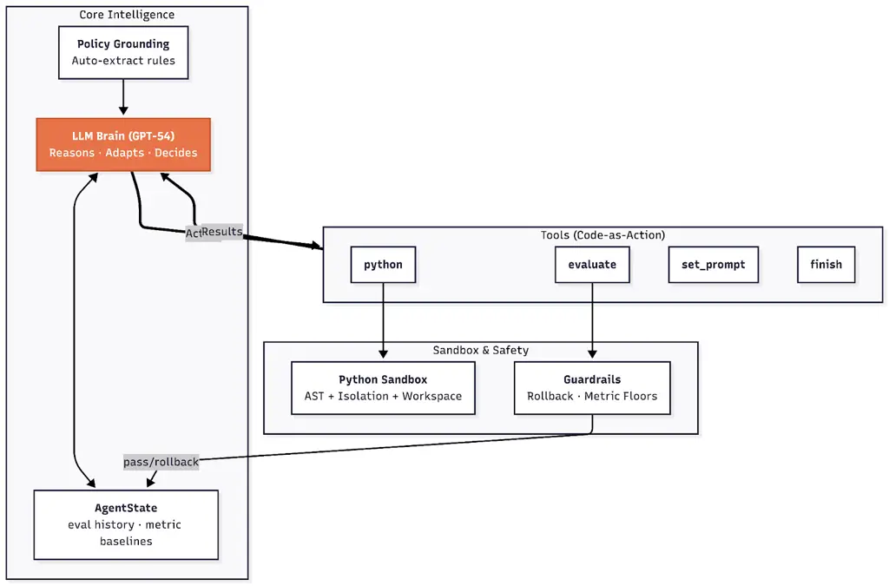
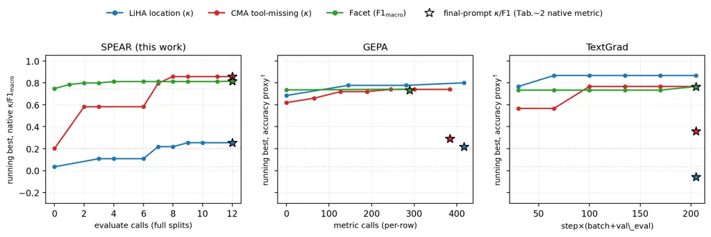

# SPEAR: Code-Augmented Agentic Prompt Optimization

Mengyin Lu, Cong Feng, Huimin Han, Guangming Lu, Yu Sun, Xiaonan Ding,
Shihui Long, Fengyi Li, Tanvi Motwani Affiliation: LinkedIn Corporation
Affiliation: {melu, cofeng, huhan, glu, ysun1, kding, shlong, fenli,
tmotwani}@linkedin.com

###### Abstract

Automatic prompt engineering (APE) rewrites prompts to improve
downstream task performance, but existing APE loops treat the optimizer
itself as a fixed pipeline. We port the code-as-action paradigm of
CodeAct (Wang et al., 2024a) to APE and propose _SPEAR_ (Sandboxed
Prompt Engineer with Active Rollback), a free-form agentic optimizer
with four tools – evaluate, python, set_prompt, finish – that decides
autonomously how and when to use them. The distinctive tool is the
Python sandbox: the optimizer writes and executes arbitrary Python on
the current evaluation DataFrame, performing structural error analysis
(confusion matrices, error clustering, per-group metrics) the agent
itself authors. Two guardrails keep the long-horizon agent from
regressing on the validation metric: auto-rollback to the best
validation prompt seen, and an optional guard-metric floor. We evaluate
on three industrial LLM-as-judge suites (13 judge tasks across
recruiter-intake, conversational-memory, and query-refinement systems)
plus seven BBH tasks and GSM8K. In a like-for-like comparison (same
optimizer, matched runs) SPEAR leads every industrial task it is
compared on ($`\kappa`$ 0.857 vs 0.359 on tool-selection; F1-macro 0.815
vs 0.763 on filter-relevance; $`\kappa`$ 0.483 vs 0.260 on the hardest
extraction dimension). On BBH-7 SPEAR averages 0.938 accuracy vs GEPA
0.628 and TextGrad 0.484. On the public Banking77 benchmark, from a
shared seed prompt, only SPEAR substantially improves ($`\kappa`$ 0.927
vs GEPA 0.816 and instruction-only MIPRO 0.753), leakage-free evidence
for the confusion-analysis mechanism. Ablations show the Python tool is
the largest single lever on complex judge tasks
($`\Delta\approx{+}0.79\kappa`$ on the 5-class tool-selection judge,
$`\Delta\approx{+}0.35\kappa`$ on the hardest extraction dimension when
removed); its irreplaceable contribution is class-pair confusion
aggregation that a long-context LLM cannot extract reliably from the raw
eval DataFrame.

## 1 Introduction

Automatic prompt engineering (APE) rewrites a seed prompt to maximise a
metric on a labeled dataset. Existing systems (Yang et al., 2024; Guo et
al., 2024; Yuksekgonul et al., 2025; Agrawal et al., 2026) all share one
structural trait: the optimizer is a _fixed pipeline_. Its error signal
– scalar loss, Pareto front, or single-row textual critique – is chosen
at design time, and the analysis the optimizer performs is whatever the
pipeline pre-bakes. When errors cluster by structure (a confused class
pair, a label-rule contradiction visible only when grouping by a
feature), a fixed pipeline cannot expose that structure to the
optimizer.

#### Our proposal.

We replace the fixed APE pipeline with a free-form agent equipped with a
Python sandbox, transplanting the _code-as-action_ paradigm of
CodeAct (Wang et al., 2024a) into the APE loop. SPEAR has four tools –
evaluate (score the current prompt and return per-row predictions),
python (run arbitrary code over that DataFrame), set_prompt (rewrite),
finish – and is the first APE system in which the optimizer _actively
authors_ analysis code over the evaluation DataFrame (positioning in
Appendix S). A concrete payoff: on a 5-class CMA judge whose seed prompt
yields $`\kappa`$=0.20 because it collapses minorities into the
majority, SPEAR’s first python block builds the EXPECTED$`\times`$PARSED
confusion matrix, targets the most-confused class pair, and four such
rewrites take $`\kappa`$ from 0.20 to 0.95+. Two minimal guardrails –
metric-based _auto-rollback_ on regression and an optional _guard-metric
floor_ – keep the long-horizon agent from regressing on the validation
metric (auto-rollback returns the best validation prompt seen).

#### Contributions.

\(1\) Code-as-action applied to APE. The first APE system in which the
optimizer actively authors analysis code over the evaluation DataFrame;
the closest prior work, OPTO/Trace (Cheng et al., 2024), treats
execution traces as _passive_ feedback. (2) Free-form agent vs. fixed
pipeline. An ablation replacing the agent with a rigid same-tools cycle
loses 26 pp on BBH logical_deduction_5obj and 0.27$`\kappa`$ on Hiring
Assistant _job location_: orchestration autonomy carries a substantial
share of the lift. (3) Industrial case studies of what code-as-action
discovers in APE. Two studies (§5) expose qualitatively distinct
rewrites the affordance enables – a confusion-matrix-driven
category-definition rewrite on a multi-class judge, and a
label-rule-contradiction discovery on a binary judge.

## 2 Related work

Existing APE systems – LLM-in-loop search (Zhou et al., 2023; Yang et
al., 2024), evolutionary methods (Fernando et al., 2024; Guo et al.,
2024; Zehle et al., 2025; Agrawal et al., 2026), surrogate/beam and tree
search (Opsahl-Ong et al., 2024; Pryzant et al., 2023; Wang et al.,
2024b), symbolic and joint search (Schnabel and Neville, 2024; Agarwal
et al., 2025), self-supervised (Xiang et al., 2025),
memory-augmented (Liang et al., 2026; Gangireddi et al., 2026), gated
refinement/compression (Shi et al., 2025; Xu et al., 2025; Jiang et al.,
2024), and textual-gradient methods (Yuksekgonul et al., 2025) – all use
a fixed optimizer loop; the optimizer never authors analysis code over
per-row predictions. The closest adjacent work, OPTO/Trace (Cheng et
al., 2024), treats execution traces as _passive_ feedback. A concurrent
wave of judge-prompt and multi-agent APE systems (Zhou et al., 2024; Wen
et al., 2025; Li et al., 2025; Zhang et al., 2026; Zhou et al., 2026;
Zhang et al., 2025; Do et al., 2025; Liu et al., 2026c; Liu et al.,
2026b; Rishav et al., 2026; Liu et al., 2026a; Singhal et al., 2026;
Breen Herrera et al., 2026) similarly lacks an active code-execution
affordance. Among these, Build/Judge/Optimize (Breen Herrera et al., 2026) is closest to our industrial setting – it calibrates an
LLM-as-judge for a production multi-agent shopping assistant – but
optimizes via natural-language reflection on multi-turn trajectories
rather than over-DataFrame code execution. SPEAR ports the
_code-as-action_ paradigm of CodeAct (Wang et al., 2024a) into APE
(lineage: ReAct (Yao et al., 2023), Reflexion (Shinn et al., 2023),
ADAS (Hu et al., 2025)); auto-rollback is in the family of GRACE (Shi et
al., 2025). We benchmark against TextGrad and GEPA (both open-source,
run unchanged); a full positioning table is in Appendix S.
DSPy/MIPRO (Opsahl-Ong et al., 2024) jointly searches instructions _and_
few-shot demonstrations, but our LLM-as-judge prompts cannot accommodate
demonstrations (each row is the held-out scoring target, so no row can
serve as an in-context demo without label leakage), reducing MIPRO to
instruction-only there – a strict subset of what TextGrad and GEPA
already optimize. We do benchmark instruction-only MIPRO on the public
Banking77 task (§4.3). OPRO and EvoPrompt BBH numbers are cited from the
published papers (Appendix I).

## 3 Method



Figure 1: SPEAR architecture. A GPT-5.4 _agent brain_ is grounded by an
optional policy document and chooses one of four tools per step: python
(executes arbitrary code in an AST-restricted sandbox with the current
eval DataFrame in scope), evaluate (scores the current prompt on train
or valid via a task-model inference pass), set_prompt (replaces the
system prompt), and finish (terminates). Tool outputs (Results) flow
back to the brain and update an AgentState that tracks eval history and
best-metric baselines. Two guardrails sit between tool calls and the
state: auto-rollback reverts set_prompt mutations when the primary
metric regresses below its best-seen value, and a guard-metric floor
rejects rewrites that would sink a user-nominated secondary metric. No
component requires a fixed evaluate–analyze–rewrite ordering; the agent
decides.

### 3.1 Four tools, no pipeline

The optimizer seeks
$`P^{*}=\arg\max_{P\in\mathcal{P}}\frac{1}{N}\sum_{i}g(\pi(f(P,x_{i})),y_{i})`$
on a labeled dataset $`\{(x_{i},y_{i})\}_{i=1}^{N}`$, where $`f`$ is the
fixed task model, $`\pi`$ parses the structured prediction from the
generated text, and $`g(\hat{y},y)`$ is the primary metric (e.g. Cohen’s
$`\kappa`$, macro-F1), subject to a budget of full-dataset evaluations
$`\#\text{evals}\leq B`$ and an optional guard-metric floor
$`g_{2}\geq\tau`$ (§3.2). The dataset is split into train (analysis),
valid (selection), and test (held out); formal expansion in Appendix A.
SPEAR’s agent (Figure 1) runs a plain while loop and selects one of four
tools per step (full pseudo-code in Appendix B): evaluate(split,
row_indices=None) runs the prompt on train/valid (optionally a subset)
and returns per-row predictions; one full call consumes a budget unit.
python(code) executes code in a sandbox with pandas/numpy, the eval
DataFrame, the current prompt (read-only), and an llm() helper (default
GPT-4o, $`T`$=0.2). set_prompt(new) replaces the system prompt;
finish(summary) terminates. Defaults: max_eval_calls=20,
max_steps=5$`\times`$ max_eval_calls; the initial evaluate is forced.
Valid is exposed as a _scoring_, not _analysis_, surface: the sandbox
sees aggregate label distributions on valid but never row content
(redaction details and the brain prompt in Appendices C, M).

### 3.2 Guardrails

Auto-rollback reverts the prompt when a full-split evaluate drops the
primary metric below its best-seen value; sampled evaluations do not
update best-seen state, so the agent cannot inflate the headline by
selectively evaluating easy rows. Guard metric is opt-in: a second
metric with a floor $`\tau`$ that rewrites must not sink below (used on
Facet with precision, $`\tau\approx 0.80`$ auto-initialised from the
seed prompt; the other 12 dimensions do not need it because $`\kappa`$
already penalises majority collapse). Algorithm in Appendix B.

### 3.3 Sandbox and safety

The python tool runs in an AST-restricted sandbox (module whitelist, no
network/shell, 60 s wall-clock + 512 MB RSS cap, read-only prompt) under
a cooperative threat model (trusted optimizer LLM, internal data);
sandbox details in Appendix C, eval-tool reliability instrumentation in
Appendix D.

## 4 Experiments

### 4.1 Setup

#### Tasks.

Three industrial LLM-as-judge benchmarks – _Hiring Assistant_ (10
extraction-judge dimensions on a recruiter-intake assistant; train=94,
valid=130, $`\kappa`$), _CMA_ (2 tool-selection judges on a
conversational memory agent; 125 rows, 60/40 split, $`\kappa`$), and
_Facet Suggestion_ (1 filter-relevance judge; 943 rows, 70/30 split,
macro-F1) – with adjudicated human labels (Hiring Assistant: three
annotators plus expert adjudication; full per-dataset descriptions and
labeling protocols in Appendix P). We also evaluate on *BBH-7* (Suzgun
et al., 2023) (seven OPRO-style tasks, 50/50 split, accuracy) and
*GSM8K* (Cobbe et al., 2021) (260 train / 1,319 test, accuracy).

#### Methods, models, budgets.

Task model: GPT-4o ($`T=0`$, 4k tokens). Optimizer model: GPT-5.4 – an
internal deployment of a GPT-5-family reasoning model – for SPEAR and
GEPA. TextGrad’s backward engine is GPT-4o (GPT-5.4 produced persistent
gRPC errors on long Hiring Assistant backward prompts); the
like-for-like comparison repeats the industrial setup with
TextGrad+GPT-5.4 in the unified-optimizer view (Appendix G). We release
the agent harness, prompts, and sanitized data; the specific
GPT-5-family point release is the only un-reproducible component.
Baselines: TextGrad (textgrad pip) and GEPA (gepa==0.1.1), run
unchanged. Budgets: SPEAR max_eval_calls=15–20; GEPA
max_metric_calls=400–500; TextGrad max_steps=5 (batch 5–10) – comparable
total task-LM calls across methods (§4.4; cost detail in Appendix E).

#### Evaluation protocol.

Because our earlier search depth differed across methods, we avoid
best-of-$`N`$ selection entirely and compare under two symmetric
protocols: a _matched multi-seed_ protocol (seven independent runs per
method on the deepest-searched dimensions, mean $`\kappa\pm`$SE,
Table 1) and a _unified-optimizer single-seed_ protocol (all methods on
the same GPT-5.4 optimizer, one run each, Appendix G). On public data,
Banking77 (§4.3) adds a leakage-free replication; run-to-run variance is
bounded directly (location $`\sigma`$ up to 0.22, Appendix H).

### 4.2 Main results (industrial)

Our industrial head-to-head uses matched runs with no best-of-$`N`$
asymmetry. On the three dimensions where our earlier search was deepest,
we run seven independent optimizations per method (Table 1).

| Hiring Assistant dim. | SPEAR | GEPA  | TextGrad   |
| --------------------- | ----- | ----- | ---------- |
| job location          | 0.483 | 0.260 | 0.159      |
| employment type       | 0.562 | 0.461 | $`-`$0.047 |
| unsound inference     | 0.900 | 0.873 | 0.640      |

Table 1: Matched comparison on the three deepest-searched Hiring
Assistant dimensions: mean $`\kappa`$ over $`n`$=7 independent runs per
method (SE, SPEAR/GEPA/TextGrad: location 0.044/0.033/0.019; employment
0.067/0.042/0.035; unsound 0.013/0.016/0.009). SPEAR is highest on all
three; SPEAR vs. GEPA one-sided Mann–Whitney combined via Fisher gives
$`p<0.001`$. TextGrad uses its GPT-4o reflection engine (GPT-5.4
produced gRPC errors on long backward prompts); SPEAR and GEPA use
GPT-5.4.

Table 1 is the primary industrial comparison. SPEAR is highest on all
three dimensions; against GEPA it wins 122/147 (83%) of run pairings,
and TextGrad trails both by 0.26–0.61 $`\kappa`$. Single-run $`\kappa`$
on $`\sim`$130 imbalanced rows is noisy (bootstrap CI
$`\approx\pm`$0.17), so the head-to-head rests on the $`n`$=7 aggregate
and the large-$`n`$ public replication (§4.3), not any single seed.

A single-seed _unified-optimizer_ comparison (all methods on the same
GPT-5.4 optimizer, one run each; Appendix G) corroborates the ranking on
three tasks: SPEAR wins each on its primary metric (CMA _tool-missing_
$`\kappa`$=0.857 vs. GEPA 0.291 and TextGrad 0.359; Facet F1-macro 0.815
vs. 0.734 and 0.763; _job location_ $`\kappa`$=0.254 vs. GEPA 0.218 and
TextGrad $`-`$0.057, a single noisy seed whose reliable value is the
0.483 above).

#### Scope.

The industrial suite comprises 13 deployed judge dimensions across three
production systems; we report the multi-method head-to-head only where a
matched or unified-optimizer comparison exists (five dimensions plus
Banking77), and exclude dimensions with only asymmetric-budget runs from
the head-to-head.

### 4.3 Public benchmarks (BBH, GSM8K)

SPEAR averages 0.938 accuracy across BBH-7 vs GEPA 0.628 and TextGrad
0.484 (following OPRO convention, BBH uses the optimization valid split
as the reported test set; see §4). A large share of the BBH-7 gap is
driven by _output-format rewriting_ rather than architectural lift: on
the three format-diverging tasks (date_understanding, disambiguation_qa,
logical_deduction_5obj) the seed regex cannot produce the target surface
form and SPEAR rewrites the contract on the first evaluate; on the four
non-format tasks the mean gap shrinks to $`+`$0.033 over GEPA, with
overlapping CIs on 3 of 4. On GSM8K (matched format) no method moves the
metric (SPEAR 0.965, GEPA 0.960, TextGrad 0.956). The setting where
SPEAR’s architecture is load-bearing is the industrial judge-task
setting (§4.2). Full per-task table with bootstrap CIs in Appendix Q.

#### Banking77: public, leakage-free mechanism evidence.

BBH gains are partly output-format correction; to test the
confusion-analysis mechanism on public data where errors are structured
class confusion rather than format, we run all methods on
Banking77 (Casanueva et al., 2020) (77-way banking-intent
classification, native Cohen’s $`\kappa`$), from the same 77-intent seed
prompt ($`\kappa`$=0.791), matched $`N`$=3, equal task model. SPEAR
reaches $`\kappa`$=0.927$`\pm`$0.014 vs. GEPA 0.816$`\pm`$0.009, MIPRO
0.753$`\pm`$0.010, and the seed 0.791; each $`\kappa`$ is on
$`n\!\approx\!231`$ held-out examples and the per-seed ranges are
disjoint (SPEAR $`[0.899,0.947]`$ $`>`$ GEPA $`[0.803,0.833]`$ $`>`$
MIPRO $`[0.737,0.772]`$). Only SPEAR substantially improves on the seed,
by authoring confusion-matrix analyses that disambiguate near-duplicate
intents (e.g. card_arrival vs. card_delivery_estimate); GEPA improves
marginally and instruction-only MIPRO does not improve on the seed.
Because no method optimizes against the test split and there is no
proprietary infrastructure, this is public, format-free, leakage-free
evidence for the same mechanism as the industrial tasks.

### 4.4 Ablations, transfer, and cost

#### Components (Appendix R).

Six single-seed ablations on a five-task subset isolate the contribution
of each SPEAR component. The Python tool (A1) is the single largest
lever: removing it costs $`-0.35\kappa`$ on Hiring Assistant location
and $`-0.79\kappa`$ on CMA tool-missing (CI non-overlap with SPEAR
full); these gaps measure the value of _arbitrary analysis_ on top of
the same textual error summary TextGrad/GEPA already consume. An
aggregation-vs-information probe (A6: no Python tool, but the full train
eval DataFrame is appended to every evaluate result as text) shows the
Python tool’s contribution is task-structured rather than just “richer
info”: A6 closes 100% of the A1-to-full gap on logical_deduction_5obj
(format-rewriting), 72% on Hiring Assistant location (single-pattern
rule discovery), 39% on Facet, but only 2% on CMA tool-missing (5-class
confusion-matrix structure), and is net-negative on BBH causal_judgement
(long context distracts a small-lift task). The Python tool’s
distinctive contribution is specifically the ability to aggregate
per-row predictions into class-pair confusion structure that a
long-context LLM does not extract reliably from raw text. A free-form
agent vs. a same-tools rigid loop (A4) loses 0.27$`\kappa`$ on Hiring
Assistant location and 26 pp on logical_deduction_5obj: orchestration
autonomy is load-bearing. Downgrading the agent model from GPT-5.4 to
GPT-4o (A5) causes near-total failure (e.g., 0.000 on
logical_deduction_5obj): model quality is a threshold condition. The
dependence is on optimizer _strength_, not on a private model:
re-running SPEAR on BBH-7 with the public GPT-4.1 optimizer still yields
0.757 mean accuracy, above both submitted baselines (GEPA 0.628,
TextGrad 0.484), and GPT-5.4 is an internal deployment of a public
GPT-5-family model (on-network only to keep industrial data
confidential), so the harness is reproducible with standard API access.
Auto-rollback (A2) and forced init eval (A3) sit within single-seed CI
of SPEAR full and we do not claim them as significant mean-improvers;
they raise the optimizer’s _floor_ (no SPEAR run terminates below seed
across 78 logged runs).

#### Unified-optimizer view (Appendix G).

With all baselines on the same GPT-5.4 optimizer and one run each, SPEAR
wins every task in this like-for-like comparison: CMA $`\kappa`$=0.857
vs. TextGrad 0.359; Facet F1=0.815 vs. TextGrad 0.763; Hiring Assistant
location $`\kappa`$=0.254 vs. GEPA 0.218 (a single noisy seed; matched
$`n`$=7 gives 0.483 vs 0.260).

#### Is SPEAR just “GPT-5.4 with Python”?

No. A general-purpose coding agent with the _same_ four tools, same
GPT-5.4, and same budget, but a minimal generic prompt and none of
SPEAR’s scaffolding (optimizer prompt, rollback, forced initial eval,
guard-metric floor), does not reproduce SPEAR ($`n`$=3, matched to the
bare agent): Hiring Assistant location $`\kappa`$=0.183$`\pm`$0.046 vs.
SPEAR 0.444$`\pm`$0.048, employment 0.341$`\pm`$0.113 vs.
0.551$`\pm`$0.115, unsound 0.870$`\pm`$0.025 vs. 0.895$`\pm`$0.020. The
bare agent trails by 0.21–0.26 $`\kappa`$ on the confusion-structured
dimensions and even trails matched GEPA on location; only on unsound (a
rule/format fix) does the gap close. A trace audit of all nine runs
found no protocol violations, so the gap is analysis quality, not
misbehavior. A fixed toolset does not substitute either: replacing the
Python sandbox with two canned tools (confusion_matrix, group_metrics)
recovers neither dimension (location $`\kappa`$=0.276$`\pm`$0.009, CMA
tool-missing 0.226$`\pm`$0.011), both at the no-Python/GEPA floor. The
lever is the agent _authoring_ analysis code on the fly, not access to a
confusion matrix per se.

#### Robustness, transfer, cost (Appendices H, J, E).

A held-out re-split (50/50 dev/test of the valid batch) has SPEAR
highest on test $`\kappa`$ for 2 of 3 Hiring Assistant dimensions. The
exception is _employment_type_: SPEAR wins the matched optimization
metric (Table 1, 0.562 vs. GEPA 0.461) but shows a large dev$`\to`$test
gap on the re-split (dev 0.820, test 0.377 vs. GEPA 0.691), which we
disclose as a read-side-exposure / small-$`n`$ overfitting signal
(Limitations), not as counter-evidence to the matched result. The
matched $`n`$=7 comparison (Table 1) remains the primary head-to-head;
on location it gives SPEAR mean $`\kappa`$=0.483 vs. GEPA 0.260 vs.
TextGrad 0.159. Cross-model transfer: SPEAR has positive retention on
6/6 task$`\times`$target-model pairs vs. 4/6 for GEPA and TextGrad.
Cost: SPEAR converges in 2–3 full evals (vs. GEPA’s $`\sim`$500). On a
matched per-run basis, SPEAR uses more input but fewer output tokens and
less wall-clock than GEPA: on IT1-location $`\approx`$16.2M input / 342K
output in $`\approx`$30 min vs. GEPA’s $`\approx`$12.9M / 633K in
$`\approx`$49 min; on IT1-unsound $`\approx`$15.8M / 863K in
$`\approx`$40 min vs. GEPA’s $`\approx`$11.7M / 1.89M in
$`\approx`$73 min. Across these the pattern is 25–35% more input tokens,
about half (or fewer) the output tokens, and 35–45% less wall-clock
(single-run measurements; per-component breakdown in Appendix E).

## 5 Case study: what code-as-action discovers

#### Hiring Assistant job location – label-contradiction discovery (Appendix O).

The judge’s seed prompt yields $`\kappa`$=0.035 (IAA ceiling 0.74);
SPEAR reaches 0.76 on this run (the matched-mean over seeds is 0.483,
Table 1; this walkthrough traces one high-scoring run to illustrate the
mechanism). On step 3, the agent’s python tool clusters failing rows by
the agent-emitted location string and finds that commute-based phrases
(“within commutable distance to …”) dominate. A second python block
cross-references commute phrases against whether the recruiter actually
stated a base city and discovers a _label-rule contradiction_: rows
where the agent emitted geographically incoherent commute constraints
(“commutable distance to US/EMEA”) were nonetheless labeled _pass_. The
resulting rewrite – a rule change, not a reasoning scaffold – whitelists
recruiter-stated locations as sole evidence and adds an explicit
“invalid commute constraint” failure path. This is the paper’s core
qualitative claim: code execution lets the optimizer _discover_ rules,
not only refine them.

#### CMA tool-missing – multi-class confusion analysis (Appendix F).

On a 5-class judge whose seed prompt yields $`\kappa\!=\!0.20`$ because
it collapses minorities into the majority, SPEAR’s first python block
builds the EXPECTED $`\times`$ PARSED confusion matrix, targets the
most-confused class pair, and four such rewrites take $`\kappa`$ from
0.20 to 0.95+. Baselines’ text-critique-driven rewrites stall at
$`\kappa\!=\!0.63`$/0.69 because they cannot see which class pairs are
confused.

## 6 Discussion

#### When does the Python tool matter?

It dominates when errors cluster by feature (Hiring Assistant, CMA); on
near-saturated tasks (BBH object_counting, GSM8K) it adds little. The
affordance is uniquely useful for complex judge tasks and complementary
on others.

#### Failure modes.

Across 78 archived SPEAR runs, 71 (91%) materially improved
($`\text{best}>\text{init}+0.01`$), 7 (9%) plateaued, and _none_ ended
strictly below seed – the empirical signature of auto-rollback. Within
the plateau bucket we observe three recurring modes: plateau-and-stop,
metric-flipping rewrite (the failure the guard-metric floor catches on
Facet), and parse-failure inflation.

#### Format vs. reasoning.

The BBH-7 lead is driven primarily by first-eval output-format rewriting
on format-diverging tasks; on GSM8K (matched format) no method moves the
metric. The industrial judge tasks are where SPEAR’s architectural
advantage is load-bearing.

## 7 Conclusion

SPEAR applies the code-as-action pattern (Wang et al., 2024a) to
automatic prompt engineering: a free-form agent writes and executes
Python over the evaluation DataFrame to analyze its own errors, paired
with metric-based auto-rollback and an optional guard-metric floor. On
industrial judge tasks (matched $`n`$=7 and unified-optimizer
comparisons), the public Banking77 benchmark, seven BBH tasks, and
GSM8K, SPEAR matches or beats TextGrad and GEPA on the primary metric in
every like-for-like comparison, with the largest absolute wins on
complex multi-class judge tasks. Ablations show the Python tool is the
single largest contributor on those tasks, with its irreplaceable role –
not recovered by appending the raw eval DataFrame to the agent’s context
– being class-pair confusion aggregation on multi-class judges; the
BBH-7 lead is driven by output-format rewriting and does not survive on
GSM8K. Model quality is a necessary condition; guardrails raise the
optimizer’s floor rather than its mean.

## Limitations

#### Reproducibility of the optimizer model.

GPT-5.4 refers to an internal deployment of a GPT-5-family reasoning
model accessed via our organization’s gateway; we cannot publicly
disclose which point release maps to this alias. External researchers
should expect to reproduce our results with the strongest publicly
available GPT-5-family reasoning model at the time of replication; we
will release the agent harness, prompts, and sanitized data so that the
only un-reproducible component is the specific point release. Model
_strength_, not this specific release, is what matters: SPEAR with a
public GPT-4.1 optimizer still exceeds both baselines on BBH-7 (§4.4).

#### Proprietary data.

BBH and GSM8K are public; Hiring Assistant, CMA, and Facet rest on
internal annotation, and the optimized prompts on those tasks cannot be
released due to proprietary policy content (BBH/GSM8K prompts will be
released). We release a synthetic judge-task stub and the single-seed
unified-optimizer numbers (Appendix G).

#### Statistical reach.

\(i\) GPT-4o at $`T\!=\!0`$ is not bit-reproducible on borderline rows
($`\sigma`$ up to 0.28 across replicas). (ii) Single-seed ablations:
deltas $`\leq 0.05`$ should be read as directional; only the multi-seed
experiment (Appendix H) bounds across-seed variance. (iii) Small-$`n`$
judges: CMA _tool-missing_ valid is $`\sim`$50 rows / 5 classes; we
cross-check with the unified-optimizer view (Appendix G,
$`\Delta\kappa=0.498`$).

#### Read-side valid exposure.

SPEAR sees aggregate label-distribution on valid, never row content: the
sandbox redacts valid_df to ground-truth labels and valid_eval_df to
\[gt_label, parsed_output, is_correct\], with raw input columns never
included (see §3); this is asymmetric vs. GEPA/TextGrad. The strongest
bound is the public Banking77 result (§4.3), a held-out test set no
method optimized against, where SPEAR still wins by a wide margin with
disjoint seed ranges. For the binary judge dimensions the derivable
aggregate reduces to the validation scalar every baseline already
consumes; only the multi-class CMA judge exposes richer per-class
aggregates. We cannot fully distinguish read-side exposure from a
small-$`n`$ dev-set artifact (baselines also exhibit positive
dev$`\to`$test gaps); a correctness-only parity variant is planned.

#### Prompt length and annotation bias.

SPEAR’s optimized prompts grow $`\sim`$2$`\times`$ in length, comparable
to GEPA/TextGrad rewrites; production may pair with a post-hoc prompt
compressor (e.g., LongLLMLingua (Jiang et al., 2024), ProCut (Xu et al.,
2025)) or a length-penalising APE such as CAPO (Zehle et al., 2025).
Judge prompts aligning with human-adjudicated labels inherit the
annotation pipeline’s biases.

#### Sandbox is not adversarial.

The threat model assumes a trusted optimizer LLM and internal data;
AST-level whitelisting is known-leaky, so a deployment with
user-supplied DataFrame content would need stronger isolation (container
or WASM). Across 200+ logged runs we observed no escape attempts; this
is operational experience, not a security evaluation.

## Ethical Considerations

#### Data and consent.

The three industrial benchmarks rest on internal annotation pipelines
for a recruiter-facing extraction assistant, a conversational-memory
agent, and a job-search query-refinement system. Annotations are
produced by paid in-house annotators under our organization’s annotation
guidelines; no end-user content is released. The sanitized data and
synthetic judge-task stubs we release contain no PII and no proprietary
policy text.

#### Bias and fairness.

The recruiter-intake judge scores extraction over free-text input;
downstream uses can affect hiring workflows. Aligning a judge to
adjudicated labels inherits any annotation-pipeline bias and does not,
on its own, address representational fairness. Production deployments
should pair SPEAR-optimized judges with bias monitoring on protected
attributes and periodic re-adjudication.

#### Misuse and safety.

SPEAR’s Python sandbox is for offline optimization on labeled internal
data, not for serving end-user traffic. The threat model is cooperative
(trusted optimizer LLM, internal data); a user-facing deployment with
untrusted DataFrame content would require stronger isolation (container
or WASM, §3.3).

## Acknowledgments

We thank our teammates at LinkedIn for foundational engineering and
infrastructure support across the LLM-serving gateway, the evaluation
harness, and the production judge deployments underlying every
experiment in this paper. We are also indebted to the annotation team
and the in-house linguistic experts whose adjudicated labels constitute
the gold standard for all three industrial benchmarks; this work would
not exist without their careful and patient labelling. The authors
declare no competing financial interests outside the submitted work.

## References

- Agarwal et al. (2025) E. Agarwal, R. Magazine, J. Singh, V. Dani, T.
  Ganu, and A. Nambi PromptWizard: optimizing prompts via task-aware,
  feedback-driven self-evolution. In Findings of the Association for
  Computational Linguistics: ACL 2025, pp. 19974–20003. External Links:
  [Link](https://aclanthology.org/2025.findings-acl.1025/) Cited by:
  Table 9, §2.
- Agrawal et al. (2026) L. A. Agrawal, S. Tan, D. Soylu, N. Ziems, R.
  Khare, K. Opsahl-Ong, A. Singhvi, H. Shandilya, M. J. Ryan, M.
  Jiang, C. Potts, K. Sen, A. G. Dimakis, I. Stoica, D. Klein, M.
  Zaharia, and O. Khattab GEPA: reflective prompt evolution can
  outperform reinforcement learning. In International Conference on
  Learning Representations (ICLR), Note: Oral; open-source release:
  gepa==0.1.1 Cited by: Table 9, §1, §2.
- Breen Herrera et al. (2026) A. Breen Herrera, A. Sheth, S. G. Xu, Z.
  Zhan, C. Wright, M. Yearwood, H. Wei, S. Das, D. Nightingale, M.
  Watson, and C. Pollnow V Build, judge, optimize: a blueprint for
  continuous improvement of multi-agent consumer assistants. arXiv
  preprint arXiv:2603.03565. Cited by: §2.
- Casanueva et al. (2020) I. Casanueva, T. Temčinas, D. Gerz, M.
  Henderson, and I. Vulić Efficient intent detection with dual sentence
  encoders. In Proceedings of the 2nd Workshop on Natural Language
  Processing for Conversational AI, pp. 38–45. Cited by: §4.3.
- Cheng et al. (2024) C. Cheng, A. Nie, and A. Swaminathan Trace is the
  next AutoDiff: generative optimization with rich feedback, execution
  traces, and LLMs. In Advances in Neural Information Processing Systems
  (NeurIPS), Cited by: Table 9, §1, §2.
- Cobbe et al. (2021) K. Cobbe, V. Kosaraju, M. Bavarian, M. Chen, H.
  Jun, L. Kaiser, M. Plappert, J. Tworek, J. Hilton, R. Nakano, C.
  Hesse, and J. Schulman Training verifiers to solve math word problems.
  arXiv preprint arXiv:2110.14168. Cited by: Appendix P, §4.1.
- Do et al. (2025) X. L. Do, X. Wan, H. Nakhost, C. Lee, T. Pfister,
  and S. Ö. Arık VISTA: a test-time self-improving video generation
  agent. arXiv preprint arXiv:2510.15831. Cited by: §2.
- Fernando et al. (2024) C. Fernando, D. Banarse, H. Michalewski, S.
  Osindero, and T. Rocktäschel Promptbreeder: self-referential
  self-improvement via prompt evolution. In International Conference on
  Machine Learning (ICML), pp. 13481–13544. Cited by: Table 9, §2.
- Gangireddi et al. (2026) B. D. Gangireddi, A. Garikaparthi, M.
  Patwardhan, and A. Cohan REVERE: reflective evolving research engineer
  for scientific workflows. arXiv preprint arXiv:2603.20667. Cited by:
  Table 9, §2.
- Guo et al. (2024) Q. Guo, R. Wang, J. Guo, B. Li, K. Song, X. Tan, G.
  Liu, J. Bian, and Y. Yang Connecting large language models with
  evolutionary algorithms yields powerful prompt optimizers. In
  International Conference on Learning Representations (ICLR), Cited by:
  Table 9, Table 5, Table 5, Appendix I, §1, §2.
- Hu et al. (2025) S. Hu, C. Lu, and J. Clune Automated design of
  agentic systems. In International Conference on Learning
  Representations (ICLR), Cited by: Table 9, §2.
- Jiang et al. (2024) H. Jiang, Q. Wu, X. Luo, D. Li, C. Lin, Y. Yang,
  and L. Qiu LongLLMLingua: accelerating and enhancing LLMs in long
  context scenarios via prompt compression. In Proceedings of the 62nd
  Annual Meeting of the Association for Computational Linguistics
  (Volume 1: Long Papers), L. Ku, A. Martins, and V. Srikumar (Eds.),
  Bangkok, Thailand, pp. 1658–1677. External Links:
  [Link](https://aclanthology.org/2024.acl-long.91/),
  [Document](https://dx.doi.org/10.18653/v1/2024.acl-long.91) Cited by:
  §2, Prompt length and annotation bias..
- Li et al. (2025) J. Li, H. Zhang, P. Lin, J. Xiong, and W. Xu
  Auto-prompt ensemble for LLM judge. arXiv preprint arXiv:2510.06538.
  Cited by: §2.
- Liang et al. (2026) G. Liang, Y. Bei, S. Zhou, Y. Qin, H. Zhou, B.
  Jia, B. Li, and J. Bu Generalizable self-evolving memory for automatic
  prompt optimization. arXiv preprint arXiv:2603.21520. Cited by: Table
  9, §2.
- Liu et al. (2026a) S. Liu, Q. Xia, Q. Xia, Y. Liu, X. Yu, and R. Qu
  Reflection in the dark: exposing and escaping the black box in
  reflective prompt optimization. arXiv preprint arXiv:2603.18388. Cited
  by: §2.
- Liu et al. (2026b) S. Liu, S. Agarwal, M. Maheswaran, M. Cemri, Z.
  Li, Q. Mang, A. Naren, E. Boneh, A. Cheng, M. Z. Pan, A. Du, K.
  Keutzer, A. Cheung, A. G. Dimakis, K. Sen, M. Zaharia, and I. Stoica
  EvoX: meta-evolution for automated discovery. arXiv preprint
  arXiv:2602.23413. Cited by: §2.
- Liu et al. (2026c) X. Liu, X. Luo, L. Li, G. Huang, J. Liu, and H.
  Qiao SkillForge: forging domain-specific, self-evolving agent skills
  in cloud technical support. In Proceedings of the 49th International
  ACM SIGIR Conference on Research and Development in Information
  Retrieval (Industry Track), Cited by: §2.
- Opsahl-Ong et al. (2024) K. Opsahl-Ong, A. Singhvi, O. Khattab, K.
  Shrivastava, S. Heidari, M. Zaharia, and C. Potts Optimizing
  instructions and demonstrations for multi-stage language model
  programs. In Empirical Methods in Natural Language Processing (EMNLP),
  Cited by: Table 9, §2.
- Pryzant et al. (2023) R. Pryzant, D. Iter, J. Li, Y. T. Lee, C. Zhu,
  and M. Zeng Automatic prompt optimization with “gradient descent” and
  beam search. In Empirical Methods in Natural Language Processing
  (EMNLP), Cited by: Table 9, §2.
- Rishav et al. (2026) R. Rishav, P. Pujari, and P. Rastogi
  ContraPrompt: contrastive prompt optimization via dyadic reasoning
  trace analysis. In ICLR 2026 Workshop on LLM Reasoning, Cited by: §2.
- Schnabel and Neville (2024) T. Schnabel and J. Neville Symbolic prompt
  program search: a structure-aware approach to efficient compile-time
  prompt optimization. In Findings of the Association for Computational
  Linguistics: EMNLP 2024, pp. 670–686. External Links:
  [Link](https://aclanthology.org/2024.findings-emnlp.37/) Cited by:
  Table 9, §2.
- Shi et al. (2025) W. Shi, Y. Chen, S. Bian, X. Zhang, K. Tang, P.
  Hu, Z. Zhao, W. Lu, and X. Du No loss, no gain: gated refinement and
  adaptive compression for prompt optimization. arXiv preprint
  arXiv:2509.23387. Cited by: Table 9, §2.
- Shinn et al. (2023) N. Shinn, F. Cassano, A. Gopinath, K. Narasimhan,
  and S. Yao Reflexion: language agents with verbal reinforcement
  learning. In Advances in Neural Information Processing Systems
  (NeurIPS), Cited by: §2.
- Singhal et al. (2026) R. Singhal, P. Tambwekar, and K. Maamari PrefPO:
  pairwise preference prompt optimization. arXiv preprint
  arXiv:2603.19311. Cited by: §2.
- Suzgun et al. (2023) M. Suzgun, N. Scales, N. Schärli, S. Gehrmann, Y.
  Tay, H. W. Chung, A. Chowdhery, Q. V. Le, E. H. Chi, D. Zhou, and J.
  Wei Challenging BIG-Bench tasks and whether chain-of-thought can solve
  them. In Findings of the Association for Computational Linguistics
  (ACL Findings), Cited by: Appendix P, §4.1.
- Wang et al. (2024a) X. Wang, Y. Chen, L. Yuan, Y. Zhang, Y. Li, H.
  Peng, and H. Ji Executable code actions elicit better LLM agents. In
  International Conference on Machine Learning (ICML), Cited by: Table
  9, §1, §2, §7, Abstract.
- Wang et al. (2024b) X. Wang, C. Li, Z. Wang, Y. Bai, H. Luo, Z.
  Zhang, Z. Lipton, and C. Xiong PromptAgent: strategic planning with
  language models enables expert-level prompt optimization. In
  International Conference on Learning Representations (ICLR), Note:
  arXiv:2310.16427 Cited by: Table 9, §2.
- Wen et al. (2025) B. Wen, P. Ke, Y. Sun, C. Wang, X. Gu, J. Zhou, J.
  Tang, H. Wang, and M. Huang HPSS: heuristic prompting strategy search
  for LLM evaluators. In Findings of the Association for Computational
  Linguistics (ACL Findings), Cited by: §2.
- Xiang et al. (2025) J. Xiang, J. Zhang, Z. Yu, X. Liang, F. Teng, J.
  Tu, F. Ren, X. Tang, S. Hong, C. Wu, and Y. Luo Self-supervised prompt
  optimization. In Findings of the Association for Computational
  Linguistics: EMNLP 2025, pp. 9017–9041. External Links:
  [Link](https://aclanthology.org/2025.findings-emnlp.479/) Cited by:
  Table 9, §2.
- Xu et al. (2025) Z. Xu, F. Li, A. C. Chen, and X. Wang ProCut: LLM
  prompt compression via attribution estimation. In Proceedings of the
  2025 Conference on Empirical Methods in Natural Language Processing:
  Industry Track, S. Potdar, L. Rojas-Barahona, and S. Montella (Eds.),
  Suzhou (China), pp. 285–309. External Links: ISBN 979-8-89176-333-3
  Cited by: §2, Prompt length and annotation bias..
- Yang et al. (2024) C. Yang, X. Wang, Y. Lu, H. Liu, Q. V. Le, D. Zhou,
  and X. Chen Large language models as optimizers. In International
  Conference on Learning Representations (ICLR), Cited by: Table 9,
  Table 5, Table 5, Table 5, Appendix I, §1, §2.
- Yao et al. (2023) S. Yao, J. Zhao, D. Yu, N. Du, I. Shafran, K.
  Narasimhan, and Y. Cao ReAct: synergizing reasoning and acting in
  language models. In International Conference on Learning
  Representations (ICLR), Cited by: §2.
- Yuksekgonul et al. (2025) M. Yuksekgonul, F. Bianchi, J. Boen, S.
  Liu, P. Lu, Z. Huang, C. Guestrin, and J. Zou Optimizing generative ai
  by backpropagating language model feedback. Nature 639 (8055),
  pp. 609–616. Note: System name: TextGrad; preprint arXiv:2406.07496
  External Links:
  [Document](https://dx.doi.org/10.1038/s41586-025-08661-4) Cited by:
  Table 9, §1, §2.
- Zehle et al. (2025) T. Zehle, M. Schlager, T. Heiß, and M. Feurer
  CAPO: cost-aware prompt optimization. In International Conference on
  Automated Machine Learning (AutoML), pp. 18/1–45. Note:
  arXiv:2504.16005 Cited by: Table 9, §2, Prompt length and annotation
  bias..
- Zhang et al. (2026) J. Zhang, Z. Wang, H. Zhu, K. Cheng, K. He, B.
  Li, Q. Lin, J. Liu, and E. Cambria MARS: multi-agent adaptive
  reasoning with socratic guidance for automated prompt optimization. In
  AAAI Conference on Artificial Intelligence (AAAI), Cited by: §2.
- Zhang et al. (2025) X. Zhang, Y. Hu, F. Liu, and Z. Dou P3: prompts
  promote prompting. In Findings of the Association for Computational
  Linguistics (ACL Findings), Cited by: §2.
- Zhou et al. (2024) H. Zhou, X. Wan, Y. Liu, N. Collier, I. Vulić,
  and A. Korhonen Fairer preferences elicit improved human-aligned large
  language model judgments. In Empirical Methods in Natural Language
  Processing (EMNLP), Cited by: §2.
- Zhou et al. (2026) H. Zhou, X. Wan, R. Sun, H. Palangi, S. Iqbal, I.
  Vulić, A. Korhonen, and S. Ö. Arık Multi-agent design: optimizing
  agents with better prompts and topologies. In International Conference
  on Learning Representations (ICLR), Cited by: Table 9, §2.
- Zhou et al. (2023) Y. Zhou, A. I. Muresanu, Z. Han, K. Paster, S.
  Pitis, H. Chan, and J. Ba Large language models are human-level prompt
  engineers. In International Conference on Learning Representations
  (ICLR), Cited by: Table 9, §2.

## Appendix

## Appendix A Problem definition (formal)

A _prompt_ $`P\in\mathcal{P}`$ is system-message text drawn from a
free-form prompt space. A fixed task model $`f`$ maps $`(P,x)`$ to a
generated text $`f(P,x)`$; a parser $`\pi`$ extracts a structured
prediction $`\hat{y}=\pi(f(P,x))`$. The prompt is evaluated on a labeled
dataset $`\mathcal{D}=\{(x_{i},y_{i})\}_{i=1}^{N}`$ via metric
$`g(\hat{y},y)`$ (e.g. Cohen’s $`\kappa`$, macro-F1):

```math
P^{*}=\arg\max_{P\in\mathcal{P}}\;\frac{1}{N}\sum_{i=1}^{N}g(\pi(f(P,x_{i})),y_{i}),
```

subject to $`\#\text{evals}\leq B`$ and, when configured, a guard-metric
floor $`\frac{1}{N}\sum_{i}g_{2}(\pi(f(P,x_{i})),y_{i})\geq\tau`$. Two
properties motivate SPEAR’s design: (i) the objective is a black box
(prior APE uses reflective LLM proposals or evolutionary search to
navigate $`\mathcal{P}`$); (ii) the per-row terms are individually
inspectable, but most existing optimizers reduce them to a scalar
aggregate or a one-row textual critique _before_ they reach the LLM
proposer – SPEAR removes that reduction.

## Appendix B SPEAR loop (pseudo-code)

Algorithm 1 expands the free-form four-tool loop described in §3,
showing the explicit rollback branches for the primary metric and the
optional guard-metric floor.

1: seed prompt $`P_{0}`$, dataset
$`(\mathcal{D}_{\text{train}},\mathcal{D}_{\text{valid}})`$, task model
$`f`$, parser $`\pi`$, metric $`g`$, budget $`B`$, max steps $`S`$,
optional guard $`(g_{2},\tau)`$

2: $`P\leftarrow P_{0}`$;  $`P^{\text{best}}\leftarrow P_{0}`$; 
$`\kappa^{\text{best}}\leftarrow-\infty`$;  $`b\leftarrow 0`$; 
$`s\leftarrow 0`$

3: $`r_{0}\leftarrow\textsc{Evaluate}(P,\mathcal{D}_{\text{valid}})`$
$`\triangleright`$ forced initial eval

4: $`\kappa^{\text{best}}\leftarrow r_{0}.\kappa`$;  $`b\leftarrow b+1`$

5: while $`s<S`$ and $`b<B`$ and not finished do

6:   $`a\leftarrow\textsc{AgentBrain}(P,r_{\text{last}},`$

7:   $`\text{status},\text{history})`$

8:   if $`a=\texttt{python}(\text{code})`$ then

9:
   $`\textsc{stdout}\leftarrow\textsc{Sandbox}(\text{code},\text{eval-DF},\mathcal{D})`$
$`\triangleright`$ free; no $`b`$

10:   else if $`a=\texttt{evaluate}(\text{split},R)`$ then

11:    $`r\leftarrow\textsc{Evaluate}(P,\text{split},R)`$; 
$`b\leftarrow b+1`$ if $`R=\varnothing`$

12:    if $`R=\varnothing`$ and $`\text{split}=\text{valid}`$ then

13:      if $`r.\kappa<\kappa^{\text{best}}`$ then

14:       $`P\leftarrow P^{\text{best}}`$ $`\triangleright`$
primary-metric rollback

15:      else if $`g_{2}`$ is set and $`r.g_{2}<\tau`$ then

16:       $`P\leftarrow P^{\text{best}}`$ $`\triangleright`$
guard-metric rollback

17:      else

18:       $`\kappa^{\text{best}}\leftarrow r.\kappa`$; 
$`P^{\text{best}}\leftarrow P`$ $`\triangleright`$ accept new best

19:      end if

20:    end if

21:   else if $`a=\texttt{set\_prompt}(P^{\prime})`$ then

22:    $`P\leftarrow P^{\prime}`$

23:   else if $`a=\texttt{finish}`$ then

24:    break

25:   end if

26:   $`s\leftarrow s+1`$

27: end while

28: return $`P^{\text{best}},\kappa^{\text{best}}`$

Algorithm 1 SPEAR optimization loop.

## Appendix C Sandbox details

The cooperative-mode checks in §3.3 expand to: (i) AST-level module
whitelist (pandas, numpy, json, re, collections, itertools, math,
statistics); imports outside the whitelist raise. (ii) Network and shell
egress stripped: socket, urllib, requests, subprocess, os.system, eval,
exec, and file read/write outside two allow-listed surfaces – a
read-only view of the eval DataFrame and a per-run scratch directory
workspace_dir (used by the brain prompt for cross-step note
persistence). (iii) 60 s wall-clock per python call, 512 MB RSS; process
isolation is advisory. (iv) the current prompt is exposed as a read-only
string; mutations go only through set_prompt.

The threat model: a trusted optimizer LLM acting on labelled but
otherwise trusted internal data. The sandbox is not adversarial- grade.
Data exfiltration risk is bounded by the network-blocking layer; for
sensitive data we recommend running on a network-isolated node.

## Appendix D Eval-tool instrumentation

Three practical issues were load-bearing for reliability of evaluate:

- •
  Per-row timeouts. An Azure content-filter or a single slow row can
  otherwise block the entire evaluation. evaluate enforces a per-row
  wall-clock cap; timed-out rows are recorded as parse failures, which
  count as wrong under our metric.
- •
  Strict success predicate. eval-lib’s default success_predicate only
  checked that the provider returned an error-free response, not that
  the response had non-empty content; a content-filter refusal could
  silently be counted as a row with empty content and parsed as
  incorrect. We patch this locally (and upstream) to require non-empty
  content.
- •
  Rate-limit recovery. Cross-model transfer evaluations sometimes
  accumulated 5–30% of rows into the endpoint’s rate-limit window; naive
  retry windows (1.5 s) could not recover. We wrap evaluate in a
  post-hoc recovery pass that retries failed rows at 1 qps with 30 s
  inter-pass sleep.

## Appendix E Per-method convergence trajectories

Figure 2 plots the per-method optimization curves on the three
industrial tasks, supporting the “$`\sim`$2–3 full evals to convergence”
claim in §4.4 and showing the gap between each baseline’s
optimization-internal score and its native-metric end state.



Figure 2: Per-method convergence on the three industrial tasks. Each
method is plotted in its own panel because the optimization- internal
score and budget unit differ. Per panel: x-axis is the method’s native
budget unit (SPEAR: full- split evaluate calls; GEPA: metric*calls, i.e.
per-row scores within the Pareto loop; TextGrad: step$`\times`$(batch +
val_eval)). Y-axis is the metric the optimizer’s loop actually observes:
SPEAR logs the native task metric ($`\kappa`$/F1$`{}*{\text{macro}}`$);
GEPA and TextGrad log internal accuracy proxies (DefaultAdapter 0/1
accuracy and StringBasedFunction accuracy respectively). The black-edged
$`\bigstar`$ on each curve marks the final-prompt evaluation under the
native metric for the same single-seed run (matching Table 2); the gap
between the line endpoint and the $`\bigstar`$ on the GEPA and TextGrad
panels (e.g., TextGrad Hiring Assistant-location: line $`\approx`$0.87
accuracy proxy vs. $`\bigstar=-0.057`$ native $`\kappa`$) shows that
high optimization-internal scores do not translate to high native
metric. Dotted horizontals are the seed baseline per task. SPEAR
converges in 2–3 full evals on its native metric; GEPA and TextGrad
accuracy-proxy plateaus do not match the native- metric $`\bigstar`$.

## Appendix F CMA tool-missing case study

CMA _tool-missing_ is a 5-class judge that scores whether a
conversational memory agent invoked the correct retrieval tools for a
user query, with labels score$`|`$reason-category such as
“1$`|`$missing_tool_no_retrieval”, “2$`|`$partial_missing_tool”, and
“3$`|`$no_missing_tools_complete”. The seed prompt yields
$`\kappa`$=0.202; SPEAR reaches 0.976 in 28 steps (8 rewrites, 9 evals).

CMA errors are not label-rule contradictions – the labels are
consistent. The failure mode is _class confusion_: the seed prompt
collapses minority classes (“2$`|`$partial_missing_tool”,
“1$`|`$missing_tool_wrong_type”) into the majority
“1$`|`$missing_tool_no_retrieval” because its rubric does not
distinguish them clearly.

The agent opens with a python block that builds a 5$`\times`$5 confusion
matrix grouped by EXPECTED_OUTPUT $`\times`$ PARSED_OUTPUT (steps 1, 4),
identifies which pairs are confused, reads a few exemplar rows per
confused pair, and then rewrites the _category definitions_ section of
the judge prompt with explicit disambiguating criteria (step 6:
$`\kappa`$ 0.22 $`\to`$ 0.34). The same pattern repeats for the next
three rewrites (steps 9, 12, 15), each time targeting the single largest
remaining confused pair revealed by a fresh groupby over the eval
DataFrame: $`\kappa`$ climbs 0.34 $`\to`$ 0.75 $`\to`$ 0.85 $`\to`$
0.95. The final two rewrites (steps 19, 22) close the last edge cases to
reach 0.976. (This run is the best of five independent SPEAR seeds on
CMA tool_missing, in which seed $`\kappa`$ ranged 0.86–0.98.)

GEPA’s best rewrite on the same task is a natural-language critique of
individual failing examples ($`\kappa`$=0.631); TextGrad’s textual
gradient produces a “reason more carefully about tool selection”
scaffold ($`\kappa`$=0.694). Neither sees _which specific class pairs_
are confused because the Pareto candidate selection (GEPA) and the
backward-pass (TextGrad) operate over per-example scalar losses, not a
typed prediction DataFrame. Access to the DataFrame is a hard
requirement for the confusion-matrix manoeuvre, and only the python tool
provides it.

## Appendix G Unified-optimizer model ablation

Table 2 reports the unified-optimizer view referenced from §4.4: all
three methods using GPT-5.4 as the optimizer/reflection model on the
three industrial primary metrics, single-seed.

| Task                      | Metric     | Seed  | SPEAR | GEPA+GPT5.4 | TextGrad+GPT5.4 |
| ------------------------- | ---------- | ----- | ----- | ----------- | --------------- |
| Hiring Assistant location | $`\kappa`$ | 0.035 | 0.254 | 0.218       | $`-`$0.057      |
| CMA tool_missing          | $`\kappa`$ | 0.202 | 0.857 | 0.291       | 0.359           |
| Facet Suggestion          | F1-macro   | 0.748 | 0.815 | 0.734       | 0.763           |

Table 2: Model ablation: all methods with GPT-5.4 optimizer. SPEAR wins
every task. TextGrad regresses on Hiring Assistant (kappa $`<`$ seed)
because its StringBasedFunction sum-of-accuracy loss pushes toward the
78% majority class. GEPA regresses on Facet (F1 $`<`$ seed) because
Pareto selection overfits on low-$`n`$ class-imbalanced minibatches. The
Hiring Assistant-location gap (0.254 vs 0.218, $`\Delta=0.036`$) is a
single noisy seed; the reliable estimate is the matched $`n`$=7
comparison (Table 1: SPEAR 0.483 vs GEPA 0.260, SE 0.044/0.033). The CMA
and Facet gaps are well outside their respective seed-variance bands.

## Appendix H Held-out test and seed variance: detailed walkthrough

This appendix expands §4.4.

#### Held-out re-split setup.

We re-split the Hiring Assistant valid batch (130 rows) 50/50 with
seed=42 into a 65-row _dev_ split (proxy for the optimization-time valid
surface) and a 65-row _test_ split (held out). For each (method,
dimension) we re-evaluate the final prompt across three independent
GPT-4o inference replicas, reporting mean $`\pm`$ std.

| Task              | Method   | dev $`\kappa`$ |            | test $`\kappa`$ |            | gap                                    |
| ----------------- | -------- | -------------- | ---------- | --------------- | ---------- | -------------------------------------- |
|                   |          | $`\mu`$        | $`\sigma`$ | $`\mu`$         | $`\sigma`$ | $`\mu_{\text{dev}}-\mu_{\text{test}}`$ |
| unsound inference | SPEAR    | 0.895          | 0.02       | 0.979           | 0.02       | $`-`$0.08                              |
|                   | TextGrad | 0.903          | 0.00       | 1.000           | 0.00       | $`-`$0.10                              |
|                   | GEPA     | 0.808          | 0.00       | 0.947           | 0.02       | $`-`$0.14                              |
| employment type   | SPEAR    | 0.820          | 0.06       | 0.377           | 0.00       | $`+`$0.44                              |
|                   | TextGrad | 0.497          | 0.03       | 0.163           | 0.28       | $`+`$0.33                              |
|                   | GEPA     | 0.480          | 0.00       | 0.691           | 0.18       | $`-`$0.21                              |
| job location      | SPEAR    | 0.845          | 0.07       | 0.594           | 0.00       | $`+`$0.25                              |
|                   | TextGrad | 0.216          | 0.03       | 0.009           | 0.03       | $`+`$0.21                              |
|                   | GEPA     | 0.456          | 0.06       | 0.173           | 0.04       | $`+`$0.28                              |

Table 3: Held-out test evaluation across 3 replicas (50/50 dev/test
split on the Hiring Assistant valid batch, seed 42). SPEAR has the
highest _test_ $`\kappa`$ on all three dimensions on every replica,
except on _employment type_ where GEPA’s test $`\kappa`$ exceeds SPEAR’s
(with high variance $`\sigma`$=0.18, and below SPEAR’s _dev_
$`\kappa`$).

#### Held-out takeaway.

SPEAR has the highest _test_ $`\kappa`$ on 2 of 3 dims (_unsound
inference_ and _job location_); on _employment_type_, GEPA’s test
$`\kappa`$=0.691 exceeds SPEAR’s 0.377 (with $`\sigma`$=0.18 and below
SPEAR’s dev $`\kappa`$). The dev$`\to`$test gap is positive on hard dims
(+0.44 on employment_type, +0.25 on location); on the two dims where
SPEAR wins, its test metric also exceeds every baseline’s _dev_ metric.
The +0.44 gap on _employment_type_ is large in absolute terms; we treat
it as a small-$`n`$ dev-set artifact rather than a SPEAR-specific
overfit signal because (a) the dev split is 65 rows from a 50/50
re-split of the 130-row valid batch, so a few borderline rows can swing
dev $`\kappa`$ by 0.1+, and (b) the _baselines_ also exhibit positive
dev$`\to`$test gaps on this dim (TextGrad +0.33, GEPA $`-`$0.21),
indicating the gap is driven by the dev/test split rather than the
optimizer. On a larger held-out batch the gap should attenuate; we have
not collected one yet and flag this as a limitation. We also observe
that GPT-4o at temperature 0 is *not* bit-reproducible on borderline
rows (TextGrad’s employment_type test $`\sigma`$ reaches 0.28), which is
the paper-level rationale for reporting mean$`\pm`$std rather than
single runs.

#### Multi-seed detail.

We run all three methods with $`n`$=7 independent seeds on the three
deepest-searched dimensions under the canonical configuration (Table 4);
this is the detailed form of the matched comparison in Table 1. Variance
scales with task difficulty for SPEAR (SE 0.013 on the easy dimension,
rising to 0.044–0.067 on the middle and hard dimensions).

| Dim                 | Method   | $`n`$ | mean $`\kappa\pm`$ SE    |
| ------------------- | -------- | ----- | ------------------------ |
| unsound (easy)      | SPEAR    | 7     | 0.900 $`\pm`$ 0.013      |
|                     | GEPA     | 7     | 0.873 $`\pm`$ 0.016      |
|                     | TextGrad | 7     | 0.640 $`\pm`$ 0.009      |
| employment (middle) | SPEAR    | 7     | 0.562 $`\pm`$ 0.067      |
|                     | GEPA     | 7     | 0.461 $`\pm`$ 0.042      |
|                     | TextGrad | 7     | $`-`$0.047 $`\pm`$ 0.035 |
| location (hard)     | SPEAR    | 7     | 0.483 $`\pm`$ 0.044      |
|                     | GEPA     | 7     | 0.260 $`\pm`$ 0.033      |
|                     | TextGrad | 7     | 0.159 $`\pm`$ 0.019      |

Table 4: Matched multi-seed comparison: mean $`\kappa\pm`$SE over
$`n`$=7 independent runs per method on the three deepest-searched Hiring
Assistant dimensions, canonical configuration (TextGrad uses its GPT-4o
reflection engine; SPEAR and GEPA use GPT-5.4). SPEAR is highest on all
three; SPEAR’s variance scales with difficulty (SE 0.013 on unsound to
0.044–0.067 on location/employment). This is the detailed form of
Table 1.

## Appendix I Published APE numbers for reference

OPRO (Yang et al., 2024) and EvoPrompt (Guo et al., 2024) do not run
head-to-head against SPEAR in our experiments because they use different
task models (PaLM 2-L, text-bison, GPT-3.5-turbo) where we use GPT-4o.
For reference, we reproduce their published BBH and GSM8K averages below
and mark the task model used so the reader can calibrate expectations.

| Method                    | Task model    | BBH-23 avg | GSM8K | Source                       |
| ------------------------- | ------------- | ---------- | ----- | ---------------------------- |
| OPRO (“Let’s solve” seed) | PaLM 2-L      | –          | 80.2% | (Yang et al., 2024) Tab. 4   |
| OPRO (best optimized)     | PaLM 2-L      | 81.5%      | 83.8% | (Yang et al., 2024) Tab. 3/4 |
| OPRO (best optimized)     | GPT-4         | –          | 80.8% | (Yang et al., 2024)          |
| EvoPrompt-GA              | GPT-3.5-turbo | 53.6%      | –     | (Guo et al., 2024) Tab. 3    |
| EvoPrompt-DE              | GPT-3.5-turbo | 54.7%      | –     | (Guo et al., 2024) Tab. 3    |
| SPEAR (ours, BBH-7)       | GPT-4o        | 93.8%      | 96.5% | Tab. 7                       |

Table 5: Published numbers for OPRO and EvoPrompt cited verbatim from
their respective papers. Task-model differences preclude a clean
apples-to-apples comparison; SPEAR’s 93.8% on BBH-7 uses GPT-4o while
OPRO’s 81.5% on BBH-23 uses PaLM 2-L (a model of comparable quality to
GPT-4o at the time), so the gap represents a combination of (a) the
SPEAR agent’s architectural lift and (b) the few-year improvement in the
underlying task model. We report SPEAR on BBH-7 (OPRO’s task subset
overlaps on 4 of our 7 tasks); restricting to the OPRO subset does not
change SPEAR’s headline number.

## Appendix J Cross-model transfer: full table

Table 6 reports per-task retention
($`\text{target-metric}/\text{source-metric}`$) across the 6
task$`\times`$target-model pairs referenced in §4.4. Each cell takes the
method’s best prompt optimized against GPT-4o and re-evaluates it on
GPT-4.1 or GPT-4o-mini without further optimization.

| Task                      | Method   | $`\to`$ GPT-4.1 | $`\to`$ GPT-4o-mini |
| ------------------------- | -------- | --------------- | ------------------- |
| Hiring Assistant location | SPEAR    | 167%            | 66%                 |
|                           | GEPA     | 27%             | 140%                |
|                           | TextGrad | (neg src)       | (neg src)           |
| CMA tool_missing          | SPEAR    | 92%             | 87%                 |
|                           | GEPA     | 83%             | $`-`$11%            |
|                           | TextGrad | 117%            | $`-`$2%             |
| Facet                     | SPEAR    | 83%             | 85%                 |
|                           | GEPA     | 105%            | 83%                 |
|                           | TextGrad | 98%             | 83%                 |

Table 6: Cross-model-transfer retention. SPEAR has positive retention on
all 6 cells; GEPA and TextGrad on 4/6.

## Appendix K Hyperparameters

Canonical configuration per method (full details in each owner’s
writeup):

#### SPEAR.

task_model=GPT-4o, $`T`$=0, max_tokens=4000; agent_model=GPT-5.4,
max_tokens=50,000, max_eval_calls$`\in\{15,20\}`$,
max_steps=$`5\times`$max_eval_calls, eval_workers=5–8, max_retries=3.

#### GEPA.

gepa==0.1.1, task_lm=GPT-4o via a threaded adapter (8 threads),
reflection_lm=GPT-5.4 ($`T`$=0.7, max 16k–20k tokens),
max_metric_calls$`\in\{400,500\}`$, candidate_selection_strategy=pareto,
use_merge=False, seed 0.

#### TextGrad.

textgrad, task engine GPT-4o ($`T`$=0, 4k tokens), reflection engine
GPT-4o ($`T`$=0.7, 16k tokens; GPT-5.4 was tried but produced gRPC
errors on long Hiring Assistant backward prompts), max_steps=5, batch
5–10, val_eval_samples=30–40.

## Appendix L Rate-limit recovery

evaluate_prompt_with_recovery detects rows whose INFERENCE_ERROR is
non-empty or whose RAW_GENERATED_TEXT is empty, sleeps 30 s to let the
rate-limit window clear, then retries those rows at 1 qps for up to 3
passes. In the cross-model transfer rerun, 107 rate-limited rows across
6 target cells were recovered on pass 1. Upstream fix merged in our
internal evaluation library; the anonymized PR link will be released on
de-anonymization.

## Appendix M Agent system prompt (“brain prompt”)

Below is the verbatim system prompt that drives the SPEAR agent
(“AGENT_SYSTEM_PROMPT” in the released code). Curly braces that appear
doubled ({{, }}) are Python format-string escapes that the harness
collapses to single braces before sending to the agent; single-brace
placeholders such as {metric_name} are filled in at run time from the
run’s configuration. Three additional variants used by ablations
(TRAIN_ONLY, NO_PYTHON, TRAIN_ONLY_NO_PYTHON) are not reproduced here;
they differ from the default prompt only in (i) targeting the train
metric instead of valid (TRAIN_ONLY variants) and (ii) removing the
python tool description (NO_PYTHON variants, used for the A1 ablation in
§4.4).

You are an expert prompt engineer. Your goal: maximize {metric_name} on
a validation set by rewriting the system prompt of a target LLM. Target:
{metric_name} \>= {target_metric} on valid. Budget: {max_eval_calls}
evaluations, {max_steps} steps. {task_description_line} \## Tools (call
ONE per step) \*\*evaluate\*\* -- Run current prompt on a data split.
Returns metric + per-row results. Args: {{"split": "train" or "valid",
"row_indices": \[0, 1, 2, ...\]}} (row_indices is optional) Expensive
(uses eval budget). After evaluation, per-row results are available in
the Python sandbox as \`train_eval_df\` / \`valid_eval_df\`. If
row_indices is provided, only those rows are evaluated (useful for large
datasets). Sampled evals do NOT update best-metric tracking -- use full
evals for that. \*\*python\*\* -- Execute arbitrary Python code. Print
output to see results. Args: {{"code": "..."}} Free. This is your main
tool. The namespace includes: - \`train_df\`: raw train DataFrame with
ALL columns. \`valid_df\`: labels-only slice (gt_column +
gt_reason_column when set). - \`train_eval_df\`: per-row train eval
results -- all input columns + gt_column + EXPECTED_OUTPUT +
PARSED_OUTPUT + IS_CORRECT + RAW_OUTPUT. - \`valid_eval_df\`: per-row
valid eval results, REDACTED to the three structural columns
EXPECTED_OUTPUT, PARSED_OUTPUT, IS_CORRECT only. Use it for
label-distribution diagnostics (confusion matrix, per-class accuracy);
raw row content is intentionally not exposed -- valid is for scoring,
train is for analysis. - \`current_prompt\` -- current system prompt
text (read-only; use set_prompt to change) - \`config\` -- dict with
input_columns, gt_column, gt_reason_column, column_to_variable,
task_description, policy_context, metric_name, target_metric -
\`llm(system, user, model="GPT4O", max_tokens=4000)\` -- call an LLM
(for sub-tasks like rewriting, summarizing long text, etc.) - \`pd\`,
\`np\`, \`json\`, \`re\`, \`collections\`, \`os_path\` (os.path),
\`textwrap\` - File I/O: read/write files in the workspace dir
(\`workspace_dir\` variable). Use \`os_path.join(workspace_dir,
’filename’)\` for paths. Use this to persist notes across steps when
conversation gets trimmed. \*\*set_prompt\*\* -- Replace the current
system prompt. Args: {{"content": "the full new prompt text"}} Free.
Always review the prompt you’re setting (print it from python first if
needed). \*\*finish\*\* -- Stop optimizing. Args: {{"reason": "..."}}
\## Response Format Respond with JSON (no markdown fences): {{
"thinking": "your reasoning", "tool": "tool_name", "args": {{...}} }}
\## Workflow Follow this loop: \*\*analyze deeply -\> accumulate
insights -\> rewrite prompt -\> evaluate -\> repeat\*\*. \### 1. After
every evaluate, do THOROUGH error analysis Do NOT skip this. For EVERY
incorrect prediction, print the key fields: \`\`\` gt_reason_col =
config\[’gt_reason_column’\] input_cols = config\[’input_columns’\] for
i, row in incorrect.iterrows(): print(f"GT={{row\[’EXPECTED_OUTPUT’\]}}
Pred={{row\[’PARSED_OUTPUT’\]}}") for col in input_cols: val =
str(row.get(col, ’’)) if val and val != ’nan’: print(f" {{col}}:
{{val}}") print(f" Model output: {{row\[’RAW_OUTPUT’\]}}") if
gt_reason_col: print(f" GT reason: {{row.get(gt_reason_col, ’’)}}")
print() \`\`\` Then categorize the errors: what types of mistakes does
the model make? What patterns appear across multiple rows? Which errors
are fixable by prompt changes? \### 2. Save your findings to workspace
files Conversation history gets trimmed. Your analysis will be LOST
unless you save it: \`\`\` with open(os_path.join(workspace_dir,
’error_patterns.md’), ’w’) as f: f.write(analysis_text) \`\`\` Before
each rewrite, re-read your notes. \### 3. Use llm() to draft prompts --
do NOT write prompts by hand Writing a good prompt requires considering
error patterns, data examples, policy context, and counterexamples
simultaneously. Use llm() for this: \`\`\` notes =
open(os_path.join(workspace_dir, ’error_patterns.md’)).read() new_prompt
= llm( "You are an expert prompt engineer. Write a complete evaluation
prompt.", f"## Current prompt\n{{current_prompt}}\n\n" f"## Error
patterns\n{{notes}}\n\n" f"## Instructions\n{{what_to_change}}",
max_tokens=16000 ) print(new_prompt\[:2000\]) \# review before setting
\`\`\` Then use set_prompt to apply it. \### 4. Every rule needs IS and
IS-NOT examples from real data Wrong: "Fail if location is hallucinated"
Right: "Fail if location is hallucinated. Examples of hallucination:
’Austin, TX’ when input only says ’Texas’. NOT hallucination: ’San
Francisco, CA’ when input says ’SF Bay Area’." Extract these examples
from your error analysis. \### 5. Write prompts that generalize The
prompt you write will be deployed on NEW, unseen data. It must
generalize. \*\*Banned phrases\*\*: "for this dataset", "in this
training set", "in this data", "based on the training examples", "the
dataset shows". Never reference a specific dataset or training set --
the prompt should read as standalone instructions. \*\*Concrete examples
and edge cases are ENCOURAGED.\*\* Adding IS/IS-NOT examples, few-shot
demonstrations, and specific edge cases learned from error analysis is
one of the most effective prompt-engineering techniques. Just frame them
as illustrative examples of general rules, not as dataset artifacts.
\*\*Prefer concept-level descriptions over phrase lists.\*\* Instead of
enumerating many example phrases, describe the underlying pattern in 1-2
sentences, then give at most 2-3 illustrative examples. The model should
understand the CONCEPT, not memorize a word list. \### 6. Large datasets
-- use sampling to iterate faster For datasets with 200+ rows, use
\`row_indices\` to evaluate on a sample during iteration. Use sampled
evals for fast iteration (error analysis, prompt drafts). Run a full
eval (no row_indices) when you want to confirm improvement and update
the best score. \### 7. Budget discipline Use your full eval budget. If
one approach plateaus, try something radically different: simplify the
prompt, restructure it, focus on a different error type, or start from
scratch. If a rewrite regresses, go back to your best prompt and try a
different angle.

#### Discussion of ablation interactions.

The brain prompt prescribes a workflow (error-analysis-then-rewrite),
encourages python as the main tool, and explicitly forbids “write
prompts by hand” (step 3). Two implications for our ablations: (a) the
A1 result (§4.4, removing the python tool) measures the joint effect of
the tool’s absence _and_ the agent now having to violate step 3 of its
own workflow; the A1 variant uses the dedicated
AGENT_SYSTEM_PROMPT_NO_PYTHON variant which removes the python-related
workflow steps, so the comparison is between two coherent prompt+tool
pairs rather than the default prompt with python stripped. (b) The A4
fixed-pipeline ablation does not use this prompt at all; it uses a
programmatic state-machine controller, so its effect is the agent’s
autonomy itself, not the prompt content. We disclose these wirings here
so the ablation results are unambiguously interpretable.

## Appendix N Optimized prompts – release plan

#### What we release.

The SPEAR agent harness, the agent system prompt of §M, the BBH-7 and
GSM8K seed prompts, and the BBH-7 / GSM8K SPEAR-optimized final prompts
will be included in the supplementary release on de-anonymization. These
are derived from public benchmarks and contain no proprietary content;
they are sufficient to reproduce SPEAR’s public-benchmark results
end-to-end up to the optimizer-model choice.

#### What we do not release.

The seed and optimized prompts for the Hiring Assistant, CMA, and Facet
judge tasks contain proprietary extraction policies, internal product
taxonomies, and rubric text authored by our organization’s domain teams;
we do not have license to release them publicly. This is a real
reproducibility limitation on the industrial half of the paper, in
addition to the data-access limitation already disclosed in §Limitations
(Proprietary data and reproducibility). To partially mitigate, we
provide for each industrial case study (§5) a _structural diff_ that
describes the SPEAR rewrite at a section level (e.g., “the optimizer
added a 6-paragraph _Categories_ section followed by a 4-rule _Edge
cases_ section, all populated with IS / IS-NOT examples derived from
training-set errors”) without reproducing the proprietary content
itself.

#### Sanitized example.

For readers who want a concrete sense of what a SPEAR rewrite looks like
in practice, the BBH logical_deduction_5obj case is illustrative and
fully public-disclosable. Seed prompt: “Solve the following logical
puzzle. Reason step by step. The answer is \<ANSWER\>.” SPEAR’s first
evaluate reveals format mismatch (BBH expects (A)/(B)/(C)/(D)/(E) not
free-form), and the agent’s single set_prompt rewrites the output
contract to the expected multiple-choice tag plus a brief reasoning
preamble; this is the rewrite that takes accuracy from 0.000 to 0.952
(Table 7). The full BBH-7 set of seed and optimized prompts is in the
release archive.

## Appendix O Hiring Assistant job location: agent trace

Figure 3 shows the per-step tool sequence and $`\kappa`$ trajectory for
the SPEAR run discussed in §5, including the step-34 set_prompt where
the label-contradiction discovery produces a 0.14-point single-step jump
in valid $`\kappa`$.

Figure 3: SPEAR agent trace on the Hiring Assistant _job location_
dimension (42 steps, 8 rewrites, 9 valid evaluations). Top band:
tool-type per step (blue = python, orange = evaluate, green =
set_prompt, purple = finish). Bottom: Cohen’s $`\kappa`$ after each
evaluate on the valid split (orange line) and train split (gray
$`\times`$). The agent opens with two python blocks that read the policy
doc and cluster training errors (steps 1–4), then alternates
rewrite/evaluate cycles. The final rewrite at step 34 is the
label-contradiction-discovery moment described in §5; valid $`\kappa`$
jumps from 0.574 to 0.712 in that single set_prompt.

The optimized prompt is a 1,400-character rewrite that whitelists
recruiter-stated locations as the sole valid evidence source and adds an
explicit “invalid commute constraint” failure path. We caveat that
generalization in the resulting prompt is partially _programmed_ rather
than emergent – the brain prompt (§M, step 5) bans dataset-referencing
phrases and instructs the agent to write rules at the concept level with
at most 2–3 illustrative examples; what code execution contributes is
the discovery of which rule needs writing, not the discipline that the
rule should generalize. The prompt itself is in proprietary policy
content and cannot be released; see Appendix N for the release plan.

## Appendix P Dataset details and labeling protocols

The three industrial datasets are LLM-as-judge benchmarks: each row
contains a free-text input, the LLM application’s structured output, and
a human-adjudicated pass/fail or multi-class label indicating whether
the output was correct for the input. The optimizer’s goal is to rewrite
the _judge_ prompt to agree with the human label.

#### Hiring Assistant (10 dimensions).

Scores a recruiter-intake assistant on whether it correctly extracted
structured fields from a recruiter’s free-text hiring brief: job
location, employment type, organization, workplace type, required hard
skills, qualification coherence, and several qualification-set
consistency checks (e.g., “unsound inference” flags malformed logical
form; “over-qualification” flags sets with too many simultaneous
constraints). Train = 94 rows from one annotation batch; valid = 130
rows from a second, temporally adjacent batch collected two weeks later
from the same annotation pipeline. We rely on the held-out re-evaluation
(Appendix H, which re-splits the valid batch within itself, seed=42) for
an in-batch generalization signal. Each Hiring Assistant row is
independently labeled by three annotators; an in-house domain expert
then issues the adjudicated label, which serves as gold. Inter-annotator
agreement values cited per dimension (e.g., $`\kappa=0.74`$ on _job
location_) are pairwise agreement among the three annotators _before_
expert adjudication, so a model aligning with the expert-adjudicated
label can exceed pairwise IAA without implying overfitting to a single
annotator. Metric: Cohen’s $`\kappa`$.

#### CMA (2 tasks).

Scores a conversational memory agent’s tool-use: whether it invoked the
right retrieval tools (_tool-missing_) and whether it avoided redundant
retrievals (_tool-redundancy_). Five-class labels of the form
score\|reason-category. 125 rows, 60/40 random split, seed 42. Metric:
$`\kappa`$.

#### Facet Suggestion (1 task).

Scores a job-search query-refinement system that proposes facets (e.g.,
“Industry: Healthcare”). The binary judge decides whether a proposed
facet is helpful given the seeker’s profile and query text. 943 rows,
70/30 random split, seed 42. Metric: macro-F1 with positive class = Yes.

#### BBH-7 (Suzgun et al., 2023)

– seven OPRO-style tasks (boolean_expressions, causal_judgement,
date_understanding, disambiguation_qa, logical_deduction_five_objects,
object_counting, word_sorting). 50/50 split, seed 0; following OPRO, the
same split is both the optimizer’s valid surface and the reported test
set (BBH has no separate valid split).

#### GSM8K (Cobbe et al., 2021)

– 260 train / 1,319 test (OPRO convention). Both public tasks use
exact-match accuracy.

## Appendix Q Public-benchmark accuracy table

Table 7 reports per-task accuracy on BBH-7 and GSM8K with bootstrap CIs,
supporting the format-vs-reasoning split analysed in §4.3.

|                              |       |                        |                        |                        |
| ---------------------------- | ----- | ---------------------- | ---------------------- | ---------------------- |
| Task                         | Seed  | SPEAR \[95% CI\]       | GEPA \[95% CI\]        | TextGrad \[95% CI\]    |
| boolean_expressions          | 0.664 | 1.000 \[1.000, 1.000\] | 0.976 \[0.944, 1.000\] | 0.992 \[0.976, 1.000\] |
| causal_judgement             | 0.638 | 0.766 \[0.681, 0.841\] | 0.713 \[0.617, 0.798\] | 0.723 \[0.628, 0.809\] |
| date_understanding^(†)       | 0.000 | 0.984 \[0.960, 1.000\] | 0.128 \[0.072, 0.184\] | 0.008 \[0.000, 0.024\] |
| disambiguation_qa^(†)        | 0.024 | 0.984 \[0.952, 1.000\] | 0.024 \[0.000, 0.056\] | 0.056 \[0.016, 0.104\] |
| logical_deduction_5obj^(†)   | 0.000 | 0.952 \[0.912, 0.984\] | 0.728 \[0.656, 0.808\] | 0.192 \[0.128, 0.264\] |
| object_counting              | 0.992 | 1.000 \[1.000, 1.000\] | 0.984 \[0.960, 1.000\] | 0.992 \[0.976, 1.000\] |
| word_sorting                 | 0.000 | 0.880 \[0.816, 0.936\] | 0.840 \[0.776, 0.896\] | 0.424 \[0.336, 0.512\] |
| BBH-7 mean                   | 0.331 | 0.938                  | 0.628                  | 0.484                  |
|    on format-diverging 3^(†) | 0.008 | 0.973                  | 0.293                  | 0.085                  |
|    on non-format 4           | 0.574 | 0.912                  | 0.879                  | 0.783                  |
| GSM8K (test, $`N`$=1319)     | 0.965 | 0.965 \[0.955, 0.975\] | 0.960 \[0.948, 0.970\] | 0.956 \[0.945, 0.967\] |

Table 7: Public-benchmark accuracy with bootstrap 95% CIs (per-row
resample, $`N`$=1000). $`\dagger`$ marks _format-diverging_ tasks where
the seed format does not match the target. CIs capture test-set sampling
variance, not optimization variance.

## Appendix R Component ablation table

Table 8 reports the six component ablations referenced in §4.4 (A1
Python tool removed, A2 auto-rollback removed, A3 forced init eval
removed, A4 fixed workflow, A5 GPT-4o agent, A6 no Python tool but full
train eval DataFrame appended to every evaluate result as text) on a
five-task subset spanning all three industrial use cases and two
representative BBH tasks. A6 isolates the contribution of _code
aggregation_ over the eval DataFrame from the contribution of merely
having richer error information: it strips the python tool like A1, but
compensates with the full TSV-rendered per-row train table in the
agent’s context.

| Config                                      | Hiring Assistant job loc. | CMA tool-miss. | Facet          | BBH log. ded.  | BBH caus. jud. |
| ------------------------------------------- | ------------------------- | -------------- | -------------- | -------------- | -------------- |
|                                             | $`\kappa`$                | $`\kappa`$     | F1-macro       | acc            | acc            |
| SPEAR full^(‡)                              | 0.407                     | 1.000          | 0.828          | 0.952          | 0.766          |
|                                             | \[0.20, 0.58\]            | \[1.00, 1.00\] | \[0.79, 0.87\] | \[0.91, 0.98\] | \[0.68, 0.84\] |
| A1. Python tool removed                     | 0.059                     | 0.206          | 0.774          | 0.888          | 0.692          |
|                                             | \[-0.11, 0.23\]           | \[0.09, 0.31\] | \[0.73, 0.81\] | \[0.82, 0.94\] | \[0.60, 0.78\] |
| A2. Auto-rollback removed                   | 0.343                     | 0.857          | 0.831          | 0.960          | 0.787          |
|                                             | \[0.15, 0.52\]            | \[0.66, 1.00\] | \[0.79, 0.87\] | \[0.93, 0.99\] | \[0.70, 0.86\] |
| A3. Forced init eval removed                | 0.575                     | 1.000          | 0.820          | 0.824          | 0.777          |
| A4. Fixed workflow (same tools, rigid loop) | 0.140                     | 0.684          | 0.760          | 0.688          | 0.713          |
| A5. GPT-4o agent (vs GPT-5.4)               | 0.024                     | 0.220          | 0.756          | 0.000          | 0.723          |
| A6. No python, full train DF in context     | 0.311                     | 0.222          | 0.795          | 0.952          | 0.670          |

Table 8: Component ablations (single-seed, $`N`$=130/50/378/125/94 rows
respectively). Bootstrap 95% CIs (per-row resample, 1000 iterations)
shown for A1, A2, and SPEAR full. ^(‡)The “SPEAR full” row reports a
single-seed run under the ablation harness; the three SPEAR-full numbers
across Tables 1, 2, and 8 reflect run-to-run variance
($`\sigma\approx 0.16`$) under different reporting conventions. A3
exceeds SPEAR full on Hiring Assistant location for the same reason; the
across-seed bound places A3’s expected effect near zero.

## Appendix S APE positioning table

Table 9 positions SPEAR across major APE systems and the code-as-action
lineage referenced in §2: prior APE systems all use a fixed optimizer
loop and lack active code execution over the evaluation DataFrame.

|                                                              |      |              |                       |            |                |
| ------------------------------------------------------------ | ---- | ------------ | --------------------- | ---------- | -------------- |
| System                                                       | Year | Domain       | Agent type            | Code exec  | Free-form loop |
| APE (Zhou et al., 2023)                                      | 2023 | APE          | LLM-in-loop           | –          | no             |
| PromptBreeder (Fernando et al., 2024)                        | 2023 | APE          | evolutionary          | –          | no             |
| OPRO (Yang et al., 2024)                                     | 2024 | APE          | LLM-in-loop           | –          | no             |
| EvoPrompt (Guo et al., 2024)                                 | 2024 | APE          | evolutionary          | –          | no             |
| TextGrad (Yuksekgonul et al., 2025)                          | 2024 | APE          | textual backprop      | –          | no             |
| DSPy/MIPRO (Opsahl-Ong et al., 2024)                         | 2024 | APE          | TPE/surrogate         | –          | no             |
| PromptAgent (Wang et al., 2024b)                             | 2023 | APE          | MCTS                  | –          | no             |
| ProTeGi (Pryzant et al., 2023)                               | 2023 | APE          | beam/gradient         | –          | no             |
| SAMMO (Schnabel and Neville, 2024)                           | 2024 | APE          | symbolic search       | –          | no             |
| PromptWizard (Agarwal et al., 2025)                          | 2024 | APE          | feedback loop         | –          | no             |
| CAPO (Zehle et al., 2025)                                    | 2025 | APE          | evol. + cost-aware    | –          | no             |
| SPO (Xiang et al., 2025)                                     | 2025 | APE          | self-supervised       | –          | no             |
| GEPA (Agrawal et al., 2026)                                  | 2025 | APE          | reflective evol.      | –          | no             |
| MemAPO (Liang et al., 2026)                                  | 2026 | APE          | memory-aug.           | –          | no             |
| MASS (Zhou et al., 2026)                                     | 2025 | APE/MAS      | topology+prompt       | –          | no             |
| REVERE (Gangireddi et al., 2026)                             | 2026 | APE          | reflective+memory     | –          | no             |
| GRACE (Shi et al., 2025)                                     | 2025 | APE          | gated refine+compress | –          | no             |
| OPTO/Trace (Cheng et al., 2024)                              | 2024 | APE-adj.     | trace optimizer       | passive    | no             |
| _Code-as-action lineage (non-APE; not directly comparable):_ |      |              |                       |            |                |
| CodeAct (Wang et al., 2024a)                                 | 2024 | agents       | free-form             | active     | yes            |
| ADAS (Hu et al., 2025)                                       | 2024 | agent design | meta-search           | active^(∗) | yes            |
| SPEAR (ours)                                                 | 2026 | APE          | free-form             | active     | yes            |

Table 9: Positioning SPEAR across APE systems and the code-as-action
lineage. _Active_ = the optimizer writes the code that produces its
analysis signal; _passive_ = the optimizer reads pre-existing execution
traces. ^(∗)ADAS performs active code generation but as agent-program
search, not as analysis over an evaluation DataFrame, and is not an APE
system.
