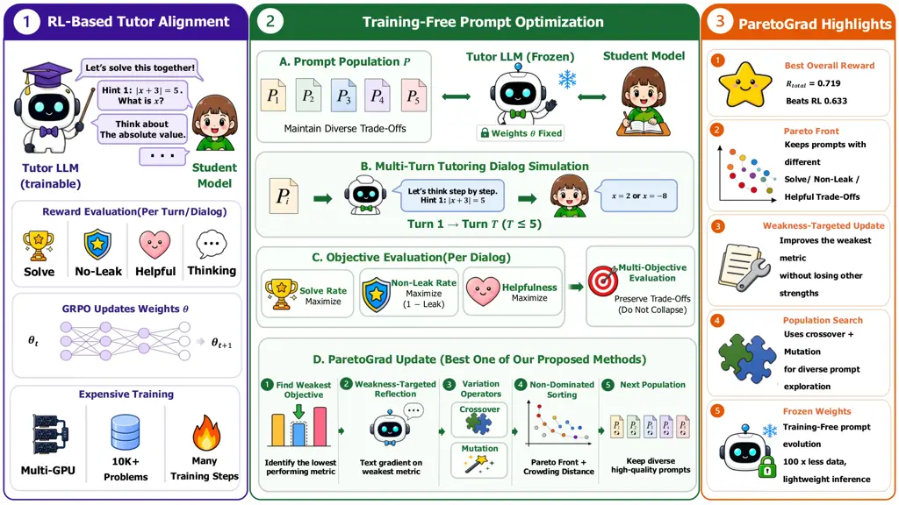
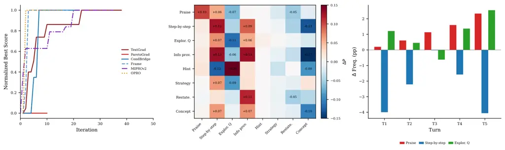
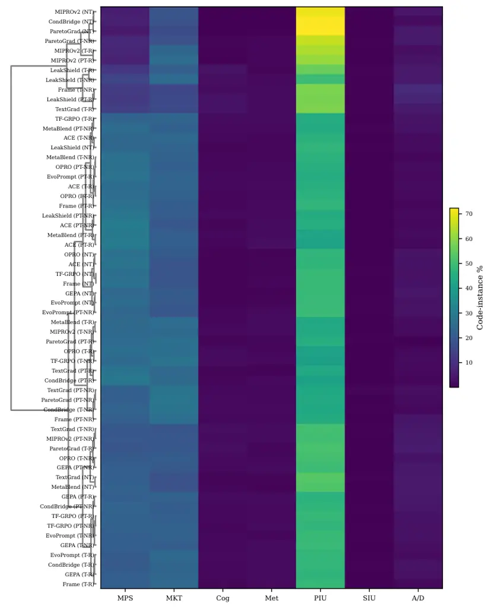
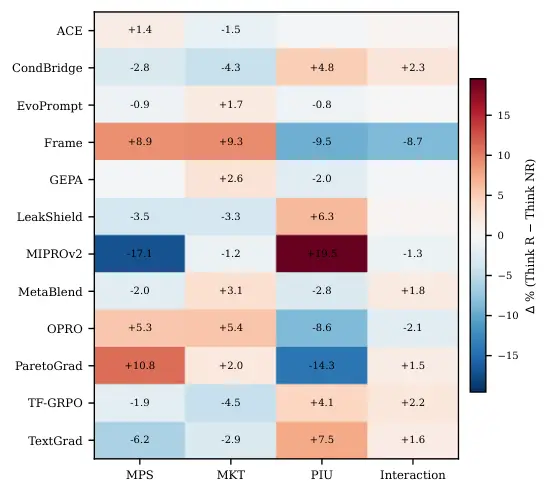
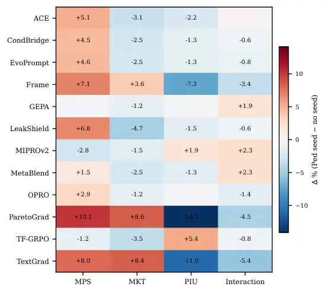

# LLMs Are Already Good Tutors: Training-Free Prompt Optimization for Pedagogical Math Tutoring

Unggi Lee Affiliation: Korea University Sejong Campus
Email: [codingchild@korea.ac.kr](mailto:)    Minchul Shin
Affiliation: Gyeonggi Institute of Education
Email: [minchul0582@gmail.com](mailto:)    Yeil Jeong
Affiliation: Indiana University Bloomington
Email: [yeilj@iu.edu](mailto:)    Sookbun Lee Affiliation: Opentutorials
   Jeongsu Moon Affiliation: Chosun University    Kyungtae Joo
Affiliation: Chosun University    Eunjoo Lee Affiliation: Gyeonggi
Institute of Education    Hoilym Kwon Affiliation: Korea University
Korean Studies Center^(†)Corresponding authors

###### Abstract

Aligning LLMs for math tutoring typically requires RL-based training
with multi-GPU infrastructure. We investigate whether training-free
prompt optimization-evolving only the system prompt via API calls-can
serve as a practical alternative. We adapt 7 published methods and
propose 5 education-specialized methods, evaluating these 12 methods
under 5 conditions on 2 OOD benchmark suites. All 12 best-per-method
configurations surpass the strongest RL-trained baseline
($`R_{\text{total}}=0.633`$), and our ParetoGrad achieves the best
Pareto balance across post-test solve rate, leak control, and
helpfulness, rather than dominating any single component. Behavioral
analysis with an 82-code educational codebook reveals that training-free
methods rely on teaching-knowledge patterns at 2-3$`\times`$ the rate of
RL-trained models, with a compensating $`{\sim}10`$ percentage-point
reduction in intent-level scaffolding. We also find a task-dependent
reasoning mode effect consistent across training-free and RL-based
paradigms. Our approach enables efficient development of pedagogically
aligned LLM tutors with prompts alone and minimal compute.

## 1 Introduction

Large language models (LLMs) hold significant promise as personalized
math tutors (Tack and Piech, 2022; LearnLM Team, Google, 2025), but
aligning them with sound pedagogy-guiding students toward solutions
without simply revealing answers-remains challenging (Chi and Wylie,
2014). Recent RL-based alignment approaches (Dinucu-Jianu et al., 2025;
Lee et al., 2026a) train with multi-objective rewards (solve rate, leak
prevention, helpfulness) using GRPO (Shao et al., 2024), producing
effective 7B tutors competitive with frontier models. However, these
approaches require multi-GPU infrastructure and thousands of training
problems, creating a significant barrier for educators and researchers.

Meanwhile, automatic prompt optimization methods such as OPRO (Yang
et al., 2024), TextGrad (Yuksekgonul et al., 2024), and GEPA (Agrawal
et al., 2026) have demonstrated that LLM behavior can be steered by
evolving the system prompt without weight updates. Yet these methods
have never been applied to multi-turn educational dialog, where
optimization must jointly balance scaffolding quality, answer leak
prevention, and student learning outcomes.

Figure 1: Post-test solve rate ($`R_{\text{sol}}`$, K=8) vs. leak rate
trade-off across the 12 listed training-free methods; bubble size
reflects helpfulness. Our proposed ParetoGrad ($`\bigstar`$) achieves
the best Pareto balance across the three objectives without updating
model weights.



Figure 2: Left shows RL-based tutor alignment and center shows our
training-free prompt optimization, illustrated with ParetoGrad as a
representative instance; right lists method highlights. RL updates tutor
weights $`\theta`$ via GRPO over reward components (solve, non-leak,
helpfulness, thinking), requiring multi-GPU training over 10K+ problems.
In contrast, our approach keeps the tutor and student models frozen and
evolves a population of system prompts $`\mathcal{P}`$ through four
steps - (A) maintaining diverse prompt trade-offs, (B) simulating
multi-turn tutoring dialog, (C) evaluating each prompt on three
objectives ($`R_{\text{sol}}`$, $`R_{\text{leak}}`$,
$`R_{\text{help}}`$), and (D) updating the population via
weakness-targeted reflection, crossover and mutation, and non-dominated
Pareto sorting with crowding distance. ParetoGrad achieves the best
Pareto balance across solve rate, leak control, and helpfulness with
100$`\times`$ less data and single-GPU inference, and all 12 listed
training-free methods surpass the strongest RL-trained baseline.

We investigate whether _training-free_ prompt optimization can serve as
a practical alternative to RL-based tutor alignment (Figures 1 and 2).
We first adapt 7 published prompt optimization methods to multi-turn
educational dialog. Through extensive experimentation with diverse
optimization strategies, we identify and propose 5 education-specialized
methods that embed pedagogical priors - scaffolding, leak prevention,
meta-optimization - directly into the prompt evolution process. Using
the same reward framework as PedagogicalRL-Thinking (Lee et al., 2026a),
we evaluate all 12 methods under 5 conditions on 2 OOD benchmark suites
(Lee et al., 2026b; Macina et al., 2025), yielding 792 evaluation runs.

Our key contributions are:

- •
  We show that training-free prompt optimization can match or exceed
  RL-trained baselines on the same multi-objective reward using only
  inference-time compute.¹¹ 1
  [https://anonymous.4open.science/r/tf-openlearnlm-anon-C780/README.md](https://anonymous.4open.science/r/tf-openlearnlm-anon-C780/README.md)
- •
  We propose five education-specialized prompt optimization methods
  (ParetoGrad, CondBridge, LeakShield, Frame, MetaBlend) inspired by
  empirical failure analysis of existing approaches.
- •
  We provide the first adaptation of published prompt optimization
  methods to multi-turn educational dialog, together with a systematic
  behavioral comparison against RL-trained approaches using the same
  educational codebook.

## 2 Method

### 2.1 Problem Formulation

Given a frozen LLM $`\mathcal{M}`$ with fixed weights $`\theta`$, we
seek a system prompt $`P^{*}`$ that maximizes tutoring quality:

```math
P^{*}=\argmax_{P}\;\mathbb{E}_{x\sim\mathcal{X}}\left[R_{\text{total}}\!\left(\text{Dialog}(\mathcal{M},P,x)\right)\right] \tag{1}
```

Unlike RL-based approaches (Dinucu-Jianu et al., 2025; Lee et al.,
2026a) that update $`\theta`$ via GRPO, we keep $`\theta`$ frozen and
evolve only $`P`$, requiring only black-box API access. Each candidate
prompt $`P`$ is evaluated by simulating multi-turn tutoring dialogs
between the tutor $`\mathcal{M}`$ and a student model $`\mathcal{S}`$
for up to $`T\!=\!5`$ turns on problem $`x`$.

### 2.2 Reward Design

We adopt the reward framework from Lee et al. (2026a). Given a dialog
$`D=\text{Dialog}(\mathcal{M},P,x)`$, we compute four reward components:
(1) $`R_{\text{sol}}(D)`$: post-dialog student solve rate over
$`K\!=\!8`$ attempts; (2) $`R_{\text{leak}}(D)\in\{0,1\}`$: 1 if the
tutor avoided leaking the answer, 0 otherwise (we report the leak rate
$`1-R_{\text{leak}}`$ in tables for interpretability; $`\rho=-0.94`$
between leak rate and $`R_{\text{total}}`$ across 137
method$`\times`$condition runs); (3) $`R_{\text{help}}(D)\in[0,1]`$:
pedagogical helpfulness; (4) $`R_{\text{think}}(D)\in[0,1]`$: thinking
quality (reasoning models only). The total reward is:

```math
R_{\text{total}}(D)\!=\!\begin{cases}\frac{R_{\text{sol}}+R_{\text{leak}}+R_{\text{help}}}{3}&\text{(no think)}\\[4.0pt]
\frac{R_{\text{sol}}+R_{\text{leak}}+R_{\text{help}}+R_{\text{think}}}{4}&\text{(think)}\end{cases} \tag{2}
```

### 2.3 Adapted Published Methods

We adapted 7 published prompt optimization methods to the tutoring
domain, replacing their evaluation functions with our dialog simulation
and reward $`R_{\text{total}}`$. GEPA (Agrawal et al., 2026) uses
reflective prompt evolution with a Pareto frontier over
$`R_{\text{sol}}`$, $`R_{\text{leak}}`$, and $`R_{\text{help}}`$. ACE
(Zhang et al., 2026) extracts reusable skills, which we redefine as
pedagogical strategies such as scaffolding and questioning. OPRO (Yang
et al., 2024) uses an LLM-as-optimizer approach, where we include
tutoring failure cases in the meta-prompt. EvoPrompt (Guo et al., 2024)
applies genetic algorithms over a population of tutor system prompts
$`\{P_{1},\ldots,P_{N}\}`$. TextGrad (Yuksekgonul et al., 2024) computes
text-based gradients $`\nabla_{\text{text}}`$ from dialog quality
feedback and updates $`P_{t+1}=P_{t}-\nabla_{\text{text}}`$. MIPROv2
(Opsahl-Ong et al., 2024) performs Bayesian selection over pedagogical
instruction variants. TF-GRPO applies the group relative scoring from
GRPO (Shao et al., 2024) to rank prompt candidates by
$`R_{\text{total}}`$ without updating $`\theta`$.

### 2.4 Proposed Education-Specialized Methods

Error analysis of 19,500 dialogs from the adapted methods revealed three
tutoring-specific failure patterns: _answer leakage_ (82.8% of
failures), _rigid instruction following_, and _lack of pedagogical
structure_ despite high $`R_{\text{total}}`$ (Chi and Wylie, 2014).
Inspired by these empirical observations, we designed 5
education-specialized methods targeting these failure patterns. We
present these methods below; additional exploratory variants are
documented in Appendix D.

#### 2.4.1 Pedagogical Scaffolding

Frame extends TextGrad (Yuksekgonul et al., 2024) with a post-gradient
reframing pass:

```math
P_{t+1}=\text{Refr}\!\left(P_{t}-\nabla_{\text{text}}(P_{t},D)\right) \tag{3}
```

where $`\text{Refr}(\cdot)`$ applies three linguistic transformations:
(1) converting prohibitive language into behavioral guidance; (2)
replacing brevity directives with substance-focused instructions; (3)
injecting concrete tutoring exemplars. In pilot analysis, reframing
alone reduced leak rate from 0.891 to 0.761.

#### 2.4.2 Leak Prevention

CondBridge evaluates each candidate $`P`$ under both NoThink
($`\mathcal{M}_{\text{NT}}`$) and Think ($`\mathcal{M}_{\text{TH}}`$)
conditions:

```math
P^{*}\!=\!\argmax_{P}\alpha R_{\text{total}}^{\text{NT}}\!(P)+(1\!-\!\alpha)R_{\text{total}}^{\text{TH}}\!(P) \tag{4}
```

where $`\alpha=0.5`$. This dual-condition objective drives CondBridge to
the lowest leak rate (0.204) among all training-free methods at NoThink,
while at Think Reward it reaches $`R_{\text{total}}=0.691`$.

#### 2.4.3 Dual-Objective

LeakShield uses two-stage optimization: Stage 1 (first 40%) minimizes
leakage; Stage 2 maximizes $`R_{\text{sol}}`$ and $`R_{\text{help}}`$
under a leak ceiling $`\tau`$:

```math
P^{*}\!=\!\argmax_{P}R_{\text{sol}}(P)\!+\!R_{\text{help}}(P)\;\text{s.t.}\;1\!-\!R_{\text{leak}}(P)\!\leq\!\tau \tag{5}
```

If leakage exceeds $`\tau`$ during Stage 2, the optimizer reverts to
anti-leak updates.

#### 2.4.4 Meta-Optimization

MetaBlend collects the best prompts $`\{P^{*}_{1},\ldots,P^{*}_{m}\}`$
from $`m`$ completed runs, extracts common structural patterns, and
synthesizes an initial prompt $`P_{0}`$. Phase 2 refines $`P_{0}`$ via
TextGrad for 300 iterations, preserving patterns as constraints.

#### 2.4.5 Population-Gradient Hybrid

ParetoGrad maintains a population $`\{P_{1},\ldots,P_{N}\}`$ with
$`N\!=\!5`$ and applies NSGA-II non-dominated sorting across
$`(R_{\text{sol}},R_{\text{leak}},R_{\text{help}})`$, yielding the best
Pareto balance across the three objectives ($`R_{\text{total}}=0.719`$
at Think NoReward). Each generation produces offspring via
weakness-targeted TextGrad, crossover, and mutation over 100
generations.

## 3 Experiments

|                                            |     |      |        |                                           |                    |                  |                                             |                   |                |                |                 |                 |                |                |                 |
| ------------------------------------------ | --- | ---- | ------ | ----------------------------------------- | ------------------ | ---------------- | ------------------------------------------- | ----------------- | -------------- | -------------- | --------------- | --------------- | -------------- | -------------- | --------------- |
|                                            |     |      |        | BigMath (ID)                              |                    |                  |                                             | OpenLearnLM (OOD) |                |                |                 |                 | MTBench        |                |                 |
| Method                                     | Th. | Th.R | Prompt | $`\boldsymbol{R_{\text{sol}}}{\uparrow}`$ | Leak$`\downarrow`$ | Help$`\uparrow`$ | $`\boldsymbol{R_{\text{total}}}{\uparrow}`$ | CK$`\uparrow`$    | PK$`\uparrow`$ | SK$`\uparrow`$ | Att$`\uparrow`$ | Avg$`\uparrow`$ | Sc$`\uparrow`$ | Pd$`\uparrow`$ | Avg$`\uparrow`$ |
| Frontier Models (Zero-shot)^($`\dagger`$)  |     |      |        |                                           |                    |                  |                                             |                   |                |                |                 |                 |                |                |                 |
| GPT-5.2 (Ped.)                             | ✓   | \-   | Ped.   | .340                                      | .000               | .440             | .593                                        | 8.08              | 8.46           | 8.63           | 8.68            | 8.46            | \-             | \-             | \-              |
| Claude-4-Opus (Ped.)                       | ✓   | \-   | Ped.   | .350                                      | .090               | .760             | .673                                        | 6.63              | 8.61           | 8.82           | 8.45            | 8.13            | \-             | \-             | \-              |
| DeepSeek-V3.2 (Ped.)                       | ✓   | \-   | Ped.   | .390                                      | .110               | .820             | .700                                        | 7.46              | 7.32           | 8.63           | 8.77            | 8.05            | \-             | \-             | \-              |
| RL-Trained Models^($`\dagger`$)            |     |      |        |                                           |                    |                  |                                             |                   |                |                |                 |                 |                |                |                 |
| NoThink (RL)                               | ✗   | ✗    | Gen.   | .120                                      | .300               | .180             | .333                                        | 7.95              | 7.43           | 7.77           | 7.57            | 7.68            | \-             | \-             | \-              |
| Think NR (RL)                              | ✓   | ✗    | Gen.   | .281                                      | .180               | .730             | .604                                        | 7.95              | 7.43           | 7.76           | 7.79            | 7.73            | \-             | \-             | \-              |
| Think R (RL)                               | ✓   | ✓    | Gen.   | .284                                      | .182               | .764             | .621                                        | 7.95              | 7.43           | 7.76           | 7.71            | 7.71            | \-             | \-             | \-              |
| Ped. Think NR (RL)                         | ✓   | ✗    | Ped.   | .275                                      | .214               | .766             | .607                                        | 7.95              | 7.43           | 7.76           | 7.79            | 7.73            | \-             | \-             | \-              |
| Ped. Think R (RL)                          | ✓   | ✓    | Ped.   | .294                                      | .172               | .776             | .633                                        | 7.99              | 7.43           | 7.77           | 7.86            | 7.76            | \-             | \-             | \-              |
| Baseline                                   |     |      |        |                                           |                    |                  |                                             |                   |                |                |                 |                 |                |                |                 |
| No optimization                            | ✗   | ✗    | Gen.   | .120                                      | .300               | .180             | .333                                        | 7.56              | 6.87           | 8.53           | 7.93            | 7.72            | 7.17           | 5.25           | 6.21            |
| Training-Free: Published Methods (Adapted) |     |      |        |                                           |                    |                  |                                             |                   |                |                |                 |                 |                |                |                 |
| EvoPrompt                                  | ✓   | ✓    | Gen.   | .566                                      | .286               | .847             | .711                                        | 7.62              | 7.54           | 8.69           | 8.50            | 8.09            | 8.16           | 8.09           | 8.13            |
| MIPROv2                                    | ✓   | ✓    | Gen.   | .563                                      | .298               | .848             | .707                                        | 6.97              | 7.42           | 8.56           | 8.21            | 7.79            | 8.29           | 8.03           | 8.16            |
| TF-GRPO                                    | ✓   | ✓    | Gen.   | .561                                      | .312               | .845             | .700                                        | 6.78              | 6.71           | 7.95           | 8.50            | 7.49            | 7.95           | 7.70           | 7.82            |
| GEPA                                       | ✓   | ✗    | Gen.   | .542                                      | .324               | .841             | .686                                        | 6.41              | 6.87           | 7.27           | 8.43            | 7.24            | 8.23           | 8.00           | 8.12            |
| OPRO                                       | ✓   | ✓    | Ped.   | .574                                      | .382               | .846             | .684                                        | 6.64              | 6.67           | 7.70           | 8.21            | 7.31            | 7.84           | 7.65           | 7.75            |
| TextGrad                                   | ✓   | ✗    | Ped.   | .527                                      | .374               | .845             | .666                                        | 6.97              | 6.67           | 7.45           | 8.36            | 7.36            | 8.01           | 7.72           | 7.86            |
| ACE                                        | ✓   | ✗    | Ped.   | .551                                      | .460               | .833             | .642                                        | 7.11              | 6.63           | 8.62           | 8.57            | 7.73            | 8.21           | 8.06           | 8.13            |
| Training-Free: Proposed Methods (Ours)     |     |      |        |                                           |                    |                  |                                             |                   |                |                |                 |                 |                |                |                 |
| ParetoGrad                                 | ✓   | ✗    | Gen.   | .563                                      | .252               | .845             | .719                                        | 6.92              | 6.55           | 7.99           | 8.07            | 7.38            | 7.77           | 7.79           | 7.78            |
| LeakShield                                 | ✓   | ✗    | Gen.   | .496                                      | .264               | .847             | .693                                        | 6.97              | 6.87           | 7.12           | 8.00            | 7.24            | 7.37           | 7.87           | 7.62            |
| CondBridge                                 | ✓   | ✓    | Gen.   | .552                                      | .336               | .843             | .691                                        | 6.88              | 6.71           | 7.91           | 8.14            | 7.41            | 7.82           | 7.84           | 7.83            |
| Frame                                      | ✓   | ✗    | Ped.   | .558                                      | .354               | .845             | .683                                        | 6.97              | 6.83           | 7.62           | 7.93            | 7.34            | 7.89           | 7.72           | 7.81            |
| MetaBlend                                  | ✓   | ✓    | Gen.   | .562                                      | .392               | .843             | .676                                        | 6.88              | 6.79           | 7.68           | 8.29            | 7.41            | 7.88           | 7.63           | 7.76            |

^($`\dagger`$)Frontier/RL/Baseline rows show $`\Delta`$Solve in the
$`R_{\text{sol}}`$ column as reported by Lee et al. (2026a); Lee et al.
(2026b); training-free rows use the K=8 post-test $`R_{\text{sol}}`$
defined above. Bold = best per column (for $`R_{\text{sol}}`$ and
$`R_{\text{total}}`$, restricted to the 12 listed training-free methods
due to the $`R_{\text{sol}}`$ metric difference). Underline = best per
column among non-Frontier rows (RL + 12 training-free) when distinct
from the bolded entry, else 2nd best in that pool. Full appendix results
in §A.

Table 1: In-domain BigMath and OOD benchmark results. Each training-free
row shows its best of 5 conditions, encoded by the Th./Th.R/Prompt
indicators. $`R_{\text{sol}}`$ is the K=8 post-dialog solve rate;
$`R_{\text{total}}=(R_{\text{sol}}+R_{\text{leak}}+R_{\text{help}})/3`$.
ParetoGrad achieves the best Pareto balance across the three components,
and all 12 listed training-free methods surpass the strongest RL-trained
baseline.

### 3.1 Setup

We match the setup of Dinucu-Jianu et al. (2025); Lee et al. (2026a).
The tutor model is Qwen2.5-7B-Instruct for the NoThink condition with a
maximum of 256 output tokens, and Qwen3-8B for all thinking conditions
with 384 output tokens and a thinking budget of 1,024 tokens. The
student model is LLaMA-3.1-8B-Instruct with a maximum of 512 tokens.
Reward judgments are made by GPT-4o-mini (Zheng et al., 2023), and
prompt improvements are proposed by GPT-4o as the reflection model. Each
dialog runs up to 5 turns under 5 conditions identical to Lee et al.
(2026a): NoThink (Qwen2.5-7B), Think NoReward and Think Reward
(Qwen3-8B, with/without $`R_{\text{think}}`$), and their
pedagogical-seed variants. Whether each condition enables thinking,
applies $`R_{\text{think}}`$, or seeds with a pedagogical prompt is
encoded in Table 1 as the Th./Th.R/Prompt indicator triplet.

Optimization uses 100 BigMath (Albalak et al., 2025) problems filtered
to medium-to-hard difficulty (student solve rate 1-60%). We evaluate on
2 OOD suites: OpenLearnLM (Lee et al., 2026b) (4 sub-benchmarks) and
MathTutorBench (Macina et al., 2025) (2 sub-benchmarks), totaling 1,334
items. Our approach requires only a single RTX 3090 for vLLM inference,
compared to 4$`\times`$H100 GPUs for RL training (Lee et al., 2026a),
with a small amount of API costs for GPT-4o-mini and LLaMA-3.1 via
OpenRouter. We conduct 792 evaluation runs in total. We focus on the 5
proposed methods listed in Table 1; additional exploratory variants are
in Appendix A.

### 3.2 Main Results

Table 1 presents performance on both in-domain and OOD benchmarks; for
compactness each training-free method is shown with its best of 5
conditions ranked by $`R_{\text{total}}`$, and the corresponding
configuration is encoded by the indicator triplet.

#### RQ1: Is training-free prompt optimization effective for math tutoring?

Yes - and more strongly than initial estimates suggested. All
training-free methods improve over the unoptimized baseline
($`R_{\text{total}}\!\approx\!0.33`$); all 12 listed methods even
surpass the strongest RL-trained model (Ped. Think R,
$`R_{\text{total}}=0.633`$). Our proposed ParetoGrad (Think, no reward)
reaches $`R_{\text{total}}=0.719`$, the most balanced result across the
three objectives. ParetoGrad does not dominate any single component but
is uniformly strong, with $`R_{\text{sol}}=0.563`$ (3rd, tied with
MIPROv2), Leak$`=0.252`$ (best), and Help$`=0.845`$ (top tier).
Specialists exist for individual components - OPRO leads
$`R_{\text{sol}}`$ (0.574) and CondBridge attains the lowest leak
(0.204) at NoThink - but neither balances all three components as well
as ParetoGrad, illustrating the persistent solve-leak tension
(Figure 1).

#### RQ2: Do education-specialized methods outperform general-purpose ones?

The answer is nuanced under the completed evaluation. On in-domain
BigMath $`R_{\text{total}}`$, the top-12 split into 7 published-adapted
and 5 proposed methods; the most balanced is our proposed ParetoGrad
(0.719), with published EvoPrompt (0.711) and MIPROv2 (0.707) close
behind on aggregate reward. On OOD, published methods now lead
OpenLearnLM-Avg (EvoPrompt 8.09) and MathTutorBench-Avg (MIPROv2 8.16),
with proposed methods narrowly behind (CondBridge OL-Avg 7.41;
CondBridge/Frame MTB-Avg 7.83/7.81). Pedagogical-seed prompts help OOD
specifically for ACE, TextGrad, and Frame, while non-pedagogical seeds
win on $`R_{\text{total}}`$ for ParetoGrad/LeakShield/GEPA.
Education-specialization therefore yields gains in leak control and in
selected OOD subscores, rather than a uniform advantage on
$`R_{\text{total}}`$ (see §4.1).

#### RQ3: How do training-free methods compare to RL-trained approaches?

Training-free optimization can match or exceed RL on aggregate reward:
ParetoGrad reaches $`R_{\text{total}}=0.719`$ vs. RL Ped. Think R at
0.633, while using 100$`\times`$ less data (100 vs. 10K problems) and
only inference-time compute on a single consumer GPU rather than the
multi-GPU training stack required by RL. RL still attains slightly
tighter leak control under thinking (RL Ped. Think R leak 0.172 vs.
ParetoGrad 0.252), and conversely training-free can exceed RL on
$`\Delta\text{Sol}`$ (0.394 vs. 0.294). The paradigms are complementary:
RL provides tight behavioral control through weight updates, while
training-free offers accessibility, interpretability, and immediate
deployability with a much smaller compute footprint.

Figure 3: Left compares NoThink and Think (avg of 4 think conditions) on
in-domain metrics (0-1 scale). Thinking modestly degrades leak control
(1$`-`$Leak drops from 0.55 to 0.43). Right shows OOD benchmark
averages. Think improves MathTutorBench (+0.87) but hurts OpenLearnLM
($`-`$0.44), revealing a task-dependent reasoning mode effect.

Comparing Think and NoThink (Table 1, Figure 3 right), thinking improves
MathTutorBench but degrades OpenLearnLM. Figure 3 left shows that
in-domain leak control degrades sharply under thinking. This
task-dependent reasoning mode effect is consistent across both
training-free and RL paradigms (Lee et al., 2026a), suggesting it
reflects a fundamental property of reasoning-enabled models rather than
an artifact of the optimization method. After the full sweep, the best
condition per method is a Think variant for all 12 listed methods, with
the choice between $`R_{\text{think}}`$ on/off and pedagogical/general
seed differing across methods - encoded in Table 1 by the indicator
triplet rather than collapsed into a single representative condition.

## 4 Analysis

Figure 4: Left plots in-domain $`R_{\text{total}}`$ vs. OOD MTB-Avg
across the 12 listed methods. Reward maximization is essentially
uncorrelated with OOD MathTutorBench performance ($`\rho\!=\!0.01`$,
$`p\!=\!0.96`$) and only weakly correlated with OpenLearnLM
($`\rho\!=\!0.25`$, $`p\!=\!0.41`$). Center compares sentence-multilabel
code frequency (%) between RL-trained models (Dinucu-Jianu et al., 2025;
Lee et al., 2026a) and training-free methods (CondBridge, Frame). Right
reports Polya phase progression for top-6 vs. bottom-6 methods by
$`R_{\text{total}}`$ (NoThink); high-performance methods sustain
Scaffold codes throughout the dialog.

### 4.1 In-Domain vs. OOD Generalization

Figure 4 reveals essentially no correlation between in-domain
$`R_{\text{total}}`$ and OOD MathTutorBench-Avg across the 12 listed
methods ($`\rho=0.01`$, $`p=0.96`$), and only a weak correlation with
OpenLearnLM-Avg ($`\rho=0.25`$, $`p=0.41`$). The most striking
dissociations are: ACE ranks 12th in-domain but 2nd on MTB (and 3rd on
OL), LeakShield ranks 5th in-domain but last (12th) on both MTB and OL,
and ParetoGrad ranks 1st in-domain but 9th on MTB and 7th on OL.
Codebook analysis suggests the mechanism: methods that minimize leak via
tight scaffolding (ParetoGrad, LeakShield) optimize the in-domain reward
rubric, while content-delivery-rich methods (ACE, MIPROv2, EvoPrompt)
transfer their structured tutoring patterns more readily to held-out
benchmarks. This indicates that in-domain reward maximization and OOD
generalization rely on fundamentally different pedagogical strategies.

### 4.2 Trained vs. Training-Free Behavioral Comparison

We labeled 415,775 tutor sentences across 60 method-condition
configurations (12 methods $`\times`$ 5 conditions) with GPT-4o-mini
using the 82-code educational codebook from Lee et al. (2026a). Figure 4
center compares two training-free methods (CondBridge, Frame) with RL
baselines on six core codes (sentence-multilabel %). Training-free
methods strongly suppress Praise (CondBridge 5.94%, Frame 3.20%;
comparable to RL Ped. Think Reward 5.78% and far below the unoptimized
baseline 11.76%), with MIPROv2 as a notable exception whose
$`R_{\text{think}}`$-activated runs increase rather than reduce Praise
(Appendix C.12). However, they redistribute behavior toward content
delivery rather than explicit scaffolding: Information provision is
23-31% under training-free versus 8-9% under RL, while explicit Hint
provision drops to 0.5-1.4% versus 9-11% under RL. At the category
level, this manifests as a 2-3$`\times`$ elevation of Mathematical
Knowledge for Teaching (training-free 19-23% vs. RL 7-8%) and a
$`{\sim}10`$pp deficit in Pedagogical Intent Utterance (training-free
46-55% vs. RL 60-65%), suggesting that prompt-level optimization
recruits teaching-knowledge patterns where RL recruits intent-level
scaffolding moves.

### 4.3 Polya Phase Progression

We mapped the 82 codes to Polya’s problem-solving phases and tracked
progression across dialog turns (Figure 4 right; top-6 vs. bottom-6
methods by $`R_{\text{total}}`$, NoThink). Scaffold codes (hints,
exploratory questions, prompts) dominate every turn (49-73%), and
high-performance methods maintain consistently higher Scaffold than
low-performance methods (+9.8pp at T1, +8.8pp at T5). Conversely,
low-performance methods substitute direct Execution codes (calculation,
step-by-step procedure) by 3-5pp across mid-late turns. _Sustained
scaffolding_-continuing to guide rather than execute on the student’s
behalf-is the key behavioral differentiator between high- and
low-performing optimization methods.



Figure 5: Left shows optimization convergence for 6 methods under a
shared 500-evaluation budget; gradient methods converge within 10
iterations while dual-objective methods improve gradually. Center
displays code-to-code transition probability differences (high $`-`$
low). High-performance methods chain content delivery codes
(Step-by-step, Information provision), while low-performance methods
chain question codes (Exploratory question). Right reports per-turn
frequency differences between successful (top 25%) and failed (bottom
25%) dialogs in the high-performance group. Successful dialogs deploy
fewer Step-by-step instructions and substitute more Exploratory
questions and Praise toward the dialog’s conclusion.

### 4.4 Optimization Convergence

Figure 5 left shows convergence patterns across methods. All methods
share a budget of 500 reward evaluations, but iterations differ because
population methods (ParetoGrad, $`N\!=\!5`$) consume $`\sim`$50
evaluations per iteration while single-candidate methods (TextGrad) use
$`\sim`$10. Gradient-based methods converge rapidly within 10
iterations, while dual-objective methods (CondBridge, LeakShield) show
slower but steadier improvement as they balance competing objectives.

### 4.5 Transition Patterns

Transition analysis (Figure 5 center) reveals a code-type dependent
pattern. On _question_ codes, low-performance methods exhibit higher
self-repetition: Exploratory question self-loop probability is 0.408 for
low-performance vs. 0.357 for high-performance methods. By contrast, on
_content-delivery_ codes, high-performance methods show stronger
self-chaining (Information provision 0.314 vs. 0.172; Step-by-step
instruction 0.347 vs. 0.212), reflecting sustained explanation rather
than fragmented question repetition. The pedagogical signature of strong
methods is thus a shift of self-repetition from question loops toward
explanation chains.

### 4.6 Success vs. Failure Dialogs

Within the same high-performance methods, successful dialogs (top 25%
$`R_{\text{total}}`$) differ from failures across turns (Figure 5
right). Successful dialogs deploy fewer Step-by-step instructions early
($`-`$4.0pp at T1, $`-`$2.2pp at T2) and at closure ($`-`$4.0pp at T5),
substituting more Exploratory questions (+1.2pp at T1, +2.6pp at T5) and
more Praise (+2.3pp at T5). The pattern suggests that successful
tutoring elicits the student’s understanding through questions rather
than dictating procedure, and reserves praise for confirmed progress
near the dialog’s conclusion. Decomposing this effect by reasoning mode
and turn position (Appendix C.11) shows that the late-turn Praise
contribution to $`R_{\text{total}}`$ is concentrated in NoThink dialogs
at T4+, providing the behavioral substrate for the closing-turn
pedagogical wrap-up.

### 4.7 Cost Comparison

PedagogicalRL-Thinking (Lee et al., 2026a) requires substantial
multi-GPU compute for hundreds of hours of GRPO training, while our
approach uses only inference-time serving on a single consumer GPU
during prompt optimization. Training-free can match or exceed RL on
aggregate reward (ParetoGrad $`R_{\text{total}}=0.719`$ vs. RL Ped.
Think R 0.633) with substantially lower GPU requirements, while
producing interpretable, human-readable prompts that educators can
directly inspect and modify.

### 4.8 Qualitative Analysis

While the preceding aggregate analyses characterize behavioral shifts in
distribution, the excerpts here clarify what those shifts look like in
dialog. First, the leak-rate differences in Table 1 and the Polya phase
progression in §4.3 point to a shared mechanism: higher-performing
methods avoid solution takeover while keeping the student responsible
for the next mathematical move. ParetoGrad illustrates this delegation:
“Let’s start by defining the number of red marbles as $`R`$. The problem
gives us three relationships involving $`R`$. Can you write these
relationships as equations?” The tutor supplies variable naming and
structural framing, but leaves equation formulation to the student (Wood
et al., 1976). In pedagogical terms, this preserves the problem-solving
cycle: the tutor supports entry into the task without collapsing
Understand, Plan, and Execute into tutor-performed computation (Pólya,
1945). The same pattern appears across both proposed and adapted
methods, so the qualitative evidence is best read as a behavioral
signature of successful prompt optimization rather than a
proposed-versus-published contrast.

Second, the MKT/PIU redistribution discussed earlier appears
qualitatively as a shift toward concept-rich explanation (Shulman, 1986;
Ball et al., 2008). CondBridge, for example, frames inequalities and
symmetry as a “key insight” for exploiting mathematical structure,
explaining _why_ a representation is useful rather than merely _which_
operation to perform. RL-trained tutors more often foreground
interactional pacing through praise, questions, and hints. Thus,
training-free optimization and RL appear to emphasize different but
compatible pedagogical resources: explanatory depth and scaffolding
density.

Finally, some higher-performing dialogs elicit student-model turns with
features of mathematical communication, including variable definition,
function transformation, and explicit reasoning connectives. After a
structured ParetoGrad exchange, the simulated student writes, “let
$`a=\log_{10}2`$ … Therefore $`f(a)+f(-a)=\ldots`$” These are features
of student-model generated discourse, not evidence of human learning.
Still, they suggest that future rewards could explicitly value
transferable scaffolds, such as Polya-phase maintenance (Pólya, 1945),
to better connect in-domain optimization with OOD teaching competencies.

## 5 Discussion

Training-free prompt optimization works because the prompt itself is an
explicit pedagogical prior over the LLM’s frozen distribution: short
instructions can directly invoke teaching-knowledge patterns (Shulman,
1986; Ball et al., 2008) that RL approximates only through many gradient
updates over scalar rewards (Dinucu-Jianu et al., 2025; Lee et al.,
2026a). The observed MKT/PIU redistribution is consistent with this
account: prompts recruit declarative resources, while RL shapes
behavioral pacing (Chi and Wylie, 2014), making the two paradigms
complements rather than substitutes.

The dissociation between in-domain reward and OOD generalization
qualifies what “best method” means: tight-scaffolding methods win the
in-domain rubric, while content-delivery-rich methods transfer better to
held-out benchmarks (Macina et al., 2025; Lee et al., 2026b). Since
aggregate scores cluster tightly, ParetoGrad’s value lies less in
topping the table than in lacking weakness across the three reward
components - Pareto balance is a more honest summary than scalar
dominance for multi-objective evaluation.

For educators, training-free tutoring’s most useful property is its
artifact: a plain-text prompt that can be read, edited, and shared,
rather than opaque weights. Combined with the sustained scaffolding
(Wood et al., 1976) and Polya-phase structure (Pólya, 1945) visible in
the dialogs, these prompts function more like inspectable instructional
materials than fine-tuned models.

## 6 Related Work

### 6.1 Prompt Optimization

Prompt optimization refines black-box LLM prompts without weight updates
via meta-prompting (Zhou et al., 2023; Yang et al., 2024), textual
gradients (Pryzant et al., 2023; Yuksekgonul et al., 2024), modular
Bayesian programs (Khattab et al., 2024; Opsahl-Ong et al., 2024),
evolutionary populations (Guo et al., 2024), or reflective evolution
(Agrawal et al., 2026; Zhang et al., 2026). These methods have been
benchmarked primarily on single-turn NLP tasks under a single scalar
reward, with reflective evolution recently matching or exceeding
reinforcement learning on agentic tasks.

### 6.2 LLM-Based Math Tutoring

LLM-based math tutors guide students through multi-turn dialog rather
than supplying answers (Tack and Piech, 2022; LearnLM Team, Google,
2025), with scaffolding and answer-leak prevention as the defining
design constraints (Chi and Wylie, 2014); recent work operationalizes
this trade-off through dialog corpora (Macina et al., 2023),
multi-objective RL alignment (Dinucu-Jianu et al., 2025; Lee et al.,
2026a), and OOD benchmarks (Macina et al., 2025; Lee et al., 2026b). Our
training-free alternative matches or exceeds the strongest RL-trained
baseline using only inference-time prompts that educators can directly
inspect, and enables systematic behavioral comparison over the same
82-code educational codebook (Lee et al., 2026a).

## 7 Conclusion

We investigated whether training-free prompt optimization can serve as a
practical alternative to RL-based tutor alignment for math tutoring.
Adapting published prompt optimization methods to multi-turn educational
dialog and proposing five education-specialized variants inspired by
empirical failure analysis, we found that training-free methods match or
exceed the strongest RL-trained baseline using only inference-time
compute, while recruiting more teaching-knowledge patterns and less
intent-level scaffolding than RL. These results position training-free
prompt optimization not as a cheaper substitute for RL but as a
complementary paradigm that offers interpretability, accessibility, and
the ability to explore diverse pedagogical strategies through method
design alone.

## 8 Limitations

All tutoring dialogs use a simulated student (LLaMA-3.1-8B) rather than
real learners; while standard in the field (Dinucu-Jianu et al., 2025;
Lee et al., 2026a), student behavior may differ from authentic
interactions. Experiments are restricted to mathematics; generalization
to other subjects is untested. Evaluation relies on LLM-as-judge (Zheng
et al., 2023) without human evaluation. We report single-run results
without seed variance, though the breadth of comparison (792 runs)
partially mitigates this. Experiments use 7B/8B models; larger models
may narrow the gap between methods. Cross-paradigm comparison with RL
uses different OOD benchmarks, limiting direct numerical comparison.
Codebook analysis uses GPT-4o-mini for automatic labeling (vs.
GPT-5-mini in Lee et al. 2026a); a labeler-induced gap appears in
absolute Praise rate, though the directional finding that training-free
methods suppress Praise below the unoptimized baseline holds.

## 9 Use of Generative AI

We used Claude (Anthropic) to assist with drafting, editing, and code
generation during the preparation of this manuscript. All scientific
claims, experimental design, and data analysis were conducted and
verified by the authors.

## References

- Agrawal et al. (2026) Lakshya A Agrawal, Shangyin Tan, Dilara Soylu,
  Noah Ziems, Rishi Khare, Krista Opsahl-Ong, Arnav Singhvi, Herumb
  Shandilya, Michael J Ryan, Meng Jiang, Christopher Potts, Koushik Sen,
  Alexandros G. Dimakis, Ion Stoica, Dan Klein, Matei Zaharia, and Omar
  Khattab. 2026. GEPA: Reflective prompt evolution can outperform
  reinforcement learning. In _Proceedings of the Fourteenth
  International Conference on Learning Representations (ICLR)_. Oral.
- Albalak et al. (2025) Alon Albalak, Daman Agarwal, Pratyush Maini, Jon
  Saad-Falcon, and Tatsunori Hashimoto. 2025. BigMath: A large-scale,
  high-quality math dataset for reinforcement learning in language
  models. _arXiv preprint arXiv:2502.17387_.
- Ball et al. (2008) Deborah Loewenberg Ball, Mark Hoover Thames, and
  Geoffrey Phelps. 2008. Content knowledge for teaching: What makes it
  special? _Journal of Teacher Education_, 59(5):389–407.
- Chi and Wylie (2014) Michelene T.H. Chi and Ruth Wylie. 2014. The ICAP
  framework: Linking cognitive engagement to active learning outcomes.
  _Educational Psychologist_, 49(4):219–243.
- Dinucu-Jianu et al. (2025) David Dinucu-Jianu, Jakub Macina, Nico
  Daheim, Ido Hakimi, Iryna Gurevych, and Mrinmaya Sachan. 2025. From
  problem-solving to teaching problem-solving: Aligning LLMs with
  pedagogy using reinforcement learning. In _Proceedings of the 2025
  Conference on Empirical Methods in Natural Language Processing
  (EMNLP)_.
- Guo et al. (2024) Qingyan Guo, Rui Wang, Junliang Guo, Bei Li, Kaitao
  Song, Xu Tan, Guoqing Liu, Jiang Bian, and Yujiu Yang. 2024.
  Connecting large language models with evolutionary algorithms yields
  powerful prompt optimizers. In _Proceedings of the Twelfth
  International Conference on Learning Representations (ICLR)_.
- Khattab et al. (2024) Omar Khattab, Arnav Singhvi, Paridhi Maheshwari,
  Zhiyuan Zhang, Keshav Santhanam, Sri Vardhamanan, Saiful Haq, Ashutosh
  Sharma, Thomas T. Joshi, Hanna Moazam, Heather Miller, Matei Zaharia,
  and Christopher Potts. 2024. Dspy: Compiling declarative language
  model calls into self-improving pipelines. In _International
  Conference on Learning Representations_.
- LearnLM Team, Google (2025) LearnLM Team, Google. 2025. LearnLM:
  Improving Gemini for learning. _arXiv preprint arXiv:2412.16429_.
- Lee et al. (2026a) Unggi Lee, Jiyeong Bae, Jaehyeon Park, Haeun Park,
  Taejun Park, Younghoon Jeon, Sungmin Cho, Junbo Koh, Yeil Jeong, and
  Gyeonggeon Lee. 2026a. Rewarding how models think pedagogically:
  Integrating pedagogical reasoning and thinking rewards for LLMs in
  education. _arXiv preprint arXiv:2601.14560_.
- Lee et al. (2026b) Unggi Lee, Sookbun Lee, Heungsoo Choi, Jinseo Lee,
  Haeun Park, Younghoon Jeon, Sungmin Cho, Minju Kang, Junbo Koh,
  Jiyeong Bae, Minwoo Nam, Juyeon Eun, Yeonji Jung, and Yeil Jeong.
  2026b. OpenLearnLM benchmark: A unified framework for evaluating
  knowledge, skill, and attitude in educational large language models.
  _arXiv preprint arXiv:2601.13882_.
- Macina et al. (2023) Jakub Macina, Nico Daheim, Sankalan Pal
  Chowdhury, Tanmay Sinha, Manu Kapur, Iryna Gurevych, and Mrinmaya
  Sachan. 2023. MathDial: A dialogue tutoring dataset with rich
  pedagogical properties grounded in math reasoning problems. In
  _Findings of the Association for Computational Linguistics: EMNLP
  2023_.
- Macina et al. (2025) Jakub Macina, Nico Daheim, Ido Hakimi, Manu
  Kapur, Iryna Gurevych, and Mrinmaya Sachan. 2025. MathTutorBench: A
  benchmark for measuring open-ended pedagogical capabilities of LLM
  tutors. In _Proceedings of the 2025 Conference on Empirical Methods in
  Natural Language Processing (EMNLP)_.
- Opsahl-Ong et al. (2024) Krista Opsahl-Ong, Michael J Ryan, Josh
  Purtell, David Broman, Christopher Potts, Matei Zaharia, and Omar
  Khattab. 2024. Optimizing instructions and demonstrations for
  multi-stage language model programs. _arXiv preprint
  arXiv:2406.11695_.
- Pólya (1945) George Pólya. 1945. _How to Solve It: A New Aspect of
  Mathematical Method_. Princeton University Press.
- Pryzant et al. (2023) Reid Pryzant, Dan Iter, Jerry Li, Yin Tat Lee,
  Chenguang Zhu, and Michael Zeng. 2023. Automatic prompt optimization
  with “gradient descent” and beam search. In _Proceedings of the 2023
  Conference on Empirical Methods in Natural Language Processing_.
- Shao et al. (2024) Zhihong Shao, Peiyi Wang, Qihao Zhu, Runxin Xu,
  Junxiao Song, Xiao Bi, Haowei Zhang, Mingchuan Zhang, Y.K. Li, Y. Wu,
  and Daya Guo. 2024. DeepSeekMath: Pushing the limits of mathematical
  reasoning in open language models. _arXiv preprint arXiv:2402.03300_.
- Shulman (1986) Lee S. Shulman. 1986. Those who understand: Knowledge
  growth in teaching. _Educational Researcher_, 15(2):4–14.
- Tack and Piech (2022) Anaïs Tack and Chris Piech. 2022. The AI teacher
  test: Measuring the pedagogical ability of blender and GPT-3 in
  educational dialogues. In _Proceedings of the International Conference
  on Artificial Intelligence in Education_.
- Wood et al. (1976) David Wood, Jerome S. Bruner, and Gail Ross. 1976.
  The role of tutoring in problem solving. _Journal of Child Psychology
  and Psychiatry_, 17(2):89–100.
- Yang et al. (2024) Chengrun Yang, Xuezhi Wang, Yifeng Lu, Hanxiao Liu,
  Quoc V. Le, Denny Zhou, and Xinyun Chen. 2024. Large language models
  as optimizers. _arXiv preprint arXiv:2309.03409_.
- Yuksekgonul et al. (2024) Mert Yuksekgonul, Federico Bianchi, Joseph
  Boen, Sheng Liu, Zhi Huang, Carlos Guestrin, and James Zou. 2024.
  TextGrad: Automatic “differentiation” via text. _arXiv preprint
  arXiv:2406.07496_.
- Zhang et al. (2026) Qizheng Zhang, Changran Hu, Shubhangi Upasani,
  Boyuan Ma, Fenglu Hong, Vamsidhar Kamanuru, Jay Rainton, Chen Wu,
  Mengmeng Ji, Hanchen Li, Urmish Thakker, James Zou, and Kunle
  Olukotun. 2026. Agentic context engineering: Evolving contexts for
  self-improving language models. In _Proceedings of the Fourteenth
  International Conference on Learning Representations (ICLR)_.
- Zheng et al. (2023) Lianmin Zheng, Wei-Lin Chiang, Ying Sheng, Siyuan
  Zhuang, Zhanghao Wu, Yonghao Zhuang, Zi Lin, Zhuohan Li, Dacheng Li,
  Eric Xing, and 1 others. 2023. Judging LLM-as-a-judge with MT-bench
  and chatbot arena. _Advances in Neural Information Processing
  Systems_, 36.
- Zhou et al. (2023) Yongchao Zhou, Andrei Ioan Muresanu, Ziwen Han,
  Keiran Paster, Silviu Pitis, Harris Chan, and Jimmy Ba. 2023. Large
  language models are human-level prompt engineers. In _International
  Conference on Learning Representations_.

## Appendix A Full Results

Across the full experiment we designed 19 education-specialized prompt
optimization methods targeting the three failure patterns identified in
§3.2 (answer leakage, rigid instruction following, lack of pedagogical
structure). The 5 representative methods (ParetoGrad, CondBridge,
LeakShield, Frame, MetaBlend) are described in §3.2 and listed in
Table 1; the remaining 14 exploratory variants are described in §D. All
19 methods were evaluated under the NoThink condition with the same
multi-turn dialog simulation and multi-objective reward framework.
Table 2 presents in-domain BigMath results for the full set, sorted by
$`R_{\text{total}}`$. $`R_{\text{total}}`$ uses the K=8 post-test
$`R_{\text{sol}}`$ (consistent with Table 1); the $`\Delta`$Sol column
is reported separately for reference. Two published methods (TextGrad,
GEPA) are included with an asterisk for direct comparison under the same
NoThink condition.

|                                         |               |      |      |                                   |
| --------------------------------------- | ------------- | ---- | ---- | --------------------------------- |
| Method                                  | $`\Delta`$Sol | Leak | Help | $`\boldsymbol{R_{\text{total}}}`$ |
| CondBridge                              | .167          | .204 | .848 | .614                              |
| TextGrad\*                              | .173          | .208 | .840 | .612                              |
| ParetoGrad                              | .394          | .492 | .849 | .594                              |
| GEPA\*                                  | .237          | .340 | .842 | .590                              |
| HintGrad                                | .263          | .370 | .846 | .589                              |
| CurriculumOpt                           | .232          | .346 | .846 | .587                              |
| DisCo                                   | .180          | .294 | .843 | .586                              |
| HintChain                               | .304          | .448 | .847 | .577                              |
| PrincipleHint                           | .292          | .454 | .845 | .572                              |
| DecompReward                            | .167          | .320 | .840 | .571                              |
| SokRat                                  | .284          | .446 | .845 | .570                              |
| PopGrad                                 | .165          | .350 | .840 | .562                              |
| Frame                                   | .195          | .392 | .840 | .558                              |
| ThinkGuard                              | .206          | .424 | .784 | .531                              |
| LeakShield                              | .167          | .508 | .782 | .489                              |
| MetaBlend                               | .117          | .492 | .801 | .486                              |
| PromptDistill                           | .121          | .500 | .785 | .479                              |
| Adversarial                             | .162          | .700 | .821 | .437                              |
| ContrastOpt                             | .177          | .720 | .799 | .428                              |
| AnchorBoost                             | .105          | .668 | .794 | .421                              |
| DualLoop                                | .091          | .786 | .705 | .346                              |
| \*Published method shown for reference. |               |      |      |                                   |

Table 2: All 19 proposed methods on BigMath (NoThink).

## Appendix B Think Condition Comparison

Table 3 compares OOD performance across the four Think conditions for
all 12 training-free methods. Think Reward achieves the highest average
(7.66), though differences across conditions are small (spread 0.08).
The best condition varies by method (marked with $`\bigstar`$),
suggesting no single Think configuration is universally optimal.

|            |      |                  |                  |                  |
| ---------- | ---- | ---------------- | ---------------- | ---------------- |
| Method     | T-NR | T-R              | PT-NR            | PT-R             |
| MIPROv2    | 7.76 | $`\bigstar`$7.92 | 7.90             | 7.91             |
| EvoPrompt  | 8.00 | $`\bigstar`$8.10 | 7.78             | 7.78             |
| ACE        | 7.98 | 7.82             | 7.87             | $`\bigstar`$8.00 |
| GEPA       | 7.54 | $`\bigstar`$7.76 | 7.59             | 7.61             |
| ParetoGrad | 7.52 | $`\bigstar`$7.62 | 7.49             | 7.37             |
| OPRO       | 7.46 | $`\bigstar`$7.60 | 7.44             | 7.45             |
| TF-GRPO    | 7.54 | $`\bigstar`$7.60 | 7.51             | 7.54             |
| CondBridge | 7.54 | 7.55             | $`\bigstar`$7.59 | 7.36             |
| MetaBlend  | 7.44 | 7.52             | $`\bigstar`$7.58 | 7.37             |
| Frame      | 7.44 | $`\bigstar`$7.55 | 7.49             | 7.53             |
| TextGrad   | 7.34 | 7.48             | $`\bigstar`$7.53 | 7.50             |
| LeakShield | 7.37 | 7.39             | 7.47             | $`\bigstar`$7.52 |
| Average    | 7.58 | 7.66             | 7.60             | 7.58             |

Table 3: OOD average across 4 Think conditions. $`\bigstar`$ = best
condition per method. T = Think, PT = Ped. Think, NR = NoReward, R =
Reward.

## Appendix C Behavioral Analysis Details

This section provides condition-level aggregates and additional cuts of
the behavioral analysis in §4.2 and §4.3. All training-free rows are
12-method averages under each condition; RL reference rows are from Lee
et al. (2026a).

### C.1 Labeling Methodology Details

We use the 82-code educational codebook from Lee et al. (2026a),
organized into seven top-level categories: Mathematical Problem Solving
(MPS), Mathematical Knowledge for Teaching (MKT), Cognition,
Metacognition, Pedagogical Intent Utterance (PIU), Student Intent
Utterance (SIU), and Affect/Discourse (A/D). Tutor responses are labeled
with OpenAI GPT-4o-mini (openai/gpt-4o-mini via OpenRouter) at
temperature 0. For thinking-mode trajectories, \<think\>...\</think\>
blocks are stripped before sentence-level labeling, and sentences
shorter than 15 characters are excluded. PedRL-Thinking originally
reports labels obtained with GPT-5-mini; absolute rates therefore should
not be directly compared across the two studies, but the within-study
rank-based comparisons (Spearman) used in Appendix C.11 are robust to
labeler-induced offsets.

Two rate definitions appear in this work. The _single-label rate_ (used
by aggregate category percentages following Lee et al. 2026a) is the
fraction of sentences whose label set is exactly $`\{c\}`$; the
_multi-label rate_ (used for dialog-level aggregation and for the
core-code tables in this appendix) is the fraction of sentences whose
label set contains $`c`$. Spearman correlation tests in Appendix C.11
apply Benjamini-Hochberg correction across the
$`5\text{ conditions}\times 4\text{ reward components}`$ grid (20 tests,
$`q<0.05`$).

|                                                     |         |
| --------------------------------------------------- | ------- |
| Quantity                                            | Count   |
| Labeled tutor sentences (60 method-condition cells) | 415,775 |
| Labeled dialogs with $`R_{\text{total}}`$           | 22,126  |
| Schoenfeld paragraphs (thinking only)               | 30,954  |

Table 4: Labeled corpus statistics.

### C.2 Category Distributions

Table 5 reports the 4-category code-instance % per condition (the basis
for the body’s MKT/PIU finding), and Table 6 expands the Interaction
category into Cognition, Metacognition, Student Intent Utterance, and
Affect/Discourse. The residual $`{\sim}5{-}8`$pp is dominated by
Affect/Discourse, with small Cognition and Metacognition contributions
that grow modestly under Think conditions.

|                                                                         |       |       |       |             |
| ----------------------------------------------------------------------- | ----- | ----- | ----- | ----------- |
| Condition                                                               | MPS   | MKT   | PIU   | Interaction |
| NT                                                                      | 20.29 | 19.31 | 54.81 | 5.59        |
| T-NR                                                                    | 20.37 | 22.57 | 49.37 | 7.68        |
| T-R                                                                     | 19.68 | 23.12 | 49.69 | 7.51        |
| PT-NR                                                                   | 24.03 | 22.57 | 46.22 | 7.17        |
| PT-R                                                                    | 23.73 | 22.77 | 47.27 | 6.23        |
| RL reference (Lee et al., 2026a)                                        |       |       |       |             |
| RL NoThink                                                              | 16.73 | 7.95  | 65.14 | 9.11        |
| RL Ped. Think                                                           | 25.06 | 7.15  | 59.54 | 6.97        |
| MPS = Math Problem Solving, MKT = Math Knowledge for Teaching,          |       |       |       |             |
| PIU = Pedagogical Intent Utterance, Interaction = remaining categories. |       |       |       |             |

Table 5: Major category distribution (code-instance %, 12-method average
per condition). Rows sum to 100. NT = NoThink, T-NR = Think NoReward,
T-R = Think Reward, PT-NR = Ped. Think NR, PT-R = Ped. Think R.

|                                                         |       |       |      |      |       |      |      |
| ------------------------------------------------------- | ----- | ----- | ---- | ---- | ----- | ---- | ---- |
| Condition                                               | MPS   | MKT   | Cog  | Met  | PIU   | SIU  | A/D  |
| NT                                                      | 20.29 | 19.31 | 0.69 | 0.80 | 54.81 | 0.27 | 3.83 |
| T-NR                                                    | 20.37 | 22.57 | 1.91 | 1.82 | 49.37 | 0.31 | 3.65 |
| T-R                                                     | 19.68 | 23.12 | 2.06 | 1.80 | 49.69 | 0.35 | 3.31 |
| PT-NR                                                   | 24.03 | 22.57 | 1.59 | 1.91 | 46.22 | 0.36 | 3.31 |
| PT-R                                                    | 23.73 | 22.77 | 1.51 | 1.82 | 47.27 | 0.20 | 2.69 |
| Cog = Cognition, Met = Metacognition,                   |       |       |      |      |       |      |      |
| SIU = Student Intent Utterance, A/D = Affect/Discourse. |       |       |      |      |       |      |      |

Table 6: Extended 7-category distribution (code-instance %, 12-method
average per condition). Expands Table 5 by splitting Interaction into
Cognition, Metacognition, Student Intent Utterance, and
Affect/Discourse.

### C.3 Code Frequencies

Table 7 compares six core codes from the body’s discussion against RL
references, and Table 8 expands the view to the 15 most frequent codes
(by NoThink prevalence). Information provision, Step-by-step
instruction, and Concept explanation dominate under NoThink (37.1%,
30.0%, 21.1% of sentences), while Exploratory question is the most
stable across conditions (17.5-18.7% under Think variants).

|                                                                                  |        |       |       |       |       |       |
| -------------------------------------------------------------------------------- | ------ | ----- | ----- | ----- | ----- | ----- |
| Condition                                                                        | Praise | Step  | ExplQ | Info  | Hint  | Strat |
| NT                                                                               | 5.48   | 29.95 | 18.73 | 37.10 | 1.30  | 0.04  |
| T-NR                                                                             | 5.99   | 14.47 | 18.31 | 22.28 | 1.45  | 0.10  |
| T-R                                                                              | 5.89   | 14.03 | 17.46 | 22.22 | 1.44  | 0.11  |
| PT-NR                                                                            | 4.02   | 16.66 | 13.57 | 23.20 | 1.32  | 0.07  |
| PT-R                                                                             | 3.35   | 18.61 | 14.04 | 27.28 | 1.11  | 0.08  |
| RL reference (Lee et al., 2026a)                                                 |        |       |       |       |       |       |
| RL NoThink                                                                       | 11.76  | 15.18 | 12.85 | 8.91  | 9.42  | 3.45  |
| RL Ped. Think                                                                    | 5.78   | 18.22 | 13.27 | 8.12  | 10.89 | 4.89  |
| Step = Step-by-step instruction, ExplQ = Exploratory question,                   |        |       |       |       |       |       |
| Info = Information provision, Hint = Hint provision, Strat = Strategy selection. |        |       |       |       |       |       |

Table 7: Core code frequencies (sentence-multilabel %, 12-method average
per condition). Each entry is the fraction of sentences containing at
least one instance of the code.

|                               |       |       |       |       |       |
| ----------------------------- | ----- | ----- | ----- | ----- | ----- |
| Code                          | NT    | T-NR  | T-R   | PT-NR | PT-R  |
| Information provision         | 37.10 | 22.28 | 22.22 | 23.20 | 27.28 |
| Step-by-step instruction      | 29.95 | 14.47 | 14.03 | 16.66 | 18.61 |
| Concept explanation           | 21.10 | 17.09 | 16.80 | 16.44 | 17.74 |
| Exploratory question          | 18.73 | 18.31 | 17.46 | 13.57 | 14.04 |
| Application of rules/formulas | 11.61 | 8.08  | 7.15  | 7.42  | 6.94  |
| Providing justification       | 11.45 | 13.28 | 12.35 | 12.25 | 11.36 |
| Performing calculations       | 6.93  | 4.24  | 3.84  | 4.07  | 3.75  |
| Open-ended question           | 6.36  | 4.60  | 3.74  | 3.83  | 3.78  |
| Praise                        | 5.48  | 5.99  | 5.89  | 4.02  | 3.35  |
| Encouraging participation     | 4.70  | 3.79  | 3.38  | 2.39  | 1.89  |
| Request for clarification     | 3.72  | 3.77  | 4.54  | 2.99  | 2.73  |
| Context check/Solution comp.  | 3.19  | 4.02  | 3.52  | 3.50  | 3.51  |
| Clarification                 | 3.04  | 5.26  | 4.58  | 5.84  | 5.74  |
| Emotional Support             | 2.94  | 2.39  | 2.37  | 1.61  | 1.13  |
| Use of examples               | 2.71  | 2.69  | 2.64  | 2.67  | 2.12  |

Table 8: Top-15 codes by overall sentence-multilabel frequency,
12-method average per condition. Rows are sorted by NoThink frequency.

### C.4 Polya Phase Distribution

Table 9 summarises the Polya phase distribution over the full dialog,
complementing the per-turn view in Figure 4 right. Scaffold dominates
every condition (58-63%), while the pedagogical seed shifts mass from
Interaction toward Understand (NT 8.2% $`\rightarrow`$ PT-R 13.3%).

|           |            |         |          |        |             |
| --------- | ---------- | ------- | -------- | ------ | ----------- |
| Condition | Understand | Execute | Scaffold | Review | Interaction |
| NT        | 8.20       | 9.75    | 63.39    | 3.82   | 14.84       |
| T-NR      | 9.91       | 8.22    | 58.48    | 5.97   | 17.42       |
| T-R       | 10.01      | 7.71    | 59.03    | 5.81   | 17.44       |
| PT-NR     | 13.22      | 8.32    | 58.57    | 5.99   | 13.89       |
| PT-R      | 13.29      | 7.77    | 61.64    | 6.01   | 11.29       |

Table 9: Polya phase distribution over the full dialog (code-instance %,
12-method average per condition).

### C.5 Turn-Level Behavioral Diversity

Table 10 reports two diversity metrics per tutor turn: Shannon entropy
of the code distribution and the mean number of distinct codes assigned.
Think conditions raise entropy slightly above NoThink (1.51 nats
$`\rightarrow`$ 1.59-1.62), consistent with the broader code mass shift
visible in Tables 7 and 8.

|           |                |                     |
| --------- | -------------- | ------------------- |
| Condition | Entropy (nats) | Unique codes / turn |
| NT        | 1.505          | 7.82                |
| T-NR      | 1.621          | 8.11                |
| T-R       | 1.586          | 7.45                |
| PT-NR     | 1.609          | 8.21                |
| PT-R      | 1.570          | 7.72                |

Table 10: Turn-level behavioral diversity (12-method average per
condition). Entropy is the Shannon entropy (nats) of the code
distribution within a tutor turn; unique codes per turn is the mean
number of distinct codes assigned to a tutor turn.

### C.6 Schoenfeld Sanity Check

Table 11 reports the Schoenfeld 3-phase distribution over \<think\>
content. This is included only as a sanity check against Lee et al.
(2026a) Table 10; the body’s behavioral analysis does not rely on it.
Our Explore rate of 20-29% diverges substantially from the 0.75%
reported under RL Ped. Think Reward, likely because our \<think\> blocks
are short procedural traces rather than extended exploratory reasoning.

|                               |         |         |        |
| ----------------------------- | ------- | ------- | ------ |
| Condition                     | Explore | General | Verify |
| T-NR                          | 26.73   | 25.20   | 48.08  |
| T-R                           | 28.52   | 24.20   | 47.28  |
| PT-NR                         | 20.60   | 26.52   | 52.87  |
| PT-R                          | 20.82   | 25.60   | 53.58  |
| Reference (Lee et al., 2026a) |         |         |        |
| RL Ped. Think R               | 0.75    | 81.02   | 18.23  |

Table 11: Schoenfeld 3-phase distribution (%) of \<think\> content
(paragraph-level, 12-method average per thinking condition).

### C.7 Response Length and Math Content

Table 12 reports visible response length, thinking trace length, and the
LaTeX math character fraction. NoThink responses are roughly 25% shorter
than Think visible responses (110.1 vs. $`{\sim}145`$ words) but contain
a higher math character fraction (18.0% vs. $`{\sim}11\%`$), reflecting
the tendency of NoThink to deliver direct computational content.

|                                                                 |        |        |          |           |           |
| --------------------------------------------------------------- | ------ | ------ | -------- | --------- | --------- |
| Condition                                                       | Vis WC | Thk WC | Total WC | Vis Math% | Thk Math% |
| NT                                                              | 110.1  | 0.0    | 110.1    | 17.97     | \-        |
| T-NR                                                            | 146.9  | 201.3  | 348.2    | 11.17     | 0.93      |
| T-R                                                             | 141.1  | 200.4  | 341.5    | 10.38     | 0.95      |
| PT-NR                                                           | 150.2  | 204.0  | 354.3    | 10.30     | 1.02      |
| PT-R                                                            | 145.9  | 201.7  | 347.6    | 11.27     | 1.02      |
| Vis WC = visible response words, Thk WC = thinking-trace words. |        |        |          |           |           |

Table 12: Response length (mean words per turn) and math content (LaTeX
math character fraction, %) by condition (12-method average).

### C.8 Method Behavioral Clustering

Figure 6 applies hierarchical clustering to the 60 method-condition
cells using their 7-category behavioral signature. Cells with similar
code-instance distributions group together, surfacing whether method
identity or condition (NoThink vs. Think vs. Pedagogical seed) drives
the dominant behavioral pattern.



Figure 6: Hierarchical clustering (Ward linkage on Euclidean distance)
of 60 method-condition cells by their 7-category behavioral signature.

### C.9 Condition Effect Analyses

Figures 7 and 8 isolate the per-method effect of the two
thinking-condition axes. The $`R_{\text{think}}`$ reward (Think Reward
$`-`$ Think NoReward) produces small shifts ($`|\Delta|\leq 2`$pp in
most cells), while the pedagogical seed produces larger and
method-specific shifts, most prominently increased MPS and reduced PIU
for several methods.



Figure 7: Per-method effect of $`R_{\text{think}}`$ reward on the
4-category distribution (Think Reward $`-`$ Think NoReward, percentage
points). Annotated cells have $`|\Delta|\geq 0.5`$pp.



Figure 8: Per-method effect of the pedagogical seed prompt on the
4-category distribution, averaged over the $`R_{\text{think}}`$ axis
(Pedagogical seed $`-`$ no seed, percentage points). Annotated cells
have $`|\Delta|\geq 0.5`$pp.

### C.10 Published vs. Proposed Group Comparison

Figure 9 aggregates the 7-category distribution across all 5 conditions
and compares the 7 adapted Published methods against our 5 Proposed
methods. The two groups overlap substantially across all categories,
indicating that the behavioral signature of training-free tutoring is
largely driven by the prompt-optimization paradigm itself rather than by
specific method design.

Figure 9: Distribution of 7-category code-instance % across
method-condition cells, grouped by Published (7 methods $`\times`$ 5
conditions) vs. Proposed (5 methods $`\times`$ 5 conditions). Boxes show
interquartile range with median; whiskers extend to 1.5$`\times`$IQR.

### C.11 Praise Mode-Specific Analysis

Across $`n=22{,}126`$ labeled dialogs, we decompose the dialog-level
Spearman correlation between Praise rate and reward components by
reasoning condition and turn position. Table 13 shows that the positive
correlation between Praise rate and $`R_{\text{total}}`$ is concentrated
in the NoThink condition, while Think variants show null or slightly
negative effects. Table 14 further localizes the effect to the dialog’s
closing turns (T4+), consistent with a late-turn motivational signal
that carries measurable post-test contribution.

|           |       |                                       |                                        |                                        |                                         |
| --------- | ----- | ------------------------------------- | -------------------------------------- | -------------------------------------- | --------------------------------------- |
| Condition | n     | $`\boldsymbol{\rho(R_{\text{sol}})}`$ | $`\boldsymbol{\rho(R_{\text{leak}})}`$ | $`\boldsymbol{\rho(R_{\text{help}})}`$ | $`\boldsymbol{\rho(R_{\text{total}})}`$ |
| NoThink   | 6,000 | $`+0.126^{**}`$                       | $`+0.016`$                             | $`+0.077^{**}`$                        | $`\mathbf{+0.106^{***}}`$               |
| T-NR      | 4,131 | $`+0.048`$                            | $`-0.007`$                             | $`+0.011`$                             | $`+0.013`$                              |
| T-R       | 4,206 | $`+0.056^{*}`$                        | $`-0.010`$                             | $`+0.023`$                             | $`+0.026`$                              |
| PT-NR     | 3,900 | $`-0.019`$                            | $`+0.005`$                             | $`+0.029`$                             | $`+0.003`$                              |
| PT-R      | 3,889 | $`-0.003`$                            | $`-0.010`$                             | $`+0.004`$                             | $`-0.014`$                              |

Table 13: Per-condition Spearman correlation between dialog-level Praise
rate and reward components. Significance after Benjamini-Hochberg
correction over 20 tests. ^(∗) $`p<0.05`$, ^(∗∗) $`p<0.01`$, ^(∗∗∗)
$`p<10^{-15}`$.

|               |                                       |                                         |                |
| ------------- | ------------------------------------- | --------------------------------------- | -------------- |
| Turn position | $`\boldsymbol{\rho(R_{\text{sol}})}`$ | $`\boldsymbol{\rho(R_{\text{total}})}`$ | Significance   |
| T1-T3 (mid)   | $`+0.046`$                            | $`+0.062`$                              | $`q<0.001`$    |
| T4+ (close)   | $`+0.093`$                            | $`\mathbf{+0.110}`$                     | $`q<10^{-28}`$ |

Table 14: Turn-position decomposition of Spearman correlation between
dialog Praise rate and reward. The T4+ effect drives the bulk of the
$`R_{\text{sol}}`$ contribution.

### C.12 MIPROv2 Reward-Driven Behavioral Shift

The Praise-suppression generalization in §4.2 is a method-level
aggregate. MIPROv2 is a notable exception: when $`R_{\text{think}}`$ is
activated, its Praise rate increases by $`+8.49`$pp, its Pedagogical
Intent Utterance share by $`+19.5`$pp, and its turn-level
code-distribution entropy collapses by $`-0.91`$ bits - each the most
extreme value among the 12 listed methods (ParetoGrad moves in the
opposite direction with $`\Delta\text{Praise}=-5.03`$pp). Table 15 lists
four behavioral category cells where MIPROv2 exceeds the 12-method mean
by $`\geq 2\sigma`$, all sharing a “high PIU, low MPS” signature
consistent with a reward-driven tilt toward direct telling at the
expense of Socratic questioning. These cells contribute to MIPROv2’s
competitive $`R_{\text{total}}=0.707`$ despite the behavioral
divergence, illustrating that scalar reward alone can mask qualitatively
different policies.

|                  |          |             |                   |
| ---------------- | -------- | ----------- | ----------------- |
| Condition        | Category | MIPROv2 (%) | 12-method avg (%) |
| Think Reward     | PIU      | 63.4        | 49.7              |
| Think Reward     | MPS      | 7.8         | 19.7              |
| Ped Think Reward | PIU      | 61.1        | 47.2              |
| Ped Think Reward | MPS      | 7.0         | 23.7              |

Table 15: Behavioral category cells where MIPROv2 exceeds the 12-method
mean by $`\geq 2\sigma`$. PIU = Pedagogical Intent Utterance, MPS =
Mathematical Problem Solving.

### C.13 Method-Level Seed Effect Breakdown

Table 16 expands the aggregate seed analysis to a per-method breakdown
of the Polya pedagogical seed effect (pedagogical condition $`-`$
general condition, NoThink) on the two largest behavioral categories.
Negative $`\Delta`$PIU combined with positive $`\Delta`$MPS indicates a
shift away from explicit telling toward Socratic question-driven
instruction. As a descriptive observation (not a statistically
inferential claim given $`n=12`$), four of the five proposed methods
(ParetoGrad, Frame, LeakShield, MetaBlend) show stronger seed-driven
PIU/MPS reallocation than any of the seven published methods, consistent
with the design intent that the proposed methods explicitly embed
pedagogical priors (§2.4).

|            |           |                                   |                                   |
| ---------- | --------- | --------------------------------- | --------------------------------- |
| Method     | Source    | $`\boldsymbol{\Delta\text{PIU}}`$ | $`\boldsymbol{\Delta\text{MPS}}`$ |
| ParetoGrad | Proposed  | $`-22.0`$                         | $`+13.9`$                         |
| Frame      | Proposed  | $`-13.6`$                         | $`+9.2`$                          |
| TextGrad   | Published | $`-7.6`$                          | $`+2.1`$                          |
| OPRO       | Published | $`-5.1`$                          | $`+6.2`$                          |
| LeakShield | Proposed  | $`-4.8`$                          | $`+13.2`$                         |
| MetaBlend  | Proposed  | $`-1.9`$                          | $`-1.4`$                          |
| ACE        | Published | $`-0.9`$                          | $`+6.1`$                          |
| GEPA       | Published | $`+0.3`$                          | $`-0.8`$                          |
| EvoPrompt  | Published | $`+0.7`$                          | $`+2.4`$                          |
| CondBridge | Proposed  | $`+4.1`$                          | $`-0.0`$                          |
| MIPROv2    | Published | $`+6.1`$                          | $`-4.9`$                          |
| TF-GRPO    | Published | $`+7.1`$                          | $`-2.0`$                          |

Table 16: Per-method Polya pedagogical seed effect (pedagogical $`-`$
general, NoThink condition, percentage points). Rows are sorted by
$`\Delta`$PIU.

### C.14 Method-Level Reward Effect Breakdown

Complementing the MIPROv2 case study in Appendix C.12, Table 17 reports
the per-method $`R_{\text{think}}`$ reward effect (reward on $`-`$
reward off, Think condition) on three behavioral indicators: Praise rate
(sentence-multilabel %), PIU share (code-instance %), and turn-level
code-distribution entropy (bits). The reward signal acts differently
across methods in both magnitude and direction: MIPROv2 sharpens to a
single high-Praise high-PIU pattern (entropy collapse), while ParetoGrad
moves in the opposite direction, suppressing Praise and PIU while
broadening the code distribution. Aggregate $`R_{\text{total}}`$ does
not distinguish these qualitatively different policies.

|            |           |                                           |                                        |                                              |
| ---------- | --------- | ----------------------------------------- | -------------------------------------- | -------------------------------------------- |
| Method     | Source    | $`\boldsymbol{\Delta\text{Praise}}`$ (pp) | $`\boldsymbol{\Delta\text{PIU}}`$ (pp) | $`\boldsymbol{\Delta\text{entropy}}`$ (bits) |
| MIPROv2    | Published | $`+8.49`$                                 | $`+19.5`$                              | $`-0.91`$                                    |
| ACE        | Published | $`+2.19`$                                 | $`-0.3`$                               | $`-0.03`$                                    |
| CondBridge | Proposed  | $`+0.28`$                                 | $`+4.8`$                               | $`-0.01`$                                    |
| MetaBlend  | Proposed  | $`+0.17`$                                 | $`-2.9`$                               | $`+0.00`$                                    |
| LeakShield | Proposed  | $`+0.11`$                                 | $`+6.4`$                               | $`-0.08`$                                    |
| OPRO       | Published | $`+0.03`$                                 | $`-8.5`$                               | $`-0.66`$                                    |
| EvoPrompt  | Published | $`-0.61`$                                 | $`-0.8`$                               | $`+0.18`$                                    |
| GEPA       | Published | $`-0.76`$                                 | $`-2.1`$                               | $`-0.20`$                                    |
| TF-GRPO    | Published | $`-0.82`$                                 | $`+4.1`$                               | $`+0.41`$                                    |
| Frame      | Proposed  | $`-1.33`$                                 | $`-9.5`$                               | $`-0.22`$                                    |
| TextGrad   | Published | $`-3.89`$                                 | $`+7.5`$                               | $`-0.22`$                                    |
| ParetoGrad | Proposed  | $`-5.03`$                                 | $`-14.4`$                              | $`+0.64`$                                    |

Table 17: Per-method $`R_{\text{think}}`$ reward effect (reward on $`-`$
reward off, Think condition). Rows sorted by $`\Delta`$Praise.

### C.15 CondBridge Prompt-Evolution Artifact

CondBridge under NoThink shows a Praise rate of 10.33%, the only cell
among the 60 method-condition combinations to exceed 7% (other NoThink
cells fall in the 3-7% range; cf. Table 7). Inspection of the
optimization trajectory reveals that the seed prompt contains no
explicit praise template - the word “encourage” appears in instruction
context but no praise phrase is templated. During prompt-evolution
mutation an explicit closing template is introduced:

> “Conclude your response with an encouraging statement, such as ‘You’re
> doing a great job!’ or ‘Keep up the good work!’ ”

This template appears in the optimized best prompt but is absent from
the seed. The 10.33% Praise rate is therefore a _prompt-evolution
artifact_: a localized template insertion that survived the
dual-condition objective rather than a direct consequence of the
objective itself. In contrast to the MIPROv2 case (Appendix C.12), which
illustrates reward-response hacking, this CondBridge case illustrates
mutation-injection hacking, indicating that prompt-level optimization
can introduce verbal-praise patterns through at least two distinct
mechanisms.

### C.16 Thinking-Mode Entropy Effect

Thinking-mode trajectories show higher behavioral entropy and a more
uniform distribution across methods than NoThink trajectories
(Table 18). The mean turn-level Shannon entropy (computed over the
per-turn distribution of assigned codes) increases from 2.644 bits under
NoThink to 2.977 bits under Think (4-condition average), and the
method-level entropy standard deviation contracts from 0.406 to 0.246
bits, indicating that thinking partially normalizes behavioral diversity
across methods. The reward-driven entropy shifts in Appendix C.14
(ParetoGrad $`+0.64`$ bits vs. MIPROv2 $`-0.91`$ bits) operate on top of
this thinking-mode baseline.

|             |            |         |            |
| ----------- | ---------- | ------- | ---------- |
| Condition   | Codes/turn | Entropy | Method std |
| NoThink     | 7.95       | 2.644   | 0.406      |
| Think (avg) | 10.95      | 2.977   | 0.246      |

Table 18: Turn-level behavioral entropy (bits) under NoThink and Think
conditions, 12-method average. Method std = std of entropy across
methods at fixed condition.

## Appendix D Method Details

This section provides detailed descriptions of the 14 proposed methods
not covered in the main text. All methods use the same multi-turn dialog
simulation and multi-objective reward framework described in §2.

### D.1 Pedagogical Scaffolding

HintChain ($`R_{\text{total}}=0.577`$) optimizes a progressive hint
sequence where each hint builds on the previous one with increasing
specificity. The optimization evaluates whether students progress after
each hint level, adjusting the structure to minimize hints needed while
maximizing solve rate. Optimization runs for 500 metric calls with
minibatch size 10.

HintGrad ($`R_{\text{total}}=0.589`$) applies TextGrad-style gradient
feedback specifically to the hint-giving portions of the tutor prompt.
Gradients target cases where hints were too vague (no student progress)
or too revealing (answer leaked), refining the balance between guidance
and discovery.

SokRat ($`R_{\text{total}}=0.570`$) optimizes Socratic questioning
strategies by evaluating question quality and student response patterns.
The optimizer adjusts questioning patterns to maximize engagement and
problem-solving progress, using dialog turn analysis as feedback.

### D.2 Solution-Leak Prevention

Adversarial ($`R_{\text{total}}=0.437`$) generates red-team prompt
mutations designed to expose leakage vulnerabilities. Each iteration, an
adversary LLM modifies the tutor prompt to induce answer leakage.
Successfully leaked cases are used to patch the prompt, creating
robustness against leakage failure modes.

ThinkGuard ($`R_{\text{total}}=0.531`$) monitors chain-of-thought traces
for premature solution disclosure. When the thinking trace contains the
final answer before the tutor has guided the student, ThinkGuard adds
thinking-specific anti-leak constraints to the prompt.

### D.3 Dual-Objective

DualLoop ($`R_{\text{total}}=0.346`$) combines an inner loop (TextGrad
gradient descent at every iteration) with an outer loop (behavioral
proxy analysis every 5 iterations). The outer loop extracts three proxy
metrics from dialog transcripts: question ratio (fraction of tutor turns
containing questions), average disclosure level (0–4 scale), and average
turn count. When proxies deviate from target ranges (e.g., 10–20%
question ratio, disclosure $`\leq 1.5`$), priority signals steer
optimization toward desirable behavioral patterns.

CurriculumOpt ($`R_{\text{total}}=0.587`$) applies curriculum learning
to prompt optimization: early iterations optimize on easier problems
(higher baseline solve rate), with difficulty gradually increasing. This
prevents premature convergence on strategies that only work for simple
problems.

### D.4 Meta / Distillation

PromptDistill ($`R_{\text{total}}=0.479`$) analyzes best-performing
prompts from multiple optimization methods, identifies common successful
patterns, and distills them into a single compact prompt. A refinement
phase then optimizes this distilled prompt using TextGrad for 300
iterations.

DecompReward ($`R_{\text{total}}=0.571`$) decomposes the aggregate
reward into fine-grained pedagogical sub-components (e.g., question
quality, hint specificity, encouragement appropriateness) and optimizes
each sub-component with targeted gradient feedback before re-composing
the full prompt.

### D.5 Contrastive Analysis

DisCo ($`R_{\text{total}}=0.586`$) mines dialog transcripts for
recurring patterns associated with high or low rewards, then uses these
discovered patterns as optimization heuristics. Successful patterns are
reinforced in the prompt while failure patterns are explicitly
discouraged.

AnchorBoost ($`R_{\text{total}}=0.421`$) identifies anchor prompt
segments from early optimization that consistently contribute to high
performance, freezes these segments, and applies gradient-based
optimization only to the remaining prompt regions. This preserves
verified pedagogical strategies while exploring improvements.

ContrastOpt ($`R_{\text{total}}=0.428`$) evaluates each candidate prompt
under both NoThink and Think conditions on the same examples each
iteration and uses per-example gap analysis as the optimization signal.
The combined score
$`0.5R^{\text{NT}}+0.5R^{\text{TH}}-0.3|R^{\text{NT}}-R^{\text{TH}}|`$
penalizes condition-dependent inconsistency, and the optimizer receives
detailed feedback on examples where one condition succeeded while the
other failed.

### D.6 Population-Gradient Hybrids

PopGrad ($`R_{\text{total}}=0.562`$) maintains a population of prompts
and uses TextGrad gradient information to guide mutation operators.
Unlike standard evolutionary approaches with random mutations, PopGrad
directs mutations based on gradient feedback, combining exploration
(population diversity) with exploitation (gradient direction).

PrincipleHint ($`R_{\text{total}}=0.572`$) generates prompts from
explicit pedagogical principles (e.g., Polya’s problem-solving steps,
zone of proximal development) and integrates progressive hint
structures. The optimization adjusts the balance between
principle-guided instruction and adaptive hint giving across 500 metric
calls.
