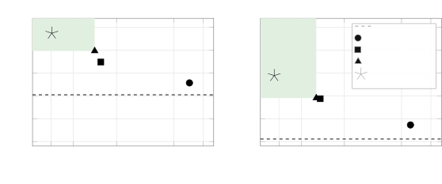
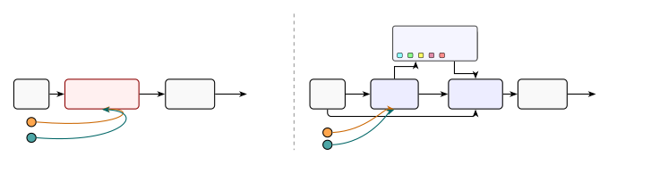
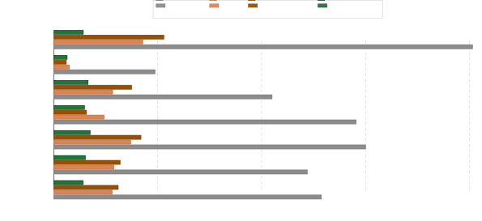
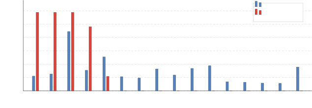
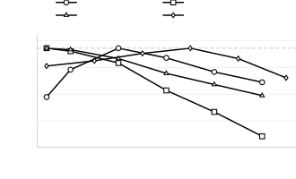
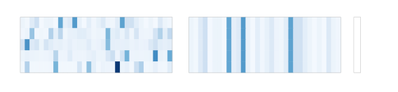

theorem\]Proposition

# Prompt Codebooks: Discrete Compositional Optimization for Language Model Instruction Refinement

Jyotirmoy Nath jyotirmoy.nath@ee.iitd.ac.in Affiliation: Indian
Institute of Technology Delhi, India    Neeraj Kumar
neerajkr2k14@gmail.com Affiliation: Indian Institute of Technology
Delhi, India    Brejesh Lall brejesh@ee.iitd.ac.in Affiliation: Indian
Institute of Technology Delhi, India

###### Abstract

Automatic prompt optimization (APO) (Pryzant et al., 2023; Yuksekgonul
et al., 2025; Khattab et al., 2024) has driven significant gains in
LLM-based agentic workflows (Yao et al., 2023; Shinn et al., 2023).
However, most existing methods treat each task’s prompt as a monolithic,
instance-blind string optimized through global edits, producing brittle
updates and preventing the reuse of learned sub-behaviors. We propose
Prompt Codebook Optimization (PCO), a novel compositional prompt
optimization framework that recasts APO as discrete learning over a
finite vocabulary of natural-language _instincts_—atomic, reusable
instruction units. PCO organizes prompt-construction knowledge in a
discrete codebook: an LLM-based encoder routes each input to a small
subset of entries, and a generator composes them into a prompt for the
executor. A critic emits a structured verdict that an attribution
operator decomposes into per-variable textual gradients, and the
encoder, generator, critic, and codebook are trained jointly under a
language-valued min–max objective. The resulting routing is
_per-instance_: different inputs in the same task receive different
instinct compositions. Across six benchmarks, PCO improves aggregate
performance over zero-shot by $`+13.91`$ points on LLaMA-3.1-8B and
$`+13.50`$ points on Qwen3-8B. PCO also outperforms the strongest
baseline in aggregate by $`+4.93`$ points (LLaMA-3.1-8B) and $`+3.89`$
points (Qwen3-8B), while simultaneously reducing deployed prompt length
by up to $`14.1\times`$ vs. MIPROv2 and $`3.0\times`$ vs. GEPA on
Qwen3-8B.



Figure 1: A comparison of PCO against state-of-the-art prompt optimizers
on aggregate score (six benchmarks) versus deployed prompt length for
(a) Qwen3-8B and (b) LLaMA-3.1-8B. PCO attains the highest score with
the shortest prompt on both models, using $`9.1\times`$ (Qwen3-8B) and
$`8.9\times`$ (LLaMA-3.1-8B) fewer tokens than MIPROv2 on aggregate.

## 1 Introduction

Large language models (LLMs) increasingly operate inside compositional
agentic workflows, pipelines where one agent plans, another invokes
tools, a third verifies, and feedback loops refine all three (Yao et
al., 2023; Shinn et al., 2023; Wu et al., 2024; Khattab et al., 2024).
These systems are non-differentiable by construction: tool calls,
retrieval, and discrete planning steps preclude analytic gradients.
Within this landscape, automatic prompt optimization (APO) is a core
sub-problem: every agent is a composition of LLM calls conditioned on
prompts that determine the planner’s decisions, the verifier’s
calibration, and the safety of the system as a whole. Most prior APO
methods, including black-box search (Zhou et al., 2023; Shin et al.,
2020), RL over tokens (Deng et al., 2022), evolutionary mutation (Guo et
al., 2024; Agrawal et al., 2026), reflective refinement (Madaan et al.,
2023), and textual-gradient optimization of prompt strings (Pryzant et
al., 2023; Yuksekgonul et al., 2025), treat the prompt for each task as
a monolithic, instance-blind text object: a single string applied
identically to every input and optimized through global edits.
Consequently, the formulation is both instance-blind, because one prompt
serves all inputs, and globally entangled, because a critique intended
to fix one failure may rewrite the entire prompt and disrupt other
well-tuned behaviors.

Meanwhile, a parallel decade of generative modeling has shown that
discrete latent codebooks (van den Oord et al., 2017; Razavi et al.,
2019; Chang et al., 2022), paired with a generator–critic training
signal (Goodfellow et al., 2014; Arjovsky et al., 2017; Esser et al.,
2021), yield state-of-the-art results in image synthesis, neural audio
coding (Défossez et al., 2023), and token-based multimodal modeling. A
defining property of such systems is that they are trained per
distribution: their power is intra-domain, with codes specialized to a
single data regime. APO has exactly this shape: each task defines its
own input distribution, reward, and optimal prompting policy, and is in
practice run per-task—yet no prior APO method organizes prompts as
compositions over a discrete codebook of natural-language instincts. We
close this gap with Prompt Codebook Optimization (PCO), a framework that
introduces a discrete codebook of natural-language _instincts_ — atomic,
reusable instructions that are themselves optimizable variables — as a
first-class object in prompt optimization. A prompt encoder (an LLM)
routes each input $`x`$ to a small subset of instincts via _semantic
routing_, allowing the encoder to select instincts based on meaning
rather than vector proximity. A prompt generator composes the selected
instincts, conditioned on $`x`$, into a fluent prompt dispatched to the
executor. A critic emits a structured natural-language verdict that an
attribution operator partitions into per-variable textual
gradients (Yuksekgonul et al., 2025), propagating component-wise through
the generator, the active instincts, the encoder’s routing policy, and
the critic’s own criteria. The full system is trained end-to-end under a
language-valued min–max objective.

This architecture confers four advantages over monolithic per-task APO,
each corresponding to a capability useful for broader agentic workflows.
(i) Per-instance adaptive prompting: the encoder routes different inputs
_within the same task_ to different instinct compositions — hard
instances invoke verification-heavy instincts, easier inputs use
lightweight ones — a regime structurally absent from monolithic
optimizers. (ii) Dense, behavior-level supervision: the critic (Arjovsky
et al., 2017) emits a structured natural-language verdict rather than a
sparse binary reward, exposing not just _whether_ a prompt failed but
_which behavior_ was responsible, providing a richer training signal
than scalar feedback alone. (iii) Regularization through a discrete
bottleneck: by construction, the finite codebook constrains the policy
to compose prompts from a small shared inventory rather than editing an
unbounded string, biasing it toward instance-general structure. (iv)
Localized credit assignment: attribution routes feedback to the specific
instinct responsible for a failure, leaving unrelated instincts
untouched — unlike monolithic prompt optimization, where any update may
rewrite the entire string, and unlike fixed-template modular prompting,
PCO allocates credit dynamically across a routed codebook.



Figure 2: Architectural Comparison. (a) Monolithic methods apply a
single, instance-blind prompt per task. (b) PCO routes each input
through an encoder that selects instincts from a discrete codebook, and
a generator composes them into an instance-specific prompt, so distinct
inputs within the same task receive different instinct compositions.


  Codebook entries (textual instincts)

Figure 3: Overview of PCO. The encoder $`\theta`$ maps input $`x`$ to
discrete indices, selecting instincts from a shared codebook $`C`$. The
generator $`\phi`$ composes the selected instincts conditioned on $`x`$
into a prompt executed by an executor LLM. A critic $`\psi`$ emits a
natural-language verdict $`\ell_{\mathrm{text}}`$, which is propagated
backward via textual gradients ($`g_{\theta}`$, $`g_{\phi}`$, $`g_{C}`$,
$`g_{\psi}`$) to each trainable component independently.

#### Contributions.

1.  1.  We introduce a discrete codebook of natural-language instincts: a
        finite inventory of reusable instincts selected and composed per
        input. Unlike query-level regeneration methods (Kong et al., 2025;
        Nica et al., 2025), PCO composes prompts from a shared codebook
        rather than generating from scratch; unlike continuous prompt-pool
        methods (Wang et al., 2022; Jiang et al., 2024) and section-based
        decomposition (Sharma and Henley, 2026), our instincts are
        natural-language instructions refined via textual gradients, routed
        per-instance.
2.  2.  We perform per-instance adaptive prompting through semantic routing
        over the codebook, letting each input activate a different instinct
        subset for compositional, instance-specific prompts — the same
        shared-pool routing principle as L2P (Wang et al., 2022) and
        MoPE (Jiang et al., 2024), realized in discrete language rather than
        continuous embeddings.
3.  3.  We formulate codebook, encoder, generator, and critic training as a
        language-valued min–max optimization problem with a jointly trained
        critic, extending prior textual-gradient minimax games over
        monolithic prompts (Do et al., 2024) to per-variable attribution
        over a routed codebook, jointly optimizing instinct content,
        routing, composition, and the critic’s own criteria.
4.  4.  We evaluate PCO on six benchmarks spanning multi-hop reasoning, fact
        verification, mathematics, instruction following, and
        privacy-preserving delegation, achieving up to $`+33.56`$ points
        over zero-shot on HotpotQA (LLaMA-3.1-8B) and a $`+3.89`$ aggregate
        improvement over the strongest baseline (GEPA on Qwen3-8B).

The remainder of this paper is structured as follows. Section 2 surveys
related work on monolithic prompt optimization, discrete latent
representations, and instance-aware prompting methods (extended in
Appendix A). Section 3 formalizes the PCO framework, introducing the
codebook, encoder, generator, and critic, and describes the forward
pass, min–max training objective, component-scoped credit assignment,
and inference procedure. Section 4 establishes three theoretical
properties of PCO: the expressivity advantage of compositional
prompting, codebook utilization lower bounds under $`\epsilon`$-greedy
exploration, and the approximate additivity of component-scoped credit
assignment. Section 5 presents experimental results across six
benchmarks and two model families, followed by component ablations,
hyperparameter sensitivity analysis, critic capacity analysis, and
computational efficiency; the attribution operator evaluation and
further analyses are deferred to the appendix. Section 6 concludes and
discusses the scope and limitations of our analysis.

## 2 Related Work

Monolithic Prompt Optimization. Early approaches to prompt optimization
rely on discrete search over candidate tokens or instructions (Shin et
al., 2020; Zhou et al., 2023), while recent methods utilize
natural-language feedback, reflection, and evolutionary mutation to
iteratively refine prompts (Pryzant et al., 2023; Madaan et al., 2023;
Guo et al., 2024; Yuksekgonul et al., 2025; Agrawal et al., 2026).
Reinforcement learning methods such as GRPO (Shao et al., 2024; Zuo et
al., 2025), which update model weights rather than prompts, and
compositional pipeline systems like DSPy (Khattab et al., 2024;
Opsahl-Ong et al., 2024) further automate this process. However, because
these standard frameworks apply global feedback to entire monolithic
strings, updates remain noisy. Critically, these methods are
instance-blind: learned structural components cannot be dynamically
routed or reused across different inputs within the same task.

Discrete and Instance-Level Representations. Discrete latent
representations model data using a finite set of reusable
components (van den Oord et al., 2017; Razavi et al., 2019). In prompt
engineering, continuous prompt pools like L2P (Wang et al., 2022) and
MoPE (Jiang et al., 2024) use input-dependent routing over continuous
expert embeddings. In contrast, PCO operates entirely in the discrete
textual domain. While generative query-level models like QPO (Kong et
al., 2025) and TRPrompt (Nica et al., 2025) produce prompts from
scratch, and Modular Prompt Optimization (Sharma and Henley, 2026)
optimizes fixed sections, PCO routes dynamically over a learned codebook
of instincts, enabling structured component reuse across inputs within
the same task.

## 3 Prompt Codebook Optimization (PCO)

We propose Prompt Codebook Optimization (PCO), which recasts prompt
optimization as discrete compositional learning over a finite vocabulary
of natural-language instincts. In place of monolithic prompt strings
optimized by most prior APO methods (Zhou et al., 2023; Pryzant et al.,
2023; Yuksekgonul et al., 2025), PCO imposes a discrete latent
bottleneck where prompts are composed from shared, reusable instincts.
As shown in Figure 3, the framework routes and composes instincts using
an encoder–generator–critic pipeline, jointly trained via textual
gradient descent (Yuksekgonul et al., 2025) under a language-valued
min–max objective. PCO is language-native throughout: all parameters are
strings, all gradients are textual critiques, and routing is performed
semantically by an LLM rather than continuous vector quantization (van
den Oord et al., 2017).

### 3.1 Problem Setup and Notation

Let $`\mathcal{M}`$ denote a frozen large language model and
$`\mathcal{D}=\{(x_{i},y_{i}^{\star})\}_{i=1}^{N}`$ a per-task dataset
with inputs $`x_{i}\in\mathcal{X}`$ and references
$`y_{i}^{\star}\in\mathcal{Y}`$. Let
$`r:\mathcal{Y}\times\mathcal{Y}\to\mathbb{R}`$ be a task-specific
reward (exact match, pass-rate, or learned preference). The standard APO
problem (Zhou et al., 2023; Pryzant et al., 2023) seeks a single prompt
$`p^{\star}`$ maximizing expected reward:

```math
p^{\star}=\arg\max_{p\in\mathcal{P}}\mathbb{E}_{(x,y^{\star})\sim\mathcal{D}}\bigl[\,r(\mathcal{M}(p,x),y^{\star})\,\bigr]. \tag{1}
```

Equation 1 treats the prompt as a monolithic, instance-blind string. Its
two structural pathologies—_instance blindness_ (the same $`p`$ for
every $`x`$) and _global entanglement_ (any update may rewrite the
entire string)—motivate the discrete latent decomposition introduced
next.

### 3.2 Discrete Latent Decomposition of Prompts

We replace the monolithic prompt with four trainable components,
including a finite codebook of instincts:

- •
  A prompt encoder,
  $`\mathcal{E}_{\theta}:\mathcal{X}\times\mathcal{C}^{K}\rightarrow\{1,\ldots,K\}^{S}`$,
  implemented as an LLM with system prompt $`\theta`$, maps an input
  $`x`$ to $`S`$ discrete indices into a codebook of size $`K`$, where
  $`S\ll K`$.
- •
  A codebook, $`\mathcal{C}=\{c_{1},\ldots,c_{K}\}`$, where each
  $`c_{k}`$ is a short natural-language directive (e.g., “decompose into
  sub-questions before answering”).
- •
  A prompt generator,
  $`\mathcal{G}_{\phi}:\mathcal{X}\times\mathcal{C}^{S}\rightarrow\mathcal{P}`$,
  implemented as an LLM with system prompt $`\phi`$, composes the $`S`$
  selected instincts, conditioned on $`x`$, into a fluent prompt.
- •
  A critic,
  $`\mathcal{D}_{\psi}:\mathcal{Y}\times\mathcal{X}\times\mathcal{P}\times\mathcal{Y}\rightarrow\mathcal{T}`$,
  implemented as an LLM with system prompt $`\psi`$, which emits
  natural-language feedback in the textual-gradient space
  $`\mathcal{T}`$.

The trainable variable set is
$`\Theta=\{\theta,\phi,\mathcal{C},\psi\}`$; only the target model
$`\mathcal{M}`$ is held frozen. Under this decomposition, the monolithic
prompt of equation 1 is replaced by the composed prompt

```math
p_{\Theta}(x)=\mathcal{G}_{\phi}\bigl(x,\,\mathcal{C}[\mathcal{E}_{\theta}(x,\mathcal{C})]\bigr), \tag{2}
```

so that the APO objective is now optimized over $`\Theta`$ through the
encoder–codebook–generator pipeline.

### 3.3 Forward Pass: Routing, Composition, and Execution

For each input $`x`$, the forward pass proceeds in three steps:

```math
\displaystyle z_{q} \displaystyle=\mathcal{E}_{\theta}(x,\mathcal{C})\in\{1,\ldots,K\}^{S}, \tag{3}
```

```math
\displaystyle p \displaystyle=\mathcal{G}_{\phi}(x,\{c_{k}:k\in z_{q}\}), \tag{4}
```

```math
\displaystyle y \displaystyle=\mathcal{M}(p,x). \tag{5}
```

Equation 3 is the discrete bottleneck: the encoder selects $`S`$ indices
from a codebook of size $`K`$, yielding an input-dependent routing
$`z_{q}`$. Equation 4 composes the selected instincts
$`\{c_{k}\}_{k\in z_{q}}`$ into a fluent prompt $`p`$, conditioned on
$`x`$ for instance-specific phrasing. Equation 5 is the sole call to the
executor. Together, equations 3–4 realize per-instance adaptive
prompting: distinct inputs flow through distinct instinct compositions.

1: dataset $`\mathcal{D}`$; codebook size $`K`$, selection size $`S`$;
schedule $`\epsilon_{0},\epsilon_{\min},\gamma`$; EMA step size
$`\alpha`$; temperature $`\tau`$; epochs $`T`$; reward $`r`$; frozen
executor $`\mathcal{M}`$

2: Initialize codebook $`\mathcal{C}=\{c_{1},\dots,c_{K}\}`$ and
parameters $`\theta,\phi,\psi`$

3:
$`\bar{r}_{k}\leftarrow 0~\forall k`$; $`\epsilon\leftarrow\epsilon_{0}`$

4:

for $`t=1,\dots,T`$ do


5:
   

for $`(x,y^{\star})\in\mathcal{D}`$ do


6:
    

if $`\mathrm{rand}()<\epsilon`$ then


7:
      
$`z_{q}\sim\mathrm{SuccWtd}(\bar{\mathbf{r}},S,\tau)`$ // explore:
success-weighted routing, Sec. 3.6


8:
    

else


9:
      
$`z_{q}\leftarrow\mathcal{E}_{\theta}(x,\mathcal{C})`$ // encoder
routing, Sec. 3.3
    

10:
    
$`p\leftarrow\mathcal{G}_{\phi}(x,\mathcal{C}[z_{q}])`$; $`y\leftarrow\mathcal{M}(p,x)`$


11:
    
$`r_{t}\leftarrow r(y,y^{\star})`$ // binary task success


12:
    
$`(\ell,g_{\theta},g_{\phi},g_{\mathcal{C}},g_{\psi})\leftarrow\mathcal{D}_{\psi}(\mathcal{H})`$
// critic & attribution on trace $`\mathcal{H}`$, Sec. 3.5


13:
    
$`\theta\leftarrow\mathrm{LLM}_{\mathrm{upd}}(\theta,g_{\theta})`$;
$`\phi\leftarrow\mathrm{LLM}_{\mathrm{upd}}(\phi,g_{\phi})`$
// textual-gradient step, Sec. 3.5


14:
    

for $`k\in z_{q}`$ do


15:
      
$`c_{k}\leftarrow\mathrm{LLM}_{\mathrm{upd}}(c_{k},g_{c_{k}})`$
    

16:
    
$`\psi\leftarrow\mathrm{LLM}_{\mathrm{upd}}(\psi,g_{\psi})`$


17:
    

for $`k\in z_{q}`$ do


18:
      
$`\bar{r}_{k}\leftarrow(1-\alpha)\bar{r}_{k}+\alpha\,r_{t}`$
       

19:
   
$`\epsilon\leftarrow\max(\epsilon_{\min},\gamma\epsilon)`$


20: return optimized $`\mathcal{C},\theta,\phi,\psi`$ // deploy at
inference, Sec. 3.7

Algorithm 1 Prompt Codebook Optimization (PCO)

### 3.4 Training Objective: A Critic-Regularized Discrete Bottleneck

The forward pass of Section 3.3 produces, for each input $`x`$, a
composed prompt
$`p=\mathcal{G}_{\phi}(x,\mathcal{C}[\mathcal{E}_{\theta}(x,\mathcal{C})])`$
and response $`y=\mathcal{M}(p,x)`$. Motivated by the GAN
family (Goodfellow et al., 2014; Arjovsky et al., 2017), where a critic
supplies a dense continuous signal in place of binary supervision, we
introduce a critic
$`\mathcal{D}_{\psi}:\mathcal{Y}\times\mathcal{X}\times\mathcal{P}\times\mathcal{Y}\to\mathcal{T}`$
that plays the same functional role in the textual domain. Rather than a
scalar, $`\mathcal{D}_{\psi}`$ emits a structured natural-language
verdict

```math
\ell_{\mathrm{text}}=\mathcal{D}_{\psi}(y,x,p,y^{\star})\in\mathcal{T},
```

identifying behaviors in $`y`$ deviating from $`y^{\star}`$, localizing
failures to specific elements of $`p`$, and prescribing corrections. A
scalarizer $`\rho:\mathcal{T}\to\mathbb{R}_{\geq 0}`$ projects this
verdict onto a penalty — zero when the critique is empty, larger as
deviations grow more severe. PCO then trains the joint parameter set
$`\Theta=\{\theta,\phi,\mathcal{C},\psi\}`$ under a language-valued
min–max objective:

```math
\Theta^{\star}=\arg\max_{\theta,\phi,\mathcal{C}}\,\min_{\psi}\,\mathbb{E}_{(x,y^{\star})\sim\mathcal{D}}\Bigl[r\bigl(\mathcal{M}(p,x),y^{\star}\bigr)-\rho\bigl(\mathcal{D}_{\psi}(y,x,p,y^{\star})\bigr)\Bigr], \tag{6}
```

where the outer player $`(\theta,\phi,\mathcal{C})`$ maximizes the task
reward $`r`$ minus the critic-induced penalty $`\rho`$, and the inner
player $`\psi`$ updates the critic’s evaluation criteria to minimize the
objective (thereby maximizing the penalty $`\rho`$ by discovering
harder, more subtle flaws). In Algorithm 1, equation 6 is optimized
through the critic’s textual feedback rather than a scalar penalty; the
success rate $`\bar{r}_{k}`$ is an EMA of binary task success,
$`\bar{r}_{k}\leftarrow(1-\alpha)\bar{r}_{k}+\alpha r_{t}`$ with
$`r_{t}\in\{0,1\}`$, so $`\bar{r}_{k}\in[0,1]`$. Grounding
$`\mathcal{D}_{\psi}`$ on the reference $`y^{\star}`$ is designed to
yield an empty critique ($`\rho=0`$) when $`y=y^{\star}`$, preventing
degenerate critic negativity.

### 3.5 Backward Pass: Component-Scoped Credit Assignment

Because routing and prompt construction are discrete, PCO cannot
propagate analytic gradients through the encoder
$`\mathcal{E}_{\theta}`$, codebook $`\mathcal{C}`$, and generator
$`\mathcal{G}_{\phi}`$. Instead, the critic $`\mathcal{D}_{\psi}`$
performs natural-language credit assignment over the complete forward
execution trace

```math
\mathcal{H}=\big(x,\;z_{q},\;\{c_{k}\}_{k\in z_{q}},\;p,\;y,\;y^{\star}\big), \tag{7}
```

where $`z_{q}=\mathcal{E}_{\theta}(x,\mathcal{C})`$,
$`p=\mathcal{G}_{\phi}\big(x,\{c_{k}\}_{k\in z_{q}}\big)`$, and
$`y=\mathcal{M}(p,x)`$. Conditioning on the full trace
$`\mathcal{H}`$—rather than on the response $`y`$ alone—gives the critic
the information needed to distinguish routing, composition, and instinct
quality as separate causes of a failure. Given $`\mathcal{H}`$, the
critic emits a structured verdict

```math
\mathcal{D}_{\psi}(\mathcal{H})=\Big(\ell_{\text{text}},\;g_{\theta},\;g_{\phi},\;\{g_{c_{k}}\}_{k\in z_{q}},\;g_{\psi}\Big), \tag{8}
```

where $`\ell_{\text{text}}\in\mathcal{T}`$ is the holistic verdict and
each $`g_{v}\in\mathcal{T}`$ is textual feedback in the textual-gradient
space $`\mathcal{T}`$, scoped to a particular trainable variable
$`v\in\{\theta,\phi,\psi\}\cup\{c_{k}:k\in z_{q}\}`$. The feedback
channels diagnose complementary stages of prompt construction.
$`g_{\theta}`$ evaluates _routing quality_—whether
$`\mathcal{E}_{\theta}`$ selected an appropriate subset of instincts
$`\{c_{k}\}_{k\in z_{q}}`$ for $`x`$. $`g_{\phi}`$ evaluates
_composition faithfulness_—whether $`\mathcal{G}_{\phi}`$ preserved and
effectively integrated the selected instincts into the prompt $`p`$.
$`g_{c_{k}}`$ evaluates _instinct quality_, identifying whether an
active directive $`c_{k}`$ is useful, ambiguous, overly broad, or
harmful for the observed behavior. Finally, $`g_{\psi}`$ evaluates
_critic quality_—whether the current rubric $`\psi`$ surfaced the
failure at all—and drives the adversarial inner update of the min–max
objective (equation 6), sharpening $`\mathcal{D}_{\psi}`$ toward harder
edge cases and preventing feedback saturation. The channels are
component-scoped but are not assumed to represent mutually exclusive
causes. A single execution failure may therefore generate feedback for
multiple components—for example, an inappropriate routing $`z_{q}`$ may
coexist with an imperfect composition by $`\mathcal{G}_{\phi}`$. Each
feedback signal nevertheless updates only its corresponding variable:

```math
v\leftarrow\operatorname{LLM}_{\text{upd}}(v,g_{v}),\qquad v\in\{\theta,\,\phi,\,\psi\}\cup\{c_{k}:k\in z_{q}\}. \tag{9}
```

Only active codebook entries $`\{c_{k}\}_{k\in z_{q}}`$ receive
instinct-level updates; the remaining $`K-S`$ entries of $`C`$ remain
unchanged. This yields localized credit assignment over the trainable
set $`\Theta=\{\theta,\phi,C,\psi\}`$ without assuming an additive or
disjoint decomposition of the execution error: credit is scoped by
_where_ in the trace $`\mathcal{H}`$ the critic locates a fault, not by
a presumed partition of a scalar penalty. The objective of equation 6 is
optimized stochastically by Algorithm 1: a single critic call
$`\mathcal{D}_{\psi}(\mathcal{H})`$ produces the structured verdict of
equation 8, and each variable in $`\Theta`$ updates independently via
$`\operatorname{LLM}_{\text{upd}}`$. No closed-form gradient is ever
computed.

### 3.6 Optimization Algorithm

Since the critic, attribution operator, and per-variable updates
(Section 3.5) are all LLM calls, Algorithm 1 optimizes the objective
stochastically: each step performs one forward pass, one critic call,
per-variable attribution, and component-wise updates. Two design choices
address pathologies specific to the discrete bottleneck.

$`\epsilon`$-greedy routing. A purely encoder-driven policy starves
unselected codebook entries, since the codebook refinement step updates
only active $`c_{k}`$ in-place — the textual analogue of dead codes in
continuous VQ (Razavi et al., 2019). We sample $`z_{q}`$ from the
encoder with probability $`1{-}\epsilon`$ and from a success-weighted
distribution with probability $`\epsilon`$, decaying $`\epsilon`$ from
$`\epsilon_{0}{=}1.0`$ to $`\epsilon_{\min}{=}0.15`$.

Success-weighted sampling. Uniform exploration wastes calls on
underperforming instincts. During exploratory steps, we sample indices
with probabilities proportional to $`\exp(\bar{r}_{k}/\tau)`$ (Sutton
and Barto, 1998), where $`\bar{r}_{k}`$ denotes the EMA of binary task
success (step size $`\alpha`$) of prompts containing $`c_{k}`$ —
referred to hereafter as the success rate ($`sr`$) of instinct $`k`$ —
and $`\tau=0.5`$ is the softmax temperature.

### 3.7 Inference

At inference, the critic, attribution operator, and update rules are
discarded; only the optimized encoder, generator, and codebook
parameters $`(\theta^{\star},\phi^{\star},\mathcal{C}^{\star})`$ remain.
Given a held-out input $`x`$, the system executes a single forward pass
through equations 3–5, producing a per-instance prompt:

```math
p_{x}=\mathcal{G}_{\phi^{\star}}\bigl(x,\,\mathcal{C}^{\star}[\mathcal{E}_{\theta^{\star}}(x,\mathcal{C}^{\star})]\bigr) \tag{10}
```

for the executor $`\mathcal{M}`$. Crucially,
$`p_{x}\neq p_{x^{\prime}}`$ for $`x\neq x^{\prime}`$ in general — the
encoder routes different inputs through different instinct compositions,
realizing the per-instance adaptive prompting regime that monolithic
optimizers cannot express.

## 4 Theoretical Analysis

We establish three formal properties of PCO: (i) a combinatorial
expressivity advantage over monolithic optimizers, (ii) an expected-case
lower bound on codebook utilization under $`\epsilon`$-greedy
exploration, derived under an independence approximation, and (iii) a
condition under which the component-scoped credit assignment underlying
the min–max objective equation 6 is approximately additive. Since TGD
rewrites natural-language strings through an LLM with no explicit step
size, classical SGD convergence theory does not apply; we therefore
restrict our claims to properties derivable directly from Algorithm 1.
These results characterize the expressivity of the PCO policy class, not
the optimization dynamics of Algorithm 1; whether training actually
reaches high-performing routings is an empirical question we address in
Section 5.

### 4.1 Expressivity of Compositional Prompting

{definition}

\[Prompt policy spaces\] A _monolithic_ optimizer applies one fixed
string to every input; its policy class is

```math
\mathcal{P}_{\mathrm{mono}}=\bigl\{\mu:\mathcal{X}\to\mathcal{P}\mid\mu(x)=\mu(x^{\prime})\ \forall\,x,x^{\prime}\in\mathcal{X}\bigr\}=\mathcal{P}_{\mathrm{blind}}, \tag{11}
```

the class of all _instance-blind_ prompt functions. GEPA, MIPROv2, and
TextGrad each emit a single optimized string, so their induced policy
classes lie in $`\mathcal{P}_{\mathrm{blind}}`$. Writing
$`\pi(x):=\mathcal{E}_{\theta}(x,\mathcal{C})`$ for the encoder-induced
routing, the PCO policy class is

```math
\mathcal{P}_{\mathrm{PCO}}=\Bigl\{\,x\mapsto\mathcal{G}_{\phi}\bigl(x,\{c_{k}\}_{k\in\pi(x)}\bigr)\;\Bigm|\;\pi:\mathcal{X}\to\tbinom{[K]}{S}\Bigr\}, \tag{12}
```

where $`\tbinom{[K]}{S}`$ is the set of $`S`$-element subsets of
$`[K]`$.

{assumption}

\[Instinct-set separability\] $`\mathcal{G}_{\phi}`$ is injective on
instinct subsets: for all $`x\in\mathcal{X}`$ and distinct
$`A,B\in\tbinom{[K]}{S}`$,
$`\mathcal{G}_{\phi}(x,\{c_{k}\}_{k\in A})\neq\mathcal{G}_{\phi}(x,\{c_{k}\}_{k\in B})`$.
This holds when codebook entries are semantically distinct and
$`\mathcal{G}_{\phi}`$ incorporates every selected instinct (enforced by
including the entry index in the composition template).

{lemma}

\[Routing injectivity\] Under Assumption 4.1, the map
$`\Phi:\pi\mapsto\bigl(x\mapsto\mathcal{G}_{\phi}(x,\{c_{k}\}_{k\in\pi(x)})\bigr)`$
is injective on routing functions $`\pi:\mathcal{X}\to\tbinom{[K]}{S}`$.

###### Proof.

If $`\pi_{1}\neq\pi_{2}`$, pick $`x_{0}`$ with
$`\pi_{1}(x_{0})\neq\pi_{2}(x_{0})`$. Assumption 4.1 (with
$`A=\pi_{1}(x_{0})`$, $`B=\pi_{2}(x_{0})`$) gives
$`\Phi(\pi_{1})(x_{0})\neq\Phi(\pi_{2})(x_{0})`$, hence
$`\Phi(\pi_{1})\neq\Phi(\pi_{2})`$. ∎

{theorem}

\[Policy-class expressivity\] Under Assumption 4.1,
$`\mathcal{P}_{\mathrm{mono}}\subsetneq\mathcal{P}_{\mathrm{PCO}}`$, and
on a training set $`\mathcal{X}_{\mathrm{tr}}\subseteq\mathcal{X}`$ of
$`N\geq 2`$ inputs, $`\mathcal{P}_{\mathrm{PCO}}`$ induces at least

```math
\bigl|\mathcal{P}_{\mathrm{PCO}}\bigr|_{\mathcal{X}_{\mathrm{tr}}}\bigr|\geq\binom{K}{S}^{N} \tag{13}
```

distinct policies.

###### Proof.

_Containment._ For $`p^{\star}\in\mathcal{P}_{\mathrm{mono}}`$, set
$`c_{1}:=p^{\star}`$, fix $`A_{0}=\{1,\dots,S\}`$, take
$`\pi(x)\equiv A_{0}`$, and let $`\mathcal{G}_{\phi}`$ return $`c_{1}`$
verbatim on $`A_{0}`$; this reproduces $`p^{\star}`$ on every input, so
$`\mathcal{P}_{\mathrm{mono}}\subseteq\mathcal{P}_{\mathrm{PCO}}`$.

_Counting._ The routing functions
$`\pi:\mathcal{X}_{\mathrm{tr}}\to\tbinom{[K]}{S}`$ number
$`\binom{K}{S}^{N}`$, and by Lemma 4.1 (applied on
$`\mathcal{X}_{\mathrm{tr}}`$) distinct routings induce distinct
policies, giving equation 13.

_Strictness._ A policy in $`\mathcal{P}_{\mathrm{mono}}`$ is constant,
so it is determined by its value at a fixed input
$`x_{1}\in\mathcal{X}_{\mathrm{tr}}`$, which lies in
$`\{\mathcal{G}_{\phi}(x_{1},\{c_{k}\}_{k\in A}):A\in\tbinom{[K]}{S}\}`$.
By Lemma 4.1, each such policy arises from at most one routing, so at
most $`\binom{K}{S}`$ routings induce policies in
$`\mathcal{P}_{\mathrm{mono}}`$. Since $`K>S\geq 1`$ gives
$`\binom{K}{S}\geq 2`$, we have $`\binom{K}{S}^{N}>\binom{K}{S}`$ for
$`N\geq 2`$, so some routing induces a policy outside
$`\mathcal{P}_{\mathrm{mono}}`$; thus the inclusion is strict. ∎

{theorem}

\[Reward gap\] There is a task
$`(\mathcal{X},\mathcal{Y},r,\mathcal{D})`$ and a routing
$`\pi^{\star}`$, inducing the policy
$`p_{\pi^{\star}}\in\mathcal{P}_{\mathrm{PCO}}`$, with

```math
\mathbb{E}\!\left[r(\mathcal{M}(p_{\pi^{\star}}(x),x),y^{\star})\right]>\max_{\mu\in\mathcal{P}_{\mathrm{mono}}}\mathbb{E}\!\left[r(\mathcal{M}(\mu(x),x),y^{\star})\right]. \tag{14}
```

Moreover, for any $`2\leq m\leq K`$ the gap is at least $`1-1/m`$ on a
task of $`m`$ equiprobable inputs, each requiring a distinct optimal
single entry $`c_{i}\in\mathcal{C}`$ (an $`S{=}1`$ construction).

###### Proof.

_Two-input construction._ Let $`\mathcal{X}=\{x_{1},x_{2}\}`$ with
$`\mathbb{P}(x_{1})=\mathbb{P}(x_{2})=\tfrac{1}{2}`$ and entries
$`c_{1},c_{2}`$ such that $`\mathcal{G}_{\phi}(x_{i},\{c_{i}\})`$ is
uniquely optimal for $`x_{i}`$. With binary rewards

```math
\displaystyle r_{11}=1,\quad r_{12}=0,\quad r_{22}=1,\quad r_{21}=0,\qquad r_{ij}:=r\bigl(\mathcal{M}(\mathcal{G}_{\phi}(x_{i},\{c_{j}\}),x_{i}),\,y_{i}^{\star}\bigr) \tag{15}
```

any $`\mu\in\mathcal{P}_{\mathrm{mono}}`$ applies one fixed prompt to
both inputs and attains $`\mathbb{E}[r]\leq\tfrac{1}{2}`$, whereas the
routing $`\pi^{\star}:x_{1}\mapsto\{1\},\,x_{2}\mapsto\{2\}`$ (via
equation 3) attains

```math
\mathbb{E}[r]=\tfrac{1}{2}\cdot 1+\tfrac{1}{2}\cdot 1=1>\tfrac{1}{2}. \tag{16}
```

_$`m`$-input generalization ($`S{=}1`$)._ For $`m\leq K`$ equiprobable
inputs each with a unique optimal entry, a monolithic $`\mu`$ matches at
most one input, so $`\mathbb{E}[r]\leq 1/m`$; PCO routes each input to
its optimal entry (equation 3) for $`\mathbb{E}[r]=1`$, giving a gap of
$`1-1/m`$, which reaches $`1-1/K`$ at $`m=K`$.

_Scope._ This certifies a gap only for $`m\leq K`$ single-index optima;
extending it to $`m\leq\binom{K}{S}`$ under full $`S`$-subset routing
would additionally require a _reward-discriminability_ condition on
$`(\mathcal{G}_{\phi},\mathcal{M})`$—distinct from the prompt-level
injectivity of Assumption 4.1. ∎

{corollary}

GEPA, MIPROv2, and TextGrad induce policies in
$`\mathcal{P}_{\mathrm{blind}}=\mathcal{P}_{\mathrm{mono}}`$. By
Theorem 4.1, any policy in
$`\mathcal{P}_{\mathrm{PCO}}\setminus\mathcal{P}_{\mathrm{mono}}`$ is
inexpressible by all three, and $`\mathcal{P}_{\mathrm{PCO}}`$ contains
at least $`\binom{K}{S}^{N}\geq\binom{16}{4}=1820`$ single-input
compositions (equation 13); by Theorem 4.1 this yields a strict reward
advantage on tasks with up to $`m\leq K=16`$ per-instance optima. (The
bound $`1820`$ sizes the policy class, not the number of inputs for
which an advantage is proven.)

Theorems 4.1 and 4.1 characterize the policy class
$`\mathcal{P}_{\mathrm{PCO}}`$; they do not imply that Algorithm 1 finds
the optimal routing $`\pi^{\star}`$, which we assess empirically in
Section 5.

### 4.2 Codebook Utilization Under $`\epsilon`$-Greedy Exploration

A central risk in discrete routing is _codebook collapse_: a small
subset of entries monopolizes the training signal. We bound how
$`\epsilon`$-greedy exploration protects against the worst case
(Theorem 4.2), and separately give an informal account of why collapse
occurs in its absence (Proposition 4.2).

###### Remark 1 (Independence approximation).

The success rate $`\bar{r}_{k}`$ drifts across epochs, so exploratory
draws are not strictly independent; Theorem 4.2 is thus an expected-case
bound under an independence approximation, which becomes accurate as
$`\bar{r}_{k}`$ varies more slowly.

{definition}

\[Codebook collapse\] Let $`n_{k}(t)`$ be the cumulative selection count
of entry $`k`$ up to epoch $`t`$, and let
$`U_{t}:=\bigl|\{k:n_{k}(t)>0\}\bigr|`$ be the number of active entries.
$`\mathcal{C}`$ _collapses_ at epoch $`t`$ if $`U_{t}<K/2`$.

{theorem}

\[Expected-case utilization lower bound under exploration\] Under
Algorithm 1, $`\bar{r}_{k}\in[0,1]`$ for all $`k`$, since it is an EMA
of binary outcomes initialized at $`0`$. With exploration rate
$`\epsilon\in(0,1]`$ over an epoch of $`N`$ inputs, softmax temperature
$`\tau=0.5`$, and the independence approximation of Remark 1, the
expected number of entries activated at least once satisfies

```math
\mathbb{E}[U_{t}]\;\geq\;K\!\left(1-\exp\!\left(-\dfrac{\lfloor\epsilon N\rfloor S\,e^{-1/\tau}}{K}\right)\right). \tag{17}
```

###### Proof.

During the $`\lfloor\epsilon N\rfloor`$ exploratory steps (Remark 1),
entries are sampled via

```math
p_{k}=\frac{\exp(\bar{r}_{k}/\tau)}{\sum_{j=1}^{K}\exp(\bar{r}_{j}/\tau)}. \tag{18}
```

The denominator is maximized—and $`p_{k}`$ minimized—in the adversarial
configuration $`\bar{r}_{k}=0,\ \bar{r}_{j}=1\ \forall j\neq k`$, whence

```math
p_{k}\;\geq\;\frac{1}{1+(K-1)e^{1/\tau}}\;\geq\;\frac{e^{-1/\tau}}{K}, \tag{19}
```

using $`1+(K-1)e^{1/\tau}\leq Ke^{1/\tau}`$. Each exploratory step draws
$`S`$ entries from $`p`$, so the $`\lfloor\epsilon N\rfloor`$ steps make
$`\lfloor\epsilon N\rfloor S`$ draws in total, treated as conditionally
independent (Remark 1); sampling without replacement only raises the
chance of drawing $`k`$, so the bound below also holds in that case.
Entry $`k`$ is therefore never selected with probability

```math
\Pr\bigl(n_{k}(t)=0\bigr)\;\leq\;(1-p_{k})^{\lfloor\epsilon N\rfloor S}\;\leq\;e^{-\lfloor\epsilon N\rfloor S\,p_{k}}\;\leq\;\exp\!\left(-\dfrac{\lfloor\epsilon N\rfloor S\,e^{-1/\tau}}{K}\right), \tag{20}
```

using $`(1-p)^{n}\leq e^{-np}`$ and the bound
$`p_{k}\geq e^{-1/\tau}/K`$ from equation 19. Hence
$`\Pr(n_{k}(t)>0)\geq 1-\exp\bigl(-\lfloor\epsilon N\rfloor S\,e^{-1/\tau}/K\bigr)`$.
Since $`U_{t}=\sum_{k=1}^{K}\mathbf{1}[n_{k}(t)>0]`$, linearity of
expectation gives

```math
\mathbb{E}[U_{t}]=\sum_{k=1}^{K}\Pr\bigl(n_{k}(t)>0\bigr)\;\geq\;K\!\left(1-\exp\!\left(-\dfrac{\lfloor\epsilon N\rfloor S\,e^{-1/\tau}}{K}\right)\right), \tag{21}
```

which is equation 17. ∎

###### Remark 2 (Counting fact under $`\epsilon=0`$).

When $`\epsilon=0`$ only encoder-selected entries receive signal, so
over $`N`$ examples
$`\mathbb{E}[U_{t}]\leq S\cdot|\mathrm{Im}(\mathcal{E}_{\theta})|`$.
This is purely combinatorial and does _not_ by itself predict collapse:
an expressive LLM encoder can make
$`|\mathrm{Im}(\mathcal{E}_{\theta})|`$ as large as $`N`$, rendering the
bound vacuous. The actual mechanism is dynamical, and is formalized
next.

{proposition}

\[Reinforcement-driven collapse under $`\epsilon=0`$, informal\] When
$`\epsilon=0`$, only the selected entries $`z_{q}`$ are updated
(equation 9), and since $`\mathcal{E}_{\theta}`$ conditions on their
success rates, sharpened entries are reselected more often. This
self-reinforcing dynamic is a generalized Pólya urn, for which standard
results (Arthur, 1989; Pemantle, 2007) suggest that a $`\Theta(S)`$-size
subset captures almost all selections, i.e., $`U_{t}\to\Theta(S)`$
regardless of $`|\mathrm{Im}(\mathcal{E}_{\theta})|`$, matching the
observed entropy collapse ($`3.76\to 2.17`$ bits; Table 3, Figure 5(b)).

### 4.3 Component-Scoped Credit Assignment: Approximate Additivity

Credit assignment in PCO is not an additive partition of a scalar
penalty: the critic $`\mathcal{D}_{\psi}`$ emits per-variable channels
$`(g_{\theta},g_{\phi},\{g_{c_{k}}\}_{k\in z_{q}},g_{\psi})`$ as part of
its structured verdict (equation 8), scoped by _where_ in the trace
$`\mathcal{H}`$ a fault is located. We make explicit when this
non-additive design is consistent with the objective equation 6: the
component penalties reconstruct the holistic penalty in expectation up
to the attribution residual. Define, over
$`(x,y^{\star})\sim\mathcal{D}`$,

```math
\displaystyle\mathcal{L}_{\mathrm{fid}} \displaystyle:=\mathbb{E}[\rho(g_{\phi})], \displaystyle\mathcal{L}_{\mathrm{route}} \displaystyle:=\mathbb{E}[\rho(g_{\theta})], \tag{22}
```

```math
\displaystyle\mathcal{L}_{\mathrm{cb}} \displaystyle:=\mathbb{E}\!\Bigl[\tfrac{1}{S}\textstyle\sum_{k\in z_{q}}\rho(g_{c_{k}})\Bigr], \displaystyle\mathcal{L}_{\mathrm{critic}} \displaystyle:=\mathbb{E}[\rho(g_{\psi})], \tag{23}
```

penalizing composition, routing, instinct quality, and critic-criteria
refinement respectively.

{definition}

\[Attribution residual\] For a sample $`(x,y^{\star})`$ let the
_attributed sum_ be

```math
\hat{s}:=\rho(g_{\phi})+\rho(g_{\theta})+\tfrac{1}{S}\!\sum_{k\in z_{q}}\rho(g_{c_{k}})+\rho(g_{\psi}), \tag{24}
```

and the _additivity residual_
$`\delta:=\rho(\ell_{\mathrm{text}})-\hat{s}`$.

{proposition}

\[Approximate additive decomposition\] For
$`(x,y^{\star})\sim\mathcal{D}`$, with
$`\mathcal{L}_{\mathrm{fid}},\dots,\mathcal{L}_{\mathrm{critic}}`$ as in
equations 22–23,

```math
\displaystyle\mathbb{E}\!\left[\rho(\ell_{\mathrm{text}})\right] \displaystyle=\bigl(\mathcal{L}_{\mathrm{fid}}+\mathcal{L}_{\mathrm{route}}+\mathcal{L}_{\mathrm{cb}}+\mathcal{L}_{\mathrm{critic}}\bigr)+\mathbb{E}[\delta],
```

```math
\displaystyle\Bigl|\mathbb{E}\!\left[\rho(\ell_{\mathrm{text}})\right]-\bigl(\mathcal{L}_{\mathrm{fid}}+\mathcal{L}_{\mathrm{route}}+\mathcal{L}_{\mathrm{cb}}+\mathcal{L}_{\mathrm{critic}}\bigr)\Bigr| \displaystyle\leq\mathbb{E}\bigl[|\delta|\bigr]. \tag{25}
```

In particular, if $`|\delta|\leq\delta_{\max}`$ almost surely, the gap
is at most $`\delta_{\max}`$.

###### Proof.

By Definition 4.3, $`\rho(\ell_{\mathrm{text}})=\hat{s}+\delta`$ for
every sample. Taking expectations and applying linearity to equation 24
with equations 22–23 gives
$`\mathbb{E}[\hat{s}]=\mathcal{L}_{\mathrm{fid}}+\mathcal{L}_{\mathrm{route}}+\mathcal{L}_{\mathrm{cb}}+\mathcal{L}_{\mathrm{critic}}`$,
hence the identity. The bound follows from
$`|\mathbb{E}[\delta]|\leq\mathbb{E}[|\delta|]`$, and
$`\mathbb{E}[|\delta|]\leq\delta_{\max}`$ under the almost-sure bound. ∎

Proposition 4.3 follows directly from the definition of $`\delta`$: it
does not show that attribution is accurate, but states that the four
component losses reconstruct the holistic penalty up to the mean
residual $`\mathbb{E}[\delta]`$, and hence track it closely when the
residual is small. Whether the attribution operator achieves this is an
empirical question, which we evaluate with ground-truth interventions in
Appendix D.1.

## 5 Experiments


$`\downarrow`$ Encoder selects $`S{=}4`$ instincts from codebook
($`K{=}16`$)


$`\downarrow`$ Generator compresses instincts into a compact prompt


$`\downarrow`$ Frozen $`\mathcal{M}`$ executes constraint-bound
inference


Figure 4: PCO inference pipeline (IFBench, LLaMA-3.1-8B). The optimized
encoder selects four codebook instincts, which the generator compresses
into a single prompt to drive constraint-bound instruction-following.

#### Benchmarks & Baselines.

We evaluate PCO on six benchmarks spanning reasoning, mathematics,
instruction following, and privacy-preserving delegation: HotpotQA (Yang
et al., 2018), HoVer (Jiang et al., 2020), AIME-25 (Mathematical
Association of America, 2025), LiveBench-Math (LB-Math) (White et al.,
2025), IFBench (Pyatkin et al., 2025), and PUPA (Li et al., 2025). We
compare against zero-shot prompting, Bayesian-optimization and RL-based
methods (MIPROv2 (Opsahl-Ong et al., 2024), GRPO (Shao et al., 2024)),
and evolutionary methods (GEPA, GEPA+Merge (Agrawal et al., 2026)) using
Qwen3-8B (Yang and others, 2025) and LLaMA-3.1-8B (Dubey and others,
2024). For Qwen3-8B, baseline numbers are taken from Agrawal et al.
(2026), and PCO is run under the same splits, metric definitions, and
evaluation harness to keep the comparison matched. Due to resource
constraints, we do not evaluate on proprietary models such as GPT-4.1
Mini, as used by GEPA (Agrawal et al., 2026).

#### Implementation Details.

A single local 8B LLM serves all roles (encoder, generator, critic,
executor) via role-specific system prompts. PCO uses $`K=16`$ codebook
entries, $`S=4`$ selected per input, trained for 50 epochs with
$`\epsilon`$ decaying from $`1.0`$ to $`0.15`$. In tables and figures,
codebook entries are indexed from 0 (#0–#15 for $`K{=}16`$). Full
implementation details, hyperparameters, and dataset splits are provided
in Appendix B.

|              |                   |                   |                   |                   |                   |                   |                   |                    |
| ------------ | ----------------- | ----------------- | ----------------- | ----------------- | ----------------- | ----------------- | ----------------- | ------------------ |
| Method       | HotpotQA          | IFBench           | HoVer             | PUPA              | AIME-25           | LB-Math           | Agg.              | $`\Delta`$         |
| Qwen3-8B     |                   |                   |                   |                   |                   |                   |                   |                    |
| Baseline     | 42.33             | 36.90             | 35.33             | 80.82             | 27.33             | 48.70             | 45.23             | —                  |
| GRPO         | 43.33             | 35.88             | 38.67             | 86.66             | 38.00             | 51.26             | 48.97             | +3.73              |
| MIPROv2      | 55.33             | 36.22             | 47.33             | 81.55             | 20.00             | 46.60             | 47.84             | +2.60              |
| GEPA         | 62.33             | 38.61             | 52.33             | 91.85             | 32.00             | 51.95             | 54.84             | +9.61              |
| GEPA+Merge   | 64.33             | 28.23             | 51.67             | 86.26             | 32.00             | 51.95             | 52.41             | +7.17              |
| PCO^(†)      | 68.67             | 41.33             | 55.67             | 94.52             | 39.33             | 52.89             | 58.73             | +13.50             |
| LLaMA-3.1-8B |                   |                   |                   |                   |                   |                   |                   |                    |
| Baseline     | 21.33 $`\pm`$1.33 | 30.95 $`\pm`$0.68 | 36.33 $`\pm`$0.67 | 74.36 $`\pm`$1.45 | 18.00 $`\pm`$1.76 | 32.24 $`\pm`$2.37 | 35.54 $`\pm`$0.85 | —                  |
| GRPO         | 24.33 $`\pm`$1.20 | 30.50 $`\pm`$1.09 | 38.56 $`\pm`$1.50 | 79.26 $`\pm`$1.22 | 25.56 $`\pm`$1.92 | 36.89 $`\pm`$0.82 | 39.18 $`\pm`$0.83 | +3.65 $`\pm`$0.43  |
| MIPROv2      | 39.22 $`\pm`$1.17 | 31.29 $`\pm`$1.80 | 41.67 $`\pm`$0.33 | 75.87 $`\pm`$2.14 | 13.33 $`\pm`$3.33 | 30.33 $`\pm`$2.17 | 38.62 $`\pm`$0.92 | +3.08 $`\pm`$0.48  |
| GEPA         | 47.44 $`\pm`$1.17 | 33.67 $`\pm`$0.34 | 45.89 $`\pm`$0.51 | 80.69 $`\pm`$0.69 | 21.11 $`\pm`$1.68 | 38.25 $`\pm`$0.47 | 44.51 $`\pm`$0.62 | +8.97 $`\pm`$0.46  |
| GEPA+Merge   | 49.22 $`\pm`$1.84 | 29.82 $`\pm`$0.79 | 44.33 $`\pm`$1.45 | 84.01 $`\pm`$1.04 | 21.11 $`\pm`$2.04 | 37.70 $`\pm`$1.42 | 44.37 $`\pm`$0.78 | +8.83 $`\pm`$0.38  |
| PCO^(†)      | 54.89 $`\pm`$1.02 | 34.58 $`\pm`$0.20 | 52.33 $`\pm`$2.33 | 87.18 $`\pm`$0.52 | 27.78 $`\pm`$2.14 | 39.89 $`\pm`$0.47 | 49.44 $`\pm`$0.83 | +13.91 $`\pm`$0.42 |

Table 1: Benchmark performance for Qwen3-8B and LLaMA-3.1-8B. Qwen3-8B
baselines are reported from Agrawal et al. (2026). LLaMA-3.1-8B entries
are mean $`\pm`$ std over 3 seeds. Agg.: mean over six benchmarks.
$`\Delta`$: aggregate gain over zero-shot, computed per seed. Green:
best mean per column. ^(†)Ours.

### 5.1 Results and Analysis

Table 1 compares PCO against zero-shot baselines and state-of-the-art
optimization methods across two 8B model families.

Observation 1: Discrete bottlenecks support modular reasoning. On
HotpotQA, PCO achieves a $`+33.56`$ absolute gain over zero-shot
(LLaMA-3.1-8B) and exceeds the strongest baseline, GEPA+Merge, by
$`+4.34`$ (Qwen3-8B) and $`+5.67`$ (LLaMA-3.1-8B). PCO drives these
gains by dynamically routing complex queries to specialized instincts.
Furthermore, success-weighted $`\epsilon`$-greedy exploration during
training is critical for maintaining this diversity: without
exploration, the encoder suffers from severe index collapse
(Figure 5(b), red bars). In contrast, training with full PCO exploration
yields a robust policy that maintains broad codebook coverage during
inference (blue bars).

Observation 2: Codebook compression preserves instruction following.
Beyond compositional reasoning, PCO remains competitive on
instruction-following and privacy-preserving tasks. On Qwen3-8B, PCO
achieves 41.33 on IFBench (exceeding GEPA by $`+2.72`$) and the highest
PUPA score (94.52 vs. 91.85 for GEPA).

Observation 3: Codebook routing extends to mathematical reasoning. PCO
remains competitive on mathematical reasoning without any math-specific
architectural changes. On AIME-25 (Qwen3-8B), PCO outperforms both GEPA
(39.33 vs. 32.00) and the RL-based GRPO method (38.00). On
LiveBench-Math, PCO achieves the best score in both model blocks (52.89
on Qwen3-8B, 39.89 on LLaMA-3.1-8B), extending its gains beyond
reasoning and instruction-following benchmarks into mathematics.

Observation 4: PCO drastically reduces prompt overhead. PCO maintains
competitive downstream performance while substantially reducing
inference-time overhead. As detailed in Figure 5(a), PCO produces
shorter prompts than MIPROv2 and GEPA on every benchmark, reducing
prompt length by up to $`14.1\times`$ ($`9.1\times`$ on aggregate)
relative to MIPROv2, and by up to $`3.0\times`$ ($`2.0\times`$ on
aggregate) relative to GEPA. Instead of relying on long monolithic
prompts, PCO dynamically routes inputs to a small subset of active
instincts, reducing context overhead while preserving task performance.



(a) Token efficiency of optimized prompts on Qwen3-8B (lower is better).
PCO reduces deployed prompt length by up to 14.1$`\times`$
(9.1$`\times`$ on aggregate) vs. MIPROv2, and up to 3.0$`\times`$ vs.
GEPA (2.0$`\times`$ on aggregate).



(b) Codebook usage on IFBench (LLaMA-3.1-8B): full PCO
($`\epsilon`$-greedy, blue) vs. without $`\epsilon`$-greedy (red) at
$`K=16`$. Collapse onto indices 0–4 without $`\epsilon`$-greedy
($`H=2.17`$ bits vs. $`H=3.76`$ bits).

Figure 5: Efficiency and specialization analysis of PCO.

| ID   | Learned Instinct                                             | Usage ($`n`$) | $`sr`$ |
| ---- | ------------------------------------------------------------ | ------------- | ------ |
| \#7  | Structured multi-step verification & triple-check protocol   | 82            | 0.812  |
| \#9  | Dynamic narrative framework & real-time analysis             | 84            | 0.745  |
| \#15 | Proactive expectation alignment & assumption clarification   | 89            | 0.618  |
| \#10 | Curiosity hook & structured narrative framework              | 94            | 0.455  |
| \#4  | Meticulous prohibited keyword & letter sweeps                | 127           | 0.312  |
| \#2  | Word count constraint prioritization & critical distillation | 222           | 0.184  |

Table 2: Emergent specialization within the learned codebook (IFBench,
LLaMA-3.1-8B). Success rate ($`sr`$) is the final EMA of task success
from training, while usage ($`n`$) is measured during inference.

Observation 5: Routing naturally yields emergent specialization. Table 2
reveals emergent codebook specialization. Frequently selected units
exhibit broad, lower-impact behaviors, while sparsely activated units
achieve higher success rates on specialized reasoning patterns. For
example, instinct \#2 is selected frequently ($`n=222`$) but has a low
success rate ($`sr=0.184`$), whereas instinct \#7 activates rarely
($`n=82`$) but achieves the highest success rate ($`sr=0.812`$). This
pattern suggests that the routing mechanism, without explicit
supervision, organizes instincts into reusable functional
roles—broadly-applicable fallbacks versus narrow, high-precision
specialists.

### 5.2 Ablations and Hyperparameter Analysis

We evaluate the contribution of individual PCO components and the
sensitivity of the discrete bottleneck design in Table 3. We report task
accuracy (Acc), constraint satisfaction rate (CSR), and routing entropy,
where higher entropy corresponds to more diverse codebook utilization.

[TABLE]

Table 3: Ablation and sensitivity on IFBench (LLaMA-3.1-8B). Shaded
columns report the same Full model ($`K{=}16`$, $`S{=}4`$).
Mean $`\pm`$ std over 3 seeds; $`\Delta`$: mean CSR percentage point
change over Baseline (30.95 $`\pm`$ 0.68).

Core Component Analysis. Table 3 isolates the contribution of individual
architectural components, with all degradations reported in CSR relative
to full PCO. In “w/o TextGrad”, no textual-gradient updates are applied:
the encoder, generator, critic, and codebook keep their initial (seed)
prompts throughout training, and only the success-rate estimates
$`\bar{r}_{k}`$ are updated. Removing TextGrad costs $`5.10`$ points and
drops performance below the baseline. Removing the learnable encoder
costs $`3.06`$ points, remaining above baseline and highlighting the
importance of adaptive routing for instruction composition. Exploration
strategy is similarly critical: replacing success-weighted exploration
with uniform sampling costs $`10.20`$ points, while disabling
$`\epsilon`$-greedy exploration separately costs $`6.24`$ points and
reduces routing entropy to $`2.17`$ bits, revealing severe codebook
collapse (Figure 5(b)).

Sensitivity Analysis ($`K`$ and $`S`$). Table 3 (blocks Codebook $`K`$
and Bottleneck $`S`$) reports the effect of codebook size $`K`$ and
bottleneck width $`S`$ on task accuracy, constraint satisfaction (CSR),
and routing diversity (entropy). Performance peaks at $`K=16`$ and
$`S=4`$. A smaller codebook ($`K=4`$) produces a modest accuracy drop,
while a larger codebook ($`K=32`$) spreads selections across more
entries (entropy $`4.76`$ bits) and causes a sharp drop in both accuracy
and CSR. For the bottleneck width, a single instruction ($`S=1`$) yields
the largest drop in both accuracy and CSR, while an excessively wide
bottleneck ($`S=6`$) produces a smaller but still notable degradation in
both metrics.

Hyperparameter Robustness. Figure 6 varies four key hyperparameters on
HotpotQA (LLaMA-3.1-8B). An EMA step size of $`\alpha=0.3`$ performs
best; $`\alpha=0`$ freezes the success-rate estimates and larger values
overreact to noisy traces. Critic temperature is the most sensitive:
accuracy falls monotonically from $`54.89`$ to $`41.67`$ as $`T_{\psi}`$
grows, since sampling noise corrupts credit assignment. The encoder
should stay near-deterministic ($`T_{\theta}\leq 0.1`$), while the
generator peaks at an intermediate $`T_{\phi}=0.6`$, balancing fluent
composition against dropped constraints.



Figure 6: Hyperparameter sensitivity on HotpotQA (LLaMA-3.1-8B; test
accuracy, mean over 3 seeds). Each curve varies one hyperparameter with
the others fixed at their validation-selected values; the dashed line
marks the selected configuration (54.89). Accuracy is most sensitive to
the critic temperature.

### 5.3 Effect of Critic Adaptation and Capacity

Table 4 examines three complementary properties of the critic:
adaptation, capacity, and model-family dependence. Freezing the
same-model critic reduces aggregate accuracy by 4.44 points relative to
the jointly trained critic. This comparison directly contrasts the
_fixed-critic regularized formulation_ with the proposed _min–max
formulation_. With a fixed critic, $`D_{\psi_{0}}`$ acts as a stationary
regularizer while only the encoder, generator, and codebook are
optimized; under min–max training, the critic is additionally updated
through the inner optimization, allowing its evaluation criteria to
adapt and expose residual failure modes. The 4.44-point improvement
therefore demonstrates the benefit of moving from a fixed critic
regularizer to an adaptive min–max critic.

Critic capacity is also important: replacing the 8B critic with a 3B
weak critic reduces aggregate performance by 9.52 points, indicating
that effective component-level feedback requires a sufficiently capable
critic. Finally, we replace the LLaMA-3.1-8B critic with an independent
Qwen3-8B critic of matched capacity (8B). Aggregate performance
decreases by 2.86 points (49.44 vs. 46.58), yet remains above the fixed
same-model critic (45.00), suggesting that an adaptive critic from a
different model family remains effective, although a same-family critic
performs best.

| Critic Model               | HotpotQA          | IFBench           | HoVer             | PUPA              | AIME-25           | LB-Math           | Agg.              |
| -------------------------- | ----------------- | ----------------- | ----------------- | ----------------- | ----------------- | ----------------- | ----------------- |
| Same-model (Trainable)     | 54.89 $`\pm`$1.02 | 34.58 $`\pm`$0.20 | 52.33 $`\pm`$2.33 | 87.18 $`\pm`$0.52 | 27.78 $`\pm`$2.14 | 39.89 $`\pm`$0.47 | 49.44 $`\pm`$0.83 |
| Same-model (Fixed)         | 49.11 $`\pm`$1.17 | 32.13 $`\pm`$0.39 | 45.33 $`\pm`$1.15 | 83.20 $`\pm`$0.69 | 23.33 $`\pm`$2.31 | 36.89 $`\pm`$0.38 | 45.00 $`\pm`$0.55 |
| Independent (Qwen3-8B)     | 50.89 $`\pm`$0.96 | 33.60 $`\pm`$0.52 | 46.56 $`\pm`$0.84 | 84.40 $`\pm`$0.40 | 25.56 $`\pm`$1.92 | 38.44 $`\pm`$0.51 | 46.58 $`\pm`$0.54 |
| Weak Critic (LLaMA-3.2-3B) | 43.22 $`\pm`$1.26 | 28.53 $`\pm`$0.34 | 40.22 $`\pm`$1.35 | 76.53 $`\pm`$0.61 | 18.89 $`\pm`$3.85 | 32.11 $`\pm`$0.69 | 39.92 $`\pm`$0.51 |

Table 4: Critic ablation on LLaMA-3.1-8B as executor (mean $`\pm`$ std
over 3 seeds). We evaluate four configurations: (1) Same-model
(Trainable): jointly trained critic LLaMA-3.1-8B; (2) Same-model
(Fixed): fixed critic LLaMA-3.1-8B; (3) Independent: Critic Qwen3-8B;
and (4) Weak Critic: Critic LLaMA-3.2-3B.

### 5.4 Computational Budget and Efficiency

We examine the trade-off between optimization cost and deployment
latency. As detailed in Table 5, PCO introduces a modest overhead during
training, requiring $`9.05`$M total tokens compared to GEPA’s $`8.8`$M
tokens. However, this upfront cost is offset at deployment. By
compressing the execution prompt via the codebook bottleneck
($`S{=}4`$), PCO processes fewer tokens per query. On the HotpotQA task,
PCO achieves a latency of $`\sim`$45 s per query compared to
$`\sim`$126 s for GEPA. On this task, PCO thus trades a small increase
in one-time training compute for a $`2.8\times`$ reduction in inference
latency, while also improving accuracy (54.89 vs. 47.44).

|            |              |                        |               |                     |          |
| ---------- | ------------ | ---------------------- | ------------- | ------------------- | -------- |
|            | Optimization | Deployment (Inference) |               |                     |          |
| Method     | Total Tokens | Total Tokens           | Latency/Query | Speedup             | HotpotQA |
| GEPA       | 8.8M         | 1.7M                   | $`\sim`$126 s | $`1.0\times`$ (Ref) | 47.44    |
| PCO (Ours) | 9.05M        | 1.0M                   | $`\sim`$45 s  | 2.8$`\times`$       | 54.89    |

Table 5: Computational budget analysis on the HotpotQA task. We compare
PCO against the GEPA baseline using the LLaMA-3.1-8B model. Latency is
the actual end-to-end time per query on a single NVIDIA A100 GPU.

## 6 Conclusion

We introduced Prompt Codebook Optimization (PCO), a framework that
reformulates prompt optimization as discrete compositional learning over
reusable natural-language instincts. By moving beyond monolithic prompt
editing to per-instance adaptive routing, our approach enables localized
credit assignment and structured instruction reuse. Experiments across
six benchmarks and two model families show aggregate gains over strong
APO baselines: PCO improves aggregate performance over zero-shot by up
to $`+13.91`$ points, while compressing the deployed prompt length by up
to $`14.1\times`$ compared to MIPROv2. These findings suggest that
discrete semantic bottlenecks provide a useful inductive bias for prompt
optimization, offering an efficient alternative to monolithic
approaches.

#### Scope of Analysis.

Our evaluation covers two open-weight 8B executors (LLaMA-3.1-8B and
Qwen3-8B) across six benchmarks spanning multi-hop question answering
(HotpotQA), fact verification (HoVer), instruction following (IFBench),
privacy-preserving delegation (PUPA), and mathematical reasoning
(AIME-25, LiveBench-Math). Within this scope, PCO achieves the best
aggregate performance among strong APO baselines. We do not claim that
these results transfer unchanged to substantially larger or closed
executors, to interactive multi-turn settings, or to modalities beyond
text; extending PCO to these regimes is left to future work.

#### Limitations.

Because PCO optimizes a reusable vocabulary of natural-language
instincts, an adversarially optimized codebook could systematically
propagate bias, manipulative phrasing, or safety-evading instructions
across tasks if transferred without inspection. We therefore recommend
three safeguards prior to deployment: (i) _pre-transfer codebook
auditing_, whereby every entry in $`\mathcal{C}^{\star}`$ undergoes
automated safety and bias scanning before being deployed or transferred
to a new task; (ii) _instinct version control_, logging codebook entries
as immutable versioned artifacts to enable immediate rollback if
downstream misbehavior is detected; and (iii) a _safety-regularized
critic rubric_, in which the critic’s evaluation criteria $`\psi`$
explicitly penalize harmful or toxic instincts during textual gradient
optimization.

## References

- Agrawal et al. (2026) L. A. Agrawal, S. Tan, D. Soylu, N. Ziems, R.
  Khare, K. Opsahl-Ong, A. Singhvi, H. Shandilya, M. J. Ryan, M.
  Jiang, C. Potts, K. Sen, A. Dimakis, I. Stoica, D. Klein, M. Zaharia,
  and O. Khattab GEPA: reflective prompt evolution can outperform
  reinforcement learning. In International Conference on Learning
  Representations (ICLR), Cited by: Appendix A, §B.1, §1, §2, §5, Table
  1.
- Arjovsky et al. (2017) M. Arjovsky, S. Chintala, and L. Bottou
  Wasserstein generative adversarial networks. In International
  Conference on Machine Learning (ICML), Cited by: Appendix A, §1, §1,
  §3.4.
- Arthur (1989) W. B. Arthur Competing technologies, increasing returns,
  and lock-in by historical events. The Economic Journal 99 (394),
  pp. 116–131. Cited by: §4.2.
- Balunović et al. (2025) M. Balunović, J. Dekoninck, I. Petrov, N.
  Jovanović, and M. Vechev MathArena: evaluating LLMs on uncontaminated
  math competitions. In Advances in Neural Information Processing
  Systems (NeurIPS), Datasets and Benchmarks Track, Cited by: §B.1.
- Bengio et al. (2013) Y. Bengio, N. Léonard, and A. Courville
  Estimating or propagating gradients through stochastic neurons for
  conditional computation. arXiv preprint arXiv:1308.3432. Cited by:
  Appendix A.
- Buchnick et al. (2026) A. Buchnick, A. Shamsian, A. Navon, and E.
  Fetaya PromptEvolver: prompt inversion through evolutionary
  optimization in natural-language space. arXiv preprint
  arXiv:2604.06061. Cited by: Appendix A.
- Chang et al. (2022) H. Chang, H. Zhang, L. Jiang, C. Liu, and W. T.
  Freeman MaskGIT: masked generative image transformer. In IEEE/CVF
  Conference on Computer Vision and Pattern Recognition (CVPR), Cited
  by: Appendix A, §1.
- Cheng et al. (2024) C. Cheng, A. Nie, and A. Swaminathan Trace is the
  next AutoDiff: generative optimization with rich feedback, execution
  traces, and LLMs. In Advances in Neural Information Processing Systems
  (NeurIPS), Cited by: Appendix A.
- Défossez et al. (2023) A. Défossez, J. Copet, G. Synnaeve, and Y. Adi
  High fidelity neural audio compression. Transactions on Machine
  Learning Research (TMLR). Cited by: Appendix A, §1.
- Deng et al. (2022) M. Deng, J. Wang, C. Hsieh, Y. Wang, H. Guo, T.
  Shu, M. Song, E. P. Xing, and Z. Hu RLPrompt: optimizing discrete text
  prompts with reinforcement learning. In Conference on Empirical
  Methods in Natural Language Processing (EMNLP), Cited by: Appendix A,
  §1.
- Do et al. (2024) X. L. Do, Y. Zhao, H. Brown, Y. Xie, J. X.
  Zhao, N. F. Chen, K. Kawaguchi, M. Shieh, and J. He Prompt
  optimization via adversarial in-context learning. In Annual Meeting of
  the Association for Computational Linguistics (ACL), Cited by:
  Appendix A, item 3.
- Dubey et al. (2024) A. Dubey et al. The Llama 3 herd of models. arXiv
  preprint arXiv:2407.21783. Cited by: §5.
- Esser et al. (2021) P. Esser, R. Rombach, and B. Ommer Taming
  Transformers for high-resolution image synthesis. In IEEE/CVF
  Conference on Computer Vision and Pattern Recognition (CVPR), Cited
  by: Appendix A, §1.
- Goodfellow et al. (2014) I. J. Goodfellow, J. Pouget-Abadie, M.
  Mirza, B. Xu, D. Warde-Farley, S. Ozair, A. Courville, and Y. Bengio
  Generative adversarial nets. In Advances in Neural Information
  Processing Systems (NeurIPS), Cited by: Appendix A, §1, §3.4.
- Guo et al. (2024) Q. Guo, R. Wang, J. Guo, B. Li, K. Song, X. Tan, G.
  Liu, J. Bian, and Y. Yang Connecting large language models with
  evolutionary algorithms yields powerful prompt optimizers. In
  International Conference on Learning Representations (ICLR), Cited by:
  Appendix A, §1, §2.
- Jang et al. (2017) E. Jang, S. Gu, and B. Poole Categorical
  reparameterization with Gumbel-Softmax. In International Conference on
  Learning Representations (ICLR), Cited by: Appendix A.
- Jiang et al. (2024) R. Jiang, L. Liu, and C. Chen MoPE: mixture of
  prompt experts for parameter-efficient and scalable multimodal fusion.
  arXiv preprint arXiv:2403.10568. Cited by: Appendix A, item 1, item 2,
  §2.
- Jiang et al. (2020) Y. Jiang, S. Bordia, Z. Zhong, C. Dognin, M.
  Singh, and M. Bansal HoVer: a dataset for many-hop fact extraction and
  claim verification. In Findings of the Association for Computational
  Linguistics: EMNLP 2020, Cited by: Table 8, §5.
- Juneja et al. (2025) G. Juneja, G. Jajoo, N. Natarajan, H. Li, J.
  Jiao, and A. Sharma Task facet learning: a structured approach to
  prompt optimization. In Findings of the Association for Computational
  Linguistics: ACL 2025, Cited by: Appendix A.
- Khattab et al. (2024) O. Khattab, A. Singhvi, P. Maheshwari, Z.
  Zhang, K. Santhanam, S. Vardhamanan, S. Haq, A. Sharma, T. T.
  Joshi, H. Moazam, H. Miller, M. Zaharia, and C. Potts DSPy: compiling
  declarative language model calls into self-improving pipelines. In
  International Conference on Learning Representations (ICLR), Cited by:
  Appendix A, §1, §2, Abstract.
- Kong et al. (2025) Y. Kong, H. Mao, Z. Qi, B. Zhang, J. Ruan, L.
  Shen, Y. Chang, X. Wang, R. Zhao, and D. Tao QPO: query-dependent
  prompt optimization via multi-loop offline reinforcement learning.
  Transactions on Machine Learning Research (TMLR). Cited by: Appendix
  A, item 1, §2.
- Lee et al. (2026) Y. Lee, J. Boen, and C. Finn Feedback descent:
  open-ended text optimization via pairwise comparison. In ICLR Workshop
  on Memory for LLM-Based Agentic Systems, Cited by: Appendix A.
- Li et al. (2025) S. Li, V. C. Raghuram, O. Khattab, J. Hirschberg,
  and Z. Yu PAPILLON: privacy preservation from internet-based and local
  language model ensembles. In Conference of the Nations of the Americas
  Chapter of the Association for Computational Linguistics (NAACL),
  Cited by: Table 8, §5.
- Madaan et al. (2023) A. Madaan, N. Tandon, P. Gupta, S. Hallinan, L.
  Gao, S. Wiegreffe, U. Alon, N. Dziri, S. Prabhumoye, Y. Yang, S.
  Gupta, B. P. Majumder, K. Hermann, S. Welleck, A. Yazdanbakhsh, and P.
  Clark Self-Refine: iterative refinement with self-feedback. In
  Advances in Neural Information Processing Systems (NeurIPS), Cited by:
  Appendix A, §1, §2.
- Mathematical Association of America (2025) Mathematical Association of
  America American invitational mathematics examination (AIME) 2025.
  Note: Competition problem set Cited by: §B.1, Table 8, §5.
- Menchaca Resendiz and Klinger (2025) Y. Menchaca Resendiz and R.
  Klinger MOPO: multi-objective prompt optimization for affective text
  generation. In International Conference on Computational Linguistics
  (COLING), Cited by: Appendix A.
- Mirza and Osindero (2014) M. Mirza and S. Osindero Conditional
  generative adversarial nets. arXiv preprint arXiv:1411.1784. Cited by:
  Appendix A.
- Murthy et al. (2025) R. Murthy, M. Zhu, L. Yang, J. Qiu, J. Tan, S.
  Heinecke, C. Xiong, S. Savarese, and H. Wang Promptomatix: an
  automatic prompt optimization framework for large language models.
  arXiv preprint arXiv:2507.14241. Cited by: Appendix A.
- Nica et al. (2025) A. Nica, I. Zakazov, N. M. Baldwin, S. Geng, and R.
  West TRPrompt: bootstrapping query-aware prompt optimization from
  textual rewards. arXiv preprint arXiv:2507.18618. Cited by: Appendix
  A, item 1, §2.
- Novikov et al. (2025) A. Novikov et al. AlphaEvolve: a coding agent
  for scientific and algorithmic discovery. arXiv preprint
  arXiv:2506.13131. Cited by: Appendix A.
- Opsahl-Ong et al. (2024) K. Opsahl-Ong, M. J. Ryan, J. Purtell, D.
  Broman, C. Potts, M. Zaharia, and O. Khattab Optimizing instructions
  and demonstrations for multi-stage language model programs. In
  Conference on Empirical Methods in Natural Language Processing
  (EMNLP), Cited by: Appendix A, §2, §5.
- Pemantle (2007) R. Pemantle A survey of random processes with
  reinforcement. Probability Surveys 4, pp. 1–79. Cited by: §4.2.
- Pryzant et al. (2023) R. Pryzant, D. Iter, J. Li, Y. T. Lee, C. Zhu,
  and M. Zeng Automatic prompt optimization with “gradient descent” and
  beam search. In Conference on Empirical Methods in Natural Language
  Processing (EMNLP), Cited by: Appendix A, §1, §2, §3.1, §3, Abstract.
- Pyatkin et al. (2025) V. Pyatkin, S. Malik, V. Graf, H. Ivison, S.
  Huang, P. Dasigi, N. Lambert, and H. Hajishirzi Generalizing
  verifiable instruction following. In Advances in Neural Information
  Processing Systems (NeurIPS), Cited by: Table 8, §5.
- Ramesh et al. (2021) A. Ramesh, M. Pavlov, G. Goh, S. Gray, C.
  Voss, A. Radford, M. Chen, and I. Sutskever Zero-shot text-to-image
  generation. In International Conference on Machine Learning (ICML),
  Cited by: Appendix A.
- Razavi et al. (2019) A. Razavi, A. van den Oord, and O. Vinyals
  Generating diverse high-fidelity images with VQ-VAE-2. In Advances in
  Neural Information Processing Systems (NeurIPS), Cited by: Appendix A,
  §1, §2, §3.6.
- Shao et al. (2024) Z. Shao, P. Wang, Q. Zhu, R. Xu, J. Song, X. Bi, H.
  Zhang, M. Zhang, Y. K. Li, Y. Wu, and D. Guo DeepSeekMath: pushing the
  limits of mathematical reasoning in open language models. arXiv
  preprint arXiv:2402.03300. Cited by: Appendix A, §2, §5.
- Sharma and Henley (2026) P. Sharma and A. Z. Henley Modular prompt
  optimization: optimizing structured prompts with section-local textual
  gradients. arXiv preprint arXiv:2601.04055. Cited by: Appendix A,
  item 1, §2.
- Shin et al. (2020) T. Shin, Y. Razeghi, R. L. Logan IV, E. Wallace,
  and S. Singh AutoPrompt: eliciting knowledge from language models with
  automatically generated prompts. In Conference on Empirical Methods in
  Natural Language Processing (EMNLP), Cited by: Appendix A, §1, §2.
- Shinn et al. (2023) N. Shinn, F. Cassano, A. Gopinath, K. R.
  Narasimhan, and S. Yao Reflexion: language agents with verbal
  reinforcement learning. In Advances in Neural Information Processing
  Systems (NeurIPS), Cited by: Appendix A, §1, Abstract.
- Spiess et al. (2025) C. Spiess, M. Vaziri, L. Mandel, and M. Hirzel
  AutoPDL: automatic prompt optimization for LLM agents. arXiv preprint
  arXiv:2504.04365. Cited by: Appendix A.
- Sutton and Barto (1998) R. S. Sutton and A. G. Barto Reinforcement
  learning: an introduction. MIT Press. Cited by: §3.6.
- van den Oord et al. (2017) A. van den Oord, O. Vinyals, and K.
  Kavukcuoglu Neural discrete representation learning. In Advances in
  Neural Information Processing Systems (NeurIPS), Cited by: Appendix A,
  §1, §2, §3.
- Wang et al. (2022) Z. Wang, Z. Zhang, C. Lee, H. Zhang, R. Sun, X.
  Ren, G. Su, V. Perot, J. Dy, and T. Pfister Learning to prompt for
  continual learning. In IEEE/CVF Conference on Computer Vision and
  Pattern Recognition (CVPR), Cited by: Appendix A, item 1, item 2, §2.
- Wei et al. (2022) J. Wei, X. Wang, D. Schuurmans, M. Bosma, B.
  Ichter, F. Xia, E. Chi, Q. V. Le, and D. Zhou Chain-of-thought
  prompting elicits reasoning in large language models. In Advances in
  Neural Information Processing Systems (NeurIPS), Cited by: Appendix A.
- White et al. (2025) C. White, S. Dooley, M. Roberts, A. Pal, B.
  Feuer, S. Jain, R. Shwartz-Ziv, N. Jain, K. Saifullah, S. Dey,
  Shubh-Agrawal, S. S. Sandha, S. V. Naidu, C. Hegde, Y. LeCun, T.
  Goldstein, W. Neiswanger, and M. Goldblum LiveBench: a challenging,
  contamination-limited LLM benchmark. In International Conference on
  Learning Representations (ICLR), Cited by: §B.1, Table 8, §5.
- Wu et al. (2024) Q. Wu, G. Bansal, J. Zhang, Y. Wu, B. Li, E. Zhu, L.
  Jiang, X. Zhang, S. Zhang, J. Liu, A. H. Awadallah, R. W. White, D.
  Burger, and C. Wang AutoGen: enabling next-gen LLM applications via
  multi-agent conversations. In Conference on Language Modeling (COLM),
  Cited by: Appendix A, §1.
- Yang et al. (2025) A. Yang et al. Qwen3 technical report. arXiv
  preprint arXiv:2505.09388. Cited by: §5.
- Yang et al. (2018) Z. Yang, P. Qi, S. Zhang, Y. Bengio, W. W.
  Cohen, R. Salakhutdinov, and C. D. Manning HotpotQA: a dataset for
  diverse, explainable multi-hop question answering. In Conference on
  Empirical Methods in Natural Language Processing (EMNLP), Cited by:
  Table 8, §5.
- Yao et al. (2023) S. Yao, J. Zhao, D. Yu, N. Du, I. Shafran, K.
  Narasimhan, and Y. Cao ReAct: synergizing reasoning and acting in
  language models. In International Conference on Learning
  Representations (ICLR), Cited by: Appendix A, §1, Abstract.
- Yu et al. (2022) J. Yu, X. Li, J. Y. Koh, H. Zhang, R. Pang, J.
  Qin, A. Ku, Y. Xu, J. Baldridge, and Y. Wu Vector-quantized image
  modeling with improved VQGAN. In International Conference on Learning
  Representations (ICLR), Cited by: Appendix A.
- Yuksekgonul et al. (2025) M. Yuksekgonul, F. Bianchi, J. Boen, S.
  Liu, P. Lu, Z. Huang, C. Guestrin, and J. Zou Optimizing generative AI
  by backpropagating language model feedback. Nature 639 (8055),
  pp. 609–616. Cited by: Appendix A, §1, §1, §2, §3, Abstract.
- Zhou et al. (2023) Y. Zhou, A. I. Muresanu, Z. Han, K. Paster, S.
  Pitis, H. Chan, and J. Ba Large language models are human-level prompt
  engineers. In International Conference on Learning Representations
  (ICLR), Cited by: Appendix A, §1, §2, §3.1, §3.
- Zuo et al. (2025) Y. Zuo, K. Zhang, S. Qu, L. Sheng, X. Zhu, B. Qi, Y.
  Sun, G. Cui, N. Ding, and B. Zhou TTRL: test-time reinforcement
  learning. In Advances in Neural Information Processing Systems
  (NeurIPS), Cited by: Appendix A, §2.

## Structure of the Appendix

The appendix is organized as follows.

#### Appendix A: Extended Related Work.

We position PCO relative to search-based, textual-gradient,
evolutionary, reinforcement-learning, pipeline, instance-level,
discrete-representation, and adversarial approaches, and compare
representative methods along five structural axes.

#### Appendix B: Implementation Details and Reproducibility.

We describe the hardware and serving setup, list the full hyperparameter
configuration, and specify the dataset splits and evaluation metrics of
all six benchmarks.

#### Appendix C: Module Prompts.

We provide the system prompts of the learnable encoder, generator,
critic, and of the fixed attribution operator.

#### Appendix D: Additional Experiments.

We evaluate the attribution operator on a causal-intervention benchmark
with known ground-truth failure loci, study codebook initialization, and
analyze routing dynamics and codebook utilization at a larger codebook
size.

#### Appendix E: Qualitative Analysis.

We present deployed prompts on four benchmarks and trace how individual
instincts evolve under textual-gradient descent.

## Appendix A Extended Related Work

Section 2 positions PCO briefly; here we give a fuller account. Table 6
summarizes the comparison along five structural axes: whether a method
adapts its prompt _per instance_, maintains a _discrete codebook_,
performs _component-wise credit assignment_, keeps its parameters in
_natural language_, and trains a _critic jointly_ with the prompt.

[TABLE]

Table 6: Structural comparison of prompt optimization methods. ✓ = yes;
✗ = no;
 = partial:
credit is assigned per pipeline stage (DSPy, MIPROv2) or per task facet
(UniPrompt), but without per-input routing or component-scoped textual
gradients.

Table 6 groups prior work into six families; we discuss them in the same
order.

#### Search.

Early methods search over prompts directly. AutoPrompt (Shin et al., 2020) performs gradient-guided search over vocabulary tokens, producing
effective but uninterpretable sequences, while APE (Zhou et al., 2023)
lets an LLM propose natural-language instructions and selects among them
by validation score, motivated by evidence that instruction content can
unlock reasoning (Wei et al., 2022). Both return a single prompt applied
identically to every input.

#### Textual gradient.

ProTeGi (Pryzant et al., 2023) edits prompts using natural-language
critiques of their failures, and TextGrad (Yuksekgonul et al., 2025)
propagates such feedback through computation graphs of LLM calls;
related work optimizes from execution traces (Cheng et al., 2024) or
pairwise comparisons (Lee et al., 2026). Reflexion (Shinn et al., 2023)
and Self-Refine (Madaan et al., 2023) apply verbal feedback at inference
time, incurring repeated LLM calls per query. PCO adopts the
textual-gradient update but scopes each gradient to a single component
(Section 3.5), so refining one instinct never overwrites the others.

#### Evolutionary / RL.

Evolutionary methods mutate and recombine populations of complete
prompts (Guo et al., 2024; Menchaca Resendiz and Klinger, 2025; Buchnick
et al., 2026; Novikov and others, 2025); GEPA (Agrawal et al., 2026),
our strongest baseline, combines reflective feedback with Pareto
selection. RLPrompt (Deng et al., 2022) learns discrete prompts with
reinforcement learning, and GRPO (Shao et al., 2024) and test-time
RL (Zuo et al., 2025) update model weights. PCO instead keeps the
executor frozen and evolves a shared vocabulary of _partial_
instructions.

#### Pipeline.

Agentic frameworks compose LLM calls and tools into workflows (Yao et
al., 2023; Wu et al., 2024). DSPy (Khattab et al., 2024) compiles the
prompts of such modular pipelines, MIPROv2 (Opsahl-Ong et al., 2024)
optimizes each module’s instructions and demonstrations with Bayesian
optimization, and related systems automate agent prompts (Murthy et al.,
2025; Spiess et al., 2025). These methods decompose the _pipeline_
(partial credit in Table 6), but each stage still uses one static
prompt; PCO decomposes the prompt _within_ a stage and could be applied
to every module.

#### Instance-level.

L2P (Wang et al., 2022) and MoPE (Jiang et al., 2024) route among
continuous prompts per input, which requires gradient access and yields
non-interpretable vectors; QPO (Kong et al., 2025) and TRPrompt (Nica et
al., 2025) generate a query-specific prompt from scratch; Modular Prompt
Optimization (Sharma and Henley, 2026) localizes textual gradients to
fixed prompt sections; and UniPrompt (Juneja et al., 2025) learns a
single prompt organized into task facets from clustered feedback. PCO is
likewise per-instance but composes each prompt from a shared,
inspectable codebook that remains reusable and auditable after training.

#### Min–max.

In GANs (Goodfellow et al., 2014; Mirza and Osindero, 2014; Arjovsky et
al., 2017), a critic supplies a dense learning signal, and adversarial
in-context learning (AdvICL; Do et al., 2024) brings this min–max game
to prompt optimization. PCO’s critic (equation 6) differs in emitting
component-scoped textual verdicts and in updating its own rubric
$`\psi`$ to expose progressively harder failures.

#### Discrete codebooks.

Finally, PCO’s bottleneck is inspired by vector-quantized models (van
den Oord et al., 2017; Razavi et al., 2019), scaled to images (Esser et
al., 2021; Ramesh et al., 2021; Yu et al., 2022; Chang et al., 2022) and
audio (Défossez et al., 2023) and trained with straight-through (Bengio
et al., 2013) or Gumbel-Softmax (Jang et al., 2017) estimators. PCO’s
codes are natural-language instincts routed semantically by an LLM, so
no gradient estimator is required.

## Appendix B Implementation Details and Reproducibility

All experiments run on a single NVIDIA A100 80 GB GPU. The executor,
encoder, generator, critic, attribution operator, and update model
$`\mathrm{LLM}_{\mathrm{upd}}`$ share a single locally hosted
LLaMA-3.1-8B (or Qwen3-8B) checkpoint, served through a custom
FastAPI + Uvicorn inference server; no external or proprietary API calls
are made. Table 7 lists the hyperparameters used across all six
benchmarks. For modules decoded at temperature $`0`$, decoding is greedy
and the listed top-$`p`$ has no effect.

|                                   |       |
| --------------------------------- | ----- |
| Hyperparameter                    | Value |
| Codebook                          |       |
| Codebook size $`K`$               | 16    |
| Instincts per input $`S`$         | 4     |
| EMA step size $`\alpha`$          | 0.3   |
| $`\epsilon`$-greedy exploration   |       |
| Initial $`\epsilon_{0}`$          | 1.0   |
| Decay rate $`\gamma`$ (per epoch) | 0.96  |
| Minimum $`\epsilon_{\min}`$       | 0.15  |
| Softmax temperature $`\tau`$      | 0.5   |
| Training                          |       |
| Epochs $`T`$                      | 50    |

|                                              |                          |
| -------------------------------------------- | ------------------------ |
| Hyperparameter                               | Value                    |
| Module decoding (temperature / top-$`p`$)    |                          |
| Encoder $`\mathcal{E}_{\theta}`$             | 0.0 / 1.0                |
| Generator $`\mathcal{G}_{\phi}`$             | 0.6 / 0.9                |
| Executor $`\mathcal{M}`$ (train/eval)        | 0.6 / 0.95               |
| Executor top-$`k`$                           | 20                       |
| Critic $`\mathcal{D}_{\psi}`$                | 0.0 / 1.0                |
| Attribution operator                         | 0.0 / 1.0                |
| Update model $`\mathrm{LLM}_{\mathrm{upd}}`$ | 0.7 / 0.9                |
| Hardware and serving                         |                          |
| GPU                                          | 1$`\times`$ A100 (80 GB) |
| Serving                                      | FastAPI + Uvicorn        |

Table 7: Hyperparameter configuration used in all PCO experiments unless
stated otherwise.

### B.1 Datasets and Evaluation Metrics

Table 8 lists the dataset splits, instance counts, and primary metric of
each benchmark. Every metric below is computed per test instance,
averaged over the test set, and reported as a percentage;
$`\mathbb{I}[\cdot]`$ denotes the indicator function. The binary success
$`r_{t}`$ used during training (Algorithm 1) is $`1`$ if and only if the
instance is fully solved: the metric itself on HotpotQA, HoVer, and AIME
(equations 26, 28, 30); all constraints satisfied under strict
evaluation on IFBench ($`\mathrm{CSR}(y)=1`$); full grader credit on
LB-Math ($`\mathrm{LB}(y)=1`$); and $`Q(y)\geq 0.5`$ with no PII leaked
($`L(y)=0`$) on PUPA.

|        | HotpotQA | IFBench | HoVer       | PUPA              | AIME-25             | LB-Math  |
| ------ | -------- | ------- | ----------- | ----------------- | ------------------- | -------- |
| Train  | 150      | 150     | 150         | 111               | 45                  | 123      |
| Val    | 300      | 300     | 300         | 111               | 45                  | 123      |
| Test   | 300      | 294     | 300         | 221               | 150 (30$`\times`$5) | 122      |
| Metric | EM       | CSR     | HoVer score | Quality $`-`$ PII | Accuracy            | LB score |

Table 8: Dataset splits and primary evaluation metrics (defined in
equations 26–31) for HotpotQA (Yang et al., 2018), IFBench (Pyatkin et
al., 2025), HoVer (Jiang et al., 2020), PUPA (Li et al., 2025),
AIME-2025 (Mathematical Association of America, 2025), and
LiveBench-Math (LB-Math; White et al., 2025).

#### HotpotQA (multi-hop reasoning).

We optimize an iterative retrieval pipeline whose feedback identifies
unresolved supporting evidence at each reasoning stage. Performance is
measured by exact match,

```math
\mathrm{EM}(y,y^{\star})=\mathbb{I}\bigl[\nu(y)=\nu(y^{\star})\bigr], \tag{26}
```

where $`\nu(\cdot)`$ is the standard answer normalization (lowercasing
and removal of punctuation and articles).

#### IFBench (instruction following).

We optimize a two-stage system of response generation followed by
constraint-aware rewriting; feedback reports which constraints are
satisfied or violated. Performance is measured by the constraint
satisfaction rate,

```math
\mathrm{CSR}(y)=\frac{1}{m}\sum_{i=1}^{m}\mathbb{I}\bigl[\,y\models\kappa_{i}\,\bigr], \tag{27}
```

where $`\kappa_{1},\dots,\kappa_{m}`$ are the constraints stated in the
instruction and $`y\models\kappa_{i}`$ denotes that $`y`$ satisfies
$`\kappa_{i}`$. We additionally report task accuracy (Acc), the fraction
of prompts whose constraints are _all_ satisfied under IFBench’s _loose_
evaluation, in which a constraint counts as satisfied if $`y`$ or any
cleaned variant of it (with markdown symbols, the first line, or the
last line removed) satisfies it.

#### HoVer (multi-hop fact verification).

The system performs iterative query generation and document
summarization across hops; feedback reports the gold evidence retrieved
so far and the documents still missing. An instance is correct only if
the evidence is complete _and_ the label is correct:

```math
\mathrm{HoVer}(y)=\mathbb{I}\bigl[\,E^{\star}\subseteq\hat{E}\,\bigr]\cdot\mathbb{I}\bigl[\,\hat{v}=v^{\star}\,\bigr], \tag{28}
```

where $`E^{\star}`$ and $`\hat{E}`$ are the gold and retrieved document
sets, and
$`\hat{v},v^{\star}\in\{\textsc{Supported},\textsc{Not-Supported}\}`$
are the predicted and gold labels.

#### PUPA (privacy-preserving delegation).

We optimize the PAPILLON pipeline, in which trusted rewriting modules
surround an untrusted model call. The score rewards task quality and
penalizes leakage of personally identifiable information (PII):

```math
s(y)=Q(y)-\lambda\,L(y),\qquad\lambda=1, \tag{29}
```

where $`Q(y)\in[0,1]`$ is the LLM-judged response quality and
$`L(y)\in[0,1]`$ is the fraction of PII tokens exposed to the untrusted
model, so $`s(y)\in[-1,1]`$; we report its mean $`\times 100`$.

#### AIME-2025 (mathematical reasoning).

AIME-2025 (Balunović et al., 2025) consists of two problem sets of 15
questions each (30 in total) from the American Invitational Mathematics
Examination (Mathematical Association of America, 2025). Following
GEPA (Agrawal et al., 2026), we split the 90 questions of AIME 2022–2024
equally into training and validation sets and use the AIME-2025
questions, each repeated five times, as the test set. Models produce
chain-of-thought reasoning ending in a boxed answer; feedback inspects
intermediate steps for calculation errors, misapplied theorems, or
missing cases. Performance is measured by answer accuracy,

```math
\mathrm{Acc}(y,y^{\star})=\mathbb{I}\bigl[\,a(y)=y^{\star}\,\bigr], \tag{30}
```

where $`a(y)`$ is the final boxed answer extracted from $`y`$.

#### LiveBench-Math (mathematical reasoning).

LiveBench-Math is the mathematics category of LiveBench (White et al.,
2025), comprising competition problems, AMPS-Hard, and olympiad tasks.
Models use the same chain-of-thought format and receive the same
feedback as on AIME-2025. Performance is measured by the official
LiveBench grader,

```math
\mathrm{LB}(y)=g_{\mathrm{LB}}(y,y^{\star})\in[0,1], \tag{31}
```

which assigns exact-match credit to answer-based questions and partial
credit to olympiad proof-rearrangement questions.

## Appendix C Module Prompts

Equation 8 defines the critic’s structured verdict
$`\mathcal{D}_{\psi}(\mathcal{H})`$ as jointly producing the holistic
verdict $`\ell_{\text{text}}`$ and the component-scoped gradients
$`(g_{\theta},g_{\phi},\{g_{c_{k}}\},g_{\psi})`$. To realize this
reliably, we implement $`\mathcal{D}_{\psi}`$ as a two-stage pipeline:
the critic evaluates the trace $`\mathcal{H}`$ (equation 7) and produces
$`\ell_{\text{text}}`$, after which a fixed _attribution operator_
partitions $`\ell_{\text{text}}`$ into
$`(g_{\theta},g_{\phi},g_{\mathcal{C}})`$; the instinct-level feedback
$`g_{\mathcal{C}}`$ is scoped to each active entry, yielding
$`\{g_{c_{k}}\}_{k\in z_{q}}`$, so that only the $`S`$ selected
instincts are updated (Algorithm 1). The critic’s own gradient
$`g_{\psi}`$ is derived from the same trace in a separate step that
implements the adversarial inner update. Each step enforces strict JSON
output, and Algorithm 1 treats these steps together as the single critic
call $`\mathcal{D}_{\psi}(\mathcal{H})`$ of Section 3.5. The four
prompts are shown in Figure 7. Parts marked learnable are updated by
textual-gradient descent; parts marked fixed are templates, in which
{placeholders} are filled at run time.


Figure 7: System prompts of the four PCO modules for HotpotQA. Other
tasks use the same prompts except for the generator’s answer-format
clauses (2)–(4), which are task-specific.

## Appendix D Additional Experiments

### D.1 Attribution Operator Evaluation

We evaluate the attribution operator by causal intervention on HotpotQA.
Starting from traces
$`\mathcal{H}=(x,z_{q},\{c_{k}\}_{k\in z_{q}},p,y,y^{\star})`$ that the
target model $`\mathcal{M}`$ answers correctly, we perturb exactly one
component while holding all others fixed, giving 150 synthetic failure
traces whose ground-truth (G.T.) locus is known by construction
(Table 9). An attribution is correct if the operator assigns its primary
feedback to that component. The operator reaches a macro F1 of $`0.84`$,
with recall highest for routing failures.

| Failure mode ($`n`$)       | Intervention                                                    | G.T. locus                       | Prec. | Rec. | F1   |
| -------------------------- | --------------------------------------------------------------- | -------------------------------- | ----- | ---- | ---- |
| Routing (50)               | Encoder forced to select an irrelevant instinct into $`z_{q}`$  | Encoder $`\mathcal{E}_{\theta}`$ | 0.83  | 0.90 | 0.87 |
| Composition (50)           | Prompt $`p`$ deliberately omits a selected instinct             | Generator $`\mathcal{G}_{\phi}`$ | 0.80  | 0.80 | 0.80 |
| Instinct (50)              | A selected instinct $`c_{k}`$ is replaced by a harmful strategy | Codebook $`\mathcal{C}`$         | 0.89  | 0.80 | 0.84 |
| Macro average (150 traces) |                                                                 |                                  | 0.84  | 0.83 | 0.84 |

Table 9: Attribution operator evaluation by causal intervention: each
failure mode perturbs one component with a known ground-truth locus.

### D.2 Impact of Codebook Initialization

Table 10 compares expert-seeded and random codebook initialization on
IFBench (LLaMA-3.1-8B). Expert seeding improves CSR by $`5.27`$ points
($`34.58`$ vs. $`29.31`$) and Acc by $`5.11`$ points ($`31.75`$ vs.
$`26.64`$), as seeds that start closer to human-designed strategies give
textual-gradient descent a stronger starting point within the fixed
budget. Random initialization does not close this gap within the same
budget and ends below the zero-shot baseline in CSR ($`30.95`$;
Table 1), indicating that seed quality matters on constraint-heavy
tasks.

| ID     | Expert-seeded                                                                                                          | Random-seeded                                                                                                              |
| ------ | ---------------------------------------------------------------------------------------------------------------------- | -------------------------------------------------------------------------------------------------------------------------- |
| \#0    | Constraint verification: verify project scope, stakeholder expectations, and alignment before finalising.              | A strategic framework for refining user-centric language, fostering clear and concise interactions that prioritise nuance. |
| \#1    | Strategic formatting: employ hierarchical structure with numbered lists and flowcharts to illustrate complex concepts. | A structured methodology for iterating and embracing diverse perspectives to ensure effective, resilient solutions.        |
| \#2    | When a specific word count is requested, prioritise clarity and concise storytelling.                                  | Amplify creative potential by embracing diverse perspectives and promoting innovative solutions through calculated risks.  |
| \#3    | Craft prompts that amplify diverse voices and perspectives, prioritising empathy and constructive dialogue.            | Employ a multi-faceted approach incorporating user feedback, context analysis, and personalised responses.                 |
| Result | CSR 34.58 %  Acc 31.75 %                                                                                               | CSR 29.31 %  Acc 26.64 %                                                                                                   |

Table 10: Expert-seeded vs. random codebook initialization on IFBench
(LLaMA-3.1-8B, 50 epochs, 150 training examples).

### D.3 Encoder Routing Dynamics and Codebook Size

Figure 8 tracks the selection probability of every codebook entry during
training at a larger codebook size ($`K{=}32`$, $`S{=}4`$), which admits
$`\binom{32}{4}=35{,}960`$ distinct compositions. As training proceeds,
the adaptive encoder (Figure 8a) shifts routing mass towards
high-performing instincts while $`\epsilon`$-greedy sampling keeps every
entry in use; the static encoder (Figure 8b) keeps the same selection
profile at every epoch, confirming that learnable routing is necessary
for discovering task-specialized instincts. Routing does not collapse at
this scale: at test time, $`94.5\%`$ of the entries are used on average
across benchmarks, and routing entropy averages $`4.81`$ of a maximum
$`\log_{2}32=5`$ bits (Table 11). This complements the $`K{=}16`$
ablation in Table 3, where disabling $`\epsilon`$-greedy exploration
lowers routing entropy from $`3.76`$ to $`2.17`$ bits.



Figure 8: Per-epoch selection probability (fraction of inputs routed to
each entry) over the first five epochs on IFBench (LLaMA-3.1-8B,
$`K{=}32`$, $`S{=}4`$). The adaptive encoder concentrates on a subset of
instincts while $`\epsilon`$-greedy keeps every entry in use; the static
encoder does not adapt.

|                 |          |       |         |       |       |       |         |         |       |
| --------------- | -------- | ----- | ------- | ----- | ----- | ----- | ------- | ------- | ----- |
|                 | HotpotQA |       | IFBench |       | HoVer | PUPA  | AIME-25 | LB-Math |       |
| Metric          | Qwen     | LLaMA | Qwen    | LLaMA | Qwen  | Qwen  | Qwen    | Qwen    | Avg.  |
| Entropy (bits)  | 4.78     | 4.71  | 4.85    | 4.76  | 4.82  | 4.91  | 4.79    | 4.84    | 4.81  |
| Utilization (%) | 93.8     | 87.5  | 100     | 87.5  | 93.8  | 100   | 93.8    | 100     | 94.5  |
| Avg. $`sr`$     | 0.567    | 0.544 | 0.612   | 0.531 | 0.598 | 0.643 | 0.521   | 0.574   | 0.574 |

Table 11: Routing diversity and codebook utilization of the trained
encoder on the test set at $`K{=}32`$ (no exploration). _Entropy_:
Shannon entropy of the selection distribution (max. $`\log_{2}32=5`$
bits). _Utilization_: fraction of the 32 entries selected at least once.
_Avg. $`sr`$_: selection-weighted success rate. Qwen = Qwen3-8B, LLaMA =
LLaMA-3.1-8B executor. Utilization here can be below the training-time
profile of Figure 8, where $`\epsilon`$-greedy exploration samples every
entry.

## Appendix E Qualitative Analysis

### E.1 Deployed Prompts Across Benchmarks

A central property of PCO is its discrete codebook bottleneck, which
induces domain-specialized prompting behavior without any supervision
over which instincts to learn or select. Figure 9 shows prompts deployed
at inference time for representative inputs from four benchmarks: for
each input, the $`S{=}4`$ instincts selected by the encoder (with
codebook indices) and the prompt composed from them by the generator.
The selected instincts match each domain: invariant and edge-case
verification for mathematics; constraint sweeps and assumption alignment
for instruction following, where the generator keeps the instincts
nearly verbatim to preserve constraint fidelity; evidence chaining and
entity disambiguation for multi-hop fact verification; and redaction and
minimal disclosure for sensitive inputs, even though PCO receives no
supervision over PII categories.


Figure 9: Prompts deployed by PCO at inference time on four benchmarks
(LLaMA-3.1-8B): the input, the $`S{=}4`$ instincts selected by the
encoder (#: index in that benchmark’s codebook), and the prompt composed
by the generator.

### E.2 Evolution of Instincts under Textual-Gradient Descent

Table 12 shows that textual-gradient descent turns generic seed
heuristics into specific, structured instincts. On HoVer (top block),
for example, the epoch-1 seed “break complex tasks into sequential
logical steps” becomes “decompose complex queries into semantic nodes”
by epoch 50. The bottom block follows a single instinct (#12, IFBench)
across training; each update tightens its constraint handling, and its
success rate $`sr`$ climbs from $`0.25`$ to $`0.41`$ to $`0.65`$. PCO
therefore rewrites its instincts into new, better-performing strategies
rather than only re-weighting the ones it starts with.

|                                                     |                                                                                                                     |                                                                                                                                                                                               |        |
| --------------------------------------------------- | ------------------------------------------------------------------------------------------------------------------- | --------------------------------------------------------------------------------------------------------------------------------------------------------------------------------------------- | ------ |
| ID                                                  | Epoch 1 (seed)                                                                                                      | Epoch 50 (optimized)                                                                                                                                                                          |        |
| \#13                                                | Reflective Verification: Anticipate counterarguments and perform self-critical analysis to ensure robust responses. | Multi-step Validation Pipeline: Synchronise contextual input nodes with logical-path execution to verify internal consistency and factual alignment through iterative cross-source synthesis. |        |
| \#7                                                 | Task Decomposition: Break complex tasks into sequential logical steps to improve clarity.                           | Interconnected Multi-Hop Synthesis: Decompose complex queries into semantic nodes and resolve latent dependencies through intermediate inferences for high-fidelity logical synthesis.        |        |
| \#5                                                 | Standard Review: Conduct a final review to ensure outputs satisfy guidelines and task requirements.                 | Expert-Opinion Synthesis Framework: Execute a multi-stage review protocol integrating academic and empirical evidence to ensure precision and trustworthiness.                                |        |
| Trajectory of instinct \#12 (IFBench, LLaMA-3.1-8B) |                                                                                                                     |                                                                                                                                                                                               | $`sr`$ |
| Ep. 15                                              | structure the output using explicit paragraph boundaries.                                                           |                                                                                                                                                                                               | 0.25   |
| Ep. 30                                              | align paragraph structure strictly with numeric and formatting constraints.                                         |                                                                                                                                                                                               | 0.41   |
| Ep. 50                                              | enforce rigid constraint adherence while maintaining logical narrative flow.                                        |                                                                                                                                                                                               | 0.65   |

Table 12: Evolution of instincts under textual-gradient descent. _Top:_
representative HoVer instincts at initialization (epoch 1) and at the
end of training (epoch 50). _Bottom:_ refinement trajectory of a single
IFBench instinct with its success rate $`sr`$. Instinct text is
reproduced verbatim.
