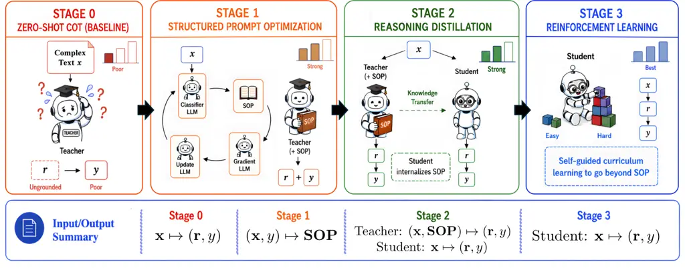
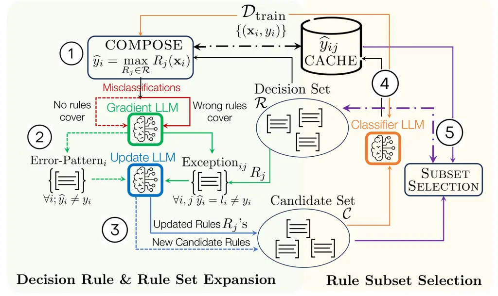

# Structured Prompt Optimization Meets Reinforcement Learning for Global and Local Interpretability over Complex Text

Tianyang Zhou Affiliation: Carnegie Mellon University
Email: [tzhou3@andrew.cmu.edu](mailto:)    Wenbo Chen
Affiliation: Amazon Email: [wbchen@amazon.com](mailto:)    Pierre
Jinghong Liang Affiliation: Carnegie Mellon University
Email: [liangj@tepper.cmu.edu](mailto:)    Leman Akoglu
Affiliation: Carnegie Mellon University
Email: [lakoglu@andrew.cmu.edu](mailto:)

###### Abstract

LLMs have advanced text classification, yet existing paradigms face a
trade-off: supervised (label only) fine-tuning is scalable but offers
limited reasoning on complex text and lacks broader model transparency,
while discrete prompt optimization offers human-readable instructions
but struggles with performance and scalability. We introduce eXTC
(eXplainable Text Classifier) with three progressive stages: (1)
learning a Standard Operating Procedure (SOP, or rulebook) in natural
language via a new Structured Prompt Optimization algorithm; (2)
SOP-grounded reasoning distillation from a large teacher LLM into a
compact LM; and (3) expanding reasoning capabilities beyond the initial
SOP via reinforcement learning. This design enables eXTC to provide (i)
fast inference via a compact LM, with (ii) inference-time local
reasoning traces, alongside a global, modular explanation of its learned
domain rules, while (iii) significantly outperforming existing paradigms
across diverse benchmarks in both classification performance and
explanation quality, with stage-by-stage gains.

²²footnotetext: This work was conducted outside the author’s role at
Amazon.

## 1 Introduction

Text classification finds widespread applications in finance (e.g.,
market sentiment) Das and Chen (2007), healthcare (e.g., clinical note
triage) Jagannatha and Yu (2016), law (e.g., case outcome prediction)
Chalkidis et al. (2020), cybersecurity (e.g., spam/phishing/malware
detection) Salloum et al. (2022). With the rise of LLM-generated text,
it has found critical applications in safety and reliability; e.g.,
detecting LLM-vs-human content Mitchell et al. (2023), hallucination Ji
et al. (2023), and harmful/unsafe generations Gehman et al. (2020).

Despite its popularity, text classification remains challenging due to
(i) the high dimensionality of textual input, (ii) complex and nuanced
semantics that extend beyond surface-level words, and (iii) long-range
dependencies across text. Moreover, many applications require (iv)
robust high-level discrimination rather than reliance on spurious
low-level signals, as well as (v) interpretable explanations for
individual decisions and global understanding of what the model has
learned.

(a) Example rule from the SOP (excerpt): \[Global Explanation\]  
Trigger Pattern: Apply readmit when discharge happens before pending
biopsy / pathology comes back AND specialty follow-up is scheduled
within days to weeks. … Exceptions: Pending pathology without confirmed
disease. … Examples: …

|                       |       |       |
| --------------------- | ----- | ----- |
| (c) Method            | mF1   | Judge |
| Zero-shot CoT         | 0.517 | 3.58  |
| Stage I (SPO4SOP)     | 0.597 | 3.65  |
| Stage I+II (R-SFT)    | 0.620 | 4.29  |
| Stage I+II+III (eXTC) | 0.652 | 4.31  |

(b) MIMIC Readmission Prediction.   Discharge summary: Patient has liver
spots suspicious for cancer. A biopsy was taken; patient was discharged
stable _while awaiting results_, with an _outpatient_ oncology clinic
visit in 10 days.  
Zero-shot CoT reasoning:  
“Suspicious for metastatic disease with pending biopsy and planned
oncology follow-up indicate serious malignancy concern likely needing
chemotherapy/radiation soon. High readmission risk.” Predicted:
readmitted  ✗ v.s. eXTC (RL) reasoning: \[Local Explanation\]  
“Biopsy done; results pending but no indication of active malignancy; no
intensive treatment in progress, patient stable and ambulatory at
discharge.” Predicted: not_readmitted (✓)

Figure 1: eXTC at a glance on MIMIC Readmission. (a) a rule excerpt from
our learned rulebook (or SOP); (b) on a test case: Zero-shot CoT
over-fires on the surface trigger, whereas eXTC correctly invokes the
rule’s _exception_ (no confirmed disease yet); (c) both metrics improve
monotonically across our three Stages. See Case Study in §4.4.

Traditional solutions that rely on many textual features Joachims
(1998), even high-level topics, struggle to address these challenges as
features provide fragmented representations that fail to capture rich
semantics, long-range context, robust high-level reasoning, and coherent
explanations. Explanations based on feature importance and saliency
often fail to reflect the deeper rationale underlying classification
decisions Lipton (2018).

Large language models (LLMs) have transformed many areas of natural
language processing (NLP), with major implications for text
classification. In fact, BERT Devlin et al. (2019), as one of the first
Transformer-based LMs, already significantly improved classification
performance across a wide range of NLP benchmarks, with many follow-up
models building on this success Vajjala and Shimangaud (2025). The
attractiveness of LLMs for text classification is evident from the
advantages they offer, including ingrained world and domain knowledge,
holistic contextual comprehension, natural language interface,
high-level reasoning that is less reliant on low-level spurious signals,
and reasoning capabilities that support more interpretable predictions.

However, existing solutions for LLM-driven classification remain limited
in key aspects. In general, these approaches fall into two main
categories: (1) parameter-efficient (supervised) fine-tuning (PEFT/SFT)
of pretrained backbones Wang et al. (2025a), and (2) prompt optimization
(PO), which learns human-readable commands in context that guide a
frozen backbone Pryzant et al. (2023); Wang et al. (2024) to generate
the correct label tokens as outputs. SFT, and in particular PEFT, is
scalable, however, it does not readily provide reasoning traces or a
global explanation of the underlying model. Chain-of-Thought prompting
Wei et al. (2022) of models fine-tuned only on labels does not readily
produce competitive reasoning, especially for complex text. In contrast,
hard (discrete) prompt optimization (PO) can yield human-readable
prompts that serve as global explanations, which, however, are often
unstructured. In addition, hard PO is computationally demanding, making
it less scalable for large-corpus tasks. (See Table 6, and Apdx. A for
detailed related work.)

This work bridges these gaps by introducing eXTC, an effective and
efficient LLM-powered eXplainable Text Classifier with human-readable
global and local explanations. In a multi-stage framework (Fig. 2), eXTC
bridges structured prompt optimization, reasoning-based SFT, and
reinforcement learning; producing a small distilled LM classifier that
also offers reasoning (local explanation), and a structured rulebook in
the form of a decision set (global explanation). The following
summarizes our main contributions.

- •
  Reasoning-centric Text Classification: We introduce eXTC, a new
  LLM-powered approach to classification and reasoning over complex text
  that provides both global and local explanations. (See example in Fig.
  1 (a) and (b).)
- •
  Formulation and Algorithm Innovations: eXTC has a multi-stage
  framework: (i) SOP Learning learns a rulebook (SOP) via a new
  structured prompt optimization (SPO) algorithm, (ii) SOP-Grounded
  Distillation transfers SOP-guided reasoning traces from a large LM
  onto a small LM, which (iii) further improves through reinforcement
  learning Beyond SOP, with a curriculum designed to increase
  performance on the hard (i.e., teacher-failed) cases. (See Fig. 1
  (c).)
- •
  Desirable Properties: eXTC is (i) effective, capitalizing on SPO, SFT
  and RL; (ii) efficient, with a compact 4B-parameter student model
  obtained via distillation; and (iii) doubly-interpretable; rulebook
  constitutes the global “SOP”, and small LM’s reasoning at inference
  serves as a local explanation per input.
- •
  Evaluation: Extensive experiments on three real-world benchmarks with
  ground-truth evidence for labels show that eXTC outperforms baselines
  in terms of both classification performance and explanation quality,
  with results often improving progressively from SPO to SFT to RL
  across stages, demonstrating the effectiveness of the proposed
  multi-stage learning paradigm.

## 2 Problem and Preliminaries



Figure 2: eXTC Overview: Stage I: SPO learns a rulebook (or SOP) that
grounds Stage II: teacher-reasoning and distillation; Stage III employs
RL to increase hit-rate on hard (i.e. teacher-failed) cases. SOP serves
as the global explanation, while the small (student) LM is the text
classifier with local explanations (i.e. instance-level reasoning).

### 2.1 Problem Statement

Typical Text Classification: Let $`\mathcal{X}`$ denote the input space
with domain $`{\Theta}_{\text{lang}}`$ representing natural language,
where $`\mathbf{x}_{i}\in\mathcal{X}`$ represents a text document; i.e.,
a sequence of tokens. Let $`\mathcal{Y}`$, $`|\mathcal{Y}|=C`$, denote
the set of possible classes where $`y_{i}\in\mathcal{Y}`$ is the $`i`$th
example’s class label.

Typical text classification aims to learn a model
$`f_{\text{model}}(\cdot;\bm{\theta})`$, given training set
$`\mathcal{D}=\{(\mathbf{x}_{i},y_{i})\}_{i=1}^{n}`$, that achieves low
classification error.

Decision Sets: A decision set $`\mathcal{R}`$ consists of an unordered
collection of rules $`\{R_{1},\ldots,R_{K}\}`$ that are stand-alone,
i.e., not linked via ‘else’ statements. This makes them easier to
interpret as compared to hierarchical decision lists where a rule deep
in a decision list is in fact a long rule and applies only when none of
the preceding rules apply.

###### Definition 1 (Decision Composition).

Each rule $`R_{j}\in\mathcal{R}`$ has a target label
$`l_{j}\in\mathcal{Y}`$ and either “_fires_” for an input $`\mathbf{x}`$
(predicting $`l_{j}`$) or “_abstains_”. Given a priority order
$`p:\mathcal{Y}`$$`\to`$$`\{1,\ldots,|\mathcal{Y}|\}`$ with default
$`y_{\text{def}}:=\arg\min_{l}p(l)`$, a decision set’s prediction is

```math
f_{\text{model}}(\mathbf{x};\mathcal{R})\;:=\;R_{\arg\max_{j}\,p(R_{j}(\mathbf{x}))}(\mathbf{x}) \tag{1}
```

where $`R_{j}(\mathbf{x}):=y_{\text{def}}`$ when $`R_{j}`$ abstains, so
if no rule fires,
$`f_{\text{model}}(\mathbf{x};\mathcal{R})=y_{\text{def}}`$. In the
binary case $`(\mathcal{Y}=\{0,1\})`$, this reduces to the standard
max-pool: $`f_{\text{model}}(\mathbf{x};\mathcal{R})=1`$ iff at least
one rule fires.

Decision sets have been effectively used for explainable ML for tabular
data Lakkaraju et al. (2016); Macha and Akoglu (2018), where each rule
corresponds to an itemset; i.e., a conjunction of predicates over
numerical and/or categorical features (e.g., age$`>65`$ $`\wedge`$
location$`=`$California). Different from prior literature, our work
introduces decision sets of rules in natural language. This allows us to
utilize them (1) as a structured prompt of an LLM-powered text
classifier, and (2) as human-readable explanations behind decisions.

###### Problem 1 (Explainable Text Classification).

Given a labeled text corpus
$`\mathcal{D}=\{(\mathbf{x}_{i},y_{i})\}_{i=1}^{n}`$,
$`\mathbf{x}_{i}\in{\Theta}_{\text{lang}}`$, estimate a text
classification model
$`f_{\text{model}}(\cdot;\bm{\theta}):\mathbf{x}\mapsto\{\mathbf{r},y\}`$
that produces (1) instance-level local explanation
$`\mathbf{r}\in{\Theta}_{\text{lang}}`$ (in the form of reasoning), and
(2) model-level global explanation
$`\mathcal{R}`$$`=`$$`\{R_{k}\in{\Theta}_{\text{lang}}\}`$ (in the form
of a decision set of natural language rules).

Our problem statement differs from traditional text classification by
explicitly requiring both local and global explanations in natural
language, motivating a language-model-driven approach. Further, the
global explanation is structured and decomposable, enabling readability
and modular inspection. Such explanations provide a more coherent and
richer reasoning than fragmented feature importance scores or saliency
maps, which often only identify portions of the input text most
associated with the predicted label, rather than offering a deeper
semantic interpretation of the content.

### 2.2 Verbalized Machine Learning

Traditional neural models for text classification exhibit numerical
parameters $`\bm{\theta}`$ in continuous space. Motivated by modern
LLMs’ prowess in many NLP tasks, recent “verbalized” machine learning
approaches Xiao et al. (2024); Yüksekgönül et al. (2025), employ a
pretrained (frozen) LLM as a function approximator that is parameterized
by its (text) prompt. In essence, both the input data
$`\mathcal{D}`$$`\in`$$`{\Theta}_{\text{lang}}`$ and the model
parameters $`\bm{\theta}`$$`\in`$$`{\Theta}_{\text{lang}}`$ (i.e., the
prompt) are represented in natural language. LLMs are further employed
for prompt optimization, to derive “textual gradients” that guide
learning the prompt through reasoning and reflection on model
mispredictions across training epochs.

## 3 Proposed Framework

### 3.1 Motivation and Overview

Fig. 2 illustrates the three stages of eXTC: I. SOP Learning employs
structured prompt optimization (SPO) to learn a rulebook or SOP
(Standard Operating Procedure); II. SOP-Grounded Distillation collects
grounded reasoning traces and performs distillation; and III. Beyond SOP
further improves reasoning beyond the learned SOP through reinforcement
learning. Stages I and II access the large LM only as a black box; the
small LM is trained in Stages II and III. We provide an overview
motivating each stage’s role within the overall pipeline.

Stage I. SOP Learning (§3.2) Motivation: Given $`\langle`$text,
label$`\rangle`$ training pairs
$`\mathcal{D}`$$`=`$$`\{(\mathbf{x}_{i},y_{i})\}_{i=1}^{n}`$, a basic
approach would be SFT/PEFT an existing language model (LM) to map input
text to its label. However, this model would not readily produce
individual explanations/reasoning $`\mathbf{r}_{i}`$’s. CoT-prompting
Wei et al. (2022) does not necessarily induce effective reasoning,
especially for complex text, as we show in §4.2 where direct CoT yields
poor classification and explanation quality.

Overview: As with RAG-based generations for knowledge-intensive tasks
Lewis et al. (2020), having access to additional information in the
context, such as a task-specific SOP (Standard Operating Procedure) or a
rulebook could help obtain enriched reasoning. To this end, we learn a
rulebook comprising a structured prompt in the form of stand-alone rules
(i.e., a decision set) in natural language. We propose a new structured
prompt optimization (SPO) algorithm based on verbalized machine learning
(VML) Xiao et al. (2024) to learn such a task-specific rulebook, which
we call Standard Operating Procedure (SOP).

Stage II. SOP-Grounded Distillation (§3.3) Motivation and Overview:
Given the learned SOP, a teacher LLM is prompted with the enriched and
grounded context $`\langle\text{SOP},\mathbf{x}\rangle`$ to generate
reasoning and label pairs $`\langle\mathbf{r},y\rangle`$. Retaining only
the teacher-generated traces whose predicted labels agree with the
ground truth, we distill triplets
$`{(\mathbf{x}_{i},\mathbf{r}_{i},y_{i})}\subset\mathcal{D}`$ onto a
smaller (student) LM via reasoning-supervised fine-tuning (R-SFT),
training the model to map input text to both reasoning and label
outputs. This distillation serves two purposes: (i) equipping the
student model with SOP-free reasoning capability, and (ii) producing a
smaller and more efficient inference model. The former enables the model
to move beyond the SOP through subsequent reinforcement learning (RL),
while the latter facilitates efficient RL rollouts.

Stage III. Beyond SOP (§3.4) Motivation: SPO requires costly iterative
optimization over multiple LLM calls; therefore, SOP is learned from a
relatively small subset of training data, limiting the teacher model’s
reasoning capability and coverage. In turn, using only those
teacher-generated reasoning traces with correct predictions limits
distillation to a subset of the training set.

Overview: To further improve reasoning capability, we employ
reinforcement learning (RL); enabling the student-LM to generate
multiple traces per input within each batch. The training set naturally
decomposes into easy and hard examples, reflecting the teacher model’s
varying accuracy, and our goal is to rapidly improve performance on the
harder cases without imposing an explicit manual curriculum. To this
end, we over-sample candidate inputs and filter out both overly easy and
overly hard examples whose rollouts yield zero GRPO (Group Relative
Policy Optimization) advantage Shao et al. (2024). Constructing batches
from examples with non-zero advantage promotes more informative learning
signals, thereby improving RL’s sample-efficiency and effectiveness.

### 3.2 I: SOP Learning via SPO

The first goal is to construct a task-specific rulebook to be placed
in-context with each test sample to ground a language model’s reasoning
and classification. The problem can be viewed as prompt optimization
(PO), specifically as structured PO, where the rulebook is to comprise
standalone decision rules expressed in natural language. Since the
rulebook governs the LM output, we also refer to it as a Standard
Operating Procedure (SOP).

Algo. 1 presents SPO4SOP, our proposed structured prompt optimization
approach to learning a task-specific SOP (See diagram in Apdx. B.1.1
Fig. 6). In essence, it employs verbalized ML and text gradients to
update the SOP by orchestrating a Classifier LLM, Gradient LLM, and
Update LLM.

Algorithm at a glance. SPO4SOP starts _cold_ with an empty decision set
$`\mathcal{R}_{0}=\emptyset`$ and iterates over $`T`$ batches drawn from
$`\mathcal{D}_{\text{train}}`$. Each iteration handles two disjoint
error modes. (i) False coverage (a rule fires on $`\mathbf{x}_{i}`$ but
its label $`l_{j}`$ disagrees with ground truth $`y_{i}`$): the Gradient
LLM proposes _exceptions_ from the “offending” example, and the Update
LLM rewrites the rule into a more precise candidate. (Lines 3–11) (ii)
Blind spots (no rule fires and the default label $`y_{\text{def}}`$ is
wrong): the Gradient LLM extracts an _error pattern_ per missed sample,
and the Update LLM synthesizes new candidate rules grouped by target
label $`l\in\mathcal{Y}`$. Candidates from each iteration accumulate in
a _persistent pool_ $`\mathcal{P}_{t}`$ throughout the iterations, such
that a rule generated early but not initially selected remains available
for later subset search. (Lines 13–20)

Subset selection. From $`\mathcal{P}_{t}`$ we select a small active set
$`\mathcal{R}_{t}\subseteq\mathcal{P}_{t}`$
($`|\mathcal{R}_{t}|`$$`\leq`$$`K`$) that maximizes macro-$`F_{1}`$ on
$`\mathcal{D}_{\text{val}}`$ with an AIC-style sparsity penalty
$`\lambda\cdot|\mathcal{R}_{t}|/|\mathcal{D}_{\text{val}}|`$. Because
each rule’s per-sample prediction is cached (Line 21), evaluating any
candidate subset reduces to composing cached predictions, thanks to the
composability of decisions across rules (Definition 1). As such, the LLM
cost is linear in the pool size $`|\mathcal{P}_{t}|`$ rather than
exponential in subset count. We approximate the argmax with beam search
(Line 22); with details in Apdx. B.1.2. After $`T`$ iterations, SPO4SOP
returns the final $`\mathcal{R}_{T}`$ as the learned SOP. Importantly,
it serves as a global explanation of what the model has learned.

0:  $`\mathcal{D}_{\text{train}}=\{(\mathbf{x}_{i},y_{i})\}_{i=1}^{n}`$,
$`\mathcal{D}_{\text{val}}`$, max iter.s $`T`$, max subset size $`K`$,
sparsity penalty $`\lambda`$, priority
$`p:\mathcal{Y}\to\{1,\ldots,|\mathcal{Y}|\}`$ (default
$`y_{\text{def}}:=\arg\min_{l}p(l)`$)

0:  SOP (i.e. decision set $`\mathcal{R}`$ in natural language)  

1:  Init. SOP, pool, candidates
$`\mathcal{R}_{0}`$$`=`$$`\mathcal{P}_{0}`$$`=`$$`\mathcal{C}`$$`:=`$$`\emptyset`$
{cold start}

2:  for $`t=1,\ldots,T`$, batch
$`\mathcal{D}_{\text{batch}}\subseteq\mathcal{D}_{\text{train}}`$ do {
(Iterative Optimization) Revise rules & rule set w.r.t.
$`\mathcal{D}_{\text{val}}`$ error }

3:   for $`R_{j}\in\mathcal{R}_{t-1}`$ do

4:
   $`\mathcal{F}^{+}_{j}:=\{\mathbf{x}_{i}\in\mathcal{D}_{\text{batch}}\;|\;f_{\text{model}}(\mathbf{x}_{i};R_{j})=l_{j}\neq y_{i}\}`$
{false coverage by Rule $`R_{j}`$}

5:   end for$`\blacktriangleright`$ Handling False Coverage — Update
mis-“firing” rules with new exceptions

6:   for $`R_{j}\in\mathcal{R}_{t-1}`$ do

7:    $`\mathcal{G}_{j}:=\emptyset`$

8:    for $`\mathbf{x}_{i}\in\mathcal{F}^{+}_{j}`$ do

9:     $`\mathcal{G}_{j}:=\mathcal{G}_{j}\;\cup`$
$`f_{\text{grad}}(\mathbf{x}_{i},y_{i};l_{j},R_{j})`$ {add Exception by
Gradient_LLM; Apdx. C.3}

10:    end for

11:
   $`\;\mathcal{C}:=\mathcal{C}\cup f_{\text{update}}(R_{j},\mathcal{G}_{j})`$
{update $`R_{j}`$ based on Exceptions via Update_LLM; Apdx. C.4}

12:   end for$`\blacktriangleright`$ Handling Misclassifications — Add
new rules

13:
  $`\mathcal{F}^{-}:=\{\mathbf{x}_{i}\in\mathcal{D}_{\text{batch}}\;|\;f_{\text{model}}(\mathbf{x}_{i};\mathcal{R}_{t-1})`$$`=`$$`y_{\text{def}}\neq y_{i}\}`$
{blind spot; uncovered pattern}

14:   for $`\mathbf{x}_{i}\in\mathcal{F}^{-}`$ do

15:
   $`g_{i}:=f_{\text{grad}}(\mathbf{x}_{i},y_{i};\{R\in\mathcal{R}_{t-1}\;|\;l=y_{i}\})`$
{Error-Pattern by Gradient_LLM; Apdx. C.3}

16:   end for

17:   for $`l\in\mathcal{Y}`$ s.t.
$`\mathcal{G}_{l}:=\{g_{i}:\mathbf{x}_{i}\in\mathcal{F}^{-},\,y_{i}=l\}\neq\emptyset`$
do

18:
   $`\mathcal{C}:=\mathcal{C}\cup f_{\text{update}}(\mathcal{G}_{l};\,l)`$
{cand.s for $`l`$; Apdx. C.5}

19:   end for

20:   Expand persistent pool;
$`\mathcal{P}_{t}:=\mathcal{P}_{t-1}\cup\mathcal{C}`$
 $`\blacktriangleright`$ (Rule Subset Selection): Select few rules on
$`\mathcal{D}_{\text{val}}`$

21:   Classify $`\mathcal{D}_{\text{val}}`$ by Classifier*LLM (Apdx.
C.2) against new candidate rules;
$`\;\widehat{y}*{ij}=f*{\text{model}}(\mathbf{x}*{i}\in\mathcal{D}_{\text{val}};R_{j}`$$`\in`$$`\mathcal{C})`$

22:
  $`\mathcal{R}_{t}`$$`:=`$$`\arg\max_{\mathcal{S}\subseteq\mathcal{P}_{t},\,|\mathcal{S}|\leq K}\big[\,M(\mathcal{S};\mathcal{D}_{\text{val}})`$$`-`$$`\lambda|\mathcal{S}|/|\mathcal{D}_{\text{val}}|\,\big]`$
{beam search; Apdx. B.1.2 ($`M(\cdot\;;\;\cdot)`$ is macro-$`F_{1}`$)}

23:  end for

24:  Return $`\mathcal{R}_{T}`$

Algorithm 1 SPO4SOP: Structured Prompt Optimization for Standard
Operating Procedure

Efficiency.  SPO4SOP’s key compute cost is the number of required LLM
API calls, which may directly translate into monetary cost in practical
deployments. Therefore, we analyze the time complexity of eXTC in terms
of the \#LLM-calls.

###### Lemma 1 (Scalable subset search).

SPO4SOP’s rule subset search scales linearly with the number of
candidate rules $`m`$, rather than with the exponential number of
possible rule subsets. This is enabled by decision composition
(Definition 1), which requires only a linear number of LLM calls in
$`m`$ to obtain decisions for arbitrary rule subsets.

###### Proof.

See Apdx. B.1.3. ∎


Figure 3: t-SNE of PO-classifier reasoning on MIMIC: SPO4SOP’s
embeddings form distinct clusters per rule, while those of baselines are
diffused and unstructured.

As a qualitative study, Fig. 3 shows 2D embedding of PO-classifier
reasonings on MIMIC dataset. SPO4SOP’s reasonings form well-separated
clusters corresponding to individual rules, while those from baseline PO
methods are diffused and unstructured, showing that SPO4SOP’s modular
standalone rules induce distinct reasoning.

### 3.3 II: SOP-Grounded Distillation

Teacher trace generation and rejection sampling. To absorb SOP’s task
knowledge into a compact student model, we collect SOP-grounded
reasoning traces from a teacher LLM. A natural choice is to use the same
LLM as the Stage I Classifier, ensuring consistent SOP interpretation
across stages. We ground the context by concatenating the learned SOP
with each training example as
$`\langle\text{SOP},\mathbf{x}_{i}\rangle`$, and prompt the teacher for
a reasoning-label pair. We draw at most $`M`$$`=`$$`4`$ candidate traces
per example and accept the first whose predicted label matches ground
truth as the distillation trace $`(\mathbf{r}_{i},y_{i})`$ for
$`\mathbf{x}_{i}`$. Examples with all $`M`$ mispredictions are denoted
as _hard_ and excluded from R-SFT, while the other _easy_ ones form the
distillation set. This hard/easy partition further seeds the RL
curriculum in §3.4.

Reasoning-supervised fine-tuning (R-SFT). Letting
$`\mathcal{D}_{\text{rsft}}=\{(\mathbf{x}_{i},\mathbf{r}_{i},y_{i})\}`$
denote the accepted (easy) triplets, we fine-tune a smaller student LM
with LoRA Hu et al. (2022) via next-token cross-entropy on
$`[\mathbf{r}_{i};y_{i}]`$ conditioned on $`\mathbf{x}_{i}`$. To give
the subsequent RL stage a stable starting point, we apply class-balanced
upsampling on $`\mathcal{D}_{\text{rsft}}`$: each epoch traverses the
majority class once while minority classes are oversampled to match.
This prevents the student from initializing as a majority-biased
predictor that would destabilize early policy updates. Training details
are in Apdx. D.2.

After R-SFT, the student maps input text directly to both reasoning and
label outputs without needing the SOP in-context at inference: i.e.,
SOP’s task knowledge has been internalized into the model’s parameters.
Student’s per-example reasoning then serves as a local explanation of
its prediction, complementing the SOP’s global explanation (§3.2).

### 3.4 III: Beyond SOP via RL

|             |       | Rollouts correct (%) |               |      |              |
| ----------- | ----- | -------------------- | ------------- | ---- | ------------ |
| Dataset     | Diff. | 0/G                  | $`1`$–$`7/G`$ | G/G  | % of band    |
| ICLR Review | hard  | 54.0                 | 43.6          | 2.4  | 29.5         |
|             | easy  | 0.7                  | 18.1          | 81.2 | 70.5         |
|             | all   | 8.6                  | 21.9          | 69.5 | (14.8% nat.) |

Table 1: Distribution (%) of rollout outcomes within each hard/easy
group at the start of RL ($`G`$=8), shown for ICLR Review as a
representative example; the other two datasets follow the same pattern
(see Apdx. B.2.1, Tab. 7). Only the $`1`$–$`7/G`$ column carries
non-zero GRPO advantages and provides gradient signal.

Why standard GRPO underperforms on classification. Stage II equips the
student with SOP-grounded reasoning but leaves the _hard_ examples
(§3.3) unaddressed. We turn to RL to extend coverage by letting the
student self-explore. While GRPO-style RL has been most actively studied
on verifiable reasoning tasks such as math and code, where rollouts span
correct and incorrect outcomes Shao et al. (2024); Yu et al. (2025),
text classification with a small and often imbalanced label space
exposes a distinct failure mode: rollout homogeneity. Within a group of
$`G`$ rollouts on the same input, all rollouts often share the same
predicted label, yielding a zero-advantage group, hence no gradient
signal. Concretely, each rollout $`i`$ receives a binary correctness
reward $`R_{i}=2\cdot\mathbf{1}[\widehat{y}_{i}=y]-1\in\{-1,+1\}`$, from
which GRPO computes a within-group normalized advantage

```math
\hat{A}_{i}\;=\;\frac{R_{i}-\mathrm{mean}(\{R_{j}\}_{j=1}^{G})}{\mathrm{std}(\{R_{j}\}_{j=1}^{G})+\varepsilon}, \tag{2}
```

and optimizes the clipped surrogate

```math
\mathcal{J}_{\text{GRPO}}(\theta)=\mathbb{E}\Big[\tfrac{1}{G}\!\sum_{i}\min\!\big(\rho_{i}\hat{A}_{i},\\
\text{clip}(\rho_{i},1{-}\epsilon,1{+}\epsilon)\hat{A}_{i}\big)\Big]-\beta\,D_{\text{KL}}[\pi_{\theta}\|\pi_{\text{ref}}] \tag{3}
```

with importance ratio
$`\rho_{i}=\pi_{\theta}(\mathbf{r}_{i}|\mathbf{x})/\pi_{\theta_{\text{old}}}(\mathbf{r}_{i}|\mathbf{x})`$,
and $`\varepsilon`$ a small constant. When all rollouts in a group share
the same prediction, $`\mathrm{std}(\{R_{j}\})=0`$ and every
$`\hat{A}_{i}`$ vanishes. To quantify this at the start of RL, we run
$`G{=}8`$ rollouts per training example with the Stage II R-SFT model
and bucket each example by its number of correct rollouts. Taking ICLR
Review as a representative example (Table 1; analogous patterns hold on
the other two datasets, Apdx. B.2.1), easy examples are mostly already
mastered and a majority of hard examples are unsolved, leaving only a
thin informative band of $`21.9\%`$ where rollouts within a group
disagree; implying that most of a random GRPO batch contributes no
gradient.

Balanced Dynamic GRPO (BD-GRPO). We introduce BD-GRPO, a
classification-aware variant of GRPO that resolves rollout homogeneity
through two coupled mechanisms operating in a specific order. First,
training pool is partitioned by class; for each class $`c`$ with
per-class quota $`n_{c}`$, we draw a candidate batch
$`\widetilde{\mathcal{B}}_{c}`$ of size $`\kappa n_{c}`$ from
$`\mathcal{D}_{\text{train}}^{(c)}`$ ($`\kappa{>}1`$ the oversample
factor; value in Apdx. D.2) and run $`G`$ rollouts per candidate.
Second, in the same spirit as DAPO’s dynamic sampling Yu et al. (2025),
we discard groups with $`\mathrm{std}(\{R_{j}\})=0`$ and take the first
$`n_{c}`$ survivors per class:

```math
\mathcal{B}=\bigcup_{c\in\mathcal{Y}}\,\text{first}_{n_{c}}\!\left\{\mathbf{x}\in\widetilde{\mathcal{B}}_{c}\,:\,\mathrm{std}(\{R_{j}(\mathbf{x})\}_{j=1}^{G})>0\right\}, \tag{4}
```

producing a class-balanced batch composed entirely of informative
groups, on which the GRPO update (Eq. 3) is then computed. If a class
yields fewer than $`n_{c}`$ informative survivors, we top up its quota
with random draws from the same class. Performing dynamic sampling
_after_ per-class oversampling is critical under severe label imbalance:
replacing it with class-agnostic oversampling (D-GRPO) causes RL to
over-predict the majority class and collapse on MIMIC (Fig. 4).

Figure 4: Bal-acc vs. time, truncated at each run’s RL peak. BD-GRPO
hits peak $`3`$-$`5\times`$ faster than B-GRPO; D-GRPO collapses on
MIMIC w/out class balance.

|     |
| --- |
|     |
|     |

Figure 5: RL training progression on ContractNLI (other datasets in
Apdx. B.2.1). Take-aways: Entropy stays bounded (no collapse), KL
remains small, hard hit rate steadily increases, and easy hit rate
remains high.

| Dataset       | Split (Tr/V/Te) | Avg Tok. | Min Class (%) | Class | Domain      | Task Description    | Evidence Type     |
| ------------- | --------------- | -------- | ------------- | ----- | ----------- | ------------------- | ----------------- |
| ContractNLI   | 7191/1037/2091  | 2185     | 11            | 3     | Legal       | Contract NLI        | Contract Spans    |
| ICLR Review   | 8552/1000/655   | 2242     | 37            | 2     | Peer Review | Paper Acceptance    | Meta-Review       |
| MIMIC Readmit | 8000/1000/1000  | 3209     | 22            | 2     | Clinical    | Patient Readmission | LACE Risk Factors |

Table 2: Dataset Overview and Summary Statistics

Self-guided curriculum and wall-clock time. Together, the two mechanisms
implement an _implicit self-guided curriculum_: at every step, the model
trains on examples currently in its informative band rather than on
random batches. The informative band is itself hard-heavy: as
illustrated in Table 1 for ICLR Review, hard examples occupy a far
larger share than in the natural training set (similarly for other
datasets), so a BD-GRPO over-represents hard examples relative to a
random batch without any hand-crafted schedule. Fig. 5 shows that
training is healthy throughout RL: entropy stays bounded,
KL-to-reference remains small, hard-set accuracy rises substantially
while easy-set accuracy is retained.

The upsampling strategy appears to multiply per-step rollout cost, but
the wall-clock comparison in Fig. 4 demonstrates the opposite: BD-GRPO
reaches its peak performance $`3`$-$`5\times`$ faster than vanilla
B-GRPO across all datasets while matching or exceeding its peak. The
speedup comes from two sources: (i) every retained group provides a
high-quality gradient signal, yielding more stable update directions
than B-GRPO’s noisy mix of informative and zero-advantage groups; so
BD-GRPO needs far fewer total optimizer steps to peak; and (ii) rollouts
within a step are independent and dispatched concurrently across GPUs
via vLLM’s batched inference, whereas optimizer steps must run
sequentially. In addition, B-GRPO’s class-balanced batches do not
translate to a balanced _effective_ signal: zero-advantage groups are
unevenly distributed across classes and batches, causing the model to
oscillate between over-predicting each class, further slowing
convergence. Apdx. D.2 gives RL setting details.

RL learnings on hard cases are incorporated back into the SOP, deferred
to Apdx. B.2.2 for brevity.

## 4 Experiments

### 4.1 Experiment Setup

Datasets:  We use publicly available datasets from three domains: legal
contracts, academic peer reviews, and hospital readmissions. All
datasets exhibit “evidence” for each label which we use for evaluating
explanations. Table 2 provides a summary while Apdx. D.1 gives details.

Models and Configurations:  We organize the baselines into two:
prompt-based and fine-tuned. CoT employs zero-shot Chain-of-Thought
prompting Wei et al. (2022), while MIPROv2 Opsahl-Ong et al. (2024) and
GEPA Agrawal et al. (2026) are two hard prompt optimization (PO)
alternatives to our SPO4SOP, producing discrete but unstructured PO. SFT
uses a classification head to fine-tune on the labels (only). In
contrast, our Reasoning Distillation (Stage II) fine-tunes using both
SOP-grounded teacher reasoning and the labels.

Student backbone is Qwen3-4B Team (2025b), a compact LM used for all SFT
and RL methods. gpt-4.1-mini is the classifier for all prompt-based
methods (zero-shot CoT, MIPROv2, GEPA, SPO4SOP) and the teacher
generating R-SFT reasoning traces. All fine-tuning runs were carried out
on 4$`\times`$ NVIDIA H100 80GB GPUs. Prompt-optimization methods are
API-only through OpenAI. For Cls-head SFT with no native reasoning, we
extract post-hoc gradient-based input saliency via Captum Kokhlikyan
et al. (2020). Setup for PO, SFT, and RL are detailed in Apdx. D.2.

Metrics:  We evaluate both classification performance and explanation
quality. The former is measured by macro-F1 and balanced accuracy.
Explanations are compared against ground-truth evidence using NLI and
LLM-judge scores. NLI scores use MiniCheck-Flan-T5-Large Tang et al.
(2024), a fact-checking model that scores per-sentence entailment of an
explanation against the evidence. LLM judge (gemini-2.5-flash-lite)
follows G-Eval Liu et al. (2023): for each (evidence, explanation) pair,
it returns a 1–5 Likert score weighted by token-level output
probabilities. Further details are given in Apdx. D.3.

|                       |              |             |       |       |       |             |       |       |       |                   |       |       |       |
| --------------------- | ------------ | ----------- | ----- | ----- | ----- | ----------- | ----- | ----- | ----- | ----------------- | ----- | ----- | ----- |
|                       |              | ContractNLI |       |       |       | ICLR Review |       |       |       | MIMIC Readmission |       |       |       |
| Method                | Family       | mF1         | BAcc  | NLI   | Judge | mF1         | BAcc  | NLI   | Judge | mF1               | BAcc  | NLI   | Judge |
| CoT prompt            | Zero-shot    | 0.743       | 0.757 | 0.576 | 4.31  | 0.789       | 0.786 | 0.160 | 3.18  | 0.517             | 0.528 | 0.045 | 3.58  |
| SPO4SOP (I)           | SPO          | 0.790       | 0.789 | 0.578 | 4.33  | 0.795       | 0.815 | 0.200 | 3.32  | 0.597             | 0.593 | 0.178 | 3.65  |
| SFT                   | Cls. Head    | 0.847       | 0.865 | 0.243 | 3.43  | 0.825       | 0.832 | 0.112 | 2.97  | 0.609             | 0.726 | 0.051 | 3.36  |
| Reas. Distill. (I+II) | SPO+R-SFT    | 0.802       | 0.811 | 0.576 | 4.24  | 0.821       | 0.821 | 0.196 | 3.40  | 0.620             | 0.623 | 0.057 | 4.29  |
| eXTC (I+II+III)       | SPO+R-SFT+RL | 0.849       | 0.882 | 0.554 | 4.37  | 0.825       | 0.829 | 0.217 | 3.44  | 0.652             | 0.642 | 0.057 | 4.31  |

Table 3: Classification performance (macro-F1, Balanced Accuracy) and
Explanation performance (NLI and LLM Judge scores) across datasets. Top:
prompt-based; Bottom: fine-tuned methods. The best and runner-up are
highlighted in green and blue, resp. Take-aways: SPO4SOP substantially
outperforms CoT; SFT improves classification, but falls short in
explanation; SPO-grounded R-SFT significantly boosts explanation quality
over standard SFT, and eXTC achieves the best overall performance across
datasets and the majority of metrics.

### 4.2 Main Results

Table 3 presents results across datasets and metrics. Basic zero-shot
CoT prompting baseline considerably underperforms across tasks,
demonstrating the necessity of training the language models for complex
text classification. Our SPO4SOP substantially outperforms CoT in terms
of both classification and explanation performance, despite being
trained only on a small subset of training data.

SFT improves classification over prompting by using all available
training data for fine-tuning, but it deteriorates notably in
explanation quality, even against basic CoT, because saliency-extracted
explanations are fragmented and confined to input spans, underscoring
the necessity for reasoning-based fine-tuning. In fact, our SPO-grounded
reasoning distillation significantly boosts explanation quality over
end-to-end SFT, by combining Stage I (learned SOP) and Stage II (R-SFT),
while maintaining robust classification performance.

eXTC achieves the best overall performance across datasets and majority
of metrics by further boosting R-SFT model through Stage III (RL with
self-guided curriculum). The improvements in classification and
explanation performance justify eXTC’s modular design, where SPO grounds
R-SFT and RL further boosts the result.

|         |             |       |       |       |       |       |
| ------- | ----------- | ----- | ----- | ----- | ----- | ----- |
|         | ContractNLI |       | ICLR  |       | MIMIC |       |
| Method  | mF1         | BAcc  | mF1   | BAcc  | mF1   | BAcc  |
| CoT     | 0.743       | 0.757 | 0.789 | 0.786 | 0.517 | 0.528 |
| MIPROv2 | 0.753       | 0.767 | 0.779 | 0.808 | 0.541 | 0.568 |
| GEPA    | 0.790       | 0.786 | 0.790 | 0.783 | 0.450 | 0.499 |
| SPO4SOP | 0.790       | 0.789 | 0.795 | 0.815 | 0.597 | 0.593 |

Table 4: PO ablation. Top: zero-shot CoT baseline; Bottom: hard-PO
methods. Take-aways: SPO4SOP outperforms zero-shot CoT and matches or
exceeds both hard-PO baselines, MIPROv2 and GEPA, producing a
structured, decision set of rules.

### 4.3 Ablation Analysis

Table 4 compares SPO4SOP, one of our main contributions, with two
existing hard PO approaches that do not produce structured SOPs with
stand-alone rules. SPO4SOP consistently performs better across datasets,
with especially large gains over MIPROv2 on ContractNLI and GEPA on
MIMIC.

|               |             |       |       |       |       |       |
| ------------- | ----------- | ----- | ----- | ----- | ----- | ----- |
|               | ContractNLI |       | ICLR  |       | MIMIC |       |
| Method        | mF1         | BAcc  | mF1   | BAcc  | mF1   | BAcc  |
| R-SFT (II)    | 0.802       | 0.811 | 0.821 | 0.821 | 0.620 | 0.623 |
| B-GRPO        | 0.841       | 0.877 | 0.817 | 0.808 | 0.645 | 0.642 |
| D-GRPO        | 0.857       | 0.871 | 0.823 | 0.818 | 0.586 | 0.578 |
| BD-GRPO (III) | 0.849       | 0.882 | 0.825 | 0.829 | 0.652 | 0.642 |
| BD-GRPO+aux   | 0.829       | 0.868 | 0.827 | 0.834 | 0.646 | 0.644 |

Table 5: RL ablation. Top: R-SFT in II (as reference); Bottom: RL
variants in III. B/D prefixes denote class-Balanced batching and Dynamic
upsampling-and-filter; BD-GRPO (proposed) combines both; +aux adds an
LLM-judge auxiliary reasoning reward on top. Column best in bold,
runner-up underlined. Take-aways: RL variants (Stage III) often improve
R-SFT (Stage II); class-balancing is beneficial; upsample-then-filter
boosts performance; auxiliary reward can be beneficial.

Table 5 compares Stage III RL variants and Stage II. Combined class
(B)alancing and (D)ynamic batch oversampling consistently improve
performance. Extending RL’s binary label reward with LLM-judge reasoning
reward (Apdx. D.4) yields further gains on some, though not all,
datasets, suggesting judge quality may vary across domains.

### 4.4 Case Study

Fig. 1 presents a case from MIMIC, where (a) shows one of the rules in
the learned SOP (see full SOP in Apdx. F) that predicts readmit under
the trigger pattern “pending biopsy” with the exception of “no confirmed
disease”. In (b) right, eXTC predicts no_readmit for a test input, based
on the reasoning “biopsy with results pending” but with “no indication
of malignancy”. In contrast, in (b) left, CoT latches on surface
information of “pending biopsy” to incorrectly predict readmit. For
brevity, Apdx. E.2 gives additional case studies.

Importantly, after teacher distillation, eXTC no longer includes the SOP
from Stage I in its prompt. Its continued adherence to the learned rules
indicates that this knowledge has been internalized through distillation
(II), and that RL (III) remains faithful to those rules during
exploration.

## 5 Conclusion

We introduce eXTC, an effective text classifier that provides both local
reasoning and a global, modular rulebook. By strategically uniting
structured prompt optimization, reasoning-grounded distillation, and
targeted reinforcement learning, eXTC captures the best of both worlds:
it overall outperforms traditional fine-tuning and prompt-optimization
baselines while simultaneously offering high-quality, auditable
interpretability.

## Limitations

Our work focused on general text corpora, leveraging and further
enhancing LLM capabilities for structured prompt optimization,
reasoning, and reinforcement learning. However, we recognize that many
real-world corpora are inherently multimodal and contain information
beyond plain text, such as images, charts, and structured numerical
tables, which were not explicitly addressed in this work. Stages I and
II rely on proprietary LLMs; reproducing our results requires comparable
access. We used temperature 0 where possible to encourage deterministic
outputs, but environmental factors may introduce minor variation.

## Ethical Considerations

Our approach inherits ethical considerations associated with LLMs,
including potential biases in pretrained models, privacy concerns, and
risk of misleading or unfaithful generated rationales. Although
structured reasoning is designed to facilitate interpretability, in
high-stakes applications, outputs should be used with appropriate human
oversight and careful evaluation across diverse populations.

AI assistance: We used Claude and ChatGPT for code drafting, debugging,
and editorial polishing of this manuscript, with author oversight. All
scientific design, experimental protocols, and analyses were performed
by the authors.

## References

- Agrawal et al. (2026) Lakshya A. Agrawal, Shangyin Tan, Dilara Soylu,
  Noah Ziems, Rishi Khare, Krista Opsahl-Ong, Arnav Singhvi, Herumb
  Shandilya, Michael J. Ryan, Meng Jiang, Christopher Potts, Koushik
  Sen, Alex Dimakis, Ion Stoica, Dan Klein, Matei Zaharia, and Omar
  Khattab. 2026. [GEPA: Reflective prompt evolution can outperform
  reinforcement learning](https://openreview.net/forum?id=RQm2KQTM5r).
  In _The Fourteenth International Conference on Learning
  Representations_.
- Chalkidis et al. (2020) Ilias Chalkidis, Manos Fergadiotis, Prodromos
  Malakasiotis, Nikolaos Aletras, and Ion Androutsopoulos. 2020.
  Legal-bert: The muppets straight out of law school. In _Findings of
  the association for computational linguistics: EMNLP 2020_, pages
  2898–2904.
- Das and Chen (2007) Sanjiv R. Das and Mike Y. Chen. 2007. [Yahoo! for
  amazon: Sentiment extraction from small talk on the
  web](https://doi.org/10.1287/MNSC.1070.0704). _Manag. Sci._,
  53(9):1375–1388.
- Deng et al. (2024) Chenlong Deng, Kelong Mao, Yuyao Zhang, and
  Zhicheng Dou. 2024. Enabling discriminative reasoning in LLMs for
  legal judgment prediction. _arXiv preprint arXiv:2407.01964_.
- Devlin et al. (2019) Jacob Devlin, Ming-Wei Chang, Kenton Lee, and
  Kristina Toutanova. 2019. [Bert: Pre-training of deep bidirectional
  transformers for language
  understanding](https://doi.org/10.18653/v1/N19-1423). In _Proceedings
  of the 2019 Conference of the North American Chapter of the
  Association for Computational Linguistics: Human Language
  Technologies_, pages 4171–4186. Association for Computational
  Linguistics.
- Gao et al. (2026) Xiang Gao, Yuguang Yao, Qi Zhang, Kaiwen Dong,
  Avinash Baidya, Ruocheng Guo, Hilaf Hasson, and Kamalika Das. 2026.
  RIMRULE: Improving tool-using language agents via MDL-guided rule
  learning. _arXiv preprint arXiv:2601.00086_.
- Gehman et al. (2020) Samuel Gehman, Suchin Gururangan, Maarten Sap,
  Yejin Choi, and Noah A. Smith. 2020. Realtoxicityprompts: Evaluating
  neural toxic degeneration in language models. In _EMNLP_.
- Guo et al. (2025) Daya Guo, Dejian Yang, Haowei Zhang, Junxiao Song,
  Peiyi Wang, Qihao Zhu, Runxin Xu, Ruoyu Zhang, Shirong Ma, Xiao Bi,
  Xiaokang Zhang, Xingkai Yu, Yu Wu, Z. F. Wu, Zhibin Gou, Zhihong Shao,
  Zhuoshu Li, Ziyi Gao, Aixin Liu, and 175 others. 2025. [Deepseek-r1
  incentivizes reasoning in llms through reinforcement
  learning](https://doi.org/10.1038/S41586-025-09422-Z). _Nat._,
  645(8081):633–638.
- Henrichsen and Krebs (2025) Mads Henrichsen and Rasmus Krebs. 2025.
  Two-stage reasoning-infused learning: Improving classification with
  LLM-generated reasoning. _arXiv preprint arXiv:2507.00214_.
- Hu et al. (2022) Edward J. Hu, Yelong Shen, Phillip Wallis, Zeyuan
  Allen-Zhu, Yuanzhi Li, Shean Wang, Lu Wang, and Weizhu Chen. 2022.
  LoRA: Low-rank adaptation of large language models. In _International
  Conference on Learning Representations_.
- Jagannatha and Yu (2016) Abhyuday Jagannatha and Hong Yu. 2016.
  Bidirectional rnn for medical event detection in electronic health
  records. In _NAACL_.
- Ji et al. (2023) Ziwei Ji, Nayeon Lee, Rita Frieske, Tiezheng Yu, Dan
  Su, Yan Xu, Etsuko Ishii, Ye Jin Bang, Andrea Madotto, and Pascale
  Fung. 2023. Survey of hallucination in natural language generation.
  _ACM computing surveys_, 55(12):1–38.
- Joachims (1998) Thorsten Joachims. 1998. Text categorization with
  support vector machines: Learning with many relevant features. In
  _ECML_.
- Johnson et al. (2023) Alistair E. W. Johnson, Lucas Bulgarelli,
  Lu Shen, Alvin Gayles, Ayad Shammout, Steven Horng, Tom J. Pollard,
  Sicheng Hao, Benjamin Moody, Brian Gow, Li-wei H. Lehman, Leo A. Celi,
  and Roger G. Mark. 2023. [Mimic-iv, a freely accessible electronic
  health record dataset](https://doi.org/10.1038/s41597-022-01899-x).
  _Scientific Data_, 10(1).
- Khattab et al. (2023) Omar Khattab, Arnav Singhvi, Paridhi Maheshwari,
  Zhiyuan Zhang, Keshav Santhanam, Sri Vardhamanan, Saiful Haq, Ashutosh
  Sharma, Thomas T. Joshi, Hanna Moazam, Heather Miller, Matei Zaharia,
  and Christopher Potts. 2023. DSPy: Compiling declarative language
  model calls into self-improving pipelines. _CoRR_, abs/2310.03714.
- Kohler et al. (2025) Hector Kohler, Quentin Delfosse, Waris Radji,
  Riad Akrour, and Philippe Preux. 2025. Evaluating interpretable
  reinforcement learning by distilling policies into programs. _arXiv
  preprint arXiv:2503.08322_.
- Kokhlikyan et al. (2020) Narine Kokhlikyan, Vivek Miglani, Miguel
  Martin, Edward Wang, Bilal Alsallakh, Jonathan Reynolds, Alexander
  Melnikov, Natalia Kliushkina, Carlos Araya, Siqi Yan, and Orion
  Reblitz-Richardson. 2020. Captum: A unified and generic model
  interpretability library for PyTorch. _arXiv preprint
  arXiv:2009.07896_.
- Koreeda and Manning (2021) Yuta Koreeda and Christopher D.
  Manning. 2021. [Contractnli: A dataset for document-level natural
  language inference for
  contracts](https://doi.org/10.18653/V1/2021.FINDINGS-EMNLP.164). In
  _Findings of the Association for Computational Linguistics: EMNLP_,
  Findings of ACL, pages 1907–1919. Association for Computational
  Linguistics.
- Lakkaraju et al. (2016) Himabindu Lakkaraju, Stephen H. Bach, and Jure
  Leskovec. 2016. [Interpretable decision sets: A joint framework for
  description and
  prediction.](http://dblp.uni-trier.de/db/conf/kdd/kdd2016.html#LakkarajuBL16)
  In _Proceedings of the 22nd ACM SIGKDD international conference on
  knowledge discovery and data mining_, pages 1675–1684. ACM.
- Lewis et al. (2020) Patrick Lewis, Ethan Perez, Aleksandra Piktus,
  Fabio Petroni, Vladimir Karpukhin, Naman Goyal, Heinrich Küttler, Mike
  Lewis, Wen-tau Yih, Tim Rocktäschel, Sebastian Riedel, and Douwe
  Kiela. 2020. [Retrieval-augmented generation for knowledge-intensive
  NLP
  tasks](https://proceedings.neurips.cc/paper/2020/hash/6b493230205f780e1bc26945df7481e5-Abstract.html).
  In _Advances in Neural Information Processing Systems_.
- Lipton (2018) Zachary C. Lipton. 2018. The mythos of model
  interpretability. _Communications of the ACM_.
- Liu et al. (2026) Shih-Yang Liu, Xin Dong, Ximing Lu, Shizhe Diao,
  Peter Belcak, Mingjie Liu, Min-Hung Chen, Hongxu Yin, Yu-Chiang Frank
  Wang, Kwang-Ting Cheng, Yejin Choi, Jan Kautz, and Pavlo
  Molchanov. 2026. GDPO: Group reward-decoupled normalization policy
  optimization for multi-reward RL optimization. _arXiv preprint
  arXiv:2601.05242_.
- Liu et al. (2023) Yang Liu, Dan Iter, Yichong Xu, Shuohang Wang,
  Ruochen Xu, and Chenguang Zhu. 2023. G-Eval: NLG evaluation using
  GPT-4 with better human alignment. In _Proceedings of the 2023
  Conference on Empirical Methods in Natural Language Processing_.
  Association for Computational Linguistics.
- Lundberg and Lee (2017) Scott M Lundberg and Su-In Lee. 2017. A
  unified approach to interpreting model predictions. In _Proceedings of
  the 31st International Conference on Neural Information Processing
  Systems (NeurIPS)_, pages 4765–4774.
- Lyu et al. (2024) Qing Lyu, Marianna Apidianaki, and Chris
  Callison-Burch. 2024. Towards faithful model explanation in NLP: A
  survey. _Computational Linguistics_, 50(2):657–723.
- Macha and Akoglu (2018) Meghanath Macha and Leman Akoglu. 2018.
  Explaining anomalies in groups with characterizing subspace rules.
  _Data Mining and Knowledge Discovery_, 32:1444–1480.
- Mitchell et al. (2023) Eric Mitchell, Yoonho Lee, Alexander Khazatsky,
  Christopher D. Manning, and Chelsea Finn. 2023. [Detectgpt: Zero-shot
  machine-generated text detection using probability
  curvature](https://proceedings.mlr.press/v202/mitchell23a.html). In
  _International Conference on Machine Learning, ICML 2023, 23-29 July
  2023, Honolulu, Hawaii, USA_, Proceedings of Machine Learning
  Research, pages 24950–24962. PMLR.
- OpenAI (2024) OpenAI. 2024. [Gpt-4o system
  card](https://doi.org/10.48550/ARXIV.2410.21276). _CoRR_,
  abs/2410.21276.
- Opsahl-Ong et al. (2024) Krista Opsahl-Ong, Michael J Ryan, Josh
  Purtell, David Broman, Christopher Potts, Matei Zaharia, and Omar
  Khattab. 2024. Optimizing instructions and demonstrations for
  multi-stage language model programs. In _Proceedings of the 2024
  Conference on Empirical Methods in Natural Language Processing_, pages
  9340–9366.
- Panickssery et al. (2024) Arjun Panickssery, Samuel R. Bowman, and Shi
  Feng. 2024. LLM evaluators recognize and favor their own generations.
  In _Advances in Neural Information Processing Systems (NeurIPS)_.
- Pryzant et al. (2023) Reid Pryzant, Dan Iter, Jerry Li, Yin Tat Lee,
  Chenguang Zhu, and Michael Zeng. 2023. [Automatic prompt optimization
  with "gradient descent" and beam
  search](https://doi.org/10.18653/V1/2023.EMNLP-MAIN.494). In
  _Proceedings of the 2023 Conference on Empirical Methods in Natural
  Language Processing, EMNLP 2023, Singapore, December 6-10, 2023_,
  pages 7957–7968. Association for Computational Linguistics.
- Quan et al. (2005) Hude Quan, Vijaya Sundararajan, Patricia Halfon,
  Andrew Fong, Bernard Burnand, Jean-Christophe Luthi, L. Duncan
  Saunders, Cynthia A. Beck, Thomas E. Feasby, and William A.
  Ghali. 2005. [Coding algorithms for defining comorbidities in ICD-9-CM
  and ICD-10 administrative
  data](https://doi.org/10.1097/01.mlr.0000182534.19832.83). _Medical
  Care_, 43(11):1130–1139.
- Ribeiro et al. (2016) Marco Túlio Ribeiro, Sameer Singh, and Carlos
  Guestrin. 2016. ["why should I trust you?": Explaining the predictions
  of any classifier](https://doi.org/10.1145/2939672.2939778). In
  _Proceedings of the 22nd ACM SIGKDD International Conference on
  Knowledge Discovery and Data Mining, San Francisco, CA, USA, August
  13-17, 2016_, pages 1135–1144. ACM.
- Rudin (2019) Cynthia Rudin. 2019. [Stop explaining black box machine
  learning models for high stakes decisions and use interpretable models
  instead](https://doi.org/10.1038/S42256-019-0048-X). _Nat. Mach.
  Intell._, 1(5):206–215.
- Salloum et al. (2022) Said Salloum, Tarek Gaber, Sunil Vadera, and
  Khaled Shaalan. 2022. A systematic literature review on phishing email
  detection using natural language processing techniques. _Ieee Access_,
  10:65703–65727.
- Sechidis et al. (2011) Konstantinos Sechidis, Grigorios Tsoumakas, and
  Ioannis P. Vlahavas. 2011. [On the stratification of multi-label
  data](https://doi.org/10.1007/978-3-642-23808-6_10). In _Machine
  Learning and Knowledge Discovery in Databases (ECML PKDD)_, volume
  6913 of _Lecture Notes in Computer Science_, pages 145–158.
- Shao et al. (2024) Zhihong Shao, Peiyi Wang, Qihao Zhu, Runxin Xu,
  Junxiao Song, Mingchuan Zhang, Y. K. Li, Y. Wu, and Daya Guo. 2024.
  [Deepseekmath: Pushing the limits of mathematical reasoning in open
  language models](https://doi.org/10.48550/ARXIV.2402.03300). _CoRR_,
  abs/2402.03300.
- Sheng et al. (2024) Guangming Sheng, Chi Zhang, Zilingfeng Ye, Xibin
  Wu, Wang Zhang, Ru Zhang, Yanghua Peng, Haibin Lin, and Chuan
  Wu. 2024. HybridFlow: A flexible and efficient RLHF framework. _arXiv
  preprint arXiv:2409.19256_.
- Sun et al. (2024) Zhiqing Sun, Yikang Shen, Hongxin Zhang, Qinhong
  Zhou, Zhenfang Chen, David Cox, Yiming Yang, and Chuang Gan. 2024.
  SALMON: Self-alignment with instructable reward models. In
  _International Conference on Learning Representations (ICLR)_.
- Tang et al. (2024) Liyan Tang, Philippe Laban, and Greg Durrett. 2024.
  MiniCheck: Efficient fact-checking of LLMs on grounding documents. In
  _Proceedings of the 2024 Conference on Empirical Methods in Natural
  Language Processing_.
- Team (2025a) Gemini Team. 2025a. [Gemini 2.5: Pushing the frontier
  with advanced reasoning, multimodality, long context, and next
  generation agentic
  capabilities](https://doi.org/10.48550/ARXIV.2507.06261). _CoRR_,
  abs/2507.06261.
- Team (2025b) Qwen Team. 2025b. [Qwen3 technical
  report](https://doi.org/10.48550/ARXIV.2505.09388). _CoRR_,
  abs/2505.09388.
- Thareja et al. (2026) Rushil Thareja, Gautam Gupta, Francesco Pinto,
  and Nils Lukas. 2026. MAC: Multi-agent constitution learning. _arXiv
  preprint arXiv:2603.15968_.
- Vajjala and Shimangaud (2025) Sowmya Vajjala and Shwetali
  Shimangaud. 2025. Text classification in the llm era–where do we
  stand? _arXiv preprint arXiv:2502.11830_.
- van Walraven et al. (2010) Carl van Walraven, Irfan A. Dhalla, Chaim
  Bell, Edward Etchells, Ian G. Stiell, Kelly Zarnke, Peter C. Austin,
  and Alan J. Forster. 2010. [Derivation and validation of an index to
  predict early death or unplanned readmission after discharge from
  hospital to the community](https://doi.org/10.1503/cmaj.091117).
  _CMAJ_, 182(6):551–557.
- Wang et al. (2025a) Luping Wang, Sheng Chen, Linnan Jiang, Shu Pan,
  Runze Cai, Sen Yang, and Fei Yang. 2025a. [Parameter-efficient
  fine-tuning in large language models: a survey of
  methodologies](https://doi.org/10.1007/S10462-025-11236-4). _Artif.
  Intell. Rev._, 58(8):227.
- Wang et al. (2025b) Ruochen Wang, Si Si, Felix X. Yu,
  Dorothea Wiesmann Rothuizen, Cho-Jui Hsieh, and Inderjit S. Dhillon.
  2025b. [Large language models are interpretable
  learners](https://openreview.net/forum?id=hTphfqtafO). In _The
  Thirteenth International Conference on Learning Representations, ICLR
  2025, Singapore, April 24-28, 2025_. OpenReview.net.
- Wang et al. (2024) Xinyuan Wang, Chenxi Li, Zhen Wang, Fan Bai,
  Haotian Luo, Jiayou Zhang, Nebojsa Jojic, Eric P. Xing, and Zhiting
  Hu. 2024. [Promptagent: Strategic planning with language models
  enables expert-level prompt
  optimization](https://openreview.net/forum?id=22pyNMuIoa). In _The
  Twelfth International Conference on Learning Representations, ICLR
  2024, Vienna, Austria, May 7-11, 2024_. OpenReview.net.
- Wei et al. (2025) Bowen Wei, Mehrdad Fazli, and Ziwei Zhu. 2025.
  Learning to explain: Prototype-based surrogate models for LLM
  classification. _arXiv preprint arXiv:2505.18970_.
- Wei et al. (2022) Jason Wei, Xuezhi Wang, Dale Schuurmans, Maarten
  Bosma, Brian Ichter, Fei Xia, Ed H. Chi, Quoc V. Le, and Denny
  Zhou. 2022. [Chain-of-thought prompting elicits reasoning in large
  language
  models](http://papers.nips.cc/paper_files/paper/2022/hash/9d5609613524ecf4f15af0f7b31abca4-Abstract-Conference.html).
  In _Advances in Neural Information Processing Systems_.
- Wu et al. (2025) Rong Wu, Xiaoman Wang, Jianbiao Mei, Pinlong Cai,
  Daocheng Fu, Cheng Yang, Licheng Wen, Xuemeng Yang, Yufan Shen, Yuxin
  Wang, and Botian Shi. 2025. [Evolver: Self-evolving LLM agents through
  an experience-driven
  lifecycle](https://doi.org/10.48550/ARXIV.2510.16079). _CoRR_,
  abs/2510.16079.
- Xia et al. (2026) Peng Xia, Jianwen Chen, Hanyang Wang, Jiaqi Liu,
  Kaide Zeng, Yu Wang, Siwei Han, Yiyang Zhou, Xujiang Zhao, Haifeng
  Chen, Zeyu Zheng, Cihang Xie, and Huaxiu Yao. 2026. SkillRL: Evolving
  agents via recursive skill-augmented reinforcement learning. _arXiv
  preprint arXiv:2602.08234_.
- Xiao et al. (2024) Tim Z Xiao, Robert Bamler, Bernhard Schölkopf, and
  Weiyang Liu. 2024. Verbalized machine learning: Revisiting machine
  learning with language models. _arXiv preprint arXiv:2406.04344_.
- Yu et al. (2025) Qiying Yu, Zheng Zhang, Ruofei Zhu, Yufeng Yuan,
  Xiaochen Zuo, Yu Yue, Tiantian Fan, Gaohong Liu, Lingjun Liu, Xin Liu,
  Haibin Lin, Zhiqi Lin, Bole Ma, Guangming Sheng, Yuxuan Tong, Chi
  Zhang, Mofan Zhang, Wang Zhang, Hang Zhu, and 16 others. 2025. [DAPO:
  an open-source LLM reinforcement learning system at
  scale](https://doi.org/10.48550/ARXIV.2503.14476). _CoRR_,
  abs/2503.14476.
- Yüksekgönül et al. (2025) Mert Yüksekgönül, Federico Bianchi, Joseph
  Boen, Sheng Liu, Pan Lu, Zhi Huang, Carlos Guestrin, and James
  Zou. 2025. [Optimizing generative AI by backpropagating language model
  feedback](https://doi.org/10.1038/S41586-025-08661-4). _Nat._,
  639(8055):609–616.
- Zhang et al. (2025) Daoze Zhang, Zhijian Bao, Sihang Du, Zhiyi Zhao,
  Kuangling Zhang, Dezheng Bao, and Yang Yang. 2025. Re²: A
  consistency-ensured dataset for full-stage peer review and multi-turn
  rebuttal discussions. _arXiv preprint arXiv:2505.07920_.
- Zheng et al. (2024) Yaowei Zheng, Richong Zhang, Junhao Zhang, Yanhan
  Ye, and Zheyan Luo. 2024. [Llamafactory: Unified efficient fine-tuning
  of 100+ language
  models](https://doi.org/10.18653/V1/2024.ACL-DEMOS.38). In
  _Proceedings of the 62nd Annual Meeting of the Association for
  Computational Linguistics (Volume 3: System Demonstrations), ACL 2024,
  Bangkok, Thailand, August 11-16, 2024_, pages 400–410. Association for
  Computational Linguistics.

## Appendix

## Appendix A Extended Related Work

| Paper                            | Task    | Venue       | Method |     |     |     |                    | Capability |          |             | Total |
| -------------------------------- | ------- | ----------- | ------ | --- | --- | --- | ------------------ | ---------- | -------- | ----------- | ----- |
|                                  |         |             | PO     | SPO | SFT | RL  | RL$`\rightarrow`$R | Global     | Instance | Infer. eff. |       |
| Ours                             | Class.  | —           | ✓      | ✓   | ✓   | ✓   | ✓                  | ✓          | ✓        | ✓           | 8/8   |
| EvolveR Wu et al. (2025)         | Agent   | arXiv’25-10 | ✓      | (✓) | ✓   | ✓   | ✓                  |            |          | ✓           | 6/8   |
| MAC Thareja et al. (2026)        | Class.  | arXiv’26-03 | ✓      | (✓) | ✓   |     |                    | ✓          |          | ✓           | 5/8   |
| DeepSeek-R1 Guo et al. (2025)    | Reason. | Nature’25   |        |     | ✓   | ✓   |                    |            | ✓        | ✓           | 4/8   |
| LSP Wang et al. (2025b)          | Class.  | ICLR’25     | ✓      | (✓) |     |     |                    | ✓          | ✓        |             | 4/8   |
| SkillRL Xia et al. (2026)        | Agent   | arXiv’26-02 |        |     |     | ✓   | ✓                  |            |          | ✓           | 3/8   |
| RIMRULE Gao et al. (2026)        | Agent   | arXiv’26-01 | ✓      | (✓) |     |     |                    | ✓          |          |             | 3/8   |
| SALMON Sun et al. (2024)         | Align.  | ICLR’24     |        |     | ✓   | ✓   |                    |            |          |             | 2/8   |
| GEPA Agrawal et al. (2026)       | General | ICLR’26     | ✓      |     |     |     |                    |            |          |             | 1/8   |
| MIPROv2 Opsahl-Ong et al. (2024) | General | NeurIPS’24  | ✓      |     |     |     |                    |            |          |             | 1/8   |

Table 6: Related work comparison. Columns: SPO = structured PO;
RL$`\rightarrow`$R = rule mining from RL rollouts; Global ✓ requires a
decomposable structured artifact (rule list / decision tree / program)
inspectable without running the model; Instance ✓ requires a per-example
reasoning trace grounded in that artifact (CoT / applied-rule trace /
decision path). Symbols: ✓ = property fully satisfied; blank = absent;
(✓) (SPO column only) marks methods whose rules are structured but
concatenated into one prompt or routed per input rather than applied as
an independently-composable rule set.

Much of the related work is already referenced in the main text, and
here we provide an extended discussion. Table 6 outlines
directly-relevant prior work along five _methodology_ axes (PO, SPO,
SFT, RL, RL$`\rightarrow`$R rule mining) and three _capability_ axes
(global/model-level explanation, local/instance-level explanation,
inference efficiency). Each existing work covers only a strict subset of
these axes; _no_ prior system jointly delivers global and instance-level
interpretability for complex text classification with a
deployment-efficient student.

##### Structured prompt optimization.

Prompt optimization has evolved from token-level rewriting Pryzant
et al. (2023) to text-as-parameter approaches that treat the prompt as a
learnable artifact under verbalized feedback Xiao et al. (2024);
Yüksekgönül et al. (2025). Representative methods MIPROv2 Opsahl-Ong
et al. (2024) and GEPA Agrawal et al. (2026) optimize over unstructured
instruction strings; a parallel line targets _structured_ rule-sets,
including LSP Wang et al. (2025b) and MAC Thareja et al. (2026). These
structured baselines still select a per-input rule _subset_ and
concatenate the selected rules during inference (tree traversal in LSP,
agentic re-selection in MAC). In contrast, our SOP is a _composable_
rule set, applied uniformly at inference, and atomic, stand-alone, and
fully present—so the rule set itself could serve as a global
explanation.

##### Reasoning distillation and RL on reasoning.

Chain-of-thought supervision Wei et al. (2022) underpins
reasoning-distillation pipelines that fine-tune students on teacher
rationales Henrichsen and Krebs (2025); Deng et al. (2024). Beyond
distillation, group-based policy optimization (GRPO, Shao et al., 2024;
DAPO, Yu et al., 2025) and verifiable-reward RL (DeepSeek-R1, Guo
et al., 2025) improve reasoning quality beyond the teacher; a separate
line uses learned reward models to align LLMs with high-level principles
(SALMON, Sun et al., 2024), targeting alignment rather than
task-specific reasoning. Our Stage II conditions the teacher on the SOP
so that the student inherits a rule-grounded chain of thought; Stage III
then uses BD-GRPO to concentrate learning on the hard examples the SOP
alone cannot resolve.

##### Interpretable text classification.

Traditional interpretability is post-hoc: feature-attribution methods
such as LIME Ribeiro et al. (2016) and SHAP Lundberg and Lee (2017), and
gradient/saliency-style scoring Lyu et al. (2024) explain a black-box
decision token-by-token but offer no global model-level account Rudin
(2019). A newer line pursues either global rulebooks (LSP, MAC; see
above) or instance-level rationales such as prototype surrogates Wei
et al. (2025); few provide both global and local explanations within a
single deployment-efficient student model.

##### Rule mining from RL rollouts.

A nascent line recovers interpretable artifacts from trained policies:
distilling neural agents into programs Kohler et al. (2025) and
tool-using agents that consolidate failure traces via MDL-guided
rules Gao et al. (2026). Most closely related are agent-side rulebook
learners EvolveR Wu et al. (2025) and SkillRL Xia et al. (2026). In
contrast, eXTC loops RL-mined rules back into the global SOP for text
classification.

## Appendix B eXTC Details

This appendix expands on eXTC’s Stage I structured prompt optimization
with SPO4SOP (Apdx. B.1) and Stage III reinforcement learning with
BD-GRPO (Apdx. B.2).

### B.1 Proposed Structured Prompt Optimization: Details

We elaborate on SPO4SOP (Stage I): an overall flow diagram of the
algorithm (Apdx. B.1.1), the rule-subset selection step that picks the
inference-time working set (Apdx. B.1.2), and a scalability analysis
showing the procedure scales linearly in the number of candidate rules
(Apdx. B.1.3).

#### B.1.1 Flow Diagram

Fig. 6 illustrates the main components and the workflow of SPO4SOP
algorithm designed for eXTC’s Stage I.



Figure 6: eXTC’s Stage I: SPO4SOP for structured prompt (i.e. decision
(rule) set $`\mathcal{R}`$) optimization consists of two main
primitives: (1) Decision Rule & Rule Set Expansion employs Gradient and
Update LLMs on misclassifications to obtain updated and new candidate
rules, and (2) Rule Subset Selection employs Beam-Search over the
persistent pool $`\mathcal{P}_{t}`$ of all accumulated candidate rules
to maximize macro-F1 on the validation set. Thanks to composable
decisions, individual rule predictions by Classifier LLM are cached and
composed efficiently to evaluate potential rule subsets— allowing search
over a combinatorial space while keeping the number of LLM calls linear
in the number of rules, rather than in the exponentially many possible
rule subsets.

#### B.1.2 Rule Subset Selection: Details

Given the persistent pool
$`\mathcal{P}_{t}:=\mathcal{P}_{t-1}\cup\mathcal{C}`$ accumulating all
candidate rules generated through iteration $`t`$ (including the
previous pool $`\mathcal{P}_{t-1}`$ and the (updated as well as new)
candidates $`\mathcal{C}`$ from this iteration), the next step is to
select a small subset $`\mathcal{S}\subseteq\mathcal{P}_{t}`$ that
achieves low classification error on the held-out validation data
$`\mathcal{D}_{\text{val}}`$.

To compute classification error, we first obtain individual predictions
$`\widehat{y}_{ij}:=R_{j}(\mathbf{x}_{i})`$ of each rule on each sample.
Importantly, these standalone predictions are composed easily and
efficiently for any subset of rules via max-pooling to reach the final
prediction—thanks to the composability of decision sets (Definition 1).
Decision composition is a key notion in our design that fosters
efficiency; we simply obtain predictions for the newly added candidate
rules $`\mathcal{C}`$ only, as they are generated, and cache these to be
used in composition during subset search (Line 21), while the
$`\widehat{y}_{ij}`$ cache readily contains predictions for the rules in
$`\mathcal{P}_{t-1}`$ from previous iterations.

The persistent pool
$`\mathcal{P}_{t}:=\mathcal{P}_{t-1}\cup\mathcal{C}`$ (Line 20), which
accumulates all candidates generated through iteration $`t`$, is used
within a beam search for subset selection (Line 22). Letting
$`|\mathcal{P}_{t}|=m`$ and the binary variable $`z_{j}\in\{0,1\}`$ be
the indicator for the $`j`$’th rule being selected, Eq. 5 depicts the
optimization model. In the objective function,
$`l(\widehat{\mathbf{y}},\mathbf{y})`$ denotes the task-specific loss
(macro-$`F_{1}`$ in our experiments), where $`\mathbf{y}`$ and
$`\widehat{\mathbf{y}}`$ denote the label vector and the composed
prediction vector over the dataset, respectively. The second term
encourages the sparsity of rule selection, where $`\lambda`$ controls
the trade-off between the classification loss and the subset size. A
small set promotes interpretability and encourages semantic diversity
among the rules.

```math
\displaystyle\min_{z_{j}\in\{0,1\},j\in[m]}\;l(\widehat{\mathbf{y}},\mathbf{y})+\lambda\sum_{j}z_{j}\quad\text{s.t.} \tag{5}
```

```math
\displaystyle\widehat{y}_{i}=\begin{cases}\displaystyle\max_{j\in[m]}\{z_{j}\cdot\widehat{y}_{ij}\},&\text{binary},\\[4.30554pt]
\displaystyle\arg\max_{j\in[m]}\{z_{j}\cdot p(\widehat{y}_{ij})\},&\text{multi-class}\end{cases}
```

We remark that the beam search does not necessarily return the optimal
subset if the beam size is not large enough. Arguably, we do not need
the global optimum in practice as it might lead to overfitting
(especially given that the validation set is typically small in
prompt-optimization settings).

For the optimal subset returned after the last iteration (Line 24), one
can in principle linearize the formulation in Eq. 5 and solve it
exactly. In practice, we use the beam-search approximation described
above throughout.

#### B.1.3 Scalability Analysis

The key computational bottleneck of SPO4SOP is the rule subset search
primitive, not the rule & rule set expansion primitive (see Fig. 6). The
latter’s LLM calls for the “gradient” “updates” are negligible since
those ($`i`$) are over a mini-batch of samples
$`\mathcal{D}_{\text{batch}}`$, and ($`ii`$) involve Gradient LLM calls
only for misclassified samples in the batch, while ($`iii`$) Update LLM
is called once per rule in Line 11 and only once in Line 18.

This section shows that rule subset search via beam search is scalable,
in fact, linear in the number of candidates (as opposed to exponential
in the number of possible subsets). We restate the lemma from §3.2 and
prove it here.

###### Lemma 2 (Scalable subset search, restated).

SPO4SOP’s rule subset search scales linearly with the number of
candidate rules $`m`$, rather than with the exponential number of
possible rule subsets. This is enabled by decision composition
(Definition 1), which requires only a linear number of LLM calls in
$`m`$ to obtain decisions for arbitrary rule subsets.

###### Proof.

As a decision set, our structured prompt design enables composable label
assignment and consequently, scalable search. In particular, our
decision set consists of standalone rules, which allows us to predict
each sample by each rule in the set independently. This allows
independent LLM calls, using a prompt composed of a single rule at a
time (meanwhile reducing context length), to obtain predictions for
$`n`$ samples by $`m^{\prime}`$ additional candidate rules in
$`\mathcal{C}`$, which we cache. Note that the predictions by the
existing $`(m`$$`-`$$`m^{\prime})`$ rules in $`\mathcal{P}_{t-1}`$ are
already cached in previous iterations. Overall, subset selection
necessitates $`nm`$ Classifier LLM calls prior to beam search (Line 21,
Algorithm 1).

For beam search with width $`b`$, expansion at depth $`d`$ yields
$`b(m-d)`$ subset candidates to evaluate (the objective in Eq. 5).
Having cached existing $`b`$ subsets’ predictions of $`n`$ samples,
adding a new rule to a subset takes $`O(1)`$ time per sample to update
its prediction—by picking the maximum of the current/cached prediction
and the new rule’s prediction (also cached). Over $`K`$ steps of the
beam search, $`O(bKm)`$ subsets are evaluated, without any additional
LLM calls, saving $`O(bKmn)`$ LLM calls over the course of the search.

In effect, decision composition allows us to search in a combinatorially
large space while necessitating the number of LLM calls to be only
linear in the number of rules $`m`$—and not in the exponential number of
rule subsets. ∎

In comparison, prior prompt optimization algorithms Pryzant et al.
(2023); Wang et al. (2024); Xiao et al. (2024); Yüksekgönül et al.
(2025) can only evaluate entire prompts, as they lack compositionality.
In theory, searching the same prompt space would require these existing
approaches $`O(2^{m}n)`$ LLM calls, compared to $`O(mn)`$ by SPO4SOP.

### B.2 Reinforcement Learning: Details

This section provides additional analysis of the RL stage: per-dataset
training dynamics (Apdx. B.2.1) and the procedure for folding RL-derived
findings back into the SOP (Apdx. B.2.2).

#### B.2.1 RL Dynamics

At the start of RL, Table 7 extends the hardness $`\times`$
rollout-correctness cross-tab of Table 1 (ICLR Review in the main body)
to all three datasets, characterizing the informative band before any
training step is taken.

|               |       | Rollouts correct (%) |               |      |              |
| ------------- | ----- | -------------------- | ------------- | ---- | ------------ |
| Dataset       | Diff. | 0/G                  | $`1`$–$`7/G`$ | G/G  | % of band    |
| ContractNLI   | hard  | 32.9                 | 63.6          | 3.5  | 30.5         |
|               | easy  | 0.4                  | 19.0          | 80.6 | 69.5         |
|               | all   | 4.2                  | 24.1          | 71.7 | (11.6% nat.) |
| ICLR Review   | hard  | 54.0                 | 43.6          | 2.4  | 29.5         |
|               | easy  | 0.7                  | 18.1          | 81.2 | 70.5         |
|               | all   | 8.6                  | 21.9          | 69.5 | (14.8% nat.) |
| MIMIC Readmit | hard  | 65.3                 | 33.7          | 1.0  | 24.4         |
|               | easy  | 1.4                  | 27.1          | 71.5 | 75.6         |
|               | all   | 14.6                 | 28.5          | 57.0 | (20.6% nat.) |

Table 7: Full version of Table 1: rollout-outcome distribution per
hard/easy group at the start of RL on all three datasets ($`G`$=8).

Over the course of training, §3.4 (Fig. 5) shows ContractNLI as a
representative example; Figs. 7 and 8 report the same four
training-dynamics curves (actor entropy, KL to reference, hard-pool
correct rate, easy-pool correct rate) over rollout rounds for the other
two datasets. All RL training curves are exponentially-moving-average
(EMA) smoothed with $`\alpha{=}0.99`$ for the hit-rate metrics and
$`\alpha{=}0.95`$ for entropy and KL.

Figure 7: RL training dynamics on ICLR Review, parallel to Fig. 5.
Entropy stays bounded (briefly dips around step 80 then rises to
$`\sim`$0.60, no collapse), KL grows but remains small ($`\leq`$0.20),
hard-pool correct rate rises steadily from $`\sim`$0.08 to $`\sim`$0.23
($`\sim`$3$`\times`$), easy-pool correct rate preserved ($`\sim`$0.93).

Figure 8: RL training dynamics on MIMIC Readmission, parallel to Fig. 5.
Entropy decreases from $`\sim`$0.55 to $`\sim`$0.36 but stays well above
collapse, KL remains small ($`\leq`$0.20), hard-pool correct rate
roughly doubles from $`\sim`$0.08 to $`\sim`$0.19 then plateaus,
easy-pool correct rate largely retained ($`\sim`$0.81–0.85) with brief
late-stage dips—consistent with the same hard-band learning pattern.

#### B.2.2 Rulebook Revision

The SOP learned by SPO4SOP (Apdx. B.1) covers most inputs but leaves a
residual error band of _hard_ inputs where the post-RL model reasons
correctly while a teacher applying the current SOP does not. The
Rulebook Revision pipeline distills these residual strategies into
candidate SOP rules in five stages: (1) collect correct RL rollouts on
hard inputs; (2) cluster them by reasoning strategy via three
independent LLM rounds followed by a merge pass; (3) assign each rollout
to one cluster; (4) synthesize one candidate rule per
(cluster, target label); (5) deduplicate near-equivalent candidates
within each cluster.

All five stages are LLM-driven; the per-stage prompts are listed in
Apdx. C.6. Stage 2 asks the LLM to describe an analytical _strategy_
(the reasoning method, not the input topic): three independent rounds
plus a merge pass reduce single-round variance. Stage 3 bins each
rollout into one strategy cluster. Stage 4 is the core synthesis call:
per cluster, the LLM is shown _paired_ traces (teacher-incorrect vs.
RL-correct on the same inputs) with a stratified mix of positive (gold
$`=`$ target label) and negative (gold $`\neq`$ target label) examples;
a SKIP gate suppresses candidates with insufficient signal for the
target label. Stage 5 is a pairwise LLM equivalence judge that collapses
near-duplicate candidates within a cluster.

##### Selection on _val_hard_.

From the candidate rule set, we apply the same beam-search SubsetSelect
logic used by SPO4SOP (Apdx. B.1.2) to choose the final additions, but
with the validation pool restricted to _val_hard_ — the val examples on
which the teacher applying the existing SOP fails all $`M{=}4`$
attempts. Restricting selection to _val_hard_ avoids reusing the
train-hard signal that the RL model already exploited during training,
and isolates the marginal value of the new rules on examples the
existing SOP cannot solve.

##### Evaluation on _test_hard_.

We evaluate the selected rules (max-pool composed with the existing SOP,
per Eq. 5) on the analogously-defined _test_hard_ subset, against the
CoT baseline (zero-shot teacher, no rules). For ICLR Review, the teacher
with the existing SOP over-predicts reject on hard inputs (91% of
val_hard has gold $`=`$ accept); we therefore synthesize label-accept
rules to push toward the under-served direction. Table 8 shows that the
new rules consistently improve both macro-F1 and balanced accuracy over
CoT across all three datasets.

|                  | ContractNLI |       | ICLR Review |       | MIMIC Readmit |       |
| ---------------- | ----------- | ----- | ----------- | ----- | ------------- | ----- |
| Method           | mF1         | BAcc  | mF1         | BAcc  | mF1           | BAcc  |
| CoT (no rules)   | 0.143       | 0.150 | 0.312       | 0.255 | 0.321         | 0.437 |
| RL$`\to`$R rules | 0.255       | 0.335 | 0.468       | 0.495 | 0.355         | 0.505 |

Table 8: Evaluation of the RL$`\to`$R-selected rules on _test_hard_
(test examples on which the teacher with the existing SOP fails all
$`M{=}4`$ attempts). Per-dataset sizes are $`n{=}235`$ / $`195`$ /
$`108`$ for ContractNLI / ICLR Review / MIMIC Readmit. CoT = zero-shot
teacher (no rules).

## Appendix C Prompt Templates and Instructions

### C.1 Generic prompt templates

These templates are shared across all three datasets, with per-dataset
placeholders ({task_framing}, {input_tag}, {input_noun}, {labels})
substituted from Table 9. The _Reasoning Prompt with Rules_ drives the
R-SFT teacher (uses the learned SOP); the _Reasoning Prompt without
Rules_ is used by the zero-shot CoT baseline, the R-SFT student, and
during RL; and the _Classification (Label-Only) Prompt_ is used when SFT
runs with a classification head instead of generative decoding.


### C.2 SPO4SOP meta-prompt: Classifier LLM

The Classifier LLM is invoked once per (sample, rule) pair: it sees a
single rule at a time and returns whether the rule fires (label
{RULE_LABEL}) or abstains (label {ABSTAIN}). Task framing is supplied
via the system prompt (the same one used by the SFT teacher above). For
multi-class tasks (e.g. ContractNLI, 3 classes), the last sentence of
the output spec asks the model to first conclude any class, then output
the rule’s target label only if its conclusion matches it.


### C.3 SPO4SOP meta-prompts: Gradient LLM

The Gradient LLM is invoked in two modes, depending on the error type.
Both share the structured-field output convention; the bullet-pointed
exceptions / points are then forwarded to the Update LLM.


### C.4 SPO4SOP meta-prompt: Update LLM rule revision (false coverage)

The Update LLM consumes the Gradient LLM’s exception bullets and emits a
revised rule, formatted with a \<RULE_NAME\> / \<RULE_DESCRIPTION\>
schema used elsewhere in the pipeline.


### C.5 SPO4SOP meta-prompt: Update LLM new rule synthesis (blind spot)

When no rule fires on a misclassified example, the Update LLM is
prompted to synthesize one or more brand-new rules from the Gradient
LLM’s error patterns, grouped by target label.


### C.6 Rulebook Revision meta-prompts

The Rulebook Revision pipeline (Apdx. B.2.2) distills new candidate SOP
rules from post-RL behavior on hard inputs. Five LLM-driven stages are
used; the per-stage prompts follow.


### C.7 Per-dataset placeholders

| Placeholder  | ContractNLI                                | ICLR Review           | MIMIC Readmission           |
| ------------ | ------------------------------------------ | --------------------- | --------------------------- |
| {input_tag}  | \<CONTRACT_HYPOTHESIS_PAIR\>               | \<REVIEWER_COMMENTS\> | \<DISCHARGE_SUMMARY\>       |
| {input_noun} | contract text and the hypothesis           | reviewer comments     | discharge summary           |
| {labels}     | not_mentioned / entailment / contradiction | accept / reject       | readmitted / not_readmitted |

Table 9: Per-dataset values for the placeholders used in the generic
prompt templates above.

## Appendix D Experiment Setup Details

This appendix gives the full setup behind §4: dataset construction and
splits (Apdx. D.1), model and training configurations for all baselines
and eXTC variants (Apdx. D.2), evaluation metrics (Apdx. D.3), and
LLM-judge details with full prompts (Apdx. D.4).

### D.1 Dataset Description

ContractNLI Koreeda and Manning (2021).¹¹ 1
[https://stanfordnlp.github.io/contract-nli/](https://stanfordnlp.github.io/contract-nli/)
We use the Stanford ContractNLI corpus, comprising 10,319 (contract,
hypothesis) pairs over 607 non-disclosure agreements. Each instance
carries a human-labeled evidence span—the contiguous portion of the
contract that supports the label—used as ground truth for our NLI- and
judge-based explanation metrics. We use the official train/dev/test
split (7,191 / 1,037 / 2,091).

ICLR_Reviews.²² 2
[https://huggingface.co/datasets/Daoze/ReviewRebuttal](https://huggingface.co/datasets/Daoze/ReviewRebuttal)
Sourced from the Re² corpus Zhang et al. (2025), which aggregates
peer-review records across 24 conferences and 21 workshops on OpenReview
(including NeurIPS, ACL, and others). We restrict to ICLR
main-conference rows (workshops, tiny-papers, and blog tracks are
excluded) and keep all venue-matched papers in the official Re²
train/test split, additionally carving out an in-distribution validation
set from train. The resulting split is 8,552 / 1,000 / 655 for the
binary _accept_/_reject_ task. Year coverage is inherited from Re²:
train/val span ICLR 2017, 2018, 2020–2023; test spans ICLR 2020–2023
only (no test rows from 2017/2018; ICLR 2019 appears in Re² as workshops
only and is filtered out; ICLR 2024 is absent from Re²). Each paper’s
evidence is its official meta-review summary; reviewer texts (input) and
meta-review (evidence) are disjoint.

MIMIC_Readmission.³³ 3
[https://physionet.org/content/mimiciv/3.1/](https://physionet.org/content/mimiciv/3.1/)
Built from MIMIC-IV v3.1 Johnson et al. (2023) discharge summaries. We
subsample 10,000 admissions via patient-level iterative multi-label
stratification Sechidis et al. (2011) jointly balancing the binary
readmission label and the discharge service, yielding an 8,000 / 1,000 /
1,000 train/val/test split with no patient overlap across splits.
Evidence is a structured per-admission summary aligned to the LACE van
Walraven et al. (2010) schema; comorbidities are mapped from
diagnoses_icd via Quan-2005 Charlson coding Quan et al. (2005), and the
ED component is proxied by 6-month inpatient admission counts
(MIMIC-IV’s ED module is unaligned with our cohort). Output format and
per-field formulas follow LACE conventions; see the released code for
exact mapping.

##### Licenses, intended use, and de-identification.

All datasets and tools are used in compliance with their licenses, for
non-commercial research only, consistent with their intended use.
MIMIC-IV requires PhysioNet credentialed access under the PhysioNet
Credentialed Health Data License v1.5.0; we obtained this access via the
standard CITI training and Data Use Agreement and do not redistribute
any record-level data. MIMIC-IV is de-identified per HIPAA Safe Harbor
by the dataset providers; we did no additional re-identification or
aggregation steps. ContractNLI uses publicly redacted NDAs and ICLR
Review uses public OpenReview metadata, neither of which contains
personal identifiers beyond the original public release. Qwen3-4B is
released under Apache-2.0; Captum, MiniCheck, and DSPy under permissive
open-source licenses (BSD/MIT). Closed-source LLMs (gpt-4.1-mini,
gpt-4o-mini, gemini-2.5-flash-lite) are accessed via OpenAI / Google
APIs in compliance with their terms of service.

##### Train/val splits per method.

SPO4SOP and PO baselines (MIPROv2, GEPA) were run on the same 180-row
class-balanced PO-train and 400-row natural-ratio PO-val, across each
dataset. Both PO-train and PO-val are subsets of the training set; this
is to prevent pollution of the validation set in stages II and III.
R-SFT and RL use the full training and validation sets (see Table 2).

### D.2 Model Configuration Details

Tables 10 and 11 summarize the hyperparameters of all fine-tuning (FT)
and prompt-optimization (PO) methods, respectively. All FT runs share
the same student backbone (Qwen3-4B) and hardware (4$`\times`$ H100
80GB). SFT (Cls. Head) is trained full-parameter with the HuggingFace
Trainer (AutoModelForSequenceClassification); R-SFT uses LlamaFactory
Zheng et al. (2024); RL uses verl Sheng et al. (2024) with our custom
sampler that supports upsampling and group-decoupled auxiliary reward.
For all FT methods we retain the checkpoint with the best validation
macro-$`F_{1}`$ and report all numbers on the held-out test set under
this selection. All FT methods use the AdamW optimizer with
mixed-precision (bf16) training and a single random seed (42). For
BD-GRPO, the per-class quota $`n_{c}`$ is set to $`\lfloor B/C\rfloor`$
with a rotating remainder when $`B\nmid C`$, where $`B{=}16`$ is the
effective batch size and $`C\in\{2,3\}`$ is the number of classes (e.g.,
$`8`$/$`8`$ for binary, $`6`$/$`5`$/$`5`$ for 3-class).

|                 |                                  |                                              |                                  |
| --------------- | -------------------------------- | -------------------------------------------- | -------------------------------- |
|                 | SFT (Cls. Head)                  | R-SFT                                        | RL (eXTC)                        |
| Backbone        | Qwen3-4B                         | Qwen3-4B                                     | Qwen3-4B (R-SFT init)            |
| Fine-tuning     | Full-parameter                   | LoRA $`r{=}64,\alpha{=}128`$                 | Full-parameter                   |
| LoRA target     | —                                | all linear (q/k/v/o + MLP)                   | —                                |
| Epochs / Steps  | 4 epochs                         | 2 epochs                                     | 260 steps                        |
| Learning rate   | $`5\mathrm{e}{-}6`$ (10% warmup) | $`2\mathrm{e}{-}4\to 2\mathrm{e}{-}5`$ (cos) | $`1\mathrm{e}{-}6`$ (10% warmup) |
| Eff. batch      | 32                               | 32                                           | 16                               |
| Max input len.  | 8192                             | 8192                                         | 8192                             |
| Max output len. | —                                | —                                            | 1024                             |

Table 10: Fine-tuning method hyperparameters. RL uses verl GRPO with
dynamic oversample-then-filter on top of an R-SFT-merged initialization.
RL ablation variants (class balance, dynamic filter, auxiliary reward)
and their specific configurations are detailed in Table 12.

|                   |              |              |                     |                                      |
| ----------------- | ------------ | ------------ | ------------------- | ------------------------------------ |
|                   | CoT          | MIPROv2      | GEPA                | SPO4SOP                              |
| Task model        | gpt-4.1-mini | gpt-4.1-mini | gpt-4.1-mini        | gpt-4.1-mini                         |
| temperature       | 0            | 0            | 0                   | 0                                    |
| Optimizer model   | —            | gpt-5.4-mini | gpt-5.4-mini        | gpt-5.4-mini                         |
| temperature       | —            | 1            | 1                   | 1                                    |
| reasoning         | —            | low          | low                 | low                                  |
| Train / Val       | —            | 180 / 400    | 180 / 400           | 180 / 400                            |
| Budget            | —            | auto=medium  | auto=heavy          | $`T{=}6`$, batch$`=`$30, beam$`=`$15 |
| Subset constraint | —            | —            | —                   | $`K{=}8`$, $`\lambda{=}1.0`$         |
| Selection         | —            | Bayesian     | Pareto + Reflection | Reflection + Beam                    |

Table 11: Prompt-optimization method hyperparameters. All PO methods use
the same 180/400 PO-train/PO-val subset (Apdx. D.1); CoT requires no
optimization.

##### PO baseline implementation and metric choice.

We invoke MIPROv2 and GEPA through the official DSPy framework Khattab
et al. (2023). Both methods are designed around per-sample scalar
feedback and cannot natively optimize aggregate metrics such as
macro-$`F_{1}`$ or balanced accuracy. We therefore use the binary
correctness signal (1 if the predicted label matches the gold label, 0
otherwise), equivalent to optimizing accuracy. Neither baseline is aware
of class imbalance during prompt search, partially explaining their
weaker performance on the most label-imbalanced dataset, MIMIC
Readmission, reported in Table 4.

##### Cls-head SFT saliency extraction.

For the Cls-head SFT baseline (Qwen3-4B with a classification head, no
native reasoning), we generate a token-level pseudo-explanation post-hoc
with Captum’s LayerGradientXActivation Kokhlikyan et al. (2020) on the
input-embedding layer, targeting the predicted-class logit. This
attribution gives a signed, magnitude-aware contribution per token,
isolating the input tokens that pull the model toward its prediction—the
natural candidates for an evidence-like span set. Per-token scores are
summed over the hidden dimension and ReLU-clamped (keeping only tokens
that support the predicted label); high-saliency spans are then picked
by greedy non-maximum suppression over $`W{=}10`$-token windows until
$`400`$ tokens are accumulated. Selected spans are decoded back to text,
yielding the pseudo-reasoning string scored by the NLI and LLM-judge
metrics.

|                       |                     |                     |                     |                                                            |
| --------------------- | ------------------- | ------------------- | ------------------- | ---------------------------------------------------------- |
|                       | B-GRPO              | D-GRPO              | BD-GRPO (III)       | BD-GRPO+aux                                                |
| Init                  | R-SFT merged        | R-SFT merged        | R-SFT merged        | R-SFT merged                                               |
| Fine-tuning           | Full-param          | Full-param          | Full-param          | Full-param                                                 |
| Learning rate         | $`1\mathrm{e}{-}6`$ | $`1\mathrm{e}{-}6`$ | $`1\mathrm{e}{-}6`$ | $`1\mathrm{e}{-}6`$                                        |
| LR warmup             | 10%                 | 10%                 | 10%                 | 10%                                                        |
| KL coef               | 0.001               | 0.001               | 0.001               | 0.001                                                      |
| Rollout temp.         | 1.0                 | 1.0                 | 1.0                 | 1.0                                                        |
| Eff. batch            | 16                  | 16                  | 16                  | 16                                                         |
| Rollouts ($`n`$)      | 8                   | 8                   | 8                   | 8                                                          |
| Entropy coef^(†)      | 0                   | 0                   | 0                   | 0                                                          |
| Training steps^(‡)    | 780                 | 260                 | 260                 | 260                                                        |
| Clip (low / high)     | 0.2 / 0.2           | 0.2 / 0.28          | 0.2 / 0.28          | 0.2 / 0.28                                                 |
| Upsampling batch size | —                   | 6$`\times`$ batch   | 6$`\times`$ batch   | 6$`\times`$ batch                                          |
| Class-balanced batch  | ✓                   | ✗                   | ✓                   | ✓                                                          |
| Aux reward            | —                   | —                   | —                   | LLM-judge ($`\mathbf{x}\to\mathbf{r}`$), $`\lambda{=}0.2`$ |

Table 12: RL ablation variant hyperparameters, matching the rows of
Table 5 (performance). ^(†) RL runs on ContractNLI override the entropy
coefficient to $`0.001`$ for all variants to encourage exploration; ICLR
Review and MIMIC use the defaults shown. ^(‡) B-GRPO is allotted
$`3\times`$ more optimizer steps because, lacking dynamic filtering,
each of its steps consumes the same nominal rollout budget but yields a
much noisier (mostly zero-advantage) gradient; the longer schedule gives
it the wall-clock budget needed to peak (see Fig. 4).

### D.3 Metrics

Classification performance metrics.  Let $`C`$ be the number of classes
and let $`\mathrm{recall}_{c}`$, $`\mathrm{precision}_{c}`$, $`F_{1,c}`$
denote the per-class recall, precision, and $`F_{1}`$. We report:

```math
\displaystyle\text{macro-}F_{1} \displaystyle=\tfrac{1}{C}\textstyle\sum_{c=1}^{C}F_{1,c},
```

```math
\displaystyle=\tfrac{1}{C}\textstyle\sum_{c=1}^{C}\mathrm{recall}_{c}.
```

Both are unweighted means over classes, robust to label imbalance.

Predictions that fail to parse into a valid label (e.g., format
violations, missing LABEL: field) are counted as wrong for the gold
class, so an unparseable output contributes one false negative to its
true class and zero true positives anywhere. Parse-failure rates are
below 1% across all reported runs.

Explanation quality metrics.  For each test example we evaluate the
model’s reasoning trace $`\mathbf{r}`$ against the dataset-provided
evidence $`\mathbf{x}_{\text{ev}}`$ with two complementary metrics:

- •
  _NLI score_: per-sentence entailment with $`\mathbf{x}_{\text{ev}}`$
  as the premise and each sentence of $`\mathbf{r}`$ as the hypothesis,
  scored by MiniCheck-Flan-T5-Large Tang et al. (2024). We average the
  per-sentence entailment probability over sentences in $`\mathbf{r}`$.
- •
  _LLM-judge score_: a G-Eval-style 1–5 Likert rating Liu et al. (2023)
  of how well $`\mathbf{r}`$ is grounded in $`\mathbf{x}_{\text{ev}}`$,
  returned by gemini-2.5-flash-lite.

For all metrics higher is better. NLI and LLM-judge are computed only on
examples for which evidence is available; coverage is 100% for
ContractNLI / ICLR_Reviews and $`\sim`$95% for MIMIC_Readmission
(admissions without LACE-derived evidence are excluded).

### D.4 LLM-judge details

Two G-Eval-style LLM-judges appear in our pipeline with distinct roles.
(i) Evaluation judge (Groundedness): scores reasoning $`\mathbf{r}`$
against the held-out evidence span $`\mathbf{x}_{\text{ev}}`$; powers
the explanation-quality metric reported in our results tables.
(ii) Auxiliary reward judge (Faithfulness): scores reasoning
$`\mathbf{r}`$ against the model input $`\mathbf{x}`$ (not
$`\mathbf{x}_{\text{ev}}`$) as a dense secondary reward during RL
training in BD-GRPO + aux ablation (Table 12). We describe each in turn
below, then list the per-dataset prompt substitutions shared by both
judges in Table 13 at the end of this section.

##### Evaluation judge: model.

We use gemini-2.5-flash-lite Team (2025a) accessed through the Google
Enterprise Agent Platform (formerly Google Vertex AI), which exposes
per-token log-probabilities required for G-Eval-style
probability-weighted scoring. gemini-2.5-flash-lite is from a different
model family than the task classifier (gpt-4.1-mini) and the student LLM
(Qwen3-4B), which could avoid the same-family preference bias of LLM
judges Panickssery et al. (2024).

##### Evaluation judge: scoring.

We extract a continuous score from the judge’s output as the expected
value $`s=\sum_{i=1}^{5}i\cdot p(i)`$ over the renormalized top-$`k`$
token-level probabilities of $`\{`$1,2,3,4,5$`\}`$ at the answer
position. The same expected-value extraction is reused by the auxiliary
judge below.

##### Evaluation judge: prompt.

The Groundedness prompt template (shared across the three datasets up to
two task-specific phrases substituted via Python .format()) is:


##### Auxiliary judge: motivation and model.

We use gpt-4o-mini OpenAI (2024) with a G-Eval-style _Faithfulness_
rubric Liu et al. (2023) on the input–reasoning pair
$`(\mathbf{x},\mathbf{r})`$, _not_ the evidence–reasoning pair
$`(\mathbf{x}_{\text{ev}},\mathbf{r})`$: $`\mathbf{x}_{\text{ev}}`$ is
by construction a near-sufficient determinant of the label (e.g., the
ICLR Review meta-review summary is strongly related to the final
acceptance decision). Rewarding alignment with
$`\mathbf{x}_{\text{ev}}`$ would leak label-revealing text unavailable
to baselines, whereas $`\mathbf{x}`$ is already the model’s
inference-time context, so faithfulness to $`\mathbf{x}`$ is leak-free.
The auxiliary judge reuses the same expected-value extraction as the
evaluation judge.

##### Auxiliary judge: prompt.

The Faithfulness prompt is shared across the three datasets up to two
placeholders, input and task_description:


##### Auxiliary judge: call cost.

With train batch $`B{=}16`$ prompts per step, rollout group size
$`G{=}8`$, and $`T{=}260`$ training steps per run, the auxiliary judge
is called $`B\cdot G\cdot T=16\cdot 8\cdot 260=33{,}280`$ times per run.
Across the three +aux runs (ContractNLI / ICLR Review / MIMIC), this
totals $`\sim`$100k gpt-4o-mini calls.

##### Auxiliary judge: group-decoupled normalization in BD-GRPO.

A naive addition of the auxiliary reward to the binary correctness
reward $`R^{\text{cor}}_{i}\in\{-1,+1\}`$ would dilute the per-group
sparsity that the BD-GRPO oversample-then-filter step explicitly
preserves. BD-GRPO drops any rollout group whose correctness reward has
$`\mathrm{std}(\{R^{\text{cor}}_{j}\}_{j=1}^{G})=0`$ because that group
carries no contrastive learning signal; pre-mixing a dense 1–5 auxiliary
score into the reward would silently let the filter keep groups that
have no correctness signal at all. To avoid this we follow the GDPO
group-reward-decoupled formulation Liu et al. (2026): the auxiliary
judge is invoked _after_ the BD-GRPO filter (so only
correctness-signal-bearing groups are scored, halving API cost vs.
pre-filter scoring), and the two reward streams are z-scored
independently within each surviving group before being summed into a
single advantage:

```math
\displaystyle\hat{A}^{\bullet}_{i} \displaystyle=\frac{R^{\bullet}_{i}-\mathrm{mean}(\{R^{\bullet}_{j}\}_{j=1}^{G})}{\mathrm{std}(\{R^{\bullet}_{j}\}_{j=1}^{G})+\varepsilon},\quad\bullet\in\{\text{cor},\text{aux}\},
```

```math
\displaystyle\hat{A}_{i} \displaystyle=\hat{A}^{\text{cor}}_{i}+\lambda\cdot\hat{A}^{\text{aux}}_{i},\qquad\lambda{=}0.2.
```

Here mean and std are computed over the $`G{=}8`$ rollouts of the same
prompt that survive the BD-GRPO filter; rollouts inapplicable to the
auxiliary judge prompt (empty reasoning or empty input) receive
$`\hat{A}^{\text{aux}}_{i}{=}0`$ and pass through unchanged. Because the
two advantages are z-scored independently, the auxiliary contribution
stays in the same unit-variance scale as the correctness advantage
regardless of how the raw 1–5 Faithfulness scores cluster, and the
$`\lambda{=}0.2`$ weight keeps its magnitude at roughly one-fifth of the
main signal. This is small enough that BD-GRPO’s filter decision and the
overall optimization direction remain driven by correctness, while still
giving the model a smooth, dense secondary signal that shapes which
correct rollouts (and which incorrect-but-faithful rollouts) are pushed
up or down.

##### Per-dataset substitutions (both judges).

The dataset-specific phrases substituted via Python .format() into both
prompt templates are listed in Table 13. All other prompt content is
identical across the three datasets.

[TABLE]

Table 13: Per-dataset substitutions for both judge prompt templates.
task_description is shared between the evaluation judge (Groundedness)
and the auxiliary judge (Faithfulness); evidence_phrase appears only in
the evaluation-judge template; input appears only in the auxiliary-judge
template.

## Appendix E Additional Experiment Results

This appendix presents results complementing §4: the SPO4SOP validation
trajectory across iterations, showing rule-quality progression on all
three datasets, and additional qualitative case studies on ICLR Review
and ContractNLI (Apdx. E.2).

### E.1 SPO4SOP Validation Trajectory

Fig. 9 shows val macro-$`F_{1}`$ over SPO4SOP iterations on all three
datasets. Because each iteration’s subset search ranges over the entire
accumulated rule pool and ranks candidates by validation
macro-$`F_{1}`$, the previously selected subset always remains a
feasible candidate; the trajectory is therefore non-decreasing, up to
small fluctuations induced by the beam-search approximation.

Figure 9: Val macro-$`F_{1}`$ across SPO4SOP iterations, per dataset.

### E.2 Additional Case Studies

Beyond the MIMIC Readmission teaser (Fig. 1), Figs. 10 and 11 illustrate
the same global-rule / local-reasoning interplay on the other two
datasets. Each figure pairs an excerpt of a learned SOP rule with a real
test case and side-by-side reasoning traces from zero-shot CoT and eXTC.

##### ICLR Review (Fig. 10).

Panel (a) shows Rule 1 from the learned SOP (full rule in Table 19):
predict reject when reviewer comments contain rejection cues such as
“limited novelty” or “missing comparisons”, _with the exception_ that no
reviewer explicitly recommends rejection and the raised concerns are
fixable or exploratory. Panel (b) presents a test case where three
reviewers raise concerns about “limited novelty” and missing comparisons
but none recommends outright rejection, and the criticisms remain
fixable. In (b) right, eXTC correctly invokes the rule’s
exception—identifying the absence of an explicit reject signal and the
fixable nature of the concerns—and predicts accept. In contrast, (b)
left shows zero-shot CoT latching onto the surface critique phrases
(“limited novelty,” “missing comparisons”) and mispredicting reject,
without weighing that the aggregate reviewer signal is
mixed-to-positive.

##### ContractNLI (Fig. 11).

Panel (a) shows Rule 5 from the learned SOP (full rule in Table 18):
predict contradiction when a contract’s cleanup clause requires the
receiving party to return or destroy _all_ Confidential Information but
the hypothesis claims the party may retain some of it, _with the
exception_ that the contract expressly allows retention of specified
categories (archival, legal, backup, etc.). Panel (b) presents a test
case where the contract requires “recipient shall return all
Confidential Information (including any copies thereof) or certify the
destruction thereof”—an all-encompassing return/destroy obligation that
contradicts the hypothesis “Receiving Party may retain some Confidential
Information.” In (b) right, eXTC recognises the rule’s trigger pattern
(return…or certify destruction of _all_ CI) and correctly outputs
contradiction. In contrast, (b) left shows zero-shot CoT noting the
strict return/destroy language but then misjudging the contract as
“silent on retention,” incorrectly outputting not_mentioned.

In both cases the failure mode mirrors the MIMIC example in §4.4:
zero-shot CoT over-fires on a surface trigger or under-fires by missing
an applicable rule, while eXTC invokes the relevant rule together with
its exception. As in MIMIC, eXTC produces its reasoning _without_ the
SOP in-context at inference time, indicating that the rules have been
internalised through distillation and preserved through RL.

(a) Example rule from the SOP (excerpt): \[Global Explanation\]  
Trigger Pattern: Predict reject when reviewer comments contain rejection
cues (limited novelty / missing comparisons). … Exceptions: no reviewer
explicitly recommends rejection and the criticisms are fixable /
exploratory. …

(b) ICLR Review (excerpt).   Reviewer 1: “novelty is _limited_; missing
comparisons to Chen et al. (2018), nn-RNN, unitary-RNNs.”   Reviewer 2:
“interesting exploration of non-normal RNN initialization; plots small;
missing reference to Henaff (2016).”   Reviewer 3: “_method is
promising_ and paper well written, but comparison with prior work
missing.”  
Zero-shot CoT reasoning:  
“Several missing comparisons (Chen 2018, Henaff 2016, nn-RNN) and
limited novelty weaken the claim; the paper is not yet ready for
acceptance.” Predicted: reject  ✗ v.s. eXTC (RL) reasoning: \[Local
Explanation\]  
“Critiques cite limited novelty / missing comparisons, but no reviewer
explicitly rejects and concerns are fixable — net mixed-to-positive.”
Predicted: accept (✓)

Figure 10: eXTC at a glance on ICLR Review. (a) a rule excerpt from our
learned rulebook (full rule in Apdx. F, Rule 1); (b) on a test case:
Zero-shot CoT overfires on the surface critique phrases (“limited
novelty,” “missing comparisons”), whereas eXTC correctly invokes the
rule’s _exception_ (no explicit reject + fixable concerns).

(a) Example rule from the SOP (excerpt): \[Global Explanation\]  
Trigger Pattern: Predict contradiction when the cleanup clause requires
return…or destroy all Confidential Information and the hypothesis claims
the party may retain some. … Exceptions: Do not apply if the contract
allows retention of specified categories (archival / legal / backup). …

(b) ContractNLI test case.   Hypothesis: “Receiving Party may _retain
some_ Confidential Information even after the return or destruction of
Confidential Information.”   Contract: “Recipient shall return all
Confidential Information (including any copies thereof) _or certify the
destruction_ thereof.”  
Zero-shot CoT reasoning:  
“Recipient must return or destroy all CI on request, but the contract is
silent on retention afterwards — neither entails nor contradicts.”
Predicted: not_mentioned  ✗ v.s. eXTC (RL) reasoning: \[Local
Explanation\]  
“Cleanup clause requires return…or certify destruction of all CI — an
all-encompassing obligation that contradicts ‘may retain some’.”
Predicted: contradiction (✓)

Figure 11: eXTC at a glance on ContractNLI. (a) a rule excerpt from our
learned rulebook (full rule in Apdx. F, Rule 5); (b) on a test case:
Zero-shot CoT reads the cleanup clause but wrongly calls the contract
“silent” on retention, whereas eXTC applies Rule 5 (return/destroy-all
contradicts “may retain some”).

## Appendix F SPO4SOP Learned Rules

### F.1 ContractNLI (5 rules)

Tables 14–18 list the five rules learned by SPO4SOP for ContractNLI.


Table 14: ContractNLI learned rule 1 (SPO4SOP output).


Table 15: ContractNLI learned rule 2 (SPO4SOP output).


Table 16: ContractNLI learned rule 3 (SPO4SOP output).


Table 17: ContractNLI learned rule 4 (SPO4SOP output).


Table 18: ContractNLI learned rule 5 (SPO4SOP output).

### F.2 ICLR Review (2 rules)

Tables 19 and 20 list the two rules learned by SPO4SOP for ICLR Review.


Table 19: ICLR Review learned rule 1 (SPO4SOP output).


Table 20: ICLR Review learned rule 2 (SPO4SOP output).

### F.3 MIMIC Readmission (4 rules)

Tables 21, 22, 23, and 24 list the four rules learned by SPO4SOP for
MIMIC Readmission.


Table 21: MIMIC Readmission learned rule 1 (SPO4SOP output).


Table 22: MIMIC Readmission learned rule 2 (SPO4SOP output).


Table 23: MIMIC Readmission learned rule 3 (SPO4SOP output).


Table 24: MIMIC Readmission learned rule 4 (SPO4SOP output).

## Appendix G PO Baseline Optimized Prompts

For completeness, we include the optimized instruction prompts produced
by the MIPROv2 and GEPA baselines, extracted from each method’s
checkpoint after running on the same 180-row class-balanced train subset
(cf. §4.2). Unlike SPO4SOP’s modular rule sets, both baselines emit a
single monolithic instruction string per dataset.

### G.1 MIPROv2

Tables 25, 26, and 27 give the MIPROv2-optimized instruction prompts for
ContractNLI, ICLR Review, and MIMIC Readmission.


Table 25: MIPROv2-optimized instruction prompt for ContractNLI.


Table 26: MIPROv2-optimized instruction prompt for ICLR Review.


Table 27: MIPROv2-optimized instruction prompt for MIMIC Readmission.

### G.2 GEPA

Tables 28, 29, and 30 give the GEPA-optimized instruction prompts for
ContractNLI, ICLR Review, and MIMIC Readmission.


Table 28: GEPA-optimized instruction prompt for ContractNLI.


Table 29: GEPA-optimized instruction prompt for ICLR Review.


Table 30: GEPA-optimized instruction prompt for MIMIC Readmission.
