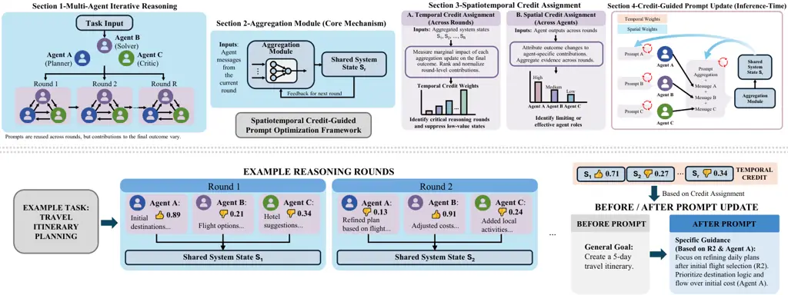
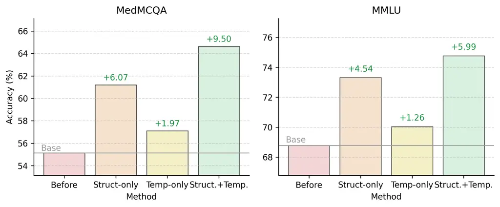
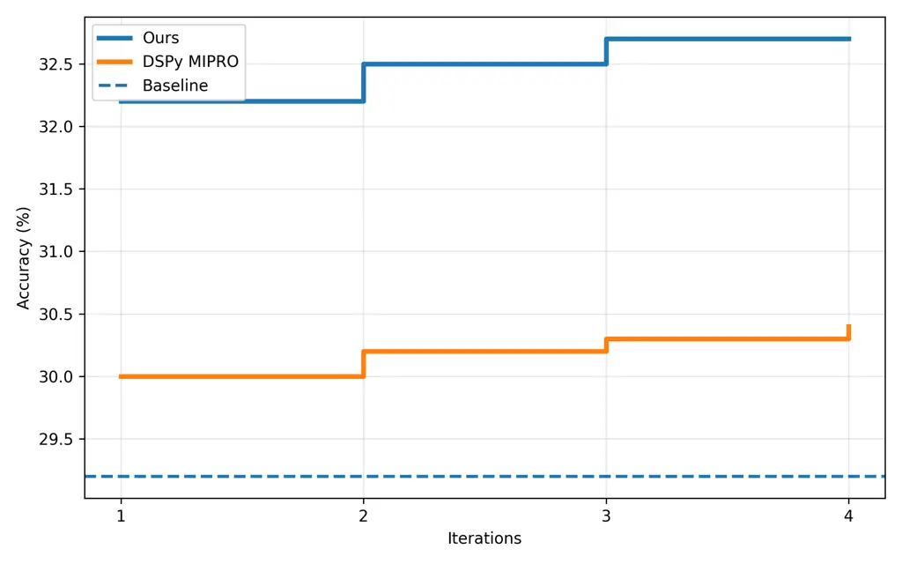

# Unifying Temporal and Structural Credit Assignment in LLM-Based Multi-Agent Prompt Optimization

Wenwu Li Affiliation: Tongji University  
Shanghai, China  
{wenwu,2250753,bjin,whli}@tongji.edu.cn    Yuran Song Affiliation:
Tongji University  
Shanghai, China  
{wenwu,2250753,bjin,whli}@tongji.edu.cn    Mingze Zhao Affiliation: The
University of Hong Kong  
Hong Kong, China  
zhaomingze@connect.hku.hk    Bo Jin Affiliation: Tongji University  
Shanghai, China  
{wenwu,2250753,bjin,whli}@tongji.edu.cn    Wenhao Li ^(†)^(†)thanks:
Corresponding author. Affiliation: Tongji University  
Shanghai, China  
{wenwu,2250753,bjin,whli}@tongji.edu.cn

###### Abstract

While Multi-Agent Systems (MAS) empower Large Language Models to tackle
complex reasoning tasks through collaborative interaction, optimizing
their dynamics remains a formidable challenge due to the discrete,
non-differentiable nature of the computation graph and the sparsity of
global supervisory signals. Existing black-box optimizers struggle to
attribute trajectory-level failure to specific local components,
resulting in inefficient, high-variance exploration. We argue that
tractable MAS optimization needs structural inductive biases to
disentangle error signals. We propose temporal and structural credit
assignment, which decomposes the objective along two axes: (i) _temporal
credit_, using state-space bottlenecks to identify critical rounds, and
(ii) _structural credit_, using stationary role policies to isolate
agent contributions. Leveraging these decomposed signals, we introduce a
discrete, verbalized block coordinate descent algorithm for iterative
refinement. Rather than indiscriminate global updates, it alternates
between optimizing role prompts and aggregation protocols, using
LLM-generated “proxy gradients” to target only the identified weak
links. Across diverse reasoning benchmarks, our approach substantially
reduces query complexity while improving performance, providing a
principled and interpretable path toward self-improving MAS.

## 1 Introduction

Large Language Models (LLMs) have evolved from static text generators
into dynamic reasoning engines, achieving remarkable success in
mathematical reasoning, code generation, and complex planning \[Brown et
al., 2020, Wei et al., 2022\]. To transcend the limitations of
single-model inference, recent research has shifted toward MAS, where
specialized agents collaborate via iterative critique-and-revision
cycles \[Zhuge et al., 2024, Zhang et al., 2025a\]. By distributing
tasks across diverse roles (e.g., proposer, debater, synthesizer), MAS
frameworks can theoretically solve problems that are intractable for a
single monolithic model \[Li et al., 2024a\].



Figure 1: Overview of the credit-guided prompt optimization pipeline.
Top: a multi-agent, multi-round reasoning loop (planner/solver/critic)
produces per-round messages that are aggregated into a shared system
state $`S_{r}`$; an aggregation module feeds back to the next round.
From the completed trajectory, we compute _temporal credit_ across
rounds (identifying critical rounds) and _structural/spatial credit_
across agents (identifying effective or limiting roles). These credits
then drive inference-time prompt updates, selectively refining the
lowest-credit rounds/roles while keeping strong components fixed.
Bottom: an example travel-itinerary task illustrates per-round agent
outputs, the evolving shared state ($`S_{1},S_{2},\ldots`$), temporal
credit weights, and a before/after prompt update that specializes
guidance to the weak round/role.

However, optimizing the interaction dynamics of MAS presents a
formidable challenge. From an optimization perspective, an LLM-based MAS
operates as a discrete, non-differentiable computation graph. Unlike
neural network training where backpropagation precisely attributes error
to specific weights, MAS optimization suffers from the Credit Assignment
Problem (CAP) in its most severe form: the supervisory signal is
typically sparse (a single scalar score at the terminal state) and
global (applying to the entire trajectory) \[Sutton and Barto, 2018,
Foerster et al., 2018\]. Existing approaches often treat the entire
system as a black box \[Deng et al., 2022, Fernando et al., 2023, Guo et
al., 2023\], applying derivative-free optimization or heuristic
aggregation \[Nagpal et al., 2025, Ai et al., 2025\].

While effective for simple chains, these methods struggle in complex
multi-round collaborations because they ignore the internal causal
structure of the reasoning process. Optimizing a system with $`N`$
agents over $`R`$ rounds essentially involves searching in a space of
$`\mathcal{O}(N\times R)`$ coupled prompts. Without structural priors,
this faces catastrophic variance and inefficient exploration \[Zhou et
al., 2024\].

In this work, we argue that making MAS optimization tractable requires
imposing structural constraints on the computation graph to disentangle
the error signal. We propose two principled relaxations that transform
the chaotic interaction graph into a structured optimization landscape.

First, state-space bottleneck via aggregation. In a fully connected MAS,
information flows diffusely, making it impossible to pinpoint _when_
reasoning collapsed. We introduce an explicit _Aggregation Module_ at
each round to summarize agent outputs into a unified state $`S_{t}`$.
This effectively models the interaction as a Markov Decision Process
(MDP), where the aggregator creates a “state bottleneck” \[Puterman,
1994, Mnih and others, 2015\]. This architectural choice is not merely
functional; it is a prerequisite for Temporal Credit Assignment,
allowing us to evaluate the quality of consensus at discrete time steps
independent of individual agent noise.

Second, stationary policy via parameter sharing \[Gupta et al., 2017, Yu
et al., 2022\]. Optimizing unique prompts for every agent at every round
creates an explosion of parameters. We impose a _Stationary Policy
Constraint_, where each role (e.g., the Debater) shares the same system
prompt across all interaction rounds. This reduces the search space from
trajectory-specific instructions to robust role definitions. Crucially,
this constraint enables reliable Structural Credit Assignment: by
observing an agent’s performance across multiple rounds, we can
distinguish systematic role incompetence from transient stochastic
errors.

Building on these structural insights, we propose a unified framework
for Temporal and Structural Credit Assignment, as shown in Figure 1. We
formalize the MAS optimization problem as a bi-level objective depending
on two orthogonal variable blocks: (i) _Role Prompts_ (defining agent
behaviors) and (ii) _Aggregation Prompts_ (defining state transition
protocols). Instead of optimizing these jointly—which is prone to
instability—we derive a novel Block Coordinate Descent (BCD) algorithm
adapted for discrete prompt optimization \[Tseng, 2001, Cai et al.,
2023\]. Our method alternates between refining role-specific
instructions (fixing the aggregation logic) and refining the aggregation
protocol (fixing the role behaviors). To drive this descent, we utilize
LLM-based critics to compute “proxy gradients”—decomposed credit scores
that guide targeted textual updates only to the bottleneck components.

Our contributions are summarized as follows: 1) We reformulate MAS
prompt optimization by introducing state-space bottlenecks and
stationary policy constraints. These inductive biases bridge the gap
between sparse terminal rewards and dense, actionable feedback. 2) We
propose a theoretically grounded optimization algorithm that alternates
between structural (role) and temporal (aggregator) updates. This mimics
Block Coordinate Descent in the discrete prompt space, ensuring
stability and convergence compared to joint optimization baselines. 3)
Numerical experiments demonstrate that our approach achieves higher task
accuracy while reduces query complexity. By focusing updates on specific
"weak link" roles or "phase transition" rounds, we avoid the
inefficiency of indiscriminate global updates.

## 2 Related Works

Prompt Optimization. Several methods have been developed for optimizing
prompts, ranging from learning parameter-efficient soft prompts to
automatically searching for optimal discrete prompts using reinforcement
learning, meta-optimization, and evolutionary algorithms. Prompt-Tuning
\[Lester et al., 2021\] freezes the parameters of a pre-trained language
model and learns task-specific soft prompts via end-to-end
backpropagation. RLPrompt \[Deng et al., 2022\] optimizes discrete
textual prompts through reinforcement learning with a policy network.
OPRO \[Yang et al., 2023\] frames prompt optimization as an iterative
black-box optimization problem. EvoPrompt \[Guo et al., 2023\]
integrates evolutionary algorithms with large language models by
employing the LLM to implement linguistically coherent crossover and
mutation operations. PromptBreeder \[Fernando et al., 2023\] implements
a self-referential self-improvement mechanism for prompts using a
genetic algorithm that co-evolves task-prompts and mutation-prompts.

LLM-based MAS. Current research on LLM-based multi-agent systems spans
four key dimensions: system representation, optimization mechanisms,
dynamic adaptation, and reasoning efficiency. GPTSwarm \[Zhang et al.,
2024\] exemplifies offline structural learning via static post-training
optimization with strong theoretical grounding in policy-gradient
methods. DyLAN \[Liu et al., 2024\] represents unsupervised online
selection, offering principled agent evaluation without labeled data and
drawing theoretical connections to Shapley-value attribution. EvoMAC
\[Li et al., 2024b\] reflects environment-driven online adaptation,
enabling test-time improvement from objective feedback and linking
classical control-theoretic feedback to LLM generation. MAS-GPT \[Chen
et al., 2024\] illustrates generative offline learning, trading
development-time cost for inference-time efficiency and cross-domain
transfer.

Credit Assignment. The credit assignment problem refers to determining
the contribution of each agent to the collectively obtained reward in a
multi-agent system. In reinforcement learning context, when an agent
receives a reward, it is challenging to determine which actions should
be credited or blamed for the outcome. In multi-agent systems context,
under the centralized training with decentralized execution paradigm, it
is required to allocate contributions from joint decisions to individual
agents. Value decomposition methods address this challenge by employing
mixing networks to decompose the joint state-action value function into
individual local observation-action value functions. MATTRL \[Hu et al.,
2026\] implements inference-time credit assignment via Difference
Rewards for precise contribution attribution in multi-agent reasoning,
while MAPRO \[Zhang et al., 2025b\] employs training-time credit
assignment for joint optimization of discussion and answer generation.

## 3 Problem Formulation

We now formalize the multi-agent, multi-round prompting setting that our
temporal and structural credit assignment targets. We specify the
interaction protocol, notation, and the optimization variables, which
will let us define per-round and per-role credit signals precisely. This
section sets up the trajectory and objective used by the attribution
method and the credit-guided prompt optimization procedure.

#### Multi-Agent, Multi-Round Prompting.

We consider a multi-agent, multi-round LLM reasoning system with a fixed
set of agents (roles) $`\mathcal{A}=\{a_{1},\dots,a_{N}\}`$ and $`R`$
interaction rounds. The base LLM parameters are fixed; the optimization
variables are the prompts used by each agent at each round. Let
$`\phi_{i,t}`$ denote the prompt fed to agent $`a_{i}`$ at round $`t`$.
We collect all prompts as
$`\Phi\triangleq\{\phi_{i,t}\}_{i=1,t=1}^{N,R}`$.

Given an input instance $`x\sim\mathcal{D}`$, the system runs for $`R`$
rounds. At round $`t`$, each agent $`a_{i}`$ produces an utterance
$`u_{i,t}`$ conditioned on $`x`$ and its prompt $`\phi_{i,t}`$:

```math
u_{i,t}\sim p\!\left(\cdot\mid x,\phi_{i,t}\right),i\in\{1,\dots,N\},\ t\in\{1,\dots,R\}. \tag{1}
```

Let $`\mathcal{U}_{t}\triangleq\{u_{1,t},\dots,u_{N,t}\}`$ be the set of
role utterances at round $`t`$. An aggregation module summarizes
$`\mathcal{U}_{t}`$ into a shared state
$`S_{t}=f_{t}(\mathcal{U}_{t}),\quad t\in\{1,\dots,R\}`$, with an
initial state $`S_{0}`$ fixed.

#### Prompt-as-Input and Output-as-Context.

We define each round prompt as a composition of (i) a system
instruction, (ii) the previous-round shared state, and (iii) a
role-specific template. Concretely, for each agent $`a_{i}`$ and round
$`t`$,

```math
\phi_{i,t}=g_{i,t}\!\left(x,S_{t-1};\theta_{i,t}\right), \tag{2}
```

where $`g_{i,t}(\cdot)`$ is a (deterministic) prompt constructor and
$`\theta_{i,t}`$ denotes its free text content (the part we optimize).
This explicitly captures that each agent’s _output_ at round $`t-1`$
becomes part of the _input_ for round $`t`$.

#### Final-Round Scoring.

After the final round, a terminal decision module produces the system
output from $`(x,S_{R})`$:

```math
\hat{y}=J(x,S_{R}). \tag{3}
```

A task-specific scorer assigns a scalar score to the final output
$`s(x,\hat{y})\in\mathbb{R}`$. Equivalently, the trajectory-level score
can be written as

```math
J(\tau;x)\triangleq s\!\left(x,j(x,S_{R})\right),\tau\triangleq\big(\mathcal{U}_{1},S_{1},\dots,\mathcal{U}_{R},S_{R}\big). \tag{4}
```

#### Optimization Objective.

The basic prompt optimization problem is to maximize the expected
final-round score:

```math
\max_{\Phi}\;\mathbb{E}_{x\sim\mathcal{D}}\,\mathbb{E}_{\tau\sim p(\cdot\mid x;\Phi)}\Big[J(\tau;x)\Big]. \tag{5}
```

Since $`J(\tau;x)`$ is only observed at the end of the $`R`$-round
interaction, it depends on all upstream prompts $`\{\phi_{i,t}\}`$
through the coupled generation process Eq.(1)–Eq.(3).

#### Textual-Gradient Prompt Update.

Because prompts are discrete text and the base LLM parameters are fixed,
we do not backpropagate numerical gradients through Eq.(1). Instead, we
convert the terminal score into a _textual gradient_ (natural-language
feedback) \[Xiao et al., 2024, Yüksekgönül et al., 2024\] that specifies
how to revise prompts:

```math
\Delta_{i,t}=\mathcal{G}\!\left(x,\tau,J(\tau;x),i,t\right), \tag{6}
```

where $`\mathcal{G}(\cdot)`$ outputs a feedback string for prompt
$`(i,t)`$. Prompts are updated by applying the feedback to the current
prompt text:

```math
\phi_{i,t}^{(k+1)}=\mathcal{U}\!\left(\phi_{i,t}^{(k)},\Delta_{i,t}^{(k)}\right),\quad i=1,\dots,N,\ t=1,\dots,R, \tag{7}
```

where $`k`$ indexes optimization iterations and $`\mathcal{U}(\cdot)`$
is a text-edit operator (e.g., rewrite / insert constraints). This
completes the most basic definition of the optimization problem in a
multi-agent, multi-round system, where the final-round score is
propagated back to prompts via textual gradients.

## 4 Methodology

Building on the naive objective in Eq.(5), we make two relaxations to
obtain a tractable optimization scheme. First, we introduce a
_state-space bottleneck_ by inserting a _round-indexed_ aggregation
module (one aggregator per round), so round-level decisions become
explicit and scorable. Second, we impose _parameter sharing_ by
instantiating a fixed set of role-specialized agents whose prompts are
shared across rounds, so credits can be accumulated by role rather than
by individual turns. During optimization, we evaluate intermediate role
outputs and per-round aggregation outputs with LLM-based critics to
obtain _proxy_ signals for credit estimation. We use the terminal scorer
$`s(x,\hat{y})`$ as the optimization objective, while LLM critics
provide auxiliary signals to estimate role- and round-level credits for
targeted prompt updates. These critic signals are transformed into two
forms of credit: (i) _structural credit_ over roles, used to identify
and optimize weak agents; and (ii) _temporal credit_ over rounds,
implemented as a per-round aggregator credit score used to trigger
targeted aggregation-prompt optimization.

### 4.1 State-Space Bottleneck

In MAS, the terminal score provides a single global optimization signal.
To update prompts, this signal must be expressed as a textual gradient.
Whether such feedback can be made actionable depends on the availability
of a state-space bottleneck: an explicit shared state that concentrates,
rather than disperses, the information flow.

#### Without aggregation.

If no aggregation is used, the final output is derived directly from the
collection of all utterances $`\{u_{i,t}\}_{i,t}`$. In this case, the
textual gradient can only be expressed as an unstructured global signal
$`\Delta=\mathcal{G}\!\left(x,\{u_{i,t}\}_{i,t},J(\tau;x)\right)`$.
Because there is no explicit bottleneck to anchor intermediate credit,
the feedback cannot be aligned with specific agents or interaction
rounds, providing only coarse guidance for prompt updates.

#### With aggregation.

By introducing an aggregation module, the system maintains explicit
shared states $`\{S_{t}\}`$, which instantiate a state-space bottleneck
across rounds. This enables textual gradients to be grounded on
intermediate representations
$`\Delta_{t}=\mathcal{G}_{t}\!\left(x,S_{t},S_{R},J(\tau;x)\right)`$,
and further decomposed to individual agents:

```math
\Delta_{i,t}=\mathcal{G}_{i,t}\!\left(x,u_{i,t},S_{t},S_{R},J(\tau;x)\right). \tag{8}
```

In this way, aggregation provides the structural interface that makes
textual gradients representable, alignable, and decomposable across both
temporal rounds and agent roles.

#### New optimization variables.

Crucially, the aggregation module is itself prompt-driven, so
introducing shared states also introduces new decision variables: the
aggregator prompts that control how $`\mathcal{U}_{t}`$ is summarized.
Let $`\psi_{t}`$ denote the aggregation prompt at round $`t`$, and write
the state update as $`S_{t}=f_{t}(\mathcal{U}_{t};\psi_{t})`$. The
optimization target therefore changes from role-prompt-only tuning to a
joint objective over role prompts and aggregation prompts:

```math
\max_{\Phi,\Psi}\;\mathbb{E}_{x\sim\mathcal{D}}\,\mathbb{E}_{\tau\sim p(\cdot\mid x;\Phi,\Psi)}\Big[J(\tau;x)\Big],\Psi\triangleq\{\psi_{t}\}_{t=1}^{R}. \tag{9}
```

This shift is important: optimizing aggregation can change the effective
trajectory distribution and thus the credit signals used to update role
prompts.

### 4.2 Parameter Sharing

We also analyze a constrained regime with _parameter sharing_, where
each agent reuses a single prompt across all interaction rounds.
Formally, for each agent $`a_{i}`$, we impose

```math
\phi_{i,1}=\phi_{i,2}=\cdots=\phi_{i,R}\triangleq\phi_{i}. \tag{10}
```

This reduces the number of optimization variables, but increases the
influence of each prompt because it is applied repeatedly under
different aggregated contexts. Under this constraint, the optimization
objective becomes

```math
\max_{\{\phi_{i}\}_{i=1}^{N},\Psi}\;\mathbb{E}_{x\sim\mathcal{D}}\mathbb{E}_{\tau\sim p(\cdot\mid x;\{\phi_{i}\},\Psi)}\big[J(\tau;x)\big]. \tag{11}
```

This is also our final optimization target. See Fig. 2 for the overall
evolution. Although simplified, the problem remains non-trivial: each
shared prompt $`\phi_{i}`$ affects the final score through multiple uses
across evolving states $`\{S_{t-1}\}`$. Effective optimization therefore
requires aggregating feedback across rounds, which naturally motivates
temporal credit assignment under parameter sharing.


Figure 2: Evolution of the optimization objective: from the naive
terminal-score objective, to introducing round-wise aggregation prompts,
to enforcing shared role prompts.

### 4.3 Verbalized BCD

Having specified a new optimization objective, the next step is to
design an algorithm that can effectively solve it. Our objective
provides supervision only at the end of the $`R`$-round interaction (Eq.
(11)), leaving the intermediate rounds and roles without direct learning
signals. Crucially, terminal success does not imply that the final
aggregation round (or speaker) is solely responsible; earlier rounds can
be decisive or harmful. We therefore introduce LLM-based critics as
_auxiliary_ evaluators of intermediate utterances and aggregations, and
translate their scores into temporal and structural credits. These
credits then drive a targeted _block coordinate descent_ procedure that
alternates between updating low-credit role prompts and low-credit
aggregation prompts, while keeping high-credit components fixed.

#### Credit Computing.

For the structural dimension, let $`q_{i,t}\in[0,1]`$ denote a
normalized critic score for role $`i`$’s utterance $`u_{i,t}`$ at round
$`t`$. To account for interaction effects, we introduce a peer-view
proxy $`p_{i,t}\in[0,1]`$: we do _not_ require each agent to explicitly
score others; instead, a single LLM-based judge conditions on the full
set $`\mathcal{U}_{t}`$ and assesses each role’s contribution to group
reasoning. We fuse these two signals as
$`c^{\text{role}}_{i,t}=\lambda\,q_{i,t}+(1-\lambda)\,p_{i,t}`$ where
$`\lambda\in[0,1]`$, and aggregate across rounds to obtain a role-level
structural credit
$`C^{\text{role}}_{i}=\frac{1}{R}\sum_{t=1}^{R}c^{\text{role}}_{i,t}`$.
For the temporal dimension, let $`q^{\text{agg}}_{t}\in[0,1]`$ be the
critic score for the round-$`t`$ aggregation output $`S_{t}`$. We define
the temporal credit as $`C^{\text{time}}_{t}=q^{\text{agg}}_{t}`$.

#### Verbalized BCD over Prompt Blocks.

Our optimization is a special instance of BCD over two prompt blocks:
(i) the _structural_ prompts that instantiate role behaviors, denoted by
$`\Phi^{\text{role}}`$ (e.g., $`\{\phi_{i}\}_{i=1}^{N}`$ under the
shared-prompt constraint in Eq. (10)); and (ii) the _temporal_ prompts
that instantiate the round-indexed aggregation modules, denoted by
$`\Psi\triangleq\{\psi_{t}\}_{t=1}^{R}`$. Starting from
$`(\Phi^{\text{role},(0)},\Psi^{(0)})`$, each outer iteration $`k`$
performs two alternating phases:


We repeat Phases A–B until a fixed budget is exhausted or the held-out
performance saturates. This alternating design makes the procedure
implementable and stable: at each step we optimize one block while
treating the other as a fixed environment, reducing unnecessary drift in
the coupled multi-round interaction.

Input: $`\mathcal{D}`$; fixed base LLM; rounds $`R`$; roles
$`\mathcal{A}=\{a_{i}\}_{i=1}^{N}`$

Output: Optimized prompts $`\{\phi_{i}\}_{i=1}^{N}`$ and
$`\{\psi_{t}\}_{t=1}^{R}`$

Initialize: $`\{\phi_{i}^{(0)}\}`$, $`\{\psi_{t}^{(0)}\}`$;
$`k\leftarrow 0`$;

while _not converged_ do

   

   Compute $`\{C^{\text{role}}_{i}\}_{i=1}^{N}`$;

   Select low-credit roles $`\mathcal{I}^{(k)}\subseteq\{1,\dots,N\}`$;

   foreach _$`i\in\mathcal{I}^{(k)}`$_ do

      $`\phi_{i}^{(k+1)}\leftarrow\mathcal{U}\!\big(\phi_{i}^{(k)},\Delta^{\text{role}}_{i}\big)`$;

   Set $`\phi_{i}^{(k+1)}\leftarrow\phi_{i}^{(k)}`$ for
$`i\notin\mathcal{I}^{(k)}`$;

   

   Compute $`\{C^{\text{time}}_{t}\}_{t=1}^{R}`$;

   Select low-credit rounds $`\mathcal{T}^{(k)}\subseteq\{1,\dots,R\}`$;

   foreach _$`t\in\mathcal{T}^{(k)}`$_ do

      $`\psi_{t}^{(k+1)}\leftarrow\mathcal{U}\!\big(\psi_{t}^{(k)},\Delta^{\text{time}}_{t}\big)`$;

   Set $`\psi_{t}^{(k+1)}\leftarrow\psi_{t}^{(k)}`$ for
$`t\notin\mathcal{T}^{(k)}`$;

   $`k\leftarrow k+1`$;

return $`\{\phi_{i}^{(k)}\}_{i=1}^{N},\{\psi_{t}^{(k)}\}_{t=1}^{R}`$;

Algorithm 1 BCD for Temporal and Structural Credit-Guided Prompt
Optimization

## 5 Experiments

To validate the proposed temporal and structural credit assignment and
the resulting prompt optimization routine, we now turn to empirical
evaluation. The following section specifies datasets, protocols, and
baselines, and then quantifies how the credit signals translate into
measurable gains and interpretability across benchmarks.

### 5.1 Settings

We evaluate our proposed credit-guided prompt optimization on
multiple-choice reasoning benchmarks, where each question has four
options and the correct answer is selected from {A, B, C, D}. Models
generate free-form text, and we deterministically extract the predicted
option using a fixed parsing rule: the first occurrence of a standalone
A/B/C/D token in the output. If no valid option is found, the prediction
is considered invalid and counted as incorrect. These parsing rules are
fixed prior to evaluation and remain constant across all runs. We report
results on AQuA \[Ling et al., 2017\], MedMCQA \[Pal et al., 2022\],
GPQA \[Rein et al., 2024\], and MMLU \[Hendrycks et al., 2021b,
Hendrycks et al., 2021a\].

For each dataset, we randomly select a fixed _optimization set_ of 100
examples used exclusively for prompt search and optimization (i.e.,
updating role prompts and round-wise aggregator prompts). All reported
metrics are evaluated on a larger, disjoint _leave-out test set_, which
is never accessed during optimization. The split is fixed across runs.
No test examples are used for prompt search, gradient updates, credit
assignment, or hyperparameter tuning. Accordingly, we emphasize _no
test-set exposure_, rather than zero-shot performance, on the reported
test set.

Random seeds are fixed for sampling the optimization set and for any
stochastic components in decoding or optimization. Unless otherwise
stated, results are averaged over multiple runs with different seeds,
and we report the mean accuracy along with standard deviation. Prompt
optimization is performed independently for each dataset. This
constitutes dataset-specific prompt search over a fixed base model, not
model fine-tuning. Cross-dataset generalization is not claimed unless
explicitly evaluated.

Models and Runtime. All debate agents are instantiated with open-weight
instruction-following LLMs, allowing inspection and modification of
prompts. We use Qwen2.5-7B-Instruct, LLaMA3-8B-Instruct, and
Gemma-7B-Instruct for the main experiments, and decoding settings are
kept identical across baselines and our method.

Frameworks and Baselines. We evaluate our approach on several
multi-agent frameworks, with a focus on LLM-Debate and DyLAN. In all
settings, the interaction protocol (number of agents, number of rounds,
and aggregator placement) is fixed. We compare against: (i) the
unmodified baseline prompts, (ii) a black-box prompt optimization
baseline using DSPy MIPRO (multi-stage instruction and demonstration
optimization) \[Opsahl-Ong et al., 2024\] that performs agent-wise
non-informed prompt search, and (iii) our credit-aware optimization.

Training and Optimization Protocol. We follow a two-stage _prompt-only_
procedure; no model parameters are updated. First, DSPy (MIPROv2) is
used solely for automated prompt initialization \[Opsahl-Ong et al.,
2024\]. Second, fixed-budget prompt edits are performed using only the
optimization split; the test split is never accessed. (i) Structural
optimization. We evaluate each agent’s final-round answer with
AgentTurnEval, aggregate scores into a risk statistic, and
deterministically select the two worst-performing roles. Only these role
prompts are optimized using RolePromptOpt with summarized error
diagnosis. (ii) Temporal optimization. Temporal credit is assigned to
per-round aggregators using the EMA update described in Section 3.
Credit is updated only on informative failures (aggregator wrong but at
least one agent correct). When the credit of round $`t`$ drops below a
threshold and sufficient failures are observed, only that round’s
aggregator prompt is optimized. All hyperparameters are fixed across
datasets.

### 5.2 Main Results and Analysis

Based on the analyses in this section, the experiments aim to answer
four research questions: RQ1: Does credit-guided prompt optimization
consistently improve accuracy across datasets and models compared with
unoptimized prompts and a black-box baseline? RQ2: How much do
structural and temporal optimization each contribute, and does their
combination yield the strongest and most consistent gains? RQ3: Is the
optimization process efficient and stable (convergence speed and
variance), and how do key hyperparameters affect performance and
stability? RQ4: Do credit signals align with error types and outcome
shifts, providing interpretable diagnostics and actionable guidance for
follow-up optimization?

### 5.3 RQ1: Effectiveness

Table 1 summarizes the performance of our credit-guided prompt
optimization compared to two baselines: the unmodified prompts and a
black-box optimization baseline. Across all datasets and models, our
method consistently improves accuracy. For instance, on MedMCQA with
LLaMA3-8B, our approach improves accuracy by 7.0% relative to the
baseline, while on GPQA with Qwen2.5-7B the gain is 2.1%. Even on
datasets with higher initial accuracy, such as AQuA and MMLU, we observe
consistent improvements. Standard deviations across multiple runs remain
low, indicating stable and reproducible performance. These results
confirm that integrating structural and temporal credit signals
effectively guides prompt optimization in multi-agent settings.


|         |            |                                                             |                                                             |                                                             |                                                             |                                                             |                                                             |
| ------- | ---------- | ----------------------------------------------------------- | ----------------------------------------------------------- | ----------------------------------------------------------- | ----------------------------------------------------------- | ----------------------------------------------------------- | ----------------------------------------------------------- |
|         |            | DyLAN                                                       |                                                             |                                                             | Debate                                                      |                                                             |                                                             |
| Domain  | Model      | baseline                                                    | optimized                                                   | ours                                                        | baseline                                                    | optimized                                                   | ours                                                        |
| MedMCQA | LLaMA3-8B  |   |   |   |  |  |  |
|         | Qwen2.5-7B |  |  |  |  |  |  |
|         | Gemma-7B   |  |  |  |  |  |  |
| GPQA    | LLaMA3-8B  |  |  |  |  |  |  |
|         | Qwen2.5-7B |  |  |  |  |  |  |
|         | Gemma-7B   |  |  |  |  |  |  |
| AQuA    | LLaMA3-8B  |  |  |  |  |  |  |
|         | Qwen2.5-7B |  |  |  |  |  |  |
|         | Gemma-7B   |  |  |  |  |  |  |
| MMLU    | LLaMA3-8B  |  |  |  |  |  |  |
|         | Qwen2.5-7B |  |  |  |  |  |  |
|         | Gemma-7B   |  |  |  |  |  |  |

Table 1: Main results on multiple-choice reasoning benchmarks. The main
number is the mean accuracy, and the right-side annotation reports the
delta relative to the corresponding MAS baseline: “-” marks the
baseline, $`\uparrow`$ denotes an increase, and $`\downarrow`$ denotes a
decrease. Cell colors follow a red–white–green gradient from negative to
zero to positive deltas, and the lower number in each cell is the
standard deviation.

### 5.4 RQ2: Ablations

To understand the source of improvements, we perform ablation
experiments. We isolate the contributions of structural and temporal
components: Role-only optimization (structural): optimizing only the
worst-performing role prompts selected by the risk statistic.
Aggregator-only optimization (temporal): optimizing only the low-credit
round aggregators while freezing role prompts.

Figure 3 visualizes the LLaMA3-8B Debate results on MedMCQA and MMLU,
highlighting the consistent gains from credit-guided prompt
optimization.



Figure 3: LLaMA3-8B Debate results on MedMCQA and MMLU: the combined
temporal+structural credit-guided optimization yields the strongest
gains, with structural-only and temporal-only providing smaller
improvements over the baseline.

Both components independently improve accuracy relative to the baseline.
Structural optimization contributes more on role-sensitive datasets
(e.g., MedMCQA), whereas temporal optimization is most effective on
datasets where aggregator consolidation is critical (e.g., GPQA). The
combination consistently achieves the highest performance.

We further analyze temporal optimization at the round level. Restricting
updates to one round $`t`$ at a time reveals which rounds are most
error-prone. Early rounds often dominate failures, indicating that
losing key evidence early can limit overall accuracy, while late rounds
mainly affect final consolidation. These findings provide actionable
guidance on where optimization should focus.


### 5.5 RQ3: Sensetivity

We evaluate performance across optimization iterations to assess
efficiency and stability. Figure 4 shows the accuracy trajectories
across iterations, highlighting faster gains for our method versus DSPy
MIPRO and the baseline. Credit-guided optimization converges rapidly
within a few iterations and maintains low variance across runs. In
contrast, the black-box baseline converges more slowly and exhibits
higher variance, reflecting inefficient exploration.



Figure 4: Accuracy convergence over optimization iterations; ours
converges faster and to higher accuracy than DSPy MIPRO and the
baseline.

We also investigate hyperparameter sensitivity by varying the temporal
credit threshold $`\tau`$ and buffer size $`m`$. Lower $`\tau`$ or
larger $`m`$ results in conservative updates, preserving stability,
while higher $`\tau`$ or smaller $`m`$ allows more aggressive updates,
increasing the risk of performance drift. Monitoring credit trajectories
$`\alpha_{t}`$ and test accuracy variance confirms that our recommended
settings achieve a favorable stability–plasticity balance.


### 5.6 RQ4: Interpretability

|                   |                 |          |
| ----------------- | --------------- | -------- |
| Shift             | DSPy(MIPRO) (%) | Ours (%) |
| X$`\rightarrow`$X | 38.00           | 34.50    |
| ✓$`\rightarrow`$X | 7.00            | 5.00     |
| X$`\rightarrow`$✓ | 7.00            | 11.00    |
| ✓$`\rightarrow`$✓ | 48.00           | 49.50    |

Table 2: Distribution of prediction shifts before and after
optimization. Compared with DSPu(MIPRO), our method yields more
incorrect$`\rightarrow`$correct repairs and fewer
correct$`\rightarrow`$incorrect regressions, indicating that credit
signals act as structured diagnostics rather than global perturbations.

To validate that optimization aligns with failure diagnosis, we analyze
outcome shifts and error types. Compared with black-box edits,
credit-guided optimization reduces regressions (correct$`\to`$incorrect)
and increases repairs (incorrect$`\to`$correct). Per-category accuracy
shows that role-specific optimizations mainly improve categories flagged
as failing by the critic, and temporal credit $`\alpha_{t}`$ correlates
with aggregator reliability rather than mere signal presence. Together,
these analyses confirm that structural and temporal credit signals
provide both mechanistic interpretability and practical guidance for
follow-up experiments.


## 6 Closing Remarks

In this paper, we introduce a test-time temporal and structural credit
assignment framework that decomposes multi-agent LLM trajectories along
rounds and roles, enabling component-level attribution without altering
inference dynamics or model parameters. Across the experiments, the
resulting credit signals reveal pronounced contribution imbalance and
identify the small set of stages and agents that consistently constrain
outcomes. Leveraging these signals, credit-guided prompt optimization
focuses updates on weak components and delivers reliable gains across
benchmarks and model families, reducing wasteful global changes while
improving effectiveness.

These findings position temporal and structural attribution as a
practical diagnostic and optimization tool for multi-agent reasoning
systems. At the same time, the framework remains limited to completed
trajectories and relies on evaluative signals; temporal attribution can
be computationally heavy for long horizons; and the current
instantiation assumes fixed roles with centralized aggregation. Future
directions include integrating credit signals into online or
inference-time adaptation, extending attribution to weakly supervised
settings via self-consistency or consensus critics, and applying the
framework to more dynamic coordination regimes such as hierarchical,
tool-augmented, or open-ended environments.

## References

- Ai et al. (2025) R. Ai Y. Pan et al. Beyond majority voting: llm
  aggregation by leveraging higher-order information. External Links:
  2510.01499, [Link](https://arxiv.org/abs/2510.01499) Cited by: §1.
- Brown et al. (2020) T. Brown B. Mann et al. Language models are
  few-shot learners. In Advances in Neural Information Processing
  Systems, H. Larochelle, M. Ranzato, R. Hadsell, M.F. Balcan, and H.
  Lin (Eds.), Vol. 33, pp. 1877–1901. Cited by: §1.
- Cai et al. (2023) X. Cai, C. Song, S. Wright, and J. Diakonikolas
  Cyclic block coordinate descent with variance reduction for composite
  nonconvex optimization. In Proceedings of the 40th International
  Conference on Machine Learning, Vol. 202, pp. 3469–3494. External
  Links: [Link](https://proceedings.mlr.press/v202/cai23e.html) Cited
  by: §1.
- Chen et al. (2024) Z. Chen Z. Wang et al. MAS-gpt: training LLM s to
  build LLM -based multi-agent systems. arXiv preprint arXiv:2402.08960.
  Cited by: §2.
- Deng et al. (2022) M. Deng J. Wang et al. Rlprompt: optimizing
  discrete text prompts with reinforcement learning. In EMNLP, Cited by:
  §1, §2.
- Fernando et al. (2023) C. Fernando D. Banarse et al. Promptbreeder:
  self-referential self-improvement via prompt evolution. In ICLR, Cited
  by: §1, §2.
- Foerster et al. (2018) J. N. Foerster, G. Farquhar, T. Afouras, N.
  Nardelli, and S. Whiteson Counterfactual multi-agent policy gradients.
  In Proceedings of the AAAI Conference on Artificial Intelligence,
  Cited by: §1.
- Guo et al. (2023) Q. Guo R. Wang et al. Connecting LLMs with
  evolutionary algorithms yields powerful prompt optimizers. In ICLR,
  Cited by: §1, §2.
- Gupta et al. (2017) J. K. Gupta, M. Egorov, and M. J. Kochenderfer
  Cooperative multi-agent control using deep reinforcement learning. In
  AAMAS Workshops (Selected Papers), pp. 66–83. External Links:
  [Document](https://dx.doi.org/10.1007/978-3-319-71682-4%5F5) Cited by:
  §1.
- Hendrycks et al. (2021a) D. Hendrycks, C. Burns, S. Basart, A.
  Critch, J. Li, D. Song, and J. Steinhardt Aligning ai with shared
  human values. Proceedings of the International Conference on Learning
  Representations (ICLR). Cited by: §5.1.
- Hendrycks et al. (2021b) D. Hendrycks, C. Burns, S. Basart, A. Zou, M.
  Mazeika, D. Song, and J. Steinhardt Measuring massive multitask
  language understanding. Proceedings of the International Conference on
  Learning Representations (ICLR). Cited by: §5.1.
- Hu et al. (2026) Z. Hu Y. Hu et al. Collaborative multi-agent
  test-time reinforcement learning for reasoning. External Links:
  2601.09667, [Link](https://arxiv.org/abs/2601.09667) Cited by: §2.
- Lester et al. (2021) B. Lester R. Al-Rfou et al. The power of scale
  for parameter-efficient prompt tuning. In EMNLP, Cited by: §2.
- Li et al. (2024a) Y. Li Y. Du et al. Improving multi-agent debate with
  sparse communication topology. In Findings of the Association for
  Computational Linguistics: EMNLP 2024, Y. Al-Onaizan, M. Bansal,
  and Y. Chen (Eds.), Miami, Florida, USA, pp. 7281–7294. External
  Links: [Link](https://aclanthology.org/2024.findings-emnlp.427/),
  [Document](https://dx.doi.org/10.18653/v1/2024.findings-emnlp.427)
  Cited by: §1.
- Li et al. (2024b) Y. Li Z. Chen et al. EvoMAC: evolutionary
  multi-agent collaboration for large language models. arXiv preprint
  arXiv:2403.01245. Cited by: §2.
- Ling et al. (2017) W. Ling, D. Yogatama, C. Dyer, and P. Blunsom
  Program induction by rationale generation: learning to solve and
  explain algebraic word problems. In Proceedings of the 55th Annual
  Meeting of the Association for Computational Linguistics (Volume 1:
  Long Papers), R. Barzilay and M. Kan (Eds.), Vancouver, Canada,
  pp. 158–167. External Links:
  [Link](https://aclanthology.org/P17-1015/),
  [Document](https://dx.doi.org/10.18653/v1/P17-1015) Cited by: §5.1.
- Liu et al. (2024) R. Liu Y. Zhang et al. DyLAN: dynamic large language
  model agent network. arXiv preprint arXiv:2401.12768. Cited by: §2.
- Mnih et al. (2015) V. Mnih et al. Human-level control through deep
  reinforcement learning. Nature 518 (7540), pp. 529–533. Cited by: §1.
- Nagpal et al. (2025) K. Nagpal D. Dong et al. Leveraging large
  language models for effective and explainable multi-agent credit
  assignment. In Proceedings of the 24th International Conference on
  Autonomous Agents and Multiagent Systems, AAMAS ’25, Richland, SC,
  pp. 1501–1510. External Links: ISBN 9798400714269 Cited by: §1.
- Opsahl-Ong et al. (2024) K. Opsahl-Ong, M. J. Ryan, J. Purtell, D.
  Broman, C. Potts, M. Zaharia, and O. Khattab Optimizing instructions
  and demonstrations for multi-stage language model programs. CoRR
  abs/2406.11695. External Links:
  [Document](https://dx.doi.org/10.48550/arXiv.2406.11695),
  [Link](https://arxiv.org/abs/2406.11695), 2406.11695 Cited by: §5.1,
  §5.1.
- Pal et al. (2022) A. Pal, L. K. Umapathi, and M. Sankarasubbu MedMCQA:
  a large-scale multi-subject multi-choice dataset for medical domain
  question answering. In Proceedings of the Conference on Health,
  Inference, and Learning (CHIL), Proceedings of Machine Learning
  Research, Vol. 174, pp. 248–260. External Links:
  [Link](https://proceedings.mlr.press/v174/pal22a.html) Cited by: §5.1.
- Puterman (1994) M. L. Puterman Markov decision processes: discrete
  stochastic dynamic programming. John Wiley & Sons, New York. Cited by:
  §1.
- Rein et al. (2024) D. Rein, B. Li Hou, A. C. Stickland, J.
  Petty, R. Y. Pang, J. Dirani, J. Michael, and S. R. Bowman GPQA: a
  graduate-level google-proof q&a benchmark. In First Conference on
  Language Modeling (COLM), External Links:
  [Link](https://arxiv.org/abs/2311.12022) Cited by: §5.1.
- Sutton and Barto (2018) R. S. Sutton and A. G. Barto Reinforcement
  learning: an introduction. 2 edition, MIT Press, Cambridge, MA, USA.
  Cited by: §1.
- Tseng (2001) P. Tseng Convergence of a block coordinate descent method
  for nondifferentiable minimization. Journal of Optimization Theory and
  Applications 109 (3), pp. 475–494. External Links:
  [Document](https://dx.doi.org/10.1023/A%3A1017501703105) Cited by: §1.
- Wei et al. (2022) J. Wei X. Wang et al. Chain-of-thought prompting
  elicits reasoning in large language models. In Proceedings of the 36th
  International Conference on Neural Information Processing Systems,
  NIPS ’22, Red Hook, NY, USA. External Links: ISBN 9781713871088 Cited
  by: §1.
- Xiao et al. (2024) T. Z. Xiao, R. Bamler, B. Schölkopf, and W. Liu
  Verbalized machine learning: revisiting machine learning with language
  models. External Links: 2406.04344,
  [Document](https://dx.doi.org/10.48550/arXiv.2406.04344),
  [Link](https://arxiv.org/abs/2406.04344) Cited by: §3.
- Yang et al. (2023) C. Yang X. Wang et al. Large language models as
  optimizers. In ICLR, Cited by: §2.
- Yu et al. (2022) C. Yu, A. Velu, E. Vinitsky, J. Gao, Y. Wang, A.
  Bayen, and Y. Wu The surprising effectiveness of ppo in cooperative
  multi-agent games. In Advances in Neural Information Processing
  Systems, Vol. 35, pp. 24611–24624. Cited by: §1.
- Yüksekgönül et al. (2024) M. Yüksekgönül, F. Bianchi, J. Boen, S.
  Liu, Z. Huang, C. Guestrin, and J. Zou TextGrad: automatic
  "differentiation" via text. External Links: 2406.07496,
  [Document](https://dx.doi.org/10.48550/arXiv.2406.07496),
  [Link](https://arxiv.org/abs/2406.07496) Cited by: §3.
- Zhang et al. (2025a) D. Zhang, Q. Yuan, L. Meng, R. Xia, W. Liu,
  and C. Qin Reinforcement learning for single-agent to multi-agent
  systems: from basic theory to industrial application progress, a
  survey. Artificial Intelligence Review. Cited by: §1.
- Zhang et al. (2024) G. Zhang, Q. Wu, L. Wang, and Z. Chen GPTSwarm:
  language agents as optimizable graphs. arXiv preprint
  arXiv:2402.16823. Cited by: §2.
- Zhang et al. (2025b) Z. Zhang L. Ge et al. MAPRO: recasting
  multi-agent prompt optimization as maximum a posteriori inference.
  External Links: 2510.07475, [Link](https://arxiv.org/abs/2510.07475)
  Cited by: §2.
- Zhou et al. (2024) H. Zhou X. Wan et al. Batch calibration: rethinking
  calibration for in-context learning and prompt engineering. In The
  Twelfth International Conference on Learning Representations, External
  Links: [Link](https://openreview.net/forum?id=L3FHMoKZcS) Cited by:
  §1.
- Zhuge et al. (2024) M. Zhuge W. Wang et al. GPTSwarm: language agents
  as optimizable graphs. In Proceedings of the 41st International
  Conference on Machine Learning, ICML’24. Cited by: §1.

## Appendix A Appendix Overview

This appendix provides supplemental details to support reproducibility
and analysis. We use standard appendix numbering (e.g., Table A.1,
Figure A.1, Algorithm A.1) and keep all references consistent with the
main text.

## Appendix B Evaluation and Prompt Optimisation Prompts

The prompts used for agent evaluation, diagnosis and role prompt
optimisation are presented below to aid reproducibility. These prompts
are treated as experimental protocols that can be referenced in the main
text.

### B.1 Agent Turn Evaluation Prompt

` `

### B.2 Agent Diagnosis Prompt

` `

### B.3 Role Prompt Optimisation Prompt

` `

## Appendix C Extended Analysis of the DyLAN Baseline on MMLU (Example)

To aid reproducibility and provide deeper insight into system behavior,
we analyzed the evaluation log file
8080_dylan_mmlu_2026-02-19_21-20-23.txt. This file contains 500 entries,
each recording the final answer of a multi-agent debate, the evaluator’s
judgment of correctness, a failure-pattern label, and a quality score.
The analysis below summarizes the distributions of these values.

## Appendix D Extended Analysis of Optimized DyLAN on MMLU (Example)

In addition to the baseline analysis, we examined the log file from the
optimized DyLAN system (8080_dylan_mmlu_2026-02-19_21-20-44.txt). This
experiment applied an optimization method to the role prompts before
evaluation. The log comprises 500 multiple-choice questions from the
MMLU dataset.

### D.1 Overall Prediction Statistics

Table 3 summarizes the aggregate performance of the optimized system.
Out of 500 questions, the system answered 279 correctly (55.8%
accuracy). The mean evaluation score was 3.38 on a 0–5 scale, comparable
to the baseline run. Thus, despite optimization, there was no
substantial improvement in overall accuracy or score.

|                          |             |                                        |
| ------------------------ | ----------- | -------------------------------------- |
| Metric                   | Value       | Description                            |
| Total predictions        | 500         | Number of evaluated questions          |
| Correct predictions      | 279 (55.8%) | Final answers matching the gold answer |
| Incorrect predictions    | 221 (44.2%) | Final answers that were wrong          |
| Average evaluation score | 3.38        | Mean score on a 0–5 scale              |

Table 3: Overall statistics for the optimised DyLAN system on MMLU.

### D.2 Distribution Across Debate Rounds

The optimization encouraged earlier convergence: 81.6% of questions were
answered after one round, while only 3.4% of questions reached the third
round (Table 4). The average score dropped sharply from round 1 to round
2 (3.59 to 2.27) and increased again for the few questions that reached
round 3 (3.12).

|       |       |            |               |
| ----- | ----- | ---------- | ------------- |
| Round | Count | Proportion | Average score |
| 1     | 408   | 81.6%      | 3.59          |
| 2     | 75    | 15.0%      | 2.27          |
| 3     | 17    | 3.4%       | 3.12          |

Table 4: Number of questions and average score by debate round for the
optimised system.

### D.3 Failure Pattern Distribution

Table 5 reports the frequency and average score of each failure pattern.
As with the baseline run, KNOWLEDGE_DEFICIT and MISINTERPRET_QUESTION
remain the most common error modes, collectively accounting for nearly
38% of all predictions. Additional errors such as INCOMPLETE_REASONING
and OVERGENERALIZATION appear more often than in the baseline, and a
single RANDOM_OR_UNGROUNDED error is observed.

|                            |       |       |            |                                                       |
| -------------------------- | ----- | ----- | ---------- | ----------------------------------------------------- |
| Failure pattern            | Count | Share | Avg. score | Interpretation                                        |
| NONE (correct)             | 279   | 55.8% | 5.00       | Correct answer with robust reasoning                  |
| KNOWLEDGE_DEFICIT          | 123   | 24.6% | 1.33       | Missing or misused domain knowledge                   |
| MISINTERPRET_QUESTION      | 65    | 13.0% | 1.32       | Misunderstanding the question’s intent or constraints |
| INCOMPLETE_REASONING       | 11    | 2.2%  | 1.45       | Partial reasoning missing critical steps              |
| MISALIGNED_OBJECTIVE       | 8     | 1.6%  | 1.38       | Answering an off-target question                      |
| OVERGENERALIZATION         | 6     | 1.2%  | 1.33       | Generic heuristics without context                    |
| INSUFFICIENT_JUSTIFICATION | 4     | 0.8%  | 1.50       | Plausible conclusion but weak justification           |
| DOMAIN_MISMATCH            | 3     | 0.6%  | 1.00       | Reasoning from an inappropriate domain                |
| RANDOM_OR_UNGROUNDED       | 1     | 0.2%  | 1.00       | Arbitrary or ungrounded answer                        |

Table 5: Failure patterns and average scores for the optimised system.
“NONE” denotes correct answers.

### D.4 Round–Error Cross Analysis

Table 6 cross-tabulates failure patterns across debate rounds. Most
correct responses occur in the first round. Knowledge deficits remain
prevalent across rounds, whereas misinterpretation errors are more
prominent in the third round. The distribution suggests that the
optimization did not fully mitigate fundamental knowledge gaps.

[TABLE]

Table 6: Number of predictions by round and failure pattern for the
optimised system.
