## From Demonstrations to Rewards: Test-Time Prompt Optimization for VLM Reward Models

Christian Gumbsch1 , Leonardo Barcellona1 , Lennard Schünemann1 , Platon Karageorgis1 , Andrii Zadaianchuk1 , Zehao Wang2 , Sergey Zakharov3 , Fabien Despinoy4 , Rahaf Aljundi4 , &amp; Efstratios Gavves1

c.gumbsch@uva.nl

1University of Amsterdam

2Catholic University of Leuven

3Toyota Research Institute

4Toyota Motor Europe

## Abstract

Reinforcement learning relies on accurate reward functions, which are often handcrafted or even unavailable in real-world applications, such as robotics. Recent work has explored the zero-shot reasoning capabilities of pre-trained Vision-Language Models (VLMs) as reward models. However, without careful prompt engineering, these approaches tend to produce suboptimal rewards, where false positive predictions can severely degrade downstream policy learning. In robotics, limited datasets comprising expert demonstrations are often collected to bootstrap policy learning. This scenario provides an opportunity to optimize a reward model prior policy training. We propose Demo2Reward a test-time adaptation technique to optimize the language instruction of a reward model based on a few demonstrations (3-10 trajectories) to reduce false positives while preserving true positives. Crucially, this requires no additional model training or computation resources during policy learning. We show that Demo2Reward consistently outperforms existing zero- and few-shot VLM reward models across a range of simulated robotic tasks and policy backbones. Finally, we demonstrate that Demo2Reward effectively transfers to a real-world robotic learning scenario, enabling policy learning without manually engineering a reward function.

## 1 Introduction

Rewards are one of the main components of reinforcement learning (RL) and largely drive the policy learning. In the classic Markov Decision Process formulation, rewards are part of the environment and are produced by the transition function (Sutton &amp; Barto, 1998). However, in most real-world applications, such as an RL-based robotic scenario, reward functions are not naturally available and must be manually specified. This is a major bottleneck for embodied RL, since it requires taskspecific expertise and careful reward engineering. In practice, reward functions frequently depend on fragile heuristic-based criteria, such as registering successful object placements by tracking colored pixels in parts of a camera image (Hu et al., 2024). As collecting robot-teleoperated demonstrations is usually simpler, state-of-the-art robotics has largely relied on supervised policy learning schemes, such as imitation learning and behavior cloning (Kim et al.; Intelligence et al., 2025; Bjorck et al., 2025; Li et al., 2026). These methods are straightforward to apply, however, their performance is constrained by both the quality and quantity of available demonstrations.

Recently, pre-trained foundation models such as Large Language Models (LLMs) and Vision Language Models (VLMs) have gained attention as zero-shot or few-shot reward models (Rocamonde et al., 2023; Ma et al., 2024; Du et al., 2023; Wang et al., 2024; Lee et al., 2026). These models are trained on internet-scale data and exhibit strong capabilities in semantic interpretation, visual scene understanding, and common sense reasoning (Radford et al., 2021; Alayrac et al., 2022; Gemini Team and Google, 2024; OpenAI, 2023; Bai et al., 2025). Logically, such capabilities can directly be repurposed for reward modeling. Prior work applied them out of the box, i.e. without fine-tuning, to generate binary task success (Quevedo et al., 2025; Sharma et al., 2026), to produce continuous task progress scores (Ma et al., 2024), and to provide preferences in place of human annotators in preference-based RL (Wang et al., 2024; Klissarov et al., 2024; Sancaktar et al., 2025).

Figure 1: Demo2Reward overview: (a) Before policy training, Demo2Reward optimizes a language instruction to improve success predictions of a VLM on a small set of demonstrations. During policy learning, the VLM generates rewards from video observations and the optimized instruction. (b) Exemplary VLM-generated binary rewards with final frames of videos. Without Demo2Reward, VLMs often prematurely detect success, e.g. already during the pick-up of pick-and-place tasks such as Assemble-Nut (left) or PickPlace-Can, while missing true successes, e.g. Assemble-Nut (right). Demo2Reward yields more accurate rewards that match ground-truth success.

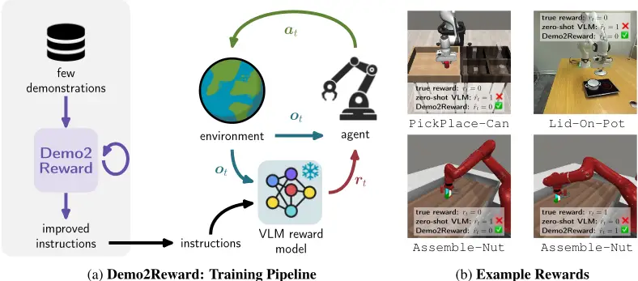

Despite promising results, such an out of the box approach is extremely challenging, as even small reward misspecifications can cause the agent to exploit the reward function in unintended ways, consequently creating drastic changes in the learned policy, a phenomenon known as reward hacking (Skalse et al., 2022). In particular, false positive rewards can lead the policy to seek out states that appear valuable to the VLM but do not reflect the true task success, reinforcing spurious behaviors and drifting away from real task completion.

One strategy to mitigate this reward exploit is to rely on advanced prompt engineering techniques. Especially, a comprehensive understanding of the task can help to carefully design detailed prompts that clarify the task objective and its possible inner sub-goals, while reducing hallucinated rewards. For instance, prior approaches that guide policy learning with LLMs or VLMs provide explicit game rules (Zhou et al., 2023b), extensive in-context examples (Wang et al., 2023), or detailed interpretations of game sprites (Sancaktar et al., 2025). However, this reintroduces the original rewardspecification bottleneck and requires manual design. Conversely, automatic prompt engineering (Zhou et al., 2023a; Li et al., 2025), where one VLM generates or refines prompts for another VLM, represents a promising solution, but systematic evaluations of such approaches in RL settings remain limited (Sancaktar et al., 2025).

We propose Demo2Reward, a simple and effective test-time adaptation scheme to leverage pretrained VLMs as success detectors in sparse reward RL (illustrated in Fig. 1a). Demo2Reward assumes a standard robot learning setup (Vecerik et al., 2017; Rajeswaran et al., 2018; Gupta et al., 2023; Hu et al., 2024) in which a small number of demonstrations are collected by a human expert, before the policy optimization of a given robotic task. To generate a customized task-based instruction, Demo2Reward employs a VLM as a meta-critic to optimize its own language instruction based on the provided demonstrations. Demo2Reward starts from a generic task instruction, and based on sampled demonstrations, the meta-critic refines the language instruction, which is then evaluated on the rest of demonstrations until false rewards are minimized. The optimized prompt is then fixed and used during policy learning to assign rewards. In this way, Demo2Reward performs automatic prompt engineering on a small set of demonstrations to reduce false positive hallucinations of the VLM while recognizing true successes (examples shown in Fig. 1b). Importantly, this adaptation does not require additional training or fine-tuning of the VLM. All optimization is performed before policy learning begins, so computation and throughput during test-time, i.e. when interacting with the environment during policy learning, remain unchanged. We show that Demo2Reward improves the policy learning across tasks, simulation and real-world environments, as well as RL backbones.

Our main contributions are as follows:

1. We propose Demo2Reward, an automatic prompt engineering scheme that improves pre-trained VLM reward models without additional training or test-time compute.
2. We analyze various VLM-based reward models for policy optimization in simulated robot tasks and show that Demo2Reward mitigates these issues and improves policy learning across environments, policy backbones, and generated prompts.
3. We demonstrate that Demo2Reward transfers to real-world robot learning and enables RL without manually specifying a reward function.

## 2 RelatedWork

VLMs as source of rewards: There is an expanding number of work that leverages pre-trained foundation models, such as LLMs and VLMs, to generate rewards for RL agents. These approaches can be grouped into (1) explicit prompting, (2) preference-based methods, (3) latent embedding approaches, and (4) code generation. Explicit prompting directly queries a foundation model to produce scalar rewards. The simplest variant predicts a binary task success, as in SuccessVQA (Du et al., 2023). Similarly, WorldGym (Quevedo et al., 2025) uses a frozen VLM to evaluate imagined rollouts within a video diffusion model to train policies in simulation (Sharma et al., 2026). Beyond binary success, VLMs are also prompted to provide discrete or continuous task progress rewards (Lee et al., 2026; Tan et al., 2025; Ma et al., 2024). For example, RoboReward (Lee et al., 2026) and Robo-Dopamine (Tan et al., 2025) fine-tune VLMs to assign discrete task process rewards to robotic videos, while GVL (Ma et al., 2024) demonstrates that even frozen VLMs can estimate task completion percentages with a suitable prompting scheme. Preference-based methods instead distill a reward model from VLM-generated preferences, following the paradigm of RL from human feedback (Christiano et al., 2017). This is applied to text-based environments using LLM annotators (Klissarov et al., 2024), to visual observations using VLM annotators (Wang et al., 2024; Sancaktar et al., 2025), and to multimodal settings by combining LLM and VLM annotations (Wang et al., 2025). Latent embedding approaches derive synthetic rewards by comparing VLM embeddings of observations and task descriptions, for example using CLIP similarities as in RoboCLIP (Sontakke et al., 2023) and VLM-RM (Rocamonde et al., 2023). Finally, code generation methods generate executable reward functions from task descriptions (Yu et al., 2023; Xie et al., 2023; Venuto et al., 2024). In this work, we focus on explicit prompting approaches and their optimization at test time.

Automatic Prompt-Engineering (APE) refers to methods that automatically refine the text-based input to a language model in order to improve performance with respect to a given objective. Various techniques are proposed to optimize prompts, including refinement through a meta-model, gradient-based optimization, genetic algorithms, and reinforcement learning (Li et al., 2025). APE is successfully applied to natural language reasoning (Zhou et al., 2023a), code generation (Nashid et al., 2023), and multimodal generation (Hao et al., 2023). However, its usage to learn reliable reward models in reinforcement learning remains limited. SENSEI (Sancaktar et al., 2025) shows that prompts generated by a VLM from initial screenshots can yield better rewards for task-free exploration than manually designed prompts. To the best of our knowledge, APE for test-time optimization of VLM reward models has not yet been explored.

In-context learning (ICL) is an alternative technique to APE for adapting LLMs or VLMs at test time. In ICL, example input-output pairs are provided as part of the prompt to allow the model to infer the underlying pattern and generate outputs accordingly. For reward modeling, ICL is primarily studied in the context of improving preference-based RL (Yu et al., 2024). For explicit prompting approaches, GVL (Ma et al., 2024) proposes a prompting scheme and shows that in-context demonstrations can improve value and task progress predictions.

Inverse reinforcement learning (IRL) is a classical approach for learning reward functions from expert demonstrations (Abbeel &amp; Ng, 2004; Ziebart et al., 2008). IRL infers a reward under which the demonstrations are approximately optimal and typically requires repeated policy optimization during training, as well as tens to hundreds of expert trajectories to obtain stable reward estimates (Ziebart et al., 2008; Wulfmeier et al., 2015; Ho &amp; Ermon, 2016). In contrast, Demo2Reward does not attempt to recover a reward function from scratch. Instead, it leverages a pre-trained VLM and adapts its prompt using only a handful of demonstrations before policy learning begins.

## 3 Method

## 3.1 Problem Setup

We consider tasks that can be formalized as a partially observable Markov decision process (POMDP) M = (S,O,A, T,R, ℓ) (Kaelbling et al., 1998) with state space S, observation space O, action space A, transition function T : S ×A → S ×O and a binary success/no-success reward function R : S → {0, 1}. The task is specified by a natural language instruction ℓ.

At each time step t the agent receives an observation ot ∈ O, which consists of an RGB image and may additionally include proprioceptive inputs such as robot joint angles. The true state st ∈ S is not observable. We further assume that the reward is not directly accessible to the agent. Instead, the agent must approximate the true reward rt with a synthetic reward ˆ rt that is used to train a policy.

As is common in robotics (Vecerik et al., 2017; Hu et al., 2024), we assume access to a small dataset of expert demonstrations D = {τ i}Ni=1 with 3 ≤ N ≤ 20. Each trajectory is given by τ i = ((o1, at, r1), . . . , (oT , aT , rT )). The demonstrations are collected either through direct human teleoperation in the real world or from a near-optimal policy in simulation. Since rewards are not observable from the environment, for each data point (o, at, rt) ∈ D a reward label rt is provided by a human expert and indicates task success. This dataset can be used to initialize a policy via behavioral cloning, but more importantly it serves as supervision for reward modeling.

## 3.2 Motivating Example: Reward Hacking with VLMs

Since the agent cannot access the true reward rt, it requires a reward model mcritic that produces synthetic rewards ˆ rt. Following recent approaches that leverage a pre-trained VLM as a zero-shot reward model (e.g. Quevedo et al. 2025; Sharma et al. 2026; Lee et al. 2026), we define:

<!-- formula-not-decoded -->

as the output of the VLM given observations o1:t, a task instruction ℓ and a generic template that instructs the VLM to output a binary scalar reward (prompt details provided in Suppl. A.1.3).

Exploiting the zero-shot adaptability of VLMs, we train a policy solely using rewards from mcritic (details in Suppl. B.1). As illustrated in Figure 2, although the predicted reward ˆ rt increases during training, true task success is never reached (Fig. 2b). By comparing the true reward from the environment with the predicted reward over time (Fig. 2a), we observe that the latter produces many false-positive signals. This high frequency of false positives effectively induces severe reward hacking, resulting in a policy that is unable to solve the task.

Figure 2: Reward Misalignment with VLMs: Without guidance, a VLM reward model can easily misjudge rewards. (a) In an example Assemble-Nut sequence the VLM-generated rewards output false positives (ˆ rt before Demo2Reward, bottom row) before the the task is actually complete (ground-truth reward rt, top row). (b) Training an agent on these flawed rewards causes it to exploit such false positives. The agent collects high synthetic rewards (ˆ rt, red) without ever reaching true task success (rt = 1, blue). Shaded area shows standard deviation (5 seeds).

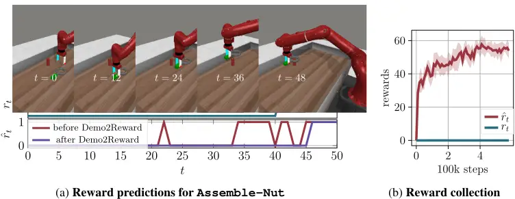

## 3.3 Demo2Reward

To address the false positive reward issue, we introduce Demo2Reward, which adapts the task instruction of a pre-trained VLM using a small dataset of demonstrations before the policy learning begins. Instead of directly using the task instruction ℓ, we search for an improved instruction p that yields more reliable reward predictions on the demonstrations. Since we only have few demonstration of the task, we extend the dataset D by generating additional samples from each trajectory. Specifically, for each demonstration of length T, we construct T prefix subsequences (o1, r1), (o1, r1, o2, r2), . . . , (o1, r1, . . . , oT , rT ). This results in an augmented dataset Dsub containing N × T clips for N original demonstrations.

Next, to optimize the instruction on our subsampled dataset Dsub, we introduce a second VLM mmeta, referred to as the meta-critic. The meta-critic receives a sampled demonstration, the current instruction p, and representative false annotations for the instruction p, and proposes an updated instruction p′ (for the prompt pattern see Suppl. A.1.2). We evaluate the critic model with the new prompt containing p′ on Dsub using an objective ̂ O(p′ ). If the objective improves, we replace p ← p′ , otherwise we keep p. This process is repeated for a fixed number of steps (I = 100).

Objective Our goal is to maximize correct reward predictions for a task instruction p on the dataset:

<!-- formula-not-decoded -->

In practice, we compute the true negative rate (TNR) and true positive rate (TPR), with

<!-- formula-not-decoded -->

<!-- formula-not-decoded -->

Here, D+ and D- denote the subsets of Dsub with rt = 1 and rt = 0, respectively. We use a weighted objective of the two termŝ

<!-- formula-not-decoded -->

We choose a small λ = 0.01 to mainly prioritize minimizing false positives.

Avoiding Degenerate Solutions Strongly weighting true negatives introduces a trivial local optimum in which the prompt always predicts zero reward. In practice, once such a prompt is discovered, optimization rarely recovers. To mitigate this issue, we repeat the optimization process K times with different initializations and different VLMs as meta-critic models mmeta. We select the task instruction with the highest objective value.

## 4 Experiments

In our experiments, we empirically evaluate the following research questions:

1. Can Demo2Reward discover improved instructions through its automatic prompt engineering?
2. Do these instructions improve the downstream policy learning when used to generate rewards?
3. How does Demo2Reward compare to other zero- or few-shot VLM-based reward models?
4. How robust is Demo2Reward across different settings?
5. Can Demo2Reward be applied to real-world robot learning?

We first illustrate instruction discovery with Demo2Reward (Sec. 4.2) and show how improved instructions translate into better downstream policy learning (Sec. 4.3). We then benchmark Demo2Reward against various VLM-based reward models (Sec. 4.4) and test Demo2Reward's robustness with respect to different RL backbones and randomly discovered instructions (Sec. 4.5). Finally, we demonstrate that Demo2Reward enables learning a real-world robotic policy using online rewards generated solely by a VLM (Sec. 4.6).

## 4.1 Experimental Setup

RL-based policy learning. In the experiments, rewards for policy training are generated using a pre-trained VLM. Following prior work on VLM-based reward modeling (Sontakke et al., 2023; Lee et al., 2026), rewards are provided only at the end of each episode. This creates a challenging setup with sparse and potentially delayed rewards, but significantly reduces computational overhead since the VLM is queried only once per episode. For policy learning, we use the following two algorithms that leverage demonstrations to accelerate training.

Imitation Bootstrapped Reinforcement Learning (IBRL). IBRL (Hu et al., 2024) first pre-trains an imitation learning policy on expert demonstrations, before training a second RL-based policy during online interaction. At each time step, the agent selects the action from the policy with the highest estimated Q-value. We initialize IBRL using the imitation policies provided by the authors.

Reinforcement Learning from Prior Data (RLPD). RLPD (Ball et al., 2023) maintains two replay buffers, one for demonstration data and one for online interaction data. During training, demonstration samples are oversampled by drawing 50% of each batch from each buffer.

We consider the following environments and tasks.

MetaWorld (Yu et al., 2020) is an open-source benchmark featuring a Sawyer robot interacting with tabletop objects. Following (Hu et al., 2024), we evaluate four tasks of varying difficulty: Assemble-Nut, Box-Close, Coffee-Push, and Stick-Pull. We use pixel-based observations only and provide the task descriptions from the official MetaWorld documentation as language instructions ℓ.Since human teleoperation is not available for MetaWorld, demonstrations are generated using scripted controllers from the official benchmark (Yu et al., 2020; Hu et al., 2024).

RoboMimic (Mandlekar et al., 2022) is a benchmark suite built on RoboSuite (Zhu et al., 2020) with human teleoperated demonstrations. We evaluate two object manipulation tasks with a Franka Emika Panda: PickPlace-Can and NutAssembly-Square. We use pixel-based observations and the official task descriptions from RoboSuite (Zhu et al., 2020).

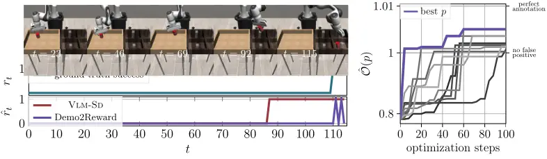

(a) Reward predictions for PickPlace-Can

(b) Optimization in Demo2Reward

Figure 3: Instruction optimization: (a) Example reward prediction for PickPlace-Can before (red) and after (purple) Demo2Reward. (b) Objective ˆO(p) over optimization steps (y-axis in logscale). Each gray line shows one of K = 10 independent optimization runs with purple marking the best. ˆO(p) = 1.01 marks the perfect score with 100%TNR and 100%TPR (λ = 0.01 in Eq. 5).

Real Robot We evaluate Demo2Reward on a Franka Panda robot. In the Lid-On-Pot task, the robot must close a pot with a lid. We collect 20 demonstrations via teleoperation. Observations consist of front-view RGB images (see Fig. 1b) and the end-effector position (details in Suppl. B.2).

We compare Demo2Reward against several zero-shot and few-shot VLM-based reward models. Unless otherwise stated, we use Qwen3-VL (Bai et al., 2025) as the VLM backbone for fair comparison. Implementation details for all methods can be found in Suppl. A.

VLM Success Detector (VLM-SD). Our primary baseline uses a VLM as a zero-shot success detector following Quevedo et al. (2025). The model receives a subsampled video of an episode and the task instruction, and outputs a binary success label. We use Qwen3-VL-8B, which provided strong performance and higher throughput than larger models in preliminary experiments (see Suppl. C.3).

RoboReward (Lee et al., 2026). RoboReward fine-tunes Qwen3-VL-8B on large-scale robotics data to serve as a zero-shot foundational reward model. It outputs a discrete score in {1, 2, 3, 4, 5} describing task success for a video depicting robot behavior. We normalize these scores to [0, 1].

Generative Value Learning (GVL) (Ma et al., 2024). GVL uses in-context learning for value estimation with pre-trained VLMs. The VLM receives a demonstration video and an interaction video and outputs a task completion percentage per frame. The frames within each video are randomly shuffled, forcing the VLM to attend to the content of each frame rather than rely on temporal ordering. We use the percentage for the final frame as the reward and normalize it to [0, 1]. For GVL, we use Qwen3-VL-32B, as smaller models struggled with the longer context required by this method.

RoboCLIP (Sontakke et al., 2023). RoboCLIP embeds demonstration and interaction videos into a latent space of a pre-trained VLM (Xie et al., 2018) and uses the scalar product between the latent embeddings to estimate rewards. We normalize rewards to [0, 1] for consistency.

Table 1: Confusion matrix for Dsub in PickPlace-Can before optimization

| Success rt | Pred. 1 | Reward ˆ rt 0 |
| ---------- | ------- | ------------- |
| 1          | 100%    | 0%            |
| 0          | 26.1%   | 73.9%         |

Table 2: Confusion matrix for Dsub in PickPlace-Can after optimization

| Success rt | Pred. Reward 1 | ˆ rt 0 |
| ---------- | -------------- | ------ |
| 1          | 68.8%          | 31.2%  |
| 0          | 0%             | 100%   |

Figure 4: Downstream policy learning in RoboMimic when training with IBRL. Ground-truth rewards (blue) serve as an approximate upper bound. Demo2Reward (purple) clearly outperforms its counterpart without optimization (VLM-SD, red). Shaded areas show standard deviation (5 seeds)

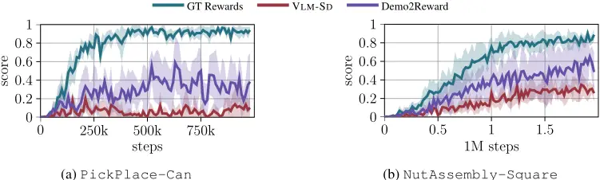

## 4.2 Instruction Discovery with Demo2Reward

We first evaluate language instruction optimization with Demo2Reward on MetaWorld and RoboMimic tasks. For each task, we optimize the instruction using a dataset of three expert demonstrations. Figure 3 and Tables 1-2 illustrate the optimization process for two representative tasks.

Instruction optimization. The original and generic task instruction, without Demo2Reward, exhibits a high false positive rate (Table 1). In particular, the VLM tends to assign rewards before the task is actually completed (e.g. Fig. 2a &amp; Fig. 3a). During optimization, Demo2Reward explores alternative instruction formulations and progressively improves the objective ˆO (Fig. 3b). The final discovered instruction reduces the false positive rate to zero while maintaining a reasonable true positive rate (Table 2). We provide more examples in Suppl. C.1.

Resulting instructions. The full list of discovered instructions can be found in Suppl. C.2. Qualitatively, discovered instructions specify visual properties of objects (e.g. ". . . the nut (a gray circular object) . . . '), emphasize spatial relations between object (e.g. ". . . the white mug is fully under the coffee machine . . . "), and list exact visually verifiable success condition, failure checks and ignorable aspects (e.g. ". . . Ignore slight rotation or minor misalignment . . . "). Interestingly, some discovered instructions describe visual patterns that do not strictly correspond to true elements of the scene but instead reflect how the VLM internally represents the scene. For example, a blue stick may be described as a "red stick" due to visual artifacts from the gripper alignment. Although such descriptions may appear counterintuitive, they better align with the model's perceptual biases, as they represent the VLMs's own understanding. Thus, such instructions can produce more reliable reward predictions, as reflected in the perfect true negative rate achieved by all optimized instructions in the demonstration data set.

## 4.3 Downstream policy learning with Demo2Reward

Next, we evaluate whether improved task instructions translate into better downstream policy learning with IBRL (Hu et al., 2024) on RoboMimic. Figure 4 shows the scores during the evaluation of a policy trained with synthetic rewards from a VLM success detector (VLM-SD), Demo2Reward, or ground-truth rewards. The policy trained with VLM-SD struggles to achieve high task success, especially for the PickPlace-Can task. Demo2Reward consistently improves upon the zero-shot baseline and reaches higher task success rates. Thus, test-time optimization through Demo2Reward directly results in better downstream task learning when using VLM-generated rewards.

## 4.4 Benchmarking Demo2Reward

We compare Demo2Reward with various state-of-the art VLM-based reward models for policy learning with IBRL in MetaWorld. Figure 5 reports success rates for the considered VLM-based reward models and ground-truth rewards. The setup is challenging, as even with ground-truth rewards the policy peaks around 60-80%. After peak success, the performance slightly declines, likely due to instabilities in sparse reward off-policy learning (Kumar et al., 2020).

Figure 5: Downstream policy learning in MetaWorld by training an IBRL policy with different reward sources. Demo2Reward (purple) outperforms all VLM-based baselines (10 seeds).

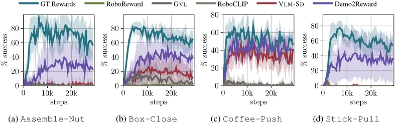

Most VLM-based reward models fail to achieve meaningful success rates. Among the baselines, only VLM-SD and GVL solve some tasks with non-zero performance, albeit substantially below groundtruth rewards. With Demo2Reward, policy learning improves significantly across tasks, yielding up to a 40% increase in success rate. On some tasks, e.g. Coffee-Push, performance approaches ground-truth levels despite the absence of any ground-truth rewards during online interaction.

## 4.5 Robustness of Demo2Reward

Policy Backbones. To demonstrate that performance gains stem from improved reward modeling rather than a specific policy learning algorithm, we evaluate the same optimized prompts using RLPD (Ball et al., 2023). Figures 6a-6b report results for two representative MetaWorld tasks. When applied to policy learning with RLPD, Demo2Reward again consistently matches or outperforms the zero-shot VLM-SD baseline. This indicates that the gains generalize across policy backbones.

Instruction Variability. Since Demo2Reward performs VLM-guided prompt optimization via sampling, different runs will produce different instructions. We therefore repeat instruction discovery with different random initializations for two MetaWorld tasks and evaluate policy learning with IBRL. Figures 6c-6d show the resulting success rates. Although there is some variation between prompts, final task performance consistently reaches similar levels. This suggests that Demo2Reward can discover multiple effective instructions for stable reward generation.

Figure 6: Robustness in MetaWorld: We analyze the robustness of Demo2Reward by (a) applying it to a different RL backbone RLPD and (b) comparing different discovered instructions p with IBRL policy learning. Results are averaged (5 seeds) and smoothed with a sliding window (size = 3).

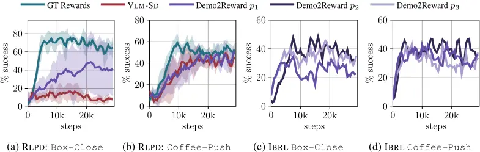

## 4.6 Real-World Experiments

Finally, we evaluate real-world scalability by applying Demo2Reward to our Lid-On-Pot task on a physical robot. We train policies using RLPD (Ball et al., 2023), using the RLInf (Zang et al., 2025) implementation for real-world robotics, and compare ground-truth rewards from a manually defined task success criterion to zero-shot VLM-SD rewards and Demo2Reward.

Figure 7 shows the resulting behaviors. Despite never accessing ground-truth rewards during training, the policy trained with Demo2Reward achieves success rates on par with using groundtruth rewards. In contrast, zero-shot VLM-SD suffers from frequent false positives, and learns a substantially weaker policy. After around 100 episodes, Demo2Reward achieves a 20% higher success rate compared to vanilla VLM-SD. These results demonstrate that Demo2Reward is not limited to simulated benchmarks but can successfully transfer to real-world robot learning.

## 5 Discussion

In this work, we argued and showed that naively deploying pre-trained VLMs as reward models can lead to severe reward hacking and suboptimal policy optimization. To address this, we have introduced Demo2Reward which adapts the task instruction of a frozen VLM based on a few demonstrations before policy learning begins. Across simulated benchmarks and a real-world robot experiment, Demo2Reward consistently improved downstream policy performance without additional model training or test-time computation during policy learning. These results suggest that aligning foundation models through demonstration-guided optimization of task instructions is a practical and scalable direction for reward modeling in embodied RL.

Limitations and Future Work. If visual conditions change between demonstration collection and policy learning, Demo2Reward could overfit to the small demonstration dataset. This could be mitigated by incorporating demonstrations from multiple camera viewpoints or by regularizing the optimization of task instructions toward the original generic ones to preserve semantic consistency. Currently, Demo2Reward is restricted to binary success detection. Future work could extend the framework to discrete or continuous reward signals (Tan et al., 2025; Lee et al., 2026) and even preference-based annotations (Wang et al., 2024), for example by optimizing correlation between reward predictions and temporal progress in demonstrations. Finally, Demo2Reward relies on an initial language instruction. An interesting direction for future research is reward modeling without any human language instructions, where a VLM first infers a task description directly from demonstration videos and subsequently refines it through prompt optimization.

## References

Pieter Abbeel and Andrew Y Ng. Apprenticeship learning via inverse reinforcement learning. In Proceedings of the twenty-first international conference on Machine learning, pp. 1, 2004.

Jean-Baptiste Alayrac, Jeff Donahue, Pauline Luc, Antoine Miech, Iain Barr, Yana Hasson, Karel Lenc, Arthur Mensch, Katie Millican, Malcolm Reynolds, Roman Ring, Eliza Rutherford, Serkan Cabi, Tengda Han, Zhitao Gong, Sina Samangooei, Marianne Monteiro, Jacob Menick, Sebastian Borgeaud, Andrew Brock, Aida Nematzadeh, Sahand Sharifzadeh, Mikolaj Binkowski, Ricardo Barreira, Oriol Vinyals, Andrew Zisserman, and Karen Simonyan. Flamingo: a visual language model for few-shot learning. In Advances in Neural Information Processing Systems, volume 35, pp. 23716-23736, 2022. URL https://arxiv.org/abs/2204.14198.

Figure 7: Real-Robot Results Mean success rates (3 seeds) smoothed (window size 12).

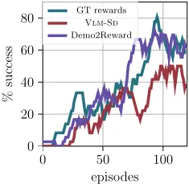

- Shuai Bai, Yuxuan Cai, Ruizhe Chen, Keqin Chen, Xionghui Chen, Zesen Cheng, Lianghao Deng, Wei Ding, Chang Gao, Chunjiang Ge, et al. Qwen3-vl technical report. arXiv preprint arXiv:2511.21631, 2025.
- Philip J Ball, Laura Smith, Ilya Kostrikov, and Sergey Levine. Efficient online reinforcement learning with offline data. In International Conference on Machine Learning, pp. 1577-1594. PMLR, 2023.
- Johan Bjorck, Fernando Castañeda, Nikita Cherniadev, Xingye Da, Runyu Ding, Linxi "Jim" Fan, Yu Fang, Dieter Fox, Fengyuan Hu, Spencer Huang, Joel Jang, Zhenyu Jiang, Jan Kautz, Kaushil Kundalia, Lawrence Lao, Zhiqi Li, Zongyu Lin, Kevin Lin, Guilin Liu, Edith Llontop, Loic Magne, Ajay Mandlekar, Avnish Narayan, Soroush Nasiriany, Scott Reed, You Liang Tan, Guanzhi Wang, Zu Wang, Jing Wang, Qi Wang, Jiannan Xiang, Yuqi Xie, Yinzhen Xu, Zhenjia Xu, Seonghyeon Ye, Zhiding Yu, Ao Zhang, Hao Zhang, Yizhou Zhao, Ruijie Zheng, and Yuke Zhu. Gr00t n1: An open foundation model for generalist humanoid robots. arXiv preprint arXiv:2503.14734, 2025. DOI: 10.48550/arXiv.2503.14734. URL https://arxiv.org/ abs/2503.14734.
- Paul F Christiano, Jan Leike, Tom Brown, Miljan Martic, Shane Legg, and Dario Amodei. Deep reinforcement learning from human preferences. Advances in neural information processing systems, 30, 2017.
- Yuqing Du, Ksenia Konyushkova, Misha Denil, Akhil Raju, Jessica Landon, Felix Hill, Nando de Freitas, and Serkan Cabi. Vision-language models as success detectors. Proceedings of Machine Learning Research. PMLR, 2023.
- Gemini Team and Google. Gemini 1.5: Unlocking multimodal understanding across millions of tokens of context. arXiv preprint arXiv:2403.05530, 2024. DOI: 10.48550/arXiv.2403.05530. URL https://arxiv.org/abs/2403.05530.
- Abhishek Gupta, Corey Lynch, Brandon Kinman, Garrett Peake, Sergey Levine, and Karol Hausman. Demonstration-bootstrapped autonomous practicing via multi-task reinforcement learning. In 2023 IEEE International Conference on Robotics and Automation (ICRA), pp. 50205026. IEEE, 2023. DOI: 10.1109/ICRA48891.2023.10161447. URL https://doi.org/ 10.1109/ICRA48891.2023.10161447.
- Yaru Hao, Zewen Chi, Li Dong, and Furu Wei. Optimizing prompts for text-to-image generation. In Thirty-seventh Conference on Neural Information Processing Systems, 2023. URL https: //openreview.net/forum?id=BsZNWXD3a1.
- Jonathan Ho and Stefano Ermon. Generative adversarial imitation learning. Advances in neural information processing systems, 29, 2016.
- Hengyuan Hu, Suvir Mirchandani, and Dorsa Sadigh. Imitation bootstrapped reinforcement learning. Proceedings of Robotics: Science and Systems (RSS), 2024.
- Physical Intelligence, Kevin Black, Noah Brown, James Darpinian, Karan Dhabalia, Danny Driess, Adnan Esmail, Michael Equi, Chelsea Finn, Niccolo Fusai, et al. π0.5: a vision-language-action model with open-world generalization. arXiv preprint arXiv:2504.16054, 2025.
- Leslie Pack Kaelbling, Michael L Littman, and Anthony R Cassandra. Planning and acting in partially observable stochastic domains. Artificial intelligence, 101(1-2):99-134, 1998.
- Moo Jin Kim, Karl Pertsch, Siddharth Karamcheti, Ted Xiao, Ashwin Balakrishna, Suraj Nair, Rafael Rafailov, Ethan P Foster, Pannag R Sanketi, Quan Vuong, et al. Openvla: An open-source vision-language-action model. In 8th Annual Conference on Robot Learning.

- Martin Klissarov, Pierluca D'Oro, Shagun Sodhani, Roberta Raileanu, Pierre-Luc Bacon, Pascal Vincent, Amy Zhang, and Mikael Henaff. Motif: Intrinsic motivation from artificial intelligence feedback. 2024.
- Aviral Kumar, Abhishek Gupta, and Sergey Levine. Discor: Corrective feedback in reinforcement learning via distribution correction. Advances in neural information processing systems, 33: 18560-18572, 2020.
- Tony Lee, Andrew Wagenmaker, Karl Pertsch, Percy Liang, Sergey Levine, and Chelsea Finn. Roboreward: General-purpose vision-language reward models for robotics. arXiv preprint arXiv:2601.00675, 2026.
- Lin Li, Qihang Zhang, Yiming Luo, Shuai Yang, Ruilin Wang, Fei Han, Mingrui Yu, Zelin Gao, Nan Xue, Xing Zhu, Yujun Shen, and Yinghao Xu. Causal world modeling for robot control. arXiv preprint arXiv:2601.21998, 2026.
- Wenwu Li, Xiangfeng Wang, Wenhao Li, and Bo Jin. A survey of automatic prompt engineering: An optimization perspective. arXiv preprint arXiv:2502.11560, 2025.
- Yecheng Jason Ma, Joey Hejna, Chuyuan Fu, Dhruv Shah, Jacky Liang, Zhuo Xu, Sean Kirmani, Peng Xu, Danny Driess, Ted Xiao, et al. Vision language models are in-context value learners. In The Thirteenth International Conference on Learning Representations, 2024.
- Ajay Mandlekar, Danfei Xu, Josiah Wong, Soroush Nasiriany, Chen Wang, Rohun Kulkarni, Li FeiFei, Silvio Savarese, Yuke Zhu, and Roberto Martín-Martín. What matters in learning from offline human demonstrations for robot manipulation. In Conference on Robot Learning, pp. 1678-1690. PMLR, 2022.
- Antoine Miech, Dimitri Zhukov, Jean-Baptiste Alayrac, Makarand Tapaswi, Ivan Laptev, and Josef Sivic. Howto100m: Learning a text-video embedding by watching hundred million narrated video clips. In Proceedings of the IEEE/CVF international conference on computer vision, pp. 2630-2640, 2019.
- Noor Nashid, Mifta Sintaha, and Ali Mesbah. Retrieval-based prompt selection for code-related few-shot learning. In 2023 IEEE/ACM 45th International Conference on Software Engineering (ICSE), pp. 2450-2462. IEEE, 2023.
- OpenAI. Gpt-4 technical report. arXiv preprint arXiv:2303.08774, 2023. DOI: 10.48550/arXiv. 2303.08774. URL https://arxiv.org/abs/2303.08774.
- Julian Quevedo, Ansh Kumar Sharma, Yixiang Sun, Varad Suryavanshi, Percy Liang, and Sherry Yang. Worldgym: World model as an environment for policy evaluation. arXiv preprint arXiv:2506.00613, 2025.
- Alec Radford, Jong Wook Kim, Chris Hallacy, Aditya Ramesh, Gabriel Goh, Sandhini Agarwal, Girish Sastry, Amanda Askell, Pamela Mishkin, Jack Clark, et al. Learning transferable visual models from natural language supervision. In International conference on machine learning, pp. 8748-8763. PmLR, 2021.
- Aravind Rajeswaran, Vikash Kumar, Abhishek Gupta, Giulia Vezzani, John Schulman, Emanuel Todorov, and Sergey Levine. Learning complex dexterous manipulation with deep reinforcement learning and demonstrations. In Proceedings of Robotics: Science and Systems, Pittsburgh, Pennsylvania, June 2018. DOI: 10.15607/RSS.2018.XIV.049. URL https://www. roboticsproceedings.org/rss14/p49.html.
- Juan Rocamonde, Victoriano Montesinos, Elvis Nava, Ethan Perez, and David Lindner. Visionlanguage models are zero-shot reward models for reinforcement learning. In The Twelfth International Conference on Learning Representations, 2023.

- Cansu Sancaktar, Christian Gumbsch, Andrii Zadaianchuk, Pavel Kolev, and Georg Martius. Sensei: Semantic exploration guided by foundation models to learn versatile world models. In International Conference on Machine Learning, pp. 52745-52777. PMLR, 2025.
- Ansh Kumar Sharma, Yixiang Sun, Ninghao Lu, Yunzhe Zhang, Jiarao Liu, and Sherry Yang. World-gymnast: Training robots with reinforcement learning in a world model. arXiv preprint arXiv:2602.02454, 2026.
- Joar Skalse, Nikolaus Howe, Dmitrii Krasheninnikov, and David Krueger. Defining and characterizing reward gaming. Advances in Neural Information Processing Systems, 35:9460-9471, 2022.
- Sumedh Anand Sontakke, Jesse Zhang, Séb Arnold, Karl Pertsch, Erdem Biyik, Dorsa Sadigh, Chelsea Finn, and Laurent Itti. RoboCLIP: One demonstration is enough to learn robot policies. In Thirty-seventh Conference on Neural Information Processing Systems, 2023. URL https: //openreview.net/forum?id=DVlawv2rSI.
- Richard S. Sutton and Andrew G. Barto. Reinforcement Learning: An Introduction. The MIT Press, Cambridge, MA, 1998.
- Huajie Tan, Sixiang Chen, Yijie Xu, Zixiao Wang, Yuheng Ji, Cheng Chi, Yaoxu Lyu, Zhongxia Zhao, Xiansheng Chen, Peterson Co, et al. Robo-dopamine: General process reward modeling for high-precision robotic manipulation. arXiv preprint arXiv:2512.23703, 2025.
- Mel Vecerik, Todd Hester, Jonathan Scholz, Fumin Wang, Olivier Pietquin, Bilal Piot, Nicolas Heess, Thomas Rothörl, Thomas Lampe, and Martin Riedmiller. Leveraging demonstrations for deep reinforcement learning on robotics problems with sparse rewards. arXiv preprint arXiv:1707.08817, 2017.
- David Venuto, Sami Nur Islam, Martin Klissarov, Doina Precup, Sherry Yang, and Ankit Anand. Code as reward: empowering reinforcement learning with vlms. In Proceedings of the 41st International Conference on Machine Learning, pp. 49368-49387, 2024.
- Guanzhi Wang, Yuqi Xie, Yunfan Jiang, Ajay Mandlekar, Chaowei Xiao, Yuke Zhu, Linxi Fan, and Anima Anandkumar. Voyager: An open-ended embodied agent with large language models. arXiv preprint arXiv:2305.16291, 2023.
- Ruiqi Wang, Dezhong Zhao, Ziqin Yuan, Tianyu Shao, Guohua Chen, Dominic Kao, Sungeun Hong, and Byung-Cheol Min. PRIMT: Preference-based reinforcement learning with multimodal feedback and trajectory synthesis from foundation models. In The Thirty-ninth Annual Conference on Neural Information Processing Systems, 2025. URL https://openreview.net/forum? id=4xvE6Iy77Y.
- Yufei Wang, Zhanyi Sun, Jesse Zhang, Zhou Xian, Erdem Biyik, David Held, and Zackory Erickson. Rl-vlm-f: reinforcement learning from vision language foundation model feedback. In Proceedings of the 41st International Conference on Machine Learning, pp. 51484-51501, 2024.
- Philipp Wu, Yide Shentu, Zhongke Yi, Xingyu Lin, and Pieter Abbeel. Gello: A general, low-cost, and intuitive teleoperation framework for robot manipulators, 2024. URL https://arxiv. org/abs/2309.13037.
- Markus Wulfmeier, Peter Ondruska, and Ingmar Posner. Maximum entropy deep inverse reinforcement learning. arXiv preprint arXiv:1507.04888, 2015.
- Saining Xie, Chen Sun, Jonathan Huang, Zhuowen Tu, and Kevin Murphy. Rethinking spatiotemporal feature learning: Speed-accuracy trade-offs in video classification. In Proceedings of the European conference on computer vision (ECCV), pp. 305-321, 2018.
- Tianbao Xie, Siheng Zhao, Chen Henry Wu, Yitao Liu, Qian Luo, Victor Zhong, Yanchao Yang, and Tao Yu. Text2reward: Reward shaping with language models for reinforcement learning. arXiv preprint arXiv:2309.11489, 2023.

- Chao Yu, Qixin Tan, Hong Lu, Jiaxuan Gao, Xinting Yang, Yu Wang, Yi Wu, and Eugene Vinitsky. Icpl: Few-shot in-context preference learning via llms. arXiv preprint arXiv:2410.17233, 2024.
- Tianhe Yu, Deirdre Quillen, Zhanpeng He, Ryan Julian, Karol Hausman, Chelsea Finn, and Sergey Levine. Meta-world: A benchmark and evaluation for multi-task and meta reinforcement learning. In Conference on robot learning, pp. 1094-1100. PMLR, 2020.
- Wenhao Yu, Nimrod Gileadi, Chuyuan Fu, Sean Kirmani, Kuang-Huei Lee, Montserrat Gonzalez Arenas, Hao-Tien Lewis Chiang, Tom Erez, Leonard Hasenclever, Jan Humplik, et al. Language to rewards for robotic skill synthesis. In 7th Annual Conference on Robot Learning, 2023.
- Hongzhi Zang, Mingjie Wei, Si Xu, Yongji Wu, Zhen Guo, Yuanqing Wang, Hao Lin, Liangzhi Shi, Yuqing Xie, Zhexuan Xu, et al. Rlinf-vla: A unified and efficient framework for vla+ rl training. arXiv preprint arXiv:2510.06710, 2025.
- Yongchao Zhou, Andrei Ioan Muresanu, Ziwen Han, Keiran Paster, Silviu Pitis, Harris Chan, and Jimmy Ba. Large language models are human-level prompt engineers. In The Eleventh International Conference on Learning Representations, 2023a. URL https://openreview.net/ forum?id=92gvk82DE-.
- Zihao Zhou, Bin Hu, Chenyang Zhao, Pu Zhang, and Bin Liu. Large language model as a policy teacher for training reinforcement learning agents. arXiv preprint arXiv:2311.13373, 2023b.
- Yuke Zhu, Josiah Wong, Ajay Mandlekar, Roberto Martín-Martín, Abhishek Joshi, Kevin Lin, AbhiramMaddukuri, Soroush Nasiriany, and Yifeng Zhu. robosuite: A modular simulation framework and benchmark for robot learning. arXiv preprint arXiv:2009.12293, 2020.
- Brian D Ziebart, Andrew L Maas, J Andrew Bagnell, Anind K Dey, et al. Maximum entropy inverse reinforcement learning. In Aaai, volume 8, pp. 1433-1438. Chicago, IL, USA, 2008.

## Supplementary Materials

The following content was not necessarily subject to peer review.

## A Implementation Details

## A.1 Demo2Reward

## A.1.1 Hyperparameters

Hyperparameters are shown per suite, with shared hyperparameters displayed in the center.

| Name                           | MetaWorld | Value RoboMimic            | Real                       |
| ------------------------------ | --------- | -------------------------- | -------------------------- |
| λ                              |           | 0.01                       |                            |
| Optimization steps I           |           | 100                        |                            |
| mcritic model                  |           | Qwen3-8B-VL                |                            |
| mmeta models                   |           | Qwen3-8B-VL & Qwen3-32B-VL | Qwen3-8B-VL & Qwen3-32B-VL |
| Optimizations K per mmeta      |           | 5                          |                            |
| &#124;D&#124;                  | 3         | 3                          | 10                         |
| image resolution VLM inputs    |           | 224 × 224                  |                            |
| policy inputs                  | image     | image                      | image & position           |
| image resolution policy inputs | 84×84     | 96×96                      | 124×124                    |
| max episode steps              | 100       | 200 (Can) / 300 (Square)   | 30                         |

## A.1.2 Meta-Critic

The meta-critic uses the following system prompt:

You are the Meta-Critic, an expert at writing precise, unambiguous text instructions for another vision-language model ("the Critic") that must decide whether a simulated robot has completed a task in a given video. The Critic receives:

- A short sequence of RGB frames (a sparsely sampled video) from a single episode, ordered in time from the start to the current state (roughly 5-10 frames, every Nth frame).
- Your instruction text.

The Critic outputs task completion score as a single, binary character: "1" if the task is completed in the last frame; "0" otherwise. Different formatting is not allowed. Your goal is to rewrite the Critic's instruction so that its decisions align with the binary ground-truth labels of success/no success.

Follow these principles at all times:

- Define success strictly by clear visual evidence in the frames of the sequence.
- Assume the video is sparsely sampled: avoid criteria that depend on seeing every moment of motion or exact trajectories.
- State the task goal succinctly, then specify a minimal checklist of visual cues required for success.
- Include explicit failure/ambiguity rules.
- Specify what to ignore.
- When needed, explicitly say how to compare frames.
- Use imperative voice, and refer to objects as they appear visually.
- Format your response exactly as follows without other additions or changes in formatting:

Reasoning: &lt;3-5 sentences about the ambiguities or mistakes of the current prompt that explain the failure cases.&gt; Final Instruction: &lt;updated and final instruction text&gt;

At each optimization iteration, we provide the following inputs to the meta-critic for optimizing the prompt:

- the current best prompt p
- a randomly sampled demonstration episode o1:T , r1:T
- the confusion matrix of p when evaluating mcritic on dataset D, i.e. TPR(p), TNR(p), FPR(p), FNR(p)
- 5 random subsampled episodes (5 frames) for which mcritic made a mistake with p

The meta-critic is prompted for an improved prompt p′ as follows:

```
Rewrite the instruction that will be given to a separate AI model (the Critic). The Critic receives a short sequence of RGB frames from a single episode and must decide whether a simulated robot has completed the task. Your goal is to modify the instruction so that the Critic's binary decisions (1 = success, 0 = not successful) match the ground-truth labels as closely as possible. As a reference, you are given a demonstration of a successful task execution: a sequence of frames from a single episode, each followed by a binary ground-truth label indicating whether the task is already completed in that particular frame. Use this reference, together with the performance summary to refine the instruction. Ground-truth reference demonstration (each is an image followed by its ground-truth labels): <o1> <r1> . . . <oT> <rT> Current Critic instruction: <p> Performance summary of the current Critic instruction over evaluation episodes: True Positive Rate: <TPR(p)> True Negative Rate: <TNR(p)> False Positive Rate: <TPR(p)> False Negative Rate: <TNR(p)> Here are exemplar videos which the Critic judged incorrectly: <oi1> <ri1> . . . <oiK > <riK > Incorrect Critic output: <mcritic(oi1:K , p) ... <oj1> <rj1> . . . <oiL> <riL> Incorrect Critic output: <mcritic(oj1:L, p) First provide the reasoning (3-5 sentences), then provide the instruction -- both exactly as required by the output format.
```

We apply the same prompt for all tasks, but we dismiss the word "simulated" when applying Demo2Reward to real robots.

For the meta-critic, we use an exploratory decoding scheme with stochastic sampling (temperature=1.3, top-p =0.97, top-k=50) and an increased token budget to encourage diverse and creative prompt refinements.

We employ both Qwen3-VL-8B-Instruct as well as Qwen/Qwen3-VL-32B-Instruct as meta-critics. Each of the two models is optimized K = 5 times, from different random initializations for I = 100 optimization steps.

## A.1.3 VLM-SD Critic

Our VLM-SD critic is based on the implementations of Quevedo et al. (2025) and Sharma et al. (2026). Unlike the implementation of Quevedo et al. (2025), which uses GPT-4, we use Qwen3-VL-8B-Instruct as our VLM. We slightly modify the original prompts to match our setup. Since Quevedo et al. (2025) assigns rewards to video diffusion rollouts, we remove all references to video diffusion. To increase throughput, we uniformly subsample video inputs to five frames. In addition, our VLM-SD outputs only the binary reward and does not generate reasoning traces. Ablation studies in Suppl. C.3 show that these modifications improve performance in our setup. At the same time our modification increase inference throughput by approximately a factor of ten in wall-clock time.

We use the same system prompt for all tasks. We only dismiss the word "simulated" when applying Demo2Reward to real robots.

```
You are an expert roboticist tasked to decide whether a simulated robot has completed a given task using a short video and a task instruction. Output format: Return a single character with no extra text: "1" if the task is completed in this frame; "0" otherwise. Do not explain your answer.
```

We use the following prompt to evaluate an episode:

```
Here is a sequence of frames showing a robot policy attempting to solve a task. I need your help determining whether the policy is successful. <o1> . . . <oT> Instruction: p Output EXACTLY a single character, either 0 or 1, to denote task completion. Use 1 if the task is completed; 0 otherwise. Use no other symbols or formatting.
```

When prompting the VLM-SD critic, we disable sampling for maximal accuracy.

## A.2 GVL

While we closely follow the prompt instructions provided in the original paper by Ma et al. (2024), pre-tests showed that the VLM sometimes didn't adhere to the desired output pattern when prompted to output a task completion score AND a textual reasoning for this score. We assume that this happens because of a very long context length.

We make two minor changes in order to reduce context length: 1) We uniformly subsample the demonstration video to 10 frames and subsample the policy video to 5 frames. 2) We prompt the VLM to only output the reward not a video description. On an offline dataset we verified that this increased reward prediction accuracy.

We use the following system prompt for GVL:

```
You are an expert roboticist tasked with predicting task completion percentages. The task completion percentage must be between 0 and 100, where: - 0% corresponds to the initial state - 100% corresponds to full task completion Frames may be presented in random order. Do not assume any temporal ordering. Estimate completion based only on the visual state of each frame.
```

```
For each frame, output strictly: "Frame i: Task Completion Percentages:%" Do not include any additional text.
```

We use the following prompt for a given demonstration (od1 , . . . , odT ) and policy video (o1, . . . , oT ):

```
You are an expert roboticist tasked with predicting task completion percentages for a robot performing the following task: <task_description>. The task completion percentages are between 0 and 100, where 100 corresponds to full task completion. We provide several examples of the robot performing the task at various stages and their corresponding task completion percentages. Note that these frames are in random order, so please pay attention to the individual frames when reasoning about task completion percentage. Example frames (with known completion): Frame 1: <odi > Task completion: <i%> . . . Frame 10: <odj > Task completion:<j%> Now consider a new episode. Initial frame of this episode: <odi > In the initial robot scene, the task completion percentage is 0. Now, estimate task completion for the task: <task_description>. Output the task completion percentage for the following frames that are presented in random order. For each frame, format your response as follow: Frame i: Task Completion Percentages:% Frame 1: <oh> . . . Frame <t>: <oT> . . . Frame 5: <ok>
```

We only use the output for time step T as the reward for this episode. We disable sampling in the VLM for maximal accuracy.

## A.3 RoboCLIP

We closely followed the RoboCLIP setup (Sontakke et al., 2023) by subsampling each video to 32 frames and resizing frames to 250×250, matching the preprocessing used to pretrain the S3D backbone (Xie et al., 2018) on the HowTo100M dataset (Miech et al., 2019). However, in preliminary experiments we observed that the raw dot-product similarity used by RoboCLIP exhibits substantial variation in magnitude across successful demonstrations from the same tasks. The reward values differed by up to three orders of magnitude for different videos of the same MetaWorld task.

Since IBRL requires rewards in [0,1], as it was pre-trained with binary task rewards and mixes value estimates during RL updates, we apply a fixed task-dependent normalization. For each task, we use the three available demonstrations and generate all possible 32-frame subclips. We compute dot-product similarities between the target demonstration embedding and all subclip embeddings to obtain a calibration distribution. We then estimate the 5th and 95th percentiles of this distribution and linearly rescale rewards to [0,1], clipping values outside this range. This transformation preserves the ranking induced by RoboCLIP while ensuring compatibility with our policy learning.

## A.4 RoboReward

RoboReward (Lee et al., 2026) is a pre-trained Qwen3-VL-8B-Instruct model fine-tuned on a large-scale robotics dataset to serve as a reward model. To ensure it works as intended, we use the same prompt that it was trained on:

```
Given the task, assign a discrete progress score reward (1,2,3,4,5) for the robot in the video in the format: ANSWER: <score> Rubric for end-of-episode progress (judge only the final state without time limits): 1 - No Success: Final state shows no goal-relevant change for the command. 2 - Minimal Progress: Final state shows a small but insufficient change toward the goal. 3 - Partial Completion: The final state shows good progress toward the goal but violates more than one requirement or a major requirement. 4 - Near Completion: Final state is correct in region and intent but misses a single minor requirement. 5 - Perfect Completion: Final state satisfies all requirements. Task: <task_description>
```

Since RoboReward was fine-tuned using full videos, we do not subsample the video inputs to maximally align it with its fine-tuning setup. We normalize RoboReward's output to [0, 1] to match the reward scale of the binary rewards in the demonstration data. We experimentally evaluate this design choice and compare it to unnormalized or binarized versions in Suppl. C.4.

## A.5 ICL VLM-SD

In Suppl. C.3 we test an in-context learning (ICL) version for our VLM success detector. For this ablation we use the following system prompt:

```
You are an expert roboticist tasked to decide whether a simulated robot has completed a given task using two short videos and a task instruction. The first video shows a demonstration of successful task completion. The second video shows a robot policy attempting the task. Output format: Return a single character with no extra text: "1" if the task is completed in the second video; "0" otherwise. Do not explain your answer.
```

We randomly sample a demonstration od1:T for ICL (sub-sampled to 10 frames) and provide it together with the task behavior video o1:T (sub-sampled to 5 frames):

```
Here are two short videos related to a robot task. The FIRST video is a demonstration of a robot successfully completing the task. The SECOND video shows a robot policy attempting the same task. <od1 > . . . <odT > <o1> . . . <oT> Task description: <task_description>. Using the demonstration video as a reference for what constitutes success, determine whether the robot in the SECOND video successfully completes the task. Output EXACTLY a single character, either 0 or 1, to denote task completion. Use 1 if the task is completed; 0 otherwise. Use no other symbols or formatting.
```

## B Experiment Details

## B.1 Simulated Experiments

For all simulated experiments, we follow the setup of IBRL (Hu et al., 2024) and use their implementation of IBRL and RLPD. We modify only one aspect: rewards are provided exclusively at the end of each episode, consistent with prior work on VLM-based reward models (Sontakke et al., 2023; Lee et al., 2026). In particular, we disable early episode termination and assign rewards at the end of truncated episodes. Disabling early termination is necessary to prevent task success signals from leaking through episode termination conditions.

In all experiments, the VLM receives higher-resolution images (224 × 224) than the policies to enable more accurate visual reasoning (see Suppl. A.1.1). Following Hu et al. (2024), we use a third-person camera for NutAssembly-Square and a gripper-mounted camera for PickPlace-Can. For reward evaluation, however, the VLM always receives third-person views to simplify visual assessment.

For MetaWorld we took the generic task descriptions from the benchmark website: https:// metaworld.farama.org/benchmark/task_descriptions/. For RoboMimic we use the official task descriptions from the RoboSuite paper (Zhu et al., 2020).

Motivating Example. For the motivating example in Section 3.2, we use a slightlymodified setup to more clearly illustrate the effects of reward hacking. In this case, the VLM is queried at every time step to produce a reward ˆ rt. A IBRL policy is then trained using these synthetic rewards. While this setup clearly highlights the impact of false positive rewards, it is computationally infeasible for real-world robotics applications due to the high inference cost of querying the VLM at every transition.

## B.2 Real Robot Experiments

For our real-world evaluation, we deploy our method on a Franka Research 3 manipulator. We build upon the RLInf framework (Zang et al., 2025), adopting both their ResNet-based pre-trained visual encoder and their implementation of RLPD. However, we introduce key architectural modifications to the teleoperation and vision pipelines. Specifically, we integrate a ZED 2i stereo camera through ROS2 and employ the GELLO framework (Wu et al., 2024) for teleoperation, using its native Franka controller and joint state publisher.

Data processing To seamlessly interface our hardware setup with the RLInf training pipeline, we implemented a custom data-logging module tailored to match their expected data format. Since precise temporal alignment between visual observations and robot proprioception is critical for RL, we enforce strict cross-machine clock synchronization using Chrony (NTP). We combine this with ROS2 time synchronization policies to tightly couple incoming image frames with their corresponding robot state messages. Following Zang et al. (2025), the recorded end-effector poses are mapped into a relative end-effector coordinate frame. The continuous action space is defined by the position deltas between consecutive robot states, which are subsequently normalized to align with the action scaling of the rollout environment.

Lid-On-Pot This task is inspired by the two insertion tasks used in RLInf (Zang et al., 2025), but adapted for our robot and a kitchen setup. Our robot holds the lid and must move it ontop of the pot to close it. We measure ground-truth success based on the end effector position. Specifically a target pose ([0.541, -0.027, 0.101]) must be reached within a certain threshold ([0.025, 0.025, 0.035]). The observation space for the end-effector poses is symmetric around the target with 10cm in both x and y direction, and extends 10cm above the target in the z coordinate. We truncate episodes after 30 time steps and allocating rewards strictly at truncation.

## C Additional Results

## C.1 Example optimizations and annotations

Figure 8: Prompt optimization: Example reward prediction for Stick-Pull (a) and AssembleNut-Square (c) before (red) and after (purple) Demo2Reward. Objective ˆO(p) (Eq. 5) for Stick-Pull (b) and AssembleNut-Square (d) over optimization steps. Each gray line shows one of K = 10 independent optimization runs with the dashed purple marking the best. The y-axis is displayed in log-scale.

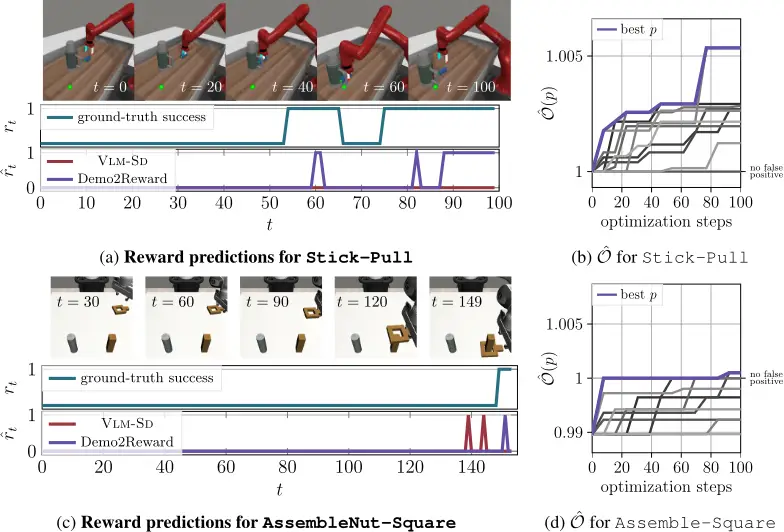

Table 3: Confusion matrix for Dsub in Assemble-Nut before optimization

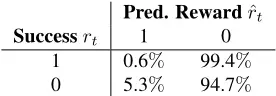

Table 5: Confusion matrix for Dsub in Stick-Pull before optimization

| Success rt | Pred. Reward ˆ 1 | rt 0  |
| ---------- | ---------------- | ----- |
| 1          | 0.6%             | 99.4% |
| 0          | 5.3%             | 94.7% |

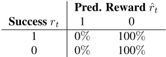

Table 7: Confusion matrix for Dsub in NutAssemble-Square before optimization

| Success rt | Pred. 1 | Reward ˆ rt 0 |
| ---------- | ------- | ------------- |
| 1          | 0%      | 100%          |
| 0          | 0%      | 100%          |

| Success rt | Pred. Reward 1 | ˆ rt 0 |
| ---------- | -------------- | ------ |
| 1          | 33.3%          | 66.7%  |
| 0          | 1.4%           | 98.6%  |

## C.2 Discovered Instructions

Here we provide all instructions discovered by Demo2Reward.

## C.2.1 MetaWorld

The following prompt were used for our main experiments in Sec. 4.2.

## Assemble-Nut

Before Demo2Reward:

Evaluate the behavior of this simulated robot. The robot was instructed with the task: Pick up a nut and place it onto a peg.

## After Demo2Reward:

In the final frame, determine if the robot has successfully completed the task by visually verifying that the nut (a gray circular object) is fully seated on top of the peg (a red cylindrical object), with no visible separation between them. Output "1" if the nut is completely resting on the peg; otherwise, output "0". Ignore intermediate actions or partial placements. Do not consider motion or rotation as failure -- success is determined by final positional alignment.

## Box-Close

Before Demo2Reward:

Table 4: Confusion matrix for Dsub in Assemble-Nut after optimization

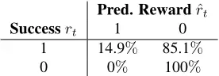

Table 6: Confusion matrix for Dsub in Stick-Pull after optimization

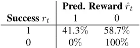

Table 8: Confusion matrix for Dsub in NutAssemble-Square after optimization

| Success rt | Pred. Reward ˆ rt 1 | 0     |
| ---------- | ------------------- | ----- |
| 1          | 41.3%               | 58.7% |
| 0          | 0%                  | 100%  |

| Success rt | Pred. 1 | Reward ˆ rt 0 |
| ---------- | ------- | ------------- |
| 1          | 6.7%    | 93.3%         |
| 0          | 0%      | 100%          |

Evaluate the behavior of this simulated robot. The robot was instructed with the task: Grasp the cover and close the box with it.

## After Demo2Reward:

In the final frame, determine if the robot has successfully completed the task "grasp the cover and close the box with it" by checking whether the cover is visibly grasped by the robot's end-effector and placed on top of the box such that it overlaps with the box's top surface; ignore incomplete alignment or small gaps. If this condition is met, output "1"; otherwise, output "0".

## Coffee-Push

Before Demo2Reward:

Evaluate the behavior of this simulated robot. The robot was instructed with the task: Push a mug under a coffee machine.

## After Demo2Reward:

The robot's task is to push a white mug under a red coffee machine. Evaluate the final frame: if the white mug is fully under the coffee machine (no part of it is visible on the table surface) and there is a small green dot visible near the coffee machine's spout (indicating correct placement), output "1". If the mug is still visible on the table, not positioned under the machine, or the green dot is absent, output "0". Ignore the robot's arm position or motion. Do not consider partial positioning or intermediate contact as success. Success is defined solely by the mug's final position and the presence of the green dot.

## Stick-Pull

Before Demo2Reward:

Evaluate the behavior of this simulated robot. The robot was instructed with the task: Grasp a stick and pull a box with the stick.

## After Demo2Reward:

Output "1" only if, in the final frame, the red stick is visibly held by the robot's gripper and is in direct contact with the multicolored box, and the box is positioned close to the green ball (within touching distance or adjacent). Ignore motion or intermediate frames. If the box is not near the green ball, or the stick is not clearly contacting the box, or the stick is not gripped, output "0". The gripper must be visibly closed around the stick, and the stick must appear to be touching the side or top of the multicolored box.

## C.2.2 MetaWorld Alternativ

For our robustness analysis in Sec. 4.5 we generated two addittional prompts per task.

## Box-Close-2

The robot's task is to grasp the cover and close the box with it. The task is completed in the final frame if and only if the wooden box is fully closed (no open sides visible, lid fully seated) and the box is visibly lifted off the table (with a clear gap between the bottom of the box and the table surface). If both conditions are met, output 1. If the box is still in contact with the table or visibly open, output 0. Do not require the green dot to be fully covered--its partial visibility does not invalidate closure. Ignore intermediate steps such as grasping or aligning the cover. When in doubt, if the box appears closed and lifted, output 1.

## Box-Close-3

Output "1" if in the last frame the wooden box is lifted by the robot's gripper and is visibly not resting on the table (even if close to the surface), and the green dot is visible on the top face of the box (regardless of exact centering or partial occlusion). Output "0" only if the box is touching the table or the green dot is not on the top surface (e.g., invisible, on side, or absent). Ignore motion blur, intermediate steps, and minor changes in arm pose. Focus exclusively on the position of the box and visibility of the green dot in the final frame.

## Coffee-Push-2

In the final frame, if the mug is visibly placed under the spout of the coffee machine -- meaning the top of the mug is within the projected area of the spout's downward cone (even if slightly off-center or tilted) -- output 1. Otherwise, output 0. Ignore robot motion or intermediate positioning -- only evaluate whether the mug is located under the spout's projection in the final frame.

## Coffee-Push-3

In the final frame, determine if the robot has completed the task by visually confirming that the white mug is positioned within the dispensing area of the red coffee machine -- meaning the mug must be visibly beneath the spout, even if slightly offset or not perfectly centered. Output "1" if the mug is visibly under the spout (any portion of the mug overlaps the spout's projection); output "0" only if no part of the mug is under the spout at all. Ignore motion or trajectory in preceding frames -- only the final frame matters. Do not consider the gripper state or its orientation in your decision.

## C.2.3 RoboMimic

## PickPlace-Can

Before Demo2Reward:

Evaluate the behavior of this simulated robot. The robot was instructed with the task: A can is placed in a bin in front of a single robot arm. There are four containers next to the bin. The robot must place the can into its corresponding container.

## After Demo2Reward:

In the final frame, output "1" only if the red can is visually fully and stably seated inside a compartment of the container AND the robot's arm and gripper are stationary, disengaged from the can, and not in motion -- otherwise output "0".

## AssembleNut-Square

Before Demo2Reward:

Evaluate the behavior of this simulated robot. The robot was instructed with the task: Two colored pegs (one square and one round) are mounted on the tabletop, and a square nut is placed on the table in front of a single robot arm. The robot must fit the square nut onto the square peg.

After Demo2Reward:

The robot must fit the brown square nut onto the brown square peg. Success is achieved in the final frame if the brown square nut is fully seated on top of the brown square peg with no visible gaps, and the gripper is not in contact with or holding the nut. The nut and peg must be in stable physical contact with no motion. If the nut is floating above, partially inserted, or the gripper is touching the nut, output "0". Ignore slight rotation or minor misalignment if the nut is visibly seated and stable. Output "1" only if the nut is clearly seated and not being held.

## C.2.4 Real Robot

## Lid-On-Pot

## Before Demo2Reward:

Evaluate the behavior of this simulated robot. The robot was instructed with the task: Cover the pot with the lid.

## After Demo2Reward:

The robot's task is to place the lid fully on the pot. The task is complete if, in the final frame, the lid is resting stably on top of the pot, covering its opening without being held by the gripper. The lid must appear seated and not tilted or suspended. If the gripper is still touching the lid or is positioned directly over it in a holding pose, the task is not complete. If the lid is clearly and completely on the pot with no visible motion or support from the gripper, output "1". Otherwise, output "0". Ignore intermediate states or near-completion poses not clearly showing success.

## C.3 Ablation of VLM-SD

Our VLM success detector (VLM-SD) is based on the prompting scheme of Quevedo et al. (2025), with two main modifications: (1) uniform subsampling of input videos to five frames, and (2) restricting the VLM to output only a binary reward rather than a textual explanation. Here, we evaluate the impact of these design choices. First we compare against using the full video and to even stronger subsampling, providing only the last frame of the video. Next, we compare against an ablation additionally outputting reasoning for each reward. We also compare different VLM sizes, namely Qwen3-VL-8B and Qwen3-VL-32B. Finally, motivated by Ma et al. (2024), we analyze whether providing an in-context demonstration (ICL) improves reward prediction. All ablations are evaluated on Coffee-Push and Box-Close, two representative MetaWorld tasks.

Figure 9 reports the resulting success rates when using the rewards generated by these models for training an IBRL policy. For both tasks, using the larger VLM does not substantially improve performance or even degrades it. This is consistent with findings from the RoboReward benchmark (Lee et al., 2026), where Qwen3-VL-8B also outperformed Qwen3-VL-32B. Generating additional reasoning (Descr.), using in-context learning (ICL), or providing the full video or final frame instead of subsampled frames (Full Video) all lead to worse downstream policy performance. We hypothesize that longer contexts increase task complexity for the VLM, whereas focusing on a small set of informative frames and a single binary output improves reliability. Based on these results, we adopt Qwen3-VL-8B with five-frame subsampling and binary-only outputs as our default VLM-SD configuration.

Figure 9: Ablations of VLM success detector when used for downstream policy learning with IBRL in MetaWorld. We compare full video inputs (Full Video), using only a single, final frame (Final Frame), reasoning descriptions (Descr.), In-Context Learning (ICL), a larger VLM backbone (Qwen32) to our base VLM-SD. Shaded area shows standard deviation (5 seeds).

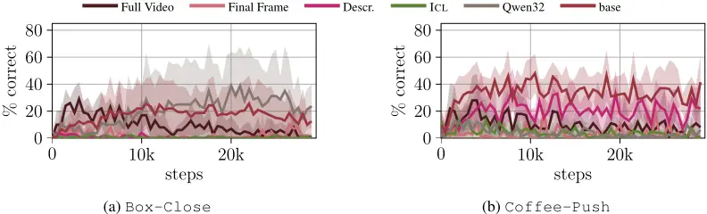

## C.4 RoboReward ablations

Rewards from RoboReward (Lee et al., 2026) do not lead to meaningful policies in our experiments with IBRL. This is surprising, as successful downstream policy learning was reported by the authors. Since our only modification to their approach was reward normalization, we experimentally analyze the effect of this design choice. In addition, as IBRL was originally designed for binary rewards, we consider a second ablation in which we binarize RoboReward outputs by treating near completion (4) and perfect completion (5) as success (ˆ rt = 1), and all other outputs as failure (ˆ rt = 0).

Figure 10 shows the resulting success rates when training IBRL policies on two representative MetaWorld tasks, Coffee-Push and Box-Close, using these reward variants. None of the ablations achieve consistent task success. We therefore conclude that reward normalization is unlikely to be the primary cause of the observed performance degradation. Instead, the issue may stem from deeper factors, such as limited transfer between RoboReward's training data of real-world robotics episodes and our simulation setup.

Figure 10: Ablations of RoboReward when used for downstream policy learning with IBRL in MetaWorld. We compare unnormalized discrete rewards (1-5), to normalized rewards and to binary rewards. Shaded area shows standard deviation (5 seeds).

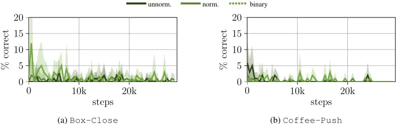
