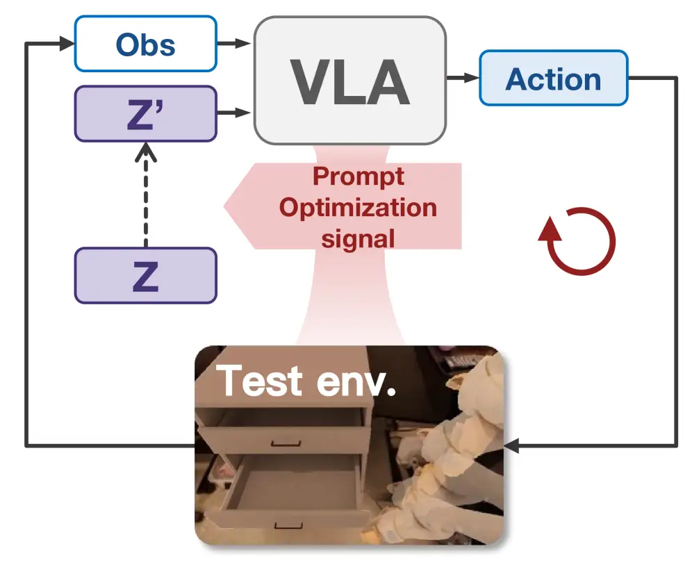
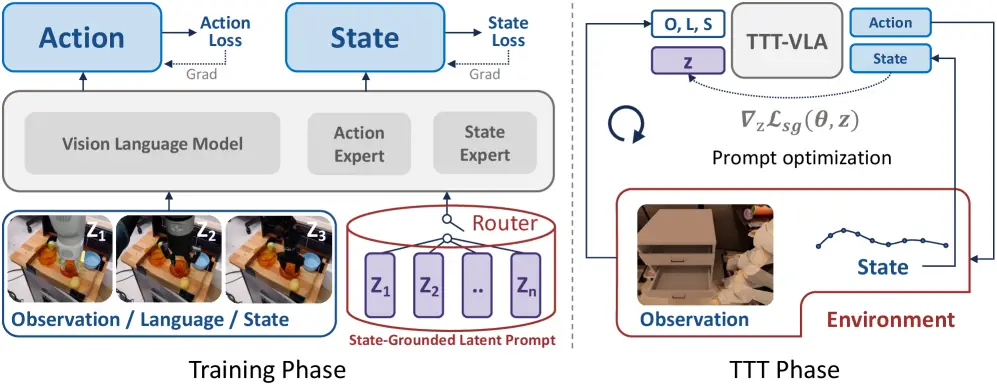
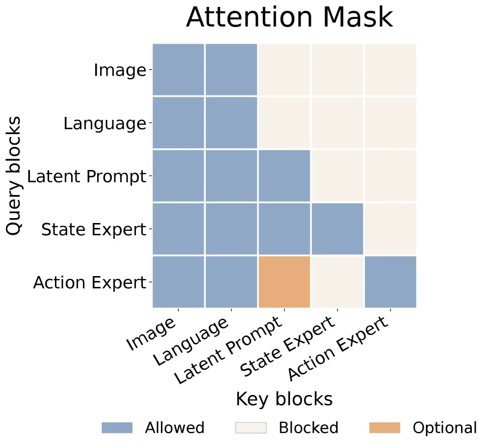
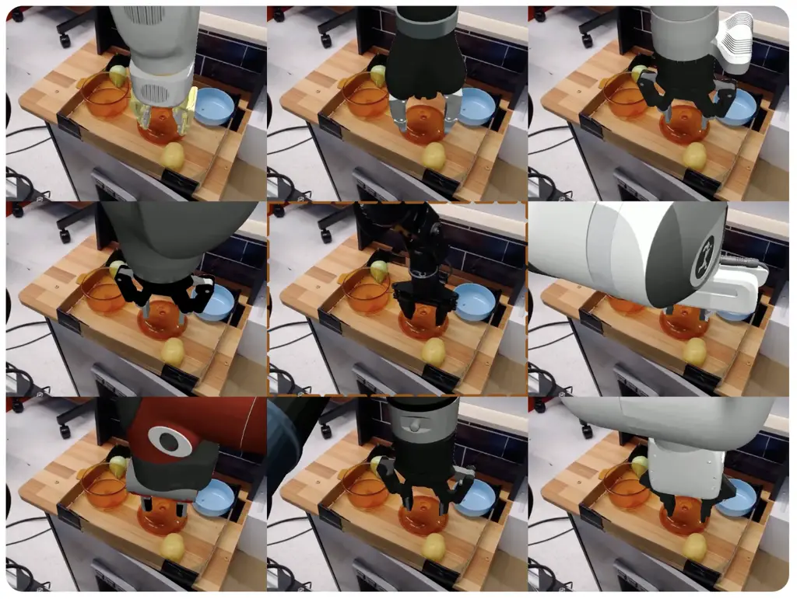
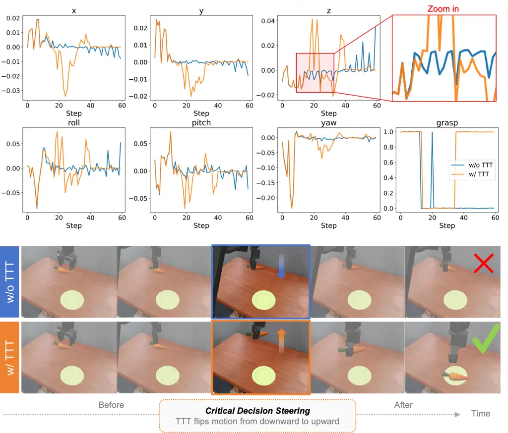
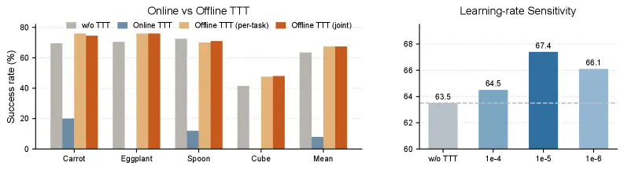
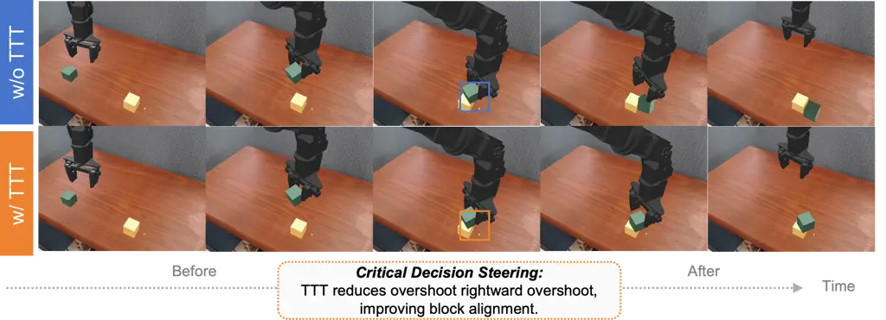
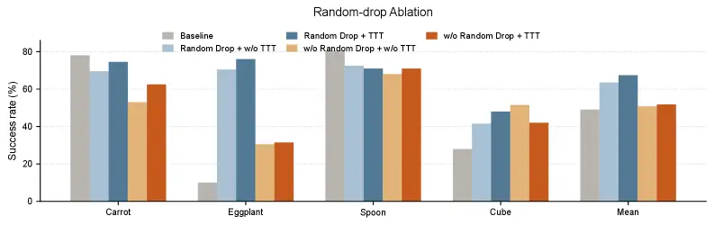

1\]ByteDance Seed 2\]The University of Adelaide 3\]Tsinghua University
4\]Zhejiang University 5\]The University of Hong Kong 6\]CSIRO Data61
\contribution\[\*\]Work done at ByteDance Seed
\contribution\[†\]Corresponding authors \correspondence,

# TTT-VLA: Test-Time Latent Prompt Optimization for Vision-Language-Action Models

Wenbo Zhang    Jianxiong Li    Shuai Yang    Sijin Chen    Jiajun Liu   
Lingqiao Liu    Xiao Ma \[ \[ \[ \[ \[ \[
[xiao.ma@bytedance.com](2606.03127v1/mailto:xiao.ma@bytedance.com)
[lingqiao.liu@adelaide.edu.au](2606.03127v1/mailto:lingqiao.liu@adelaide.edu.au)

(June 1, 2026)

###### Abstract

Vision-Language-Action (VLA) models trained on large-scale data have
made remarkable progress, but they remain vulnerable to distribution
shifts at deployment time. Recent VLA models suggest that prompts can
serve as an efficient interface for steering policy behavior, but
existing prompt-based steering typically relies on external guidance.
This raises a natural question: can test-time training (TTT) for VLA be
achieved by optimizing a prompt, so that the steering interface itself
can be learned and adapted from interaction? We address this question
with TTT-VLA, a test-time training framework based on Latent Prompt
Optimization (LPO). During training, the latent prompt is learned with
an additional proxy task, providing an extra learned conditioning signal
for policy learning. At test time, TTT is performed by collecting
interaction data from the current environment and optimizing only the
latent prompt on those data using the proxy task’s self-supervised
signal, without modifying the policy itself. Experiments on SimplerEnv
demonstrate that the proposed method consistently improves task success
rates in both single- and multi-embodiment settings. Further analysis
shows that the gains arise primarily from correcting a small number of
critical decisions rather than globally altering policy behavior. These
results suggest that LPO provides an effective and practical pathway for
deployment-time improvement of foundation manipulation policies.

## 1 Introduction

Vision-Language-Action (VLA) models are a promising framework for
general-purpose robot control because they unify visual perception,
language conditioning, and action generation within a single policy. The
pursuit of better generalization in VLA has motivated a range of
technical directions, including large-scale pretraining \[black2024pi_0,
brohan2022rt, brohan2023rt, kim24openvla, padalkar2023open\], latent
action models \[univla_2025, lapa_2025\], and world-model-based methods
\[cosmos_policy_2026, dreamzero_2026\]. Another practical route toward
this goal is to improve the policy at deployment time, especially when
the model must act under shifts in visual conditions, environment, or
embodiment. However, the dominant approach to deployment-time
improvement is still reinforcement learning (RL), which can improve a
policy from interaction but is often costly and reward-dependent
\[pi06_2025, grrl_2025\].

At the same time, recent work suggests that prompt-based steering is
becoming an important interface for deployment-time improvement in VLA
\[zheng2024tracevla, molmoact*2025, zhao2025cotvla, pi07_2026\]. In
particular, with human assistance such as factorized instructions, an
off-the-shelf policy can achieve better performance. While useful, this
paradigm cannot learn from deployment experience. On the other hand, as
highlighted by $`\pi*{0.7}`$, task success and proficiency can also
depend on finer-grained context that is difficult to express with text
alone, such as episode quality, execution speed, or visual cues
\[pi07_2026\]. These factors reflect control-relevant temporal and
spatial context, suggesting that there is still substantial room to
improve how such context is represented for VLA control.



Figure 1: Overview of TTT-VLA with Latent Prompt Optimization.

|                        |                                                             |                         |                                                                               |
| ---------------------- | ----------------------------------------------------------- | ----------------------- | ----------------------------------------------------------------------------- |
|                        | Human-Assisted Steering                                     | RL Post-Training        | Test-Time Training                                                            |
| Intervention interface | Prompts, e.g., task-factorized instruction, metadata, trace | Typically policy itself | Typically parts of the parameters. In this paper, we only use latent prompts. |
| Improvement signal     | Human guidance / external signal                            | Reward                  | Self-supervised loss                                                          |
| Policy backbone status | Frozen                                                      | Generally updated       | Frozen                                                                        |

Table 1: Comparison of deployment-time improvement strategies for VLA.
These strategies differ in how they intervene on the policy at
deployment time, what gets updated, and what signal drives improvement.
TTT-VLA belongs to the self-supervised test-time training regime: it
optimizes only a latent prompt while keeping the policy backbone frozen.
More comparisons refer to 5.

Motivated by this observation, we explore a new direction for
deployment-time improvement: learning a latent prompt $`z`$ during
training to condition a policy, and then improving the policy at test
time by adapting only $`z`$. We address this problem with TTT-VLA, a
framework based on _Latent Prompt Optimization_. As shown in Fig. 1, the
core idea is to obtain an improvement signal from interaction with the
test environment and use it to optimize the latent prompt. Because the
VLA is trained to condition on this prompt, test-time knowledge can be
absorbed through a lightweight interface without modifying the policy
backbone. In our current implementation, the improvement signal comes
from a proxy task called _state grounding_, which uses observation-state
supervision to shape the latent prompt. This proxy task encourages the
latent prompt to capture spatially relevant information \[rosa_2025\],
and we further design training strategies to strengthen this effect. The
resulting latent prompt serves two roles: during training, it provides
an additional learned conditioning signal for policy learning; at test
time, interaction data from the current environment are collected and
used to update only the latent prompt of a frozen policy.

We evaluate this idea in SimplerEnv \[simpler_2025\] under both
single-embodiment and multi-embodiment settings. Our evaluation follows
the official protocol, in which the policy is trained on real robot data
and tested in simulation, naturally introducing a deployment-time domain
gap. In the single-embodiment setting, we evaluate on WidowX and Google
Robot tasks. In the multi-embodiment setting, we train on BridgeData V2
\[walke2023bridgedata\] of OXE-Aug \[oxe_auge_2025\] with nine
embodiments and then evaluate on WidowX. Across these settings, we
achieve consistent improvements with TTT-VLA while keeping the main
policy frozen. The analysis further suggests that much of the gain comes
from what we call _critical decision steering_, where test-time training
corrects a small number of key actions rather than globally rewriting
the full trajectory. Our contributions are summarized as follows:

- •
  TTT-VLA, a deployment-time improvement framework for VLA based on
  Latent Prompt Optimization, which learns a latent prompt during
  training and performs prompt-only test-time training on a frozen
  policy at deployment time.
- •
  Consistent deployment-time improvements in both single-embodiment and
  multi-embodiment settings, showing that a latent prompt can serve as
  an effective interface for learning from interaction.
- •
  An investigation of effective training and update strategies for the
  latent prompt, revealing that the gains mainly arise from a phenomenon
  we term critical decision steering.

## 2 Related Work

### 2.1 Deployment-Time Improvement for Manipulation Policies

Deployment-time improvement for manipulation policies has been studied
through RL post-training, human-assisted prompt steering, and, more
recently, test-time training. One established line of work improves VLA
policies through reinforcement learning from deployment experience.
Representative examples include $`\pi^{*}_{0.6}`$, which studies
RL-based self-improvement from heterogeneous experience and human
corrections, and GR-RL, which turns a generalist VLA into a dexterous
specialist through multi-stage reinforcement learning \[pi06_2025,
grrl_2025\].

Another line of work uses the VLA conditioning interface itself as a
channel for human assistance at deployment time. Yell At Your Robot uses
real-time language corrections during execution, while MolmoAct and
TraceVLA expose editable traces as structured steering signals for
spatial-temporal guidance \[yellrobot*2024, molmoact_2025,
zheng2024tracevla\]. $`\pi*{0.7}`$ broadens this interface further with
metadata, language guidance, and image-goal context, showing that human-
or externally-specified context can improve trajectory quality and
generalization to unseen tasks \[pi07_2026\].

Early work on test-time training for manipulation policies includes PAD
\[pad_2020\], which showed on small-scale policies that self-supervised
signals can help manipulation policies adapt to environmental changes.
However, PAD was not studied in the foundation-model regime. As a
result, neither its design nor its conclusions transfer directly to
modern VLA models. More recently, test-time training has begun to emerge
in the VLA literature. A contemporaneous work is WorldAgen
\[worldagen_2026\], which jointly learns action prediction and world
modeling, and then adapts its world-model branch from newly collected
transitions at deployment time. However, its test-time training scheme
is built around a tailored architecture that is introduced together with
the method, rather than around a strong state-of-the-art VLA model. By
contrast, we study prompts as a lightweight adaptation interface for
pretrained VLA models, so that test-time training is performed on top of
a strong foundation policy with already competitive performance.

### 2.2 Prompt-Conditioned VLA

Recent VLA models are increasingly organized around prompt-conditioned
interfaces that extend beyond language alone. Early systems such as
RT-2, OpenVLA, and Octo established language-conditioned robot control,
and Octo further showed that subgoal images can serve as an additional
task-specification channel \[brohan2023rt,
kimOpenVLAOpenSourceVisionLanguageAction2024, octo*2023,
yang2025instructvla\]. Recent work further broadens prompt by using
structured trajectory or trace inputs as prompts, as in MolmoAct and
TraceVLA \[molmoact_2025, zheng2024tracevla\]. The $`\pi`$ series
further expands this line: $`\pi*{0}`$ improves the breadth and
dexterity of language-conditioned control, $`\pi*{0.5}`$ augments the
prompt with hierarchical sub-task instructions, and $`\pi*{0.7}`$
further broadens the conditioning space with metadata and image-goal
context derived from a world model \[black2024pi_0, pi05_2025,
pi07_2026\]. Together, these works show that richer prompt interfaces
are central to modern VLA performance. Our method is complementary to
this line: rather than adding another human-specified prompt channel, we
learn a latent prompt that captures control-relevant context for a VLA
policy and can be updated with test-time training.

## 3 Method: Latent Prompt Optimization

In general, a VLA policy can be written as a conditional policy that
takes the current observation $`o`$ together with a conditioning context
$`c`$ and predicts an action chunk $`a`$ through

```math
a\sim\pi_{\theta}(a\mid o,c), \tag{1}
```

where $`c`$ is a unified conditioning variable. It may include explicit
conditions with readable semantics, such as language, state, image, or
other structured context, as well as an implicit condition in the form
of a learnable latent prompt $`z`$. In our current implementation,
$`z\in\mathbb{R}^{n\times d}`$ is instantiated as a learnable block of
$`n`$ prompt tokens, where $`d`$ is the hidden dimension of the policy
backbone and $`n`$ is a hyperparameter controlling the prompt length.
Following flow-based VLA formulations, we model action generation as
conditional flow matching over an action chunk. Let $`a_{0}\sim p_{0}`$
denote a noise sample in action space and let $`a_{1}=a`$ denote the
target action chunk. For an interpolation time
$`t\sim\mathcal{U}(0,1)`$, we define the noised action trajectory as
$`a_{t}=(1-t)a_{1}+ta_{0}`$ and the corresponding target vector field as
$`u_{t}=a_{0}-a_{1}`$. The policy predicts the vector field conditioned
on the current inputs and the full conditioning context:

```math
\mathcal{L}_{\mathrm{act}}(\theta,z)=\mathbb{E}_{(o,c,a),\,a_{0},\,t}\left[\left\|v_{\theta}(a_{t},t;o,c)-u_{t}\right\|_{2}^{2}\right]. \tag{2}
```

This objective defines the base policy learning problem in our
framework. Latent Prompt Optimization does not replace the action
objective. Instead, it adds a learned conditioning variable that can be
optimized during training and later adapted at deployment time. The
following subsection introduces how this latent prompt is updated at
deployment time through an abstract proxy objective, and the later
implementation subsection specifies the concrete proxy used in our
current system.



Figure 2: Overview of TTT-VLA. The policy is conditioned on the current
observation, the explicit prompt, and a latent prompt. During training,
the latent prompt is optimized jointly with the policy and with the
state grounding proxy task. During deployment, test-time training
updates only the latent prompt from interaction with the environment
without modifying the policy itself.

### 3.1 Test-Time Training via Latent Prompt Optimization

Inspired by prior test-time training and deployment-time self-supervised
adaptation works \[ttt_2020, ttt_mae_2022, pad_2020\], we introduce a
proxy task to enable test-time training for latent prompt optimization.
Since the action objective is not directly available for prompt-only
adaptation at deployment time, this proxy task provides the auxiliary
learning objective needed to carry out the test-time training procedure.
At the same time, it couples the latent prompt to control-relevant
context during training so that the same objective can later be reused
for deployment-time adaptation. During training, we optimize the policy
with both the action objective and the proxy objective so that the
latent prompt is useful for action prediction while remaining adaptable
through the same proxy signal:

```math
\mathcal{L}_{\mathrm{train}}(\theta,z)=\mathcal{L}_{\mathrm{act}}(\theta,z)+\mathcal{L}_{\mathrm{proxy}}(\theta,z). \tag{3}
```

At test time, our primary procedure is prompt-only adaptation from a
current-environment interaction buffer. We first collect interaction
data from the current environment, organize the resulting samples into a
buffer, and then update only the latent prompt while keeping the policy
backbone frozen. The resulting test-time training rule can be written as

```math
z\leftarrow z-\eta\nabla_{z}\mathcal{L}_{\mathrm{proxy}}, \tag{4}
```

using interaction data from the current environment. Here,
$`\mathcal{L}_{\mathrm{proxy}}`$ denotes the same proxy objective
introduced in training, and its concrete instantiation is given later as
the state grounding task in Sec. 3.2. This preserves a clean division of
labor: the action expert remains responsible for action generation,
while the latent prompt is the only variable adapted during deployment.
We also explore online prompt updates as an ablation, but in our current
experiments this mode is unstable and the prompt representation tends to
collapse, so the main method uses the offline buffer formulation above.

### 3.2 Architecture and Training Strategy

#### Network Structure.

As illustrated in Fig. 2, our current implementation instantiates
TTT-VLA with a Mixture-of-Transformers (MoT) architecture
\[black2024pi_0\] composed of two flow-matching experts: an action
expert that predicts the flow field in action space, and a
state-grounding expert that predicts the flow target in state space for
robot state grounding. We consider a hard router for latent prompt
selection. If the training data contains multiple embodiments, multiple
latent prompts are randomly initialized. In the single-embodiment
setting, this design naturally degenerates to a single latent prompt.



Figure 3: Attention mask used in the MoT network.

The detailed attention mask is shown in Fig. 3. Whether the latent
prompt can be attended to by the action expert depends on specific
training strategies, which are described later. During training,
parameters are initialized from the pretrained $`\pi_{0.5}`$ checkpoint.
Note that there is a slight difference in the state input: it is moved
from language-form conditioning into the action expert, following the
implementation of $`\pi_{0}`$. This change is mainly introduced to avoid
conflict with our proxy task. Our main comparisons focus on two
variants.

#### State Grounding as the Proxy Task.

In our current implementation, Latent Prompt Optimization is
instantiated with a proxy task called _state grounding_, in which a
dedicated expert predicts the robot end-effector position and gripper
state from the current observation, the explicit prompt, and the latent
prompt. Let $`s_{1}=s`$ denote the target robot state, which consists of
the end-effector position and gripper state, and let
$`s_{0}\sim p_{0}^{s}`$ denote a noise sample in state space. For an
interpolation time $`t\sim\mathcal{U}(0,1)`$, we define the noised state
trajectory as $`s_{t}=(1-t)s_{1}+ts_{0}`$ and the corresponding target
vector field as $`u_{t}^{s}=s_{0}-s_{1}`$. The state-grounding expert
predicts this vector field conditioned on the current inputs and the
full conditioning context:

```math
\mathcal{L}_{\mathrm{proxy}}(\theta,z)=\mathcal{L}_{\mathrm{sg}}(\theta,z)=\mathbb{E}_{(o,c,s),\,s_{0},\,t}\left[\left\|v_{\theta}^{s}(s_{t},t;o,c)-u_{t}^{s}\right\|_{2}^{2}\right]. \tag{5}
```

We use this task as the proxy objective for two reasons. First, these
state targets are available at both training and deployment time without
extra annotation cost, making them a practical self-supervised signal.
Second, accurate state prediction requires spatial understanding of the
scene together with embodiment-specific understanding of the robot, and
therefore provides rich control-relevant cues \[rosa_2025,
worldagen_2026\]. The remaining question is how to ensure that these
cues are more effectively absorbed into the latent prompt rather than
other parameters, which motivates the training strategy below.

#### Training Strategy for Single- and Multi-Embodiment Settings.

In the multi-embodiment setting, embodiment provides a natural partition
of heterogeneous robot data into distinct control-relevant contexts. We
therefore associate different state-grounded latent prompts with
different embodiments and jointly optimize them with both the action
objective and the state grounding objective. This design encourages
cross-embodiment control differences to be absorbed into the latent
prompt, rather than being entirely entangled in shared model parameters.

The single-embodiment setting is more data-limited, so this natural
partition becomes much weaker and prompt learning must be enforced more
explicitly. To address this issue, we use a two-stage training strategy.
As indicated by Fig. 3, the connection from the latent prompt to the
action expert is optional: in the first stage, it is blocked with
probability $`1`$, and in the second stage, it is blocked with
probability $`0.5`$. The ablation of this random-drop design is provided
in Appendix Figure 8. Without random drop, simply adding a latent prompt
can already degrade the base policy performance, suggesting that
stronger decoupling is important in the single-embodiment regime.
Related prompt-drop or conditioning-drop strategies have also been used
in prior work \[pi07\]. In addition, we constrain the gradient flow of
the state-grounding objective to the state expert and the latent prompt,
while the gradient flow of the action objective is restricted to the VLM
backbone and the action expert. Together, these constraints encourage
the latent prompt to absorb control-relevant context from the proxy task
before it is more strongly coupled to action prediction.

|                                             |        |          |       |       |         |
| ------------------------------------------- | ------ | -------- | ----- | ----- | ------- |
| WidowX Benchmark                            | Carrot | Eggplant | Spoon | Cube  | Overall |
| RT-1-X \[brohanRT1RoboticsTransformer2023\] | 4.2%   | 0%       | 0%    | 0%    | 1.1%    |
| OpenVLA \[kim24openvla\]                    | 0%     | 4.1%     | 0%    | 0%    | 1.0%    |
| SpatialVLA \[qu2025spatialvla\]             | 20.8%  | 70.8%    | 20.8% | 25.0% | 34.4%   |
| Magma \[yang2025magma\]                     | 29.2%  | 91.7%    | 37.5% | 20.8% | 44.8%   |
| Octo-Base \[octo_2023\]                     | 8.3%   | 43.1%    | 12.5% | 0%    | 16.0%   |
| Octo-Small \[octo_2023\]                    | 9.7%   | 56.9%    | 47.2% | 4.2%  | 29.5%   |
| RoboVLM \[li2024robovlm\]                   | 20.8%  | 79.2%    | 45.8% | 4.2%  | 37.5%   |
| InstructVLA \[yang2025instructvla\]         | 40.3%  | 94.4%    | 43.1% | 9.7%  | 46.9%   |
| $`\pi_{0}`$ \[black2024pi_0\]               | 36.1%  | 81.9%    | 45.8% | 26.4% | 47.6%   |
| CogACT \[li2024cogact\]                     | 37.5%  | 91.7%    | 58.3% | 20.8% | 52.1%   |
| ThinkAct \[huang2025thinkact\]              | 37.5%  | 70.8%    | 58.3% | 8.7%  | 43.8%   |
| $`\pi_{0.5}`$                               | 79.2%  | 75.0%    | 33.3% | 16.7% | 51.1%   |
| $`\pi_{0.5}`$ + SG-LP                       | 69.5%  | 70.5%    | 72.5% | 41.5% | 63.5%   |
| $`\pi_{0.5}`$ + SG-LP + TTT                 | 74.5%  | 76.0%    | 71.0% | 48.0% | 67.4%   |

Table 2: Performance comparison with state-of-the-art policies on the
SimplerEnv WidowX benchmark. For the last three rows, all are
initialized from the pretrained $`\pi_{0.5}`$ checkpoint. Here,
‘$`\pi_{0.5}`$’ denotes our internal baseline, ‘$`\pi_{0.5}`$ + SG-LP’
adds state grounding with latent prompt training, and ‘$`\pi_{0.5}`$ +
SG-LP + TTT’ further applies test-time training to the learned latent
prompt.

| Visual Matching                                   |               |           |                   |       |
| ------------------------------------------------- | ------------- | --------- | ----------------- | ----- |
| Model                                             | Pick Coke Can | Move Near | Open/Close Drawer | Avg   |
| HPT \[wang2024hpt\]                               | 56.0%         | 60.0%     | 24.0%             | 46.0% |
| TraceVLA \[zheng2024tracevla\]                    | 28.0%         | 53.7%     | 57.0%             | 42.0% |
| RT-1-X \[brohan2022rt\]                           | 56.7%         | 31.7%     | 59.7%             | 53.4% |
| Octo-Base \[octo_2023\]                           | 17.0%         | 4.2%      | 22.7%             | 16.8% |
| OpenVLA \[kim24openvla\]                          | 16.3%         | 46.2%     | 35.6%             | 27.7% |
| RoboVLM \[li2024robovlm\] (zero-shot)             | 72.7%         | 66.3%     | 26.8%             | 56.3% |
| RoboVLM \[li2024robovlm\] (fine-tuned)            | 77.3%         | 61.7%     | 43.5%             | 63.4% |
| Emma-X \[li2024emmax\]                            | 2.3%          | 3.3%      | 18.3%             | 8.0%  |
| $`\pi_{0}`$ \[black2024pi_0\] (fine-tuned)        | 72.7%         | 65.3%     | 38.3%             | 58.7% |
| $`\pi_{0}`$-Fast \[pertsch2025fast\] (fine-tuned) | 75.3%         | 67.5%     | 42.9%             | 61.9% |
| GR00T \[gr00t_n1_2025\] (fine-tuned)              | 69.3%         | 68.7%     | 35.8%             | 52.4% |
| $`\pi_{0.5}`$                                     | 84.0%         | 59.2%     | 59.3%             | 67.5% |
| $`\pi_{0.5}`$ + SG-LP                             | 85.0%         | 66.2%     | 55.6%             | 68.9% |
| $`\pi_{0.5}`$ + SG-LP + TTT                       | 85.0%         | 71.7%     | 60.6%             | 72.4% |

| Variant Aggregation                               |               |           |                   |       |
| ------------------------------------------------- | ------------- | --------- | ----------------- | ----- |
| Model                                             | Pick Coke Can | Move Near | Open/Close Drawer | Avg   |
| TraceVLA \[zheng2024tracevla\]                    | 60.0%         | 56.4%     | 31.0%             | 45.0% |
| RT-1-X \[brohan2022rt\]                           | 49.0%         | 32.3%     | 29.4%             | 39.6% |
| Octo-Base \[octo_2023\]                           | 0.6%          | 3.1%      | 1.1%              | 1.1%  |
| OpenVLA \[kim24openvla\]                          | 54.5%         | 47.7%     | 17.7%             | 39.8% |
| RoboVLM \[li2024robovlm\] (zero-shot)             | 68.3%         | 56.0%     | 8.5%              | 46.3% |
| RoboVLM \[li2024robovlm\] (fine-tuned)            | 75.6%         | 60.0%     | 10.6%             | 51.3% |
| Emma-X \[li2024emmax\]                            | 5.3%          | 7.3%      | 20.5%             | 11.0% |
| $`\pi_{0}`$ \[black2024pi_0\] (fine-tuned)        | 75.2%         | 63.7%     | 25.6%             | 54.8% |
| $`\pi_{0}`$-Fast \[pertsch2025fast\] (fine-tuned) | 77.6%         | 68.2%     | 31.3%             | 59.0% |
| GR00T \[gr00t_n1_2025\] (fine-tuned)              | 46.7%         | 62.9%     | 17.5%             | 43.7% |
| $`\pi_{0.5}`$                                     | 82.0%         | 47.7%     | 44.7%             | 58.1% |
| $`\pi_{0.5}`$ + SG-LP                             | 81.7%         | 51.2%     | 42.9%             | 58.6% |
| $`\pi_{0.5}`$ + SG-LP + TTT                       | 79.3%         | 55.2%     | 45.8%             | 60.1% |

Table 3: Performance comparison on SimplerEnv Google Robot tasks.
Results are reported for the visual-matching and variant-aggregation
protocols.

## 4 Experiments

Benchmark. We use SimplerEnv\[simpler_2025\] as the evaluation benchmark
throughout this section. Within this benchmark, we study both
single-embodiment and multi-embodiment settings: the former covers
fixed-embodiment WidowX and Google Robot tasks, while the latter studies
training on OXE-Aug, an augmented Open X-Embodiment (OXE) training set,
and evaluation on WidowX. For readability, the WidowX tasks are
abbreviated as Spoon, Carrot, Cube, and Eggplant in Tables 2, 4, 7, and
Figure 6, corresponding to _Put Spoon on Towel_, _Put Carrot on Plate_,
_Stack Blocks_, and _Put Eggplant in Basket_, respectively.

Baseline. For comparison, we report public state-of-the-art results from
a range of prior methods on SimplerEnv. As a strict control for our
method, we include a baseline without the state expert or the latent
prompt, which is a version directly fine-tuned from the original
$`\pi_{0.5}`$. The second notation is ‘$`\pi_{0.5}`$ + SG-LP’ (state
grounded latent prompt), which extends the baseline with SG-LP training.
The third is ‘$`\pi_{0.5}`$ + SG-LP + test-time training (TTT)’, which
further applies test-time training to the learned latent prompt. This
latter variant is our full method, TTT-VLA.

Training. All models are initialized from the pretrained $`\pi_{0.5}`$
checkpoint. We move the state input from language-form conditioning into
the action expert, following the implementation of $`\pi_{0}`$, to avoid
conflict with the proxy task. In the single-embodiment setting, models
are trained for 20,000 steps; in the multi-embodiment setting, they are
trained for 40,000 steps. We use AdamW with a learning rate of
$`1\times 10^{-4}`$ and a batch size of 1024. All training runs are
conducted on 32 NVIDIA H100 GPUs, with a wall-clock time of
approximately 20 hours per run.

Test-Time Training. At test time, we update only the latent prompt,
initializing it from the pretrained prompt learned during training. We
use a learning rate of $`1\times 10^{-5}`$ and a batch size of 128.
Unless otherwise stated, we run 500 optimization steps for WidowX and
1000 optimization steps for Google Robot tasks. We do not select the
best checkpoint based on evaluation performance; instead, we fix the
optimization horizon in advance for each benchmark so that the procedure
remains uniform within each setting and stops well after the proxy loss
has largely plateaued. Test-time training is conducted on 8 NVIDIA H100
GPUs and typically requires 15–30 minutes of wall-clock time. More
details are provided in Appendix 6.



Figure 4: OXE-Aug Bridge V2 examples across the nine training
embodiments.

Evaluation protocol. Evaluation in SimplerEnv is stochastic because (1)
actions are generated through flow-matching sampling, and (2) the WidowX
benchmark has only 24 configurations across four tasks with different
object positions and orientations. A single sweep is therefore too noisy
for reliable comparison. Following GR00T \[gr00t_n1_2025\], we therefore
evaluate each WidowX task for 200 episodes by cycling through the 24
configurations while allowing sampling noise to produce different
actions across trials. Across model variants, we fix only the initial
seed rather than the full downstream random stream, so the sampled noise
and resulting actions still differ. This reduces evaluation variance and
supports more reliable comparison. For Google Robot visual matching and
variant aggregation, we use the official default evaluation counts.
After optimizing the evaluation pipeline, the wall-clock time of one
full evaluation is approximately 40 minutes for Bridge, 50 minutes for
Fractal visual matching, and 3 hours for Fractal variant aggregation.

| Method                      | Carrot | Eggplant | Spoon | Cube | Mean  |
| --------------------------- | ------ | -------- | ----- | ---- | ----- |
| $`\pi_{0.5}`$               | 28.0%  | 17.5%    | 43.0% | 2.5% | 22.8% |
| $`\pi_{0.5}`$ + SG-LP       | 41.0%  | 29.5%    | 43.0% | 0.5% | 28.5% |
| $`\pi_{0.5}`$ + SG-LP + TTT | 43.0%  | 34.0%    | 48.5% | 1.0% | 31.6% |

Table 4: Multi-embodiment evaluation on SimplerEnv WidowX tasks. The
policy is trained on OXE-Aug Bridge V2 with nine embodiments in total
and evaluated on four Bridge V2 WidowX tasks.

### 4.1 Single-Embodiment Setting

We first study the single-embodiment setting, where the main question is
whether a learned latent prompt is useful even when the embodiment
identity itself is fixed. Table 2 shows the results on the SimplerEnv
WidowX benchmark. Adding Latent Prompt Optimization to $`\pi_{0.5}`$
improves the mean success rate from 51.1% to 63.5%, and test-time
training further improves it to 67.4%. We observe the same trend on
Google Robot tasks in Table 3. On the visual-matching split, the mean
success rate improves from 67.5% for $`\pi_{0.5}`$ to 68.9% with Latent
Prompt Optimization, and then to 72.4% after test-time training. On the
variant-aggregation split, the same sequence improves from 58.1% to
58.6% and then to 60.1%.

### 4.2 Multi-Embodiment Setting

We next study the multi-embodiment setting. Here, the training data come
from OXE-Aug Bridge V2, which contains nine embodiments in total: the
original WidowX together with eight additional embodiments, namely
Panda, UR5e, Xarm7, Google Robot, Sawyer, Kinova3, IIWA, and Jaco, as
shown in Fig. 4. During evaluation, the router selects the corresponding
prompt for WidowX before inference. Results are shown in Table 4.
Compared with the $`\pi_{0.5}`$ baseline, Latent Prompt Optimization
improves the mean success rate from 22.8% to 28.5%, and test-time
training further improves it to 31.6%. The improvements are concentrated
on Carrot and Eggplant, while Cube remains difficult for all variants.
Empirically, we find that Cube is especially hard because it requires
more precise grasping and alignment during placement than the other
tasks, and this challenge becomes more severe when training on
heterogeneous multi-embodiment data.



Figure 5: Qualitative visualization of the test-time training effect.
The top row compares action trajectories with and without TTT, and the
bottom row shows a representative manipulation sequence in which TTT
steers a critical decision from a downward motion to an upward
corrective motion, leading to task success.

### 4.3 Ablation and Analysis

Online vs Offline TTT Here, Online TTT refers to continuously updating
the latent prompt as interaction samples arrive, using a batch size 1
and learning rate $`1\times 10^{-7}`$. This setting is conceptually
introduced in \[wang2021tent, wang2022cotta\], where the goal is to
adapt to the local streaming data distribution. Offline TTT, by
contrast, stores interaction samples in a buffer and performs batched
optimization afterward. Within offline TTT, we further distinguish
between per-task optimization and joint optimization over all tasks. As
shown in Figure 6, we find that fully online prompt updates are
sensitive, leading to a large performance decrease. Therefore, we use
offline TTT as the primary setting and treat online TTT as an analysis
of stability rather than the main deployment protocol. Meanwhile, the
difference between per-task and joint offline optimization is
negligible. These results suggest that batch size, rather than task
grouping, is the key factor and may be important for maintaining
meaningful latent representations during test-time training. Stabilizing
truly on-the-fly prompt updates remains an important future direction.

Learning-rate Sensitivity We also study learning-rate sensitivity for
offline joint test-time training, since this basic hyperparameter has a
large influence on performance. A moderate learning rate of $`10^{-5}`$
performs best, outperforming both a larger update scale of $`10^{-4}`$
and a smaller update scale of $`10^{-6}`$. This result suggests that
prompt-only adaptation is not arbitrarily fragile, but it still benefits
from using an update scale that is large enough to correct
deployment-specific mismatch without destabilizing the learned prompt.

Where the Gain Comes From. To obtain a valid comparison, we rerun
experiments with the seed fully fixed¹¹1This is not feasible for
standard evaluation because flow matching needs random sampling. This
allows us to closely examine the cases in which test-time training
improves behavior. We find that most of these improvements follow a
common pattern, which we term ‘critical decision steering’. Figure 5
illustrates one representative example. Before the gripper grasps the
carrot, the action outputs with and without TTT are nearly identical
across all dimensions. The divergence appears immediately after
grasping: the model without TTT keeps moving downward, as if it fails to
recognize that the carrot has already been secured and that the arm is
blocked by the table, whereas the model with TTT instead lifts the arm
appropriately. From this decision point onward, the two rollouts
separate and no longer overlap. We observe similar behavior across
tasks. Many manipulation tasks consist of several stages, and
transitions between stages often correspond to critical decision points.
One common example is deciding whether grasping has succeeded. In the
cube task, a different critical point appears during placement: after
grasping the cube, the policy must decide whether the object is
sufficiently aligned before release. Appendix Figure 7 shows an
additional example in which test-time training improves this placement
decision by reducing overshoot and producing better block alignment.



Figure 6: Analysis of test-time training configurations in the
single-embodiment setting. Left: task-wise comparison of online and
offline TTT strategies, including offline per-task and offline joint
variants. Right: learning-rate sensitivity for offline joint TTT, where
a moderate learning rate of $`10^{-5}`$ gives the best mean success
rate.

## 5 Conclusion

We studied whether deployment-time improvement for
Vision-Language-Action models can be achieved by updating a learned
latent prompt. To this end, we introduced TTT-VLA, a framework based on
Latent Prompt Optimization that learns a latent prompt during training
and performs prompt-only test-time training on a frozen policy at
deployment time. Experiments in SimplerEnv show that this design
improves performance in both single-embodiment and multi-embodiment
settings, including consistent gains from test-time training on WidowX
and Google Robot tasks.

The empirical analysis further indicates that the benefit of test-time
training often comes from correcting behavior at a small number of
critical decision points, rather than globally changing the full action
trajectory. A current limitation is that, under the present proxy task,
these improvements mostly take the form of local corrections to
erroneous actions near such critical points, rather than more complex
corrective behaviors over longer horizons. This may limit the ceiling of
improvement that prompt-only test-time training can achieve. An
important next step is to develop more effective prompt optimization
procedures and to study how this interface scales with stronger VLA
backbones. Additional limitations and open questions are discussed in
Appendix 5.1.

## References

\beginappendix

|                              |                                                                                                 |                                                                        |                                                                                                                  |
| ---------------------------- | ----------------------------------------------------------------------------------------------- | ---------------------------------------------------------------------- | ---------------------------------------------------------------------------------------------------------------- |
|                              | Human-Assisted Steering                                                                         | RL Post-Training                                                       | Test-time Training                                                                                               |
| Intervention interface       | Prompts, e.g., task-factorized instruction, metadata, trace                                     | Typically policy itself                                                | Typically parts of the parameters. In this paper, we only use latent prompts.                                    |
| Improvement signal           | Human guidance / external signal                                                                | Reward                                                                 | Self-supervised loss                                                                                             |
| Policy backbone status       | Frozen                                                                                          | Generally updated                                                      | Frozen                                                                                                           |
| Typical strength             | Simple and controllable at deployment time                                                      | Can improve beyond the pretrained policy through continued interaction | Lightweight self-supervised improvement without updating the backbone                                            |
| Typical limitation           | Depends on human or externally specified guidance and is often bounded by the pretrained policy | Usually costly, reward-dependent, and optimization-heavy               | Depends on the quality of the proxy objective, and gains may remain local or bounded by the adaptation interface |
| Expected improvement pattern | Mostly steers behavior within the capability envelope of the pretrained policy                  | Can reshape policy behavior more substantially through optimization    | Often corrects deployment-specific mistakes while preserving most pretrained behavior                            |

Table 5: Extended comparison of deployment-time improvement strategies
for VLA. This appendix version expands the main-table comparison with
additional practical considerations, including typical strengths and
limitations of each strategy family. TTT-VLA belongs to the
self-supervised TTT regime: it optimizes only a latent prompt while
keeping the policy backbone frozen.

| Item                          | Value                                                                                           |
| ----------------------------- | ----------------------------------------------------------------------------------------------- |
| TTT mode                      | Offline by default; online TTT is only used as an ablation                                      |
| Interaction buffer            | 800 / $`\sim`$800 / $`\sim`$2000 for WidowX/GR VM/ GR VA                                        |
| Trajectory source             | Rollouts collected from the pretrained policy                                                   |
| Success / failure composition | Includes both successful and failed rollouts                                                    |
| Optimization target           | State grounding loss only                                                                       |
| Updated parameters            | Latent prompt only                                                                              |
| Frozen parameters             | Vision-language backbone, action expert, and state expert                                       |
| TTT steps                     | 500 for WidowX; 1000 for Google Robot                                                           |
| Batch size                    | 128                                                                                             |
| Learning rate                 | $`1\times 10^{-5}`$                                                                             |
| Wall-clock cost               | Approximately 15/30 minutes for WidowX/GR optimization                                          |
| Checkpoint selection          | Fixed optimization horizon for each benchmark; no best-step selection on evaluation performance |

Table 6: Default test-time training configuration used in our
experiments. Unless otherwise stated, TTT-VLA uses the following setup
for deployment-time prompt optimization.

| Task     | Total | Base Succ. | Post Succ. | $`\Delta`$ | Succ.$`\rightarrow`$Fail. | Fail.$`\rightarrow`$Succ. | Always Succ. | Always Fail. |
| -------- | ----- | ---------- | ---------- | ---------- | ------------------------- | ------------------------- | ------------ | ------------ |
| Carrot   | 200   | 139        | 149        | +10        | 28                        | 38                        | 111          | 23           |
| Eggplant | 200   | 141        | 152        | +11        | 29                        | 40                        | 112          | 19           |
| Spoon    | 200   | 145        | 142        | -3         | 28                        | 25                        | 117          | 30           |
| Cube     | 200   | 83         | 96         | +13        | 29                        | 42                        | 54           | 75           |
| Overall  | 800   | 508        | 539        | +31        | 114                       | 145                       | 394          | 147          |

Table 7: Episode-aligned outcome comparison before and after TTT in the
single-embodiment WidowX setting. We align baseline and post-TTT
rollouts by episode identity and compare binary task outcomes. The
results show that TTT does not simply repair a fixed handful of cases;
instead, it produces a net positive shift across paired rollouts, with
both recovered failures and occasional regressions.

### 5.1 Systematic Limitations

#### No real-world deployment evaluation.

We do not yet evaluate TTT-VLA in fully real-world deployment. This
limitation should be understood in the context of the problem setting:
unlike standard imitation-learning evaluation, real-world test-time
training requires collecting fresh interaction data in the target
environment before adaptation. In this sense, the challenge is closer to
real-world reinforcement-learning deployment, where interaction cost,
system stability, and protocol design become part of the problem itself.
As test-time training for VLA is still at an early stage, many practical
questions remain open, including how to structure data collection, how
to control adaptation risk during deployment, and how to define stable
real-world evaluation procedures. We therefore view rigorous real-world
TTT evaluation as an important but separate challenge beyond the present
simulator-based study.

#### Limited proxy-task comparisons.

In the current study, we instantiate Latent Prompt Optimization only
with the state grounding proxy task. Other proxy tasks may also be
promising, including future-state prediction, future-image prediction,
future representations prediction, or inverse-dynamics prediction. Each
of these alternatives may introduce different optimization challenges.
For example, future-state prediction may require care to avoid confusion
with the main action-prediction objective. Future-image prediction may
be challenges task and need a pretrained world model as a prediction
head. Future representations prediction needs to find a effective
encoder cross DINO, SigLIP, etc. We focused first on establishing a
stable and observable TTT setting for VLA, including basic
hyperparameter choices, custom simulator evaluation rules, and
personalized deployment-time optimization protocols. This stabilization
effort consumed substantial experimental time, so a broader proxy-task
comparison remains future work.

#### No direct comparison to prior TTT methods.

We do not provide a direct experimental comparison to prior TTT methods
for manipulation policies. For VLA specifically, the closest concurrent
work is WorldAgen \[worldagen_2026\], but its code is not publicly
available and it does not report SimplerEnv results, making controlled
comparison difficult. Earlier work such as Self-Supervised Policy
Adaptation during Deployment \[pad_2020\] studies deployment-time
self-supervised adaptation, but it predates modern VLA models and is
therefore not directly comparable in model class or evaluation setup.

#### Stability of online TTT.

We observe that fully online prompt updates can be unstable when the
optimization batch is small, sometimes leading to prompt collapse. For
this reason, we use offline TTT as the main deployment protocol in this
paper. Stabilizing online updates with proximal constraints,
trust-region objectives, prompt-norm regularization, or micro-batch
accumulation is an important direction for future work.

#### Deployment cost.

TTT-VLA requires collecting interaction trajectories in the target
environment and performing prompt optimization before evaluation.
Although only a small number of parameters are updated and the policy
backbone remains frozen, the interaction and optimization cost is not
zero. We therefore report the number of trajectories, optimization
steps, and wall-clock overhead explicitly, so that this trade-off is
visible in addition to the final performance gain.



Figure 7: Additional example of critical decision steering in the cube
task. This appendix figure complements Figure 5 with another qualitative
case. Before the critical placement decision, the trajectories with and
without test-time training are similar. Near release, test-time training
reduces rightward overshoot, improves block alignment, and leads to a
successful stack.



Figure 8: Ablation of random-drop training for latent prompt
optimization in the single-embodiment setting. We compare the original
baseline, the random-drop variants, and the corresponding variants
without random drop across Carrot, Eggplant, Spoon, Cube, and the
overall mean. Random-drop training consistently improves the
corresponding variants, especially after test-time training.
