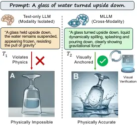
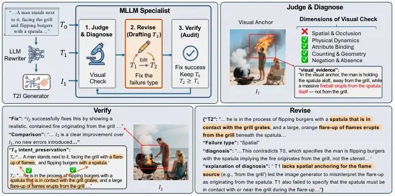
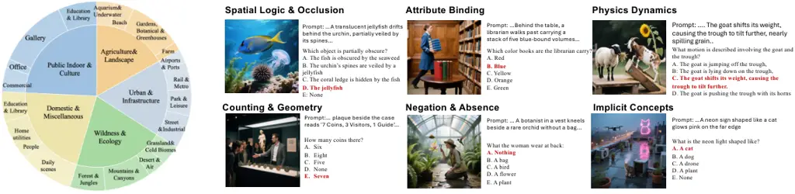
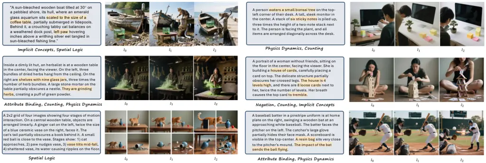

# Seeing is Believing: Aligning Prompt Rewriting with Visual Anchors for Text-to-Image Generation

Xuanyi Liu Deyi Ji Junyu Lu Jing Wang Lanyun Zhu Qianxiong Xu
Affiliation: Peking University Affiliation: Tencent Affiliation: Dalian
University of Technology Affiliation: Tongji University
Affiliation: Nanyang Technological University    Xuhang Chen Tianrun
Chen Siwei Ma Affiliation: Peking University Affiliation: University of
Cambridge Affiliation: Zhejiang University

###### Abstract

Despite the impressive capabilities of text-to-image (T2I) models, an
intent–generation gap often persists due to the brevity and ambiguity of
user prompts. Existing approaches primarily polish the prompt for
fluency and readability. However, the enhancement process still lacks
visual grounding. As a result, the rewriter may over-infer missing
details, causing an intent-generation gap. To address this limitation,
we propose FaithRewriter, a novel prompt-enhancement framework for T2I
generation. Specifically, FaithRewriter first leverages a multimodal
MLLM to generate an image from the original prompt as an intermediate
visual cue. This cue is then combined with the prompt and fed into a
large-scale LLM to produce visually grounded augmentations that better
reflect how the intended content should appear in images. Finally, these
augmentations are distilled into a small-scale LLM for efficient
deployment, enhancing its ability to generate effective T2I prompts.
Experiments show that FaithRewriter yields prompts that are more
faithful to the user intent and more visually plausible than strong
baselines, helping narrow the intent-generation gap.

^(†)^(†)footnotetext: Xuanyi Liu completed this work while interning at
Tencent as part of the Tencent Rhino-Bird Research Elite Program, with
Deyi Ji as the program leader. Correspondance to: Deyi
Ji\<jideyi16@foxmail.com\>, Siwei Ma\<swma@pku.edu.cn\>

## 1 Introduction

Text-to-image (T2I) models can generate high-quality images from natural
language Peebles and Xie (2023); Rombach et al. (2022); Cao et al.
(2026). However, users rarely provide the precise, detailed prompts
these models expect. Instead, ambiguous or underspecified inputs force
generators to guess spatial layouts, physical interactions, and implicit
constraints. This creates an intent–generation gap: the resulting images
may look realistic, but they often fail to faithfully reflect the user’s
true intent.



Figure 1: Comparison between standard rewriting and FaithRewriter.
Standard rewriting ($`T_{1}`$) often introduces hallucinations due to
modal isolation. FaithRewriter utilizes a Visual Anchor to diagnose
these errors and produces a verified revision ($`T_{2}`$).

A common solution is prompt rewriting, where a Large Language Model
(LLM) expands the initial input into a richer instruction. While this
improves linguistic fluency, it ignores visual faithfulness. Because
text-only rewriters Wang et al. (2025); Wu et al. (2025b) operate
entirely in language space, they often hallucinate details that sound
linguistically reasonable but are visually or physically impossible Wang
et al. (2026). For example (Figure 1), rewriting “a glass of water
turned upside down” might yield a fluent description of water suspended
in mid-air, which violates basic physics. Here, blind textual expansion
does not enhance the prompt; it pollutes the original intent.

We argue that faithful prompt rewriting should not be a simple
text-expansion task, but rather an alignment with visual reality. The
core problem is that text-only models lack visual common sense. Even if
a prompt reads perfectly, it can easily produce an unrealistic image
with floating objects, wrong counting, or broken physics. Therefore, the
challenge is: how can we teach a text-only model to “see” and avoid
visual mistakes during rewriting?

Our core idea is simple: the best way to catch a text hallucination is
to actually draw it. When we render a text-only rewrite into an image,
hidden logical errors instantly become obvious visual failures. We call
this intermediate image a Visual Anchor. By generating a Visual Anchor,
we can use a Multimodal LLM (MLLM) as an automated visual debugger. The
MLLM looks at the image, pinpoints exactly where the layout or physics
went wrong, and writes a corrected prompt to fix the specific error. It
then verifies that a second generated image actually fixes the problem
without losing the user’s original request. This ensures the final
prompt is not just a longer sentence, but a visually verified
instruction.

We introduce FaithRewriter, a “Simulate-Then-Distill” framework. Because
generating images and querying MLLMs is too slow for real-time
inference, we only use Visual Anchors to build our training data
offline. For thousands of prompts, we run the diagnosis and correction
process described above. This gives us highly valuable preference pairs:
a “bad” rewrite (fluent but visually flawed) and a “good” rewrite
(visually corrected and verified). Crucially, the “bad” rewrite serves
as a perfect hard negative to prevent the model from learning
superficial tricks like simply writing longer sentences. We distill this
knowledge into a compact text-only model using Supervised Fine-Tuning
(SFT) and Direct Preference Optimization Rafailov et al. (2024) (DPO).
Then the text rewriter learns to avoid visual pitfalls without
generating any images during inference.

To evaluate this, we introduce FaithT2I, a benchmark featuring
information-dense prompts and VQA-style questions targeting spatial,
physical, and semantic constraints. Extensive experiments across various
benchmarks demonstrate that FaithRewriter is effective.

Our contributions are threefold:

- •
  We identify the core failure of standard prompt rewriting: a
  description can be linguistically perfect but visually impossible.
- •
  We propose FaithRewriter, a Simulate-Then-Distill framework that uses
  Visual Anchors to expose flawed rewrites and construct verified
  revisions for preference learning.
- •
  We introduce FaithT2I-test and show that SFT+DPO distillation
  transfers cross-modal priors into an efficient text-only rewriter with
  consistent gains across benchmarks and generators.

## 2 Related Work



Figure 2: Overview of FaithRewriter. Given an original prompt $`T_{0}`$,
a text-only rewriter produces $`T_{1}`$, which is rendered into
$`I_{1}`$. An MLLM diagnoses the visual failure, revises $`T_{1}`$ into
a grounded prompt $`T_{2}`$, and verifies that the resulting image
$`I_{2}`$ fixes the error while preserving the original intent. DPO
training is omitted for clarity.

### 2.1 Prompt Rewriting

Prompt rewriting transforms short or underspecified user instructions
into more detailed prompts Wang et al. (2025); Cao et al. (2023); Kong
et al. (2024); Srivastava et al. (2024); Zhou et al. (2025); Li et al.
(2024); Mañas et al. (2024). Existing approaches often treat discrete
prompts as parameters to be optimized. For instance, PRewrite Kong et
al. (2024) trains a rewriter LLM using downstream task rewards, allowing
the model to explore and identify more effective prompts. Similarly,
Zhou et al. (2025) employs a meta-LLM iteratively to revise the prompt
for a given test instance based on the task LLM’s output. Li et al.
(2024) uses a powerful LLM to generate rewrites and distills this
capability into a compact model. Furthermore, works like
PromptEnhancerWang et al. (2025) focus on generating task-specific or
personalized prompts, often for NLP tasks like text classification or
personalized email generation. However, they primarily operate within
the textual modality, lacking an explicit mechanism to ensure the visual
plausibility of the generated text, which is crucial for text-to-image
(T2I) synthesis.

### 2.2 Text-to-Image Synthesis

The field of text-to-image (T2I) synthesis Esser et al. (2024); Han et
al. (2024); Hao et al. (2023); Podell et al. (2023); Tao et al. (2023)
has advanced significantly, with models like HunyuanImage and Qwen-Image
achieving high fidelity through advanced architectures. However,
research has primarily focused on enhancing the model’s internal
capabilities, often overlooking a critical external factor: the quality
of the input prompt itself. The prompt serves as the sole bridge between
human intent and the generative process. Ambiguous prompts force even
powerful models to guess details. This limitation is evident in
benchmarks like T2I-CompBench Huang et al. (2023), which show models
struggle with complex object relations and negations—precisely where
human descriptions are most prone to ambiguity. Addressing this requires
shifting focus from making models understand vague language better to
making language clearer for models. Recent work explores this interface:
Hunyuan Enhancer trains an LLM to rewrite prompts, improving output
alignment, while approaches using rich text or structured formatting
provide more explicit signals to guide generation.

## 3 Method

### 3.1 Problem Formulation

Let $`x`$ be the original user prompt and $`y`$ be its rewrite. A
text-only rewriter models a distribution $`p_{\text{text}}(y|x)`$,
favoring linguistically fluent prompts. However, T2I generation requires
a different criterion: the rewritten prompt should produce an image that
is faithful to the intended visual content of x. We denote the ideal
visually grounded distribution as $`p_{\text{cross}}(y|x)`$.

The key mismatch is that textual likelihood does not guarantee visual
realizability, yielding:

```math
P_{\text{text}}(y|x)\to\text{high},\quad\text{while}\quad P_{\text{cross}}(y|x)\approx 0. \tag{1}
```

Such a rewrite is a textual hallucination: fluent in text but harmful
for generation. Although it may appear specific and coherent, it can
cause visual errors such as misplaced objects, wrong attribute binding,
implausible dynamics, missing negated objects, or incorrect counts and
relations.

FaithRewriter exposes these hidden failures through rendering. Given a
candidate rewrite $`y`$, a frozen T2I model generates an image $`I`$,
which reveals the visual consequences of $`y`$. A multimodal judge then
checks whether $`I`$ satisfies the original prompt $`x`$. This enables
us to build training pairs where the rejected rewrite is not merely
textually weak, but directly linked to a visual failure.

### 3.2 FaithRewriter

FaithRewriter consists of two stages.

The first stage constructs visually grounded preference pairs through
simulation, diagnosis, revision, and verification. The second stage
distills these pairs into a compact text-only rewriter using SFT and
DPO. This design uses expensive multimodal reasoning only during offline
data construction, while keeping inference as efficient as standard
text-only rewriting.

#### 3.2.1 Visual Failure Externalization

As Figure 2, given an original prompt $`T_{0}`$, we first generate a
baseline rewrite $`T_{1}`$ using a text-only LLM. $`T_{1}`$ is
intentionally allowed to be fluent and detailed, because our goal is not
to compare against a weak negative, but to expose the specific failure
modes of text-only expansion. We then render $`T_{1}`$ using a frozen
T2I generator to obtain an intermediate image $`I_{1}`$, which we call
the visual anchor. The visual anchor transforms a latent textual risk
into an observable image-level outcome.

The visual anchor serves two purposes. First, it externalizes latent
prompt hallucinations. Errors that were difficult to detect in text,
such as an ambiguous flame source or an incorrect occlusion relation,
become directly observable in the image. Second, it provides concrete
evidence for revision. Instead of asking an MLLM to improve the prompt
abstractly, we ask it to explain what went wrong in $`I_{1}`$ and which
part of $`T_{1}`$ caused the failure. This evidence-grounded revision
process reduces the risk of arbitrary rewriting and makes each
correction traceable to a specific visual failure.

#### 3.2.2 Structured Diagnosis and Revision

Given the original prompt $`T_{0}`$, the initial rewrite $`T_{1}`$, and
the rendered image $`I_{1}`$, the MLLM diagnoses whether $`T_{1}`$ leads
to a visual failure in $`I_{1}`$. We consider six common failure types:
spatial logic and occlusion, attribute binding, physical dynamics,
counting and geometry, negation and absence, and implicit concepts.
These categories cover the main cases where a prompt can remain fluent
in language but become ambiguous or implausible after visual
instantiation.

For each sample, the MLLM first checks whether $`I_{1}`$ clearly
violates the intent of $`T_{0}`$. Samples without a clear failure are
discarded to avoid subjective or unnecessary edits. For failed samples,
the MLLM identifies the failure type, points to the visual evidence in
$`I_{1}`$, and explains which part of $`T_{1}`$ causes the error. This
step ensures that the revision is driven by an explicit causal link
between the rewritten text and the observed image failure.

The MLLM then generates a revised prompt $`T_{2}`$. The revision follows
two constraints. First, it should fix the diagnosed failure by adding
explicit visual grounding, such as object positions, attachment
relations, source-target bindings, or physical causality. Second, it
should preserve the original intent of $`T_{0}`$. In particular, the
MLLM is instructed not to remove secondary objects, change attributes,
alter the scene context, or introduce unrelated details when fixing the
primary error. These constraints encourage targeted correction rather
than unconstrained prompt expansion.

#### 3.2.3 Cycle Verification

A revised prompt may fix the diagnosed error while introducing new
deviations from the original intent. Therefore, simply generating
$`T_{2}`$ is insufficient; we need to verify whether the correction is
visually realized after rendering. To this end, we perform cycle
verification by rendering $`T_{2}`$ with the same T2I generator to
obtain $`I_{2}`$. A strict MLLM judge then compares $`T_{0}`$,
$`I_{1}`$, and $`I_{2}`$ using three binary criteria: fix verification,
whether $`I_{2}`$ resolves the failure diagnosed in $`I_{1}`$; intent
preservation, whether $`I_{2}`$ preserves the original constraints and
entities in $`T_{0}`$; and anti-regression, whether $`I_{2}`$ avoids new
visual errors while fixing the original one. This verification step
turns revision from an open-ended rewriting process into a closed-loop
quality control process grounded in the rendered outcome.

Only when all three checks pass do we accept the pair, recorded as
$`T_{\text{win}}=T_{2}`$ and $`T_{\text{lose}}=T_{1}`$. Otherwise, the
sample is discarded. This strict filtering improves preference-data
reliability by ensuring that the positive prompt is not only
linguistically improved, but also visually validated. It also ensures
that $`T_{\text{lose}}`$ is a true hard negative: fluent and detailed,
yet linked to an observed visual failure. As a result, the retained pair
isolates visual grounding as the primary difference between the
preferred and rejected rewrites, making it suitable for preference
optimization.

#### 3.2.4 Counterfactual Preference Distillation

After constructing the verified preference dataset, we train a compact
text-only rewriter. We first apply supervised fine-tuning on positive
pairs $`(T_{0},T_{\text{win}})`$, which teaches the student the syntax
and style of visually grounded prompts. However, SFT alone does not
explicitly teach the model to reject plausible but visually harmful
details. This motivates a preference-learning stage that contrasts
correct visual grounding against matched but flawed alternatives.

We therefore apply DPO using matched hard-negative pairs
$`(T_{\text{win}}>T_{\text{lose}})`$. This design is important. A naive
preference pair such as $`T_{\text{win}}>T_{0}`$ would confound visual
faithfulness with prompt length, because $`T_{\text{win}}`$ is typically
longer and more detailed than the raw prompt. In contrast,
$`T_{\text{win}}`$ and $`T_{\text{lose}}`$ are both expanded rewrites of
the same $`T_{0}`$. They are similar in fluency, verbosity, and style,
but differ in whether their added details are visually grounded. DPO
therefore learns a more targeted preference: prefer visually realizable
details over visually implausible ones.



Figure 3: Overview of FaithT2I-test: scene distribution and example
prompt–question–answer pairs.

The DPO objective is:

```math
\displaystyle\mathcal{L}_{\text{DPO}}( \displaystyle\theta)=-\mathbb{E}_{(T_{0},T_{\text{win}},T_{\text{lose}})\sim\mathcal{D}}\Bigg[\log\sigma\left(\right. \tag{2}
```

```math
\displaystyle\beta\log\frac{\pi_{\theta}(T_{\text{win}}|T_{0})}{\pi_{\text{ref}}(T_{\text{win}}|T_{0})}-\beta\log\frac{\pi_{\theta}(T_{\text{lose}}|T_{0})}{\pi_{\text{ref}}(T_{\text{lose}}|T_{0})}\left.\right)\Bigg],
```

where $`\pi_{\text{ref}}`$ is the SFT-initialized model, and $`\beta`$
controls the deviation margin. This optimization forces the student to
look beyond surface-level language patterns, explicitly unlearning the
tendency to generate textual hallucinations and pushing its distribution
toward the cross-modal ideal $`p_{\text{cross}}`$.

After distillation, the student performs faithful prompt rewriting using
only text input, while the simulation and verification process remains
offline.

### 3.3 FaithT2I Benchmark

Unlike generic metrics, FaithT2I systematically evaluates whether a
generated image faithfully satisfies dense visual constraints. As shown
in Figure 3, we classify potential T2I failures into six
macro-categories: (1) Spatial logic & occlusion, which focuses on
relative layouts and obstruction; (2) Attribute binding, which evaluates
color, size, and property associations; (3) Physical dynamics, which
tests causality and contact; (4) Counting & geometry, which examines
counts, ratios, and grids; (5) Negation & absence, which checks correct
omission; and (6) Implicit concepts, which evaluates commonsense visual
interpretation.

Prompt and Question Construction. To ensure diversity, we prompt an MLLM
to synthesize dense prompts ($`T_{0}`$) across diverse real-world
domains, as shown in Figure 3. Each sample pairs $`T_{0}`$ with 10
VQA-style questions to evaluate the generated image. To prevent forced
guessing in cases of severe misalignment, each question includes an
explicit “none of the above” option. This design encourages the
evaluator to measure concrete visual satisfaction rather than rewarding
generic text-image similarity. Computational cost is in Appendix 6.2.

Verification and Reliability. For dataset reliability, a subset of 300
samples is manually verified by three human annotators, yielding
substantial agreement with a Cohen’s Kappa of 0.72. To avoid evaluation
leakage, we completely decouple the evaluator models, including GPT-4o,
Gemini, and Qwen3-VL, from the training-time textual prompt generation
model DeepSeek-R1 Guo et al. (2025). This separation helps ensure that
the benchmark evaluates general visual faithfulness rather than
memorized preferences of a single model family.

## 4 Experiment

### 4.1 Experiment Setup

Benchmarks. To evaluate FaithRewriter, we utilize both our curated
dataset and public benchmarks. FaithT2I (Ours): Constructed via the
pipeline in Section 3.2, this dataset focuses on hard cases for T2I
generation. We curate splits for training (FaithT2I-3K, FaithT2I-10K,
FaithT2I-100K) and test on the held-out test set FaithT2I-Test, and
other public benchmarks like SpatialGenEval Wang et al. (2026), a
benchmark containing complex spatial prompts. We also evaluate on
DPG-Bench Hu et al. (2024) and GenEval Ghosh et al. (2023) to verify
generalization capabilities.

Baselines & Models. For the rewriter backbone, we experiment with
LLaMA3.1-8B, Hunyuan-7B-Instruct, and Qwen3-8B-Base who have similar
size. We conduct on these comparisons: (1) $`T_{0}`$ (Raw): Direct user
prompts; (2) Zero-shot: directly generate (3) Text-modal: Fine-tuned on
text-only rewritten data ($`T_{1}`$) (4) FaithRewriter: Fine-tuned on
cross-modality rewritten data ($`T_{2}`$) For image generation, we
employ Qwen-Image Wu et al. (2025a) as default and compare with
Hunyuan-Image 2.1 Cao et al. (2025), and FLUX.1-dev. We further include
two existing prompt rewriting baselines: PromptEnhancer Wang et al.
(2025), built upon Hunyuan-7B-Instruct, and RePrompt Wu et al. (2025b) .
For fairness, we adapt RePrompt from its original Qwen2.5-3B setting to
the same Qwen3-8B backbone used in our experiments.

Implementation Details. See in Appendix 6.1.

|                     |                          |       |         |                                        |       |         |                                   |        |         |                   |                    |
| ------------------- | ------------------------ | ----- | ------- | -------------------------------------- | ----- | ------- | --------------------------------- | ------ | ------- | ----------------- | ------------------ |
| Method              | VQA Scoring $`\uparrow`$ |       |         | Textual Alignment Scoring $`\uparrow`$ |       |         | Preference Ranking $`\downarrow`$ |        |         | CLIP $`\uparrow`$ | FID $`\downarrow`$ |
|                     | Gemini                   | GPT4o | Qwen3VL | Gemini                                 | GPT4o | Qwen3VL | GPT4o                             | Gemini | Qwen3VL |                   |                    |
| $`T_{0}`$ (raw)     | 62.12                    | 60.28 | 64.39   | 3.303                                  | 3.939 | 3.994   | \-                                | \-     | \-      | 0.752             | 23.94              |
| LLaMa3.1-8B         |                          |       |         |                                        |       |         |                                   |        |         |                   |                    |
| Zeroshot            | 55.00                    | 58.23 | 60.32   | 3.314                                  | 3.421 | 3.456   | 2.20                              | 2.22   | 2.25    | 0.762             | 23.76              |
| Text modal          | 59.12                    | 62.35 | 64.52   | 3.229                                  | 3.689 | 3.977   | 2.09                              | 1.95   | 2.07    | 0.774             | 23.58              |
| FaithRewriter       | 63.27                    | 65.61 | 70.65   | 4.037                                  | 4.249 | 4.403   | 1.71                              | 1.83   | 1.68    | 0.784             | 23.41              |
| Hunyuan-7B-Instruct |                          |       |         |                                        |       |         |                                   |        |         |                   |                    |
| PromptEnhancer      | 68.59                    | 72.69 | 74.43   | 3.472                                  | 3.491 | 3.483   | 2.24                              | 1.89   | 2.28    | 0.813             | 22.84              |
| Zeroshot            | 64.18                    | 65.82 | 62.94   | 3.327                                  | 3.364 | 3.381   | 3.11                              | 3.39   | 3.07    | 0.768             | 23.67              |
| Text modal          | 66.37                    | 68.15 | 67.06   | 3.176                                  | 3.863 | 3.925   | 2.81                              | 2.77   | 2.71    | 0.796             | 23.25              |
| FaithRewriter       | 70.83                    | 73.41 | 77.94   | 3.949                                  | 4.001 | 4.164   | 1.84                              | 1.95   | 1.94    | 0.808             | 22.87              |
| Qwen3-8B-Base       |                          |       |         |                                        |       |         |                                   |        |         |                   |                    |
| RePrompt            | 69.15                    | 68.91 | 76.12   | 3.194                                  | 3.857 | 3.891   | 2.23                              | 1.97   | 1.89    | 0.821             | 22.58              |
| Zeroshot            | 59.73                    | 61.34 | 70.83   | 4.122                                  | 3.745 | 3.773   | 2.29                              | 2.38   | 2.63    | 0.762             | 23.76              |
| Text modal          | 68.78                    | 69.40 | 75.65   | 3.263                                  | 3.814 | 3.963   | 2.19                              | 2.03   | 1.82    | 0.828             | 22.63              |
| FaithRewriter       | 74.80                    | 73.71 | 78.91   | 4.075                                  | 4.098 | 4.392   | 1.52                              | 1.59   | 1.55    | 0.847             | 22.19              |

Table 1: Main results on FaithT2I-test.

|                 |         |                    |           |                    |             |        |                   |           |           |                     |        |
| --------------- | ------- | ------------------ | --------- | ------------------ | ----------- | ------ | ----------------- | --------- | --------- | ------------------- | ------ |
| Method          | Overall | Spatial Foundation |           | Spatial Perception |             |        | Spatial Reasoning |           |           | Spatial Interaction |        |
|                 |         | Object             | Attribute | Position           | Orientation | Layout | Comparison        | Proximity | Occlusion | Motion              | Causal |
| $`T_{0}`$ (raw) | 63.09   | 87.16              | 80.47     | 69.23              | 66.24       | 73.64  | 24.42             | 66.81     | 38.22     | 65.25               | 59.42  |
| Zeroshot        | 64.58   | 87.55              | 80.12     | 71.10              | 66.80       | 74.80  | 27.20             | 68.20     | 39.85     | 68.10               | 62.10  |
| Text modal      | 66.23   | 87.72              | 80.47     | 72.79              | 67.95       | 76.34  | 29.97             | 71.79     | 40.92     | 70.23               | 64.11  |
| FaithRewriter   | 70.83   | 88.44              | 82.60     | 74.78              | 73.36       | 80.33  | 35.66             | 76.20     | 53.44     | 73.93               | 69.52  |

Table 2: Main results on SpatialGenEval. By utilizing visual anchors,
our Cross-modal enhancer demonstrates a comprehensive leap over
text-only baselines, particularly in difficult sub-domains like
Occlusion and Comparison .

|                 |           |        |           |          |       |         |               |            |          |        |          |           |         |
| --------------- | --------- | ------ | --------- | -------- | ----- | ------- | ------------- | ---------- | -------- | ------ | -------- | --------- | ------- |
| Enhancer        | DPG-Bench |        |           |          |       |         | GenEval       |            |          |        |          |           |         |
|                 | Global    | Entity | Attribute | Relation | Other | Overall | Single Object | Two Object | Counting | Colors | Position | Attribute | Overall |
| $`T_{0}`$ (raw) | 91.32     | 91.56  | 92.02     | 94.31    | 92.73 | 88.32   | 0.99          | 0.92       | 0.89     | 0.88   | 0.76     | 0.77      | 0.87    |
| Zeroshot        | 91.47     | 91.63  | 92.14     | 94.82    | 92.59 | 88.74   | 0.98          | 0.91       | 0.89     | 0.88   | 0.77     | 0.77      | 0.87    |
| Text modal      | 91.85     | 91.70  | 92.25     | 95.12    | 92.41 | 89.21   | 0.98          | 0.91       | 0.90     | 0.89   | 0.77     | 0.78      | 0.88    |
| FaithRewriter   | 92.64     | 91.48  | 93.15     | 96.53    | 93.08 | 90.34   | 0.99          | 0.94       | 0.93     | 0.87   | 0.80     | 0.79      | 0.89    |

Table 3: Main results on public benchmarks (DPG-Bench and GenEval).
FaithRewriter (Cross modal) achieves a robust +2% overall improvement on
both benchmarks. Bold indicates the best performance.

### 4.2 Main results

#### 4.2.1 Results on FaithT2I-Test

We first evaluate different prompt enhancement methods on the
FaithT2I-10K dataset, with results summarized in Table 1.

Overall, FaithRewriter consistently achieves the best performance across
nearly all metrics and backbones. Compared with text-only rewriting, the
cross-modal variant yields higher VQA scores, stronger textual
alignment, better human-preference-style ranking from multiple MLLM
judges, and more favorable CLIP/FID results. These improvements are
especially consistent across Gemini 3 Pro Comanici et al. (2025),
GPT-4o Hurst et al. (2024), and Qwen3-VL Bai et al. (2025) evaluators,
showing that the gains are not tied to a single judge. At the same time,
all rewriting-based methods outperform the raw prompt baseline,
confirming the value of prompt enhancement itself, while the comparison
between Text modal and Cross-modal further shows that
visual-anchor-based supervision provides additional benefits beyond pure
textual fine-tuning.

|                                  |                |                |                |                          |        |         |                                        |        |         |                   |                    |
| -------------------------------- | -------------- | -------------- | -------------- | ------------------------ | ------ | ------- | -------------------------------------- | ------ | ------- | ----------------- | ------------------ |
| Method Variants                  | Components     |                |                | VQA Scoring $`\uparrow`$ |        |         | Textual Alignment Scoring $`\uparrow`$ |        |         | CLIP $`\uparrow`$ | FID $`\downarrow`$ |
|                                  | Visual Anchor  | Cycle Verif.   | DPO            | Gemini                   | GPT-4o | Qwen3VL | Gemini                                 | GPT-4o | Qwen3VL |                   |                    |
| Text-only Rewriting              | $`\times`$     | $`\times`$     | $`\times`$     | 66.37                    | 68.15  | 67.06   | 3.176                                  | 3.863  | 3.925   | 0.796             | 23.25              |
| Text-only Self-Refinement        | $`\times`$     | $`\times`$     | $`\times`$     | 66.52                    | 68.29  | 67.28   | 3.284                                  | 3.882  | 3.948   | 0.797             | 23.19              |
| Image-Cond. Revision (No Filter) | $`\checkmark`$ | $`\times`$     | $`\times`$     | 68.14                    | 70.63  | 71.55   | 3.512                                  | 3.914  | 4.015   | 0.799             | 23.06              |
| Cycle Verif. (SFT Only)          | $`\checkmark`$ | $`\checkmark`$ | $`\times`$     | 69.61                    | 72.18  | 75.31   | 3.765                                  | 3.957  | 4.089   | 0.803             | 22.95              |
| FaithRewriter (Ours)             | $`\checkmark`$ | $`\checkmark`$ | $`\checkmark`$ | 70.83                    | 73.41  | 77.94   | 3.949                                  | 4.001  | 4.164   | 0.808             | 22.87              |

Table 4: Ablation study on the necessity of simulation and framework
components based on Hunyuan-7B-Instruct.

#### 4.2.2 Results on SpatialGenEval

We further evaluate our method on SpatialGenEval, and the results are
shown in Table 2. Compared with the raw, zeroshot, and text-only
baselines, the cross-modal model achieves the strongest overall
performance and improves almost all sub-dimensions of spatial
intelligence. The gains are particularly clear in more challenging
categories such as Comparison, Occlusion, Motion, and Causal, where
text-only enhancement remains limited. These results suggest that
FaithRewriter improves general prompt faithfulness, and is effective for
prompts requiring precise spatial reasoning, physical interaction, and
visually grounded logic.

#### 4.2.3 Results on DPG-Bench and GenEval

We further evaluate FaithRewriter on two public benchmarks, DPG-Bench
and GenEval. As shown in Table 3, our cross-modal variant consistently
outperforms both the raw prompt baseline and the text-only rewriting
baseline on both benchmarks, yielding around 2% overall improvement.
Although this experiment is not our main focus, it provides additional
evidence that the gains of FaithRewriter can transfer to general-purpose
public benchmarks.

### 4.3 Ablation Study

#### 4.3.1 Component Ablation

To isolate the contribution of each component in FaithRewriter, we
compare the full method with several degraded variants in Table 4.
Text-only Rewriting removes visual feedback entirely, while Text-only
Self-Refinement allows the LLM to iteratively critique and refine its
own prompt only in the textual domain. Image-Conditioned Revision
introduces the visual anchor but removes strict cycle verification,
retaining all revised prompts. Cycle Verification (SFT Only) uses only
the verified grounded prompts for SFT, while Full FaithRewriter further
applies DPO with matched hard negatives.

The comparison shows three main findings. First, Text-only
Self-Refinement brings only marginal improvement over standard Text-only
Rewriting, suggesting that textual critique alone is insufficient for
detecting spatial and physical hallucinations. Second, introducing
visual anchors substantially improves performance, confirming that
rendering intermediate images is important for externalizing latent
prompt failures. Third, cycle verification and DPO provide complementary
gains: cycle verification improves the reliability of the training data,
while DPO further teaches the student to prefer visually grounded
rewrites over linguistically similar but visually flawed alternatives.
Additional SFT/DPO ablation on Qwen-8B is in Appendix 6.3.

#### 4.3.2 Robustness Across T2I Models

We evaluate the universality of FaithRewriter by applying the same
enhanced prompts to three diverse T2I models: FLUX, Hunyuan Image, and
Qwen-Image. As shown in Table 5, FaithRewriter consistently boosts
visual assessment scores across all generators compared to the raw
prompts ($`T_{0}`$) and intra-modal baselines. This demonstrates that
FaithRewriter learns model-agnostic visual features effectively bridging
the intent gap.

|                 |               |                          |        |         |
| --------------- | ------------- | ------------------------ | ------ | ------- |
| Methods         | T2I Model     | VQA Scoring $`\uparrow`$ |        |         |
|                 |               | Gemini                   | GPT-4o | Qwen3VL |
| $`T_{0}`$ (raw) | FLUX-dev1     | 55.12                    | 54.38  | 58.21   |
| FaithRewriter   | FLUX-dev1     | 67.25                    | 65.92  | 70.43   |
| $`T_{0}`$ (raw) | Hunyuan Image | 60.15                    | 58.94  | 62.15   |
| FaithRewriter   | Hunyuan Image | 72.84                    | 71.56  | 76.54   |
| $`T_{0}`$ (raw) | Qwen-Image    | 62.12                    | 60.28  | 64.39   |
| FaithRewriter   | Qwen-Image    | 74.80                    | 73.71  | 78.91   |

Table 5: Ablation study on different T2I backbones.

#### 4.3.3 Data Scaling and Generalization

We investigate the scaling laws of our method by training on a 3k, 10k,
100k dataset. As shown in Table 6, the model trained on 100k samples
consistently outperforms the 3k and 10k version. The performance gap
between the 100k model and the text-only baseline suggests that our
cross-modal distillation process benefits significantly from increased
data diversity. The results indicate that the advantage of FaithRewriter
is not saturated, showing strong potential for further improvement with
larger-scale cross-modal simulation.

|                      |                                        |        |         |
| -------------------- | -------------------------------------- | ------ | ------- |
| Configuration        | Textual Alignment Scoring $`\uparrow`$ |        |         |
|                      | Gemini                                 | GPT-4o | Qwen3VL |
| $`T_{0}`$ (raw)      | 3.303                                  | 3.939  | 3.994   |
| FaithRewriter (3k)   | 3.712                                  | 3.924  | 4.105   |
| FaithRewriter (10k)  | 4.075                                  | 4.098  | 4.392   |
| FaithRewriter (100k) | 4.150                                  | 4.123  | 4.241   |

Table 6: Ablation study on training data scaling. Performance gains
correlate with the size of training data.



Figure 4: Exemplar qualitative comparisons across diverse evaluation
dimensions (e.g., spatial logic, physical dynamics, negation, and
quantitative counting). $`I_{0}`$, $`I_{1}`$, and $`I_{2}`$ denote
images generated by the raw prompt ($`T_{0}`$), the standard text-only
rewrite ($`T_{1}`$), and our FaithRewriter prompt ($`T_{2}`$),
respectively.

### 4.4 User Study

|                |                                      |         |      |                        |      |
| -------------- | ------------------------------------ | ------- | ---- | ---------------------- | ---- |
| Configuration  | User Preference Score $`\downarrow`$ |         |      | Overall $`\downarrow`$ | Rank |
|                | LLaMA                                | Hunyuan | Qwen |                        |      |
| $`T_{0}`$(raw) | 3.65                                 | 3.72    | 3.29 | 3.55                   | 4    |
| Zeroshot       | 2.63                                 | 2.45    | 2.95 | 2.68                   | 3    |
| Text modal     | 2.29                                 | 2.23    | 2.57 | 2.36                   | 2    |
| FaithRewriter  | 1.43                                 | 1.60    | 1.19 | 1.41                   | 1    |

Table 7: User study results.

We conduct a large-scale user study with 62 participants and 60 samples
from generated data. Given the original prompt $`T_{0}`$ and outputs
from three configurations ($`T_{0}`$, Zeroshot, Text modal, and
Cross-modal), participants rank the images according to how faithfully
they satisfy the prompt. The results in Table 7 show a clear preference
for Cross-modal, which achieves the best overall mean ranking.

VLM-Human Correlation. Taking Qwen-VL as an example, we measure the
correlation between VLM preference scores and averaged human rankings
across the study samples, obtaining a Pearson correlation of 0.76. This
suggests that VLM judgments are reasonably aligned with human.

### 4.5 Qualitative Case Analysis

We present qualitative comparisons in Figure 4.

Resolving Semantic Ambiguity and Implicit Concepts. Text-only rewriters
often drift when handling metaphorical or implicit concepts. In the
“House of cards” case (Figure 4, Middle-Right), the prompt refers to a
structure made of playing cards, but both $`I_{0}`$ and $`I_{1}`$
misinterpret it as a miniature wooden house. In contrast, FaithRewriter
($`I_{2}`$) correctly renders a four-level card structure. A similar
issue appears in the “Boat” case (Top-Left), where the aquarium is
described as “scaled to the size of a coffee table”. The text-only
baseline $`I_{1}`$ hallucinates a coffee table, while $`I_{2}`$
preserves the intended scale without introducing unwanted objects.

Enforcing Quantitative and Geometric Constraints. T2I models often fail
on precise counting and relative geometry. In the “Sticky notes” case
(Top-Right), the prompt requires one stack of six notes to be “three
times the height” of a two-note stack. Both $`I_{0}`$ and $`I_{1}`$ miss
this relation, whereas $`I_{2}`$ satisfies the count and height
constraints. In the “Motion Grid” case (Bottom-Left), the prompt
requires a strict 2$`\times`$2 layout showing four sequential stages.
Only $`I_{2}`$ follows this structure faithfully, while $`I_{1}`$
produces a disorganized composition.

Restoring Physical Dynamics and Causality. Text-only rewriters may
enrich action descriptions linguistically but still fail to induce
correct visual dynamics. In the “Baseball” case (Bottom-Right),
$`I_{0}`$ and $`I_{1}`$ show a mostly static scene and miss the “impact
of the bat”. By contrast, $`I_{2}`$ depicts a more dynamic impact with
visible physical consequences. This also appears in the “Herb grinding”
case (Middle-Left), where only $`I_{2}`$ correctly visualizes the “puff
of green powder”.

## 5 Conclusion

In this work, we identified the inherent limitation of text-only prompt
rewriting methods, which often produce visually implausible descriptions
due to a lack of cross-modal anchor. To address this, we introduced
FaithRewriter, a novel framework built on a "Simulate-Then-Distill"
paradigm. FaithRewriter leverages a powerful MLLM as a cognitive
simulator to generate visually-anchored prompt enhancements and then
efficiently distills this capability into a compact, text-only LLM. We
build a corresponding benchmark FaithT2I-test. Extensive experimental
results demonstrate that FaithRewriter significantly outperforms
existing methods in generating faithful and realistic prompts,
effectively bridging intent-generation gap.

## Limitations

Offline Computational Overhead. A primary limitation of our framework
lies in the computational cost of the data construction phase. The
“Simulate” step requires rendering intermediate images via a diffusion
model and invoking a large-scale Multimodal LLM (MLLM) for structured
diagnosis and cycle-verification. Consequently, scaling the training
dataset (e.g., to millions of pairs) is resource-intensive and
time-consuming. However, it is crucial to note that this overhead is
strictly confined to the offline training phase. Thanks to our
distillation strategy, the deployed student model operates entirely in
the text modality, ensuring high inference-time efficiency without
requiring visual encoders or online rendering.

Boundaries of the Native Generative Prior. The effectiveness of any
prompt rewriting method, including FaithRewriter, is inherently bounded
by the intrinsic capabilities of the downstream T2I generator. If the
base generative model entirely lacks the prior knowledge of a specific
concept (e.g., an extremely rare object) or suffers from hard
architectural bottlenecks (e.g., accurately rendering illegible text or
generating exactly 15 identical objects), an enhanced prompt cannot
magically inject these missing capabilities. While FaithRewriter
expertly reorganizes instructions to maximize the generator’s potential,
it cannot overcome fundamental rendering deficits.

## References

- Bai et al. (2025) S. Bai, Y. Cai, R. Chen, K. Chen, X. Chen, Z.
  Cheng, L. Deng, W. Ding, C. Gao, C. Ge, et al. Qwen3-vl technical
  report. arXiv preprint arXiv:2511.21631. Cited by: §4.2.1.
- Cao et al. (2026) P. Cao, F. Zhou, Q. Song, and L. Yang Controllable
  generation with text-to-image diffusion models: a survey. IEEE
  Transactions on Pattern Analysis and Machine Intelligence 48 (4),
  pp. 4771–4791. External Links: ISSN 1939-3539,
  [Link](http://dx.doi.org/10.1109/TPAMI.2025.3646548),
  [Document](https://dx.doi.org/10.1109/tpami.2025.3646548) Cited by:
  §1.
- Cao et al. (2025) S. Cao, H. Chen, P. Chen, Y. Cheng, Y. Cui, X.
  Deng, Y. Dong, K. Gong, T. Gu, X. Gu, et al. Hunyuanimage 3.0
  technical report. arXiv preprint arXiv:2509.23951. Cited by: §4.1.
- Cao et al. (2023) T. Cao, C. Wang, B. Liu, Z. Wu, J. Zhu, and J. Huang
  Beautifulprompt: towards automatic prompt engineering for
  text-to-image synthesis. arXiv preprint arXiv:2311.06752. Cited by:
  §2.1.
- Comanici et al. (2025) G. Comanici, E. Bieber, M. Schaekermann, I.
  Pasupat, N. Sachdeva, I. Dhillon, M. Blistein, O. Ram, D. Zhang, E.
  Rosen, et al. Gemini 2.5: pushing the frontier with advanced
  reasoning, multimodality, long context, and next generation agentic
  capabilities. arXiv preprint arXiv:2507.06261. Cited by: §4.2.1.
- Esser et al. (2024) P. Esser, S. Kulal, A. Blattmann, R. Entezari, J.
  Müller, H. Saini, Y. Levi, D. Lorenz, A. Sauer, F. Boesel, et al.
  Scaling rectified flow transformers for high-resolution image
  synthesis. In Forty-first international conference on machine
  learning, Cited by: §2.2.
- Ghosh et al. (2023) D. Ghosh, H. Hajishirzi, and L. Schmidt Geneval:
  an object-focused framework for evaluating text-to-image alignment.
  Advances in Neural Information Processing Systems 36, pp. 52132–52152.
  Cited by: §4.1.
- Guo et al. (2025) D. Guo, D. Yang, H. Zhang, J. Song, P. Wang, Q.
  Zhu, R. Xu, R. Zhang, S. Ma, X. Bi, X. Zhang, X. Yu, Y. Wu, Z. F.
  Wu, Z. Gou, Z. Shao, Z. Li, Z. Gao, A. Liu, B. Xue, B. Wang, B. Wu, B.
  Feng, C. Lu, C. Zhao, C. Deng, C. Ruan, D. Dai, D. Chen, D. Ji, E.
  Li, F. Lin, F. Dai, F. Luo, G. Hao, G. Chen, G. Li, H. Zhang, H.
  Xu, H. Ding, H. Gao, H. Qu, H. Li, J. Guo, J. Li, J. Chen, J. Yuan, J.
  Tu, J. Qiu, J. Li, J. L. Cai, J. Ni, J. Liang, J. Chen, K. Dong, K.
  Hu, K. You, K. Gao, K. Guan, K. Huang, K. Yu, L. Wang, L. Zhang, L.
  Zhao, L. Wang, L. Zhang, L. Xu, L. Xia, M. Zhang, M. Zhang, M.
  Tang, M. Zhou, M. Li, M. Wang, M. Li, N. Tian, P. Huang, P. Zhang, Q.
  Wang, Q. Chen, Q. Du, R. Ge, R. Zhang, R. Pan, R. Wang, R. J.
  Chen, R. L. Jin, R. Chen, S. Lu, S. Zhou, S. Chen, S. Ye, S. Wang, S.
  Yu, S. Zhou, S. Pan, S. S. Li, S. Zhou, S. Wu, T. Yun, T. Pei, T.
  Sun, T. Wang, W. Zeng, W. Liu, W. Liang, W. Gao, W. Yu, W.
  Zhang, W. L. Xiao, W. An, X. Liu, X. Wang, X. Chen, X. Nie, X.
  Cheng, X. Liu, X. Xie, X. Liu, X. Yang, X. Li, X. Su, X. Lin, X. Q.
  Li, X. Jin, X. Shen, X. Chen, X. Sun, X. Wang, X. Song, X. Zhou, X.
  Wang, X. Shan, Y. K. Li, Y. Q. Wang, Y. X. Wei, Y. Zhang, Y. Xu, Y.
  Li, Y. Zhao, Y. Sun, Y. Wang, Y. Yu, Y. Zhang, Y. Shi, Y. Xiong, Y.
  He, Y. Piao, Y. Wang, Y. Tan, Y. Ma, Y. Liu, Y. Guo, Y. Ou, Y.
  Wang, Y. Gong, Y. Zou, Y. He, Y. Xiong, Y. Luo, Y. You, Y. Liu, Y.
  Zhou, Y. X. Zhu, Y. Huang, Y. Li, Y. Zheng, Y. Zhu, Y. Ma, Y. Tang, Y.
  Zha, Y. Yan, Z. Z. Ren, Z. Ren, Z. Sha, Z. Fu, Z. Xu, Z. Xie, Z.
  Zhang, Z. Hao, Z. Ma, Z. Yan, Z. Wu, Z. Gu, Z. Zhu, Z. Liu, Z. Li, Z.
  Xie, Z. Song, Z. Pan, Z. Huang, Z. Xu, Z. Zhang, and Z. Zhang
  DeepSeek-r1 incentivizes reasoning in llms through reinforcement
  learning. Nature 645 (8081), pp. 633–638. External Links: ISSN
  1476-4687, [Link](http://dx.doi.org/10.1038/s41586-025-09422-z),
  [Document](https://dx.doi.org/10.1038/s41586-025-09422-z) Cited by:
  §3.3.
- Han et al. (2024) S. Han, H. Fan, J. Fu, L. Li, T. Li, J. Cui, Y.
  Wang, Y. Tai, J. Sun, C. Guo, et al. Evalmuse-40k: a reliable and
  fine-grained benchmark with comprehensive human annotations for
  text-to-image generation model evaluation. arXiv preprint
  arXiv:2412.18150. Cited by: §2.2.
- Hao et al. (2023) Y. Hao, Z. Chi, L. Dong, and F. Wei Optimizing
  prompts for text-to-image generation. Advances in Neural Information
  Processing Systems 36, pp. 66923–66939. Cited by: §2.2.
- Hu et al. (2024) X. Hu, R. Wang, Y. Fang, B. Fu, P. Cheng, and G. Yu
  Ella: equip diffusion models with llm for enhanced semantic alignment.
  arXiv preprint arXiv:2403.05135. Cited by: §4.1.
- Huang et al. (2023) K. Huang, K. Sun, E. Xie, Z. Li, and X. Liu
  T2i-compbench: a comprehensive benchmark for open-world compositional
  text-to-image generation. Advances in Neural Information Processing
  Systems 36, pp. 78723–78747. Cited by: §2.2.
- Hurst et al. (2024) A. Hurst, A. Lerer, A. P. Goucher, A. Perelman, A.
  Ramesh, A. Clark, A. Ostrow, A. Welihinda, A. Hayes, A. Radford, et
  al. Gpt-4o system card. arXiv preprint arXiv:2410.21276. Cited by:
  §4.2.1.
- Kong et al. (2024) W. Kong, S. Hombaiah, M. Zhang, Q. Mei, and M.
  Bendersky Prewrite: prompt rewriting with reinforcement learning. In
  Proceedings of the 62nd Annual Meeting of the Association for
  Computational Linguistics (Volume 2: Short Papers), pp. 594–601. Cited
  by: §2.1.
- Li et al. (2024) C. Li, M. Zhang, Q. Mei, W. Kong, and M. Bendersky
  Learning to rewrite prompts for personalized text generation. In
  Proceedings of the ACM Web Conference 2024, pp. 3367–3378. Cited by:
  §2.1.
- Mañas et al. (2024) O. Mañas, P. Astolfi, M. Hall, C. Ross, J.
  Urbanek, A. Williams, A. Agrawal, A. Romero-Soriano, and M. Drozdzal
  Improving text-to-image consistency via automatic prompt optimization.
  arXiv preprint arXiv:2403.17804. Cited by: §2.1.
- Peebles and Xie (2023) W. Peebles and S. Xie Scalable diffusion models
  with transformers. In Proceedings of the IEEE/CVF international
  conference on computer vision, pp. 4195–4205. Cited by: §1.
- Podell et al. (2023) D. Podell, Z. English, K. Lacey, A. Blattmann, T.
  Dockhorn, J. Müller, J. Penna, and R. Rombach Sdxl: improving latent
  diffusion models for high-resolution image synthesis. arXiv preprint
  arXiv:2307.01952. Cited by: §2.2.
- Rafailov et al. (2024) R. Rafailov, A. Sharma, E. Mitchell, S.
  Ermon, C. D. Manning, and C. Finn Direct preference optimization: your
  language model is secretly a reward model. External Links: 2305.18290,
  [Link](https://arxiv.org/abs/2305.18290) Cited by: §1.
- Rombach et al. (2022) R. Rombach, A. Blattmann, D. Lorenz, P. Esser,
  and B. Ommer High-resolution image synthesis with latent diffusion
  models. In Proceedings of the IEEE/CVF conference on computer vision
  and pattern recognition, pp. 10684–10695. Cited by: §1.
- Srivastava et al. (2024) S. Srivastava, C. Huang, W. Fan, and Z. Yao
  Instances need more care: rewriting prompts for instances with llms in
  the loop yields better zero-shot performance. In Findings of the
  Association for Computational Linguistics: ACL 2024, pp. 6211–6232.
  Cited by: §2.1.
- Tao et al. (2023) M. Tao, B. Bao, H. Tang, and C. Xu Galip: generative
  adversarial clips for text-to-image synthesis. In Proceedings of the
  IEEE/CVF conference on computer vision and pattern recognition,
  pp. 14214–14223. Cited by: §2.2.
- Wang et al. (2025) L. Wang, X. Xing, Y. Cheng, Z. Zhao, D. Li, T.
  Hang, J. Tao, Q. Wang, R. Li, C. Chen, et al. Promptenhancer: a simple
  approach to enhance text-to-image models via chain-of-thought prompt
  rewriting. arXiv preprint arXiv:2509.04545. Cited by: §1, §2.1, §4.1.
- Wang et al. (2026) Z. Wang, X. Hu, Y. Wang, F. Xiong, M. Zhang, and X.
  Chu Everything in its place: benchmarking spatial intelligence of
  text-to-image models. arXiv preprint arXiv:2601.20354. Cited by: §1,
  §4.1.
- Wu et al. (2025a) C. Wu, J. Li, J. Zhou, J. Lin, K. Gao, K. Yan, S.
  Yin, S. Bai, X. Xu, Y. Chen, et al. Qwen-image technical report. arXiv
  preprint arXiv:2508.02324. Cited by: §4.1.
- Wu et al. (2025b) M. Wu, L. Wang, P. Zhao, F. Yang, J. Zhang, J.
  Liu, Y. Zhan, W. Han, H. Sun, J. Ji, et al. Reprompt:
  reasoning-augmented reprompting for text-to-image generation via
  reinforcement learning. arXiv preprint arXiv:2505.17540. Cited by: §1,
  §4.1.
- Zhou et al. (2025) Q. Zhou, X. Xiang, K. He, and J. E. Hopcroft
  Learning to rewrite prompts for bootstrapping llms on downstream
  tasks. arXiv preprint arXiv:2510.06695. Cited by: §2.1.

## 6 Appendix

### 6.1 Implementation Details.

We evaluate FaithRewriter with three student rewriter backbones:
LLaMa-3.1-8B,Qwen3-8B, and Hunyuan-7B-Dense-Instruct. For Qwen and
LLaMA-family backbones, we implement full-parameter fine-tuning with
LLaMA-Factory. Training is conducted on one node with 8 NVIDIA H20 GPUs
under CUDA 12.3, cuDNN 9, PyTorch 2.3, and DeepSpeed ZeRO-3
optimization. The maximum sequence length is set to 2048, and training
is performed in bfloat16 precision with FlashAttention-2 enabled.

For supervised fine-tuning, we train for 3 epochs with a per-device
batch size of 1, gradient accumulation of 2, a learning rate of
$`1\times 10^{-5}`$, a cosine learning-rate scheduler, and a warmup
ratio of 0.1. For Hunyuan-7B-Dense-Instruct, we use the Angel-PTM
training framework with full-parameter fine-tuning. The sequence length
is set to 32768, the global batch size is 16, the micro batch size is 1,
and the model is trained for 5 epochs with a learning rate of
$`5\times 10^{-5}`$ and a minimum learning rate of $`1\times 10^{-5}`$.

For DPO training, we initialize from the corresponding SFT checkpoint
and use full-parameter optimization with the standard sigmoid DPO loss.
Unless otherwise specified, we train for 3 epochs with a per-device
batch size of 1, gradient accumulation of 8, a learning rate of
$`5\times 10^{-6}`$, a cosine scheduler, a warmup ratio of 0.1, and
$`\beta=0.1`$. All variants based on the same backbone use identical
infrastructure and hyperparameters, differing only in the supervision
data and optimization objective.

### 6.2 Data Construction Cost and Statistics

We provide additional details on the offline cost of constructing
visually grounded preference data. The construction pipeline consists of
four main steps: initial text-only rewriting, visual-anchor rendering,
MLLM-based diagnosis and revision, and cycle verification. For each
candidate prompt, the pipeline requires one rendering for the initial
rewrite $`T_{1}`$ and one additional rendering for the revised prompt
$`T_{2}`$ if the sample enters the verification stage. The MLLM is
called for structured diagnosis, prompt revision, and final
verification.

In our implementation, we first generated a larger pool of candidate
prompts and then applied confidence gating and cycle verification to
retain high-quality preference pairs. Approximately 55–65% of candidate
samples were identified as containing clear visual failures after the
initial visual-anchor diagnosis. After rendering the revised prompt and
applying the final cycle-verification checks, around 35–45% of the
original candidates were retained as verified preference pairs. This
filtering process removes cases where the initial image has no clear
failure, where the revision changes the original intent, or where the
revised rendering introduces new visual errors.

|                        |                                           |                             |                |
| ---------------------- | ----------------------------------------- | --------------------------- | -------------- |
| Stage                  | Main Operation                            | Approx. Calls per Candidate | Retained Ratio |
| Initial rewriting      | Generate $`T_{1}`$ from $`T_{0}`$         | 1 LLM call                  | 100%           |
| Visual anchoring       | Render $`I_{1}`$ from $`T_{1}`$           | 1 T2I call                  | 100%           |
| Diagnosis and revision | Diagnose $`I_{1}`$ and generate $`T_{2}`$ | 1 MLLM call                 | 55–65%         |
| Cycle verification     | Render $`I_{2}`$ and verify improvement   | 1 T2I call + 1 MLLM call    | 35–45%         |

Table 8: Approximate cost profile of the FaithRewriter data construction
pipeline. The ratios are computed after each filtering stage.

For the 10K-scale training split, this corresponds to roughly 22K–28K
candidate prompts before filtering, depending on the random seed and
generator behavior. The full construction process requires approximately
two T2I renderings and two MLLM calls for each candidate that reaches
the final verification stage. We do not include monetary cost because
API prices and deployment settings vary across providers and time.
Instead, we report the number of model calls, which provides a
provider-independent estimate of construction cost.

Importantly, this cost is incurred only once during offline data
construction. After distillation, the final FaithRewriter model is a
compact text-only rewriter and does not require T2I rendering or
MLLM-based verification at inference time.

### 6.3 Additional Impact of Training Stages

Table 9 isolates the contributions of each training stage in our
“Simulate-Then-Distill” paradigm on Qwen-8B-Base model.

SFT Efficiency: The SFT-only model achieves a substantial performance
leap over the baseline ($`T_{0}`$), confirming that distilling the
MLLM’s “visual syntax” provides a strong initialization.

DPO Refinement: The addition of the DPO stage yields further consistent
gains across all judges. This validates the effectiveness of our hard
negative mining strategy. By explicitly penalizing the linguistically
fluent but visually flawed $`y_{\text{lose}}`$, DPO sharpens the model’s
judgment, reducing hallucinations that SFT alone cannot eliminate.

|                       |                                        |       |         |
| --------------------- | -------------------------------------- | ----- | ------- |
| Configuration         | Textual Alignment Scoring $`\uparrow`$ |       |         |
|                       | Gemini                                 | GPT4o | Qwen3VL |
| T0 (raw)              | 3.303                                  | 3.939 | 3.994   |
| Cross-modal (SFT)     | 3.843                                  | 3.825 | 3.879   |
| Cross-modal (SFT+DPO) | 4.075                                  | 4.098 | 4.392   |

Table 9: Ablation on training based on Qwen-8B.

### 6.4 VQA Data example

To systematically evaluate the spatial intelligence and cross-modal
grounding capabilities of T2I models, our FaithT2I benchmark contains
diverse, information-dense prompts coupled with omni-dimensional VQA
pairs. Below, we present representative examples from the dataset. Each
card illustrates the prompt, the scene context, and the 10 fine-grained
questions targeting specific failure modes (e.g., spatial logic,
attribute binding, physical dynamics, and shape-based object
disambiguation). The inclusion of the “E: None” option prevents
evaluators from forced-guessing when the generated image completely
fails to follow the prompt.


### 6.5 Diagnosis Examples

We provide details of the diagnosis output of the image we used in the
main pipeline.


### 6.6 System Prompts


### 6.7 User Study Questionnaire Example

Here shows an example question used in our user study. For each
question, participants were given the original user prompt and four
generated images produced by different prompt configurations. The order
of the four images was randomly shuffled for each sample. Participants
were asked to rank the images according to how faithfully they satisfied
the prompt, where Rank 1 indicates the most faithful image and Rank 4
indicates the least faithful image.


## 7 Recruitment And Payment in User Study

We conducted a user study with 57 volunteers. Participants were
recruited through internal channels within our research institution,
comprising students and staff members. Each participant was tasked with
evaluating 60 comparison groups of images. Given that the participation
was voluntary and conducted within an academic setting, no monetary
compensation was provided to the participants. This recruitment and
compensation method is standard for internal, non-invasive user studies
within our institution and was deemed appropriate given that the
participant demographic consisted of members of the academic community
familiar with such evaluation tasks.

## 8 LLM Usage Description

In this paper, we use the LLM to improve the quality of our existing
text in much the same way we would use a typing assistant like Grammarly
to improve spelling, grammar, and punctuation.
