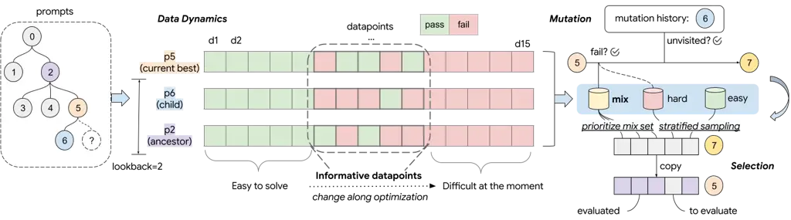
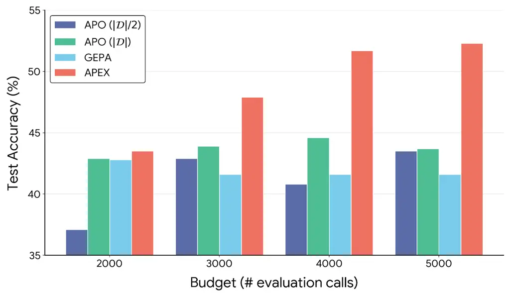
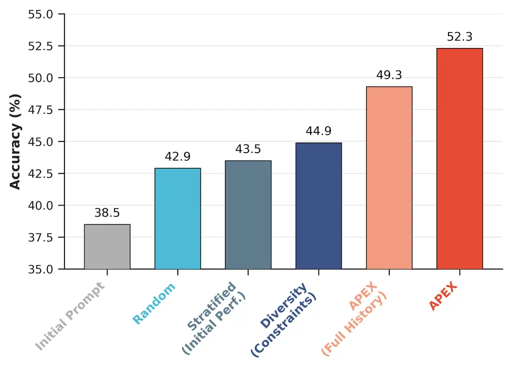
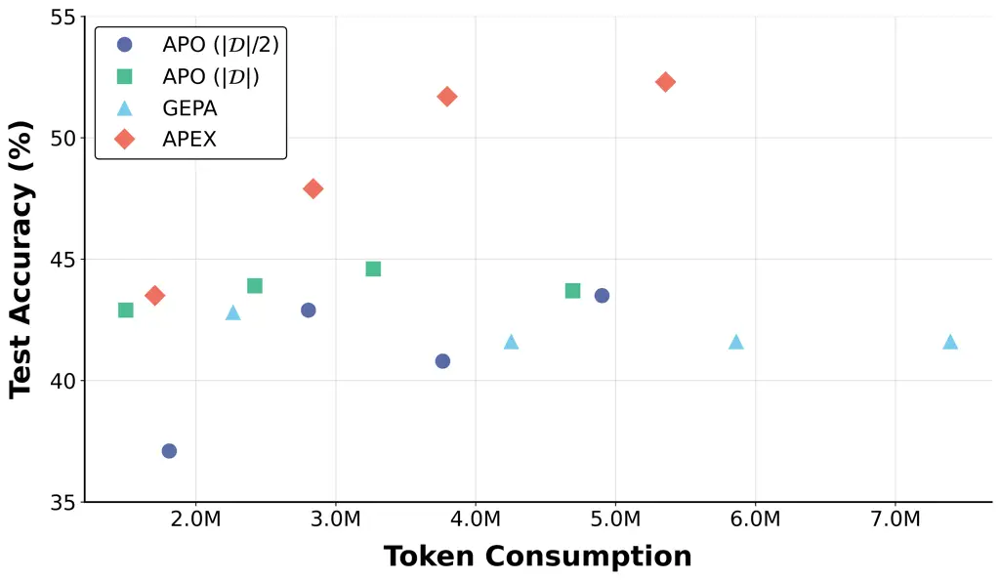

# APEX: Automated Prompt Engineering eXpert with Dynamic Data Selection

Fei Wang Affiliation: Google Email: [feiwangnlp@google.com](mailto:)   
Si Si Affiliation: Google Email: [sisidaisy@google.com](mailto:)   
Cho-Jui Hsieh Affiliation: UCLA Email: [chohsieh@cs.ucla.edu](mailto:)
   Inderjit S. Dhillon Affiliation: Google
Email: [isd@google.com](mailto:)

###### Abstract

Large Language Models are highly sensitive to prompt formulation,
necessitating automatic prompt optimization to unlock their full
potential. While evolutionary algorithms have emerged as the dominant
paradigm, they suffer from a critical bottleneck: data efficiency.
Current methods treat the development dataset as a static benchmark,
wasting significant compute budget on uninformative data. In this work,
we introduce APEX (Automated Prompt Engineering eXpert), a novel
framework that optimizes the data usage alongside the prompt search.
APEX dynamically stratifies the dataset into Easy, Hard, and Mixed tiers
based on the optimization lineage. By prioritizing the Mixed tier, which
identifies the data where the LLM has mixed performance, we identify two
high-leverage subsets: the addressable frontier for generating
informative mutations and the rank-sensitive frontier for distinguishing
candidate quality. We evaluate APEX across three diverse benchmarks:
IFBench, SimpleQA Verified, and FACTS Grounding. Under a fixed budget of
5,000 evaluation calls, due to its data efficiency, APEX outperforms the
initial prompt by an average of 11.2% on Gemini 2.5 Flash and 6.8% on
Gemma 3 27B, demonstrating that a data-centric approach is key to
efficient and effective prompt optimization.

## 1 Introduction

Large Language Models (LLMs) have demonstrated remarkable capabilities
across instruction following, fact retrieval, and complex reasoning.
However, their performance remains notoriously sensitive to the prompts
(Kojima et al., 2022). A minor change can often mean the difference
between a correct answer and a hallucination. This fragility has given
rise to automatic prompt optimization, a field dedicated to treating
prompts not as static strings, but as learnable parameters that can be
optimized (Zhou et al., 2023b; Pryzant et al., 2023; Deng et al., 2022;
Hsieh et al., 2024).

Currently, genetic and evolutionary algorithms have emerged as the
dominant paradigm in prompt optimization, exemplified by methods like
APO (Pryzant et al., 2023) and GEPA (Agrawal et al., 2025). These
frameworks typically operate through an iterative two-stage process: (1)
Mutation, where the optimizer analyzes error cases from the current
prompt to generate new candidate prompts, and (2) Selection, where these
candidates are evaluated and ranked by their performance to identify the
better ones.

However, this paradigm faces a critical and often overlooked bottleneck:
data efficiency. The effectiveness of both stages is heavily dependent
on the quality of the data used. The mutation stage relies on
identifying informative failure cases that point towards fixable errors,
while the selection stage requires a rigorous evaluation to accurately
rank candidates. Current methods typically resort to naive data
strategies: random sampling for mutation, and either random sampling or
full-set evaluation for selection. This creates a fundamental dilemma:
random sampling leads to rank instability, where superior prompts are
discarded due to variance, while full-set evaluation depletes the
compute budget rapidly, limiting the search to only a few generations.

We argue that the root cause of this inefficiency is the treatment of
the dataset as a static benchmark. In reality, the utility of any given
data point is not fixed. It changes dynamically throughout the
optimization process. As prompts evolve and improve, examples that were
once informative discriminators may converge into consistently Easy
cases (solved by all candidates), while others persist as
Hard (intractable noise). Continuing to mutate based on unsolvable
errors, or evaluating candidates on examples that have lost their
discriminatory power, wastes a significant portion of the compute budget
on signals that provide zero improvement information.

To address this, we introduce APEX (Automated Prompt Engineering
eXpert). APEX shifts the focus from improving the search algorithm to
improving the data usage. By maintaining a lineage of prompt
performance, APEX dynamically categorizes data points into Easy, Hard,
and Mixed tiers. Our core insight is that the informative mutation and
selection signals primarily lie in the Mixed tier, where the LLM has
mixed performance on recent prompt variants. This dynamic tier
constitutes two critical frontiers: the addressable frontier indicating
volatile errors suitable for mutation, and the rank-sensitive frontier
with ambiguous cases that differentiate candidates. By prioritizing
compute to these high-leverage frontiers, APEX maximizes the
optimization signal per evaluation call.

In summary, our contributions are three-fold. First, we identify the
data efficiency bottleneck in current genetic prompt optimization
methods and attribute it to the static treatment of dynamic data
signals. Second, we propose APEX, a novel algorithm that enhances the
prompt optimization process by stratifying data into dynamic tiers and
targeting the “Addressable" and “Rank-Sensitive" frontiers. Third, we
achieve performance gains across three diverse benchmarks (IFBench,
SimpleQA Verified, FACTS Grounding). Under a fixed budget of 5,000
evaluation calls, APEX improves performance by 11.2% on Gemini 2.5 Flash
and 6.8% on Gemma 3 27B, establishing a new standard for data-efficient
prompt optimization.

## 2 Related Work

### 2.1 Automatic Prompt Optimization

Early research explored diverse search strategies for prompt
engineering, ranging from gradient-based methods (Shin et al., 2020;
Deng et al., 2022; Chen et al., 2024a) and edit-based heuristics (Prasad
et al., 2023), to instruction induction (Honovich et al., 2023). They
have paved the way for LLM-driven optimization frameworks, which
formalize prompt optimization by leveraging LLMs to generate candidate
instructions (Zhou et al., 2023b; Yang et al., 2024).

As the field matured, genetic (or evolutionary) algorithms utilizing
natural language feedback emerged as the most effective paradigm. A
representative method is APO (Pryzant et al., 2023), which iteratively
refines prompts by treating error feedback as a signal for mutation.
Parallel work has explored other directions to improve the genetic
approach, by integrating history guidance, hybrid search strategies, and
carefully curated meta-prompts  (Hsieh et al., 2024; Fernando et al.,
2024; Wang et al., 2024b; Ye et al., 2024; Guo et al., 2024). Notably,
AELP (Hsieh et al., 2024) is designed for long prompts, utilizing
history guidance and limiting the mutation scope to ensure stability.
Recent research has also expanded the scope of prompt optimization to
agentic workflows (Agrawal et al., 2025; Opsahl-Ong et al., 2024),
in-context learning (Wu et al., 2024; Wan et al., 2024), and multimodal
scenarios (Liu et al., 2024; Wan et al., 2025). Among them, GEPA
(Agrawal et al., 2025) employs a Genetic-Pareto framework to optimize
agents towards a multi-objective frontier.

Despite these advancements, the field has largely overlooked the
data-centric perspective of prompt optimization. Most existing methods
treat the dataset as a static benchmark, ignoring the varying
informational value of different examples. APEX address this fundamental
inefficiency by improving the data selection process itself. By
dynamically tracking the rank-sensitivity and solvability of datapoints,
APEX allocates compute wisely.

### 2.2 Data Selection for LLM Alignment

The importance of data quality over quantity for LLM alignment was
highlighted by the LIMA hypothesis (Zhou et al., 2023a), which provided
empirical evidence that a small, curated set of examples is sufficient
for alignment. This insight catalyzed a wave of automated data selection
methods. AlpaGasus (Chen et al., 2024b) filters low-quality data to
improve fine-tuning efficiency, while LESS (Xia et al., 2024) selects
data based on gradient similarity. Additionally, influence-based
approaches (Choe et al., 2025) utilize influence functions to identify
which training examples most affect downstream capabilities. More recent
work has shifted towards dynamic and active data curation, such as Data
Advisor (Wang et al., 2024a), which dynamically curates data to improve
safety alignment.

Parallel to these training-time advances, data selection has recently
garnered attention in prompt optimization. Notable approaches, such as
those by Diao et al. (2024) and Dong et al. (2025), employ active
learning or combine data similarity and model confidence heuristics to
curate examples. However, the application scope of these methods is
limited by restrictive dependencies, such as human-in-the-loop
annotation, reliance on internal model signals (e.g., logits), or
restriction to classification tasks. These requirements render them
unsuitable for general generative tasks under fully automated, black-box
API settings, and non-comparable to our work. APEX extends the
principles of identifying informative data and dynamic curation to
prompt optimization, offering a fully automated, black-box solution.



Figure 1: The APEX framework overview. The optimization process begins
by tracking prompt lineage (left), where historical performance across
ancestors (e.g., $`p_{2}`$) and children (e.g., $`p_{6}`$) is analyzed
over a defined lookback window. In the Data Dynamics phase (center),
datapoints are dynamically categorized into tiers (Easy, Hard, and
Mixed) based on pass/fail trajectories. The Mixed set identifies
informative datapoints where model performance is inconsistent,
signaling high potential for optimization. These tiers inform the
Mutation and Selection stages (right): the former leverages mutation
history to explore unvisited prompt space, while the latter employs
stratified sampling to efficiently rank candidate prompts. Notably, both
stages prioritize the Mixed set to focus optimization on high-signal
datapoints. Evaluation is incremental, skipping previously evaluated
datapoints to maximize efficiency.

## 3 Bottleneck of Prompt Optimization

### 3.1 Preliminary: Prompt Optimization

Prompts serve as the primary interface for interacting with LLMs at the
inference stage. For a given user intent, there exists an expansive
space of potential prompt variants, many of which yield significantly
different performance outcomes. The goal of prompt optimization is to
systematically identify an optimal prompt $`P^{*}`$ that maximizes a
predefined performance metric on a target LLM:

```math
P^{*}=\arg\max_{P}\mathbb{E}_{x\sim\mathcal{D}^{*}}[f(x,\text{LLM}(P,x))], \tag{1}
```

where $`\mathcal{D}^{*}`$ represents the oracle data distribution and
$`f(\cdot)`$ is an evaluation function (e.g., string-matching accuracy
or model-based grading) that scores the LLM’s response relative to input
$`x`$.

To simplify notation across the optimization trajectory, we define
$`s(P,x)\in\{0,1\}`$ as the binary evaluation outcome of prompt $`P`$ on
datapoint $`x`$, where only a perfect score yields a pass ($`1`$) and
any partial credit is treated as a failure ($`0`$).

In practice, both the LLM and the evaluation function $`f`$ are treated
as black boxes where gradients are unavailable. Consequently,
derivative-free genetic algorithms, such as APO (Pryzant et al., 2023)
and GEPA (Agrawal et al., 2025), have emerged as leading methods. These
methods typically iterate through two primary stages on a collected
dataset $`\mathcal{D}`$:

Mutation: To explore the prompt space, a meta-optimizer
$`\text{LLM}_{\text{meta}}`$ (typically the target LLM itself) generates
a new prompt $`P_{\text{new}}`$ conditioned on an existing prompt
$`P_{\text{curr}}`$ and a batch of its error cases
$`\mathcal{E}_{\text{curr}}\subset\{x\in\mathcal{D}\mid s(P_{\text{curr}},x)=0\}`$:

```math
P_{\text{new}}\sim\text{LLM}_{\text{meta}}(P_{\text{curr}},\mathcal{E}_{\text{curr}}). \tag{2}
```

Selection: The new candidate prompt $`P_{\text{new}}`$ is evaluated
alongside the current population $`\mathcal{P}_{t}`$. The subsequent
generation $`\mathcal{P}_{t+1}`$ is constructed by selecting the $`k`$
highest-performing prompts based on their aggregate scores on
$`\mathcal{D}`$:

```math
\mathcal{P}_{t+1}=\text{Top-}k\left(\mathcal{P}_{t}\cup\{P_{\text{new}}\}\mid\mathcal{D}\right). \tag{3}
```

### 3.2 Problem: Data Efficiency

Despite their success, data efficiency remains a critical but overlooked
bottleneck in both the mutation and selection stages, hindering the
scalability of existing frameworks. We formalize the global optimization
state as a sparse score matrix
$`\mathbf{S}\in\{0,1,\emptyset\}^{|\mathcal{P}|\times|\mathcal{D}|}`$,
where each entry $`S_{j,i}`$ represents the performance of prompt
$`P_{j}`$ on datapoint $`x_{i}\in\mathcal{D}`$:

```math
S_{j,i}=s(P_{j},x_{i})\in\{0,1\},\quad(\text{or }\emptyset\text{ if not applicable}). \tag{4}
```

#### Inefficiency in Mutation.

The mutation distribution produced by $`\text{LLM}_{\text{meta}}`$
highly depends on $`\mathcal{E}_{\text{curr}}`$. Current methods
typically rely on random sampling of error cases, which fails to account
for the optimization trajectory, rendering the mutation process a source
of instability rather than monotonic improvement.

Optimization performance is often governed by a hierarchy of
“fixability,” where certain errors serve as logical precursors to
others. For instance, if error samples’ batch $`\mathcal{E}_{b}`$
contains errors only addressable after foundational issues in
$`\mathcal{E}_{a}`$ are resolved, the trajectory must follow the
sequence $`\mathcal{E}_{a}\rightarrow\mathcal{E}_{b}`$. Reversing this
sequence or sampling randomly leads to high-variance updates and
“forgetting,” as the $`\text{LLM}_{\text{meta}}`$ attempts to solve
high-level failures without the necessary prompt refinements established
in earlier stages.

This lack of trajectory awareness also frequently precipitates the trap
where $`\mathcal{E}_{\text{curr}}`$ becomes dominated by “impossible”
cases that are fundamentally beyond the capacity of the target LLM.
Attempting to optimize for these points misleads the
$`\text{LLM}_{\text{meta}}`$, stalling progress. Notably, the optimal
data for mutation is non-static; it changes dynamically along the
optimization process as different error types become addressable at
different stages of prompt maturity.

#### Inefficiency in Selection.

The selection stage represents the primary computational overhead of the
optimization loop, often accounting for more than 90% of total costs.¹¹
1 Generating a mutation often requires fewer than three API calls,
whereas the selection phase requires evaluating the new prompt across
the entire dataset or multiple candidates on subsets, frequently
requiring hundreds of API calls, as reported in APO and GEPA. This
creates a fundamental trade-off between selection accuracy and the
number of iterations $`T`$ possible within a fixed budget. While
comprehensive evaluation ensures precise ranking, it is computationally
prohibitive. Conversely, stochastically sampling a subset introduces
estimation noise that leads to rank inversion, where suboptimal prompts
are mistakenly retained.

Crucially, absolute performance estimates are often redundant. For
selection, the priority is the relative rank of candidates. Because the
population consists of parents, children, and siblings that share
significant structural or semantic similarities, their performance is
identical for a large portion of $`x\in\mathcal{D}`$. The true
bottleneck is the failure to isolate discriminative data:

```math
\mathcal{D}_{\text{disc}}=\{x_{i}\in\mathcal{D}\mid\exists P_{a},P_{b}\in\mathcal{P}_{t}:s(P_{a},x_{i})\neq s(P_{b},x_{i})\}. \tag{5}
```

Existing frameworks waste their budget evaluating
$`x\notin\mathcal{D}_{\text{disc}}`$, where all candidates perform
identically. Evaluating these points provides zero information for
selection, effectively reducing the number of meaningful updates
possible within a fixed compute budget.

## 4 Method: APEX

The APEX framework (Figure 1) addresses the core bottlenecks of data
inefficiency by dynamically re-evaluating the utility of each datapoint
in the optimization loop (Algorithm 1). Instead of treating the
development set as a static benchmark, APEX categorizes data based on
its historical interaction with the prompt lineage to guide both
mutation and selection.

Input : Initial $`P_{0}`$, Iterations $`T`$, Budget $`N`$, Batch $`m`$,
Init anchor $`\alpha_{0}`$, Lookback $`k`$

Output : Optimized Prompt $`P^{*}`$

1
$`P_{\text{curr}}\leftarrow P_{0};\hskip 9.24994pt\alpha\leftarrow\alpha_{0}`$

2 $`\mathcal{H}\leftarrow\{\text{EvaluateFull}(P_{0},\mathcal{D})\}`$

3 for _$`t=1\dots T`$_ do

    // 1. Dynamic Data Stratification

     4
$`\mathcal{B}\leftarrow\text{Stratify}(\mathcal{D},\mathcal{H},k)`$ //
Alg. 2

    // 2. Trajectory-Guided Mutation

     5
$`\mathcal{E}\leftarrow\text{Sample }m\text{ unused from }\mathcal{B}_{M,0}\cup\mathcal{B}_{H,0}`$

     6
$`C\leftarrow\text{LLM}_{\text{meta}}(\text{Critique}(P_{\text{curr}},\mathcal{E}))`$

     7
$`P_{\text{new}}\leftarrow\text{LLM}_{\text{meta}}(\text{Mutate}(P_{\text{curr}},C))`$

    // 3. Rank-Sensitive Selection

     8 $`\mathcal{D}_{\text{req}}\leftarrow\mathcal{B}_{M,\emptyset}`$

     9 $`R\leftarrow N-|\mathcal{D}_{\text{req}}|`$ // Remaining budget

     10
$`\rho_{\text{mix}}\leftarrow\text{PassRate}(\mathcal{B}_{M});\;\;\rho_{\text{all}}\leftarrow\text{PassRate}(\mathcal{D})`$

     11
$`k_{\text{pos}}\leftarrow\lfloor\min(\alpha,\rho_{\text{mix}},\rho_{\text{all}})\cdot R\rfloor;\;\;k_{\text{neg}}\leftarrow R-k_{\text{pos}}`$

     12
$`\mathcal{D}_{\text{pos}}\leftarrow\text{Sample }k_{\text{pos}}\text{ prioritizing }\mathcal{B}_{M,1}\text{ then }\mathcal{B}_{E,\emptyset}`$

     13
$`\mathcal{D}_{\text{neg}}\leftarrow\text{Sample }k_{\text{neg}}\text{ prioritizing }\mathcal{B}_{M,0}\text{ then }\mathcal{B}_{H,\emptyset}`$

     14
$`\mathcal{D}_{\text{eval}}\leftarrow\mathcal{D}_{\text{req}}\cup\mathcal{D}_{\text{pos}}\cup\mathcal{D}_{\text{neg}}`$

     15 Evaluate $`P_{\text{new}}`$ and $`P_{\text{curr}}`$ on
$`\mathcal{D}_{\text{eval}}`$

     16 if _$`P_{\text{new}}`$ is better than
$`P_{\text{curr}}\text{ on }\mathcal{D}_{\text{eval}}`$_ then

         17 $`P_{\text{curr}}\leftarrow P_{\text{new}}`$

         18 $`\alpha\leftarrow\alpha+\beta`$ // Anneal anchor

     19 Update $`\mathcal{H}`$ with Evaluation of $`P_{\text{new}}`$ and
$`P_{\text{curr}}`$ on $`\mathcal{D}_{\text{eval}}`$

20 return _$`P_{\text{curr}}`$_

Algorithm 1 APEX (Mutation & Selection)

Input : Dataset $`\mathcal{D}`$, History $`\mathcal{H}`$, Lookback $`k`$

Output : Granular Data Buckets $`\mathcal{B}_{t,s}`$

1 Initialize empty buckets $`\mathcal{B}_{t,s}`$

2 for _each $`x_{i}\in\mathcal{D}`$_ do

    // Retrieve the last k non-empty outcomes

     3
$`\mathcal{R}_{i}\leftarrow\text{Last }k\text{ valid scores }s(P,x_{i})\text{ from }\mathcal{H}`$

    // Determine semantic tier

     4 if _$`\text{Set}(\mathcal{R}_{i})\equiv\{1\}`$_ then

         5 $`t\leftarrow\text{E (Easy)}`$

     6 else if _$`\text{Set}(\mathcal{R}_{i})\equiv\{0\}`$_ then

         7 $`t\leftarrow\text{H (Hard)}`$

     8 else

         9 $`t\leftarrow\text{M (Mixed)}`$

    // Lookup cached status (yields $`\emptyset`$ if uneval)

     10
$`s\leftarrow\text{Retrieve }s(P_{\text{curr}},x_{i})\text{ from }\mathcal{H}`$

     11 $`\mathcal{B}_{t,s}\leftarrow\mathcal{B}_{t,s}\cup\{x_{i}\}`$

12 return _$`\mathcal{B}`$_

Algorithm 2 Dynamic Data Stratification

### 4.1 Data Dynamics for Prompt Optimization

The core philosophy of APEX is to move beyond static data by
characterizing how individual datapoints influence the optimization
trajectory. We categorize the interaction between the prompt lineage and
the dataset into three distinct dynamics: Easy, Hard, and Mixed
(Algorithm 2).

To accurately capture these dynamics without overfitting to stale data,
we treat the evaluation history $`\mathcal{H}`$ as an ordered sequence
of prompts. For any datapoint $`x_{i}\in\mathcal{D}`$, let
$`\mathcal{H}^{(i)}_{\text{valid}}`$ be the sub-sequence of historical
prompts that have actively evaluated $`x_{i}`$ (i.e.,
$`s(P,x_{i})\neq\emptyset`$). We define its local history
$`\mathcal{R}_{i}`$ as the set of outcomes from the $`k`$ most recent
prompts in $`\mathcal{H}^{(i)}_{\text{valid}}`$:

```math
\mathcal{R}_{i}=\left\{s(P,x_{i})\mid P\in\text{last}_{k}\big(\mathcal{H}^{(i)}_{\text{valid}}\big)\right\}. \tag{6}
```

The lookback window $`k`$ acts as a dynamic slice on the sparse score
matrix $`\mathbf{S}`$, ensuring the optimizer always has a consistent
sample size of relevant, recent behavior rather than outdated signals.

We partition the dataset $`\mathcal{D}`$ into three semantic tiers based
on the variance of $`\mathcal{R}_{i}`$:

```math
\text{Tier}(i)=\begin{cases}\text{E (Easy)}&\text{if }\text{Set}(\mathcal{R}_{i})\equiv\{1\}\\
\text{H (Hard)}&\text{if }\text{Set}(\mathcal{R}_{i})\equiv\{0\}\\
\text{M (Mixed)}&\text{if }\text{Set}(\mathcal{R}_{i})\equiv\{0,1\}\end{cases} \tag{7}
```

- •
  Easy: Points consistently solved by the lineage. Re-evaluating them
  provides minimal signal.
- •
  Hard: Points consistently failed. These represent data that are
  currently intractable.
- •
  Mixed: Points exhibiting volatility. These represent the
  rank-sensitive frontier for evaluation and the most probable targets
  for improvement.

By intersecting these historical tiers $`T\in\{E,H,M\}`$ with the
evaluation outcome $`s\in\{1,0,\emptyset\}`$ under the current prompt
$`P_{\text{curr}}`$, we partition the dataset $`\mathcal{D}`$ into nine
disjoint subsets, denoted as $`\mathcal{B}_{T,s}`$. This notation
provides a granular view of the data state. For example,
$`\mathcal{B}_{M,0}\subseteq\mathcal{D}`$ represents the subset of
historically Mixed instances that are currently failing, while
$`\mathcal{B}_{E,\emptyset}`$ represents Easy instances that were
skipped in the current pass.

|                  |                          |                          |                          |                         |
| ---------------- | ------------------------ | ------------------------ | ------------------------ | ----------------------- | ----------------------- | ----------- |
| Method           | IFBench                  | SimpleQA Verified        | FACTS Grounding          | Average                 |
| Gemini 2.5 Flash |                          |                          |                          |                         |
| Initial Prompt   | 38.5 $`\pm`$ 1.2 (—)     | 23.6 $`\pm`$ 0.6 (—)     | 85.8 $`\pm`$ 1.1 (—)     | 49.3 (—)                |
| GEPA             | 41.2 $`\pm`$ 0.9 (+2.7)  | 28.8 $`\pm`$ 0.8 (+5.2)  | 93.5 $`\pm`$ 0.0 (+7.7)  | 54.5 (+5.2)             |
| APO ($`          | D                        | `$)                      | 43.7 $`\pm`$ 1.2 (+5.2)  | 27.4 $`\pm`$ 2.6 (+3.8) | 89.7 $`\pm`$ 1.9 (+3.9) | 53.6 (+4.3) |
| APO ($`          | D                        | /2`$)                    | 43.5 $`\pm`$ 1.9 (+5.0)  | 25.0 $`\pm`$ 3.5 (+1.4) | 89.9 $`\pm`$ 0.1 (+4.1) | 52.8 (+3.5) |
| APEX (Ours)      | 52.3 $`\pm`$ 1.4 (+13.8) | 35.0 $`\pm`$ 2.3 (+11.4) | 94.1 $`\pm`$ 0.4 (+8.3)  | 60.5 (+11.2)            |
| Gemma 3 27B      |                          |                          |                          |                         |
| Initial Prompt   | 33.4 $`\pm`$ 0.7 (—)     | 9.4 $`\pm`$ 0.5 (—)      | 80.7 $`\pm`$ 1.6 (—)     | 41.2 (—)                |
| GEPA             | 34.1 $`\pm`$ 0.5 (+0.7)  | 9.4 $`\pm`$ 0.5 (+0.0)   | 91.7 $`\pm`$ 0.5 (+11.0) | 45.1 (+3.9)             |
| APO ($`          | D                        | `$)                      | 35.7 $`\pm`$ 2.4 (+2.3)  | 11.5 $`\pm`$ 0.1 (+2.1) | 88.5 $`\pm`$ 0.7 (+7.8) | 45.2 (+4.0) |
| APO ($`          | D                        | /2`$)                    | 36.1 $`\pm`$ 0.5 (+2.7)  | 8.4 $`\pm`$ 1.4 (-1.0)  | 85.7 $`\pm`$ 0.9 (+5.0) | 43.4 (+2.2) |
| APEX (Ours)      | 39.3 $`\pm`$ 2.0 (+5.9)  | 11.5 $`\pm`$ 1.2 (+2.1)  | 93.3 $`\pm`$ 0.1 (+12.6) | 48.0 (+6.8)             |

Table 1: Main Results. Accuracy (%) $`\pm`$ Std Dev and absolute gain
($`\Delta`$) over the initial prompt. APEX consistently outperforms
baselines.

### 4.2 Trajectory-Guided Mutation

To resolve the stochastic instability of mutation, APEX enforces a
trajectory-guided strategy. Standard optimization methods uniformly
sample errors from the entire failure set, frequently retrieving “hard”
cases ($`\mathcal{B}_{H,0}`$) that the current prompt logic cannot
handle, leading to hallucinated corrections.

In contrast, APEX targets the addressable frontier by constructing the
mutation error batch primarily from the Mixed-Fail bucket
($`\mathcal{B}_{M,0}`$). These “soft failures” are datapoints where the
model has demonstrated capacity in the recent lineage but regressed
under the current variation. Correcting these regressions stabilizes the
trajectory.

Furthermore, to ensure coverage maximization, we maintain a usage
history $`\mathcal{U}`$ to prevent the optimizer from repeatedly
overfitting to the same recurring failures. Errors for mutation are
exclusively drawn from unvisited failures:

```math
e\in\left\{x_{i}\mid x_{i}\in(\mathcal{B}_{M,0}\cup\mathcal{B}_{H,0}),\,x_{i}\notin\mathcal{U}\right\}. \tag{8}
```

Once this pool is exhausted, the usage history is reset, guaranteeing
broad exploration of the error surface.

### 4.3 Rank-Sensitive Evaluation

The selection stage reduces evaluation cost by focusing on the
rank-sensitive subset, which contains datapoints where the new prompt is
most likely to diverge from its parent. We construct evaluation dataset
$`\mathcal{D}_{\text{eval}}`$ using a tiered sampling strategy to fill
the budget $`N`$. First, we identify volatile unknowns, data points that
are historically mixed but were skipped during the previous evaluation.
These provide the highest information gain and form the required
baseline: $`\mathcal{D}_{\text{req}}=\mathcal{B}_{M,\emptyset}.`$ To
fill the remaining evaluation budget $`R=N-|\mathcal{D}_{\text{req}}|`$,
we employ stratified sampling to balance stability (anchors) and error
correction. We sample a positive set $`\mathcal{D}_{\text{pos}}`$
(prioritizing $`\mathcal{B}_{M,1}`$ to catch regressions, followed by
$`\mathcal{B}_{E,\emptyset}`$) and a negative set
$`\mathcal{D}_{\text{neg}}`$ (prioritizing $`\mathcal{B}_{M,0}`$ to
confirm fixes).

The size of these sets is governed by an anchor ratio $`\alpha_{t}`$,
which dictates the proportion of the budget dedicated to verifying
positive stability. This ratio follows an annealing schedule, growing
when a prompt update is successful:

```math
\alpha_{t+1}=\alpha_{t}+\beta\cdot\mathbb{I}(P_{\text{new}}\succ P_{\text{curr}}). \tag{9}
```

As the prompt improves, $`\alpha`$ increases, effectively “locking in”
mastered logic by dedicating more evaluation budget to preventing
regressions. To ensure the anchor size is calibrated to the model’s
actual competence, we clamp $`\alpha_{t}`$ against the pass ratios of
the mixed tier ($`\rho_{\text{mix}}`$) and the global dataset
($`\rho_{\text{all}}`$):

```math
k_{\text{pos}}=\lfloor\min(\alpha_{t},\rho_{\text{mix}},\rho_{\text{all}})\cdot R\rfloor,\quad k_{\text{neg}}=R-k_{\text{pos}}. \tag{10}
```

Finally, to minimize computational overhead, APEX employs an incremental
evaluation scheme. If an outcome $`s(P_{\text{curr}},x_{i})`$ for a
sampled point already exists in the history $`\mathcal{H}`$, we retrieve
it directly from memory, executing full inference only for the new
candidate.

## 5 Experiments



Figure 2: Comparison of test accuracy versus budget (i.e., number of
evaluation calls) on IFBench with Gemini 2.5 Flash. The performance
margin between APEX and baselines becomes larger as budget increases.



Figure 3: Ablation study of data selection strategies. Comparison of
test accuracy across different selection methods using Gemini-2.5-Flash
on IFBench.

### 5.1 Experimental Setting

#### General Setup.

We employ Gemini-2.5-Flash (Comanici et al., 2025) and Gemma-3-27B (Team
Gemma et al., 2025) as our underlying LLMs. For each experiment, we
utilize the same model for both the meta-optimizer
($`\text{LLM}_{meta}`$) and the target model (LLM). To enforce a fair
comparison across methods with varying sample efficiency, we restrict
all optimizers to a fixed global budget of 5,000 calls to the evaluation
function.

#### Datasets.

We evaluate APEX on three distinct tasks representing instruction
following, parametric factuality, and grounded generation. IFBench
(Pyatkin et al., 2025): A benchmark for precise instruction following on
verifiable constraints. The evaluation function verify adherence to
constraints using code-based verifiers. Following the protocol of
Agrawal et al. (2025), we sample 500 data points from the IF-RLVR split
for optimization and reserve 294 examples from IFBench for testing.
Notably, the constraints in the development set and the test set have no
overlap. SimpleQA Verified (Haas et al., 2025): Assesses short-form
factuality based on the model’s parametric knowledge across diverse
topics. The evaluation compares the model’s prediction against the
gold-standard answer. We randomly partition the data into 700 examples
for optimization and 300 for testing. FACTS Grounding (Jacovi et al.,
2025): Evaluates the model’s ability to generate long-form responses
with respect to a provided context document. The evaluation assesses
both response quality and grounding quality using a multi-phase
LLM-based judge system. We randomly partition the data into 660 examples
for optimization and 200 for testing.

#### Baselines.

We compare APEX against the following leading prompt optimization
frameworks. APO (Pryzant et al., 2023): A genetic based prompt
optimization method that remains the best-performing after its release
(Wan et al., 2024).²² 2
[https://github.com/microsoft/LMOps/tree/main/prompt_optimization](https://github.com/microsoft/LMOps/tree/main/prompt_optimization)
It utilizes reflective mutation based on textual feedback and employs a
sampling-based selection mechanism with a controllable budget per
iteration. Since APO allows for a controllable evaluation budget, we
include two baselines with per-iteration budgets set to the size of the
development set ($`|D|`$) and half that size ($`|D|/2`$). GEPA (Agrawal
et al., 2025): A genetic framework designed for agentic workflows.³³ 3
[https://github.com/gepa-ai/gepa](https://github.com/gepa-ai/gepa) It
evolves prompts via reflective mutation and employs a Pareto-based
selection strategy on the full development set.

#### Implementation Details.

For APEX, we employ a lineage lookback window of $`k=5`$ to construct
the history for data categorization. The mutation batch size is set to
$`m=5`$. For the rank-sensitive evaluation, we set the evaluation budget
per iteration to $`T=100`$. The anchor ratio initializes at
$`\alpha=0.2`$ and increments by $`\beta=0.03`$ when a better prompt is
found, gradually stabilizing the evaluation set as the prompt converges.

### 5.2 Main Results

Table 1 presents the comparative performance of APEX against baseline
methods. APEX consistently outperforms baselines across both LLMs and
all three benchmarks, achieving the highest average accuracy. On Gemini
2.5 Flash, the method secures a mean accuracy of 60.5% (+11.2% over the
initial prompt), obviously surpassing the strongest baseline, GEPA,
which reaches 54.5%. This observation is consistent on Gemma 3 27B,
where APEX maintains its lead. Notably, this performance gap is
particularly pronounced on complex instruction-following tasks and when
optimizing stronger LLMs, highlighting the method’s scalability.
Broadly, these results validate that the bottleneck in prompt
optimization is not merely the search algorithm, but the effective
optimization signals. While baselines struggle with the trade-off
between signal cost and signal noise, APEX demonstrates that actively
shaping the data distribution allows for directed and stable
improvement.

A deeper analysis of the experimental results isolates two distinct
failure modes in existing prompt selection strategies. First, methods
reliant on full-set evaluation (GEPA) suffer from limited search depth.
While the evaluation signal is reliable, the prohibitive computational
cost restricts the depth of optimization trajectories. Second, random
subsampling strategies (APO) lack evaluation stability. The reliance on
small random sets introduces high variance, failing to reliably
distinguish between superior and inferior prompts. This instability is
evident in that aggressive subsampling with fewer evaluation samples to
exchange for more iterations (APO $`|D|/2`$) may lead to performance
regression compared to the conservative baseline (APO $`|D|`$).
Furthermore, these evaluation issues exacerbate the inherent limitations
of random mutation. GEPA truncates the search before the process can
stabilize, while APO exhibits performance regression by corrupting the
selection signal with noise. Consequently, baselines fail to achieve
stable and monotonic improvement. APEX effectively navigates these
trade-offs through its dynamic data selection strategy. By prioritizing
the Addressable Frontier for mutation and the Rank-Sensitive Frontier
for selection, the method achieves better performance across multiple
scenarios.

Beyond aggregate metrics, we observe that the magnitude of improvement
is strongly correlated with the interplay between task characteristics
and LLM capability. Prompt optimization yields the most significant
returns in a “promising region" where the model possesses latent
knowledge but lacks the instruction alignment to express it. This is
evident in the contrast between easy tasks like FACTS Grounding, where
strong base capabilities allow for substantial refinement, and difficult
scenarios like Gemma 3 27B on SimpleQA Verified, where fundamental
knowledge deficits impose a hard ceiling on improvements regardless of
the optimization strategy.

|                            |                          |       |
| -------------------------- | ------------------------ | ----- |
| Trajectory-Guided Mutation | Rank-Sensitive Selection | Score |
| ✓                          | ✓                        | 52.3  |
| ✗                          | ✓                        | 50.2  |
| ✓                          | ✗                        | 48.3  |
| ✗                          | ✗                        | 42.9  |

Table 2: Independent contributions of APEX’s mutation and selection
components on IFBench with Gemini-2.5-Flash.

|                               |       |
| ----------------------------- | ----- |
| Method                        | Score |
| APEX                          | 52.3  |
|    – Random on hard and mixed | 47.3  |
|    – Random on hard           | 30.3  |
|    – Random on all data       | 42.9  |

Table 3: Impact of sampling from different data tiers on IFBench with
Gemini-2.5-Flash.

### 5.3 Analysis

To provide an in-depth understanding of the prompt optimization methods,
we conduct a fine-grained analysis on IFBench with Gemini 2.5 Flash.

#### Performance across Budgets.

Figure 3 illustrates the test accuracy achieved across different
evaluation budgets. GEPA exhibits competitive early performance but
makes little progress thereafter, a result of insufficient exploration
constrained by high per-iteration costs. Conversely, the aggressive
subsampling of APO ($`|\mathcal{D}|/2`$) results in instability. In
contrast, APEX maintains a sustained improvement that becomes
increasingly pronounced as the budget scales, validating the critical
importance of data efficiency.

#### Impact of Data Selection Strategy.

Figure 3 dissects the contribution of different data selection
mechanisms to the final performance. The results highlight a clear
hierarchy of efficacy. Random Selection provides a baseline improvement
over the initial prompt. Stratified Sampling balances the dataset based
on initial prompt performance, marginally improving upon random
selection. Explicitly enforcing Diversity based on constraint types
provides further gains, as it introduces auxiliary guidance information.
However, these methods still fall significantly short of APEX variants.
The comparison between APEX (Full History) and the complete APEX
validates the hypothesis of our dynamic frontier strategy, demonstrating
that removing outdated signals to target the dynamic frontiers delivers
a substantial performance margin.

#### Ablation on Mutation and Selection Methods.

We conduct an ablation study to isolate and quantify the individual
contributions of APEX’s prompt mutation and selection mechanisms. As
detailed in Table 3, replacing both components with random baselines
results in a severe performance drop. Introducing APEX’s selection
strategy independently yields a greater improvement than applying the
mutation strategy alone. Crucially, the combination of both components
achieves the peak overall score, highlighting a strong synergistic
effect between trajectory-guided mutation and rank-sensitive selection.

#### Necessity of Prioritizing Mixed Data.

Table 3 highlights the critical role of mixed data during optimization.
Sampling exclusively from the hard tier severely degrades performance,
causing the prompt to overfit to narrow edge cases at the expense of
general accuracy. In contrast, incorporating mixed data alongside hard
examples substantially outperforms uniform random sampling across all
data. This confirms that prioritizing mixed-tier examples provides a
vital grounding signal, preventing catastrophic overfitting and ensuring
the prompt maintains broad generalization.

Figure 4: Qualitative analysis of APEX prompt evolution. The left panel
tracks the optimization trajectory, highlighting when key instructional
strategies were discovered. The right panel shows the final prompt,
color-coded to match these milestones. Together, they demonstrate how
APEX iteratively builds high-performance prompts by accumulating
improvements over time.

#### Qualitative Example.

The evolution of the APEX prompt in Figure 4 demonstrates a clear shift
from simple instruction-giving to establishing a rigid meta-cognitive
scaffolding for the model. Early iterations focus on input analysis,
explicitly teaching the model what a constraint is. The middle phase
introduces process control, forcing a “plan and verify" mechanism that
separates the reasoning process from the final generation. The final and
most critical optimization creates a strict output architecture. By
mandating a specific response structure (Constraints $`\rightarrow`$
Plan $`\rightarrow`$ Execution $`\rightarrow`$ Answer), the prompt acts
as a forcing function.

## 6 Conclusion

In this work, we identified the static treatment of data as the
fundamental efficiency bottleneck in automated prompt optimization.
Existing evolutionary methods waste improved model capabilities on fixed
benchmarks, treating informative and uninformative data equally. We
addressed this by proposing APEX, a data-centric framework that
transforms the development set from a static ruler into a dynamic pool.
By stratifying data into dynamic tiers, APEX focuses the optimization
budget on the addressable frontier for prompt mutation and the
rank-sensitive frontier for prompt selection. Our empirical results
across instruction following, factuality, and grounding tasks
demonstrate that APEX achieves better performance under the same compute
budget. Beyond prompt engineering, these findings suggest a broader
principle for black-box optimization. As candidates evolve, the data
used to optimize them must evolve together. We expect APEX to inspire
future work to further explore the intersection of dynamic data curation
and agent optimization.

## References

- Agrawal et al. (2025) L. A. Agrawal, S. Tan, D. Soylu, N. Ziems, R.
  Khare, K. Opsahl-Ong, A. Singhvi, H. Shandilya, M. J. Ryan, M. Jiang,
  et al. Gepa: reflective prompt evolution can outperform reinforcement
  learning. arXiv preprint arXiv:2507.19457. Cited by: §1, §2.1, §3.1,
  §5.1, §5.1.
- Chen et al. (2024a) L. Chen, J. Chen, T. Goldstein, H. Huang, and T.
  Zhou InstructZero: efficient instruction optimization for black-box
  large language models. In International Conference on Machine
  Learning, pp. 6503–6518. Cited by: §2.1.
- Chen et al. (2024b) L. Chen, S. Li, J. Yan, H. Wang, K. Gunaratna, V.
  Yadav, Z. Tang, V. Srinivasan, T. Zhou, H. Huang, et al. Alpagasus:
  training a better alpaca model with fewer data. In The Twelfth
  International Conference on Learning Representations (ICLR 2024),
  Cited by: §2.2.
- Choe et al. (2025) S. K. Choe, H. Ahn, J. Bae, K. Zhao, Y. Chung, A.
  Pratapa, W. Neiswanger, E. Strubell, T. Mitamura, J. Schneider, E.
  Hovy, R. B. Grosse, and E. P. Xing What is your data worth to GPT?
  LLM-scale data valuation with influence functions. In The Thirty-ninth
  Annual Conference on Neural Information Processing Systems, External
  Links: [Link](https://openreview.net/forum?id=zPKeJAEo27) Cited by:
  §2.2.
- Comanici et al. (2025) G. Comanici, E. Bieber, M. Schaekermann, I.
  Pasupat, N. Sachdeva, I. Dhillon, M. Blistein, O. Ram, D. Zhang, E.
  Rosen, et al. Gemini 2.5: pushing the frontier with advanced
  reasoning, multimodality, long context, and next generation agentic
  capabilities. arXiv preprint arXiv:2507.06261. Cited by: §5.1.
- Deng et al. (2022) M. Deng, J. Wang, C. Hsieh, Y. Wang, H. Guo, T.
  Shu, M. Song, E. Xing, and Z. Hu Rlprompt: optimizing discrete text
  prompts with reinforcement learning. In Proceedings of the 2022
  conference on empirical methods in natural language processing,
  pp. 3369–3391. Cited by: §1, §2.1.
- Diao et al. (2024) S. Diao, P. Wang, Y. Lin, R. Pan, X. Liu, and T.
  Zhang Active prompting with chain-of-thought for large language
  models. In Proceedings of the 62nd Annual Meeting of the Association
  for Computational Linguistics (Volume 1: Long Papers), pp. 1330–1350.
  Cited by: §2.2.
- Dong et al. (2025) X. Dong, S. Wang, D. Lin, and A. Hassan Model
  performance-guided evaluation data selection for effective prompt
  optimization. In Findings of the Association for Computational
  Linguistics: ACL 2025, pp. 2844–2859. Cited by: §2.2.
- Fernando et al. (2024) C. Fernando, D. Banarse, H. Michalewski, S.
  Osindero, and T. Rocktäschel Promptbreeder: self-referential
  self-improvement via prompt evolution. In Proceedings of the 41st
  International Conference on Machine Learning, pp. 13481–13544. Cited
  by: §2.1.
- Guo et al. (2024) Q. Guo, R. Wang, J. Guo, B. Li, K. Song, X. Tan, G.
  Liu, J. Bian, and Y. Yang Connecting large language models with
  evolutionary algorithms yields powerful prompt optimizers. In The
  Twelfth International Conference on Learning Representations, External
  Links: [Link](https://openreview.net/forum?id=ZG3RaNIsO8) Cited by:
  §2.1.
- Haas et al. (2025) L. Haas, G. Yona, G. D’Antonio, S. Goldshtein,
  and D. Das Simpleqa verified: a reliable factuality benchmark to
  measure parametric knowledge. arXiv preprint arXiv:2509.07968. Cited
  by: §5.1.
- Honovich et al. (2023) O. Honovich, U. Shaham, S. Bowman, and O. Levy
  Instruction induction: from few examples to natural language task
  descriptions. In Proceedings of the 61st Annual Meeting of the
  Association for Computational Linguistics (Volume 1: Long Papers),
  pp. 1935–1952. Cited by: §2.1.
- Hsieh et al. (2024) C. Hsieh, S. Si, F. Yu, and I. Dhillon Automatic
  engineering of long prompts. In Findings of the Association for
  Computational Linguistics: ACL 2024, pp. 10672–10685. Cited by: §1,
  §2.1.
- Jacovi et al. (2025) A. Jacovi, A. Wang, C. Alberti, C. Tao, J.
  Lipovetz, K. Olszewska, L. Haas, M. Liu, N. Keating, A. Bloniarz, et
  al. The facts grounding leaderboard: benchmarking llms’ ability to
  ground responses to long-form input. arXiv preprint arXiv:2501.03200.
  Cited by: §5.1.
- Khattab et al. (2024) O. Khattab, A. Singhvi, P. Maheshwari, Z.
  Zhang, K. Santhanam, S. Vardhamanan, S. Haq, A. Sharma, T. T.
  Joshi, H. Moazam, H. Miller, M. Zaharia, and C. Potts DSPy: compiling
  declarative language model calls into self-improving pipelines. Cited
  by: Appendix E.
- Kojima et al. (2022) T. Kojima, S. S. Gu, M. Reid, Y. Matsuo, and Y.
  Iwasawa Large language models are zero-shot reasoners. Advances in
  neural information processing systems 35, pp. 22199–22213. Cited by:
  §1.
- Liu et al. (2024) S. Liu, S. Yu, Z. Lin, D. Pathak, and D. Ramanan
  Language models as black-box optimizers for vision-language models. In
  Proceedings of the IEEE/CVF Conference on Computer Vision and Pattern
  Recognition, pp. 12687–12697. Cited by: §2.1.
- Novikov et al. (2025) A. Novikov, N. Vũ, M. Eisenberger, E. Dupont, P.
  Huang, A. Z. Wagner, S. Shirobokov, B. Kozlovskii, F. J. Ruiz, A.
  Mehrabian, et al. Alphaevolve: a coding agent for scientific and
  algorithmic discovery. arXiv preprint arXiv:2506.13131. Cited by:
  Appendix E.
- Opsahl-Ong et al. (2024) K. Opsahl-Ong, M. Ryan, J. Purtell, D.
  Broman, C. Potts, M. Zaharia, and O. Khattab Optimizing instructions
  and demonstrations for multi-stage language model programs. In
  Proceedings of the 2024 Conference on Empirical Methods in Natural
  Language Processing, pp. 9340–9366. Cited by: §2.1.
- Prasad et al. (2023) A. Prasad, P. Hase, X. Zhou, and M. Bansal Grips:
  gradient-free, edit-based instruction search for prompting large
  language models. In Proceedings of the 17th Conference of the European
  Chapter of the Association for Computational Linguistics,
  pp. 3845–3864. Cited by: §2.1.
- Pryzant et al. (2023) R. Pryzant, D. Iter, J. Li, Y. Lee, C. Zhu,
  and M. Zeng Automatic prompt optimization with “gradient descent” and
  beam search. In Proceedings of the 2023 Conference on Empirical
  Methods in Natural Language Processing, pp. 7957–7968. Cited by: §1,
  §1, §2.1, §3.1, §5.1.
- Pyatkin et al. (2025) V. Pyatkin, S. Malik, V. Graf, H. Ivison, S.
  Huang, P. Dasigi, N. Lambert, and H. Hajishirzi Generalizing
  verifiable instruction following. arXiv preprint arXiv:2507.02833.
  Cited by: §5.1.
- Shi and Morstatter (2024) Z. Shi and F. Morstatter The diffusion of
  causal language in social networks. In Proceedings of the
  International AAAI Conference on Web and Social Media, Vol. 18,
  pp. 1422–1435. Cited by: Appendix E.
- Shin et al. (2020) T. Shin, Y. Razeghi, R. L. Logan IV, E. Wallace,
  and S. Singh Autoprompt: eliciting knowledge from language models with
  automatically generated prompts. arXiv preprint arXiv:2010.15980.
  Cited by: §2.1.
- Snell et al. (2025) C. Snell, J. Lee, K. Xu, and A. Kumar Scaling llm
  test-time compute optimally can be more effective than scaling
  parameters for reasoning. In International Conference on Learning
  Representations, Vol. 2025, pp. 10131–10165. Cited by: Appendix E.
- Team Gemma et al. (2025) Team Gemma, A. Kamath, J. Ferret, S.
  Pathak, N. Vieillard, R. Merhej, S. Perrin, T. Matejovicova, A.
  Ramé, M. Rivière, et al. Gemma 3 technical report. arXiv preprint
  arXiv:2503.19786. Cited by: §5.1.
- Wan et al. (2024) X. Wan, R. Sun, H. Nakhost, and S. Arik Teach better
  or show smarter? on instructions and exemplars in automatic prompt
  optimization. Advances in Neural Information Processing Systems 37,
  pp. 58174–58244. Cited by: §2.1, §5.1.
- Wan et al. (2025) X. Wan, H. Zhou, R. Sun, H. Nakhost, K. Jiang, R.
  Sinha, and S. Ö. Arık Maestro: self-improving text-to-image generation
  via agent orchestration. arXiv preprint arXiv:2509.10704. Cited by:
  §2.1.
- Wang et al. (2024a) F. Wang, N. Mehrabi, P. Goyal, R. Gupta, K. Chang,
  and A. Galstyan Data advisor: dynamic data curation for safety
  alignment of large language models. In Proceedings of the 2024
  Conference on Empirical Methods in Natural Language Processing,
  pp. 8089–8100. Cited by: §2.2.
- Wang et al. (2024b) X. Wang, C. Li, Z. Wang, F. Bai, H. Luo, J.
  Zhang, N. Jojic, E. Xing, and Z. Hu PromptAgent: strategic planning
  with language models enables expert-level prompt optimization. In The
  Twelfth International Conference on Learning Representations, Cited
  by: §2.1.
- Wu et al. (2024) Z. Wu, X. Lin, Z. Dai, W. Hu, Y. Shu, S. Ng, P.
  Jaillet, and B. K. H. Low Prompt optimization with ease? efficient
  ordering-aware automated selection of exemplars. In Advances in Neural
  Information Processing Systems, Vol. 37, pp. 122706–122740. Cited by:
  §2.1.
- Xia et al. (2024) M. Xia, S. Malladi, S. Gururangan, S. Arora, and D.
  Chen LESS: selecting influential data for targeted instruction tuning.
  In International Conference on Machine Learning, pp. 54104–54132.
  Cited by: §2.2.
- Yang et al. (2024) C. Yang, X. Wang, Y. Lu, H. Liu, Q. V. Le, D. Zhou,
  and X. Chen Large language models as optimizers. In The Twelfth
  International Conference on Learning Representations, Cited by: §2.1.
- Ye et al. (2024) Q. Ye, M. Ahmed, R. Pryzant, and F. Khani Prompt
  engineering a prompt engineer. In Findings of the Association for
  Computational Linguistics: ACL 2024, pp. 355–385. Cited by: §2.1.
- Yuksekgonul et al. (2025) M. Yuksekgonul, F. Bianchi, J. Boen, S.
  Liu, P. Lu, Z. Huang, C. Guestrin, and J. Zou Optimizing generative ai
  by backpropagating language model feedback. Nature 639 (8055),
  pp. 609–616. Cited by: Appendix E.
- Zhou et al. (2023a) C. Zhou, P. Liu, P. Xu, S. Iyer, J. Sun, Y.
  Mao, X. Ma, A. Efrat, P. Yu, L. Yu, et al. Lima: less is more for
  alignment. In Advances in Neural Information Processing Systems, Vol.
  36, pp. 55006–55021. Cited by: §2.2.
- Zhou et al. (2023b) Y. Zhou, A. I. Muresanu, Z. Han, K. Paster, S.
  Pitis, H. Chan, and J. Ba Large language models are human-level prompt
  engineers. In The eleventh international conference on learning
  representations, Cited by: §1, §2.1.

## Appendix A Analysis

#### Impact of the Lookback Window.

A sensitivity analysis demonstrates APEX’s robustness across various
lookback configurations. As detailed in Table 4, the default setting of
a lookback window of 5 achieves a score of 52.3. Narrowing the window to
3 restricts the historical context, yielding a lower score of 50.3.
Conversely, expanding the window to 10 degrades performance slightly to
50.6, as the broader scope begins to reintroduce the outdated, stale
signals that our dynamic frontier strategy aims to eliminate. This
confirms that a moderately sized lookback window provides the ideal
balance between context retention and recency bias.

|                        |       |
| ---------------------- | ----- |
| Setting                | Score |
| lookback = 3           | 50.3  |
| lookback = 5 (default) | 52.3  |
| lookback = 10          | 50.6  |

Table 4: Sensitivity of the lookback window in APEX on IFBench with
Gemini 2.5 Flash.

#### Token Cost.

Figure 5 illustrates the trade-off between test accuracy and token
consumption for API calls. The results demonstrate that APEX establishes
a clear Pareto frontier, achieving higher test accuracy than the
baseline methods.



Figure 5: Test accuracy versus token consumption on IFBench with Gemini
2.5 Flash.

#### Comparison of Prompt Length.

Table 5 demonstrates that APEX’s superior performance is not a byproduct
of generating longer prompts. While baseline methods like GEPA tend to
continuously accumulate instructions, resulting in highly inflated
prompt lengths, APEX achieves the highest overall accuracy with the most
concise prompt. This confirms that APEX does not derive its performance
gains from simply introducing more text. Instead, its optimization
process successfully distills the instructions to their most critical
and precise components, providing highly effective model guidance
without redundant bloat.

|         |               |
| ------- | ------------- | ----- | --- |
| Method  | Prompt Length |
| APEX    | 257           |
| APO ($` | D             | `$)   | 275 |
| APO ($` | D             | /2`$) | 342 |
| GEPA    | 662           |

Table 5: Prompt lengths optimized by different methods on IFBench with
Gemini 2.5 Flash.

## Appendix B Initial Prompts

Respond to the given query. Enclose the final response in \<answer\>
tags to distinguish it from the rest of your output.

Query: {query}

Listing 1: Initial Prompt for IFBench

Respond to the given query. Your final answer must be in \<answer\>
tags.

Query: {query}

Listing 2: Initial Prompt for SimpleQA Verified

Answer the question based on the given context.

{user_request}

{context_document}

Listing 3: Initial Prompt for FACTS Grounding

## Appendix C APEX Prompt Templates

You are an expert prompt engineer. Your sole function is to analyze a
faulty prompt and recommend the single most impactful, generalizable
change for the next optimization iteration. Adhere strictly to the
following process.

\### The Prompt Under Analysis

The prompt being evaluated.

\<current_prompt\>

{prompt}

\</current_prompt\>

---

\### Failure Case Analysis

Specific examples where the prompt produced a suboptimal output.

\<failure_cases\>

{error_cases}

\</failure_cases\>

---

\### Instructions

\*\*Step 1: Diagnose the Root Cause\*\*

Analyze the \*\*Failure Case Analysis\*\* to identify the primary,
underlying reasons for most of the errors. Classify the root cause into
one of two major types:

\* \*\*Type 1: Weak Decision Boundaries (Defining the "What")\*\*

\* \*\*Ambiguity & Vague Definitions:\*\* Terms, tone, or success
criteria are open to interpretation.

\* \*\*Constraint Loopholes:\*\* Missing exclusionary constraints allow
unwanted behaviors.

\* \*\*Input Confusion:\*\* The prompt lacks delimiters (e.g., XML tags,
quotes), causing the model to confuse user input with instructions.

\* \*\*Missing Context/Grounding:\*\* The prompt fails to explicitly
bind the model to provided source material (leading to hallucinations).

\* \*\*Type 2: Missing Process Instructions (Defining the "How")\*\*

\* \*\*Cognitive Overload:\*\* The task is too complex for a single
instruction and requires explicit decomposition (breaking the problem
into distinct sub-tasks).

\* \*\*Implicit Logic:\*\* The prompt assumes the model knows the
specific algorithm required to transform input to output.

\*\*Step 2: Formulate the Recommendation\*\*

Based on your diagnosis in Step 1, construct the recommendation
according to these principles:

\* \*\*1. Apply the Correct Remediation Strategy:\*\*

\* \*If Type 1 (Boundary Issues):\*

\* \*\*Operationalize Definitions:\*\* Change subjective adjectives to
objective metrics.

\* \*\*Enforce Delimiters:\*\* Recommend wrapping input data in explicit
tags (e.g., \<input\>...\</input\>) to separate it from instructions.
Note that the placeholders and the corresponding input content are
non-editable.

\* \*\*Strengthen Constraints:\*\* Add negative constraints or
"Grounding" instructions (e.g., "Answer only using the provided text").

\* \*If Type 2 (Process Issues):\*

\* \*\*Request Rationale:\*\* Require the model to "show its work" or
think step-by-step before answering. It is allowed to generate
intermediate outputs before the final answer if a clear output format is
specified for answer extraction.

\* \*\*Decompose the Task:\*\* Break the prompt into sequential, modular
steps or sub-prompts.

\* \*\*Few-Shot Prompting:\*\* If the logic is abstract, strictly
require "Input -\> Output" examples to demonstrate the pattern.

\* \*\*2. Provide Generalizable Principles:\*\*

\* Your recommendation must address the root cause, not just the
specific failure examples.

\* \*\*Crucially, do not quote or directly reference the provided
‘\<failure_cases\>‘.\*\* Your feedback must be independent of the
specific content of the examples.

\* If an example is absolutely essential to illustrate your point,
\*\*you must invent a new, concise, and clear one\*\* that demonstrates
the principle effectively.

\*\*Step 3: Construct the Feedback Object\*\*

Translate your diagnosis into a structured directive for the Editor. You
must use these exact fields:

\* \*\*Locator:\*\* Quote the exact text, section header, or placeholder
in the ‘\<current_prompt\>‘ where the fix should be applied.

\* \*\*Diagnosis:\*\* Explain the specific weakness identified in Step 1
(e.g., "Type 1 Ambiguity: The adjective ’short’ is subjective.").

\* \*\*Instruction:\*\* The specific action for the Editor to take
(e.g., "Replace ’short’ with ’maximum 50 words’.").

---

\### Required Output Format

You may provide explanatory text or rationale first (e.g., "Analysis:
...").

Your final response must be enclosed in ‘\<actionable_feedback\>‘ tags.

Inside these tags, you must strictly follow this format:

\<actionable_feedback\>

\*\*Locator:\*\* \[Quote text or Header in the ‘\<current_prompt\>‘\]

\*\*Diagnosis:\*\* \[Brief Type 1/Type 2 explanation\]

\*\*Instruction:\*\* \[Precise editing instruction\]

\</actionable_feedback\>

Listing 4: APEX Critique Prompt

You are an Adaptive Prompt Editor. Your goal is to rewrite a prompt
based on targeted structured feedback.

\### Input Data

\*\*1. Original Prompt:\*\*

\<current_prompt\>

{prompt}

\</current_prompt\>

\*\*2. Critical Feedback:\*\*

\<feedback\>

{feedback}

\</feedback\>

\*(This feedback contains a Locator, a Diagnosis, and an Instruction.)\*

---

\### Execution Protocol

\*\*1. Analysis Phase\*\*

Before rewriting, explicitly plan your edit based on the input
structure:

\* \*\*Target:\*\* Find the specific text cited in the feedback’s
\*\*Locator\*\*.

\* \*\*Context:\*\* Read the \*\*Diagnosis\*\* to understand the intent
(this ensures you don’t fix the grammar but miss the point).

\* \*\*Constraint Verification:\*\* Ensure your planned edit does not
accidentally remove critical constraints, negative instructions, or
variable placeholders (e.g., ‘{{variable}}‘).

\*\*2. Revision Phase\*\*

Rewrite the prompt using the following \*\*"Logic vs. Syntax"\*\* rules:

\* \*\*Variable Lockdown (Strict):\*\* Treat all placeholders (e.g.,
‘{{variable}}‘) as immutable constants. Do not introduce any new
placeholders, and do not add, remove, rename, or reformat existing ones.
The content represented by the placeholder is non-editable.

\* \*\*Logic Lock (Strict):\*\* Do not remove or alter instructions,
constraints, or steps that are \*not\* targeted by the \*\*Locator\*\*.

\* \*\*Contextual Integration (Flexible):\*\* You \*are\* permitted to
adjust the wording, transitions, and grammar of the sentences
surrounding the \*\*Locator\*\* to ensure the new changes blend
naturally. The final result should read as a unified document.

---

\### Output Format

\*\*Part 1: Edit Strategy\*\*

Provide a comprehensive, step-by-step plan. You must include:

\* \*\*The specific text/section you will modify.\*\*

\* \*\*How you will rephrase it to satisfy the Instruction.\*\*

\* \*\*How you will ensure surrounding transitions remain smooth.\*\*

\* \*\*Confirmation that specific variables/constraints are
preserved.\*\*

\*\*Part 2: Revised Prompt\*\*

Output the full text of the revised prompt strictly enclosed within
‘\<new_instruction\>‘ tags.

Listing 5: APEX Mutation Prompt

\### Failure Example (Score: {score})

\*\*1. Input Context:\*\*

\<input\>

{query}

\</input\>

\*\*2. Actual Model Output:\*\*

\<actual_output\>

{response}

\</actual_output\>

\*\*3. Evaluation Feedback (Why this failed):\*\*

\<critique\>

{feedback}

\</critique\>

Listing 6: APEX Error Case Template

## Appendix D Limitation

While APEX improves the data efficiency of prompt optimization, it
shares some fundamental limitations inherent to automated prompt
engineering. First, the framework heavily relies on the availability of
a representative dataset and a reliable, programmatic evaluation
function, which can be challenging to obtain for highly subjective or
open-ended tasks. Second, APEX’s effectiveness is bounded by the target
model’s underlying capacities. It assumes the model possesses a
reasonable baseline capability to perform the task when properly
instructed, and it cannot overcome a fundamental lack of model knowledge
or reasoning. Finally, our current evaluation primarily focuses on
text-based LLMs. Future work could extend APEX to more diverse and
complex scenarios, such as agentic workflows and multimodal tasks.

## Appendix E Future Work

The APEX framework opens up several promising dimensions for subsequent
research. First, APEX can serve as a versatile, plug-and-play core
optimization layer within established LLM programming
frameworks \[Yuksekgonul et al., 2025, Khattab et al., 2024\]. Second,
APEX’s underlying mechanism can be leveraged to improve inference-time
scaling techniques \[Novikov et al., 2025, Snell et al., 2025\] by
dynamically guiding test-time compute allocation and refining
intermediate search paths. Finally, future work can extend APEX beyond
static, text-based scenarios to multimodal tasks, complex agentic
workflows, and highly interactive environments. For example, APEX could
be utilized to optimize contextual text rephrasing to shape intricate
downstream behaviors, such as prompting knowledge sharing via causal
language in social networks \[Shi and Morstatter, 2024\].

More broadly, our findings highlight a fundamental, yet underexplored
principle for black-box LLM optimization. As candidate solutions evolve,
the target data distribution dynamically co-evolves. Successfully
modeling, tracking, and stabilizing this shifting landscape represents a
crucial frontier for the robust optimization of black-box LLMs.

## Appendix F Impact Statement

This work significantly improves accessibility to high-performance LLMs
by automating complex prompt engineering. By removing the bottleneck of
manual expertise, APEX allows a broader audience, including non-experts
and smaller organizations, to achieve state-of-the-art results
previously reserved for specialized teams. Furthermore, this efficiency
drives a critical shift in computational resource allocation. By
demonstrating that the performance gap between optimized prompts and
expensive parameter updates is rapidly narrowing, APEX encourages a move
towards more sustainable, energy-efficient model adaptation strategies,
fundamentally reducing the computational overhead of AI deployment.
However, we acknowledge that automated prompt optimization is a dual-use
capability. The same mechanisms that efficiently navigate the prompt
space could be misused. APEX operates as an orchestration layer built on
top of LLMs, which serve as the final execution engines. As LLMs
continue to grow safer, they inherently ensure that optimization tools
like APEX remain securely bounded, regardless of how a prompt is
engineered.
