# Environment-Grounded Automated Prompt Optimization for LLM Game Agents

Rean Clive Fernandes Affiliation: Lamarr institute for ML and AI
Affiliation: TU Dortmund University    Lukas Fehring
Affiliation: Leibniz University Hannover    Theresa Eimer
Affiliation: Leibniz University Hannover    Marius Lindauer
Affiliation: L3S Research Center Affiliation: Leibniz University
Hannover    Matthias Feurer Affiliation: Lamarr Institute for ML and AI
Affiliation: TU Dortmund University

###### Abstract

LLM agents in interactive environments are highly sensitive to their
prompts, yet prompt engineering remains a manual, task-specific process.
We introduce an automated prompt optimization framework for LLM agents
that decomposes the observation-to-action pipeline into a
goal-conditioned descriptor agent and an action selection agent, and
iteratively refines each module’s prompt through an LLM-driven
evolutionary loop guided by environment returns. We propose a behavior
analyzer to attribute episode outcomes to specific prompt components,
and a mutator to propose targeted revisions to the prompt, before
validating them through environment rollouts. We evaluate on all five
BabyAI tasks in the BALROG benchmark, comparing our pipeline against
BALROG’s RobustCoTAgent under both plain and guided prompt
initializations. Optimization improves performance consistently across
tasks and conditions, without requiring updates to the model weights. On
PutNext, a multi-step coordination task where the RobustCoTAgent
achieves $`0\%`$ success, our framework reaches up to $`72.5\%`$ success
rate using the same underlying LLM with optimized prompts. These results
suggest that a multi-agent framework, combined with automatic prompt
optimization, enhances LLMs without the need for fine-tuning or
extensive human supervision.

## 1 Introduction

LLMs have demonstrated remarkable capability as general-purpose
reasoning engines, with recent work pushing towards LLMs as the backbone
of embodied AI agents in decision-making scenarios (Plaat et al., 2025;
Gao et al., 2026). Interactive games are an interesting testbed for the
required capabilities (Paglieri et al., 2025; Karten et al., 2026),
including long-term planning, decision-making under partial information,
and adaptation to environmental changes. While current LLMs can solve
simple game-playing tasks, they fall short of human performance,
consistently struggle to interpret spatial information (Paglieri et al.,
2025), and can be beaten by domain-specific machine learning solutions
such as reinforcement learning  (Karten et al., 2026, RL;).
Hand-crafted, task-specific agent architectures (Zhang et al., 2025b;
Trivedy, 2026) have been shown to improve performance, but they must be
manually adapted for each new domain. Instead, recent work has obtained
improved performance from hand-crafted, domain-specific prompts (Lou et
al., 2026).

Figure 1: Our approach contains two components: the standard
reinforcement learning loop (top), and the evolutionary prompt
refinement (bottom, simplified, not showing prompt evaluation).
Observations, actions, and rewards are passed in textual representation.
The actor can be any agentic language model-based system. In this paper,
we use a chained descriptor and acting agent.

In this work, we move beyond monolithic agents, where one agent must
handle multiple tasks such as state parsing, strategy adaptation and
action selection at each step. We distribute this load across multiple
agents; a well-established technique to improve LLM capabilities (He et
al., 2024). Concretely, we split the monolithic agent into a descriptor
agent $`A_{des}`$ and an action selector $`A_{sel}`$, reminiscent of
actor-critic separation in RL (Grondman et al., 2012). The descriptor
agent $`A_{des}`$ focuses only on extracting task-relevant information
from the current state, without the added burden of planning ahead.

This description then serves as the basis for the next action. This
setup requires the agents’ prompts to be jointly functional, compounding
the prompt engineering challenge. Our goal is to obtain these prompts
automatically and without human effort. We optimize both sub-agents from
task feedback using a simple LLM-powered evolutionary
algorithm (Meyerson et al., 2024), yielding a task-specific prompting
structure that improves performance by separating state interpretation
and planning. This general agent architecture, combined with prompt
optimization, offers a novel and automated way to adapt LLM agents to
new tasks without costly gradient updates or task-specific redesign. We
evaluate on all five BabyAI tasks in BALROG (Paglieri et al., 2025),
which provide high-level natural-language task descriptions as well as
stepwise observations and rewards.

In summary, our contributions are:

(i) an automated prompt-optimization framework for LLM agents, allowing
to both optimize monolithic agents as well as agents with multiple
sub-agents; (ii) a joint prompt optimization procedure based on episode
returns and behavior analysis of the agents’ outputs and the state
transitions; and (iii) improved performance through both decomposition
and optimization on the BabyAI tasks in the BALROG benchmark, a
multi-turn grid world benchmark.

Code for our pipeline is provided at
[https://github.com/ReanFernandes/rapoa](https://github.com/ReanFernandes/rapoa).

## 2 Related Work

LLMs as Agents. Given the success of LLMs in language-based tasks like
question answering and summarization, a natural next step is to use them
for complex, multi-step decision-making tasks. To test these
capabilities, recent benchmarks cover scientific discovery (Lu et al.,
2024; Xu et al., 2026), machine learning and coding (Pan et al., 2024;
Nathani et al., 2025), and game playing (Klissarov et al., 2025;
Paglieri et al., 2025; Karten et al., 2026). To help solve such tasks,
self-criticism methods have been developed that use feedback, e.g., from
the environment or the agent itself (Yao et al., 2023; Shinn et al.,
2023; Kim et al., 2023). Our work continues to build upon this strain of
research by focusing on the action selection mechanism. Prior work also
applies weight updates in text-based RL environments (Carta et al.,
2023; Wen et al., 2024; Zhai et al., 2024), but LLM fine-tuning is
costly. Not requiring access to weights, prompt optimization can instead
be applied to both open and closed-weight models.

Agentic Architectures. Recent work has shown that imposing a pre-defined
structure, e.g., separating memory and skill components, for solving
decision-making tasks can significantly improve performance (Plaat et
al., 2025). He et al. (2024) define a planner-actor-reporter framework
where the planner maintains a long-term plan with subgoals for the actor
to achieve. The reporter summarizes progress for the planner. Wang et
al. (2023) use a similar structure optimized for LLM-based planning.
Zhang et al. (2025b) confirm that such a principled high-level
decomposition of LLM agents is a key factor for success in game playing.
Zhou et al. (2025) even optimize for an ideal composition of different
agents within a multi-agent system. Our approach is largely orthogonal
to these architectures because we focus on integrating prompt
optimization. In principle, our method can be combined with many agentic
designs.

Automatic Prompt Optimization. Optimizing prompts instead of weights is
an alternative way to adapt LLMs to new tasks. APE (Zhou et al., 2022)
establishes that prompts can be optimized automatically given a
performance metric. APO/ProTeGi (Pryzant et al., 2023) introduces
textual gradients where the LLM analyzes failure cases and edits the
prompt in a corrective direction. OPRO (Yang et al., 2023) frames the
LLM as a black-box optimizer that receives a history of (prompt, score)
pairs and infers what to try next. GEPA (Agrawal et al., 2026)
demonstrates that reflective prompt evolution over system-level
trajectories can match or outperform weight updates via LLM fine-tuning.
While the problem setup discusses a multi-agent setup, the experiments
do not contain such a setup. All of these approaches evaluate on fixed
datasets, tightly coupling optimized prompts to dataset quality and
coverage. Technically, it is also possible to optimize for quantities
that are judged by another LLM, such as style (Baumann and Kramer,
2024), but this might lead to bias due to the LLM-as-judge model (Dorner
et al., 2025). Our approach replaces static datasets with environment
reward as the optimization signal, which is non-stationary and harder to
overfit in the same way. RePrompt (Chen et al., 2024b) is similar to our
setting, using LLM-generated immediate rewards instead of relying on a
final solution checker. However, it is intended for a non-interactive
setting and can therefore not take environment feedback into account.

Prompt Optimization for LLM Agents. Recent work has been concerned with
improving LLMs as agents, e.g., by facilitating failure attribution.
Liang et al. (2024) and Yang et al. (2026) both use agent decomposition
to pinpoint responsibility for failed trajectories. AgentTracer (Zhang
et al., 2025a) formalizes failure attribution for multi-agent systems,
defining the decisive error as the earliest action in a trajectory whose
correction is sufficient to change the outcome. Both of these works
inform our behavior analyzer module. Several approaches focus on
extracting rules or guidance from gathered experience to improve in
future interactions (Zhao et al., 2024; Chen et al., 2024a; Gokhale et
al., 2025). We believe this can be a good solution in safety-critical
settings, but is also more limiting than a well-optimized prompt.
Another related, but orthogonal idea are optimized meta-prompts that can
provide environment descriptions, strategic advice, and solution
ideas (Xiong et al., 2025; Lou et al., 2026). We complement this idea on
the level of a single decision.

## 3 Problem Setting

We aim to use LLMs as decision-makers for diverse, potentially
long-horizon tasks. We formalize this setting as a partially observable
Markov decision process (POMDP)  (Kaelbling et al., 1998)
$`(\mathcal{S},\mathcal{A},\mathcal{O},T,Z,R,\gamma)`$, following
standard RL formulations. Here, $`\mathcal{S}`$, $`\mathcal{A}`$, and
$`\mathcal{O}`$ denote the state, action, and observation spaces;
$`T:\mathcal{S}\times\mathcal{A}\to\mathcal{S}`$,
$`Z:\mathcal{S}\times\mathcal{A}\to\mathcal{O}`$, and
$`R:\mathcal{S}\times\mathcal{A}\to\mathbb{R}`$ are the transition,
observation, and reward functions, respectively; and $`\gamma\in[0,1]`$
is the discount factor. In this work, we exclusively consider LLM-based
agents. The agent $`\pi:\mathcal{O}\to\mathcal{A}`$ can be instantiated
either as a monolithic agent governed by a single prompt, or as a
multi-agent system. Formally, we define a multi-agent system as a
directed acyclic Graph $`\{A,E^{A}\}`$ with $`A=(A_{1},...,A_{n})`$ as
nodes instantiated by subagents, and $`E^{A}\in\{0,1\}^{n}`$ as the
matrix describing inter-agent communication. $`E^{A}_{i,j}=1`$ iff
$`A_{i}`$ sends a message to $`A_{j}`$, $`E^{A}_{i,j}=0`$ otherwise.
Each subagent $`A_{i}`$ is instructed by its own prompt $`p_{i}`$, and
we denote the list of all prompts $`P=(p_{1},\ldots,p_{|A|})`$.

At each step $`t`$, the agentic system $`\pi`$ receives an observation
$`o_{t}\in\mathcal{O}`$ and selects an action
$`a_{t}\sim\pi^{P}(\cdot\mid h_{t})`$ according to a policy $`\pi^{p}`$
conditioned on the interaction history
$`h_{t}=(o_{0},a_{0},\ldots,o_{t})`$ and the prompts $`P`$.¹¹ 1 We
explicitly denote $`P`$ as part of the policy as it is the target of
optimization, although it is already part of the subagents. The selected
action drives a state transition via $`T`$, emits a new observation via
$`Z`$, and yields a reward via $`R`$, generating a trajectory
$`\tau=(o_{0},a_{0},r_{0},o_{1},a_{1},r_{1},\dots)`$. The objective is
to maximize the expected discounted return,
$`J(\pi^{P})=\mathbb{E}_{\pi^{P}}\left[\sum_{t=0}^{\infty}\gamma^{t}R(s_{t},a_{t})\right].`$

Our goal in this paper is to find a collection of prompts $`P^{*}`$ that
maximizes this expected return for a given agent architecture:

```math
P^{*}\in\argmax_{P}J(\pi^{P}). \tag{1}
```

In this _Interaction Prompt Optimization_ (IPO) setting, we do not
consider approaches that optimize model weights with gradients for a
parametric policy (Sutton and Barto, 2018; Wen et al., 2024; Zhai et
al., 2024). Instead, we optimize prompts $`P`$ for a fixed architecture
$`{A,E^{A}}`$ to maximize expected return. The optimization problem thus
shifts from parameter space to prompt space.

## 4 Reward-driven Automatic Prompt Optimization for Agentic Systems

Our proposed methodology _Reward-driven Automatic Prompt Optimisation
for Agentic systems_ (RAPOA) consists of an LLM-based agent and an
automatic prompt-evolution loop, as shown in Figure 1. We alternate
between two phases: In phase one, the agent and text-based environment
form a standard reinforcement learning loop. In phase two, the optimizer
assesses the aggregated episodes, identifies failure cases and
inefficiencies, and constructs revised prompts. With this methodology,
we enable the automatic construction of task-specific, optimized
prompts. All prompts used for initialization and during optimization are
provided in Appendix C.

Input: Initial agent $`\pi^{P}`$ (composed of subagents $`A`$ with
prompts $`P`$), budget $`N`$, threshold $`\delta`$, number of
optimization and selection rollouts $`k_{opt}`$ and $`k_{sel}`$, number
of trajectories to analyze $`l`$

1 $`S_{\mathrm{select}}\leftarrow\textsc{GenerateSeeds}(k_{sel})`$ //
held-out, fixed for the entire run

2
$`\mathcal{T}_{\mathrm{select}}^{A}\leftarrow\textsc{Rollout}(\pi,S_{\mathrm{select}})`$
// Collect episodes from rollout

3 $`A^{\prime}\leftarrow\emptyset`$

4 while _budget $`N`$ not exhausted_ do

    5
$`S_{\mathrm{sample}}\leftarrow S_{\mathrm{opt}}\leftarrow\textsc{GenerateSeeds}(k_{opt})`$
// fresh seeds per outer iteration

    6
$`\mathcal{T}_{\mathrm{sample}}^{A}\leftarrow\textsc{Rollout}(\pi,S_{\mathrm{sample}})`$
// Collect episodes from rollout

    7 while _$`|S_{\mathrm{sample}}|\neq 0\And A\neq A^{\prime}`$_ do

       8
$`S_{\mathrm{cand}},\mathcal{T}_{\mathrm{cand}}\leftarrow\textsc{Sample}(S_{\mathrm{sample}},\mathcal{T}_{\mathrm{sample}},l)`$
// sample both coupled

       9
$`S_{\mathrm{sample}}\leftarrow S_{\mathrm{sample}}\setminus S_{\mathrm{cand}}`$

       10
$`\mathcal{T}_{\mathrm{sample}}^{A^{\prime}}\leftarrow\mathcal{T}_{\mathrm{sample}}^{A^{\prime}}\setminus\mathcal{T}_{\mathrm{cand}}^{A^{\prime}}`$

       11
$`L\leftarrow\textsc{BehaviorAnalyzer}(A,\mathcal{T}_{\mathrm{cand}})`$
// prioritized (issue, agent)-list

       12 foreach _$`(\mathit{issue},A_{i})\in L`$ in order of severity_
do

          13
$`A_{i}^{\prime}\leftarrow\textsc{AdaptSubagent}(A_{i},\mathit{issue},\mathcal{T}_{\mathrm{cand}})`$

          14
$`A^{\prime}\leftarrow A\text{ with subagent }A_{i}\text{ replaced by }A_{i}^{\prime}`$

          15 if
_$`\textsc{Evaluate}(S_{\mathrm{opt}},A^{\prime})>\textsc{Evaluate}(S_{\mathrm{opt}},{A})+\delta`$_
then

             16 if
_$`\textsc{Evaluate}(S_{\mathrm{select}},{A^{\prime}})>\textsc{Evaluate}(S_{\mathrm{select}},{A})+\delta`$_
then

                17 $`A\leftarrow A^{\prime}`$

                18 break

19 return $`\pi^{P}`$

Algorithm 1 RAPOA with Severity-Ordered Subagent Adaptation

##### The RAPOA Algorithm

The pseudocode of our prompt optimization loop is provided in
Algorithm 1. The outer loop continues until the budget is depleted
(Line 4). In every iteration, we draw $`k_{opt}`$ new seeds that we use
to collect new episodes $`\mathcal{T}`$. The inner loop takes a subset
of size $`l`$ to analyze (Lines 8-10), and generates a list of critique
points $`L`$ via the Behavior Analyzer (BA) (Line 11). RAPOA then
iterates through the proposed changes, adapts the subagents, and
evaluates the multi-agent system’s resulting performance. Each proposal
must pass a two-stage acceptance test: first on the in-loop optimization
seeds $`S_{\mathrm{opt}}`$ (Line 15), then on the held-out selection
seeds $`S_{\mathrm{select}}`$ (Line 16). Only proposals clearing both
stages are accepted (Line 17-18), at which point the inner loop exits
and a new batch of episodes is collected.

##### Prompt Optimization

Provided with rollouts and the current prompts, all subagents
$`A_{i}\in A`$ are updated using the Behavior Analyzer (BA) and a
Mutator. The BA critically analyzes the rollouts and proposes an ordered
list ranked based on severity, each item in it consisting of three
things: the subagent that it considers to be the cause of certain
behavior, the reason for this characterization and the suggestion on
what to change in the sub agents prompt to target this behavior.
Crucially, the meta-prompt for the BA requires the LLM to reflect on the
trajectories with respect to what went wrong in failed trajectories, so
that bad behavior can be corrected, what went well in successful
trajectories, so that such behavior can be reinforced, and to abstain if
no suggestions can be inferred from the current set of trajectories. The
length of this list is decided by the BA and RAPOA then iterates over
these suggestions, utilizing the LLM-based Mutator to adapt the prompt
of a subagent, until a modification is accepted. Once accepted, we jump
back to the outer loop.

##### Evaluating the Adapted Agent

Our acceptance criteria is the mean improvement of the mutated prompt
(candidate) over the current prompt by a threshold $`\delta`$. To reduce
cost of added evaluation on the environment, we use two-stage evaluation
(Lines 15–16): In both stages, the candidate must exceed the current
performance by a threshold $`\delta`$. We study two evaluation
strategies that differ in selection pressure. High selection pressure
(HSP) demands that the mean performance on all seeds in
$`S_{\mathrm{opt}}`$ increases (as shown in the algorithm), reducing the
probability that an accepted mutation benefits only the specific
trajectories that motivated it. Low selection pressure (LSP) restricts
this requirement to the mean of trajectories (i.e., seeds
$`S_{\mathrm{cand}}\subseteq S_{\mathrm{opt}}`$) that were used to
create feedback, accepting a noisier estimate in exchange for a more
permissive gate, with the selection step (Line 16) providing the
safeguard against poorly generalizing mutations.

##### Agentic Architecture

Through our paper, we focus on an agent that decomposes into a
descriptor agent $`A_{des}:\mathcal{O}\to\mathcal{G}`$ and an
action-selection agent $`A_{act}:\mathcal{G}\to\mathcal{A}`$ conditioned
on prompts $`p_{des}`$ and $`p_{act}`$ respectively. Provided an
observation $`o\in\mathcal{O}`$, $`A_{des}`$ constructs an enriched
representation $`g`$, which is then passed to $`A_{act}`$, resulting in
an action $`a\in\mathcal{A}`$. We hereby refer to this decomposed actor
as a _Split Perception Action agent_, or SPA agent, for brevity.

## 5 Experiments

### 5.1 Experimental Setup

##### Environment.

We evaluate on the BabyAI suite (Chevalier-Boisvert et al., 2018) using
the five task families provided by the BALROG benchmark (Paglieri et
al., 2025): GoTo, PickUp, Open, PutNext, and PickUpSeqGoTo. Each task is
a partially observable grid-world episode in which the agent receives a
natural-language mission string and a local, egocentric observation (see
Figure 1 for an illustration). Tasks range from single-step navigation
(GoTo) to multi-step object coordination (PutNext, PickUpSeqGoTo),
providing heterogeneous difficulty. We use a reward $`R=1`$ for
successful episodes, $`R=0`$ for failures, and apply a step discount of
$`0.9`$, as is implemented in BALROG. For BabyAI, the environment
creates different missions for each task family at random, controlled
through the environment seed. We provide a short exemplar of this in the
Appendix A.1.

##### Evaluation Protocol.

We report results using held-out seeds: Concretely, we use 20 different
environment seeds and 6 inference seeds (characterising the stochastic
decoding of the LLM), resulting in 120 episodes. We report success rate
as the primary metric and mean steps as an efficiency metric. We also
evaluate runs with zero accepted mutations and additionally report
average performance across tasks, matching BALROG practice.

##### Inference-time Setup.

The agent receives the mission string and the rule-based scene
description produced by BALROG’s BabyAITextCleanLangWrapper and outputs
an action. For the SPA agent, first the descriptor $`A_{des}`$ analyzes
the input observation from the BALROG environment. Then, the action
selector $`A_{act}`$ receives the mission, the descriptor agent’s
summary $`g`$, its current carrying state, and its previous plan;
outputting a single action $`a`$ and an updated plan. Both modules
operate in single-turn mode: the plan field is the agent’s only
persistent state across steps, keeping context length constant
regardless of episode length. We evaluate two prompt initializations:
_Guided_, which encodes explicit task knowledge including termination
semantics and navigation heuristics; and _Plain_, a sparse
initialization with no task-specific guidance (provided by BALROG). Both
initializations contain the list of possible actions, and the task the
agent has to perform. We compare against BALROG’s
RobustCoTAgent (Paglieri et al., 2025) under both initializations as a
monolithic baseline. All runs use GPT-OSS20B (OpenAI, 2025) at
temperature $`0.6`$.

##### Optimization-time Setup.

The Behavior Analyzer and Mutator each receive an _environment layer_
describing the physics of the environment, a shared specification of the
action space, observation format, and physical movement constraints.
This is deliberately withheld from the action selector $`A_{act}`$ and
descriptor $`A_{des}`$ at all times, in line with the BALROG
implementation. Domain knowledge reaches the runtime agent only through
optimized prompts. The BA and Mutator also receive binary mutation
history (accepted/rejected) to avoid repeated edits and to condition new
proposals without confounding from score magnitudes (and threshold
parameter magnitudes). Optimization runs use environment seed 42 with
inference seed 1²² 2 The inference seed, seeds the sampling process of
the LLM server; however, at temperature $`0.6`$, GPU floating-point
non-determinism and server-side batching prevent fully deterministic
outputs, i.e., seeding only reduces response variance. ; we set
$`k_{opt}`$ and $`k_{sel}`$ both to 20, with fixed selection seeds for
all $`N=20`$ optimization cycles. In order to compare the performance of
our SPA agent’s optimized prompts against the BALROG’s RobustCoTAgent,
we optimize the latter with its provided default configuration (plain
prompt with 16 step rolling history window).

### 5.2 Full Comparison Between Baseline and Optimized Conditions

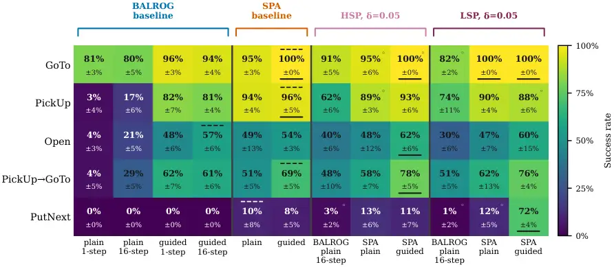

Figure 2: Comparison of Final hold-out evaluation scores between BALROG
RobustCoTAgent and Our agent , for both non-optimized and optimized
prompts. Bottom underline shows best overall performer per task, top
dashed line shows the best performer for non optimized baselines.
$`\circ`$ denotes performance of prompts which were not mutated during
the optimization.

Figure 2 shows success rates across five tasks for four agent
categories. The first two groups report non-optimized BALROG (1) and SPA
(2); the latter two are their optimized counterparts. The figure shows
which tasks are difficult before optimization and where optimization
helps most. PutNext is notably hard, with floor-level baseline
performance across agents. GoTo is much easier and yields the highest
average ceilings. Additionally, we provide in-depth results in
Appendix 6.

#### Optimization Comparison: How does Optimization Impact Performance?

Prompt optimization consistently improves over the respective
non-optimized baseline across all agent variants. For SPA with guided
initialization, the best prompt optimization variant increases the mean
success rate from $`65.5\%`$ of $`79.2\%`$ across all five tasks. For
the plain prompt initialization, the best optimized condition reaches
$`62.2\%`$ versus the $`59.8\%`$ baseline. BALROG also benefits from
optimization, improving from $`29.3\%`$ (plain/16-step baseline) to
$`49.0\%`$, a gain of nearly $`20`$pp. The improvement is not uniform
across tasks. For tasks where the non-optimized baseline is already near
ceiling, such as GoTo and PickUp for SPA guided, the optimizer accepts
few or no mutations, and performance is unchanged. The largest gains
occur on harder tasks: Open improves from $`54.2\%`$ to $`62.5\%`$ for
SPA guided, and PutNext, the hardest task, with all non-optimized
baselines near floor improves from $`8.3\%`$ to as high as $`72.5\%`$
depending on the optimization configuration. We analyze the optimized
prompts for PutNext and a selection of optimized prompts in D

#### Baseline Comparison: Non Prompt-Optimized BALROG and SPA Agents

We now compare BALROG and SPA along two dimensions to shed light on the
performance gap: history window length and prompt variant. First, the
monolithic BALROG agent, in its default settings, has access to the past
$`16`$ actions and observations. In contrast, our agent contains the
descriptor $`A_{des}`$ and action selector $`A_{sel}`$ sub-agents, but
cannot see the run history. To establish a lower bound on SPA’s
performance, we use the plain case in which it only knows the past
action leading to the current preprocessed observation. Second, given
that BALROG ships with a plain BabyAI prompt, we adopt the same for SPA,
and also craft the guided version in order to quantify the effect of the
prompt quality on performance, before optimization.

Within the baseline, we first note that the prompt performance for
BALROG varies more ($`29.3\pm 4.2\%`$ for plain vs.
$`\mathbf{58.5\pm 4.1\%}`$ for guided) than for SPA ($`59.8\pm 6.7\%`$
plain vs. $`\mathbf{65.5\pm 3.8\%}`$ guided). The BALROG agent is
therefore more susceptible to the prompt variant than to the size of its
history window. For the guided variant, extending the history from 1 to
16 steps adds less than $`1`$pp ($`57.7\%`$ vs. $`58.5\%`$), whereas for
the plain variant it adds approximately $`11`$pp ($`18.5\%`$ vs.
$`\mathbf{29.3\%}`$), and even then the prompt variant remains the
dominant effect ($`\approx 29`$pp). SPA is less sensitive to the prompt
variants, which differ not only in verbosity but also in the
task-specific win conditions the guided prompt encodes, showing the
robustness of SPA’s decomposition to the prompt variants we designed.
Notably, SPA plain ($`\mathbf{59.8\pm 6.7\%}`$) already matches BALROG
guided/16-step ($`58.5\pm 4.1\%`$) despite having no task-specific
guidance and access only to its previous plan.

Figure 3: Progression of the selection phase scores for every mutation
cycle, for $`\delta=0.05`$ and $`\delta=-\infty`$. Markers indicate
which cycle’s prompt was used for the held out evaluation. Horizontal
dashed lines in the upper row indicate that no proposed mutation cleared
the evaluation threshold.

### 5.3 Ablation Study and Sensitivity Analysis

##### Does an Acceptance Criterion Affect Performance?

Since the optimizer has access to the history of proposed prompt
mutations together with their acceptance outcomes and also acts on a
critical reflection of recent trajectories; the input to it should, in
principle, provide sufficient information for providing beneficial
mutation proposals. Thus, one might ask if it is necessary to only
accept a newly proposed prompt if it improves over the current best, or
if one could simply accept every mutation regardless of its evaluation
performance.

Figure 4: Final hold-out evaluation scores across all 5 tasks for
varying thresholds and selection pressures for SPA. Interaction between
the threshold and the size of the optimization set directly impacts the
performance on the hold-out evaluation score.

Figure 3 illustrates acceptance based on the validation step (top) vs
accepting all proposals regardless of their performance (bottom). When
requiring a performance improvement, accepted mutations are relatively
sparse, but lead to monotonic performance increase. When all proposed
mutations are accepted, the optimizer is still capable of discovering
well-performing prompts. However, it does not consistently preserve
performance or improve upon these mutations over subsequent cycles.
Since all past mutations are observed as accepted, the optimizer lacks a
contrasting signal between beneficial and detrimental changes, which
likely causes the prompt to drift away from its best-performing state.

To quantify the peak performance achieved by the unconstrained
optimizer, we select post-hoc, the prompt $`T^{*}`$ from the cycle with
the highest performance on $`\mathcal{T}_{\mathrm{select}}`$ (the
selection seed set) and compare it against the final prompt at the end
of the same optimization run on the holdout set. The resulting gap
between $`T^{*}`$ and the end-of-run prompt measures the direct cost of
operating without an optimization signal. We report this performance gap
in Figure 4. This degradation is particularly pronounced for PutNext
because the task is sufficiently difficult, making rewards extremely
sparse across episodes; success counts for SPA on average at
$`\approx 5`$ and for BALROG at $`\approx 1`$ out of the 20
$`\mathcal{T}_{\mathrm{select}}`$ seeds. As a result, the best optimized
prompt is highly sensitive to the accumulation of unfiltered mutations.

##### Sensitivity Analysis of the Threshold Parameter ’$`\delta`$’

In Figure 4 we consider the interaction effect between the selection
pressure and the threshold $`\delta`$ on the performance, as their
compound effect controls the "strictness" of accepting mutations.

We can observe that the different thresholds behave relatively similar,
and that there is no clear winner except for PutNext, and that the
prompt initialization has a bigger impact. Comparing low and high
selection pressure, we find that low selection pressure can lead to
slightly better results, but again do not find any clear winner. The
performance on PutNext is remarkably different, indicating that a too
high $`\delta`$ can stifle the optimization process, while a low
selection pressure appears to increase chances of finding an
improvement. We follow that while the starting quality of the prompt
directly affects optimization outcome, optimization still gives
improvement over the baselines.

We show in Appendix B.3 the full scores for these all the conditions
shown along with the frequency of ’no mutation’ runs spread across the
tasks in Table 7.

### 5.4 Success Rate Through the Lens of Token Usage

Figure 5: Final hold-out evaluation scores for all optimized and
non-optimized conditions, showing success rate against total tokens
consumed per task, averaged across all tasks. The best performers jump
in success rate comes directly from improvement on the hardest task, as
shown in Figure 4.

To assess the direct effect of prompts on model performance, token
counts provide useful context. They correlate with several factors in
the environment, especially the number of actor steps per episode.
Decomposing the actor into descriptor and action selector also
introduces two inference calls per state transition, which further
increases tokens. With this motivation, the average tokens generated per
episode provide a good proxy for estimating the efficiency of both our
decomposition and optimized prompts relative to baseline prompts.

From Figure 5 we see that SPA for both its baseline prompt and the
optimized prompts consistently yields higher success rates, with the
jump for the SPA (LSP/guided prompt/$`\delta=0.05`$) variant coming from
its improvement on PutNext accounting for $`94\%`$ of this total gain on
the performance. A similar concentration holds for BALROG (LSP, plain,
$`\delta=0.05`$), where $`63\%`$ of its $`+18.3`$pp mean gain comes from
PickUp alone ($`16.7\%\to 74.2\%`$), with PutNext remaining at floor.
For SPA (LSP, plain, $`\delta=0.05`$), the total gain is modest at
$`+2.3`$pp, with small regressions on PickUp and Open partially
offsetting gains elsewhere. The optimized plain prompt does not fall
below its baseline, suggesting the optimiser finds marginal improvements
rather than inducing degradation when working from a weaker starting
point. All other ablation conditions are plotted in Appendix 8

## 6 Conclusion and Future Work

We introduce RAPOA, an actor composition and optimization framework that
uses prompt optimization to improve language-based agents on
decision-making tasks. Our experiments show that action-step
decomposition and behavior-driven prompt optimization yield significant
gains over monolithic prompts without requiring weight updates. Our SPA
agent with optimized prompts also reduces the need for analyzing the
history of previous states and improves from both weak and strong
initial prompts. Because the framework is simple and flexible, it can be
combined with other agentic architectures, including long-term planning
modules.

While our results show the potential of automated prompt optimization
for multi-step decision-making agents, several limitations remain.
First, our experiments are restricted to a single domain and one LLM;
future work should test generalization across environments, task
distributions, and larger meta-LLMs. Second, we instantiate only one
optimization architecture. The framework could be extended with
alternative evaluation harnesses, memory mechanisms, and mutation
operators. Finally, we maintain a single incumbent prompt throughout
optimization. Population-based variants with crossover, diversity
preservation, and selection may improve exploration and reduce premature
convergence. More broadly, understanding how to optimize from simple
prompts toward richer, guided meta-prompts remains an open question.

Lastly, we find that procedurally generated game environments are useful
testbeds for prompt optimization. Since they can produce near-infinite
initial states, they may reduce test-set contamination risk and open a
promising direction for developing and evaluating prompt optimization
methods.

## Acknowledgments and Disclosure of Funding

This work was supported by the Federal Ministry of Research, Technology
and Space (BMFTR), Germany under the AI service center KISSKI (grant no.
16IS22093C) and the state of North Rhine-Westphalia as part of the
Lamarr Institute for Machine Learning and Artificial Intelligence. TE
acknowledges funding by the German Research Foundation (DFG) under LI
2801/10-1. LF and ML acknowledge funding by the European Union (ERC,
“ixAutoML”, grant no.101041029). Views and opinions expressed are
however those of the authors only and do not necessarily reflect those
of the European Union or the European Research Council Executive Agency.
Neither the European Union nor the granting authority can be held
responsible for them.

## References

- Agrawal et al. (2026) L. A. Agrawal, S. Tan, D. Soylu, N. Ziems, R.
  Khare, K. Opsahl-Ong, A. Singhvi, H. Shandilya, M. J. Ryan, M.
  Jiang, C. Potts, K. Sen, A. Dimakis, I. Stoica, D. Klein, M. Zaharia,
  and O. Khattab GEPA: reflective prompt evolution can outperform
  reinforcement learning. In International Conference on Learning
  Representations, Cited by: §2.
- Baumann and Kramer (2024) J. Baumann and O. Kramer Evolutionary
  multi-objective optimization of large language model prompts for
  balancing sentiments. In Applications of Evolutionary Computation, S.
  Smith, J. Correia, and C. Cintrano (Eds.), Cham, pp. 212–224. Cited
  by: §2.
- Carta et al. (2023) T. Carta, C. Romac, T. Wolf, S. Lamprier, O.
  Sigaud, and P. Oudeyer Grounding large language models in interactive
  environments with online reinforcement learning. In International
  conference on machine learning, pp. 3676–3713. Cited by: §2.
- Chen et al. (2024a) M. Chen, Y. Li, Y. Yang, S. Yu, B. Lin, and X. He
  AutoManual: constructing instruction manuals by LLM agents via
  interactive environmental learning. Advances in Neural Information
  Processing Systems 37. External Links:
  [Link](https://api.semanticscholar.org/CorpusID:276117233) Cited by:
  §2.
- Chen et al. (2024b) W. Chen, S. Koenig, and B. Dilkina Reprompt:
  planning by automatic prompt engineering for large language models
  agents. arXiv preprint arXiv:2406.11132. Cited by: §2.
- Chevalier-Boisvert et al. (2018) M. Chevalier-Boisvert, D.
  Bahdanau, S. Lahlou, L. Willems, C. Saharia, T. H. Nguyen, and Y.
  Bengio BabyAI: a platform to study the sample efficiency of grounded
  language learning. In International Conference on Learning
  Representations, External Links:
  [Link](https://api.semanticscholar.org/CorpusID:59536625) Cited by:
  §5.1.
- Dorner et al. (2025) F. E. Dorner, V. Nastl, and M. Hardt Limits to
  scalable evaluation at the frontier: llm as judge won’t beat twice the
  data. In International Conference on Learning Representations, Vol.
  2025, pp. 26467–26491. Cited by: §2.
- Gao et al. (2026) H. Gao, J. Geng, W. Hua, M. Hu, X. Juan, H. Liu, S.
  Liu, J. Qiu, X. Qi, Q. Ren, Y. Wu, H. Wang, H. Xiao, Y. Zhou, S.
  Zhang, J. Zhang, J. Xiang, Y. Fang, Q. Zhao, D. Liu, C. Qian, Z.
  Wang, M. Hu, H. Wang, Q. Wu, H. Ji, and M. Wang A Survey of
  Self-Evolving Agents: What, When, How, and Where to Evolve on the Path
  to Artificial Super Intelligence. Transactions on Machine Learning
  Research. External Links:
  [Link](https://mlanthology.org/tmlr/2026/gao2026tmlr-survey/) Cited
  by: §1.
- Gokhale et al. (2025) A. Gokhale, V. Srivastava, and F. Bullo
  LogicGuard: improving embodied LLM agents through temporal logic based
  critics. External Links:
  [Link](https://api.semanticscholar.org/CorpusID:280148429) Cited by:
  §2.
- Grondman et al. (2012) I. Grondman, L. Busoniu, G. Lopes, and R.
  Babuska A survey of actor-critic reinforcement learning: standard and
  natural policy gradients. IEEE Transactions on Systems, Man, and
  Cybernetics, Part C: Applications and Reviews 42 (6), pp. 1291–1307.
  External Links: [Link](https://hal.science/hal-00756747),
  [Document](https://dx.doi.org/10.1109/TSMCC.2012.2218595) Cited by:
  §1.
- He et al. (2024) J. He, S. Chen, F. Zhang, and Z. Yang From words to
  actions: unveiling the theoretical underpinnings of LLM-driven
  autonomous systems. In Forty-first International Conference on Machine
  Learning, ICML 2024, Vienna, Austria, July 21-27, 2024, Proceedings of
  Machine Learning Research, pp. 17807–17841. External Links:
  [Link](https://proceedings.mlr.press/v235/he24a.html) Cited by: §1,
  §2.
- Kaelbling et al. (1998) L. P. Kaelbling, M. L. Littman, and A. R.
  Cassandra Planning and acting in partially observable stochastic
  domains. Artif. Intell. 101 (1-2), pp. 99–134. External Links:
  [Link](<https://doi.org/10.1016/S0004-3702(98)00023-X>),
  [Document](https://dx.doi.org/10.1016/S0004-3702%2898%2900023-X) Cited
  by: §3.
- Karten et al. (2026) S. Karten, J. Grigsby, T. U. Jr, J. Bae, S.
  Hong, H. Jeong, J. Jung, K. Kerdthaisong, G. Kim, H. Kim, Y. Kim, E.
  Kwon, D. Liu, P. Mariglia, S. Park, B. Schink, X. Shi, A. Sistilli, J.
  Twin, A. Urdu, M. Urdu, Q. Wang, L. Wu, W. Zhang, K. Zhou, S.
  Milani, K. Vodrahalli, A. Zhang, F. Fang, Y. Zhu, and C. Jin The
  pokeagent challenge: competitive and long-context learning at scale.
  External Links: 2603.15563, [Link](https://arxiv.org/abs/2603.15563)
  Cited by: §1, §2.
- Kim et al. (2023) G. Kim, P. Baldi, and S. M. McAleer Language models
  can solve computer tasks. ArXiv abs/2303.17491. External Links:
  [Link](https://api.semanticscholar.org/CorpusID:257834038) Cited by:
  §2.
- Klissarov et al. (2025) M. Klissarov, R. D. Hjelm, A. T. Toshev,
  and B. Mazoure On the modeling capabilities of large language models
  for sequential decision making. In The Thirteenth International
  Conference on Learning Representations, ICLR 2025, Singapore, April
  24-28, 2025, External Links:
  [Link](https://openreview.net/forum?id=vodsIF3o7N) Cited by: §2.
- Liang et al. (2024) X. Liang, M. Tao, Y. Xia, T. Shi, J. Wang, and J.
  Yang Self-evolving agents with reflective and memory-augmented
  abilities. ArXiv abs/2409.00872. External Links:
  [Link](https://api.semanticscholar.org/CorpusID:272367206) Cited by:
  §2.
- Lou et al. (2026) Z. Lou, H. Chen, Y. Li, Q. Wang, and B. Hooi
  Learning to learn-at-test-time: language agents with learnable
  adaptation policies. arXiv preprint arXiv:2604.00830. Cited by: §1,
  §2.
- Lu et al. (2024) C. Lu, C. Lu, R. T. Lange, J. Foerster, J. Clune,
  and D. Ha The ai scientist: towards fully automated open-ended
  scientific discovery. ArXiv abs/2408.06292. External Links:
  [Link](https://api.semanticscholar.org/CorpusID:271854887) Cited by:
  §2.
- Meyerson et al. (2024) E. Meyerson, M. J. Nelson, H. Bradley, A.
  Gaier, A. Moradi, A. K. Hoover, and J. Lehman Language model
  crossover: variation through few-shot prompting. ACM Trans. Evol.
  Learn. Optim. 4 (4). External Links: ISSN 2688-299X,
  [Link](https://doi.org/10.1145/3694791),
  [Document](https://dx.doi.org/10.1145/3694791) Cited by: §1.
- Nathani et al. (2025) D. Nathani, L. Madaan, N. Roberts, N.
  Bashlykov, A. Menon, V. Moens, A. Budhiraja, D. Magka, V.
  Vorotilov, G. Chaurasia, D. Hupkes, R. S. Cabral, T. Shavrina, J. N.
  Foerster, Y. Bachrach, W. Y. Wang, and R. Raileanu MLGym: A new
  framework and benchmark for advancing AI research agents. CoRR
  abs/2502.14499. External Links:
  [Link](https://doi.org/10.48550/arXiv.2502.14499),
  [Document](https://dx.doi.org/10.48550/ARXIV.2502.14499), 2502.14499
  Cited by: §2.
- OpenAI (2025) OpenAI Gpt-oss-120b & gpt-oss-20b model card.
  arXiv:2508.10925 \[cs.CL\]. Cited by: §5.1.
- Paglieri et al. (2025) D. Paglieri, B. Cupiał, S. Coward, U.
  Piterbarg, M. Wolczyk, A. Khan, E. Pignatelli, Ł. Kuciński, L.
  Pinto, R. Fergus, et al. BALROG: benchmarking agentic LLM and vlm
  reasoning on games. In 13th International Conference on Learning
  Representations Iclr 2025, pp. 36061–36097. Cited by: §1, §1, §2,
  §5.1, §5.1.
- Pan et al. (2024) J. Pan, X. Wang, G. Neubig, N. Jaitly, H. Ji, A.
  Suhr, and Y. Zhang Training software engineering agents and verifiers
  with swe-gym. ArXiv abs/2412.21139. External Links:
  [Link](https://api.semanticscholar.org/CorpusID:275133330) Cited by:
  §2.
- Plaat et al. (2025) A. Plaat, M. J. van Duijn, N. van Stein, M.
  Preuss, P. van der Putten, and K. J. Batenburg Agentic large language
  models, a survey. J. Artif. Intell. Res. 84. External Links:
  [Link](https://doi.org/10.1613/jair.1.18675),
  [Document](https://dx.doi.org/10.1613/JAIR.1.18675) Cited by: §1, §2.
- Pryzant et al. (2023) R. Pryzant, D. Iter, J. Li, Y. Lee, C. Zhu,
  and M. Zeng Automatic prompt optimization with “gradient descent” and
  beam search. In Proceedings of the 2023 conference on empirical
  methods in natural language processing, pp. 7957–7968. Cited by: §2.
- Shinn et al. (2023) N. Shinn, F. Cassano, A. Gopinath, K. Narasimhan,
  and S. Yao Reflexion: language agents with verbal reinforcement
  learning. Advances in neural information processing systems 36,
  pp. 8634–8652. Cited by: §2.
- Sutton and Barto (2018) R. S. Sutton and A. G. Barto Reinforcement
  learning - an introduction, 2nd edition. MIT Press. External Links:
  [Link](http://www.incompleteideas.net/book/the-book-2nd.html) Cited
  by: §3.
- Trivedy (2026) V. Trivedy Improving deep agents with harness
  engineering. Note:
  https://www.langchain.com/blog/improving-deep-agents-with-harness-engineeringAccessed:
  04/2026 Cited by: §1.
- Wang et al. (2023) Z. Wang, S. Cai, G. Chen, A. Liu, X. Ma, and Y.
  Liang Describe, explain, plan and select: interactive planning with
  LLMs enables open-world multi-task agents. Advances in Neural
  Information Processing Systems 36. External Links:
  [Link](https://api.semanticscholar.org/CorpusID:268042457) Cited by:
  §2.
- Wen et al. (2024) M. Wen, Z. Wan, W. Zhang, J. Wang, and Y. Wen
  Reinforcing language agents via policy optimization with action
  decomposition. ArXiv abs/2405.15821. External Links:
  [Link](https://api.semanticscholar.org/CorpusID:270063865) Cited by:
  §2, §3.
- Xiong et al. (2025) W. Xiong, Y. Song, Q. Dong, B. Zhao, F. Song, X.
  Wang, and S. Li MPO: boosting LLM agents with meta plan optimization.
  In Conference on Empirical Methods in Natural Language Processing,
  External Links:
  [Link](https://api.semanticscholar.org/CorpusID:276765428) Cited by:
  §2.
- Xu et al. (2026) R. Xu, Y. Zhuang, Y. Zhong, Y. Yu, Z. Wang, X.
  Tang, H. Wu, M. D. Wang, P. Ruan, D. Yang, T. Wang, G. Xiao, X.
  Liu, C. Yang, Y. Xie, and W. Shi MedAgentGym: a scalable agentic
  training environment for code-centric reasoning in biomedical data
  science. In The Fourteenth International Conference on Learning
  Representations, External Links:
  [Link](https://openreview.net/forum?id=jHDZEUgS4r) Cited by: §2.
- Yang et al. (2023) C. Yang, X. Wang, Y. Lu, H. Liu, Q. V. Le, D. Zhou,
  and X. Chen Large language models as optimizers. In The Twelfth
  International Conference on Learning Representations, Cited by: §2.
- Yang et al. (2026) S. Yang, S. C. Han, X. Ma, Y. Li, M. R. G. Madani,
  and E. Hovy Evotool: self-evolving tool-use policy optimization in LLM
  agents via blame-aware mutation and diversity-aware selection. arXiv
  preprint arXiv:2603.04900. Cited by: §2.
- Yao et al. (2023) S. Yao, J. Zhao, D. Yu, N. Du, I. Shafran, K.
  Narasimhan, and Y. Cao ReAct: synergizing reasoning and acting in
  language models. In International Conference on Learning
  Representations (ICLR), Cited by: §2.
- Zhai et al. (2024) S. Zhai, H. Bai, Z. Lin, J. Pan, P. Tong, Y.
  Zhou, A. Suhr, S. Xie, Y. LeCun, Y. Ma, and S. Levine Fine-tuning
  large vision-language models as decision-making agents via
  reinforcement learning. In Advances in Neural Information Processing
  Systems 38: Annual Conference on Neural Information Processing Systems
  2024, NeurIPS 2024, Vancouver, BC, Canada, December 10 - 15, 2024,
  External Links:
  [Link](http://papers.nips.cc/paper%5C_files/paper/2024/hash/c848b7d3adc08fcd0bf1df3101ba6728-Abstract-Conference.html)
  Cited by: §2, §3.
- Zhang et al. (2025a) G. Zhang, J. Wang, J. Chen, W. Zhou, K. Wang,
  and S. Yan AgenTracer: who is inducing failure in the llm agentic
  systems?. arXiv preprint arXiv:2509.03312. Cited by: §2.
- Zhang et al. (2025b) Y. Zhang, H. Yu, L. Hu, H. Jin, and H. Zhang
  General modular harness for LLM agents in multi-turn gaming
  environments. In ICML MAS Workshop, Cited by: §1, §2.
- Zhao et al. (2024) A. Zhao, D. Huang, Q. Xu, M. Lin, Y. Liu, and G.
  Huang Expel: LLM agents are experiential learners. In Proceedings of
  the AAAI Conference on Artificial Intelligence, Vol. 38,
  pp. 19632–19642. Cited by: §2.
- Zhou et al. (2025) H. Zhou, X. Wan, X. Wan, R. Sun, H. Palangi, S.
  Iqbal, I. Vuli’c, A. Korhonen, and S. Ö. Arik Multi-agent design:
  optimizing agents with better prompts and topologies. ArXiv
  abs/2502.02533. External Links:
  [Link](https://api.semanticscholar.org/CorpusID:276107353) Cited by:
  §2.
- Zhou et al. (2022) Y. Zhou, A. I. Muresanu, Z. Han, K. Paster, S.
  Pitis, H. Chan, and J. Ba Large language models are human-level prompt
  engineers. In The eleventh international conference on learning
  representations, Cited by: §2.

## Overview of the Appendix

## Appendix A Experimental Details Continued

### A.1 Environment Task Details

The BabyAI MixedTrainLocal environment used in our evaluation samples
episodes from a fixed set of _task families_. Each family is defined by
a goal template and a termination criterion. A specific instantiation of
a task family, with concrete objects and colors filled into the
template, is referred to as a _mission_. The mission is the natural
language string the agent receives at the start of each episode; the
task family determines what success means and which objects appear in
the room.

For example, the goto task family produces missions of the form “go to
\<article\> \<color\> \<object\>”, with success defined as the agent
occupying a cell adjacent to the named target. Each call to gym.make
samples a task family uniformly at random and then samples a mission
within that family. The five task families used throughout this paper
are described below, with example missions drawn directly from the
trajectory logs of our evaluation runs.

[TABLE]

Table 1: The five BabyAI task families evaluated in this paper. The
mission is the natural language string presented to the agent at the
start of each episode and instantiates the task family with concrete
objects (ball, key, box, door) and colors (red, green, blue, purple,
yellow, grey). The optimiser receives task family identity through the
run configuration; the agent and descriptor at inference time receive
only the mission string.

### A.2 Computational Cost

Table 4 reports per-cycle token consumption broken down by component and
task. Episode inference (agent and descriptor LLM calls) accounts for
over 98% of total tokens in every condition; the optimiser overhead
(Behavior Analyser and Mutator) is negligible ($`<`$2%). Compute
therefore scales almost entirely with the number and length of
evaluation episodes, both of which grow with task difficulty. PutNext
episodes average at 59.5 steps and consume $`\sim`$10M tokens per cycle,
versus 14.7 steps and $`\sim`$1.6M tokens for GoTo.

The dominant cost also determines the natural parallelism strategy.
Because each evaluation episode is fully independent, a single H100
running gpt-oss-20b³³ 3
[https://huggingface.co/openai/gpt-oss-20b](https://huggingface.co/openai/gpt-oss-20b)
via vLLM ⁴⁴ 4 Version 0.19.1,
[https://github.com/vllm-project/vllm/releases/tag/v0.19.1](https://github.com/vllm-project/vllm/releases/tag/v0.19.1)
can be saturated by launching $`N`$ lightweight CPU workers, each
executing an environment and streaming requests to the shared inference
server concurrently. No additional GPUs are required for parallelism;
throughput scales with $`N`$ up to the point of GPU saturation. Our
experiments used 8 H100s for model serving but did not fully exploit
this episode-level parallelism, resulting in observed wall times of
2–16 hours per cycle depending on task, versus a theoretical minimum
governed by GPU token throughput alone.

We use gpt-oss-20b rather than a smaller reasoning model because it
matches the performance of contemporaneous models on the BALROG
benchmark ⁵⁵ 5 BALROG Benchmark
[https://BALROGai.com/](https://BALROGai.com/), providing a
well-characterised testbed for validating the optimisation process. One
consequence is that completion tokens exceed prompt tokens on harder
tasks (PutNext ratio: 1.41), reflecting the cost of extended reasoning
traces; this should be considered when estimating compute for
reasoning-capable models.

| Eval task | Steps/ep | Ag. prompt (k) | Ag. compl. (k) | Desc. prompt (k) | Desc. compl (k) |
| --------- | -------- | -------------- | -------------- | ---------------- | --------------- |
| GoTo      | 10.1     | 7.8            | 9.4            | 3.0              | 4.8             |
| Pickup    | 14.4     | 11.1           | 10.4           | 4.3              | 6.5             |
| Open      | 44.8     | 35.8           | 49.9           | 13.4             | 22.1            |
| PutNext   | 59.8     | 49.1           | 76.9           | 18.7             | 30.7            |
| Seq       | 36.3     | 28.8           | 43.8           | 11.1             | 18.8            |

Table 2: Per-episode token cost for cross-task evaluations using the
SPA, grouped by evaluation task (1,285 runs total). Token counts in
thousands (k). Prompt (complete) refers to the prompt tokens given to
(tokens generated by the) Action Selector (Ag.) and Description
Generator (Desc.).

| Eval task | Steps/ep | Agent prompt (k) | Agent completion (k) | Wall (s/ep) |
| --------- | -------- | ---------------- | -------------------- | ----------- |
| GoTo      | 18.7     | 26.9             | 7.2                  | 90          |
| Pickup    | 30.0     | 41.7             | 9.5                  | 117         |
| Open      | 53.0     | 77.5             | 24.8                 | 321         |
| PutNext   | 63.2     | 97.3             | 30.2                 | 376         |
| Seq       | 47.6     | 73.3             | 18.5                 | 248         |

Table 3: Per-episode token cost for cross-task evaluations using the
single-LLM BALROG baseline pipeline (no descriptor), grouped by
evaluation task (450 runs total). Agent prompt tokens are higher than
the two-LLM case because the agent receives the full scene description
directly rather than a descriptor summary.

|                           |       |        |       |         |       |
| ------------------------- | ----- | ------ | ----- | ------- | ----- |
|                           | GoTo  | Pickup | Open  | PutNext | Seq   |
| Episode inference         |       |        |       |         |       |
| Agent prompt (M)          | 0.66  | 1.10   | 2.34  | 3.26    | 1.64  |
| Agent completion (M)      | 0.60  | 0.83   | 2.47  | 4.60    | 1.91  |
| Descriptor prompt (M)     | 0.14  | 0.22   | 0.58  | 0.82    | 0.41  |
| Descriptor completion (M) | 0.20  | 0.29   | 0.81  | 1.23    | 0.62  |
| Optimiser overhead        |       |        |       |         |       |
| BA prompt (M)             | 0.020 | 0.026  | 0.052 | 0.068   | 0.043 |
| BA completion (M)         | 0.003 | 0.003  | 0.004 | 0.004   | 0.004 |
| Mutator prompt (M)        | 0.005 | 0.005  | 0.006 | 0.006   | 0.006 |
| Mutator completion (M)    | 0.002 | 0.002  | 0.002 | 0.002   | 0.002 |
| Summary                   |       |        |       |         |       |
| Total tokens (M)          | 1.63  | 2.49   | 6.26  | 9.99    | 4.62  |
| Episodes / cycle          | 49    | 52     | 55    | 61      | 53    |
| Mean steps / episode      | 14.7  | 23.2   | 48.6  | 59.5    | 34.5  |
| Ep. wall time / cycle (h) | 2.3   | 3.2    | 9.2   | 16.0    | 7.1   |

Table 4: Per-cycle token cost breakdown by task (means across all
optimisation conditions). All token counts in millions (M). Episode
inference (agent + descriptor) accounts for $`>`$98% of total tokens
across every task; optimiser overhead (BA + Mutator) is negligible.

### A.3 Hyperparameters

|                                   |                           |                                                                                                                                                                                          |
| --------------------------------- | ------------------------- | ---------------------------------------------------------------------------------------------------------------------------------------------------------------------------------------- | --- | --------------------------------------------------------------------------------------------------------------- |
| Hyperparameter                    | Value                     | Description                                                                                                                                                                              |
| Optimisation loop                 |                           |                                                                                                                                                                                          |
| Optimisation cycles ($`N`$)       | 20                        | Number of BA–Mutator–gate iterations per run.                                                                                                                                            |
| Optimisation phase episodes ($`   | V                         | `$)                                                                                                                                                                                      | 20  | Episodes run per candidate during the optimisation phase. Seeds rotate each cycle.                              |
| Selection phase episodes ($`      | T                         | `$)                                                                                                                                                                                      | 20  | Episodes run per candidate during the selection phase. Seeds are fixed across all cycles for paired comparison. |
| Acceptance threshold ($`\delta`$) | {0.00, 0.02, 0.05, 0.10}  | Required mean reward improvement of challenger over incumbent in the optimisation phase to proceed to selection. $`\delta=0.05`$ is the primary condition.                               |
| Min discordant pairs              | 4                         | Minimum number of episodes where incumbent and challenger differ in outcome. Below this, the acceptance signal is flagged as insufficient_signal.                                        |
| Max BA resamples                  | 3                         | Times the BA is re-queried per cycle before logging ba_skip.                                                                                                                             |
| BA trajectory episodes ($`        | B                         | `$)                                                                                                                                                                                      | 6   | Episodes sampled from the optimisation phase for BA input.                                                      |
| Episode rollout                   |                           |                                                                                                                                                                                          |
| Max steps per episode             | 64                        | Hard step limit; episode terminates as failure if not solved within this budget.                                                                                                         |
| Parallel workers                  | 20                        | Concurrent episode workers per evaluation batch.                                                                                                                                         |
| Evaluation protocol               |                           |                                                                                                                                                                                          |
| Optimisation env seed             | 42 (base)                 | Base seed for optimisation phase environment layouts. Rotated each cycle by adding the cycle index.                                                                                      |
| Optimisation inference seed       | 1                         | Fixed LLM inference seed used throughout optimisation.                                                                                                                                   |
| Test phase env seeds              | 500–519                   | 20 fixed environment layouts, independent of optimisation seeds.                                                                                                                         |
| Test phase inference seeds        | {2,3,4,5,6,7}             | 6 inference seeds; seed 1 excluded to ensure out-of-distribution evaluation.                                                                                                             |
| Architecture and prompt           |                           |                                                                                                                                                                                          |
| Prompt variant                    | plain / guided            | Starting prompt quality. Plain uses BALROG’s minimal instructions; guided encodes explicit win conditions for all 5 task families.                                                       |
| Selection pressure                | HSP / LSP                 | HSP requires improvement to hold over 20 optimisation-phase episodes before proceeding to selection. LSP uses the same 6 episodes as BA input, accepting on a weaker but cheaper signal. |
| Module constraint                 | both / agent / descriptor | Restricts BA mutations to one module. both is the default; agent-only and descriptor-only are the ablation conditions.                                                                   |
| BALROG history window             | 16 steps                  | Rolling message history for the BALROG RobustCoT baseline. Not applicable to SPA.                                                                                                        |

Table 5: Hyperparameters of the prompt optimisation framework. All
values are fixed across primary experiments unless a sweep is explicitly
stated ($`\delta`$).

## Appendix B Supplementary results

### B.1 Performance of Baseline Models on the Hold-Out Set

| Task              | Condition               | S2   | S3   | S4   | S5   | S6   | S7   | Mean | $`\boldsymbol{\pm}`$Std |
| ----------------- | ----------------------- | ---- | ---- | ---- | ---- | ---- | ---- | ---- | ----------------------- |
| GoTo              | BALROG / min / 1-step   | 85%  | 80%  | 80%  | 80%  | 75%  | 85%  | 81%  | 3%                      |
|                   | BALROG / min / 16-step  | 70%  | 80%  | 85%  | 80%  | 85%  | 80%  | 80%  | 5%                      |
|                   | BALROG / rich / 1-step  | 100% | 90%  | 95%  | 95%  | 100% | 95%  | 96%  | 3%                      |
|                   | BALROG / rich / 16-step | 100% | 100% | 90%  | 90%  | 95%  | 90%  | 94%  | 4%                      |
|                   | Ours / minimal          | 95%  | 90%  | 100% | 95%  | 95%  | 95%  | 95%  | 3%                      |
|                   | Ours / rich             | 100% | 100% | 100% | 100% | 100% | 100% | 100% | 0%                      |
| PickUp            | BALROG / min / 1-step   | 5%   | 0%   | 0%   | 5%   | 10%  | 0%   | 3%   | 4%                      |
|                   | BALROG / min / 16-step  | 20%  | 10%  | 10%  | 15%  | 20%  | 25%  | 17%  | 6%                      |
|                   | BALROG / rich / 1-step  | 80%  | 80%  | 95%  | 75%  | 75%  | 90%  | 82%  | 7%                      |
|                   | BALROG / rich / 16-step | 80%  | 80%  | 90%  | 80%  | 75%  | 80%  | 81%  | 4%                      |
|                   | Ours / minimal          | 90%  | 100% | 100% | 90%  | 95%  | 90%  | 94%  | 4%                      |
|                   | Ours / rich             | 95%  | 85%  | 100% | 100% | 95%  | 100% | 96%  | 5%                      |
| Open              | BALROG / min / 1-step   | 10%  | 5%   | 0%   | 0%   | 5%   | 5%   | 4%   | 3%                      |
|                   | BALROG / min / 16-step  | 20%  | 25%  | 20%  | 30%  | 15%  | 15%  | 21%  | 5%                      |
|                   | BALROG / rich / 1-step  | 45%  | 45%  | 50%  | 40%  | 60%  | 45%  | 48%  | 6%                      |
|                   | BALROG / rich / 16-step | 50%  | 65%  | 60%  | 55%  | 50%  | 60%  | 57%  | 6%                      |
|                   | Ours / minimal          | 30%  | 65%  | 50%  | 50%  | 35%  | 65%  | 49%  | 13%                     |
|                   | Ours / rich             | 60%  | 55%  | 55%  | 55%  | 50%  | 50%  | 54%  | 3%                      |
| PickUp$`\to`$GoTo | BALROG / min / 1-step   | 5%   | 5%   | 15%  | 0%   | 0%   | 0%   | 4%   | 5%                      |
|                   | BALROG / min / 16-step  | 35%  | 20%  | 30%  | 25%  | 30%  | 35%  | 29%  | 5%                      |
|                   | BALROG / rich / 1-step  | 55%  | 60%  | 70%  | 55%  | 60%  | 75%  | 62%  | 7%                      |
|                   | BALROG / rich / 16-step | 65%  | 55%  | 70%  | 55%  | 65%  | 55%  | 61%  | 6%                      |
|                   | Ours / minimal          | 55%  | 45%  | 60%  | 50%  | 50%  | 45%  | 51%  | 5%                      |
|                   | Ours / rich             | 65%  | 70%  | 65%  | 65%  | 80%  | 70%  | 69%  | 5%                      |
| PutNext           | BALROG / min / 1-step   | 0%   | 0%   | 0%   | 0%   | 0%   | 0%   | 0%   | 0%                      |
|                   | BALROG / min / 16-step  | 0%   | 0%   | 0%   | 0%   | 0%   | 0%   | 0%   | 0%                      |
|                   | BALROG / rich / 1-step  | 0%   | 0%   | 0%   | 0%   | 0%   | 0%   | 0%   | 0%                      |
|                   | BALROG / rich / 16-step | 0%   | 0%   | 0%   | 0%   | 0%   | 0%   | 0%   | 0%                      |
|                   | Ours / minimal          | 25%  | 10%  | 5%   | 0%   | 10%  | 10%  | 10%  | 8%                      |
|                   | Ours / rich             | 10%  | 10%  | 0%   | 5%   | 15%  | 10%  | 8%   | 5%                      |

Table 6: Per-inference-seed success rates across all five tasks and six
non-optimized conditions. Each cell: success rate over 20 episodes. Mean
and $`\pm`$Std computed across the six inference seeds. 5pp indicates a
single episode.

To highlight the intrinsic spread of the performance that stems from an
LLM’s stochastic sampling, we show in 6 performance of all the baseline
configurations of SPA and BALROG across all the inference seeds for each
task. The per-seed breakdown reveals three patterns obscured by the
headline means. First, variance is strongly task- and prompt-dependent:
Open under the plain SPA prompt shows by far the widest spread in the
table, with some seeds consistently outperforming others by a large
margin, indicating that inference stochasticity is the dominant
performance driver on medium-difficulty tasks with sparse starting
prompts. Second, BALROG achieves exactly $`0\%`$ on PutNext across every
condition and every seed without exception, establishing that the
optimized result reported in the main paper is attributable entirely to
the optimization loop. Third, the guided SPA prompt on GoTo is the only
condition in the table with zero variance across all six seeds; this
ceiling behavior is the direct reason the optimizer accepts no mutations
there.

### B.2 Direct Comparison Between Hold-Out Performances Based on Strictness of the Acceptance Criteria

Figures 7 and 7 allows further scrutiny into which the interaction
effects between the threshold value and the selection pressure through
the individual values performance value per task.

For the plain prompt, we can see that on the performance comparison
between the selection pressure conditions is almost comparable, and the
trend within the thresholds is also not instantly apparent. For the
guided case however, we see that while both instances show similar
performance on the Easy to Medium level tasks, the stark difference
between the performance on PutNext highlights that for a difficult task
i.e. one in which the rewards are extremely sparse, the noisier
estimation allows more explorative behaviors in a sparse reward
landscape.

This difficulty of the tasks is also in effect confounded by the fact
that the optimizer is a black box; there is no quantifiable way to
measure the ’step’ size of a mutation. We allow the Optimizer to make a
multitude of choices with the implication that the signal which it makes
its decision over needs to be modeled well. With the environment as a
source of a constant direction, the use of a gating mechanism and finer
control over these interacting hyperparameters would allow better
control in steering the optimizer towards consistent and semantically
meaningful prompts.

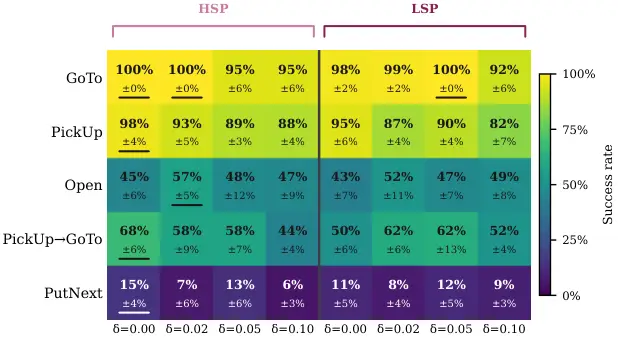

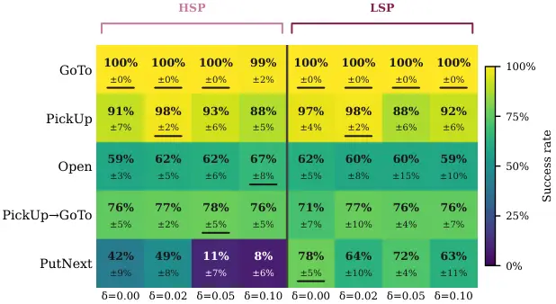

Figure 6: Threshold heatmap for Plain prompt. We see for the plain
prompt case that a higher selection pressure yields the better
performance compared to a lower selection pressure.

Figure 7: Threshold heatmap for Guided prompt. The guided prompt shows
direct benefit when optimized in a low selection pressure condition.

### B.3 Threshold Sensitivity Analysis

Table 7 shows the number of accepted mutations per condition for all 20
optimization cycles. Threshold stringency directly controls optimizer
activity: at $`\delta=0.10`$, six of ten conditions reject all mutations
under both HSP and LSP, while at $`\delta=0.00`$ almost all conditions
accept at least one candidate mutation. This reflects the diverse
difficulties of the tasks rather than optimizer failure. The
near-ceiling task such as GoTo and guided PickUp directly produce zero
accepted mutations at stricter thresholds, as no candidate can clear a
bar that is above 100% acceptance (e.g., 98% success and a threshold of
0.05 require 103% success for a new prompt to be accepted).

|                     |         |                 |                 |                 |                 |                 |                 |                 |                 |
| ------------------- | ------- | --------------- | --------------- | --------------- | --------------- | --------------- | --------------- | --------------- | --------------- |
|                     |         | HSP             |                 |                 |                 | LSP             |                 |                 |                 |
| Task                | Variant | $`\delta`$=0.00 | $`\delta`$=0.02 | $`\delta`$=0.05 | $`\delta`$=0.10 | $`\delta`$=0.00 | $`\delta`$=0.02 | $`\delta`$=0.05 | $`\delta`$=0.10 |
| GoTo                | plain   | 4               | 1               | 0               | 0               | 2               | 2               | 1               | 0               |
|                     | guided  | 0               | 1               | 0               | 0               | 1               | 0               | 1               | 0               |
| PickUp              | plain   | 6               | 2               | 0               | 1               | 1               | 1               | 1               | 0               |
|                     | guided  | 2               | 1               | 1               | 0               | 1               | 3               | 0               | 1               |
| Open                | plain   | 1               | 2               | 1               | 1               | 4               | 1               | 2               | 0               |
|                     | guided  | 3               | 3               | 2               | 1               | 1               | 0               | 1               | 0               |
| PickUp→GoTo         | plain   | 3               | 3               | 2               | 0               | 2               | 2               | 1               | 0               |
|                     | guided  | 1               | 1               | 1               | 0               | 2               | 0               | 2               | 1               |
| PutNext             | plain   | 2               | 1               | 1               | 0               | 1               | 2               | 0               | 1               |
|                     | guided  | 4               | 5               | 1               | 1               | 3               | 6               | 4               | 2               |
| Count(No mutations) |         | 1/10            | 0/10            | 3/10            | 6/10            | 0/10            | 3/10            | 2/10            | 6/10            |

Table 7: Accepted mutation counts per task, prompt variant, selection
pressure, and threshold $`\delta`$. 0 means that no mutation cleared the
threshold, throughout the optimisation process.

### B.4 Full Token Efficiency Plot Across All Optimized Conditions

Figure 8: Efficiency plot for all optimized conditions. Directly
overlaid on Figure 5.

Figure 8 shows all the conditions we optimise over. SPA guided shows the
best performance, and shows a wider variance in performance efficiency.
SPA plain however, shows clustering in its performance, suggesting that
the minimally crafted prompt does not provide enough of a strong
starting point for the optimiser to improve. The performance for BALROG
sees a steady increase with an overall decrease in the number of tokens
and its optimized versions approach closer to the SPA plain variant.

### B.5 How Well do the Optimized Prompts Generalize to Other Tasks?

In order to test the generalisation of the prompts, to see if a prompt
optimized for one task, actually transfers to another task from the same
environment, given that they would be sharing similar environmental
semantics and require the following of similar base rules, we perform
this test over a small subset of our optimized conditions, namely the
BALROG, SPA with guided and plain prompt variant, and also compare the
best performer $`T*`$ from the always accept ($`\delta=-\infty`$) case.

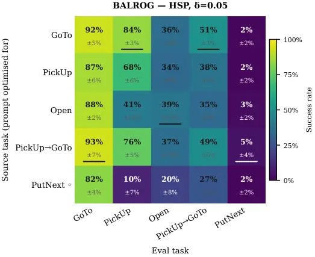

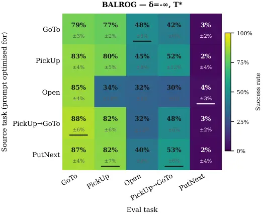

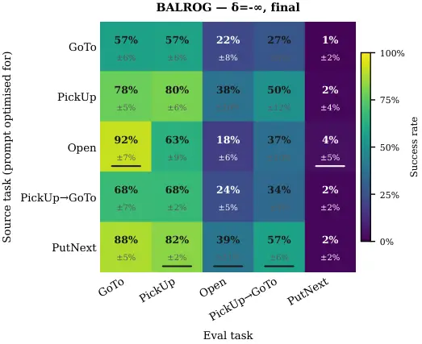

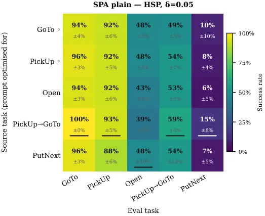


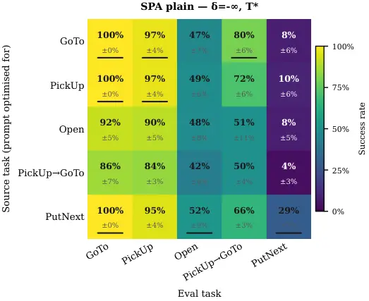

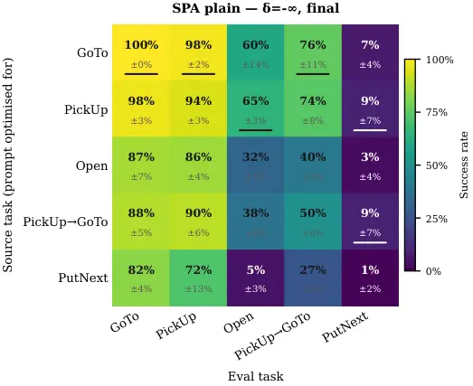

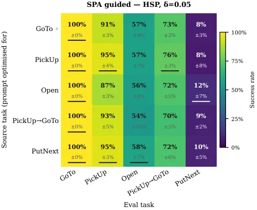

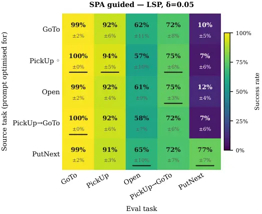

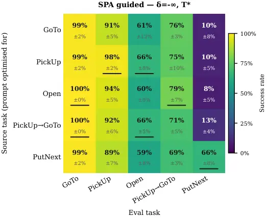

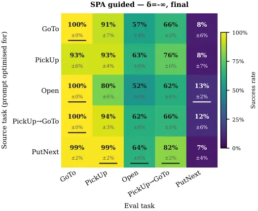


Figure 9: Cross Task Hold-Out performance, for both SPA and BALROG,
between always accept criteria

In an effort to see how the performance of one task transfers to the
other, we test out SPA and BALROG, under both selection pressures.
Figure 9 shows all of these together for a qualitative comparison. The
five BabyAI task families share subskills in a nested structure: GoTo is
a component of every other task; PickUp is a prerequisite of both
PickUpSeqGoTo and PutNext; Open partially overlaps through its
key-retrieval phase which depending on the mission, may or may not be
required to open the door. This structure predicts that improvements to
universal subskills should transfer broadly, while task-specific logic
should not.

Figure 9 confirms this prediction. Across all conditions, prompts
optimized for more compositionally complex source tasks like
PickUpSeqGoTo and PutNext produce the strongest off-diagonal
performance, since their induced mutations address navigation recovery
and multi-step coordination that appear in every task. In the
SPA/guided/LSP condition, the PutNext source prompt reaches $`65.0\%`$
on Open and $`90.8\%`$ on PickUp in addition to its $`76.7\%`$
on-diagonal result.

Open is the most structurally isolated task. Source prompts optimized on
Open do not propagate well to other tasks, and no other source task
improves Open substantially beyond its non-optimized baseline. The
Key-door toggle logic is sufficiently task-specific that the BA encodes
it in a form that provides no transfer value.

PutNext shows the sharpest asymmetry optimising for it might allow the
prompt to adapt to other tasks when used as a source, but cannot receive
them. No source task other than PutNext itself raises PutNext
performance above $`15\%`$, regardless of selection pressure or prompt
variant. The sequential subgoal structure requires failure-signal from
PutNext episodes specifically; simpler tasks do not generate the
trajectory evidence the BA needs to synthesise the relevant mutations.
We also investigate qualitatively what exactly the prompt mutation that
allows the agent to perform remarkably well in this task, in
Appendix D.1

#### B.5.1 Which Candidate Rank in a Given Batch Was Accepted for Mutation?

Given that the BA implicitly ranks candidates by severity of failure, we
examine which rank in the candidate list actually resulted in acceptance
and thus, implicitly, better performance. This reveals how often the BA
correctly identified the most pressing issue. Table 8 reports, for each
condition and task where at least one mutation was committed, the rank
of the final incumbent candidate, the selection pool scores at the
moment of acceptance, and the fresh evaluation SR. Zero-mutation tasks
are excluded; their fresh SR matches the non-optimized baseline by
construction.

Rank-1 candidates account for the majority of final incumbents across
all thresholds. Fifteen fallback cases arise (rank 2 or 3), concentrated
in harder tasks and permissive thresholds where the primary candidate
more frequently fails the gate. The sole rank-3 acceptance occurs at HSP
/ $`\delta=0.02`$ / guided PickUpSeqGoTo: both ranks 1 and 2 failed the
selection gate, rank 3 cleared it with a T-$`\Delta`$ of $`+15`$pp, and
fresh evaluation confirms $`76.7\%`$ SR which is among the strongest
results for that task across all conditions.

Fallback candidates produce comparable or better hold-out evaluation
performance to rank-1 acceptances in $`13`$ of $`15`$ cases. The two
exceptions are both PutNext under HSP ($`6.7\%`$ and $`10.8\%`$) which
shows that at strict thresholds and near-floor baseline performance,
even a cleared selection pool candidate does not reliably generalise.

The selection pool delta at acceptance is a conservative and noisy
predictor of fresh-eval gain. LSP, $`\delta=0.00`$, guided PutNext shows
T-$`\Delta=+5`$pp yet achieves $`77.5\%`$ fresh SR, while HSP,
$`\delta=0.00`$, guided PutNext shows T-$`\Delta=+20`$pp but only
$`41.7\%`$ fresh SR. The magnitude of the selection pool signal does not
reliably predict the magnitude of generalisation; it only establishes a
directional threshold for commitment.

|     |                 |         |               |       |      |       |        |              |          |
| --- | --------------- | ------- | ------------- | ----- | ---- | ----- | ------ | ------------ | -------- |
| SP  | $`\delta`$      | Variant | Task          | Cycle | Rank | T-inc | T-chal | T-$`\Delta`$ | Fresh SR |
| HSP | $`\delta`$=0.00 | plain   | GoTo          | 12    | 1    | 100%  | 100%   | $`+0`$pp     | 100.0%   |
| HSP | $`\delta`$=0.00 | plain   | PickUp        | 20    | 1    | 85%   | 85%    | $`+0`$pp     | 97.5%    |
| HSP | $`\delta`$=0.00 | plain   | Open          | 2     | 1    | 45%   | 50%    | $`+5`$pp     | 45.0%    |
| HSP | $`\delta`$=0.00 | plain   | PU$`\to`$GoTo | 13    | 1    | 75%   | 80%    | $`+5`$pp     | 68.3%    |
| HSP | $`\delta`$=0.00 | plain   | PutNext       | 5     | 1    | 15%   | 25%    | $`+10`$pp    | 13.3%    |
| HSP | $`\delta`$=0.00 | guided  | PickUp        | 9     | 1    | 90%   | 90%    | $`+0`$pp     | 90.8%    |
| HSP | $`\delta`$=0.00 | guided  | Open          | 10    | 2    | 50%   | 70%    | $`+20`$pp    | 59.2%    |
| HSP | $`\delta`$=0.00 | guided  | PU$`\to`$GoTo | 1     | 1    | 85%   | 90%    | $`+5`$pp     | 75.8%    |
| HSP | $`\delta`$=0.00 | guided  | PutNext       | 14    | 2    | 35%   | 55%    | $`+20`$pp    | 41.7%    |
| HSP | $`\delta`$=0.02 | plain   | GoTo          | 3     | 1    | 85%   | 95%    | $`+10`$pp    | 100.0%   |
| HSP | $`\delta`$=0.02 | plain   | PickUp        | 7     | 1    | 85%   | 85%    | $`+0`$pp     | 93.3%    |
| HSP | $`\delta`$=0.02 | plain   | Open          | 13    | 2    | 40%   | 45%    | $`+5`$pp     | 56.7%    |
| HSP | $`\delta`$=0.02 | plain   | PU$`\to`$GoTo | 17    | 1    | 65%   | 65%    | $`+0`$pp     | 58.3%    |
| HSP | $`\delta`$=0.02 | plain   | PutNext       | 5     | 2    | 5%    | 20%    | $`+15`$pp    | 6.7%     |
| HSP | $`\delta`$=0.02 | guided  | GoTo          | 11    | 2    | 100%  | 100%   | $`+0`$pp     | 100.0%   |
| HSP | $`\delta`$=0.02 | guided  | PickUp        | 5     | 1    | 85%   | 95%    | $`+10`$pp    | 98.3%    |
| HSP | $`\delta`$=0.02 | guided  | Open          | 16    | 1    | 65%   | 75%    | $`+10`$pp    | 61.7%    |
| HSP | $`\delta`$=0.02 | guided  | PU$`\to`$GoTo | 3     | 3    | 80%   | 95%    | $`+15`$pp    | 76.7%    |
| HSP | $`\delta`$=0.02 | guided  | PutNext       | 20    | 2    | 40%   | 55%    | $`+15`$pp    | 49.2%    |
| HSP | $`\delta`$=0.05 | plain   | Open          | 7     | 2    | 40%   | 50%    | $`+10`$pp    | 47.5%    |
| HSP | $`\delta`$=0.05 | plain   | PU$`\to`$GoTo | 20    | 1    | 80%   | 85%    | $`+5`$pp     | 58.3%    |
| HSP | $`\delta`$=0.05 | plain   | PutNext       | 10    | 1    | 10%   | 15%    | $`+5`$pp     | 13.3%    |
| HSP | $`\delta`$=0.05 | guided  | PickUp        | 5     | 2    | 85%   | 85%    | $`+0`$pp     | 93.3%    |
| HSP | $`\delta`$=0.05 | guided  | Open          | 19    | 1    | 55%   | 60%    | $`+5`$pp     | 62.5%    |
| HSP | $`\delta`$=0.05 | guided  | PU$`\to`$GoTo | 1     | 1    | 85%   | 95%    | $`+10`$pp    | 77.5%    |
| HSP | $`\delta`$=0.05 | guided  | PutNext       | 10    | 2    | 20%   | 25%    | $`+5`$pp     | 10.8%    |
| HSP | $`\delta`$=0.10 | plain   | PickUp        | 11    | 1    | 75%   | 85%    | $`+10`$pp    | 88.3%    |
| HSP | $`\delta`$=0.10 | plain   | Open          | 1     | 2    | 30%   | 50%    | $`+20`$pp    | 46.7%    |
| HSP | $`\delta`$=0.10 | guided  | Open          | 15    | 1    | 45%   | 55%    | $`+10`$pp    | 66.7%    |
| HSP | $`\delta`$=0.10 | guided  | PutNext       | 1     | 1    | 5%    | 30%    | $`+25`$pp    | 8.3%     |
| LSP | $`\delta`$=0.00 | plain   | GoTo          | 16    | 1    | 100%  | 100%   | $`+0`$pp     | 98.3%    |
| LSP | $`\delta`$=0.00 | plain   | PickUp        | 7     | 1    | 85%   | 100%   | $`+15`$pp    | 95.0%    |
| LSP | $`\delta`$=0.00 | plain   | Open          | 17    | 1    | 45%   | 50%    | $`+5`$pp     | 43.3%    |
| LSP | $`\delta`$=0.00 | plain   | PU$`\to`$GoTo | 19    | 1    | 75%   | 85%    | $`+10`$pp    | 50.0%    |
| LSP | $`\delta`$=0.00 | plain   | PutNext       | 1     | 1    | 0%    | 30%    | $`+30`$pp    | 10.8%    |
| LSP | $`\delta`$=0.00 | guided  | GoTo          | 16    | 2    | 95%   | 100%   | $`+5`$pp     | 100.0%   |
| LSP | $`\delta`$=0.00 | guided  | PickUp        | 2     | 1    | 80%   | 95%    | $`+15`$pp    | 96.7%    |
| LSP | $`\delta`$=0.00 | guided  | Open          | 3     | 1    | 50%   | 65%    | $`+15`$pp    | 62.5%    |
| LSP | $`\delta`$=0.00 | guided  | PU$`\to`$GoTo | 6     | 2    | 80%   | 85%    | $`+5`$pp     | 70.8%    |
| LSP | $`\delta`$=0.00 | guided  | PutNext       | 18    | 2    | 75%   | 80%    | $`+5`$pp     | 77.5%    |

Table 8: Final incumbent candidate rank, selection pool scores at
acceptance, and fresh evaluation SR for all SPA threshold conditions.
Only tasks where at least one mutation was accepted are shown
(zero-mutation tasks are excluded). Bold rank indicates a fallback
candidate (rank $`>`$1). T-$`\Delta`$ = challenger minus incumbent on
the fixed T seeds. Fresh SR aggregates 120 episodes (6 seeds $`\times`$
20 episodes).

|     |                 |         |               |       |      |       |        |              |          |
| --- | --------------- | ------- | ------------- | ----- | ---- | ----- | ------ | ------------ | -------- |
| SP  | $`\delta`$      | Variant | Task          | Cycle | Rank | T-inc | T-chal | T-$`\Delta`$ | Fresh SR |
| LSP | $`\delta`$=0.02 | plain   | GoTo          | 6     | 1    | 90%   | 95%    | $`+5`$pp     | 99.2%    |
| LSP | $`\delta`$=0.02 | plain   | PickUp        | 4     | 1    | 75%   | 85%    | $`+10`$pp    | 86.7%    |
| LSP | $`\delta`$=0.02 | plain   | Open          | 6     | 1    | 40%   | 55%    | $`+15`$pp    | 52.5%    |
| LSP | $`\delta`$=0.02 | plain   | PU$`\to`$GoTo | 9     | 1    | 80%   | 80%    | $`+0`$pp     | 61.7%    |
| LSP | $`\delta`$=0.02 | plain   | PutNext       | 11    | 1    | 15%   | 20%    | $`+5`$pp     | 7.5%     |
| LSP | $`\delta`$=0.02 | guided  | PickUp        | 8     | 2    | 100%  | 100%   | $`+0`$pp     | 98.3%    |
| LSP | $`\delta`$=0.02 | guided  | PutNext       | 13    | 1    | 50%   | 65%    | $`+15`$pp    | 64.2%    |
| LSP | $`\delta`$=0.05 | plain   | GoTo          | 4     | 1    | 95%   | 90%    | $`-5`$pp     | 100.0%   |
| LSP | $`\delta`$=0.05 | plain   | PickUp        | 12    | 1    | 75%   | 90%    | $`+15`$pp    | 90.0%    |
| LSP | $`\delta`$=0.05 | plain   | Open          | 2     | 1    | 35%   | 50%    | $`+15`$pp    | 46.7%    |
| LSP | $`\delta`$=0.05 | plain   | PU$`\to`$GoTo | 2     | 1    | 65%   | 75%    | $`+10`$pp    | 62.5%    |
| LSP | $`\delta`$=0.05 | guided  | GoTo          | 3     | 1    | 100%  | 100%   | $`+0`$pp     | 100.0%   |
| LSP | $`\delta`$=0.05 | guided  | Open          | 6     | 1    | 45%   | 60%    | $`+15`$pp    | 60.0%    |
| LSP | $`\delta`$=0.05 | guided  | PU$`\to`$GoTo | 6     | 1    | 85%   | 90%    | $`+5`$pp     | 75.8%    |
| LSP | $`\delta`$=0.05 | guided  | PutNext       | 13    | 1    | 60%   | 70%    | $`+10`$pp    | 72.5%    |
| LSP | $`\delta`$=0.10 | plain   | PutNext       | 12    | 1    | 10%   | 25%    | $`+15`$pp    | 9.2%     |
| LSP | $`\delta`$=0.10 | guided  | PickUp        | 15    | 1    | 85%   | 95%    | $`+10`$pp    | 91.7%    |
| LSP | $`\delta`$=0.10 | guided  | PU$`\to`$GoTo | 7     | 1    | 75%   | 85%    | $`+10`$pp    | 75.8%    |
| LSP | $`\delta`$=0.10 | guided  | PutNext       | 5     | 1    | 40%   | 70%    | $`+30`$pp    | 63.3%    |

Continuation from above table

#### B.5.2 What Is the Proportion of Failure / Insight / Skip Outputs From the BA, and Which Characterizations Yielded Test Acceptance?

In theory, starting from a prompt that always results in failure, we
expect the BA to consistently output failure characterisations more
often in the earlier rounds of optimisation. As optimisation progresses
and we start improving the prompt, we would expect to see more ’good’
behaviors encoded into the prompt through mutations. Table 9 shows us
how many insights and failures are proposed by the BA, and how many of
these actually pass the selection phase. We see that over the entire
optimisation process, failures are in early stages a richer source of
improvement, and posit that our current environment cycles are not
sufficient to allow us to see this progression, but we do see however
that there are already in these stages some insights, which mostly fail
in the earlier rounds either due to a false positive where the BA thinks
an action was good, or due to a truly good change only targetting local
behaviors of the agent that might not help it towards the goal.

| SP  | $`\delta`$      | F   | F acc | F acc% | I   | I acc | I acc% | S   |
| --- | --------------- | --- | ----- | ------ | --- | ----- | ------ | --- |
| HSP | $`\delta`$=0.00 | 179 | 24    | 13%    | 21  | 2     | 10%    | 0   |
| HSP | $`\delta`$=0.02 | 180 | 20    | 11%    | 20  | 0     | 0%     | 0   |
| HSP | $`\delta`$=0.05 | 184 | 9     | 5%     | 16  | 0     | 0%     | 0   |
| HSP | $`\delta`$=0.10 | 186 | 4     | 2%     | 13  | 0     | 0%     | 1   |
| LSP | $`\delta`$=0.00 | 183 | 16    | 9%     | 16  | 2     | 12%    | 1   |
| LSP | $`\delta`$=0.02 | 196 | 17    | 9%     | 4   | 0     | 0%     | 0   |
| LSP | $`\delta`$=0.05 | 189 | 13    | 7%     | 11  | 0     | 0%     | 0   |
| LSP | $`\delta`$=0.10 | 185 | 5     | 3%     | 15  | 0     | 0%     | 0   |

Table 9: BA output type and gate-acceptance rate per condition. F =
failure, I = insight, S = skip. Acc% = proportion of that type accepted
by the T gate. Aggregated across all 5 tasks and both prompt variants.

### B.6 What Happens When the BA Is Allowed to Mutate Only One Module?

Figure 10 shows fresh evaluation performance for the full SPA pipeline
(HSP, $`\delta=0.05`$), two module ablations, and BALROG optimized (HSP,
$`\delta=0.05`$) as a structural reference. The ablations constrain the
BA to propose mutations for one module only: agent-only mirrors the
BALROG setup, where no descriptor exists; descriptor-only isolates
whether the descriptor alone can carry performance gains.

Both SPA ablations exceed BALROG optimized in mean success rate
(agent-only: 58.2% plain, 75.2% guided; descriptor-only: 64.7% plain,
64.8% guided; BALROG: 47.7%). This holds even though all three
conditions share the same single-module constraint structure, suggesting
SPA’s decomposed architecture gives the BA more addressable failure
modes even within a single module.

The agent-only guided ablation is the strongest single-module condition
at 75.2%, driven by a 49.2% success rate on PutNext which requires
guided agent prompt encodes explicitly. The BA refines this existing
structure rather than synthesising it from scratch. In the plain
variant, agent-only achieves only 7.5% on PutNext, confirming that the
guided prompt’s structural anchors are the enabling condition.

Descriptor-only performance converges to similar levels across variants
(64.7% vs 64.8%), whereas agent-only shows a large variant gap (58.2% vs
75.2%). Descriptor improvements are relatively prompt-agnostic; agent
improvements depend critically on what is already in the prompt for the
BA to refine.

Table 10 supports a mechanistic reading of these results. The BA
attributes approximately 81% of failures to the agent module across all
unconstrained runs. Under the agent-only constraint it redirects to 93%
agent attribution; under descriptor-only it inverts to 92% descriptor
attribution, with a 1.8% constraint violation rate across 400 cycles.
The BA follows the module constraint with high fidelity, and the
performance of each ablation reflects what the BA finds when it actively
looks at one module rather than defaulting to agent attribution.

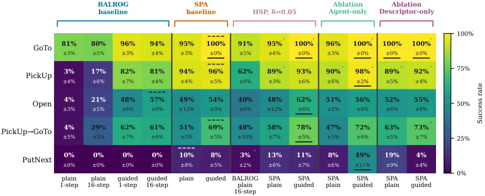

Figure 10: Comparison of the SR based on constrained and unconstrained
Optimizer functioning. The ablation on agent $`S`$ and descriptor $`D`$
essentially mimics the optimization of the BALROG agent.

|                     |         |       |            |      |        |            |            |
| ------------------- | ------- | ----- | ---------- | ---- | ------ | ---------- | ---------- |
| Condition           | Variant | Agent | Descriptor | Skip | Cycles | Violations | Viol. rate |
| HSP                 | plain   | 83%   | 17%        | 0%   | 100    | —          | —          |
| HSP                 | guided  | 79%   | 21%        | 0%   | 100    | —          | —          |
| LSP                 | plain   | 80%   | 20%        | 0%   | 100    | —          | —          |
| LSP                 | guided  | 83%   | 17%        | 0%   | 100    | —          | —          |
| Agent-only          | plain   | 95%   | 5%         | 0%   | 100    | 0          | 0.0%       |
| Agent-only          | guided  | 92%   | 8%         | 0%   | 100    | 0          | 0.0%       |
| Descriptor-only     | plain   | 3%    | 96%        | 1%   | 100    | 1          | 1.0%       |
| Descriptor-only     | guided  | 6%    | 88%        | 6%   | 100    | 6          | 6.0%       |
| Total (constrained) |         |       |            |      | 400    | 7          | 1.8%       |

Table 10: BA module attribution and constraint violations for
unconstrained gated runs and module-ablation constrained runs.
Attribution columns show the fraction of optimisation cycles where the
BA diagnosed a failure in each module. Violations count cycles where the
BA attributed the locked module, requiring a re-sample. All violations
occur in descriptor-only runs; agent-only runs produced zero violations.

## Appendix C Details of the Prompts for All Agents and Optimizer Modules

This appendix documents all prompts used in the pipeline, organised by
_when_ they are active. The Agent and Descriptor receive only their own
instruction files at rollout time — they never see the environment
layer, the BA instructions, or the Mutator instructions. Environment
physics and pipeline contracts live exclusively in the optimiser’s
context, grounding its attributions without leaking privileged
information into agent behaviour.

### C.1 Inference-Time Prompts

Exact system prompts presented to each LLM during episode rollouts.
Neither the Acting Agent nor the Descriptor Agent receives the
environment layer shown in Section C.2.

#### C.1.1 Descriptor Prompts

##### Descriptor — Plain.

One-sentence instruction. Provides no task-specific context; the
Descriptor must produce a goal-conditioned summary from the raw
observation alone.


##### Descriptor — Guided.

Handcrafted perceptual guidance: explicit output rules, prioritisation
criteria, and boundary conditions. Optimiser starting point for the
descriptor module under the guided variant.


#### C.1.2 Agent Prompts

##### Agent — Plain.

BALROG-style minimal agent instructions. Provides the action set and a
minimal output format; no task-specific win conditions or planning
guidance.


##### Agent — Guided.

Handcrafted reasoning strategy: explicit win conditions for all five
task families, partial observability handling, a structured planning
format, and action-set semantics. Optimiser starting point for the agent
module under the guided variant.


##### Agent — BALROG Plain.

Verbatim RobustCoTAgent Prompt From the BALROG, Reproduced Without
Modification Used as the starting prompt for all BALROG optimisation
runs. The {mission} placeholder is substituted at runtime by the BALROG
runner.


##### Agent — BALROG Guided.

Guided variant of the BALROG prompt in BALROG’s free-form
chain-of-thought style (\<\|ACTION\|\> extraction, no structured
PLAN/ACTION format). Used in BALROG guided baseline experiments.


### C.2 Optimization-Time Prompts

These prompts run only during the optimization loop.

##### Environment Layer.

Shared read-only context injected into both the BA and Mutator at every
optimization cycle. Encodes world structure, observation format, action
space, physical constraints, and partial observability rules. This was
richly handcrafted in order to make certain that the BA and Mutator
would follow the exact instructions that they were given. The resulting
prompts were crafted over multiple retries of both components in
isolation and then used in our pipeline.


##### Behaviour Analyser Instructions.

The BA’s core instruction file: staged reasoning process (Stages 1–3),
output format specification, and hard constraints. Shown verbatim. At
runtime the BA additionally receives (after these instructions): the
environment layer, the _current_ agent prompt, the _current_ descriptor
prompt, and the prior mutation history (last 10 hereditary entries).


##### Mutator Instructions.

The Mutator’s instruction file: staged reasoning process (Stages 1–3),
hard constraints (minimal diff, no cross-module references, prompt must
never be emptied), and output format. Shown verbatim. At runtime the
Mutator additionally receives: the environment layer, the _current_
target module’s prompt, and the prior mutation history.


## Appendix D Selected Examples of Changes to Mutated Prompts

### D.1 An Analysis of How Thresholding Impacts the Performance on PutNext: Analysis for SPA

All diffs in this section use inline highlighting to annotate semantic
categories (+ added, - removed; GOOD = addresses a diagnosed failure
mode; CONFLICT = creates a risk or contradicts an existing rule;
STRUCT = format or structure change, not reasoning; SYNTH = generated
from scratch). Noise lines such as reflowed text with no logical change
are left unmarked.

In this section, we look at the exact changes that were made to the non
optimised prompts that resulted in the best overall score for the
PutNext task. The gated run accepts exactly one mutation across 20
cycles. The entire jump from near-zero to $`72.5\%`$ traces to a single
block added to the Planning section (Box  D.1).

The addition encodes drop geometry. PutNext requires placing object A
adjacent to object B. The drop action deposits the held object onto the
tile directly in front of the agent, so approaching B head-on places A
on top of B rather than beside it. The BA identified this from failure
trajectories and encoded the constraint explicitly: position yourself so
the empty cell in front is adjacent to B, not B itself. There was no
counterpart to this rule anywhere in the original prompt. The selection
mechanism accepted it on the first valid candidate.


##### Post Hoc, Best Selection Pool Performer

The always-accept run reaches $`70.0\%`$ at its best selection pool
checkpoint through a mutation that arrives at the same spatial insight,
expressed differently (Box D.1).

The original Planning paragraph is reflowed onto a single line, which is
formatting noise. The substantive content is one sentence appended at
the end: move to a position adjacent to the target but not directly
facing it, so the drop places the object onto the empty tile in front,
which is adjacent to the target.

Comparing the two diffs is instructive. Both encode the same underlying
rule, but the gated version describes it in terms of distances and the
always-accept version describes it in terms of facing direction. Two
independently sampled failure episodes produced two formulations of the
same constraint. Both cleared the gate equivalent they were evaluated
against.


##### End-of-Round Incumbent, Without Gating

This diff shows what the optimizer added after the $`70.0\%`$ checkpoint
(Box D.1). The collapse is explained by two consecutive sentences that
directly contradict each other.

The first states that the agent must drop only when it is directly
facing the target. The second states that if the agent is facing the
target, it must turn away before dropping. These two instructions cannot
both be satisfied simultaneously. The good rule from the diff in Box
D.1, which said not to face the target when dropping, has been replaced
by a rule that oscillates in both directions within the same paragraph.

The optimizer had no mechanism to detect the degradation. Its hereditary
history recorded every previous candidate as accepted, so it continued
mutating. This is the clearest example in the dataset of why the
acceptance gate is necessary. The gate is not only a quality filter on
individual candidates. It is the only signal that tells the optimizer
when to stop.


### D.2 Other Qualitatively Analysed Mutations

Diff box D.2 shows one change to the Planning section in which two rules
were appended at the end of the existing paragraph.

The first covers key-door interactions. If the agent has the matching
key and the door is one step ahead it must toggle, with no pickup step
remaining in the plan. If it does not have the key yet it must pick it
up first. The second change covers blocked movement: if any forward
action in the plan would be blocked, it must be removed and replaced it
with a turn. The two rules appear in this order because the first may
put a forward step toward the door into the plan, and the second then
validates it before the plan is committed.


We see in box D.2, one sentence added to the Planning section. Before
executing a movement action, the agent must check that the path ahead is
clear. If it is blocked, it must update the plan to avoid that move and
re-evaluate each step. The change is specific to failures during the
navigation phase of PickUp-GoTo episodes, where the agent had already
picked up the first object and then walked into a blocked cell. The rest
of the guided prompt already handles everything else.


We see in box D.2, three separate hunks across the prompt, the first two
adding targeted improvements and the third introducing a problematic
rule alongside a structural change.

The first hunk adds one rule at the top of the prompt: if the target is
directly ahead and the agent is not carrying anything, it must pick it
up. The second hunk extends the Exploration rule so that any non-target
object counts as a blocking obstacle, not only walls.

The third hunk modifies the Planning section and the FORMAT block. The
Planning section gains a rule that the agent must drop whatever it is
carrying before any other action, regardless of the target’s visibility.
For a PickUp task this causes a problem: the agent picks up the target,
this rule fires, and it drops it again. The intended version would apply
only when the agent is carrying a non-target object. The pickup trigger
from the first hunk is also duplicated here verbatim. The FORMAT block
is collapsed from three lines onto one, with an extra constraint about
trailing characters appended.


We see in box D.2, three bullets added to the Tips section, which is the
only available anchor in the plain prompt.

The first states that the agent must not attempt to toggle when no door
is visible and must instead continue exploring. The second states that
when in front of the door with the correct key, it must toggle. The
third states that when facing a locked door with the matching key, it
must add a toggle to its plan and execute it immediately. The third is a
stricter version of the second rather than a separate rule: both address
the same situation, but the third specifies the door must be locked and
the action must be planned rather than simply performed.

This diff covers the same task as in Box D.1, but on the plain prompt.
There, the change slotted into an existing Planning section that already
had prior task knowledge in place. Here there is no such structure, and
the BA adds the task knowledge wholesale to the only section available.


