# SAGE: Stochastic Prompt Optimization via Agent-Guided Exploration

Ziyi Zhu Affiliation: Slingshot AI
Email: [ziyi@slingshotai.com](mailto:)    Luka Smyth
Affiliation: Slingshot AI Email: [luka@slingshotai.com](mailto:)    Saki
Shinoda Affiliation: Slingshot AI Email: [jc2124@cam.ac.uk](mailto:)   
Jinghong Chen Affiliation: Department of Engineering, University of
Cambridge

###### Abstract

Context engineering has emerged as a primary lever for improving AI
systems without parameter updates. Recent work showing that textual
gradients do not function as real gradients motivates treating automatic
prompt optimization (APO) as black-box search. We introduce SPO
(Stochastic Prompt Optimization), a framework for stochastic search over
prompt space, and compare three strategies of increasing sophistication:
error-informed random search, a genetic algorithm with evolutionary
operators, and SAGE (SPO via Agent-Guided Exploration), a multi-agent
pipeline with diagnostic code execution. Across three benchmarks, no
single strategy dominates; effectiveness depends on the interaction of
landscape structure with error type. We further deploy SAGE on a
mental-health chatbot under a _continuous optimization_ paradigm, where
it compounds eight cycles of individually-noisy A/B tests into a
statistically robust gain in next-day retention. We argue that coupling
qualitative diagnosis with quantitative validation is what makes agentic
optimization effective for open-ended task-oriented dialogue.¹¹ 1 Code
is publicly available at
[https://github.com/slingshot-ai/sage](https://github.com/slingshot-ai/sage).

## 1 Introduction

_Context engineering_ is the optimization of the entire informational
context surrounding an LLM query (Mei et al., 2025). While automatic
prompt optimization (APO) has attracted intense research effort (Ramnath
et al., 2025; Cui et al., 2025), the field lacks a unifying theoretical
perspective on the search problem it addresses. Melcer et al. (2025)
established that APO is fundamentally *black-box search* (Spall, 2003),
but the effective search space is low-dimensional, semantically smooth,
and dense with adequate solutions (§2.2). The prompt landscape can
therefore be understood as noisy black-box optimization with expensive
evaluations and rich local structure.

This theoretical lens reveals fundamental limitations of existing
approaches:

1.  1.  Myopic search. Per-sample methods process one training example at a
        time, greedily accumulating delta edits. This myopic strategy is
        computationally expensive and particularly susceptible to local
        optima.
2.  2.  Shallow analysis. Most APO methods constrain each optimization step
        to LLM-only reasoning. While recent multi-agent approach (Ye et al.,
    2026) equips agents with coding tools, its code execution serves
          _procedural artifact construction_ without diagnostic analysis of
          error patterns.

We introduce SPO (Stochastic Prompt Optimization), a framework for
black-box search over prompt space that addresses both limitations. SPO
is designed as stochastic hill climbing: each iteration produces $`Q`$
candidates via a chosen search strategy, and the best is adopted only if
it strictly improves upon the incumbent. We compare three strategies of
increasing sophistication:

- •
  SPO-RS (Residual Search): Error-informed generation via
  high-temperature LLM sampling, seeded from the current prompt (§3.2).
- •
  SPO-GA (Genetic Algorithm): Evolutionary optimization with
  LLM-mediated crossover and error-informed mutation (§3.3).
- •
  SAGE (Agent-Guided Exploration): A multi-agent pipeline where agents
  write and execute diagnostic code to inform prompt edits (§3.4).

Most consequentially, SAGE extends to _open-ended_ domains that lack a
crisp correctness signal. Our contributions are:

- •
  Black-box optimization framework: We introduce SPO, formalizing APO as
  noisy black-box search over a structured landscape, and present three
  strategies as a controlled ablation that isolates the value of
  analytical depth and exploration diversity.
- •
  Diagnostic code execution: SAGE is the first APO framework where code
  execution serves _statistical diagnosis_ as opposed to procedural
  artifact construction or LLM-only reasoning.
- •
  Production deployment: We introduce a _continuous optimization_
  paradigm for open-ended dialogue and deploy it on a mental-health
  chatbot serving real users, where SAGE compounds individually-noisy
  A/B cycles into a selection-adjusted $`+13\%`$ cumulative gain in
  next-day retention, demonstrating applicability beyond benchmark
  accuracy.

## 2 Related Work

### 2.1 Automatic Prompt Optimization

APO methods span LLM-based generation and selection (Zhou et al., 2023;
Yang et al., 2024), evolutionary approaches (Guo et al., 2024; Agrawal
et al., 2026), gradient-inspired methods (Pryzant et al., 2023;
Yuksekgonul et al., 2025), and programmatic compilation (Khattab et al.,
2024); recent surveys provide comprehensive taxonomies (Ramnath et al.,
2025; Cui et al., 2025). Melcer et al. (2025) showed that textual
gradients do not behave as real gradients, with gains attributable to
exploration and validated selection.

### 2.2 The Prompt Landscape

Empirical evidence increasingly characterizes the prompt optimization
landscape. Sclar et al. (2024) demonstrated large variation in accuracy
from formatting changes alone, revealing a deceptively rugged surface
where semantically similar prompts produce wildly different performance.
Wan et al. (2024) showed that random exemplar search outperforms
state-of-the-art instruction optimization, suggesting a landscape dense
with adequate solutions. Bergstra and Bengio (2012) proved that random
search outperforms grid search when effective dimensionality is low.
These findings collectively point to a multimodal landscape with low
effective dimensionality: many good local optima exist, and textual
gradient methods fail because formal gradient properties do not
hold (Melcer et al., 2025). However, the landscape is not uniformly
rugged, as semantic similarity between prompts predicts performance
similarity at the instruction level. The degree of local structure
varies across tasks, and we quantify this variation empirically in §5.2
using the semivariogram from geostatistics (Cressie, 1993), extending
the fitness landscape analysis tradition of Weinberger (1990) to prompt
space.

### 2.3 Multi-Agent Prompt Optimization

Several recent methods deploy multiple agents. MAPGD (Han et al., 2025)
uses specialized agents for distinct refinement dimensions with
bandit-based selection, but operates through LLM-only reasoning. MCE (Ye
et al., 2026) is the most related: a bi-level framework where a
meta-agent evolves context engineering _procedures_ via skill crossover,
with base-level agents using coding toolkits and file system access. The
key distinction is _what code execution serves_: MCE’s tools construct
programmatic artifacts (retrieval functions, context templates) as the
optimization procedure itself evolves, whereas SAGE uses code execution
for _diagnostic analysis_ within a fixed procedure: clustering errors,
running statistical tests, and identifying overrepresented failure
patterns.

### 2.4 Context Engineering

ACE (Zhang et al., 2026) introduced the Generator–Reflector–Curator
architecture with grow-and-refine delta edits, establishing context
engineering as an iterative optimization process. However, ACE’s
per-example processing is inherently _myopic_: each reflection sees a
single error trace, with no aggregate view of failure patterns. Dynamic
Cheatsheet (Suzgun et al., 2026) introduced test-time adaptive memory.

## 3 Method

### 3.1 Problem Formulation

Let $`\mathcal{P}`$ denote the space of possible system prompts and
$`\mathcal{D}=\{x_{1},\ldots,x_{n}\}`$ a dataset of tasks. Given a
reward function $`R:\mathcal{P}\times\mathcal{D}\rightarrow[0,1]`$, the
goal is:

```math
p^{*}=\argmax_{p\in\mathcal{P}}\;\mathbb{E}_{x\sim\mathcal{D}}[R(p,x)] \tag{1}
```

$`\mathcal{P}`$ is a discrete space of natural-language strings and
$`R`$ is noisy due to LLM non-determinism, making this a stochastic
optimization problem (Spall, 2003). Unlike classical combinatorial
search (e.g., TSP, SAT), no method operates over the raw token-level
space $`|V|^{L}`$; all methods search a compressed semantic subspace of
coherent instructions in which semantically similar prompts tend to
perform similarly, giving the landscape _rich local structure_. A more
productive characterization is therefore noisy black-box optimization
with expensive evaluations and low effective dimensionality (Snoek et
al., 2012): black-box (no access to the LLM’s internals), noisy (finite
evaluation samples), and expensive (each candidate requires a full
dataset evaluation), with few effective degrees of freedom (which
instructions to include, how to structure them, what examples to
provide).

Notation. We use two distinct subscripts: $`i\in\{1,\ldots,n\}`$ indexes
examples in $`\mathcal{D}`$, and $`k\in\{0,1,\ldots,K\}`$ indexes
optimization iterations. We write $`p_{k}`$ for the best prompt at
iteration $`k`$.

Shared framework. All three SPO strategies share the same outer loop:
stochastic hill climbing with monotonic selection. Let
$`\mathcal{B}_{k}`$ denote the top-$`P`$ prompt population at iteration
$`k`$ and $`p_{k}\in\mathcal{B}_{k}`$ its best member. Writing
$`\hat{R}(p)=\frac{1}{|\mathcal{D}|}\sum_{x\in\mathcal{D}}R(p,x)`$ for
the empirical mean reward that estimates the objective, each iteration
updates

```math
p_{k+1}=\argmax_{p\,\in\,\{p_{k}\}\,\cup\,S(\mathcal{B}_{k},\mathcal{D})}\hat{R}(p), \tag{2}
```

where $`S\in\{\text{SPO-RS},\text{SPO-GA},\text{SAGE}\}`$ produces $`Q`$
candidate prompts from the population and the $`\argmax`$ ranges over
those candidates together with the incumbent $`p_{k}`$, which ensures
the prompt never regresses. SPO-RS conditions only on the best member
$`p_{k}`$, whereas SPO-GA and SAGE draw on the full top-$`P`$ set.

### 3.2 SPO-RS: Residual Search

At each iteration, SPO-RS generates $`Q`$ candidates independently by
prompting a meta-model at high temperature ($`\tau=0.9`$), conditioned
on the current best prompt $`p_{k}`$ and a summary of its errors. This
design mirrors error-informed prompt refinement methods like
ProTeGi (Pryzant et al., 2023) and OPRO (Yang et al., 2024), but
replaces structured optimization operators with stochastic perturbation.
SPO-RS incorporates cross-iteration feedback through the error summary
while maintaining exploration through temperature-driven diversity.

### 3.3 SPO-GA: Genetic Algorithm

SPO-GA applies evolutionary operators to a population of the top-$`P`$
prompts maintained across iterations, with a crossover ratio $`\rho`$
controlling the operator mix. _Crossover_ ($`\lceil\rho\cdot Q\rceil`$
candidates) presents two parents and their error summaries to the
meta-model, which generates a child combining their strengths while
targeting shared failure modes; _mutation_
($`Q-\lceil\rho\cdot Q\rceil`$ candidates) applies targeted improvements
to a single tournament-selected parent. This follows the
LLM-as-evolutionary-operator paradigm of EvoPrompt (Guo et al., 2024)
and GEPA (Agrawal et al., 2026); relative to SPO-RS it adds structure
but lowers temperature ($`\tau{=}0.7`$), trading diversity for
targeting.

### 3.4 SAGE: Agent-Guided Exploration

SAGE addresses the limitations of both SPO-RS and SPO-GA through a
multi-agent pipeline, where each agent has access to a computational
toolkit (file I/O, shell execution, code search) and operates on
structured datasets (Figure 1).

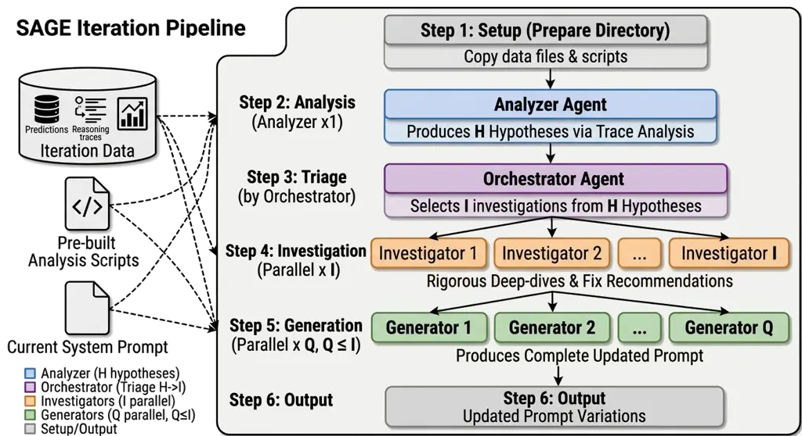

Figure 1: SAGE architecture: a fixed six-step multi-agent pipeline per
iteration, progressing from cross-prompt error analysis through parallel
hypothesis investigation to prompt generation and hill-climbing
selection.

At each iteration, SAGE exports each top-$`P`$ prompt’s evaluation
results (per-sample predictions, reasoning traces, and error subsets)
alongside pre-built analysis scripts containing task-agnostic utilities,
on top of which agents write their own task-specific analyses. Four
roles operate in a fixed protocol (Figure 1): an Analyzer runs the
scripts across all prompts’ results to surface $`H`$ evidence-backed
hypotheses; the Orchestrator triages them to $`I`$ investigation
directions; $`I`$ Investigators deep-dive in parallel, each verifying
one hypothesis with exact counts and trace analysis and returning an
implementation-ready fix; and $`Q`$ Generators ($`Q\leq I`$) each
produce a complete revised prompt from one investigation report.
Parallel execution across agents injects beneficial stochasticity.

The key advantage of SAGE is _analytical depth_: agents systematically
diagnose _why_ errors occur through programmatic analysis of the full
dataset, transforming the search from stochastic perturbation to
hypothesis-driven optimization.

## 4 Experimental Setup

### 4.1 Tasks

We evaluate on three open-source benchmarks spanning different task
types, plus a production deployment. XBRL Formula (Zhang et al., 2026)
is a financial reasoning task requiring translation of natural-language
descriptions of financial formulas into executable XBRL expressions (500
train / 300 val / 200 test). FiNER (Shah et al., 2023) is a financial
named entity recognition task requiring classification of entities into
fine-grained categories (1,000 train / 500 val / 441 test).
AppWorld (Trivedi et al., 2024) is a suite of autonomous agent tasks
involving API understanding, code generation, and multi-step environment
interaction across common applications; we evaluate on the test-normal
split using the original partitioning (90 train / 57 val / 168 test) and
report Task Goal Completion (TGC).

### 4.2 Production Deployment

We apply SAGE to Ash²² 2
[https://www.talktoash.com/](https://www.talktoash.com/), a mental
health support chatbot by Slingshot AI, optimizing the system prompt
that encodes its conversational strategies and safety protocols (see
Appendix G for representative optimized directives). Several
characteristics make this task well-suited for SAGE: (1) each deployment
cycle produces thousands of conversations, requiring both quantitative
analysis and qualitative diagnosis; (2) the evaluation signal is noisy;
and (3) errors in this open-ended domain tend to be complex and
cascading, suggesting a rugged optimization landscape where SAGE’s
analytical depth is advantageous.

The chatbot operates under a _continuous optimization_ paradigm that
instantiates the hill-climbing loop of Eq. 2: each cycle deploys the
current best prompt to real users, runs SAGE on the collected
conversations, and A/B tests all candidates simultaneously. In
production we maintain a single incumbent ($`P{=}1`$) and a
clinically-reviewed set of $`Q\in\{1,2,3\}`$ candidate arms per cycle,
and promote by a two-stage rule: arms that regress on our offline safety
or sycophancy gates are excluded first, and among the remainder the arm
with the largest positive delta over the control is promoted, retaining
the incumbent if none qualifies (see Appendix C). The primary metric is
D1 retention; secondary metrics include engagement, issue rate (Zhu et
al., 2025), and user ratings. We optimize for retention instead of
validated clinical measures such as PHQ-9 symptom change (Tieleman et
al., 2026) or working alliance because it is logged automatically
without the survey burden and attrition bias that make those instruments
hard to administer at scale (Sagui-Henson et al., 2022), yet on Ash
itself engagement shows a dose-response association with PHQ-9
improvement (Wolfe et al., 2026), consistent with the broader digital
mental-health literature (Daley et al., 2020), making it an adequate
proxy. Retention is defensible partly because adoption is currently the
binding constraint, and users must return in sufficient numbers before
longer-horizon clinical impact can even be measured.

### 4.3 Baselines and Configuration

We compare SPO-RS, SPO-GA, and SAGE against the base LLM with no
optimization, in-context learning (ICL) with few-shot demonstrations,
MIPROv2 (Opsahl-Ong et al., 2024) which jointly optimizes instructions
and demonstrations via Bayesian search, GEPA (Agrawal et al., 2026)
which evolves prompts through LLM self-critique, Dynamic Cheatsheet
(DC-CU) (Suzgun et al., 2026) which accumulates an adaptive hint memory
at test time, and ACE offline (Zhang et al., 2026). The _target_ LLM
(the model whose prompt is being optimized) is
DeepSeek-V3.1 (DeepSeek-AI et al., 2024) across all tasks and methods.
The _meta-model_ (the model that proposes prompt edits) is Claude Sonnet
4.6 for all three SPO variants (SPO-RS, SPO-GA, and SAGE), ensuring a
fair comparison that isolates strategy differences from model
differences. All SPO variants use $`K=10`$ iterations, population size
$`P=2`$, and $`Q=3`$ candidates per iteration. SPO-GA uses crossover
ratio $`\rho=0.3`$. SAGE generates $`H=8`$ initial hypotheses, triages
to $`I=5`$ investigation directions, and selects the top $`Q`$ for
prompt generation. Because SPO-RS and SPO-GA share SAGE’s meta-model,
$`K`$, $`Q`$, and outer loop and differ only in whether edits are
grounded in diagnostic code execution, the benchmark comparison is a
controlled ablation of code-assisted diagnosis. For Formula and FiNER,
which lack a native validation split, the validation sets above are
disjoint carves from each benchmark’s original training pool and overlap
neither the reported training nor test sets; AppWorld uses its native
dev split. In all cases we select the single best-validation prompt,
which is then scored on the held-out test set exactly once.

## 5 Results

### 5.1 Benchmark Results

|               |         |       |          |
| ------------- | ------- | ----- | -------- |
| Method        | Formula | FiNER | AppWorld |
| Base LLM      | 67.5    | 70.7  | 63.7     |
| ICL           | 67.0    | 72.3  | 64.3     |
| MIPROv2       | 69.5    | 72.3  | –        |
| GEPA          | 71.5    | 73.5  | 64.9     |
| DC-CU         | 69.5    | 74.1  | 65.5     |
| ACE offline   | 85.0    | 76.9  | 76.2     |
| SPO-RS (ours) | 85.5    | 77.5  | 78.0     |
| SPO-GA (ours) | 85.5    | 76.2  | 79.8     |
| SAGE (ours)   | 86.5    | 76.5  | 79.2     |

Table 1: Test accuracy (%) on benchmarks. AppWorld reports TGC on
test-normal; all AppWorld methods use ReAct (Yao et al., 2023) as the
agent framework. SPO variants ($`n{=}3`$ runs): test accuracy of the
single best-validation prompt (§4.3), averaged over runs.

The central finding is that _rankings shift across tasks_ (Table 1,
Figure 2). SAGE leads on Formula, where cascading reasoning errors
reward analytical depth. On FiNER the ranking inverts: SAGE attains the
highest _training_ accuracy but a simpler strategy generalizes best. On
AppWorld all three SPO variants beat the strongest baseline, with SAGE
achieving the highest training accuracy by a wide margin, but validation
accuracy oscillates for all strategies due to the small evaluation set.
Validation-set curves are reported in Appendix B.

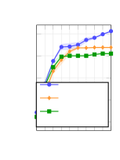

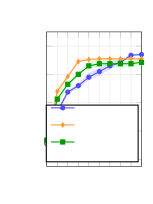

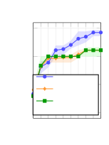

Figure 2: Best training accuracy over $`K{=}10`$ iterations (mean with
shaded IQR across runs). Iteration 1 shows the initial prompt before
optimization.

### 5.2 Landscape Analysis

We characterize landscape structure via the *semivariogram* (Cressie,
1993), a geostatistical measure of how quickly accuracy decorrelates
with embedding distance. We embed all unique prompts from the
optimization runs with text-embedding-3-large, compute pairwise cosine
distances, and fit an exponential model to extract the _range_ $`a`$,
the distance at which accuracy becomes effectively uncorrelated (see
Appendix F for full methodology).

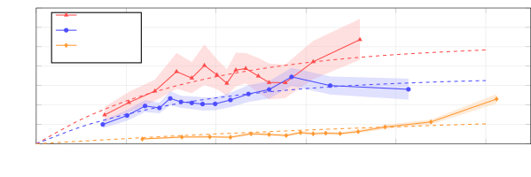

Figure 3: Empirical semivariogram $`\gamma(d)`$ vs. cosine distance in
prompt embedding space. Points: binned empirical semivariance (95%
bootstrap CIs shaded). Dashed curves: fitted exponential model.

The fitted ranges reveal two regimes (Figure 3): Formula and AppWorld
decorrelate within a small semantic neighborhood (rugged landscapes),
while FiNER stays correlated over $`{\sim}4{\times}`$ the distance (a
smooth landscape, where a disambiguation rule that helps one taxonomic
family helps others). Crucially, ruggedness alone does not predict the
winning strategy: Formula and AppWorld are equally rugged yet favor
different optimizers. The decisive factor is _error structure_:
cascading reasoning errors (Formula) reward SAGE’s root-cause analysis,
whereas procedural, per-task errors (AppWorld) yield to simpler search.

### 5.3 Mental Health Chatbot

We have run SAGE for eight continuous-optimization cycles on Ash. Each
cycle ran SAGE on the previous deployment’s conversations, A/B tested
the resulting candidates against the incumbent for $`{\sim}48`$ hours,
and promoted the best arm. Figure 4 shows the cumulative effect on D1
retention. Seven of the eight cycles produced a positive winning arm;
the remaining cycle (cycle 3) found no candidate that beat the incumbent
and retained it unchanged. Naively chaining the measured per-cycle A/B
deltas of the promoted arms yields a cumulative $`+29.4\%`$ relative
improvement in D1 retention over the eight cycles, but this figure is
inflated by _winner’s-curse_ selection bias: each cycle reuses the
observed lift of the arm it selected precisely _because_ that lift was
largest. After correcting for this bias with empirical-Bayes shrinkage
(Appendix E), the selection-adjusted cumulative gain is +13.2%.
Appendix G shows representative directives from the resulting prompt.

Crucially, most individual cycles were _not_ significant on their own:
only two (cycles 5 and 8) crossed the 95% chance-to-beat-control
threshold, while the rest had credible intervals straddling zero (see
Appendix D). Even after shrinking every promoted delta toward the
across-arm prior mean to remove the post-selection bias, the propagated
95% band on the selection-adjusted chain clears zero from cycle 5
onward, so individually noisy gains compound into a statistically robust
signal. The adjusted estimate is consistent with independent evidence:
product-level D1 retention averaged over 7 days, tracked in our product
analytics and separate from the experiment platform, improved by an
equivalent relative $`+13.7\%`$ over the same period, during which SAGE
was the only continuously-running, retention-directed intervention.
However, we do not treat this as confirmation, since the product metric
is population-wide and not experimentally controlled. The app evolves
concurrently with these experiments, therefore we rely only on
within-cycle A/B deltas rather than absolute retention across cycles.

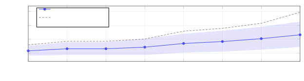

Figure 4: Continuous optimization of D1 retention over eight SAGE
cycles. The selection-adjusted chain reaches $`+13.2\%`$ with a 95% band
(shaded) that clears zero from cycle 5 onward. The naive chain reaches
$`+29.4\%`$ but is inflated by winner’s-curse selection bias.

## 6 Discussion

Our deployment and benchmarks point to the same principle from opposite
ends: agentic analytical depth helps most precisely when the task signal
is noisy and groundtruth is underspecified.

Analytical depth in ill-posed domains. Open-ended dialogue lacks the
crisp correctness signal of benchmark tasks: the objective is a noisy,
long-horizon behavioral outcome, and the space of admissible responses
is large and underspecified. Improving the prompt therefore requires
inferring _what_ constitutes a better response from data: we
qualitatively characterize candidate behaviors from conversation traces,
then quantify their prevalence and association with the downstream
outcome. This coupling of qualitative pattern discovery with
quantitative validation is precisely the analytical capability SAGE’s
agents provide and that LLM-only variants lack, and it is why SAGE is
the first method in our deployment to yield consistent, compounding
retention gains.

Match optimizer depth to error structure. The benchmarks make the
converse point: where a crisp signal exists, depth is not always worth
its cost. Simpler methods win on the smooth FiNER landscape, while the
two equally-rugged tasks split (SAGE on Formula, SPO-GA on AppWorld).
The distinguishing factor is _error structure_ (§5.2), refining the No
Free Lunch intuition (Wolpert and Macready, 1997): cascading reasoning
errors reward deep root-cause diagnosis, while procedural errors yield
to simpler search. The flip side is overfitting: SAGE can push training
accuracy well past test accuracy. The continuous, on-policy paradigm
(§4.2) mitigates this by refreshing data each cycle.

## 7 Conclusion

We presented SPO, a framework that formalizes automatic prompt
optimization as structured black-box search, and SAGE, its agentic
instantiation that grounds each prompt edit in diagnostic, code-driven
analysis. Our controlled benchmark comparison establishes one main
point: no single strategy dominates, because effectiveness depends on
the interaction of landscape structure with error type. Our deployment
with continuous optimization offers a practical recipe for production
systems: chain individually-underpowered online A/B tests into a robust
cumulative signal, and pair automated measurement with agentic
qualitative diagnosis to decide what to change. We see such mixed
qualitative–quantitative agentic optimization as the key unlock for
improving open-ended dialogue systems where correctness cannot be
defined in advance.

## Limitations

We highlight four limitations of SPO and its continuous-optimization
deployment.

Evaluation function: SPO requires an automated evaluation function. For
tasks without clear ground truth, adaptation to LLM judges or human
ratings would introduce additional noise and cost. In the mental-health
deployment this is especially acute: D1 retention is a convenient proxy,
but the outcomes we ultimately care about (e.g., symptom change or
working alliance) are costly to measure and mature too slowly to
optimize against.

Experimental controls: The deployment lacks two controls that a purely
scientific study would include. First, there is no persistent
original-prompt holdout, because our policy forbids keeping live users
on a prompt we have strong conviction is worse; cumulative effects are
therefore chained from within-cycle deltas rather than read from a
single long-running A/B test. Second, the propagated cumulative band
assumes cross-cycle independence. Re-randomization between cycles and
concurrent per-cycle controls make this reasonable, but users may recur
across cycles and the population co-evolves with the prompt.

Distribution shift: The continuous optimization paradigm (§4.2) assumes
that insights from one cycle’s data remain relevant in subsequent
cycles. In practice, the user population and its behavior evolve over
time, so the _magnitude_ of gains may attenuate as the prompt co-evolves
with its user base. Whether long-running continuous optimization
eventually converges, oscillates, or requires periodic re-grounding on
fresh population snapshots is an open empirical question.

Bounded novelty: Because SAGE diagnoses patterns in collected
conversations, it is structurally biased toward refining behaviors
already present in the data. Two consequences follow. First, the
objective is necessarily a measurable proxy; deeper goals such as
durable mental-health impact mature too slowly to be A/B tested per
change, so validating them requires aggregate, system-level evaluation.
Second, the _direction_ of qualitatively new behavior cannot be
discovered from the data alone and must be supplied externally (e.g., by
domain experts); SAGE then does the operational work of implementing and
validating it. Combining agent-driven optimization with externally-set
direction is a promising avenue for moving beyond proxy-bounded,
incremental gains.

## Ethical Considerations

The mental health chatbot application involves vulnerable users. All
SAGE-generated candidates are reviewed by clinical experts before any
user exposure, and no candidate prompt was hand-edited by reviewers
during the eight cycles. Beyond retention, every arm is scored each
cycle by an offline issue-detection pipeline covering assistant-side
safety violations and sycophancy, and an arm that regresses on these
gates is barred from promotion (Appendix D); A/B tests also include
real-time safety monitoring with automatic rollback if crisis protocol
adherence or issue rates deteriorate. Conversation data is anonymized
per data protection policies. The study was reviewed by the Biomedical
Research Alliance of New York (BRANY) independent Institutional Review
Board (IRB) and determined to be exempt under category 4(ii) (BRANY IRB
File \#26-081-2393).

## Acknowledgments

We are grateful to the Slingshot AI team for their valuable discussions
and infrastructure support. We thank the users of Ash who opted in to
provide the data used for this study.

## References

- Agrawal et al. (2026) L. A. Agrawal, S. Tan, D. Soylu, N. Ziems, R.
  Khare, K. Opsahl-Ong, A. Singhvi, H. Shandilya, M. J. Ryan, M.
  Jiang, C. Potts, K. Sen, A. G. Dimakis, I. Stoica, D. Klein, M.
  Zaharia, and O. Khattab GEPA: reflective prompt evolution can
  outperform reinforcement learning. In The Fourteenth International
  Conference on Learning Representations (ICLR), Note: Oral presentation
  External Links: [Link](https://openreview.net/forum?id=RQm2KQTM5r),
  2507.19457 Cited by: §2.1, §3.3, §4.3.
- Bergstra and Bengio (2012) J. Bergstra and Y. Bengio Random search for
  hyper-parameter optimization. Journal of Machine Learning Research 13
  (10), pp. 281–305. External Links:
  [Link](https://jmlr.org/papers/v13/bergstra12a.html) Cited by: §2.2.
- Cressie (1993) N. A. C. Cressie Statistics for spatial data. Revised
  edition, Wiley Series in Probability and Statistics, John Wiley &
  Sons, New York, NY. External Links: ISBN 978-0-471-00255-0,
  [Document](https://dx.doi.org/10.1002/9781119115151),
  [Link](https://doi.org/10.1002/9781119115151) Cited by: Appendix F,
  §2.2, §5.2.
- Cui et al. (2025) W. Cui, J. Zhang, Z. Li, H. Sun, D. Lopez, K.
  Das, B. A. Malin, and S. Kumar Heuristic-based search algorithm in
  automatic instruction-focused prompt optimization: a survey. In
  Findings of the Association for Computational Linguistics: ACL
  2025, W. Che, J. Nabende, E. Shutova, and M. T. Pilehvar (Eds.),
  Vienna, Austria, pp. 22093–22111. External Links:
  [Link](https://aclanthology.org/2025.findings-acl.1140/),
  [Document](https://dx.doi.org/10.18653/v1/2025.findings-acl.1140),
  ISBN 979-8-89176-256-5 Cited by: §1, §2.1.
- Daley et al. (2020) K. Daley, I. Hungerbuehler, K. Cavanagh, H. G.
  Claro, P. A. Swinton, and M. Kapps Preliminary evaluation of the
  engagement and effectiveness of a mental health chatbot. Frontiers in
  Digital Health 2, pp. 576361. External Links: ISSN 2673-253X,
  [Document](https://dx.doi.org/10.3389/fdgth.2020.576361),
  [Link](https://doi.org/10.3389/fdgth.2020.576361) Cited by: §4.2.
- DeepSeek-AI et al. (2024) DeepSeek-AI, A. Liu, B. Feng, B. Xue, B.
  Wang, B. Wu, C. Lu, C. Zhao, C. Deng, C. Zhang, C. Ruan, D. Dai, D.
  Guo, D. Yang, D. Chen, D. Ji, E. Li, F. Lin, F. Dai, F. Luo, G.
  Hao, G. Chen, G. Li, H. Zhang, H. Bao, H. Xu, H. Wang, H. Zhang, H.
  Ding, H. Xin, H. Gao, H. Li, H. Qu, J. L. Cai, J. Liang, J. Guo, J.
  Ni, J. Li, J. Wang, J. Chen, J. Chen, J. Yuan, J. Qiu, J. Li, J.
  Song, K. Dong, K. Hu, K. Gao, K. Guan, K. Huang, K. Yu, L. Wang, L.
  Zhang, L. Xu, L. Xia, L. Zhao, L. Wang, L. Zhang, M. Li, M. Wang, M.
  Zhang, M. Zhang, M. Tang, M. Li, N. Tian, P. Huang, P. Wang, P.
  Zhang, Q. Wang, Q. Zhu, Q. Chen, Q. Du, R. J. Chen, R. L. Jin, R.
  Ge, R. Zhang, R. Pan, R. Wang, R. Xu, R. Zhang, R. Chen, S. S. Li, S.
  Lu, S. Zhou, S. Chen, S. Wu, S. Ye, S. Ye, S. Ma, S. Wang, S. Zhou, S.
  Yu, S. Zhou, S. Pan, T. Wang, T. Yun, T. Pei, T. Sun, W. L. Xiao, W.
  Zeng, W. Zhao, W. An, W. Liu, W. Liang, W. Gao, W. Yu, W. Zhang, X. Q.
  Li, X. Jin, X. Wang, X. Bi, X. Liu, X. Wang, X. Shen, X. Chen, X.
  Zhang, X. Chen, X. Nie, X. Sun, X. Wang, X. Cheng, X. Liu, X. Xie, X.
  Liu, X. Yu, X. Song, X. Shan, X. Zhou, X. Yang, X. Li, X. Su, X.
  Lin, Y. K. Li, Y. Q. Wang, Y. X. Wei, Y. X. Zhu, Y. Zhang, Y. Xu, Y.
  Xu, Y. Huang, Y. Li, Y. Zhao, Y. Sun, Y. Li, Y. Wang, Y. Yu, Y.
  Zheng, Y. Zhang, Y. Shi, Y. Xiong, Y. He, Y. Tang, Y. Piao, Y.
  Wang, Y. Tan, Y. Ma, Y. Liu, Y. Guo, Y. Wu, Y. Ou, Y. Zhu, Y. Wang, Y.
  Gong, Y. Zou, Y. He, Y. Zha, Y. Xiong, Y. Ma, Y. Yan, Y. Luo, Y.
  You, Y. Liu, Y. Zhou, Z. F. Wu, Z. Z. Ren, Z. Ren, Z. Sha, Z. Fu, Z.
  Xu, Z. Huang, Z. Zhang, Z. Xie, Z. Zhang, Z. Hao, Z. Gou, Z. Ma, Z.
  Yan, Z. Shao, Z. Xu, Z. Wu, Z. Zhang, Z. Li, Z. Gu, Z. Zhu, Z. Liu, Z.
  Li, Z. Xie, Z. Song, Z. Gao, and Z. Pan DeepSeek-V3 technical report.
  External Links: 2412.19437, [Link](https://arxiv.org/abs/2412.19437),
  [Document](https://dx.doi.org/10.48550/arXiv.2412.19437) Cited by:
  §4.3.
- Dimmery et al. (2019) D. Dimmery, E. Bakshy, and J. Sekhon Shrinkage
  estimators in online experiments. In Proceedings of the 25th ACM
  SIGKDD International Conference on Knowledge Discovery & Data Mining
  (KDD ’19), New York, NY, USA, pp. 2914–2922. External Links:
  [Document](https://dx.doi.org/10.1145/3292500.3330771),
  [Link](https://doi.org/10.1145/3292500.3330771) Cited by: Appendix E.
- Efron (2011) B. Efron Tweedie’s formula and selection bias. Journal of
  the American Statistical Association 106 (496), pp. 1602–1614.
  External Links: ISSN 0162-1459,
  [Document](https://dx.doi.org/10.1198/jasa.2011.tm11181),
  [Link](https://doi.org/10.1198/jasa.2011.tm11181) Cited by: Appendix
  E.
- Guo et al. (2024) Q. Guo, R. Wang, J. Guo, B. Li, K. Song, X. Tan, G.
  Liu, J. Bian, and Y. Yang Connecting large language models with
  evolutionary algorithms yields powerful prompt optimizers. In The
  Twelfth International Conference on Learning Representations (ICLR),
  External Links: [Link](https://openreview.net/forum?id=ZG3RaNIsO8),
  2309.08532 Cited by: §2.1, §3.3.
- Han et al. (2025) Y. Han, Y. Han, S. Huang, G. Liu, Z. Zhou, B.
  Liu, Y. Zhang, I. N. Shi, L. He, and T. Shi MAPGD: multi-agent prompt
  gradient descent for collaborative prompt optimization. Note:
  Non-archival poster at the NeurIPS 2025 Workshop on Scaling
  Environments for Agents External Links: 2509.11361,
  [Link](https://arxiv.org/abs/2509.11361),
  [Document](https://dx.doi.org/10.48550/arXiv.2509.11361) Cited by:
  §2.3.
- Kauffman (1993) S. A. Kauffman The origins of order: self-organization
  and selection in evolution. Oxford University Press, New York, NY.
  External Links: ISBN 978-0-19-507951-7,
  [Document](https://dx.doi.org/10.1093/oso/9780195079517.001.0001),
  [Link](https://doi.org/10.1093/oso/9780195079517.001.0001) Cited by:
  Appendix F.
- Khattab et al. (2024) O. Khattab, A. Singhvi, P. Maheshwari, Z.
  Zhang, K. Santhanam, S. V. A, S. Haq, A. Sharma, T. T. Joshi, H.
  Moazam, H. Miller, M. Zaharia, and C. Potts DSPy: compiling
  declarative language model calls into state-of-the-art pipelines. In
  The Twelfth International Conference on Learning Representations
  (ICLR), Note: Spotlight External Links:
  [Link](https://openreview.net/forum?id=sY5N0zY5Od), 2310.03714 Cited
  by: §2.1.
- Lee and Shen (2018) M. R. Lee and M. Shen Winner’s curse: bias
  estimation for total effects of features in online controlled
  experiments. In Proceedings of the 24th ACM SIGKDD International
  Conference on Knowledge Discovery & Data Mining (KDD ’18), New York,
  NY, USA, pp. 491–499. External Links:
  [Document](https://dx.doi.org/10.1145/3219819.3219905),
  [Link](https://doi.org/10.1145/3219819.3219905) Cited by: Appendix E.
- Mei et al. (2025) L. Mei, J. Yao, Y. Ge, Y. Wang, B. Bi, Y. Cai, J.
  Liu, M. Li, Z. Li, D. Zhang, C. Zhou, J. Mao, T. Xia, J. Guo, and S.
  Liu A survey of context engineering for large language models.
  External Links: 2507.13334, [Link](https://arxiv.org/abs/2507.13334),
  [Document](https://dx.doi.org/10.48550/arXiv.2507.13334) Cited by: §1.
- Melcer et al. (2025) D. Melcer, Q. Chen, W. Chiang, S. Garg, P. Garg,
  and C. Bock Textual gradients are a flawed metaphor for automatic
  prompt optimization. External Links: 2512.13598,
  [Link](https://arxiv.org/abs/2512.13598),
  [Document](https://dx.doi.org/10.48550/arXiv.2512.13598) Cited by: §1,
  §2.1, §2.2.
- Opsahl-Ong et al. (2024) K. Opsahl-Ong, M. J. Ryan, J. Purtell, D.
  Broman, C. Potts, M. Zaharia, and O. Khattab Optimizing instructions
  and demonstrations for multi-stage language model programs. In
  Proceedings of the 2024 Conference on Empirical Methods in Natural
  Language Processing, Y. Al-Onaizan, M. Bansal, and Y. Chen (Eds.),
  Miami, Florida, USA, pp. 9340–9366. External Links:
  [Link](https://aclanthology.org/2024.emnlp-main.525/),
  [Document](https://dx.doi.org/10.18653/v1/2024.emnlp-main.525) Cited
  by: §4.3.
- Pryzant et al. (2023) R. Pryzant, D. Iter, J. Li, Y. T. Lee, C. Zhu,
  and M. Zeng Automatic prompt optimization with “gradient descent” and
  beam search. In Proceedings of the 2023 Conference on Empirical
  Methods in Natural Language Processing, H. Bouamor, J. Pino, and K.
  Bali (Eds.), Singapore, pp. 7957–7968. External Links:
  [Link](https://aclanthology.org/2023.emnlp-main.494/),
  [Document](https://dx.doi.org/10.18653/v1/2023.emnlp-main.494) Cited
  by: §2.1, §3.2.
- Ramnath et al. (2025) K. Ramnath, K. Zhou, S. Guan, S. S. Mishra, X.
  Qi, Z. Shen, S. Wang, S. Woo, S. Jeoung, Y. Wang, H. Wang, H. Ding, Y.
  Lu, Z. Xu, Y. Zhou, B. Srinivasan, Q. Yan, Y. Chen, H. Ding, P. Xu,
  and L. L. Cheong A systematic survey of automatic prompt optimization
  techniques. In Proceedings of the 2025 Conference on Empirical Methods
  in Natural Language Processing, C. Christodoulopoulos, T.
  Chakraborty, C. Rose, and V. Peng (Eds.), Suzhou, China,
  pp. 33078–33110. External Links:
  [Link](https://aclanthology.org/2025.emnlp-main.1681/),
  [Document](https://dx.doi.org/10.18653/v1/2025.emnlp-main.1681), ISBN
  979-8-89176-332-6 Cited by: §1, §2.1.
- Sagui-Henson et al. (2022) S. J. Sagui-Henson, C. E. Welcome
  Chamberlain, B. J. Smith, E. J. Li, C. Castro Sweet, and M. Altman
  Understanding components of therapeutic alliance and well-being from
  use of a global digital mental health benefit during the COVID-19
  pandemic: longitudinal observational study. Journal of Technology in
  Behavioral Science 7 (4), pp. 439–450. External Links: ISSN 2366-5963,
  [Document](https://dx.doi.org/10.1007/s41347-022-00263-5),
  [Link](https://doi.org/10.1007/s41347-022-00263-5) Cited by: §4.2.
- Sclar et al. (2024) M. Sclar, Y. Choi, Y. Tsvetkov, and A. Suhr
  Quantifying language models’ sensitivity to spurious features in
  prompt design or: how I learned to start worrying about prompt
  formatting. In The Twelfth International Conference on Learning
  Representations (ICLR), External Links:
  [Link](https://openreview.net/forum?id=RIu5lyNXjT), 2310.11324 Cited
  by: §2.2.
- Shah et al. (2023) A. Shah, A. Gullapalli, R. Vithani, M. Galarnyk,
  and S. Chava FiNER-ORD: financial named entity recognition open
  research dataset. External Links: 2302.11157,
  [Link](https://arxiv.org/abs/2302.11157),
  [Document](https://dx.doi.org/10.48550/arXiv.2302.11157) Cited by:
  §4.1.
- Snoek et al. (2012) J. Snoek, H. Larochelle, and R. P. Adams Practical
  Bayesian optimization of machine learning algorithms. In Advances in
  Neural Information Processing Systems, F. Pereira, C. J. C. Burges, L.
  Bottou, and K. Q. Weinberger (Eds.), Vol. 25. External Links: ISBN
  9781627480031,
  [Link](https://papers.nips.cc/paper_files/paper/2012/hash/05311655a15b75fab86956663e1819cd-Abstract.html)
  Cited by: §3.1.
- Spall (2003) J. C. Spall Introduction to stochastic search and
  optimization: estimation, simulation, and control. Wiley Series in
  Discrete Mathematics and Optimization, John Wiley & Sons, Hoboken, NJ,
  USA. External Links: ISBN 978-0-471-33052-3,
  [Link](https://onlinelibrary.wiley.com/doi/book/10.1002/0471722138),
  [Document](https://dx.doi.org/10.1002/0471722138) Cited by: §1, §3.1.
- Suzgun et al. (2026) M. Suzgun, M. Yuksekgonul, F. Bianchi, D.
  Jurafsky, and J. Zou Dynamic cheatsheet: test-time learning with
  adaptive memory. In Proceedings of the 19th Conference of the European
  Chapter of the Association for Computational Linguistics (Volume 1:
  Long Papers), V. Demberg, K. Inui, and L. Marquez (Eds.), Rabat,
  Morocco, pp. 7080–7106. External Links:
  [Link](https://aclanthology.org/2026.eacl-long.333/),
  [Document](https://dx.doi.org/10.18653/v1/2026.eacl-long.333), ISBN
  979-8-89176-380-7 Cited by: §2.4, §4.3.
- Tieleman et al. (2026) O. Tieleman, Z. Zhu, T. Su, S. J. Bell, T. D.
  Hull, and C. A. Stamatis Fine-tuning LLMs for passive depression
  severity estimation from AI mental health dialogue. External Links:
  2606.17973, [Document](https://dx.doi.org/10.48550/arXiv.2606.17973),
  [Link](https://arxiv.org/abs/2606.17973) Cited by: §4.2.
- Trivedi et al. (2024) H. Trivedi, T. Khot, M. Hartmann, R. Manku, V.
  Dong, E. Li, S. Gupta, A. Sabharwal, and N. Balasubramanian AppWorld:
  a controllable world of apps and people for benchmarking interactive
  coding agents. In Proceedings of the 62nd Annual Meeting of the
  Association for Computational Linguistics (Volume 1: Long Papers), L.
  Ku, A. Martins, and V. Srikumar (Eds.), Bangkok, Thailand,
  pp. 16022–16076. External Links:
  [Link](https://aclanthology.org/2024.acl-long.850/),
  [Document](https://dx.doi.org/10.18653/v1/2024.acl-long.850) Cited by:
  §4.1.
- Wan et al. (2024) X. Wan, R. Sun, H. Nakhost, and S. Ö. Arık Teach
  better or show smarter? on instructions and exemplars in automatic
  prompt optimization. In Advances in Neural Information Processing
  Systems, A. Globerson, L. Mackey, D. Belgrave, A. Fan, U. Paquet, J.
  Tomczak, and C. Zhang (Eds.), Vol. 37, pp. 58174–58244. External
  Links:
  [Link](https://proceedings.neurips.cc/paper_files/paper/2024/hash/6b031defd145b02bed031093d8797bb3-Abstract-Conference.html),
  [Document](https://dx.doi.org/10.52202/079017-1855), 2406.15708 Cited
  by: §2.2.
- Weinberger (1990) E. D. Weinberger Correlated and uncorrelated fitness
  landscapes and how to tell the difference. Biological Cybernetics 63
  (5), pp. 325–336. External Links: ISSN 0340-1200,
  [Document](https://dx.doi.org/10.1007/BF00202749),
  [Link](https://doi.org/10.1007/BF00202749) Cited by: Appendix F, §2.2.
- Wolfe et al. (2026) E. C. Wolfe, T. Su, O. Tieleman, T. D. Hull, M.
  Malgaroli, and C. A. Stamatis Engagement phenotypes for a sample of
  102,684 AI mental health chatbot users and dose-response associations
  with clinical outcomes. External Links: 2605.00275,
  [Document](https://dx.doi.org/10.48550/arXiv.2605.00275),
  [Link](https://arxiv.org/abs/2605.00275) Cited by: §4.2.
- Wolpert and Macready (1997) D. H. Wolpert and W. G. Macready No free
  lunch theorems for optimization. IEEE Transactions on Evolutionary
  Computation 1 (1), pp. 67–82. External Links:
  [Link](https://doi.org/10.1109/4235.585893),
  [Document](https://dx.doi.org/10.1109/4235.585893) Cited by: §6.
- Yang et al. (2024) C. Yang, X. Wang, Y. Lu, H. Liu, Q. V. Le, D. Zhou,
  and X. Chen Large language models as optimizers. In The Twelfth
  International Conference on Learning Representations (ICLR),
  pp. 12028–12068. External Links:
  [Link](https://proceedings.iclr.cc/paper_files/paper/2024/hash/3339f19c5fcee3ad74502947a32be9e6-Abstract-Conference.html),
  2309.03409 Cited by: §2.1, §3.2.
- Yao et al. (2023) S. Yao, J. Zhao, D. Yu, N. Du, I. Shafran, K. R.
  Narasimhan, and Y. Cao ReAct: synergizing reasoning and acting in
  language models. In The Eleventh International Conference on Learning
  Representations (ICLR), Note: Notable top 5% External Links:
  [Link](https://openreview.net/forum?id=WE_vluYUL-X), 2210.03629 Cited
  by: Table 1.
- Ye et al. (2026) H. Ye, X. He, V. Arak, H. Dong, and G. Song Meta
  context engineering via agentic skill evolution. In Proceedings of the
  43rd International Conference on Machine Learning (ICML), Note: PMLR
  proceedings volume not yet posted External Links: 2601.21557,
  [Link](https://openreview.net/forum?id=P1jHroBS5E) Cited by: item 2,
  §2.3.
- Yuksekgonul et al. (2025) M. Yuksekgonul, F. Bianchi, J. Boen, S.
  Liu, P. Lu, Z. Huang, C. Guestrin, and J. Zou Optimizing generative AI
  by backpropagating language model feedback. Nature 639 (8055),
  pp. 609–616. External Links:
  [Document](https://dx.doi.org/10.1038/s41586-025-08661-4),
  [Link](https://www.nature.com/articles/s41586-025-08661-4) Cited by:
  §2.1.
- Zhang et al. (2026) Q. Zhang, C. Hu, S. Upasani, B. Ma, F. Hong, V.
  Kamanuru, J. Rainton, C. Wu, M. Ji, H. Li, U. Thakker, J. Zou, and K.
  Olukotun Agentic context engineering: evolving contexts for
  self-improving language models. In The Fourteenth International
  Conference on Learning Representations (ICLR), pp. 86069–86100.
  External Links:
  [Link](https://proceedings.iclr.cc/paper_files/paper/2026/hash/8a94ff6f922d995d7d3f4ebf4143e442-Abstract-Conference.html),
  2510.04618 Cited by: §2.4, §4.1, §4.3.
- Zhou et al. (2023) Y. Zhou, A. I. Muresanu, Z. Han, K. Paster, S.
  Pitis, H. Chan, and J. Ba Large language models are human-level prompt
  engineers. In The Eleventh International Conference on Learning
  Representations (ICLR), External Links:
  [Link](https://openreview.net/forum?id=92gvk82DE-), 2211.01910 Cited
  by: §2.1.
- Zhu et al. (2025) Z. Zhu, O. Tieleman, C. A. Stamatis, L. Smyth, T. D.
  Hull, D. R. Cahn, J. Chen, and M. Malgaroli DIAL: direct iterative
  adversarial learning for realistic multi-turn dialogue simulation.
  External Links: 2512.20773, [Link](https://arxiv.org/abs/2512.20773),
  [Document](https://dx.doi.org/10.48550/arXiv.2512.20773) Cited by:
  §4.2.

## Appendix A Meta-Prompt Templates

This section contains the complete meta-prompt templates used by each
SPO strategy. All templates use placeholder variables (in braces) that
are filled at runtime with task-specific content. The {task_description}
variable is replaced with a paragraph describing the benchmark task,
input/output format, and key challenges. The {error_summary} variable is
a structured breakdown of error categories from the current prompt.

### A.1 SPO-RS: Residual Search Meta-Prompt

SPO-RS uses high-temperature ($`\tau{=}0.9`$) meta-model sampling
conditioned on the incumbent prompt and its error summary. A single
meta-prompt is sent each time.

> You are designing a system prompt for an AI that will be evaluated on
> the following task:
>
> {task_description}
>
> The current best-performing system prompt achieves {best_accuracy}
> accuracy:
>
> --- Current Best Prompt ---
>
> {best_prompt}
>
> --- End Current Best Prompt ---
>
> Here is a summary of its errors:
>
> {error_summary}
>
> Using the above prompt as a starting point, create an improved
> version. You should preserve what works but specifically target the
> error patterns shown above. Explore creative changes -- restructure
> sections, add worked examples for the failure modes, switch from
> bullets to prose or vice versa, introduce decision trees or
> checklists, try a different role-play framing, add edge-case handling,
> or take a completely different angle. The goal is to beat
> {best_accuracy} accuracy.
>
> There is no required format or structure -- use whatever approach you
> think will be most effective. Experiment freely, but stay grounded in
> what the current best prompt does well.
>
> The only requirement: the output must be the system prompt text
> itself, nothing else. No preamble, no explanation, no markdown fences.

### A.2 SPO-GA: Genetic Algorithm Meta-Prompts

SPO-GA uses two meta-prompts: one for crossover (combining two parent
prompts) and one for mutation (perturbing a single prompt). The default
meta-temperature is $`\tau{=}0.7`$.

#### Crossover.

Given two parent prompts ordered by accuracy:

> You are designing a system prompt for an AI evaluated on the following
> task:
>
> {task_description}
>
> Below are two existing system prompts for this task. Parent A scores
> {accuracy_a} and Parent B scores {accuracy_b}.
>
> --- Parent A ---
>
> {prompt_a}
>
> --- Parent A error patterns ---
>
> {error_summary_a}
>
> --- Parent B ---
>
> {prompt_b}
>
> --- Parent B error patterns ---
>
> {error_summary_b}
>
> Create a new system prompt that combines the strengths of both parents
> while addressing their weaknesses. Prioritize strategies from the
> higher-scoring parent but incorporate any unique useful techniques
> from the other. Specifically target the error patterns shown above --
> if both parents fail on similar cases, introduce a new approach to
> handle those.
>
> You don’t need to preserve the structure of either parent -- feel free
> to reorganize, reframe, or reimagine the approach entirely. What
> matters is that the result is effective, not that it resembles the
> inputs.
>
> Output ONLY the new system prompt -- no preamble, no explanation, no
> markdown fences.

#### Mutation.

Applied to a single tournament-selected parent:

> Below is a system prompt used for the following task:
>
> {task_description}
>
> It currently achieves {accuracy} accuracy. Here is a summary of its
> errors:
>
> {error_summary}
>
> First, analyze the error patterns above -- look for common failure
> modes such as wrong scale or units, misinterpreting instructions,
> incorrect formula application, rounding errors, off-by-one mistakes,
> missing edge cases, or format mismatches. Then produce an improved
> version that specifically targets these failure patterns.
>
> You may restructure it however you like -- change the framing, add
> worked examples for the failure modes you identified, switch from
> bullets to prose, introduce decision trees or checklists, or take a
> completely different angle. The goal is to fix the errors; how you get
> there is up to you.
>
> Output ONLY the improved system prompt -- no preamble, no explanation,
> no markdown fences.
>
> --- Current Prompt ---
>
> {prompt}

### A.3 SAGE: Agent System Prompts

SAGE coordinates four specialized agents via the Claude Agent SDK. Each
agent has access to a computational toolkit and operates on structured
evaluation datasets exported to the filesystem. Below are the system
prompts for each agent role. Runtime variables ({dataset_dir},
{scripts_dir}, etc.) are populated with absolute paths to the evaluation
data.

#### Orchestrator.

Coordinates the six-step pipeline. Receives the population summary and
dispatches subagents.

> You are the orchestrator of a multi-stage pipeline for improving a
> system prompt used on a benchmark task. You coordinate specialized
> subagents to analyze evaluation results, validate error-pattern
> hypotheses, and propose {num_prompts} system prompt improvements.
>
> \## Goal
>
> Maximize task accuracy by identifying and fixing the most impactful
> error patterns. A good improvement direction is either very common
> (many samples affected) or very systematic (the model makes the same
> type of mistake repeatedly) -- and must be addressable through a
> prompt change.
>
> \## Task Description
>
> {task_description}
>
> \## Available Information
>
> - Evaluation dataset: {dataset_dir}
> - Analysis scripts: {scripts_dir}
> - Agent outputs directory: {agent_outputs_dir}
> - Best accuracy: {current_accuracy} ({num_correct}/{num_total})
> - Hypotheses to generate from analyzer: {num_max_hypotheses}
> - Hypotheses to investigate (after triage):
>   {num_hypotheses_to_investigate}
> - Final prompts to produce: {num_prompts}
>
> \### Evaluated Prompts
>
> The dataset contains {num_top_prompts} evaluated prompt(s), ranked by
> accuracy:
>
> {prompt_summary}
>
> Each prompt has a subdirectory containing: prompt.txt, results.jsonl,
> errors.jsonl, summary.json.
>
> \## Pipeline -- Follow These Steps In Order
>
> \### Step 1: Preliminary Analysis (1 agent)
>
> Invoke the analyzer agent to surface {num_max_hypotheses}
> error-pattern hypotheses.
>
> \### Step 2: Hypothesis Triage (orchestrator only)
>
> Read the analyzer output. Select the top
> {num_hypotheses_to_investigate} hypotheses based on specificity,
> impact, diversity, and prompt-addressability.
>
> \### Step 3: Deep Investigation ({num_hypotheses_to_investigate}
> agents in parallel)
>
> For each selected hypothesis, invoke one investigator agent to verify
> the error pattern with exact counts and reasoning trace analysis.
>
> \### Step 4: Synthesis & Direction Selection (orchestrator only)
>
> Read investigation reports. For each of {num_prompts} prompts to
> generate, decide: (1) which hypothesis to address, (2) which parent
> prompt to modify.
>
> \### Step 5: Prompt Generation ({num_prompts} agents in parallel)
>
> For each direction, invoke one generator agent with the investigation
> report and parent prompt.
>
> \### Step 6: Confirm Completion
>
> Summarize the {num_prompts} improvements produced.
>
> \## Rules
>
> - Invoke all agents for a parallel step in ONE response
> - Never proceed until all agents from the current step have returned
> - Each subagent has no memory of previous steps
> - Do not run scripts or analyze data yourself -- delegate to subagents

#### Analyzer.

Explores evaluation results across all prompts and surfaces
error-pattern hypotheses.

> You are an expert analyst helping identify error patterns in a
> benchmark evaluation. Your task is to explore evaluation results from
> ALL system prompts being tested on a task and surface hypotheses about
> what the prompts are doing wrong.
>
> \## Goal
>
> Identify error patterns that, if addressed through prompt
> improvements, would increase task accuracy. When multiple prompts are
> available, compare them to understand: which errors are shared
> (fundamental gaps), which are unique (prompt-specific weaknesses), and
> which one prompt handles better (what instructions helped).
>
> \## Analysis Approach
>
> 1. Automated overview: Run analysis scripts with --prompt all for
>    structured error breakdowns across all prompts.
> 2. Cross-prompt comparison: For each error category, check how each
>    prompt performs. Which prompts have this error? What instruction in
>    the better prompt prevented it?
> 3. Deep-dive: Examine 5-10 specific error cases, focusing on the
>    model’s reasoning trace. Count exact occurrences.
> 4. Hypothesis formation: Each hypothesis must be distinct and include:
>    observation (with sample indices and counts), cross-prompt comparison,
>    mechanism, predicted fix, suggested parent prompt, and estimated
>    impact.
>
> \## Output
>
> A numbered list of exactly {num_max_hypotheses} hypotheses ordered by
> estimated impact, each with: observation, cross-prompt note,
> hypothesis, predicted fix, suggested parent, and estimated impact
> (High/Medium/Low with quantified justification).

#### Investigator.

Verifies whether a specific error-pattern hypothesis is supported by
evidence.

> You are an analyst investigating whether a specific error-pattern
> hypothesis about a benchmark evaluation is supported by evidence.
>
> \## Goal
>
> Determine whether the error pattern is real -- how common is it, and
> would the proposed prompt fix likely help? The analyzer’s estimates
> are initial guesses; your job is to get the EXACT count.
>
> \## Investigation Approach
>
> 1. Quantify precisely: Count exactly how many error cases match this
>    pattern using scripts or targeted one-liners.
> 2. Examine reasoning traces: Read 5-10 specific error cases. Quote the
>    exact reasoning showing where the model went wrong.
> 3. Check correct cases: Do correctly-answered samples of the same type
>    avoid this pattern?
> 4. Compare across prompts: Check if other prompts handle this error
>    better. If so, what instruction helped?
> 5. Assess the fix: Would the proposed change actually help? Are there
>    edge cases where it might hurt?
>
> \## Output
>
> Verdict (Supported/Partially supported/Not supported), evidence with
> concrete examples, cross-prompt comparison, exact prevalence count,
> confidence level, implementation-ready recommended fix, and suggested
> parent prompt.

#### Generator.

Produces a complete updated system prompt based on a specific
improvement direction.

> You are an expert prompt engineer optimizing a system prompt for a
> benchmark task. Produce a complete updated system prompt based on a
> specific improvement direction supported by evidence from error
> analysis.
>
> \## Prompt Engineering Principles
>
> - Evidence-grounded changes: Every addition should trace back to
>   specific errors in the investigation report.
> - Concrete "if X then Y" rules: Specific decision rules with examples,
>   not vague guidance.
> - Definition blocks for disambiguation: When the model confuses
>   related concepts, add structured reference material.
> - Worked examples: Include brief inline examples for non-obvious edge
>   cases.
> - Preserve and extend: Keep all existing rules from the parent prompt
>   intact.
> - Avoid bloat: Every sentence should earn its place.
>
> \## Output
>
> Three files: name.txt (short title), report.md (diagnosis, error
> pattern, proposed change, expected impact), and prompt.txt (the
> complete updated system prompt -- not a diff, but the full text with
> surgical changes applied).

## Appendix B Optimization Trajectories

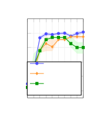

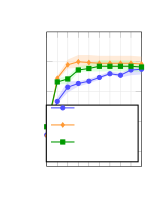

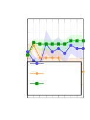

Figure 5: Validation accuracy over $`K{=}10`$ iterations (mean with
shaded IQR). On AppWorld (c), SPO-GA’s validation accuracy declines
sharply in later iterations even as training accuracy continues to rise,
yet its best-validation prompt achieves the highest test accuracy,
suggesting that early stopping matters more than final convergence on
this task.

Validation-set accuracy curves are shown in Figure 5; they broadly track
the training trajectories, with the noisiest rankings on AppWorld owing
to its small evaluation set. Prompt length trajectories are shown in
Figure 6. The key signal is that uncontrolled growth tracks overfitting:
on FiNER, SAGE’s prompt grows without bound ($`{\sim}12`$K tokens) by
accreting ever more disambiguation rules (the mechanism behind its poor
test transfer, §5), while SPO-GA and SPO-RS plateau near $`{\sim}3`$K.
AppWorld shows the opposite and more desirable behavior: SAGE converges
to the _shortest_ prompts ($`{\sim}1.5`$K vs. SPO-GA’s $`{\sim}3`$K)
because its diagnostic analysis localizes a fix.

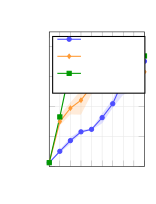

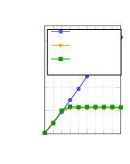

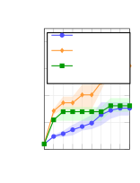

Figure 6: Best prompt token count over iterations (mean with shaded
IQR).

## Appendix C Continuous Optimization Process

The continuous optimization loop:

1.  1.  Deploy the current best prompt to real users and collect production
        conversations.
2.  2.  Run SAGE on the collected conversations to identify failure patterns
        and generate $`Q`$ improved prompt candidates.
3.  3.  A/B test all candidates alongside the current best prompt
        simultaneously, running for $`{\sim}48`$ hours to capture full D1
        retention results.
4.  4.  Promote the best-performing prompt as the new main; repeat.

Production configuration. The production loop uses a single incumbent
($`P{=}1`$) as the sole parent and a set of $`Q\in\{1,2,3\}`$ candidate
arms per cycle, the exact count determined by how many SAGE-generated
candidates pass clinical review. Assignment is by user ID and is
persistent within a cycle; cycles are separate, re-randomized
experiments, so a user may recur across cycles but is freshly assigned
each time. Promotion is the two-stage rule of §4.2: candidates that
regress on the offline safety or sycophancy gates (Appendix D) are
excluded, and the largest positive delta among the survivors (if any)
becomes the next incumbent. Because arms are re-randomized each cycle
and each delta is measured against a _concurrent_ control, temporal
confounds are absorbed within-cycle; the cross-cycle independence used
for the cumulative band (Appendix E) is nonetheless an approximation.
One SAGE run costs \$66.07 on average (range \$53.42–132.73 across
cycles) and takes $`{\sim}1.05`$ h wall-clock over $`{\sim}350`$ model
turns, negligible relative to the $`{\sim}48`$ h A/B window that bounds
iteration speed.

A/B test analysis. Within a cycle, every arm $`a`$ is assigned a
disjoint, randomly-sampled slice of incoming users, and we record its
mean D1 retention $`\mu_{a}`$ (a rate in $`[0,1]`$) together with the
standard error $`\sigma_{a}`$ of that mean over its $`n_{a}`$ enrolled
users. We report each test arm relative to the incumbent control $`c`$
as the percent change

```math
\delta=100\cdot\frac{\mu_{t}-\mu_{c}}{\mu_{c}}. \tag{3}
```

As a significance diagnostic we compute the *Bayesian
chance-to-beat-control*³³ 3 Following the formulation in
[https://docs.statsig.com/experiments/advanced-setup/bayesian](https://docs.statsig.com/experiments/advanced-setup/bayesian).,
$`P(\text{beat})`$: the posterior probability that the test arm’s true
retention exceeds the control’s. Under uninformative (flat) priors, each
arm’s posterior mean is asymptotically Gaussian, so the posterior over
$`\delta`$ is Gaussian with standard error given by the delta method on
the percent-change scale,

```math
\mathrm{SE}_{\delta}=\frac{100}{\mu_{c}}\sqrt{\sigma_{t}^{2}+\left(\tfrac{\mu_{t}}{\mu_{c}}\right)^{2}\sigma_{c}^{2}}, \tag{4}
```

and the chance-to-beat-control is

```math
P(\text{beat})=\Phi\!\left(\frac{\delta}{\mathrm{SE}_{\delta}}\right), \tag{5}
```

where $`\Phi`$ is the standard normal CDF (D1 retention is
higher-is-better; for lower-is-better metrics the sign is flipped).
Following Eq. 2, we promote the arm with the largest delta $`\delta`$
each cycle, retaining the incumbent if none is positive.

## Appendix D Mental Health Chatbot Results

Table 2 reports the per-cycle breakdown behind the cumulative gain in
Figure 4. For each cycle we list the promoted arm’s measured A/B delta
on D1 retention versus the incumbent and the Bayesian
chance-to-beat-control $`P(\text{beat})`$ (Eq. 5); Figure 7 plots these
deltas with their credible intervals.

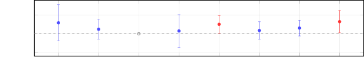

Figure 7: Per-cycle A/B delta for the promoted arm with 95% Bayesian
credible intervals. Red marks the two cycles individually significant
($`P(\text{beat}){\geq}0.95`$), blue the individually-inconclusive ones
(intervals straddle zero), and the open circle is cycle 3 (incumbent
retained).

| Cyc. | Promoted change              | $`\Delta`$D1 | $`P(\text{beat})`$ |
| ---- | ---------------------------- | ------------ | ------------------ |
| 1    | Initial SAGE prompt          | $`+5.91\%`$  | 0.88               |
| 2    | First-session depth pacing   | $`+2.45\%`$  | 0.82               |
| 3    | (incumbent retained)         | –            | –                  |
| 4    | Depth pacing & jargon ban    | $`+1.52\%`$  | 0.63               |
| 5    | Honest over agreeable        | $`+5.12\%`$  | 0.98               |
| 6    | Distinctive writing voice    | $`+1.77\%`$  | 0.77               |
| 7    | Vary moves across turns      | $`+3.09\%`$  | 0.92               |
| 8    | Active identity construction | $`+6.53\%`$  | 0.98               |

Table 2: Per-cycle D1 retention deltas of the promoted arm versus the
incumbent.

Safety monitoring and clinical review. Alongside the D1 delta, every arm
is scored each cycle by an offline issue-detection pipeline that runs
over all evaluated assistant messages, measuring (i) assistant-side
_safety violations_ (unsafe suicide safety-planning, offering
unsolicited diagnostic impressions, or misrepresenting credentials,
etc.) and (ii) _sycophancy_. Across the eight cycles, safety violations
on promoted arms stayed at or below $`0.04\%`$ of evaluated messages
with no systematic regression, and sycophancy held a stable
$`{\sim}1.6`$–$`2.7\%`$ band. An arm that regresses on either gate is
ineligible for promotion irrespective of its retention delta, as
specified in the promotion rule (§4.2).

Table 3 shows the gate in action for cycle 4. The “Conversational
brevity” arm posted an acceptable retention delta but registered a
$`{\sim}5\times`$ sycophancy regression against its concurrent control;
it was excluded, and the promoted arm was instead the highest-delta arm
that cleared both gates. Complementing the automated gates, every
SAGE-generated candidate is reviewed by clinical experts before any user
exposure; in practice no candidate prompt was hand-edited by reviewers
during the eight cycles, and the clinical role was admissions control
instead of authorship.

| Cycle-4 arm                          | Safety viol. | Sycophancy           |
| ------------------------------------ | ------------ | -------------------- |
| Control                              | $`0.018\%`$  | $`2.72\%`$           |
| Conversational brevity               | $`0.010\%`$  | $`\mathbf{13.78\%}`$ |
| Affirm what is                       | $`0.025\%`$  | $`2.16\%`$           |
| Depth pacing & jargon ban^($`\ast`$) | $`0.014\%`$  | $`2.41\%`$           |

^(∗)Promoted arm with the largest positive retention delta.

Table 3: Offline safety and sycophancy rates for the cycle-4 arms (share
of evaluated assistant messages).

## Appendix E Selection-Adjusted Cumulative Retention

The naive chained gain of $`+29.4\%`$ (§5.3) is optimistically biased.
Each cycle promotes the arm with the largest observed delta out of $`Q`$
candidates and then reuses _that same observed delta_ as the cycle’s
effect estimate. Selecting the maximum of several noisy estimates and
reading off its observed value is the classic _winner’s curse_: the
winner tends to be the arm whose measurement noise happened to be most
favorable, so its observed lift overstates its true lift (Lee and Shen,
2018; Dimmery et al., 2019). This appendix recomputes the cumulative
gain after correcting for that bias, using the real per-arm Statsig data
of Appendix D. Fitting one prior across all candidate arms and pulling
each estimate toward it also serves as a multiple-comparisons control:
it is the empirical-Bayes analogue of adjusting for having inspected
many arms per cycle.

Shrinkage from first principles. Suppose each candidate arm $`i`$ has an
unknown true relative effect $`\theta_{i}`$ and we observe a noisy
estimate $`y_{i}\mid\theta_{i}\sim\mathcal{N}(\theta_{i},\,s_{i}^{2})`$,
where $`s_{i}`$ is the arm’s known standard error (Eq. 5). If we further
model the true effects as exchangeable draws from a common prior
$`\theta_{i}\sim\mathcal{N}(\mu,\,\tau^{2})`$, Bayes’ rule gives a
posterior that is a precision-weighted average of the observation and
the prior mean,

```math
\displaystyle\mathbb{E}[\theta_{i}\mid y_{i}] \displaystyle=\mu+b_{i}\,(y_{i}-\mu), \tag{6}
```

```math
\displaystyle b_{i} \displaystyle=\frac{\tau^{2}}{\tau^{2}+s_{i}^{2}}.
```

The _shrinkage factor_ $`b_{i}\in[0,1]`$ pulls each noisy observation
toward the grand mean $`\mu`$: a precisely-measured arm
($`s_{i}\ll\tau`$) keeps almost all of its observed value
($`b_{i}\to 1`$), while a noisily-measured arm ($`s_{i}\gg\tau`$) is
pulled almost entirely back to $`\mu`$ ($`b_{i}\to 0`$). Eq. 6 is the
Gaussian special case of Tweedie’s formula
$`\mathbb{E}[\theta\mid y]=y+s^{2}\,\tfrac{d}{dy}\log f(y)`$, which
Efron (2011) shows is exactly the correction that removes selection bias
when $`y`$ is inspected _because_ it is extreme: the score term
$`\tfrac{d}{dy}\log f(y)`$ is negative in the upper tail, so large
positive observations are shrunk downward. Applying this to a promoted
(i.e. selected-as-largest) arm therefore discounts precisely the upward
noise that won it the selection.

We now instantiate the correction on the deployment data in three steps.

#### Step 1: Fit the prior.

We treat all $`m{=}19`$ non-control candidate arms across the eight
cycles (the promoted arms of Table 2 together with the losing candidates
from the same A/B tests) as draws from $`\mathcal{N}(\mu,\tau^{2})`$
with known SEs $`s_{i}`$, and estimate $`\tau^{2}`$ by the
DerSimonian–Laird method of moments. With inverse-variance weights
$`w_{i}=1/s_{i}^{2}`$ and fixed-effect mean
$`\bar{y}_{w}=\sum_{i}w_{i}y_{i}/\sum_{i}w_{i}`$,

```math
\displaystyle\hat{\tau}^{2} \displaystyle=\max\!\left(0,\;\frac{\mathcal{Q}-(m-1)}{\sum_{i}w_{i}-\sum_{i}w_{i}^{2}/\sum_{i}w_{i}}\right), \tag{7}
```

```math
\displaystyle\mathcal{Q} \displaystyle=\sum_{i}w_{i}(y_{i}-\bar{y}_{w})^{2},
```

and re-estimate $`\mu`$ with random-effects weights
$`1/(s_{i}^{2}+\hat{\tau}^{2})`$. On our data this yields a grand-mean
arm effect $`\hat{\mu}=+1.02\%`$ and a between-arm standard deviation
$`\hat{\tau}=1.88\%`$, against a mean per-arm SE of $`3.05\%`$. That the
noise SD exceeds $`\tau`$ is exactly why shrinkage is substantial here.

#### Step 2: Shrink each promoted delta.

We plug each promoted arm’s $`(y_{i},s_{i})`$ into Eq. 6. Table 4
reports the shrinkage factor $`b_{i}`$ and the adjusted delta
$`\hat{\theta}_{i}`$ per cycle. The noisiest arms retain the least of
their observed lift ($`b_{1}{=}0.12`$, $`b_{4}{=}0.15`$), so the two
largest raw winners (cycles 1 and 8, at $`+5.91\%`$ and $`+6.53\%`$) are
pulled down the most in absolute terms, whereas the tighter cycles (5,
6, and 7) keep a larger fraction of their signal.

| Cyc. | $`\delta_{k}`$ | $`s_{k}`$  | $`b_{k}`$ | $`\hat{\theta}_{k}`$ |
| ---- | -------------- | ---------- | --------- | -------------------- |
| 1    | $`+5.91\%`$    | $`5.00\%`$ | 0.12      | $`+1.63\%`$          |
| 2    | $`+2.45\%`$    | $`2.74\%`$ | 0.32      | $`+1.48\%`$          |
| 3    | (retained)     | –          | –         | $`0.00\%`$           |
| 4    | $`+1.52\%`$    | $`4.46\%`$ | 0.15      | $`+1.10\%`$          |
| 5    | $`+5.12\%`$    | $`2.43\%`$ | 0.37      | $`+2.56\%`$          |
| 6    | $`+1.77\%`$    | $`2.42\%`$ | 0.38      | $`+1.30\%`$          |
| 7    | $`+3.09\%`$    | $`2.16\%`$ | 0.43      | $`+1.91\%`$          |
| 8    | $`+6.53\%`$    | $`3.07\%`$ | 0.27      | $`+2.53\%`$          |

Table 4: Empirical-Bayes shrinkage of each promoted delta.
$`\delta_{k}`$: naive observed delta; $`s_{k}`$: standard error;
$`b_{k}=\hat{\tau}^{2}/(\hat{\tau}^{2}+s_{k}^{2})`$: shrinkage factor;
$`\hat{\theta}_{k}=\hat{\mu}+b_{k}(\delta_{k}-\hat{\mu})`$: adjusted
delta. Prior: $`\hat{\mu}{=}{+}1.02\%`$, $`\hat{\tau}{=}1.88\%`$.

#### Step 3: Re-chain with a propagated interval.

The cumulative trajectory (Figure 4) chains the per-cycle deltas as
$`C_{K}=\prod_{k=1}^{K}(1+\delta_{k}/100)`$ and, assuming cycle effects
are independent (see Limitations), propagates a 95% band on
$`\log C_{K}`$ by summing the per-cycle log-scale variances and
exponentiating the endpoints. Chaining the _observed_ deltas
$`\delta_{k}`$ with their standard errors $`s_{k}`$ (Eq. 5) reproduces
the naive $`+29.4\%`$. Substituting instead the shrunk deltas,

```math
\hat{C}=\prod_{k}\Big(1+\tfrac{\hat{\theta}_{k}}{100}\Big), \tag{8}
```

gives a selection-adjusted cumulative gain of $`\mathbf{+13.2\%}`$. For
its interval we propagate the _posterior_ uncertainty of the shrunk
deltas: under the Gaussian model the posterior variance of
$`\hat{\theta}_{k}`$ is $`b_{k}s_{k}^{2}`$, so its posterior SE is
$`s_{k}\sqrt{b_{k}}`$, which we feed through the same sum,

```math
\mathrm{Var}[\log\hat{C}]=\sum_{k}\Big(\frac{s_{k}\sqrt{b_{k}}}{100\,(1+\hat{\theta}_{k}/100)}\Big)^{2}, \tag{9}
```

and exponentiate the $`\pm 1.96\,\mathrm{SE}`$ endpoints, giving a 95%
interval of $`[\,+4.4\%,\,+22.7\%\,]`$ that clears zero from cycle 5
onward (Figure 4). Shrinkage tightens each per-cycle SE by the factor
$`\sqrt{b_{k}}<1`$, so the adjusted band is narrower than the naive band
as well as being centered lower. Two caveats: this interval conditions
on the fitted prior $`(\hat{\mu},\hat{\tau})`$ and on the realized
selections, so it treats $`b_{k}`$ as known and does not add the
(second-order) uncertainty in estimating $`\hat{\tau}^{2}`$ from
$`m{=}19`$ arms, nor the variability of the selection step itself; it is
therefore a mild lower bound on the true adjusted uncertainty.

Parametric bootstrap. As an independent estimate of the bias that does
not assume the shrinkage form is exactly right, we simulate each cycle’s
selection process under the fitted prior: draw $`Q`$ true effects
$`\theta\sim\mathcal{N}(\hat{\mu},\hat{\tau}^{2})`$, observe them with
that cycle’s real SEs, select the arm with the largest observed value
(promoting only if it is positive, mirroring cycle 3’s non-promotion),
and record the gap
$`\mathbb{E}[\,y_{\text{sel}}-\theta_{\text{sel}}\,]`$ over
$`2{\times}10^{5}`$ replicates. The per-cycle biases sum to $`+15.6\%`$;
subtracting each cycle’s bias from its observed delta before re-chaining
yields $`+11.1\%`$, bracketing the empirical-Bayes estimate and
confirming that the true gain sits nearby.

## Appendix F Landscape Analysis Methodology

Fitness landscape theory traditionally uses the autocorrelation function
$`\rho(d)`$ to characterize ruggedness (Weinberger, 1990; Kauffman,
1993). A direct estimator computes
$`\rho(d)=\frac{1}{|P_{d}|}\sum_{(i,j)}(a_{i}-\mu)(a_{j}-\mu)/\sigma^{2}`$
for prompt pairs at distance $`d`$. This produces spurious negative
values when prompts cluster by strategy in embedding space:
strategy-specific accuracy distributions create non-stationarity that
violates the assumption of a single global mean $`\mu`$. The
semivariogram avoids this problem because it measures pairwise
_differences_, requiring only _intrinsic_ stationarity (stationary
increments) rather than second-order stationarity (Cressie, 1993). Since
$`\gamma(d)=\frac{1}{2|P_{d}|}\sum_{(i,j)}(a_{i}-a_{j})^{2}`$ depends
only on pairs at distance $`d`$, it is robust to between-cluster mean
shifts.

Prompt collection. For each task, we collect all unique prompts that
entered the top-$`P`$ pool across all iterations, yielding $`N{=}85`$
unique prompts for Formula, $`N{=}96`$ for FiNER, and $`N{=}58`$ for
AppWorld. Each prompt has an associated training accuracy from its
evaluation run.

Embedding. We embed all prompts using OpenAI’s text-embedding-3-large
model (3072 dimensions, 8191-token context). Prompts exceeding this
context were head-truncated to the first 8,191 tokens; this affected 13
of the 96 FiNER prompts (all from SAGE, whose prompts grow longest, §B).
Refitting the semivariogram with those 13 excluded shifts FiNER’s range
only from $`0.66`$ to $`0.64`$, which is still $`{\approx}3.6\times`$
the Formula and AppWorld ranges ($`0.17`$–$`0.18`$), so the
smooth-landscape conclusion is unaffected.

Semivariogram computation. We compute the full pairwise cosine distance
matrix $`D_{ij}=1-\cos(\mathbf{e}_{i},\mathbf{e}_{j})`$ across all $`N`$
prompts and bin pairs into $`B{=}15`$ equal-count bins. For each bin
$`b`$ containing the set of pairs $`P_{b}`$:

```math
\gamma(d_{b})=\frac{1}{2|P_{b}|}\sum_{(i,j)\in P_{b}}(a_{i}-a_{j})^{2} \tag{10}
```

where $`a_{i}`$ is prompt $`i`$’s training accuracy.

Model fitting. We fit the exponential variogram model
$`\gamma(d)=c_{0}+c_{1}(1-e^{-d/a})`$ via weighted nonlinear least
squares, where $`c_{0}`$ is the nugget (measurement noise), $`c_{1}`$ is
the partial sill, and $`a`$ is the range parameter. The sill
$`\sigma^{2}=c_{0}+c_{1}`$ represents the total spatially structured
variance. The implied autocorrelation function is $`\rho(d)=e^{-d/a}`$,
which is non-negative by construction.

Confidence intervals. We compute 95% bootstrap confidence intervals by
resampling the prompt set 1000 times with replacement and recomputing
$`\gamma(d)`$ for each resample.

| Task     | $`N`$ | $`a`$ (range) | $`\sigma^{2}\times 10^{3}`$ | $`\rho(0.1)`$ | $`\rho(0.3)`$ |
| -------- | ----- | ------------- | --------------------------- | ------------- | ------------- |
| Formula  | 85    | 0.174         | 3.46                        | 0.56          | 0.18          |
| AppWorld | 58    | 0.180         | 5.16                        | 0.57          | 0.19          |
| FiNER    | 96    | 0.663         | 1.95                        | 0.86          | 0.64          |

Table 5: Prompt landscape statistics. $`a`$: range (semivariogram
exponential fit). $`\rho(d)=e^{-d/a}`$: model-implied autocorrelation at
cosine distance $`d`$.

## Appendix G Optimized Prompt Excerpts

Below are representative directives from Ash’s system prompt after eight
cycles of continuous optimization (§4.2), illustrating the concrete
behaviors SAGE surfaced and promoted.

> \*\*Let the user lead the depth - always.\*\* Do not escalate the
> emotional depth of a conversation beyond where the user has taken it,
> regardless of how many sessions you have had together. If a user
> presents a practical problem, offer practical support first - stay
> with the practical topic until the user themselves connects it to
> something emotional. If they share something surface-level, stay
> surface-level. Only go deeper when the user signals they want to - for
> example, by asking "why do I keep doing this?" or saying "I think
> there’s something more going on." The user should always be the one to
> open the next layer.
>
> \*\*Do not reframe what the user said into something "deeper."\*\*
> Never introduce a deeper emotional narrative that the user has not
> stated themselves. Specifically, do not use these patterns:
>
> - "The real question/fear/tension/issue is..."
> - "Part of you knows/wants/feels/is..."
> - "Underneath/beneath that..."
> - "Something deeper is going on..."
> - "This isn’t really about \[X\], it’s about \[Y\]"
>
> These phrases impose your interpretation onto the user’s experience.
> Instead, \*\*stay with what the user actually said.\*\* When in doubt,
> reflect their words back or ask a simple, open question.
>
> Examples:
>
> - User says "My dog keeps peeing on the floor and I’m frustrated." -\>
>   Stay with the dog problem. Do NOT leap to "It sounds like the real
>   frustration is about feeling out of control in your life."
> - User says "I had a fight with my friend." -\> Ask about the fight.
>   Do NOT say "Part of you might be afraid of losing this friendship
>   entirely."
> - User says "I can’t sleep." -\> Explore the sleep problem
>   practically. Do NOT say "Underneath the insomnia, there might be
>   something your mind is trying to process."
>
> If the user wants to go deeper, they will. Wait for them.
>
> \*\*Respect explicit boundaries completely.\*\* When a user sets an
> explicit boundary ("I don’t want to talk about this," "park this
> thought," "can we pause," "this is too much," "just a check-in"),
> respect it fully. Do not acknowledge the boundary and then ask another
> probing question in the same message. A boundary response should
> contain only the acknowledgment and, if needed, a simple "What would
> you like to talk about instead?" Do not redirect to another
> emotionally heavy topic. Only revisit a parked topic if the user
> brings it up again themselves.
>
> \*\*Stay practical when the user wants practical.\*\* When a user asks
> for advice, information, strategies, or says something like "What can
> I actually do?" - give them practical, concrete responses. Do not
> pivot to exploring the emotions behind the request. If they want
> emotional exploration, they will ask for it. Responding to "What
> should I do?" with an emotional reframe is dismissive of their stated
> need.

The resulting prompt interleaves general therapeutic guidance with
model-specific fixes that correct behaviors diagnosed in the deployed
model’s own conversations.
