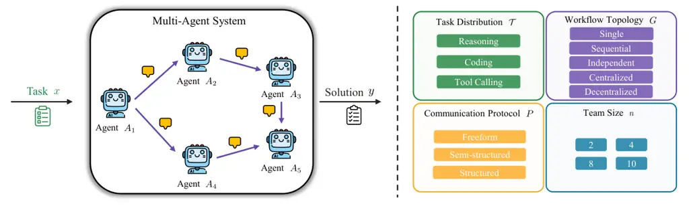

# MAS-PromptBench: When Does Prompt Optimization Improve Multi-Agent LLM Systems?

Juyang Bai ^(†)^(†)thanks: Department of Electrical and Computer
Engineering, Johns Hopkins University, Baltimore, MD 21218, USA.
Affiliation: Johns Hopkins University Email: <jbai23@jh.edu>    Laixi
Shi¹¹footnotemark: 1 Affiliation: Johns Hopkins University
Email: <laixis@jhu.edu>

August 24, 2026

###### Abstract

Multi-agent systems (MAS) offer a scalable path forward for agentic AI,
comprising multiple LLM-based agents, each assigned a system prompt and
a position within a workflow that governs inter-agent coordination and
output aggregation. System prompts thus form a critical and accessible
optimization surface: they specify agents’ roles and behaviors, enabling
system-level improvements without model finetuning. Although prompt
optimization has shown substantial potential for single LLMs, extending
it to MAS poses distinct challenges, notably an exponentially growing
search space. It remains unclear _whether, when, and by how much prompt
optimization improves MAS performance, and how sensitive such gains are
to system configuration_. In this work, we systematically study
system-prompt optimization across a broad range of MAS setups varying in
task, workflow, communication protocol, and team size, benchmarking two
prompt optimizers that naturally extend state-of-the-art single-agent
methods. The results reveal its potential to unlock significant gains
while exposing open challenges, characterizing when and how much prompt
optimization helps across diverse MAS settings.

|                                                                                                        |
| ------------------------------------------------------------------------------------------------------ |
|  Website: [https://juyangbai.github.io/MAS-PromptBench/](https://juyangbai.github.io/MAS-PromptBench/) |
|   Code: [https://github.com/juyangbai/MAS-PromptBench](https://github.com/juyangbai/MAS-PromptBench)   |

## 1 Introduction

Agentic AI, as foundation-model-based systems that autonomously plan,
use tools, and interact with the real world, is rapidly transforming
daily life, industry, and scientific discovery Lu et al. (2024); Plaat
et al. (2025); Anthropic (2026). As tasks evolve from human-scale
problems to organization-scale challenges that are increasingly complex,
open-ended, and time-sensitive, single-agent architectures face
fundamental bottlenecks in expertise breadth, context length, and
sequential execution Chen et al. (2024b). In contrast, multi-agent
systems (MAS) have emerged as a highly promising paradigm for
next-generation agentic AI and general superintelligence (ASI) Anthropic
(2026); Genewein et al. (2026), offering scalability, timeliness, and
reliability through specialization and multimodality, task decomposition
and parallelism, and independent cross-checks that strengthen reasoning
and factual accuracy Du et al. (2023). Concretely, a MAS typically
comprises multiple LLM-based agents coordinated by a harness that
manages communication, task delegation, and output aggregation, with
each agent assigned an instruction set and a position in a coordination
workflow Anthropic (2026). Throughout this paper, we refer to an LLM’s
instruction set as its system prompt, which may be a assembled
collection comprising not only the system prompt itself but also other
levels of instructions.

Within this MAS design space, system prompts provide a critical and
accessible optimization surface: they specify each agent’s role and
behavior Anthropic (n.d.); OpenAI (2025); Google (n.d.); Meta (n.d.),
enabling system-level improvement without model fine-tuning. System
prompts are among the most accessible levers available to practitioners,
who often inherit a fixed configuration and seek improvements without
redesigning the underlying architecture; many real-world deployments
further preclude topology changes due to safety, compliance, or
auditability constraints Hong et al. (2026). Given the important role of
system prompts, automatic prompt optimization has been studied
extensively in the single-agent regime, with strong demonstrated
benefits Zhou et al. (2022); Yang et al. (2024); Wang et al. (2024);
Khattab et al. (2023); Agrawal et al. (2025).

Whether such gains transfer to the multi-agent setting remains
underexplored. Extending prompt optimization to MAS introduces
qualitatively new challenges: inter-agent prompt dependencies,
compounded by coordination dynamics across multi-turn interactions,
induce a combinatorial search space that grows exponentially with the
number of agents. As illustrated in Figure 1, the current effect of
prompt optimization on MAS varies dramatically across tasks and
topologies—ranging from substantial gains to equally severe performance
drops. Meanwhile, most influential MAS frameworks—including AutoGen,
CrewAI, CAMEL, MetaGPT, ChatDev, and AgentVerse Wu et al. (2024); CrewAI
Inc. (2026); Li et al. (2023a); Hong et al. (2024); Qian et al. (2024);
Chen et al. (2024c), as well as collaboration workflows such as
debate Du et al. (2023); Liang et al. (2024)—still rely on manually
crafted system prompts. Recent works have begun to address this gap,
either by developing dedicated MAS prompt optimization algorithms Xia et
al. (2026); Shen et al. (2025a); Zhang et al. (2026); Hong et al. (2026)
or by jointly optimizing prompts alongside orchestration components such
as workflow topology Zhao et al. (2025); Zhou et al. (2025); Hu et al.
(2025). Yet these works evaluate on different tasks (e.g., math, coding,
stock trading), configurations, and baselines, making cross-comparison
difficult and leaving a fundamental question open:

_How much can prompt optimization help in MAS, and how does its effect
vary across configurations?_

We address this through a benchmark-driven study that quantifies the
gains from system-prompt optimization across a diverse set of fixed MAS
configurations, pinpointing the regimes where prompt optimization offers
substantial untapped improvement room and regimes where MAS sensitivity
calls for more principled algorithm design. These findings provide a
roadmap for designing future prompt optimization algorithms and, more
broadly, for MAS design, where prompts are tightly coupled with other
configuration choices. Our main contributions are as follows:

Figure 1: Prompt-optimization gains using a state-of-the-art optimizer
GEPA in single-agent and multi-agent settings. While GEPA consistently
improves single-agent performance across all five diverse tasks, its
natural multi-agent extension yields highly variable effects across
tasks and workflow topologies, ranging from large gains to severe
performance drops.

- •
  MAS-PromptBench: a benchmark for MAS prompt optimization. We introduce
  a comprehensive benchmark for evaluating system-prompt optimizers for
  MAS. It spans diverse MAS configurations across task domains
  (reasoning, coding, and tool calling), five workflow topologies
  (comprising both existing and newly constructed systems),
  communication protocols ranging from free-form to highly structured
  coordination, varying team sizes, and two default prompt optimizers.
  The benchmark provides a foundation for proposing, analyzing, and
  comparing system-prompt optimization algorithms under controlled MAS
  configurations.
- •
  Prompt optimization gains and failures for MAS. Using this benchmark,
  we systematically evaluate the performance gains achieved by a natural
  multi-agent extension of GEPA Agrawal et al. (2025), a
  state-of-the-art single-agent prompt optimizer, relative to default
  system prompts. The results highlight the promise of prompt
  optimization for MAS: improvements reach up to 24.0 percentage points.
  Yet they also reveal the need for principled algorithms tailored to
  multi-agent settings, as performance can drop by as much as 16.0
  percentage points for certain configurations.
- •
  Insights into when prompt optimization works for MAS. Prompt
  optimization shows greater potential when tasks have explicit,
  controllable, and verifiable agent-local behaviors, and when
  communication protocols impose an explicit shared structure that makes
  agent interactions easier to control and transfer; it also needs to be
  workflow-topology-aware. In addition, prompt optimization becomes
  harder as team size grows, confirming the challenges of scaling MAS
  prompt optimization and motivating principled and more scalable,
  robust algorithms.

## 2 Related Work

##### Prompt Optimization for Single LLM.

Prompt optimization improves LLM performance without updating model
weights; see Ramnath et al. (2025); Chang et al. (2024) for detailed
reviews. Prompts are typically categorized into system (hard) prompts as
discrete text instructions and soft prompts as continuous
embeddings Chang et al. (2024). While both have shown effectiveness in
single-agent settings, we focus on system prompts—the discrete
instructions that specify each agent’s role—due to their
interpretability and direct role in specifying agent behavior in MAS.

Most system prompt optimization methods can be viewed as searching over
a discrete instruction space Chang et al. (2024). Existing approaches
fall into three categories: (1) sampling-based methods that generate and
select candidate prompts using task feedback, including self-generated
methods Wang et al. (2023), LLM-as-optimizer approaches such as APE Zhou
et al. (2022) and OPRO Yang et al. (2024), planning-based methods such
as PromptAgent Wang et al. (2024), and evolutionary methods such as
EvoPrompt Guo et al. (2024) and PromptBreeder Fernando et al. (2023);
(2) feedback-based methods that leverage directional signals such as
reinforcement-learning rewards Deng et al. (2022), textual
gradients Pryzant et al. (2023); Yuksekgonul et al. (2024), or
self-reflection Madaan et al. (2023); Shinn et al. (2023); and (3)
editing-based methods that refine prompts through local operations such
as insertion, deletion, or paraphrasing Prasad et al. (2023). These
techniques are also integrated into broader frameworks such as
DSPy Khattab et al. (2023), which optimizes instructions within
multi-stage LLM programs via algorithms such as MIPROv2 Opsahl-Ong et
al. (2024). In this work, instead of single-agent, we focus on prompt
optimization for multi-agent LLM systems, where it remains unclear
whether single-agent gains transfer. To investigate, we evaluate when
and how much prompt optimization improves MAS performance across a broad
range of setups varying in task, workflow, communication protocol, team
size, and different prompt optimizers.

##### Prompt Optimization in Multi-Agent LLM Systems.

Many influential MAS still rely on manually designed system prompts,
specifying roles in CAMEL, MetaGPT and ChatDev Li et al. (2023a); Hong
et al. (2024); Qian et al. (2024); specifying conversations and
coordination patterns in AutoGen, CrewAI, and AgentVerseWu et al.
(2024); CrewAI Inc. (2026); Chen et al. (2024c); instantiating
collaboration patterns, such as debate Du et al. (2023); Liang et al.
(2024), mixture-style aggregation Wang et al. (2025), or consensus among
diverse LLMs Chen et al. (2024a). Recently, automatic prompt
optimization for MAS has attracted growing attention and shown
substantial progress. Many existing methods generate new prompts from
diverse feedback sources, including failure attributes and identified
underperforming agents Shen et al. (2025a); Li et al. (2026), as well as
multi-resolution signals spanning the agent itself, its neighborhood,
and global contexts Wang et al. (2026); while other work searches over a
fixed, pre-generated set of candidate prompts rather than generating new
ones Hong et al. (2026). Beyond these directions, researchers have also
studied MAS prompt optimization for domain-specific problems Xia et al.
(2026) and incorporated richer MAS-configuration information into the
optimization process Zhang et al. (2026). Recognizing that system
prompts are tightly coupled with other design choices, another line of
work jointly optimizes prompts with orchestration components such as
communication topology and hierarchical planning Zhao et al. (2025);
Zhou et al. (2025).

In this work, we ask a more foundational question: _within a given MAS
configuration, how much headroom does system prompt optimization
actually offer, and how does this headroom vary across configurations?_
We address this through a benchmark-driven study that quantifies how
much system-prompt optimization helps across a diverse set of fixed MAS
configurations. Specifically, we evaluate the gains—relative to default
prompts—of a natural multi-agent extension of GEPA Agrawal et al.
(2025), a state-of-the-art single-agent prompt optimization method. We
view these findings as an empirical roadmap that can guide the design of
future prompt optimization algorithms—and, more broadly, the design of
MAS itself.

##### Benchmarks for multi-agent LLM systems or prompt optimization.

Existing work on evaluating and analyzing LLM-based multi-agent systems
(MAS) spans three complementary perspectives: task benchmarks,
diagnostic tools, and studies of MAS design choices. First, general task
benchmarks provide broad testbeds for agents’ different abilities within
a MAS. Examples include MultiAgentBench Zhu et al. (2025) for
coordination quality, BFCL Patil et al. (2025) for function calling,
AppWorld Trivedi et al. (2024) for interactive app operation,
GAIA Mialon et al. (2024) for general assistant tasks, TravelPlanner Xie
et al. (2024) for multi-constraint planning, and SWE-bench Jimenez et
al. (2024) for software repair. Second, diagnostic and debugging work
addresses the interpretability gap by examining why MAS executions
succeed or fail. MAST proposes a taxonomy of failure modes with an
annotated trace dataset Cemri et al. (2026); AutoGen Studio and
AGDebugger enable interactive inspection and steering of multi-agent
conversations Dibia et al. (2024); Epperson et al. (2025); and
failure-attribution work identifies which agent and step caused a task
failure Zhang et al. (2025). Third, a line of work studies how different
MAS configuration choices influence overall performance, including
workflow topology Kim et al. (2025); Shen et al. (2025b), agent
diversity Yang et al. (2026), and team size Kim et al. (2025); Qian et
al. (2025). We follow this third line, but focus on a critical yet
underexplored component—the system prompt—studying how much optimizing
it can improve MAS performance under a fixed surrounding configuration.
Furthermore, although extensive benchmarks exist for evaluating prompt
optimization in single-agent setting Zhu et al. (2024), no comparable
benchmark is available for MAS yet. To fill this gap, we introduce a
systematic benchmark MAS-PromptBench that measures the gains from MAS
prompt optimization across a diverse set of configurations, encompassing
different tasks, workflow topologies, team sizes, and communication
protocols.

## 3 Prompt Optimization for Multi-Agent LLM Systems



Figure 2: Overview of benchmark MAS-PromptBench. Given an input task, a
multi-agent system produces a final solution through interactions among
LLM-based agents. MAS-PromptBench measures prompt-optimization gains
across four axes: task distribution, workflow topology, communication
protocol, and team size.

##### Prompt optimization for multi-agent systems (MAS).

We consider an LLM-based multi-agent system (MAS) Khattab et al. (2023);
Opsahl-Ong et al. (2024); Agrawal et al. (2025), illustrated in
Figure 2, represented as the tuple

```math
\mathcal{M}=(\mathcal{A},\,G,\,P), \tag{1}
```

where $`\mathcal{A}=\{A_{1},\dots,A_{n}\}`$ is an ordered collection of
$`n`$ agents, $`G`$ denotes the inter-agent coordination workflow, and
$`P`$ denotes the communication protocol between agents. Each agent
$`A_{i}=(\theta_{i},\pi_{i})`$ consists of an LLM with model parameters
$`\theta_{i}`$ and a learnable system prompt $`\pi_{i}`$. We denote
$`\pi=\{\pi_{1},\dots,\pi_{n}\}`$ as the joint system prompts for all
agents. Each task to be solved is drawn as $`(x,e)\sim\mathcal{T}`$ from
a distribution $`\mathcal{T}`$, where $`x\in\mathcal{X}`$ is the task
input and $`e`$ is a reference used for evaluation, such as a
ground-truth answer or code unit tests. We let
$`\mathcal{M}(\,\cdot\,;\pi)`$ denote the output function of the MAS
$`\mathcal{M}`$ induced by the joint prompt $`\pi`$, with the model
parameters $`\theta`$ held fixed. System-prompt optimization for a MAS
is then formulated as the following optimization problem:

```math
\max_{\pi}\;\mathbb{E}_{(x,e)\sim\mathcal{T}}\!\left[\mu\!\left(\mathcal{M}(x;\pi),e\right)\right]\quad\text{s.t.}\;\;\ell_{\mathsf{rollouts}}\leq B, \tag{2}
```

where the metric $`\mu:\mathcal{Y}\times\mathcal{E}\to[0,1]`$ evaluates
the output $`y=\mathcal{M}(x;\pi)`$ against the reference $`e`$, and
$`\ell_{\mathsf{rollouts}}`$ denotes the number of MAS execution rounds,
each comprising one MAS run to solve a task followed by an evaluation of
its output.

###### Remark 1 (System prompt as an umbrella term for the instruction set).

Within a multi-agent system (MAS), each agent is typically prompted with
a carefully assembled input package determined by the harness, which may
include the user’s request, a layered set of instructions, task-specific
skills, relevant memory, retrieved context, and available tools. We
focus on the instruction set, which typically comprises four components
that differ in authority, scope, and purpose, forming a hierarchy that
guides behavior from global constraints to task-specific procedures. At
the top, system prompts define universal rules, such as safety and
tool-use protocols; developer or product instructions then specify
application-level operation, including the agent’s role and workflow;
project instructions specify task-level conventions, such as coding
standards and testing procedures; and finally, skills provide reusable
guidance for particular task classes, such as data analysis or code
modification. Throughout this paper, we use system prompt as an umbrella
term for the instruction set excluding skills, without distinguishing
among them. In practice, agentic systems may employ multiple instruction
layers; our formulation extends naturally to optimizing an individual
component or combination thereof, which we leave to future work.

##### Metric: prompt optimization gains in MAS.

In this work, we will conduct systematic study of whether, when, and to
what extent system-prompt optimization improves MAS performance across
different MAS configurations. To this end, we investigate diverse MAS
configurations determined by four critical components
$`(\mathcal{T},G,n,P)`$: the task distribution $`\mathcal{T}`$, the
coordination workflow or topology $`G`$, the team size $`n`$, and the
communication protocol $`P`$. Any prompt optimizer can, in principle, be
used to optimize prompts by solving (2). In this work, we primarily
focus on two natural multi-agent extension of state-of-the-art
single-agent prompt optimization methods: GEPA Agrawal et al. (2025) and
MIPRO Opsahl-Ong et al. (2024) Let $`\pi^{0}`$ denote the initialized
(unoptimized) system prompt and $`\pi^{\star}`$ the optimized prompt
obtained by solving (2). Fixing an optimizer for solving (2) and the
base model, the prompt-optimization gain for the MAS with a
configuration $`(\mathcal{T},G,n,P)`$ is then defined as

```math
\Delta(\mathcal{T},G,n,P)\;:=\;\mathbb{E}_{(x,m)\sim\mathcal{T}}\!\bigl[\mu\!\left(\mathcal{M}(x;\pi^{\star}),y\right)\;-\;\mu\!\left(\mathcal{M}(x;\pi^{0}),y\right)\bigr]. \tag{3}
```

## 4 MAS-PromptBench: Prompt Optimization for MAS Benchmark

While benchmarks and evaluation protocols exist for single-agent prompt
optimization, comparable resources for multi-agent systems remain
underdeveloped. We fill this gap by introducing a benchmark designed to
support extensive and controlled investigation for prompt optimization
across diverse MAS configurations, summarized in Table 1 and Figure 2.

|               |     |                                                                                                                                                                                                                                                                                                                                     |
| ------------- | --- | ----------------------------------------------------------------------------------------------------------------------------------------------------------------------------------------------------------------------------------------------------------------------------------------------------------------------------------- |
| Factor        | \#  | Details                                                                                                                                                                                                                                                                                                                             |
| Framework     | 4   | LangGraph LangChain Inc. (2026), CrewAI CrewAI Inc. (2026), AutoGen Wu et al. (2024), OpenAI Agents SDK OpenAI (2026)                                                                                                                                                                                                               |
| Task          | 9   | Reasoning (3): GPQA-Diamond Rein et al. (2023), HotpotQA Yang et al. (2018), MATH Hendrycks et al. (2021b); Coding (3): LiveCodeBench Jain et al. (2025), APPS Hendrycks et al. (2021a), SWE-Bench Verified Jimenez et al. (2024); Tool-calling (3): BFCL Patil et al. (2025), ToolHop Ye et al. (2025), API-Bank Li et al. (2023b) |
| Topology      | 5   | Single, Independent, Sequential, Centralized, Decentralized                                                                                                                                                                                                                                                                         |
| Communication | 3   | Freeform, Semi-structured, Structured                                                                                                                                                                                                                                                                                               |
| Team size     | 4   | $`n\in\{2,4,8,10\}`$                                                                                                                                                                                                                                                                                                                |
| Optimizer     | 2   | MAS-GEPA Agrawal et al. (2025), MAS-MIPRO Opsahl-Ong et al. (2024)                                                                                                                                                                                                                                                                  |

Table 1: Overview of the modular configuration of MAS-PromptBench.

The proposed benchmark evaluates the prompt-optimization gain using the
metric in (3), which compares the optimized prompts $`\pi^{\star}`$
against the initialized prompts $`\pi_{0}`$ for a fixed prompt optimizer
and MAS configuration $`(\mathcal{T},G,n,P)`$. This controlled protocol
makes the benchmark useful in at least two ways. First, given any
system-prompt optimizer, it provides an extensive testbed across diverse
MAS configurations, enabling direct evaluation of how optimization gains
vary with task, topology, communication structure, and team size.
Second, its modular design supports controlled, component-level studies:
one can vary a single MAS factor—such as the optimizer, topology,
protocol, or team size—while holding all others fixed to isolate its
effect on system-level performance. The benchmark is also flexible and
extensible across all of these components, as new tasks or MAS
configurations can be introduced as additional configuration values,
allowing it to be tailored to different application domains and user
requirements. We primarily provide two optimizers—multi-agent extensions
of state-of-the-art single-agent prompt optimization methods,
GEPA Agrawal et al. (2025) and MIPRO Opsahl-Ong et al. (2024)—which we
call MAS-GEPA and MAS-MIPRO. This benchmark evaluates each task dataset
using its official evaluation protocol; detailed metric definitions and
implementations are provided in Appendix A.2.

## 5 Empirical Study of Prompt Optimization in MAS

Armed with the MAS-PromptBench benchmark, in this section we conduct a
systematic study to answer: _How much can prompt optimization help in
MAS, and how does its effect vary across configurations?_ We
subsequently investigate the four critical MAS configuration factors:
task (Sec. 5.1), workflow topology (Sec. 5.2), communication protocol
(Sec. 5.3), and team size (Sec. 5.4). We mainly use the natural
multi-agent extension of GEPA (named MAS-GEPA) as the prompt optimizer
for Sec. 5.1-Sec. 5.4, with an ablation study of another prompt
optimizer adapted from MIPRO (named MAS-MIPRO) in Sec. 5.5. Both
MAS-GEPA and MAS-MIPRO optimize each agent’s system prompt separately
and sequentially, using feedback from the overall MAS execution
evaluation and the agent’s own experience traces. Details are provided
in Appendix A.4.

### 5.1 Task

We first study how prompt-optimization gains vary across task domains
that spans nine tasks across three domains: reasoning, coding, and
tool-calling. In this subsection on tasks, we evaluate a range of
popular existing MAS frameworks with naturally differing topologies,
shown in Table 2; in all remaining studies on MAS configurations, we
instead use the LangGraph framework to construct the different
configurations, for flexibility and fairness. Table 2 shows that
system-prompt optimization is broadly promising across diverse tasks:
averaged over topologies, it improves performance on seven out of nine
tasks, with the largest average gain of $`+10.0\%`$ points on APPS.
Individual MAS configurations show even larger gains: Sequential in BFCL
improves by $`+24.0`$ points, and Sequential in APPS improves by
$`+18.0`$ points.

The gains are larger and more consistent for coding and tool-calling
tasks than for reasoning tasks. At the task level, the maximum average
gains for coding and tool-calling are $`+10.0`$ points on APPS and
$`+6.4`$ points on BFCL, respectively, whereas the largest average gain
among reasoning tasks is only $`+3.2`$ points on HotpotQA. At the
topology-configuration level, coding and tool-calling tasks achieve
maximum gains of $`+18.0`$ points on Sequential APPS and $`+24.0`$
points on Sequential BFCL, whereas reasoning tasks reach only $`+8.0`$
points on Sequential MATH. The same trend holds at the domain level in
average: coding benchmarks improve by $`+3.7`$ points on average and
tool-calling benchmarks by $`+4.3`$ points, compared with only $`+1.3`$
points for reasoning benchmarks.

We hypothesize that the difference arises from the extent to which each
task can be decomposed into an explicit routine with controllable local
behaviors. Coding tasks expose verifiable artifacts—small program steps
can be checked by compilation and tests, while tool-calling tasks offer
structured and clear interfaces through explicit function names and
outcome formats that system prompts can directly shape. Such behaviors
propagate through the MAS workflow with little ambiguity, allowing local
prompt improvements to survive downstream coordination. Reasoning tasks,
in contrast, rely on correlated logical steps with implicit intermediate
feedback, so local improvements or errors are often discarded,
overwritten, or amplified before reaching the final answer. Prompt
optimization is thus most effective when tasks provide structured
interfaces through which agent-level changes can be clearly controlled,
preserved, and transferred across agents.


|              |                      |                       |                         |                       |                       |                            |                       |
| ------------ | -------------------- | --------------------- | ----------------------- | --------------------- | --------------------- | -------------------------- | --------------------- |
|              |                      | Single (LangGraph)    | Independent (LangGraph) | Sequential (CrewAI)   | Centralized (AutoGen) | Decentralized (OpenAI SDK) | Average               |
| Reasoning    | GPQA-Diamond Acc.    | 54.0 / 58.0 $`+4.0`$  | 73.0 / 73.0 $`0.0`$     | 53.0 / 56.0 $`+3.0`$  | 74.0 / 74.0 $`0.0`$   | 60.0 / 60.0 $`0.0`$        | 62.8 / 64.2 $`+1.4`$  |
|              | HotpotQA EM          | 26.0 / 39.0 $`+13.0`$ | 27.0 / 26.0 $`-1.0`$    | 27.0 / 27.0 $`0.0`$   | 20.0 / 22.0 $`+2.0`$  | 16.0 / 18.0 $`+2.0`$       | 23.2 / 26.4 $`+3.2`$  |
|              | MATH Acc.            | 49.0 / 51.0 $`+2.0`$  | 76.0 / 60.0 $`-16.0`$   | 58.0 / 62.0 $`+4.0`$  | 63.0 / 69.0 $`+6.0`$  | 66.0 / 66.0 $`0.0`$        | 62.4 / 61.6 $`-0.8`$  |
| Coding       | LiveCodeBench pass@1 | 12.0 / 12.0 $`0.0`$   | 14.0 / 18.0 $`+4.0`$    | 12.0 / 18.0 $`+6.0`$  | 14.0 / 16.0 $`+2.0`$  | 8.0 / 12.0 $`+4.0`$        | 12.0 / 15.2 $`+3.2`$  |
|              | APPS pass@1          | 52.0 / 66.0 $`+14.0`$ | 74.0 / 78.0 $`+4.0`$    | 62.0 / 80.0 $`+18.0`$ | 62.0 / 76.0 $`+14.0`$ | 74.0 / 74.0 $`0.0`$        | 64.8 / 74.8 $`+10.0`$ |
|              | SWE-Bench Verified   | 33.3 / 30.0 $`-3.3`$  | 36.7 / 33.3 $`-3.4`$    | 33.3 / 30.0 $`-3.3`$  | 16.7 / 20.0 $`+3.3`$  | 40.0 / 36.7 $`-3.3`$       | 32.0 / 30.0 $`-2.0`$  |
| Tool-Calling | BFCL Acc.            | 84.0 / 88.0 $`+4.0`$  | 88.0 / 88.0 $`0.0`$     | 60.0 / 84.0 $`+24.0`$ | 96.0 / 96.0 $`0.0`$   | 84.0 / 88.0 $`+4.0`$       | 82.4 / 88.8 $`+6.4`$  |
|              | ToolHop Acc.         | 62.0 / 64.0 $`+2.0`$  | 62.0 / 68.0 $`+6.0`$    | 66.0 / 73.0 $`+7.0`$  | 68.0 / 69.0 $`+1.0`$  | 67.0 / 71.0 $`+4.0`$       | 65.0 / 69.0 $`+4.0`$  |
|              | API-Bank Acc.        | 77.0 / 79.0 $`+2.0`$  | 74.0 / 76.0 $`+2.0`$    | 60.0 / 66.0 $`+6.0`$  | 77.0 / 72.0 $`-5.0`$  | 62.0 / 69.0 $`+7.0`$       | 70.0 / 72.4 $`+2.4`$  |

Table 2: Prompt-optimization gains of MAS-GEPA for nine diverse tasks on
popular existing MAS frameworks. Each cell reports baseline / optimized
performance, followed by the signed change $`\Delta`$ in percentage
points. Blue indicates improvement, orange indicates regression, and
gray indicates no change.

### 5.2 Workflow Topology

Table 3: Prompt-optimization gains of MAS-GEPA for five workflow
topologies. Each cell reports baseline / optimized performance, followed
by the signed change $`\Delta`$ in percentage points. Blue indicates
improvement, orange indicates regression, and gray indicates no change.

|                               |                       |                       |                      |                       |                       |
| ----------------------------- | --------------------- | --------------------- | -------------------- | --------------------- | --------------------- |
|                               | Single                | Independent           | Sequential           | Centralized           | Decentralized         |
| GPQA (Acc.)                   | 54.0 / 58.0 $`+4.0`$  | 73.0 / 73.0 $`0.0`$   | 75.0 / 78.0 $`+3.0`$ | 70.0 / 70.0 $`0.0`$   | 71.0 / 71.0 $`0.0`$   |
| HotpotQA (EM)                 | 26.0 / 39.0 $`+13.0`$ | 27.0 / 26.0 $`-1.0`$  | 29.0 / 28.0 $`-1.0`$ | 19.0 / 10.0 $`-9.0`$  | 20.0 / 32.0 $`+12.0`$ |
| MATH (Acc.)                   | 49.0 / 51.0 $`+2.0`$  | 76.0 / 60.0 $`-16.0`$ | 74.0 / 74.0 $`0.0`$  | 66.0 / 69.0 $`+3.0`$  | 81.0 / 81.0 $`0.0`$   |
| LiveCodeBench (pass@1)        | 12.0 / 12.0 $`0.0`$   | 14.0 / 18.0 $`+4.0`$  | 16.0 / 16.0 $`0.0`$  | 16.0 / 16.0 $`0.0`$   | 18.0 / 18.0 $`0.0`$   |
| APPS (pass@1)                 | 52.0 / 66.0 $`+14.0`$ | 74.0 / 78.0 $`+4.0`$  | 82.0 / 84.0 $`+2.0`$ | 70.0 / 84.0 $`+14.0`$ | 86.0 / 86.0 $`0.0`$   |
| SWE-Bench Verified (Resolved) | 33.3 / 30.0 $`-3.3`$  | 36.7 / 33.3 $`-3.4`$  | 33.3 / 26.7 $`-6.6`$ | 30.0 / 33.3 $`+3.3`$  | 36.7 / 36.7 $`0.0`$   |
| BFCL (Acc.)                   | 84.0 / 88.0 $`+4.0`$  | 88.0 / 88.0 $`0.0`$   | 84.0 / 80.0 $`-4.0`$ | 92.0 / 96.0 $`+4.0`$  | 88.0 / 88.0 $`0.0`$   |
| ToolHop (Acc.)                | 62.0 / 64.0 $`+2.0`$  | 62.0 / 68.0 $`+6.0`$  | 71.0 / 73.0 $`+2.0`$ | 66.0 / 70.0 $`+4.0`$  | 65.0 / 71.0 $`+6.0`$  |
| API-Bank (Acc.)               | 77.0 / 79.0 $`+2.0`$  | 74.0 / 76.0 $`+2.0`$  | 61.0 / 70.0 $`+9.0`$ | 77.0 / 72.0 $`-5.0`$  | 65.0 / 68.0 $`+3.0`$  |
| \[0pt\]\[0pt\] Average        | 49.9 / 54.1 $`+4.2`$  | 58.3 / 57.8 $`-0.5`$  | 58.4 / 58.9 $`+0.5`$ | 56.2 / 57.8 $`+1.6`$  | 59.0 / 61.3 $`+2.3`$  |

Figure 3: The five coordination structures evaluated by our protocol.
Single is the single-agent baseline. Independent uses $`n`$ parallel
agents whose outputs are aggregated without inter-agent messaging.
Sequential forms a directed chain $`A_{1}\to A_{2}\to\cdots\to A_{n}`$
with no backward edges. Centralized uses a coordinator to route subtasks
to workers that do not communicate with one another. Decentralized
allows all agents to exchange messages over a fully connected graph for
a fixed number of rounds. Arrows indicate message flow; nodes indicate
agents.

A workflow topology refers to the inter-agent coordination graph $`G`$,
which determines how agent outputs (messages) are routed, combined, and
exposed to other agents en route to the final outcome. We again use the
natural multi-agent extension of GEPA as the prompt optimizer. To study
the room for improvement and the level of difficulty across diverse MAS
topologies, we evaluate prompt-optimization gains under the following
four multi-agent topologies along with a single-agent baseline, as
illustrated in Figure 3.

- •
  Single: A single LLM serves as the baseline.
- •
  Independent: $`n`$ agents solve the task in parallel without
  inter-agent communication, and their outputs are aggregated by
  majority vote.
- •
  Sequential: Agents form a directed chain
  $`A_{1}\to A_{2}\to\cdots\to A_{n}`$ with no backward edges; each
  agent receives the previous agent’s output as input toward the final
  answer.
- •
  Centralized: A coordinator dispatches subtasks to sub-agents
  $`A_{1},\dots,A_{n}`$, collects their outputs, and aggregates them
  into the final answer; sub-agents do not communicate with one another
  throughout the process.
- •
  Decentralized: All $`n`$ agents communicate over a fully connected
  graph and exchange messages once, after which their final-round
  outputs are aggregated by majority vote for question-answering tasks
  or best-of-$`N`$ test-pass for coding tasks.

As shown in Table 3, the average prompt-optimization gains across the
four MAS topologies (with a maximum of $`+2.3`$ points) are all smaller
than that of the single-agent baseline at $`+4.2`$ points, indicating
that MAS poses substantially greater challenges for prompt optimization.
Moreover, for a fixed optimizer, gains vary considerably across
topologies: on API-Bank, optimization improves the Sequential topology
by $`+9.0`$ points but degrades the Centralized topology by $`-5.0`$; on
SWE-Bench Verified, it degrades the Independent topology by $`-3.3`$
points yet improves the Centralized topology by $`+3.3`$. This disparity
motivates topology-aware, tailored prompt optimization approaches rather
than a one-size-fits-all method. In particular, optimization on the
Independent topology can even hurt performance—dropping by $`-16.0`$
points on MATH and by $`-0.5`$ points on average—suggesting that
uncoordinated prompt revisions across parallel agents may erase one
another’s gains. The Centralized topology, in contrast, tends to amplify
both successes and failures relative to other topologies, improving APPS
by $`+14.0`$ points while hurting HotpotQA by $`-9.0`$.


### 5.3 Communication Protocol

Figure 4: Prompt-optimization gains of MAS-GEPA across diverse
communication protocols: Freeform, Semi-structured, and Structured, on
HotpotQA and LiveCodeBench. More structured protocols give MAS prompt
optimization more room to improve.

A communication protocol specifies the format of inter-agent messages.
Since downstream agents observe only the information explicitly written
by upstream agents, an underspecified or overly redundant protocol may
obscure salient information or direct attention to irrelevant details.
To study how communication structure affects prompt optimization, we
consider three protocols with increasing levels of structure;concrete
examples of each protocol are provided in Appendix A.3:

- •
  Freeform: Agents exchange unrestricted natural-language messages with
  no required fields or templates. This protocol gives agents maximum
  flexibility, but downstream agents must infer which information is
  most relevant.
- •
  Semi-structured: Agents communicate through a small set of prescribed
  slots that summarize the sender’s status, evidence, confidence, and
  intended next step. Each slot is still filled in natural language,
  making the message easier to scan while preserving flexibility for
  task-specific details.
- •
  Structured: Agents communicate using a JSON-style format with a fixed
  set of predefined slots for critical information, such as status,
  summary, confidence level, supporting evidence, and next action.
  Unlike the semi-structured protocol, each slot’s value follows a more
  constrained format drawn from a predefined, finite set of options.
  This makes message organization more consistent and reduces ambiguity
  across agents, but also limits how freely agents can express
  task-specific details.

The overall results are reported in Table 5.4, and Figure 4 shows that
more structured communication protocols yield consistently larger
prompt-optimization gains. The average gain increases from $`+1.6`$
points under Freeform messages to $`+2.4`$ under Semi-structured
messages and $`+4.3`$ under Structured messages. The gains are largest
on HotpotQA, a multi-hop question-answering task where answering often
requires combining evidence from multiple Wikipedia passages. Here,
agents must collect, preserve, and pass intermediate evidence across
reasoning steps, making efficient communication essential for downstream
agents to interpret and use upstream outputs. In contrast, gains are
smaller and less consistent on LiveCodeBench, where code correctness is
ultimately determined by executable code and test outcomes, making
performance less sensitive to message format once the code artifact is
produced. Overall, prompt optimization is most effective when
communication protocols provide a shared structure that makes agent
state, evidence, confidence, and requests explicit, allowing local
prompt improvements to propagate more reliably through the MAS workflow.


### 5.4 Team Size

In this section, we study whether prompt-optimization gains increase
with team size due to improved scalability, or decrease as coordination
overhead grows. We vary the number of agents $`n\in\{2,4,8,10\}`$.
Figure 5 and Table 5.4 show that as team size increases,
prompt-optimization gains generally decrease, indicating more
challenging for prompt optimization to translate into system-level
gains, as agent-local improvements may be diluted or lost through
increased coordination complexity. Average gains fall from $`+2.4`$
points at $`n{=}2`$ to $`+0.6`$ at $`n{=}4`$, and become negative at
$`n{=}8`$ ($`-0.9`$) and $`n{=}10`$ ($`-2.1`$). This pattern suggests
that adding more agents does not necessarily create more opportunities
for prompt optimization, at least for current optimizers. While larger
teams may enable scalable ability, finer-grained specialization, they
also introduce more handoffs and intermediate states, making local
improvements harder to preserve throughout the workflow. This effect is
especially clear in Centralized HotpotQA, where gains fall from $`+5.0`$
at two agents to $`-9.0`$ at four and eight agents, and $`-12.0`$ at ten
agents. In contrast, Decentralized HotpotQA remains nonnegative across
all team sizes ($`+6.0`$, $`+12.0`$, $`0.0`$, and $`+3.0`$), indicating
that the effect of team size also heavily depends on workflow toplogy.

|                          |                      |                      |                       |                      |                      |
| ------------------------ | -------------------- | -------------------- | --------------------- | -------------------- | -------------------- |
|                          |                      | $`n{=}2`$            | $`n{=}4`$             | $`n{=}8`$            | $`n{=}10`$           |
| Independent              | HotpotQA (Acc.)      | 32.0 / 32.0 $`0.0`$  | 27.0 / 26.0 $`-1.0`$  | 26.0 / 27.0 $`+1.0`$ | 25.0 / 27.0 $`+2.0`$ |
|                          | LiveCodeBench (Acc.) | 16.0 / 16.0 $`0.0`$  | 14.0 / 18.0 $`+4.0`$  | 16.0 / 14.0 $`-2.0`$ | 18.0 / 12.0 $`-6.0`$ |
| Sequential               | HotpotQA (Acc.)      | 19.0 / 25.0 $`+6.0`$ | 29.0 / 28.0 $`-1.0`$  | 24.0 / 27.0 $`+3.0`$ | 31.0 / 25.0 $`-6.0`$ |
|                          | LiveCodeBench (Acc.) | 16.0 / 16.0 $`0.0`$  | 16.0 / 16.0 $`0.0`$   | 18.0 / 16.0 $`-2.0`$ | 16.0 / 16.0 $`0.0`$  |
| Centralized              | HotpotQA (Acc.)      | 18.0 / 23.0 $`+5.0`$ | 19.0 / 10.0 $`-9.0`$  | 21.0 / 12.0 $`-9.0`$ | 17.0 / 5.0 $`-12.0`$ |
|                          | LiveCodeBench (Acc.) | 12.0 / 14.0 $`+2.0`$ | 16.0 / 16.0 $`0.0`$   | 16.0 / 16.0 $`0.0`$  | 16.0 / 18.0 $`+2.0`$ |
| Decentralized            | HotpotQA (Acc.)      | 28.0 / 34.0 $`+6.0`$ | 20.0 / 32.0 $`+12.0`$ | 30.0 / 30.0 $`0.0`$  | 29.0 / 32.0 $`+3.0`$ |
|                          | LiveCodeBench (Acc.) | 16.0 / 16.0 $`0.0`$  | 18.0 / 18.0 $`0.0`$   | 14.0 / 16.0 $`+2.0`$ | 16.0 / 16.0 $`0.0`$  |
| \[0pt\]\[0pt\]   Average |                      | 19.6 / 22.0 $`+2.4`$ | 19.9 / 20.5 $`+0.6`$  | 20.6 / 19.8 $`-0.9`$ | 21.0 / 18.9 $`-2.1`$ |

Figure 5: Prompt-optimization gains of MAS-GEPA across different team
sizes on HotpotQA and LiveCodeBench. As the number of agents increases,
average gains generally decrease, suggesting that larger teams pose
additional challenges for MAS prompt optimization.

Figure 6: Prompt-optimization gains of MAS-MIPRO across diverse
communication protocols: Freeform, Semi-structured, and Structured, on
HotpotQA and LiveCodeBench. As with MAS-GEPA in Fig. 4, average gains
generally decrease as the number of agents increases, suggesting that
larger teams pose additional challenges for MAS prompt optimization.

|                          |                      |                      |                      |                      |                      |                      |                      |
| ------------------------ | -------------------- | -------------------- | -------------------- | -------------------- | -------------------- | -------------------- | -------------------- |
| Topology                 | Benchmark            | MAS-GEPA             |                      |                      | MAS-MIPRO            |                      |                      |
|                          |                      | Freeform             | Semi-structured      | Structured           | Freeform             | Semi-structured      | Structured           |
| Independent              | HotpotQA (Acc.)      | 28.0 / 36.0 $`+8`$   | 20.0 / 24.0 $`+4`$   | 22.0 / 28.0 $`+6`$   | 28.0 / 34.0 $`+6`$   | 20.0 / 35.0 $`+15`$  | 22.0 / 25.0 $`+3`$   |
|                          | LiveCodeBench (Acc.) | 16.0 / 18.0 $`+2`$   | 16.0 / 16.0 $`0`$    | 12.0 / 16.0 $`+4`$   | 16.0 / 14.0 $`-2`$   | 16.0 / 18.0 $`+2`$   | 12.0 / 16.0 $`+4`$   |
| Sequential               | HotpotQA (Acc.)      | 30.0 / 30.0 $`0`$    | 24.0 / 31.0 $`+7`$   | 25.0 / 34.0 $`+9`$   | 30.0 / 27.0 $`-3`$   | 24.0 / 29.0 $`+5`$   | 25.0 / 29.0 $`+4`$   |
|                          | LiveCodeBench (Acc.) | 16.0 / 16.0 $`0`$    | 18.0 / 14.0 $`-4`$   | 16.0 / 14.0 $`-2`$   | 16.0 / 16.0 $`0`$    | 18.0 / 14.0 $`-4`$   | 16.0 / 16.0 $`0`$    |
| Centralized              | HotpotQA (Acc.)      | 20.0 / 21.0 $`+1`$   | 14.0 / 20.0 $`+6`$   | 14.0 / 24.0 $`+10`$  | 20.0 / 14.0 $`-6`$   | 14.0 / 22.0 $`+8`$   | 14.0 / 25.0 $`+11`$  |
|                          | LiveCodeBench (Acc.) | 14.0 / 18.0 $`+4`$   | 18.0 / 16.0 $`-2`$   | 10.0 / 16.0 $`+6`$   | 14.0 / 14.0 $`0`$    | 18.0 / 18.0 $`0`$    | 10.0 / 18.0 $`+8`$   |
| Decentralized            | HotpotQA (Acc.)      | 29.0 / 27.0 $`-2`$   | 25.0 / 33.0 $`+8`$   | 28.0 / 29.0 $`+1`$   | 29.0 / 33.0 $`+4`$   | 25.0 / 37.0 $`+12`$  | 28.0 / 48.0 $`+20`$  |
|                          | LiveCodeBench (Acc.) | 16.0 / 16.0 $`0`$    | 14.0 / 14.0 $`0`$    | 16.0 / 16.0 $`0`$    | 16.0 / 18.0 $`+2`$   | 14.0 / 14.0 $`0`$    | 16.0 / 16.0 $`0`$    |
| \[0pt\]\[0pt\]   Average |                      | 21.1 / 22.8 $`+1.6`$ | 18.6 / 21.0 $`+2.4`$ | 17.9 / 22.1 $`+4.3`$ | 21.1 / 21.3 $`+0.1`$ | 18.6 / 23.4 $`+4.8`$ | 17.9 / 24.1 $`+6.3`$ |


### 5.5 Ablation of prompt optimizers

The previous subsections primarily focus on evaluating the optimization
gains achieved by the MAS-GEPA optimizer. To assess whether these
findings are specific to this representative optimizer or generalize to
other prompt optimizer for MAS, we additionally evaluate another
optimizer MAS-MIPRO. We conduct the same communication-protocol
experiments as described in Sec. 5.3, with results presented in
Table 5.4 and Figure 6.

The results exhibit trends highly consistent with those observed under
MAS-GEPA. More structured communication protocols consistently yield
larger prompt-optimization gains, with improvements increasing from +0.1
points under Freeform messages to +4.8 points under Semi-structured
messages and +6.3 points under Structured messages, respectively. As
with MAS-GEPA, the largest gains are observed on HotpotQA, while
improvements on LiveCodeBench are comparatively smaller. This ablation
study suggests that our findings are not tied to a specific prompt
optimizer. Instead, they likely reflect inherent challenges in prompt
optimization for MAS and may provide useful guidance for the design of
future optimization methods.

## 6 Conclusion

For multi-agent LLM systems (MAS), we focus on improving system prompts,
a critical and accessible optimization surface that requires no
model-parameter fine-tuning. To this end, we build MAS-PromptBench, an
evaluation benchmark for prompt optimization in MAS that spans diverse
tasks, workflow topologies, communication protocols, team sizes, and
optimizers. Extensive experiments show that prompt optimization has
substantial potential to improve MAS performance, yielding gains of up
to 24.0 points. Yet it is also challenging: gains vary widely, and
performance can drop by as much as 16.0 points, underscoring the need
for principled algorithms tailored to MAS configurations. The results
indicate that prompt optimization is most effective on tasks whose
agent-level local behaviors are explicit, controllable, and verifiable,
and when communication protocols have explicit shared structure. Larger
teams often introduce coordination overhead that makes optimization more
difficult. These findings suggest that future optimizers should be aware
of both task structure and MAS configuration. We hope MAS-PromptBench
provides a useful foundation for evaluating and developing more robust,
scalable, and structure-aware prompt optimizers for multi-agent systems.
One limitation of this study is that the evaluation covers two natural
multi-agent prompt optimizers, MAS-GEPA and MAS-MIPRO; broader
evaluation across more methods is needed to further refine these
conclusions.

## Acknowledgments

L. Shi and J. Bai are supported in part by Mitsubishi Electric Research
Laboratories (MERL).

## References

- Agrawal et al. (2025) L. A. Agrawal, S. Tan, D. Soylu, N. Ziems, R.
  Khare, K. Opsahl-Ong, A. Singhvi, H. Shandilya, M. J. Ryan, M. Jiang,
  et al. Gepa: reflective prompt evolution can outperform reinforcement
  learning. arXiv preprint arXiv:2507.19457. Cited by: §A.4, 2nd item,
  §1, §2, §3, §3, Table 1, §4.
- Anthropic (2026) Anthropic Claude code. Note: GitHub repository.
  Accessed: 2026-06-17 External Links:
  [Link](https://github.com/anthropics/claude-code) Cited by: §1.
- Anthropic (n.d.) Anthropic System prompts. Note:
  [https://platform.claude.com/docs/en/release-notes/system-prompts](https://platform.claude.com/docs/en/release-notes/system-prompts)Accessed:
  2026-05-16 Cited by: §1.
- Cemri et al. (2026) M. Cemri, M. Z. Pan, S. Yang, L. A. Agrawal, B.
  Chopra, R. Tiwari, K. Keutzer, A. Parameswaran, D. Klein, K.
  Ramchandran, et al. Why do multi-agent llm systems fail?. Advances in
  Neural Information Processing Systems 38. Cited by: §2.
- Chang et al. (2024) K. Chang, S. Xu, C. Wang, Y. Luo, X. Liu, T. Xiao,
  and J. Zhu Efficient prompting methods for large language models: a
  survey. arXiv preprint arXiv:2404.01077. Cited by: §2, §2.
- Chen et al. (2024a) J. Chen, S. Saha, and M. Bansal Reconcile:
  round-table conference improves reasoning via consensus among diverse
  llms. In Proceedings of the 62nd Annual Meeting of the Association for
  Computational Linguistics (Volume 1: Long Papers), pp. 7066–7085.
  Cited by: §2.
- Chen et al. (2024b) S. Chen, Y. Liu, W. Han, W. Zhang, and T. Liu A
  survey on llm-based multi-agent system: recent advances and new
  frontiers in application. arXiv preprint arXiv:2412.17481. Cited by:
  §1.
- Chen et al. (2024c) W. Chen, Y. Su, J. Zuo, C. Yang, C. Yuan, C.
  Chan, H. Yu, Y. Lu, Y. Hung, C. Qian, et al. Agentverse: facilitating
  multi-agent collaboration and exploring emergent behaviors. In
  International Conference on Learning Representations, Vol. 2024,
  pp. 20094–20136. Cited by: §1, §2.
- CrewAI Inc. (2026) CrewAI Inc. CrewAI: framework for orchestrating
  role-playing autonomous ai agents. Note:
  [https://github.com/crewaiinc/crewai](https://github.com/crewaiinc/crewai)Accessed:
  2026-04-30 Cited by: §A.1, §A.1, §1, §2, Table 1.
- Deng et al. (2022) M. Deng, J. Wang, C. Hsieh, Y. Wang, H. Guo, T.
  Shu, M. Song, E. Xing, and Z. Hu Rlprompt: optimizing discrete text
  prompts with reinforcement learning. In Proceedings of the 2022
  Conference on Empirical Methods in Natural Language Processing,
  pp. 3369–3391. Cited by: §2.
- Dibia et al. (2024) V. Dibia, J. Chen, G. Bansal, S. Syed, A.
  Fourney, E. Zhu, C. Wang, and S. Amershi Autogen studio: a no-code
  developer tool for building and debugging multi-agent systems. In
  Proceedings of the 2024 Conference on Empirical Methods in Natural
  Language Processing: System Demonstrations, pp. 72–79. Cited by: §2.
- Du et al. (2023) Y. Du, S. Li, A. Torralba, J. B. Tenenbaum, and I.
  Mordatch Improving factuality and reasoning in language models through
  multiagent debate. arXiv preprint arXiv:2305.14325. Cited by: §1, §1,
  §2.
- Epperson et al. (2025) W. Epperson, G. Bansal, V. C. Dibia, A.
  Fourney, J. Gerrits, E. Zhu, and S. Amershi Interactive debugging and
  steering of multi-agent ai systems. In Proceedings of the 2025 CHI
  Conference on Human Factors in Computing Systems, pp. 1–15. Cited by:
  §2.
- Fernando et al. (2023) C. Fernando, D. Banarse, H. Michalewski, S.
  Osindero, and T. Rocktäschel Promptbreeder: self-referential
  self-improvement via prompt evolution. arXiv preprint
  arXiv:2309.16797. Cited by: §2.
- Genewein et al. (2026) T. Genewein, M. Franklin, A. Lerchner, L.
  Orseau, S. Albanie, A. Bales, C. Wyeth, S. Chan, I. Gabriel, J. Z.
  Leibo, et al. From agi to asi. arXiv preprint arXiv:2606.12683. Cited
  by: §1.
- Google (n.d.) Google Gemini generatecontent api. Note:
  [https://ai.google.dev/gemini-api/docs/text-generation](https://ai.google.dev/gemini-api/docs/text-generation)Accessed:
  2026-05-16 Cited by: §1.
- Guo et al. (2024) Q. Guo, R. Wang, J. Guo, B. Li, K. Song, X. Tan, G.
  Liu, J. Bian, and Y. Yang Connecting large language models with
  evolutionary algorithms yields powerful prompt optimizers. In
  International Conference on Learning Representations, Vol. 2024,
  pp. 34133–34156. Cited by: §2.
- Hendrycks et al. (2021a) D. Hendrycks, S. Basart, S. Kadavath, M.
  Mazeika, A. Arora, E. Guo, C. Burns, S. Puranik, H. He, D. Song, et
  al. Measuring coding challenge competence with apps. arXiv preprint
  arXiv:2105.09938. Cited by: §A.2, Table 1.
- Hendrycks et al. (2021b) D. Hendrycks, C. Burns, S. Kadavath, A.
  Arora, S. Basart, E. Tang, D. Song, and J. Steinhardt Measuring
  mathematical problem solving with the math dataset. arXiv preprint
  arXiv:2103.03874. Cited by: §A.2, Table 1.
- Hong et al. (2024) S. Hong, M. Zhuge, J. Chen, X. Zheng, Y. Cheng, J.
  Wang, C. Zhang, S. Yau, Z. Lin, L. Zhou, et al. MetaGPT: meta
  programming for a multi-agent collaborative framework. In
  International Conference on Learning Representations, Vol. 2024,
  pp. 23247–23275. Cited by: §1, §2.
- Hong et al. (2026) Z. Hong, Q. Zhang, J. Sun, Z. Shang, M. Kong, X.
  Wang, Y. Shu, and Z. Dai MASPOB: bandit-based prompt optimization for
  multi-agent systems with graph neural networks. arXiv preprint
  arXiv:2603.02630. Cited by: §1, §1, §2.
- Hu et al. (2025) S. Hu, C. Lu, and J. Clune Automated design of
  agentic systems. In International Conference on Learning
  Representations, Vol. 2025, pp. 21344–21377. Cited by: §1.
- Jain et al. (2025) N. Jain, A. Gu, W. Li, F. Yan, T. Zhang, S.
  Wang, A. Solar-Lezama, K. Sen, and I. Stoica Livecodebench: holistic
  and contamination free evaluation of large language models for code.
  In International Conference on Learning Representations, Vol. 2025,
  pp. 58791–58831. Cited by: §A.2, Table 1.
- Jimenez et al. (2024) C. E. Jimenez, J. Yang, A. Wettig, S. Yao, K.
  Pei, O. Press, and K. Narasimhan Swe-bench: can language models
  resolve real-world github issues?. In International Conference on
  Learning Representations, Vol. 2024, pp. 54107–54157. Cited by: §A.2,
  §2, Table 1.
- Khattab et al. (2023) O. Khattab, A. Singhvi, P. Maheshwari, Z.
  Zhang, K. Santhanam, S. Vardhamanan, S. Haq, A. Sharma, T. T.
  Joshi, H. Moazam, et al. Dspy: compiling declarative language model
  calls into self-improving pipelines. arXiv preprint arXiv:2310.03714.
  Cited by: §1, §2, §3.
- Kim et al. (2025) Y. Kim, K. Gu, C. Park, C. Park, S.
  Schmidgall, A. A. Heydari, Y. Yan, Z. Zhang, Y. Zhuang, Y. Liu, et al.
  Towards a science of scaling agent systems. arXiv preprint
  arXiv:2512.08296. Cited by: §2.
- LangChain Inc. (2026) LangChain Inc. LangGraph: build resilient
  language agents as stateful graph workflows. Note:
  [https://github.com/langchain-ai/langgraph](https://github.com/langchain-ai/langgraph)Accessed:
  2026-04-30 Cited by: §A.1, §A.1, Table 1.
- Li et al. (2023a) G. Li, H. Hammoud, H. Itani, D. Khizbullin, and B.
  Ghanem Camel: communicative agents for" mind" exploration of large
  language model society. Advances in neural information processing
  systems 36, pp. 51991–52008. Cited by: §1, §2.
- Li et al. (2023b) M. Li, Y. Zhao, B. Yu, F. Song, H. Li, H. Yu, Z.
  Li, F. Huang, and Y. Li Api-bank: a comprehensive benchmark for
  tool-augmented llms. In Proceedings of the 2023 conference on
  empirical methods in natural language processing, pp. 3102–3116. Cited
  by: §A.2, Table 1.
- Li et al. (2026) W. Li, Y. Song, M. Zhao, B. Jin, and W. Li Unifying
  temporal and structural credit assignment in llm-based multi-agent
  prompt optimization. arXiv preprint arXiv:2605.30227. Cited by: §2.
- Liang et al. (2024) T. Liang, Z. He, W. Jiao, X. Wang, Y. Wang, R.
  Wang, Y. Yang, S. Shi, and Z. Tu Encouraging divergent thinking in
  large language models through multi-agent debate. In Proceedings of
  the 2024 conference on empirical methods in natural language
  processing, pp. 17889–17904. Cited by: §1, §2.
- Lu et al. (2024) C. Lu, C. Lu, R. T. Lange, J. Foerster, J. Clune,
  and D. Ha The ai scientist: towards fully automated open-ended
  scientific discovery. arXiv preprint arXiv:2408.06292. Cited by: §1.
- Madaan et al. (2023) A. Madaan, N. Tandon, P. Gupta, S. Hallinan, L.
  Gao, S. Wiegreffe, U. Alon, N. Dziri, S. Prabhumoye, Y. Yang, et al.
  Self-refine: iterative refinement with self-feedback. Advances in
  neural information processing systems 36, pp. 46534–46594. Cited by:
  §2.
- Meta (n.d.) Meta Llama 4: model cards and prompt formats. Note:
  [https://www.llama.com/docs/model-cards-and-prompt-formats/llama4/](https://www.llama.com/docs/model-cards-and-prompt-formats/llama4/)Accessed:
  2026-05-16 Cited by: §1.
- Mialon et al. (2024) G. Mialon, C. Fourrier, T. Wolf, Y. LeCun, and T.
  Scialom Gaia: a benchmark for general ai assistants. In International
  Conference on Learning Representations, Vol. 2024, pp. 9025–9049.
  Cited by: §2.
- OpenAI (2025) OpenAI Model spec. Note:
  [https://model-spec.openai.com/2025-12-18.html](https://model-spec.openai.com/2025-12-18.html)Accessed:
  2026-05-16 Cited by: §1.
- OpenAI (2026) OpenAI The next evolution of the agents sdk. Note:
  [https://openai.com/index/the-next-evolution-of-the-agents-sdk/](https://openai.com/index/the-next-evolution-of-the-agents-sdk/)Accessed:
  2026-04-30 Cited by: §A.1, §A.1, Table 1.
- Opsahl-Ong et al. (2024) K. Opsahl-Ong, M. J. Ryan, J. Purtell, D.
  Broman, C. Potts, M. Zaharia, and O. Khattab Optimizing instructions
  and demonstrations for multi-stage language model programs. In
  Proceedings of the 2024 Conference on Empirical Methods in Natural
  Language Processing, pp. 9340–9366. Cited by: §A.4, §2, §3, §3, Table
  1, §4.
- Patil et al. (2025) S. G. Patil, H. Mao, F. Yan, C. C. Ji, V.
  Suresh, I. Stoica, and J. E. Gonzalez The berkeley function calling
  leaderboard (bfcl): from tool use to agentic evaluation of large
  language models. In Forty-second International Conference on Machine
  Learning, Cited by: §A.2, §2, Table 1.
- Plaat et al. (2025) A. Plaat, M. van Duijn, N. Van Stein, M.
  Preuss, P. van der Putten, and K. J. Batenburg Agentic large language
  models, a survey. Journal of Artificial Intelligence Research 84.
  Cited by: §1.
- Prasad et al. (2023) A. Prasad, P. Hase, X. Zhou, and M. Bansal Grips:
  gradient-free, edit-based instruction search for prompting large
  language models. In Proceedings of the 17th Conference of the European
  Chapter of the Association for Computational Linguistics,
  pp. 3845–3864. Cited by: §2.
- Pryzant et al. (2023) R. Pryzant, D. Iter, J. Li, Y. Lee, C. Zhu,
  and M. Zeng Automatic prompt optimization with “gradient descent” and
  beam search. In Proceedings of the 2023 conference on empirical
  methods in natural language processing, pp. 7957–7968. Cited by: §2.
- Qian et al. (2024) C. Qian, W. Liu, H. Liu, N. Chen, Y. Dang, J.
  Li, C. Yang, W. Chen, Y. Su, X. Cong, et al. Chatdev: communicative
  agents for software development. In Proceedings of the 62nd annual
  meeting of the association for computational linguistics (volume 1:
  Long papers), pp. 15174–15186. Cited by: §1, §2.
- Qian et al. (2025) C. Qian, Z. Xie, Y. Wang, W. Liu, K. Zhu, H.
  Xia, Y. Dang, Z. Du, W. Chen, C. Yang, et al. Scaling large language
  model-based multi-agent collaboration. In International Conference on
  Learning Representations, Vol. 2025, pp. 41488–41505. Cited by: §2.
- Ramnath et al. (2025) K. Ramnath, K. Zhou, S. Guan, S. S. Mishra, X.
  Qi, Z. Shen, S. Wang, S. Woo, S. Jeoung, Y. Wang, et al. A systematic
  survey of automatic prompt optimization techniques. In Proceedings of
  the 2025 Conference on Empirical Methods in Natural Language
  Processing, pp. 33066–33098. Cited by: §2.
- Rein et al. (2023) D. Rein, B. L. Hou, A. C. Stickland, J.
  Petty, R. Y. Pang, J. Dirani, J. Michael, and S. R. Bowman Gpqa: a
  graduate-level google-proof q&a benchmark. arXiv preprint
  arXiv:2311.12022. Cited by: §A.2, Table 1.
- Shen et al. (2025a) M. Shen, R. Shu, A. Pratik, J. Gung, Y. Ge, M.
  Sunkara, and Y. Zhang Optimizing llm-based multi-agent system with
  textual feedback: a case study on software development. arXiv preprint
  arXiv:2505.16086. Cited by: §1, §2.
- Shen et al. (2025b) X. Shen, Y. Liu, Y. Dai, Y. Wang, R. Miao, Y.
  Tan, S. Pan, and X. Wang Understanding the information propagation
  effects of communication topologies in llm-based multi-agent systems.
  In Proceedings of the 2025 Conference on Empirical Methods in Natural
  Language Processing, pp. 12358–12372. Cited by: §2.
- Shinn et al. (2023) N. Shinn, F. Cassano, A. Gopinath, K. Narasimhan,
  and S. Yao Reflexion: language agents with verbal reinforcement
  learning. Advances in neural information processing systems 36,
  pp. 8634–8652. Cited by: §2.
- Trivedi et al. (2024) H. Trivedi, T. Khot, M. Hartmann, R. Manku, V.
  Dong, E. Li, S. Gupta, A. Sabharwal, and N. Balasubramanian Appworld:
  a controllable world of apps and people for benchmarking interactive
  coding agents. In Proceedings of the 62nd Annual Meeting of the
  Association for Computational Linguistics (Volume 1: Long Papers),
  pp. 16022–16076. Cited by: §2.
- Wang et al. (2025) J. Wang, J. Wang, B. Athiwaratkun, C. Zhang,
  and J. Y. Zou Mixture-of-agents enhances large language model
  capabilities. In International Conference on Learning Representations,
  Vol. 2025, pp. 33944–33963. Cited by: §2.
- Wang et al. (2024) X. Wang, C. Li, Z. Wang, F. Bai, H. Luo, J.
  Zhang, N. Jojic, E. Xing, and Z. Hu Promptagent: strategic planning
  with language models enables expert-level prompt optimization. In
  International Conference on Learning Representations, Vol. 2024,
  pp. 23967–24001. Cited by: §1, §2.
- Wang et al. (2023) Y. Wang, Y. Kordi, S. Mishra, A. Liu, N. A.
  Smith, D. Khashabi, and H. Hajishirzi Self-instruct: aligning language
  models with self-generated instructions. In Proceedings of the 61st
  annual meeting of the association for computational linguistics
  (volume 1: long papers), pp. 13484–13508. Cited by: §2.
- Wang et al. (2026) Z. Wang, X. Liu, L. Wang, Z. Shan, Y. Wang, Z.
  Song, and M. Zhang MASPO: joint prompt optimization for llm-based
  multi-agent systems. arXiv preprint arXiv:2605.06623. Cited by: §2.
- Wu et al. (2024) Q. Wu, G. Bansal, J. Zhang, Y. Wu, B. Li, E. Zhu, L.
  Jiang, X. Zhang, S. Zhang, J. Liu, et al. Autogen: enabling next-gen
  llm applications via multi-agent conversations. In First conference on
  language modeling, Cited by: §A.1, §A.1, §1, §2, Table 1.
- Xia et al. (2026) Y. Xia, T. Wang, S. Zhang, Z. Weng, B. Cao,
  and S. C. Liew Hivemind: contribution-guided online prompt
  optimization of llm multi-agent systems. In Proceedings of the AAAI
  Conference on Artificial Intelligence, Vol. 40, pp. 29767–29774. Cited
  by: §1, §2.
- Xie et al. (2024) J. Xie, K. Zhang, J. Chen, T. Zhu, R. Lou, Y.
  Tian, Y. Xiao, and Y. Su Travelplanner: a benchmark for real-world
  planning with language agents. arXiv preprint arXiv:2402.01622. Cited
  by: §2.
- Yang et al. (2024) C. Yang, X. Wang, Y. Lu, H. Liu, Q. V. Le, D. Zhou,
  and X. Chen Large language models as optimizers. In International
  Conference on Learning Representations, Vol. 2024, pp. 12028–12068.
  Cited by: §1, §2.
- Yang et al. (2026) Y. Yang, C. Qu, M. Wen, L. Shi, Y. Wen, W.
  Zhang, A. Wierman, and S. Gu Understanding agent scaling in llm-based
  multi-agent systems via diversity. arXiv preprint arXiv:2602.03794.
  Cited by: §2.
- Yang et al. (2018) Z. Yang, P. Qi, S. Zhang, Y. Bengio, W. Cohen, R.
  Salakhutdinov, and C. D. Manning HotpotQA: a dataset for diverse,
  explainable multi-hop question answering. In Proceedings of the 2018
  conference on empirical methods in natural language processing,
  pp. 2369–2380. Cited by: §A.2, Table 1.
- Ye et al. (2025) J. Ye, Z. Du, X. Yao, W. Lin, Y. Xu, Z. Chen, Z.
  Wang, S. Zhu, Z. Xi, S. Yuan, et al. ToolHop: a query-driven benchmark
  for evaluating large language models in multi-hop tool use. In
  Proceedings of the 63rd Annual Meeting of the Association for
  Computational Linguistics (Volume 1: Long Papers), pp. 2995–3021.
  Cited by: §A.2, Table 1.
- Yuksekgonul et al. (2024) M. Yuksekgonul, F. Bianchi, J. Boen, S.
  Liu, Z. Huang, C. Guestrin, and J. Zou Textgrad: automatic"
  differentiation" via text. arXiv preprint arXiv:2406.07496. Cited by:
  §2.
- Zhang et al. (2025) S. Zhang, M. Yin, J. Zhang, J. Liu, Z. Han, J.
  Zhang, B. Li, C. Wang, H. Wang, Y. Chen, et al. Which agent causes
  task failures and when? on automated failure attribution of llm
  multi-agent systems. arXiv preprint arXiv:2505.00212. Cited by: §2.
- Zhang et al. (2026) Z. Zhang, L. Ge, H. Li, W. Zhu, C. Zhang, and Y.
  Ye MAPRO: recasting multi-agent prompt optimization as maximum a
  posteriori inference. In Findings of the Association for Computational
  Linguistics: EACL 2026, pp. 4458–4480. Cited by: §1, §2.
- Zhao et al. (2025) J. Zhao, H. Xie, Y. Lei, X. Song, Z. Shi, L. Li, S.
  Liu, and H. Zhang Connecting the dots: a chain-of-collaboration
  prompting framework for llm agents. arXiv preprint arXiv:2505.10936.
  Cited by: §1, §2.
- Zhou et al. (2025) H. Zhou, X. Wan, R. Sun, H. Palangi, S. Iqbal, I.
  Vulić, A. Korhonen, and S. Ö. Arık Multi-agent design: optimizing
  agents with better prompts and topologies. arXiv preprint
  arXiv:2502.02533. Cited by: §1, §2.
- Zhou et al. (2022) Y. Zhou, A. I. Muresanu, Z. Han, K. Paster, S.
  Pitis, H. Chan, and J. Ba Large language models are human-level prompt
  engineers. In The eleventh international conference on learning
  representations, Cited by: §1, §2.
- Zhu et al. (2024) K. Zhu, Q. Zhao, H. Chen, J. Wang, and X. Xie
  Promptbench: a unified library for evaluation of large language
  models. Journal of Machine Learning Research 25 (254), pp. 1–22. Cited
  by: §2.
- Zhu et al. (2025) K. Zhu, H. Du, Z. Hong, X. Yang, S. Guo, D. Z.
  Wang, Z. Wang, C. Qian, R. Tang, H. Ji, et al. Multiagentbench:
  evaluating the collaboration and competition of llm agents. In
  Proceedings of the 63rd Annual Meeting of the Association for
  Computational Linguistics (Volume 1: Long Papers), pp. 8580–8622.
  Cited by: §2.

## Appendix

Contents

## Appendix A Benchmark Details

### A.1 Frameworks

We instantiate MAS configurations using four public frameworks:
LangGraph LangChain Inc. (2026), CrewAI CrewAI Inc. (2026), AutoGen Wu
et al. (2024), and OpenAI Agents SDK OpenAI (2026). Together, these
frameworks span graph-based orchestration, role-based collaboration,
conversational multi-agent systems, and production-oriented agent
workflows, allowing us to evaluate prompt optimization across diverse
execution environments.

LangGraph LangChain Inc. (2026) is a graph-based framework for building
stateful language-agent workflows. Agents are represented as nodes and
information flow is defined through directed graph edges, making it well
suited for implementing sequential, branching, and cyclic coordination
structures. We use LangGraph to instantiate topologies where explicit
control over routing and state propagation is required.

CrewAI CrewAI Inc. (2026) is a role-based multi-agent framework that
organizes agents around specialized responsibilities and task
delegation. Agents collaborate through predefined roles, goals, and
communication patterns, providing a natural abstraction for workflows
that emphasize specialization and hierarchical coordination. We use
CrewAI to study how prompt optimization interacts with structured role
assignments.

AutoGen Wu et al. (2024) is a conversational multi-agent framework in
which agents interact through iterative message exchange. It provides
flexible support for debate, reflection, collaboration, and tool use,
making it a common platform for research on LLM-based agent societies.
We use AutoGen to instantiate communication-intensive workflows where
performance depends heavily on inter-agent interaction.

OpenAI Agents SDK OpenAI (2026) is a production-oriented framework for
building tool-using agents with tracing, handoffs, and structured
execution. The framework provides native support for agent delegation,
tool invocation, and workflow monitoring, making it representative of
modern agent-engineering practice. We use it to evaluate prompt
optimization in realistic agent pipelines that combine reasoning,
coordination, and external tool use.

### A.2 Task Datasets

We choose benchmarks to cover three main regimes where MAS are commonly
used: reasoning, coding, and tool use. This mix lets us test whether
prompt optimization helps only on tasks with explicit artifacts, such as
code, patches, or function calls, or also on tasks where agents mainly
exchange rationales and final answers. For each dataset, we use its
native evaluation metric, reported as accuracy, pass rate, or resolve
rate depending on the benchmark.

GPQA-Diamond Rein et al. (2023) is the Diamond subset of GPQA, a
graduate-level, Google-proof multiple-choice benchmark written by domain
experts in biology, physics, and chemistry. The questions are designed
to be difficult even for highly capable language models and resistant to
retrieval-based shortcuts. We use it to evaluate scientific reasoning
under a constrained multiple-choice format. We report multiple-choice
answer accuracy: the model’s final selected option is extracted and
compared with the gold option, and a prediction is correct only when the
selected option exactly matches the reference answer.

HotpotQA Yang et al. (2018) is a multi-hop question-answering benchmark
built from Wikipedia. Answering a question typically requires combining
evidence from multiple documents rather than retrieving a single
supporting passage. We use it to evaluate evidence integration and
multi-step reasoning in collaborative agent workflows. We use
SQuAD-style exact match: both prediction and reference answer are
normalized by lowercasing, removing punctuation and articles, and
standardizing whitespace, and a prediction is correct only if the
normalized prediction exactly matches the normalized reference answer.

MATH Hendrycks et al. (2021b) contains competition-level mathematics
problems spanning algebra, geometry, number theory, probability, and
calculus. Solving these problems often requires long chains of symbolic
reasoning and precise intermediate calculations. We use it to evaluate
mathematical reasoning. We report math-equivalence accuracy on the
extracted final answer: following the benchmark format, we extract the
answer from \boxed{} when available, otherwise from the final answer
span, and count a prediction as correct if the extracted answer is
mathematically equivalent to the ground-truth answer.

LiveCodeBench Jain et al. (2025) is a contamination-resistant coding
benchmark built from recent programming-contest problems. Because the
tasks are collected after the training cutoff of many language models,
they provide a stronger test of generalization than static coding
benchmarks. We use it to evaluate code generation under executable test
cases. We report all-tests-pass accuracy: the generated program is
executed against the benchmark test suite, and an instance is counted as
correct only if all hidden test cases pass.

APPS Hendrycks et al. (2021a) evaluates code generation from
natural-language programming specifications. The benchmark spans
introductory, interview-level, and competition-style programming
problems with hidden test cases. We use it to test whether agents can
synthesize correct programs from problem descriptions alone. We also
report all-tests-pass accuracy: the generated solution is run against
the benchmark test cases, and an instance is correct only when the
program passes the full test suite; passing public examples alone is not
sufficient.

SWE-bench Verified Jimenez et al. (2024) is a human-validated subset of
SWE-bench built from real GitHub issues and software repositories. Each
instance requires understanding an existing codebase, modifying
repository files, and generating a patch that resolves the reported
issue. We use it to evaluate repository-level software engineering tasks
under executable verification. We report resolve rate: the generated
patch is applied to the target repository and evaluated with the
benchmark’s issue-resolution tests, and an instance is counted as
resolved only if the patch applies successfully and all required
FAIL_TO_PASS and PASS_TO_PASS tests pass.

BFCL Patil et al. (2025) evaluates function-calling ability across
realistic tool-use settings. Tasks require selecting the correct
function and generating valid arguments that satisfy the API
specification. We use it to evaluate structured tool invocation and
argument generation, measured with AST-based matching. We report
AST-based function-call correctness: the predicted function call is
parsed into an abstract syntax tree and compared with the reference call
by function name and argument values, accepting formatting differences
that do not change the function call semantics.

ToolHop Ye et al. (2025) evaluates multi-hop tool use, where solving a
query requires selecting and composing multiple locally executable
tools. The output of one tool often serves as the input to another,
creating dependencies across tool calls. We use it to evaluate
sequential tool planning and execution. We report answer accuracy: the
agent must select and compose the required tools, then return a final
answer, and a prediction is correct when the final answer after tool
execution matches the benchmark reference answer.

API-Bank Li et al. (2023b) evaluates tool-augmented dialogue agents in a
runnable API environment. Tasks require planning, API retrieval,
parameter selection, and API execution within multi-turn interactions.
We use it to evaluate end-to-end tool-use behavior in interactive
settings. We report API-call accuracy: a prediction is correct when the
model selects the correct API and provides the required arguments
according to the annotated reference call, evaluating both API retrieval
and parameter generation.

### A.3 Communication Formats

We compare three inter-agent communication formats using the same
HotPotQA example, in which an agent reports evidence for whether Scott
Derrickson and Ed Wood share the same nationality. The freeform format
provides only the question and answer context, leaving downstream agents
to infer which facts are important. The semi-structured format exposes
the agent’s status, summary, evidence, confidence, next step, entities,
reasoning hops, and answer candidate through explicit tags. The
structured format encodes the same information as a JSON-style report,
making the message easier to parse and validate automatically. Across
all three examples, only the communication format changes; the task,
topology, team size, agent roles, and scoring rule remain fixed.


### A.4 Prompt Optimizers

##### Multi-agent extension of GEPA.

GEPA Agrawal et al. (2025) is a state-of-the-art prompt optimization
framework originally designed for single-agent LLM systems. It improves
prompts through a reflection-based optimization procedure that leverages
natural-language feedback to iteratively revise prompts based on
execution traces, while keeping the underlying model weights fixed.
Specifically, GEPA maintains a pool of candidate prompts. In each
optimization iteration, it selects a candidate from the Pareto frontier
of the current prompt pool, executes the corresponding system on a
minibatch of training tasks, and records the resulting execution traces,
including intermediate reasoning steps, tool invocations, tool outputs,
and final answers. A feedback function then evaluates each rollout and
produces both a scalar task score and textual feedback. Together with
the associated execution trace, this information is provided to a
reflection model, which analyzes the observed failures and generates a
revised prompt candidate that is added back to the candidate pool. This
process repeats until the rollout budget is exhausted.

We extend this reflective prompt-evolution framework to multi-agent LLM
systems. Each agent maintains its own pool of candidate prompts. During
each optimization round, GEPA updates agents sequentially, optimizing
one agent’s prompt at a time while keeping all others fixed. For the
selected agent, the reflection model receives the agent’s execution
trace, the surrounding interaction context, the final team-level
outcome, and feedback produced by the evaluation function. Based on this
information, it revises only the selected agent’s system prompt, leaving
the prompts of all other agents unchanged.

For all experiments, we use a 25-example training split and a 25-example
validation split for each combination of dataset and topology, together
with GEPA’s medium optimization budget. At each iteration, GEPA samples
a candidate prompt configuration and evaluates it on a minibatch of
three training examples; using a round-robin policy, it then reflects on
the resulting traces and feedback to revise one agent’s system prompt at
a time. We disable perfect-score skipping so that optimization continues
on easy datasets where minibatches may already score perfectly, and we
terminate optimization after five full-validation iterations without
improvement.

After optimization, we adopt a conservative prompt-selection strategy at
the system level. The optimized multi-agent prompt configuration is used
only if it outperforms the original seed configuration on the GEPA
validation split; otherwise, the seed configuration is retained. Final
benchmark evaluation is performed separately from optimization, and all
examples used during prompt optimization are excluded from later
evaluation.

##### Multi-agent extension of MIPRO.

MIPRO Opsahl-Ong et al. (2024) is a prompt optimizer originally proposed
for single-agent LM programs, where a program may contain one or
multiple LLM modules arranged as a multi-stage pipeline. We directly
adapt MIPRO to multi-agent LLM systems by treating each agent as an
optimizable module. For each dataset and collaboration topology, we keep
the original multi-agent execution engine and inter-agent communication
structure unchanged, and optimize only the system prompt of each agent.
This allows MIPRO to jointly search over prompt configurations across
agents using end-to-end task performance as the optimization signal.

For all experiments, MIPRO uses the same 25-example training split and
25-example validation split as GEPA. For each agent, it proposes three
candidate instructions and three bootstrapped demonstration sets of up
to four demonstrations each, using no manually labeled examples, and
searches over their combinations for three optimization trials.
Candidate multi-agent prompt configurations are evaluated on the full
validation set rather than minibatches, and both instruction candidates
and rendered few-shot demonstrations are selected based on validation
performance. After optimization, we adopt the same conservative
prompt-selection strategy used for GEPA.

### A.5 Models

Table 6 summarizes the models used throughout the benchmark. We use
Qwen/Qwen3.5-9B as the task model for all benchmark execution and
Qwen/Qwen3.5-122B-A10B-FP8 as the reflection model for prompt
optimization. This separation follows the design of modern prompt
optimizers: the task model executes the benchmark under a given prompt
configuration, while the reflection model analyzes failures and proposes
prompt updates. All reported results are produced by re-running the
benchmark with the resulting optimized prompts.

Disable Thinking Mode. We disable thinking mode for task model to
maintain a controlled and reproducible evaluation protocol. This avoids
differences in hidden reasoning budgets across tasks, topologies,
communication protocols, and team sizes, ensuring that comparisons
reflect visible agent behavior and coordination rather than variation in
model-internal reasoning. Therefore, the reported scores should be
interpreted as performance under a controlled agentic protocol rather
than the maximum achievable performance of the underlying model.

|               |                   |                 |                            |
| ------------- | ----------------- | --------------- | -------------------------- |
|               |                   | Task model      | Reflection model           |
| Configuration | Model ID          | Qwen/Qwen3.5-9B | Qwen/Qwen3.5-122B-A10B-FP8 |
|               | Temperature       | 0.2             | 1.0                        |
|               | Top-$`p`$         | 0.9             | 1.0 (default)              |
|               | Seed              | 0               | — (unset)                  |
|               | Max output tokens | 32,768          | 48,000                     |
|               | Thinking mode     | Disabled        | Enabled                    |

Table 6: Models used for task execution and prompt optimization, with
decoding configurations. Values report the GEPA configuration unless
otherwise noted.

## Appendix B Prompt Examples

### B.1 Meta Prompt

We use a meta prompt to generate role-specific seed prompts for each
benchmark and topology. The meta prompt specifies the task, metric,
topology, communication protocol, and the agent’s position in the
workflow.

` `

### B.2 Initial and Optimized System Prompt

This section presents representative baseline and optimized system
prompts from our experiments. For each benchmark and multi-agent
configuration, we report the original role-specific prompt used as the
seed and the corresponding prompt selected after system-prompt
optimization. These examples show how optimization changes agent
instructions by clarifying task requirements, tool-use procedures,
output constraints, and coordination behavior, while keeping the
benchmark, topology, available tools, number of agents, and aggregation
rule fixed.

#### B.2.1 HotPotQA under Independent Topology

` `

#### B.2.2 SWE under Centralized Topology

` `

#### B.2.3 BFCL under Independent Topology


```ltx_verbatim

Optimized System Prompt—Caller


```

Table 5: Prompt-optimization gains of two optimizers MAS-GEPA and
MAS-MIPRO under different communication protocols. Each cell reports
baseline / optimized performance, followed by the signed change
$`\Delta`$ in percentage points. Blue indicates improvement, orange
indicates regression, and gray indicates no change.

Table 4: Prompt-optimization gains of MAS-GEPA across diverse team sizes
on HotpotQA and LiveCodeBench. Each cell shows baseline / optimized
values, followed by the signed change $`\Delta`$ in percentage points.
Blue indicates improvement, orange indicates regression, and gray
indicates no change.
