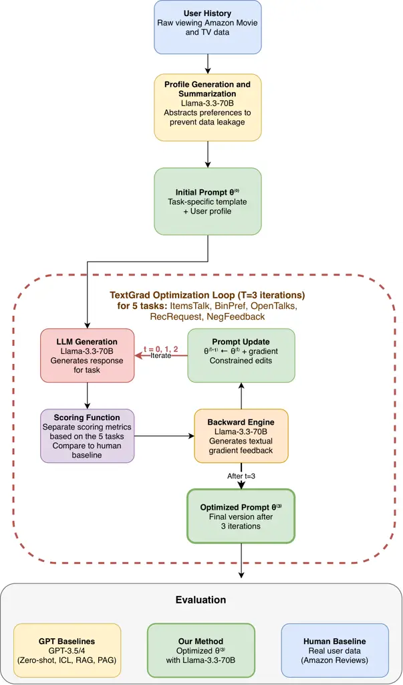

# Prompt Optimization for User Simulation in Conversational Recommender Systems: A Multi-Objective Framework

Nipun B Nair Affiliation: Monash University, Australia  
nipun.nair@monash.edu    Tongtong Wu Affiliation: Monash University,
Australia  
tongtong.wu@monash.edu    Weiqing Wang Affiliation: Monash University,
Australia  
teresa.wang@monash.edu

###### Abstract

Conversational recommender systems (CRSs) are a core component of
next-generation intelligent recommender systems because they enable
users to actively elicit preferences, clarify intentions, and adapt
recommendations in real time. However, there are two key obstacles in
the CRS domain: evaluation and access to training data. Evaluating CRSs
through real human studies is more critical than for traditional
recommender systems, yet such studies are both costly and
time-consuming. Moreover, CRS interaction data are often difficult to
obtain for model training due to privacy concerns. Large language model
(LLM)-based user simulators have shown promise in addressing both
challenges by generating synthetic user interactions for evaluation and
training. However, existing approaches suffer from systematic positive
bias, data leakage, and limited behavioral diversity, and they rely on
brittle manual prompt engineering that requires extensive domain
expertise. In this paper, we propose a framework to automatically
optimize prompts for LLM-based user simulators in CRSs, simultaneously
mitigating these issues. Experimental results demonstrate that the
proposed framework achieves improved behavioral alignment with human
interaction patterns compared to baseline methods across diverse prompt
settings.

###### Index Terms: 

User simulation, Prompt tuning, Conversational Recommendation Systems,
LLMs

## I Introduction

Recommender systems \[1, 2\] play a critical role in information seeking
by enabling users to efficiently discover relevant items, content, and
information. These systems deliver both user value and business impact
and continue to drive strong academic and industrial interest \[3, 1, 4,
5\]. Conversational recommender systems (CRSs) enhance this capability
by engaging users in natural language to infer user preferences and
reasons behind those preferences. CRSs allows users to articulate
preferences, explore options interactively, and provide fine-grained
feedback \[6, 7\] which is fundamentally different from traditional
recommender systems and have been recognized as the core component of
next-generation intelligent recommender systems in this Large Language
Model (LLM) era\[8, 9, 6\].

Conversational recommender systems typically require extensive user
testing prior to deployment, creating costly and time-consuming
bottlenecks in industrial development pipelines, as evaluation depends
on real users interacting with the system. Additionally, collecting
conversational data introduces privacy concerns that hinder deployment
in regulated settings (e.g., healthcare and financial area). User
simulators provide a promising solution to these challenges by enabling
scalable, low-cost, and privacy-preserving evaluation and training of
CRSs without requiring extensive interaction with real users.

User simulators are automated agents that emulate human interaction
patterns in recommendation dialogues by generating responses that
approximate real user behavior. LLM based user simulators have shown its
great potential in this LLM era by serving as synthetic user simulators
that enable reproducible, cost-effective user simulation in recommender
systems across diverse user populations and interaction contexts \[10,
11, 12, 13, 14\].

The existing LLM user simulators can be categorized into
fine-tuned/training based simulators\[15, 16, 17\] and prompt based
simulators \[18, 19, 20, 21, 22\]. In this paper, we focus on
prompt-based simulators, as they are cost-effective compared to
training/fine-tuning based methods which require fine-tuning of a large
language model. LLM-based user simulators operate by taking a structured
user profile and a recommended item as input, then generating a natural
language response that approximates real user behavior. In prompt-based
simulators, this behavior is controlled entirely through instructions
provided to a frozen LLM, without modifying model weights, contrasting
with fine-tuned approaches that require large labeled datasets and
significant compute, making them impractical in privacy-sensitive or
resource-constrained settings.

Current prompt-based LLM user simulators face three critical challenges
that limit practical deployment in conversational recommender systems:

(1) Systematic positive bias: LLM-based simulators exhibit
unrealistically high acceptance rates, generating overwhelmingly
positive responses that fail to capture realistic rejection behavior.
For instance, when presented with movie recommendations, LLM-based
simulators tend to accept most of suggestions regardless of stated user
preferences, while real users reject nearly half of the presented
recommendations \[18, 7\].

(2) Data leakage: Unlike standard train-test leakage in machine
learning, data leakage in user simulation occurs when user’s profile
history items appear as item mentions verbatim. Rather than reasoning
from genuine preferences, the simulator echoes these items back in its
responses, inflating apparent accuracy and artificially suppressing
diversity metrics in ways that misrepresent true simulator capability
\[19, 18\].

(3) Severely constrained behavioral diversity: Simulators exhibit
popularity bias, disproportionately favoring well-known mainstream items
over niche content, and temporal clustering, concentrating
recommendations within narrow time windows. This leads to homogenized
item mentions and fails to capture the diverse preferences of real user
populations, limiting their effectiveness for evaluating recommender
systems across varied user personas\[7, 16, 23\].

While prompt-based simulators are more accessible, their performance is
highly sensitive to prompt quality \[24, 25, 26\], and recent frameworks
addressing this lack comprehensive solutions that tackle all three
challenges simultaneously \[20, 15, 21\]. A critical gap therefore
remains in principled methods for automatically optimizing simulator
behavior to achieve realistic behavioral patterns. Beyond CRS
evaluation, this work addresses a core challenge in LLM-driven data
engineering: how to automatically generate, optimize, and validate
synthetic behavioral data at scale.

To solve these issues, we propose a framework which achieves joint
optimization of simulating user profiles and response patterns and
overcomes the three challenges simultaneously. Moreover, the framework
also avoids heavy manual prompt engineering through automatic prompt
optimization via interpretable text based gradients. In this paper we
make the following contributions.

- •
  Proposal of optimized framework: To the best of our knowledge, we are
  the first one proposing a framework to automatically optimize the
  prompt for LLMs based user simulator in CRSs by overcoming the three
  challenges simultaneously.
- •
  Solution of Challenges: In the framework, we design entropy-aware and
  textual-gradient-based scoring functions that solve the problems of
  positive bias and popularity bias. Additionally we design a profile
  summarization way to reduce the impact of data leakage while retaining
  the essential profile information. To evaluate the simulator’s ability
  in overcoming overacceptance bias, we propose NegFeedback, a
  proof-of-concept metric specifically designed to assess the
  correctness and rationale of negative user feedback.
- •
  Improved behaviour alignment: We demonstrate improved behavioral
  alignment with human interaction patterns compared to GPT-3.5 and
  GPT-4 baselines, using local execution with Llama3.3. We further
  validate the proposed metric NegFeedback using both an LLM-based
  evaluator and human evaluators. The LLM evaluator enables us to scale
  the evaluation, and its alignment with human judgments demonstrates
  the validity of the LLM evaluator.

## II Related Work

In this section, we organize our review around key challenges to
establish the foundation for our approach.

### II-A LLM-Based User Simulation in Recommender Systems

Recent implementations demonstrate significant advances in generating
human like responses and maintaining coherent user personas. Many
studies have explored LLM powered simulator adapted for recommendation
contexts that leverages contextual understanding and incorporate
personality traits and demographic features into user modeling to
generate more realistic user interactions\[11, 17, 27, 28\]. However,
existing implementations rely predominantly on manual prompt
engineering, where researchers craft static templates based on intuition
and limited experimentation \[18, 24\]. This manual approach leads to
several fundamental problems: prompt brittleness across different
domains, inability to systematically optimize for real user behavior,
and lack of principled methods for incorporating domain specific
requirements. Recent comprehensive surveys \[29, 2\] acknowledge these
limitations but do not provide systematic solutions for prompt
optimization in user simulation contexts. The need for automatic prompt
optimization in user simulation is further highlighted by the
scalability challenges of manual approaches. As recommendation systems
become more complex and diverse, manually crafting prompts for each
domain and user type becomes increasingly impractical.

### II-B Prompt Optimization and Engineering for LLMs

Recent Automated Prompt Optimization (APO) methods include
gradient-based, evolutionary, and RL-based approaches\[30, 31\].
TextGrad \[32\] represents a significant advancement by optimizing
prompts through iterative refinement based on textual feedback from the
target LLM itself. This black box approach offers key advantages: (1)
supports model optimization without requiring model access, and (2)
allows for dynamic domain specific adaptation. However, existing APO
methods have not addressed user simulation challenges. Current APO
method applications focus on traditional NLP tasks with well-defined
success metrics, while user simulation requires handling conflicting
behavioral objectives, complex behavioral patterns beyond simple
accuracy, and authentic human behavioral diversity.

### II-C Evaluation Metrics and Feedback Mechanisms

Existing user simulation evaluations rely on surface-level NLP metrics
(e.g., BLEU, F1) that overlook behavioral fidelity, such as realistic
acceptance rates and informative rejections\[19, 33, 15\]. While recent
work acknowledges these gaps, it lacks systematic methods to assess
rejection quality or alignment with human behavior\[20, 15\]. These gaps
motivate our development of NegFeedback, a proof-of-concept metric
designed to assess authenticity and rationale quality of user rejection
in user simulation contexts.

### II-D The Bias and Leakage Problem in LLM-Based User Simulation

LLM-based simulators suffer from systematic positive bias leading to
unrealistically high acceptance rates and popularity skewed responses
\[34, 35, 36\]. Prompt sensitivity exacerbates these issues, while data
leakage allows access to target items, compromising evaluation
integrity\[19\]. Existing methods lack principled tools for aligning
simulator behavior with human patterns. Our framework extends automatic
prompt-tuning with bias correction to address these challenges and
improve behavioral fidelity.



Fig. 1: Automatic Prompt tuning-based user simulator optimization
pipeline

## III Our Framework

Compared with existing LLM based user simulators in CRSs, our framework
leverages TextGrad \[32\] to achieve the automatic prompt optimization
to avoid the heavy prompt engineering. To effectively adapt to user
simulation task in CRSs, our framework optimizes behavioral fidelity
rather than linguistic similarity. Moreover, our framework introduces an
entropy-aware and textual-gradient-based scoring functions to teach the
model to optimize prompts automatically to overcome the positive bias
and popularity bias. Moreover, we also design a profile summarization
approach to achieve a good trade-off between reduced data leakage risks
and keeping essential profile information. Lastly, a newly designed
metric which will be carefully validated is proposed to evaluate the
simulators’ rejection quality to measure their ability in overcoming
over-acceptance bias. The framework is based on a local LLM Ollama’s
Llama-3.3-70B for privacy-preserving execution.

Figure 1 illustrates the overall pipeline of our approach. The process
starts with raw user interaction histories extracted from the Amazon
dataset (Section IV-A). These histories are then used to generate and
summarize user profiles (Section III-B). Based on the resulting
profiles, task-specific initial evaluation prompts are constructed
(Section III-E). Automated prompt tuning is subsequently performed using
the TextGrad optimization loop (Section III-D) to refine the simulator
behavior across tasks.

### III-A Bias Correction via Entropy-Based Diversity Metrics

LLM simulators exhibit systematic biases that undermine evaluation
validity: positive bias (over-acceptance of recommendations) \[18\],
popularity bias (over-representation of well-known items) \[7, 16\], and
temporal clustering (narrow time-window recommendations). Prompt
sensitivity further amplifies these issues. To model behavioral
diversity, we use entropy-based metrics where higher entropy reflects
greater unpredictability. We define five complementary measures and each
of them is designed to capture different aspects of human behavioral
fidelity: (1) Item Entropy captures diversity across genre, era, region,
and cultural origin, penalizing duplicates and IMDb Top 250 overuse; (2)
BinPref quantifies alignment between simulator and human binary
preferences; (3) Aspect Entropy measures justification diversity (e.g.,
plot, acting, pacing); (4) Sentiment Entropy reflects tone variation,
exposing positive bias; (5) Semantic Richness assesses vocabulary
diversity. Our method iteratively optimizes prompts using these metrics,
comparing against ground truth patterns and generating feedback to
reduce bias:

1.  1.  ItemsTalk: Item entropy quantifying diversity in movie selections.
        Let $`X=\{x_{1},\dots,x_{n}\}`$ be the list of movies binned by
        (genre, era, region):

    ```math
    H(X)=-\sum_{i=1}^{n}p(x_{i})\log p(x_{i}) \tag{1}
    ```

2.  2.  BinPref: Pearson correlation between simulated acceptance rates
        $`(x_{i})`$ and human movie ratings $`(y_{i})`$:

    ```math
    r=\frac{\sum_{i=1}^{n}(x_{i}-\bar{x})(y_{i}-\bar{y})}{\sqrt{\sum_{i=1}^{n}(x_{i}-\bar{x})^{2}\sum_{i=1}^{n}(y_{i}-\bar{y})^{2}}} \tag{2}
    ```

3.  3.  OpenPref: Aspect and sentiment entropy measuring review richness.
        Let $`X=\{x_{1},\dots,x_{n}\}`$ be aspects (plot, acting, pacing)
        and $`Y=\{y_{1},\dots,y_{m}\}`$ be sentiments (neg, neu, pos):

    ```math
    \displaystyle H_{\text{aspect}}(X) \displaystyle=-\sum_{i=1}^{n}p(x_{i})\log p(x_{i}) \tag{3}
    ```

    ```math
    \displaystyle H_{\text{sentiment}}(Y) \displaystyle=-\sum_{i=1}^{m}p(y_{i})\log p(y_{i}) \tag{4}
    ```

4.  4.  RecRequest: Multiple diversity measures. Let $`\mathbf{w}_{i}`$ be
        word vectors and $`\mathbf{s}_{i}`$ be sentence vectors:

    ```math
    \displaystyle=\frac{|\text{Types}|}{|\text{Tokens}|} \tag{5}
    ```

    ```math
    \displaystyle=1-\frac{1}{|\text{Words}|^{2}}\sum_{i,j=1}^{|\text{Words}|}\cos(\mathbf{w}_{i},\mathbf{w}_{j}) \tag{6}
    ```

    ```math
    \displaystyle=1-\frac{1}{|\text{Sentences}|^{2}}\sum_{i,j=1}^{|\text{Sentences}|}\cos(\mathbf{s}_{i},\mathbf{s}_{j}) \tag{7}
    ```

A potential concern with entropy-based optimization is that maximizing
entropy could produce outputs that are diverse but behaviorally random
rather than human-like. Our framework addresses this directly by
anchoring all scoring functions to empirically derived human baseline
distributions rather than rewarding raw entropy maximization.
Concretely, our evaluation prompts define target entropy ranges derived
from real Amazon user behavior. Outputs that fall outside these ranges
in either direction are penalized, meaning the optimizer is explicitly
discouraged from overshooting into unrealistic diversity.

### III-B Profile Summarization for Data Leakage Prevention

Using complete user histories creates context overload and data leakage
when target items appear in history. We introduce profile summarization:
randomly sample user history subsets and abstract into natural language
preferences, e.g., transforming _The Godfather, Goodfellas, Casino_ into
“prefers character-driven crime dramas with moral ambiguity.” For each
user, we sample up to $`k=5`$ items from their history, and pass titles
and years to Llama-3.3-70B with the following constrained prompt:

> “Summarize the user’s taste and behavior in simple English. Keep the
> description short without naming specific movies or TV shows.”

Refer to section IV-C for results.

### III-C NegFeedback: Rejection Quality Evaluation

We designed a new metric, NegFeedback, extending \[18\]’s feedback task
to assess rejection quality. Unlike prior work focused on accept/reject
coherence, NegFeedback evaluates if simulators give persona-aligned
rejection rationales and informative reformulation requests, revealing
deeper reasoning capability. NegFeedback requires simulators to: reject
inappropriate recommendations, provide preference based justifications,
generate semantically rich reformulation requests without naming movies,
and maintain persona-consistent tone. An LLM-based evaluator scores
responses (0–10) on rejection clarity, justification specificity,
reformulation quality, and behavioral consistency. For each NegFeedback
instance, the evaluator LLM (Llama-3.3-70B) receives the user profile
summary, recommended item description, and simulator response, along
with a rubric describing four criteria: (A) _rejection clarity_, (B)
_persona-grounded justification specificity_, (C) _reformulation quality
without naming specific titles_, and (D) _tone consistency with
persona_. The evaluator outputs four integer scores
$`s_{A},s_{B},s_{C},s_{D}\in[0,10]`$, and we define

```math
\text{NegFeedback}=\frac{1}{4}(s_{A}+s_{B}+s_{C}+s_{D}). \tag{8}
```

The same rubric is used for human evaluation and we report
inter-annotator agreement and human–LLM correlation in section IV-F2.

### III-D TextGrad Optimization Loop

We apply TextGrad optimization separately for each task, allowing
task-specific prompt refinement. For task $`i`$, we:

1.  1.  Initialize prompt $`\theta^{(0)}_{i}`$ with a task-specific template
2.  2.  For iteration $`t=0,\dots,T-1`$:

    1.  (a)
        Sample batch of users $`B`$, generate responses using
        $`\theta^{(t)}_{i}`$
    1.  (b)
        Compute task-specific metric $`m_{i}(\theta^{(t)}_{i})`$
    1.  (c)
        Query back engine LLM in Textgrad for feedback on improving
        $`m_{i}`$
    1.  (d)
        Update prompt to $`\theta^{(t+1)}_{i}`$

3.  3.  Use optimized $`\theta^{(T)}_{i}`$ for final evaluation

In all experiments we run $`T=3`$ iterations with batch size $`B=100`$
users. Optimization stops at the last iteration. Only the guideline and
persona sections of the prompt are editable; task instructions and
system boilerplate remain fixed. Edits are constrained to preserve field
structure and keep total prompt length below $`L=2048`$ tokens.

### III-E Text Gradient Design

##### Textgrad Evaluation Prompt Design

For each task, we first established human baselines using responses from
10 randomly selected Amazon users. These baselines defined the target
distributions for the five tasks. Using these values, we constructed an
initial evaluation prompt and performed prompt tuning. After each
iteration, the resulting textual gradients were manually analyzed to
extract qualitative feedback in the form of natural language. Insights
from this analysis were then used to refine and update the evaluation
prompt by incorporating additional constraints, ensuring that the
evaluation prompt progressively and accurately captured and evaluated
the intended aspects of each task. Evaluation prompts were iteratively
refined over multiple optimization runs using textual-gradient analysis
until the simulator outputs aligned closely with the human targets. This
refinement was performed separately for each task and concluded once the
evaluation prompt stabilized. The finalized prompts were then used for
large-scale evaluation. Once the final evaluation prompt was
established, we scaled the evaluation by replacing textual-gradient
analysis with numerical scoring functions. These functions mapped
deviations from the human baseline to scores in the range \[1,10\],
where 1 indicates the largest deviation and 10 indicates the closest
match.

[TABLE]

Key Patterns observed after prompt tuning: (1) ItemsTalk: Adds explicit
diversity constraints (geography, time, genre); (2) BinPref: Introduces
threshold rule (3.5 cutoff) and binary output format; (3) OpenPref:
Demands multi-aspect analysis, scene-specific examples, and personal
reflection; (4) RecRequest: Removes verbatim titles, adds rich semantic
descriptors.(5) NegFeedback: Enhances rejection quality,reformulation
ability, and rationale coherence

TABLE I: Prompt Evolution Across Five Tasks Optimization

##### Task-Specific Evaluation Prompts

Each task employs a specialized evaluation prompt $`e_{i}`$ that defines
hard constraints, scoring criteria, and target behavioral ranges
informed by human baselines. In ItemsTalk, $`e_{i}`$ enforces strict
formatting before evaluating content, penalizing popular or redundant
selections and rewarding high-entropy lists spanning various genres,
decades, and continents. In BinPref, $`e_{i}`$ uses deterministic
correctness scoring, assigning positive credit only to exact Yes/No
outputs with no additional text, aligned with human decision boundaries.
In OpenPref, $`e_{i}`$ constrains responses with respect to aspect, and
sentiment entropy baselines derived from human review distributions. In
RecRequests, $`e_{i}`$ assess fluency, implicitness, and diversity
without explicit item references, targeting baselines based on
human-written queries. In NegFeedback, $`e_{i}`$ emphasizes clear
rejection justification tied to persona preferences, semantically rich
reformulation without naming items, and tone consistency, with a
10-point rubric penalizing generic reasoning, verbatim movie mentions,
and excessive prompt length. All tasks use fixed $`K=3`$ epochs without
early stopping. Table I illustrates the concrete prompt transformations
resulting from this optimization process. Table II presents the complete
evaluation prompts used for optimization.

[TABLE]

Note: All prompts instruct the evaluator LLM (Llama-3.3-70B) to return
only a numeric score (0–10 or 0–1 for binary tasks) with no additional
text, ensuring deterministic optimization signals for automated prompt
tuning. Target ranges for entropy and diversity metrics were empirically
derived from human baseline distributions (Section IV-A).

TABLE II: Task-Specific Evaluation for Prompt Optimization

## IV Experiments

Our experimental evaluation addresses three core research questions to
validate the proposed framework. RQ1: Does our framework improve
performance over existing prompt-based user simulators in conversational
recommender systems? To answer this question, we compare our method
against GPT-3.5-turbo and GPT-4 baselines, which represent the
state-of-the-art prompt-based user simulation approaches used in prior
research \[18, 19, 20\]. Results are presented in Section IV-F1. RQ2:
How does our framework perform under different prompting configurations?
To answer this question, we conduct comprehensive comparisons across
four settings: zero-shot, In-Context Learning (ICL), Retrieval-Augmented
Generation (RAG), and Profile-Augmented Generation (PAG), following
established evaluation protocols \[37\]. Comparative results across
these configurations are reported in Section IV-F1. RQ3: Is the proposed
NegFeedback metric reliable for measuring simulators’ rejection quality
and mitigating over-acceptance bias? To answer this question, we
recognize that while human evaluation provides the gold standard for
assessing rejection behavior \[18, 38\], it does not scale to
large-scale evaluation \[19, 33\]. Therefore, we design an LLM-based
evaluator to enable scalable assessment. To guarantee the quality of the
LLM evaluator, we conduct a pilot human evaluation study and calculate
the alignment between human judgments and LLM evaluator scores using
Pearson correlation. The human validation methodology is detailed in
Section IV-E, with comprehensive NegFeedback performance analysis
presented in Section IV-F2.

### IV-A Dataset

We use the Amazon Reviews 2023 dataset (Movies & TV subset) \[39\],
which provides large scale real world user interactions ($`>`$1.4
million reviews) with diverse behavioral patterns. We develop a
pre-processing pipeline that transforms raw review data into structured
formats suitable for our five simulation tasks. The Movies & TV subset
aligns with conversational recommendation research and provides
comparable baselines from prior work. The methodology generalizes across
other Amazon Reviews 2023 corpus subsets, ensuring scalability and
adaptability for future research.

### IV-B Deployment Infrastructure and Practical Considerations

We implemented a custom OllamaEngine extending TextGrad’s EngineLM for
local deployment using Llama 3.3:70B, selected for its
instruction-following capability and compatibility with
privacy-preserving execution. Smaller models (e.g., mistral-small,
deepseek-r1) failed to meet TextGrad’s requirements. Our system ran on 1
NVIDIA A100 GPU via institutional HPC, completing simulation and
evaluation for 100 users across 5 tasks in 15 GPU hours. Profiles are
generated independently, and optimized prompts are reusable, enabling
low-cost, parallelized evaluation. Cross-domain adaptation requires
minimal changes to attribute schemas and prompt templates, demonstrating
feasibility for organizations with diverse recommendation systems.

### IV-C Profile Generation and Summarization

We implement a privacy-preserving profile generation system using
locally deployed Llama 3.3:70B via Ollama, addressing cloud-related data
concerns while maintaining generation quality. Profiles include
demographic and behavioral traits based on prior work \[17\]. Each
profile is generated through structured LLM interaction to ensure
diversity and coherence. To reduce the potential for direct data
leakage, we summarize user history by sampling up to five movies and
prompting the LLM to produce a concise preference description. This
two-stage process yields compact, natural language profiles suitable for
simulation while anonymizing sensitive data \[19, 20, 40\]. The profile
summarization output replaces the raw history in all initial prompts.
This approach reduces length significantly while _reducing the potential
for direct data leakage, improving item entropy and substantially
lowering context window pressure_. To assess leakage risk and diversity
impact, we analyzed item entropy across 100 users: raw histories yielded
simulator item entropy of 6.415, while summaries increased this to 9.269
(vs human baseline 10.067). We further analyzed 100 responses where
movie names appeared in user history: raw histories contained target
titles verbatim in almost all of the cases which resulted in the high
predictability of the titles mentioned and led to low entropy score
(6.415). This is strong evidence that data leakage caused the reduction
of item entropy values. The profile summaries abstracted these movie
titles to genre/preference descriptions in all of the cases. This was
verified by manual inspection of 100 samples and found no verbatim title
reproduction. The resultant entropy measured in this case was the
closest to the human baseline. This diagnostic strongly validates
profile summarization reduces direct leakage exposure and substantially
improves behavioral diversity.

### IV-D Task Design and Baselines

We evaluate on five tasks from \[18\]: ItemsTalk measures item mention
diversity through entropy; BinPref measures the preference alignment
between user simulator and the real user; OpenPref assesses nuanced
aspect and sentiment expression; RecRequest evaluates lexical diversity
and request granularity. We compare against GPT-3.5-turbo and GPT-4 in
four configurations: zero-shot, In-Context Learning (ICL), Retrieval
Augmented Generation (RAG), and Profile Augmented Generation (PAG),
following previous research\[37\]. These baselines represent user
simulators without heavy model training. For NegFeedback, we conduct
human evaluation with independent evaluators assessing rejection
clarity, behavioral consistency, and reformulation quality on 10
randomly sampled responses. We analyze inter-evaluator correlation and
measure human evaluator agreement with LLM-based scores across our
method and baseline models.

### IV-E NegFeedback Human and Baseline Evaluation

We introduce NegFeedback, which evaluates rejection quality,
reformulation ability, and rationale coherence which are core behaviors
in conversational recommendation. Study Design: We conducted a pilot
human evaluation on 10 samples to establish proof-of-concept validity.
Three native English-speaking graduate students independently scored
LLM-generated rejection responses on a 0–10 scale across four criteria:
(A) Rejection clarity (0=implicit acceptance, 10=unambiguous rejection),
(B) Justification specificity (0=generic, 10=persona-grounded), (C)
Reformulation quality (0=no guidance, 10=semantically rich without
naming titles), (D) Tone consistency (0=contradictory, 10=perfect
match). While $`n=10`$ is insufficient for definitive conclusions,
results provide initial evidence of metric validity; we commit to
scaling to $`n\geq 100`$ in future work. Protocol: Evaluators were
blinded to model identity, received randomized samples, and scored based
on user profile + movie name + simulator rejection response. The same
rubric was used for both human and LLM evaluation to reduce subjectivity
and LLM bias. Inter-rater agreement among three evaluators shows
moderate consistency (average pairwise correlation: $`0.52`$)

### IV-F Results and Discussion

#### IV-F1 Performance Across Behavioral Tasks

| Model              | Aspect Entropy | Sent Entropy |
| ------------------ | -------------- | ------------ |
| Human              | 6.761          | 1.277        |
| GPT-3.5-turbo      | 4.322          | 0.000        |
| GPT-3.5-turbo(ICL) | 4.524          | 0.000        |
| GPT-3.5-turbo(RAG) | 4.170          | 0.000        |
| GPT-3.5-turbo(PAG) | 4.248          | 0.000        |
| GPT-4              | 5.087          | 0.000        |
| GPT-4 (RAG)        | 5.087          | 0.000        |
| llama3.3:70b       | 4.720          | 1.363        |
| Our Method         | 7.523          | 1.274        |

TABLE III: OpenPref Task Results

Our simulator demonstrates substantial improvements across multiple
behavioral dimensions through automated prompt optimization. Apart from
comparing with GPT baseline and our method, we include the human
baseline for all the tasks in the tables. Human baseline is computed
directly from Amazon user data, serving as the gold standard for
behavioral fidelity. Unlike synthetic responses from simulators, these
reflect genuine diversity, preferences, and communication patterns.

In the OpenPref task (Table III), post-tuning aspect entropy (7.523)
approximates human performance (6.761) and dramatically exceeds GPT
baselines (4.17 to 5.087), while maintaining realistic sentiment entropy
(1.274) that matches human patterns (1.277). GPT variants uniformly
collapse to zero sentiment entropy across all context strategies (ICL,
RAG, PAG), revealing severe positive bias. This failure stems from GPT’s
tendency to generate safe, uniformly positive responses when conditioned
on user preferences, a bias that our entropy based optimization
explicitly addresses through iterative feedback that penalizes sentiment
uniformity.

| Model                    | Item Entropy |
| ------------------------ | ------------ |
| Human                    | 10.067       |
| GPT-3.5-turbo            | 6.644        |
| GPT-3.5-turbo (ICL)      | 6.596        |
| GPT-3.5-turbo (BM25 RAG) | 6.644        |
| GPT-3.5-turbo (PAG)      | 6.496        |
| GPT-4                    | 6.596        |
| GPT-4 (BM25 RAG)         | 6.496        |
| llama3.3:70b             | 7.626        |
| Our Method               | 9.269        |

TABLE IV: ItemsTalk Task Results

For ItemsTalk (Table IV), post optimization achieves item entropy
(9.269), closely matching human diversity (10.067) and substantially
exceeding GPT baselines (6.496 to 6.644). The 9.269 item entropy (vs
human 10.067) reflects improved diversity enabled by shorter,
leakage-reduced summaries that prevent over-reliance on history-popular
items. The uniform collapse across ICL, RAG, and PAG variants suggests
these context augmentation strategies introduce information that
overwhelms the GPT model, causing it to treat the augmented context as
noise that degrades GPT’s inherent diversity, with even vanilla
GPT-3.5-turbo underperforming base Llama-3.3-70b likely due to GPT’s
extensive training constraining item selection toward safer mainstream
recommendations and its training cutoff underrepresenting niche item
diversity, both biasing toward high-frequency items. Our iterative
optimization successfully amplifies the LLM diversity by the multiple
iterations of tuning and reward based learning.

| Model               | Pearson Coeff |
| ------------------- | ------------- |
| Human               | 1.000         |
| GPT-3.5-turbo       | 0.079         |
| GPT-3.5-turbo (ICL) | 0.259         |
| GPT-3.5-turbo (RAG) | 0.265         |
| GPT-3.5-turbo (PAG) | 0.234         |
| GPT-4               | 0.265         |
| GPT-4 (RAG)         | 0.265         |
| llama3.3:70b        | 0.731         |
| Our Method          | 0.726         |

TABLE V: BinPref Task Results

In BinPref(Table V), the models based on GPT-3.5-turbo and GPT-4
demonstrate relatively low correlation. Here llama3.3:70b base (0.731)
slightly outperforms our tuned method (0.726). This may be due to the
fact that without the tuning, the base model had strong instruction
following ability and prompt tuning in this case was not necessary. But
prompt tuning performs better than GPT baselines as the instruction
following ability of these models were low. This same problem had been
identified \[18\] in previous research in the GPT family. Using a larger
and better instruction following model seems to have solved the problem.

| Model              | Word Div | Word2Vec Div | Sentence Div |
| ------------------ | -------- | ------------ | ------------ |
| Human              | 0.188    | 0.581        | 0.448        |
| GPT-3.5-turbo      | 0.552    | 0.471        | 0.542        |
| GPT-3.5-turbo(ICL) | 0.595    | 0.341        | 0.463        |
| GPT-3.5-turbo(RAG) | 0.597    | 0.431        | 0.530        |
| GPT-3.5-turbo(PAG) | 0.595    | 0.406        | 0.550        |
| GPT4               | 0.421    | 0.404        | 0.535        |
| GPT4(RAG)          | 0.437    | 0.382        | 0.545        |
| llama3.3:70b       | 0.394    | 0.605        | 0.571        |
| Our Method         | 0.235    | 0.779        | 0.609        |

TABLE VI: RecRequest Task Results

In RecRequest(Table VI), post tuning achieves Type-Token Ratio of
(0.235), closely approximating human lexical patterns (0.188), while GPT
baselines exhibit inflated diversity (0.42+). This overestimation
indicates that GPT generates vocabulary rich but stylistically unnatural
requests while prioritizing lexical variety over conversational
authenticity. Our method’s human baseline optimization successfully
calibrates this trade off, producing requests that are appropriately
repetitive in structure while remaining semantically meaningful.

#### IV-F2 NegFeedback: Evaluating Rejection Realism

| Model              | Corr with H.E | p-value |
| ------------------ | ------------- | ------- |
| GPT-3.5-turbo      | -0.2443       | 0.4964  |
| GPT-3.5-turbo(ICL) | -0.2137       | 0.5532  |
| GPT-3.5-turbo(PAG) | -0.4232       | 0.2230  |
| GPT-3.5-turbo(RAG) | 0.2584        | 0.4710  |
| llama3.3:70b       | 0.2584        | 0.4710  |
| Our Method         | 0.4840        | 0.1564  |

TABLE VII: NegFeedback Task Results

Table VII presents correlations between model outputs and human
evaluation for the NegFeedback task. As detailed in Section IV-E, our
method achieves the highest human-LLM correlation ($`r=0.484`$,
$`p=0.156`$), substantially outperforming base Llama ($`r=0.258`$) and
all GPT-3.5-turbo variants (negative or near-zero correlations). Most
GPT configurations produced zero-variance outputs, yielding undefined
correlations which were corrected after Laplace smoothing. Our method
achieves highest human-LLM correlation ($`r=0.484`$, $`p=0.156`$) vs.
base Llama ($`r=0.258`$) and GPT-3.5-turbo variants (negative
correlations, Table VII). While not statistically significant due to
limited sample size, the positive moderate correlation suggests the LLM
evaluator captures meaningful human-aligned signal. GPT-3.5-turbo
configurations produced near-zero variance outputs, resulting in
undefined correlations which needed Laplace smoothing. Yet these
configurations gave poor correlations.

## V Conclusion

We presented a multi-objective framework for automatic prompt
optimization of LLM-based user simulators in conversational recommender
systems. This work jointly targets systematic positive bias, data
leakage, and constrained behavioral diversity while avoiding brittle
manual prompt engineering via textual gradients and entropy-aware
scoring. Profile summarization is integrated to abstract verbatim
histories. Our approach substantially optimizes item entropy, aspect and
sentiment entropy, preference alignment, semantic richness, and
rejection quality with respect to human baselines. The proposed
NegFeedback task and metric further capture persona-grounded rejection
quality and over-acceptance bias, with an LLM evaluator whose scores
show meaningful correlation with human judgments, suggesting that
scalable, human-aligned evaluation of rejection behavior is feasible
without exhaustive human annotation. The approach generalizes across
recommendation domains with minimal adaptation,enabling scalable
evaluation for industrial use. This makes our approach immediately
applicable for practitioners seeking reproducible, privacy compliant
simulation pipelines in regulated or resource-constrained environments.

## VI AI-Generated Content Acknowledgement

The authors acknowledge the use of Claude (Anthropic) to refine the
language and improve the clarity of this manuscript. Specifically, the
tool was used in the Introduction, Our Framework, and Experiments
sections to polish author written text for better flow and grammatical
precision. All AI-generated suggestions were critically reviewed and
modified by the authors, who maintain full responsibility for the
accuracy and integrity of the final content.

## References

- \[1\] W. Fan, Z. Zhao, J. Li, Y. Liu, X. Mei, Y. Wang, J. Tang, and Q.
  Li (2024) Recommender systems in the era of large language models
  (LLMs). IEEE Transactions on Knowledge and Data Engineering 36 (11),
  pp. 6889–6907. External Links:
  [Document](https://dx.doi.org/10.1109/TKDE.2024.3392335) Cited by: §I.
- \[2\] J. Lin, X. Dai, Y. Xi, W. Liu, B. Chen, X. Li, C. Zhu, H.
  Guo, Y. Yu, R. Tang, and W. Zhang (2023) How can recommender systems
  benefit from large language models: a survey. ACM Transactions on
  Information Systems 43, pp. 1–47. External Links:
  [Document](https://dx.doi.org/10.1145/3678004) Cited by: §I, §II-A.
- \[3\] J. Zhang, R. Xie, Y. Hou, W. Zhao, L. Lin, and J. Wen (2023)
  Recommendation as instruction following: a large language model
  empowered recommendation approach. ACM Transactions on Information
  Systems. External Links:
  [Document](https://dx.doi.org/10.1145/3708882) Cited by: §I.
- \[4\] Z. Wu (2024) Optimizing e-commerce recommender systems: a
  comprehensive review of techniques and future directions. Applied and
  Computational Engineering. External Links:
  [Link](https://api.semanticscholar.org/CorpusID:274337327) Cited by:
  §I.
- \[5\] D. Zhang, Y. Geng, W. Gong, Z. Qi, Z. Chen, X. Tang, Y. Shan, Y.
  Dong, and J. Tang (2024) RecDCL: dual contrastive learning for
  recommendation. In Proceedings of the ACM Web Conference 2024, WWW
  ’24, New York, NY, USA, pp. 3655–3666. External Links: ISBN
  9798400701719, [Link](https://doi.org/10.1145/3589334.3645533),
  [Document](https://dx.doi.org/10.1145/3589334.3645533) Cited by: §I.
- \[6\] C. Gao, W. Lei, X. He, M. De Rijke, and T. S. Chua (2021)
  Advances and challenges in conversational recommender systems: a
  survey. AI Open 2, pp. 100–126. Cited by: §I.
- \[7\] S. Zhang and K. Balog (2020) Evaluating conversational
  recommender systems via user simulation. In Proceedings of the 26th
  ACM SIGKDD International Conference on Knowledge Discovery & Data
  Mining, External Links:
  [Document](https://dx.doi.org/10.1145/3394486.3403202) Cited by: §I,
  §I, §I, §III-A.
- \[8\] R. Li, S. Ebrahimi Kahou, H. Schulz, V. Michalski, L. Charlin,
  and C. Pal (2018) Towards deep conversational recommendations. In
  Advances in Neural Information Processing Systems, Vol. 31. Cited by:
  §I.
- \[9\] Y. Wang, Z. Jiang, Z. Chen, F. Yang, Y. Zhou, E. Cho, X. Fan, Y.
  Lu, X. Huang, and Y. Yang (2024) RecMind: large language model powered
  agent for recommendation. In Findings of the Association for
  Computational Linguistics: NAACL 2024, pp. 4351–4364. External Links:
  [Document](https://dx.doi.org/10.18653/v1/2024.findings-naacl.271),
  [Link](https://aclanthology.org/2024.findings-naacl.271/) Cited by:
  §I.
- \[10\] K. Balog, N. Bernard, S. Zerhoudi, and C. Zhai (2025) Theory
  and toolkits for user simulation in the era of generative AI: user
  modeling, synthetic data generation, and system evaluation. In
  Proceedings of the 48th International ACM SIGIR Conference on Research
  and Development in Information Retrieval, SIGIR 2025, Padua, Italy,
  July 13-18, 2025, Cited by: §I.
- \[11\] L. Wang, J. Zhang, H. Yang, Z. Chen, J. Tang, Z. Zhang, X.
  Chen, Y. Lin, H. Sun, R. Song, W. Zhao, J. Xu, Z. Dou, J. Wang, and J.
  Wen (2024) User behavior simulation with large language model-based
  agents for recommender systems. ACM Transactions on Information
  Systems. External Links:
  [Document](https://dx.doi.org/10.1145/3708985) Cited by: §I, §II-A.
- \[12\] A. Bernadić, G. Kujundžić, and I. Primorac (2025) Large
  language models in power systems: enhancing control and
  decision-making. International Journal of Innovative Solutions in
  Engineering. External Links:
  [Document](https://dx.doi.org/10.47960/3029-3200.2025.1.1.10) Cited
  by: §I.
- \[13\] K. Przystalski, J. K. Argasiński, N. Lipp, and D.
  Pacholczyk (2025) The rise of the large language models. In Building
  Personality-Driven Language Models: How Neurotic is ChatGPT, pp. 3–9.
  Cited by: §I.
- \[14\] W. Xiang, H. Zhu, S. Lou, X. Chen, Z. Pan, Y. Jin, S. Chen,
  and L. Sun (2024) Simuser: generating usability feedback by simulating
  various users interacting with mobile applications. In Proceedings of
  the 2024 CHI Conference on Human Factors in Computing Systems,
  pp. 1–17. Cited by: §I.
- \[15\] L. Chen, Q. Dai, Z. Zhang, X. Feng, M. Zhang, P. Tang, X.
  Chen, Y. Zhu, and Z. Dong (2025) RecUserSim: a realistic and diverse
  user simulator for evaluating conversational recommender systems. In
  Companion Proceedings of the ACM on Web Conference 2025, pp. 133–142.
  Cited by: §I, §I, §II-C.
- \[16\] X. Zhao, L. Xia, L. Zou, H. Liu, D. Yin, and J. Tang (2021)
  UserSim: user simulation via supervised generative adversarial
  network. In Proceedings of the Web Conference 2021, External Links:
  [Document](https://dx.doi.org/10.1145/3442381.3450125) Cited by: §I,
  §I, §III-A.
- \[17\] Z. Zhang, S. Liu, Z. Liu, R. Zhong, Q. Cai, X. Zhao, C.
  Zhang, Q. Liu, and P. Jiang (2025) LLM-powered user simulator for
  recommender system. In Proceedings of the AAAI Conference on
  Artificial Intelligence, Vol. 39, pp. 13339–13347. External Links:
  [Document](https://dx.doi.org/10.1609/aaai.v39i12.33456) Cited by: §I,
  §II-A, §IV-C.
- \[18\] S. Yoon, Z. He, J. M. Echterhoff, and J. J. McAuley (2024)
  Evaluating large language models as generative user simulators for
  conversational recommendation. In Proceedings of the 2024 Conference
  of the North American Chapter of the Association for Computational
  Linguistics: Human Language Technologies (Volume 1: Long Papers),
  NAACL 2024, Mexico City, Mexico, June 16-21, 2024, Cited by: §I, §I,
  §I, §II-A, §III-A, §III-C, §IV-D, §IV-F1, §IV.
- \[19\] L. Zhu, X. Huang, and J. Sang (2024) How reliable is your
  simulator? analysis on the limitations of current llm-based user
  simulators for conversational recommendation. In Companion Proceedings
  of the ACM Web Conference 2024, pp. 1726–1732. Cited by: §I, §I,
  §II-C, §II-D, §IV-C, §IV.
- \[20\] L. Zhu, X. Huang, and J. Sang (2025) A LLM-based controllable,
  scalable, human-involved user simulator framework for conversational
  recommender systems. In Proceedings of the ACM on Web Conference 2025,
  pp. 4653–4661. Cited by: §I, §I, §II-C, §IV-C, §IV.
- \[21\] X. Luo, Z. Tang, J. Wang, and X. Zhang (2024) DuetSim: building
  user simulator with dual large language models for task-oriented
  dialogues. Proceedings of LREC-COLING 2024. Cited by: §I, §I.
- \[22\] M. Chen, H. Fu, C. Liu, X. Wang, Z. Li, and J. Sun (2025) Build
  a good human-free prompt tuning: jointly pre-trained template and
  verbalizer for few-shot classification. IEEE Transactions on Knowledge
  and Data Engineering 37, pp. 2253–2265. External Links:
  [Document](https://dx.doi.org/10.1109/TKDE.2025.3543422) Cited by: §I.
- \[23\] Q. Wang, J. Wu, Z. Tang, B. Luo, N. Chen, W. Chen, and B.
  He (2025) What limits llm-based human simulation: llms or our design?.
  CoRR abs/2501.08579. External Links:
  [Link](https://doi.org/10.48550/arXiv.2501.08579),
  [Document](https://dx.doi.org/10.48550/ARXIV.2501.08579), 2501.08579
  Cited by: §I.
- \[24\] Q. Zhan, X. Guo, H. Ji, and L. Wu (2023) User simulator
  assisted open-ended conversational recommendation system. In
  Proceedings of the 5th Workshop on NLP for Conversational AI
  (NLP4ConvAI 2023), Y. Chen and A. Rastogi (Eds.), Toronto, Canada,
  pp. 89–101. External Links:
  [Link](https://aclanthology.org/2023.nlp4convai-1.8/),
  [Document](https://dx.doi.org/10.18653/v1/2023.nlp4convai-1.8) Cited
  by: §I, §II-A.
- \[25\] B. Lester, R. Al-Rfou, and N. Constant (2021) The power of
  scale for parameter-efficient prompt tuning. In Proceedings of the
  2021 Conference on Empirical Methods in Natural Language Processing,
  pp. 3045–3059. External Links:
  [Document](https://dx.doi.org/10.18653/v1/2021.emnlp-main.243) Cited
  by: §I.
- \[26\] W. Wei, J. Tang, L. Xia, Y. Jiang, and C. Huang (2024)
  PromptMM: multi-modal knowledge distillation for recommendation with
  prompt-tuning. In Proceedings of the ACM Web Conference 2024, WWW ’24,
  New York, NY, USA, pp. 3217–3228. External Links: ISBN 9798400701719,
  [Link](https://doi.org/10.1145/3589334.3645359),
  [Document](https://dx.doi.org/10.1145/3589334.3645359) Cited by: §I.
- \[27\] J. S. Park, J. O’Brien, C. J. Cai, M. R. Morris, P. Liang,
  and M. S. Bernstein (2023) Generative agents: interactive simulacra of
  human behavior. In Proceedings of the 36th Annual ACM Symposium on
  User Interface Software and Technology, pp. 1–22. Cited by: §II-A.
- \[28\] A. Zhang, Y. Chen, L. Sheng, X. Wang, and T. S. Chua (2024) On
  generative agents in recommendation. In Proceedings of the 47th
  International ACM SIGIR Conference on Research and Development in
  Information Retrieval, pp. 1807–1817. Cited by: §II-A.
- \[29\] L. Wu, Z. Zheng, Z. Qiu, H. Wang, H. Gu, T. Shen, C. Qin, C.
  Zhu, H. Zhu, Q. Liu, et al. (2024) A survey on large language models
  for recommendation. World Wide Web 27 (5), pp. 60. Cited by: §II-A.
- \[30\] W. Li, X. Wang, W. Li, and B. Jin (2025) A survey of automatic
  prompt engineering: an optimization perspective. arXiv preprint
  arXiv:2502.11560. Cited by: §II-B.
- \[31\] K. Ramnath, K. Zhou, S. Guan, S. S. Mishra, X. Qi, Z. Shen, S.
  Wang, S. Woo, S. Jeoung, Y. Wang, et al. (2025) A systematic survey of
  automatic prompt optimization techniques. arXiv preprint
  arXiv:2502.16923. Cited by: §II-B.
- \[32\] M. Yuksekgonul, F. Bianchi, J. Boen, S. Liu, P. Lu, Z.
  Huang, C. Guestrin, and J. Zou (2025) Optimizing generative ai by
  backpropagating language model feedback. Nature 639 (8055),
  pp. 609–616. Cited by: §II-B, §III.
- \[33\] E. Zhang, X. Wang, P. Gong, Y. Lin, and J. Mao (2024)
  Usimagent: large language models for simulating search users. In
  Proceedings of the 47th International ACM SIGIR Conference on Research
  and Development in Information Retrieval, pp. 2687–2692. Cited by:
  §II-C, §IV.
- \[34\] I. Sekulić, M. Alinannejadi, and F. Crestani (2024) Analysing
  utterances in LLM-based user simulation for conversational search. ACM
  Transactions on Intelligent Systems and Technology 15, pp. 1–22.
  External Links: [Document](https://dx.doi.org/10.1145/3650041) Cited
  by: §II-D.
- \[35\] G. Gui and O. Toubia (2023) The challenge of using llms to
  simulate human behavior: a causal inference perspective. Columbia
  Business School Research Paper. Cited by: §II-D.
- \[36\] Y. Lu, A. Aleta, C. Du, L. Shi, and Y. Moreno (2024) LLMs and
  generative agent-based models for complex systems research. Physics of
  Life Reviews 51, pp. 283–293. External Links:
  [Document](https://dx.doi.org/10.1016/j.plrev.2024.10.013) Cited by:
  §II-D.
- \[37\] Y. Zhuang, H. Sun, Y. Yu, R. Qiang, Q. Wang, C. Zhang, and B.
  Dai (2024) HYDRA: model factorization framework for black-box LLM
  personalization. In The Thirty-eighth Annual Conference on Neural
  Information Processing Systems, External Links:
  [Link](https://openreview.net/forum?id=CKgNgKmHYp) Cited by: §IV-D,
  §IV.
- \[38\] W. Sun, S. Zhang, K. Balog, Z. Ren, P. Ren, Z. Chen, and M. De
  Rijke (2021) Simulating user satisfaction for the evaluation of
  task-oriented dialogue systems. In Proceedings of the 44th
  International ACM SIGIR Conference on Research and Development in
  Information Retrieval, External Links:
  [Document](https://dx.doi.org/10.1145/3404835.3463241) Cited by: §IV.
- \[39\] Y. Hou, J. Li, Z. He, A. Yan, X. Chen, and J. McAuley (2024)
  Bridging language and items for retrieval and recommendation. arXiv
  preprint arXiv:2403.03952. Cited by: §IV-A.
- \[40\] J. Qin, W. Liu, W. Zhang, and Y. Yu (2025) D2K: turning
  historical data into retrievable knowledge for recommender systems. In
  Proceedings of the ACM on Web Conference 2025, WWW ’25, New York, NY,
  USA, pp. 472–482. External Links: ISBN 9798400712746,
  [Link](https://doi.org/10.1145/3696410.3714664),
  [Document](https://dx.doi.org/10.1145/3696410.3714664) Cited by:
  §IV-C.
