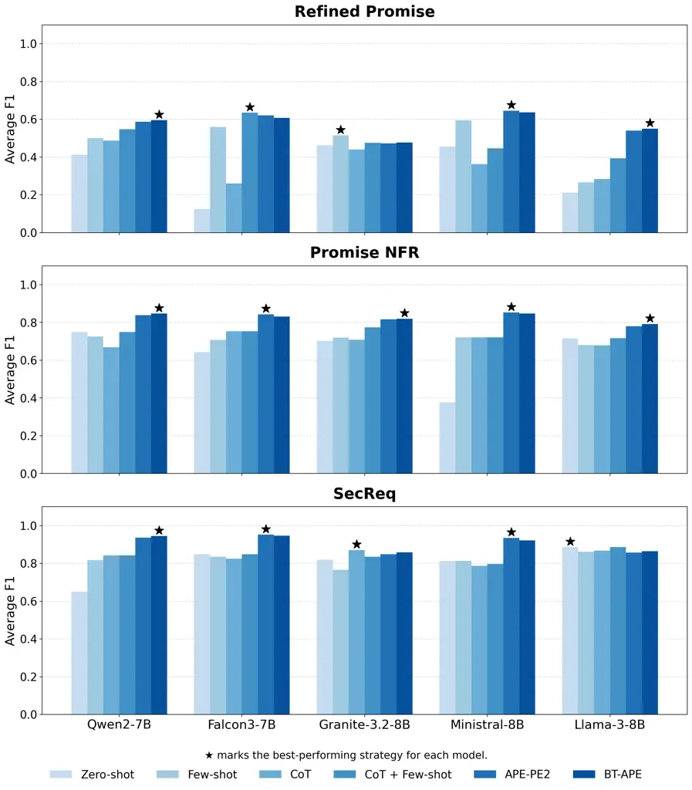
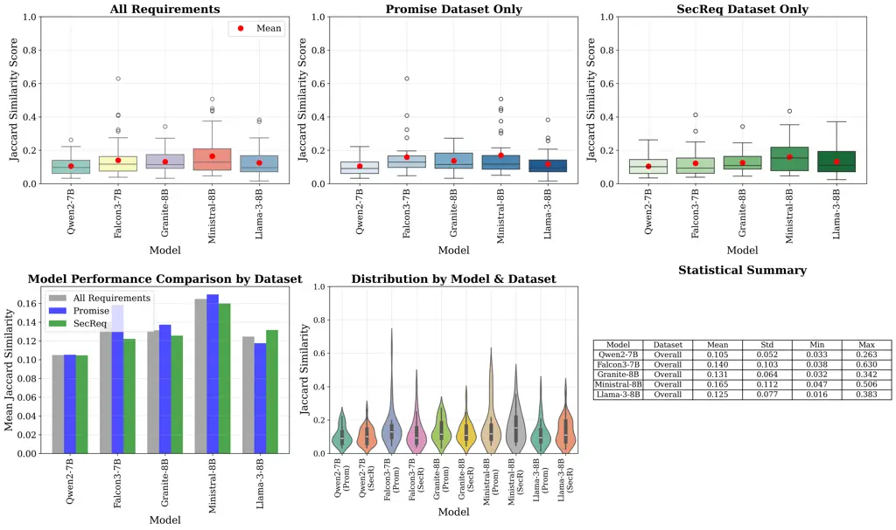

# BT-APE: A Computationally Light Backtracking Approach to Automatic Prompt Engineering for Requirements Classification

DOI: [XXXXXXX.XXXXXXX](https://doi.org/XXXXXXX.XXXXXXX)Journal: JACMVolume: 0001111CCS: Computing
methodologies Natural language generationCCS: Software and its
engineering Software organization and properties

Mohammad Amin Zadenoori email: <amin.zadenoori@unipd.it>
Affiliation: Department of Statistics, University of Padova, Padova,
Italy , Waad Alhoshan email: <wmaboud@imamu.edu.sa> Affiliation: Imam
Mohammad Ibn Saud Islamic University (IMSIU), Riyadh, Saudi Arabia ,
Jacek Dąbrowski
[](https://orcid.org/0000-0003-3392-0690)
email: <jacek.dabrowski@lero.ie> Affiliation: Lero, the Research Ireland
Centre for Software, University of Limerick, Limerick, Ireland , Liping
Zhao email: <liping.zhao@manchester.ac.uk> Affiliation: University of
Manchester, Manchester, United Kingdom and Alessio Ferrari email:
<alessio.ferrari@ucd.ie> Affiliation: University College Dublin (UCD),
Dublin, Ireland Affiliation: Istituto di Scienza e Tecnologie
dell’Informazione “A. Faedo” (ISTI), Consiglio Nazionale delle Ricerche
(CNR), Pisa, Italy

Received  5 June 2009

###### Abstract.

Large language models (LLMs) are increasingly applied to requirements
engineering (RE) tasks, including requirements classification, model
generation, trace-link detection and others. Prompts, which guide LLM
behavior, are typically designed manually through trial and error, often
leading to inconsistent and suboptimal performance on RE tasks. Despite
the importance of prompt design, prior RE research largely relies on
manually constructed prompts and does not systematically optimize them;
moreover, automated methods for prompt construction remain largely
unexplored, leaving their effectiveness unclear. To address this gap, we
propose a lightweight Automatic Prompt Engineering (APE) approach named
Backtracking APE (BT-APE) and apply it to requirements classification as
a representative RE task. We frame prompt design as an optimization
problem and iteratively refine prompts using LLM-generated candidates,
backtracking search, and dynamic example selection. We evaluate BT-APE
on three benchmark datasets with five instruction-tuned LLMs against
four classical prompting baselines (zero-shot, few-shot,
chain-of-thought, and CoT+few-shot) and a state-of-the-art, yet more
resource intensive, APE baseline (PE2). Our results show that BT-APE and
PE2 achieve nearly identical performance, both substantially
outperforming the four classical prompting baselines across datasets and
models, with large effect sizes. However, compared with PE2, BT-APE
imposes a substantially lighter computational footprint, consuming
approximately 72% fewer cumulative input tokens and 66% less wall-clock
time at equivalent accuracy (see Appendix C), making it better suited to
deployment on small or resource-constrained servers. We also find that
domain-informed prompt definitions enhance early performance, while
iterative optimization partly compensates for weaker initial prompts.
The contribution of this work is threefold: (i) a lightweight APE
framework, together with an open interactive tool and replication
package that operationalize the full pipeline; (ii) a comprehensive
empirical evaluation across datasets and instruction-tuned LLMs that
provides the first systematic comparison of APE against classical
prompting for requirements classification; and (iii) insights into the
impact of class definitions and prompt evolution on classification
performance.

###### Keywords: 

Large Language Models, LLMs, Natural Language Processing, NLP, Prompts
Engineering, Automatic Prompting, Requirements Engineering, Requirements
Classification

## 1. Introduction

Recent advances in Large Language Models (LLMs) are transforming
Requirements Engineering (RE) (Hou et al., 2024; Zadenoori et al.,
2025b). These models support tasks such as requirements elicitation,
traceability, validation, and specification generation (Ullrich et al.,
2025; Mallya et al., 2026b). Their effectiveness stems from large-scale
pretraining and their ability to follow natural language instructions
through in-context learning, without requiring task-specific
training (Zadenoori et al., 2025b). This capability is well suited to
RE, where annotated data is often scarce, domain-specific, and costly to
obtain, making traditional supervised approaches difficult to
scale (Zhao et al., 2021).

Interaction with LLMs is mediated through prompts, which are natural
language instructions that guide model behavior and shape outputs (Arora
and et al., 2024). Prompt quality directly affects performance, making
prompt engineering a critical factor in LLM-based solutions (Vogelsang
and Fischbach, 2024). However, in RE research, prompt design is
typically manual and relies on iterative trial-and-error (Zadenoori et
al., 2025b). This process is often ad hoc and unsystematic, depends
heavily on practitioner intuition, and is rarely documented in a
reproducible manner (Vogelsang and Fischbach, 2024). As a result, it
limits reproducibility and leads to inconsistent or suboptimal results
across RE tasks and datasets (Zadenoori et al., 2025b).

Despite its importance, prompt engineering in RE remains
underexplored (Cheng et al., 2024; Huang et al., 2025). Existing studies
rely on static prompting strategies—zero-shot, few-shot, and
chain-of-thought—whose effectiveness is known to be highly sensitive to
phrasing, ordering, and example selection (Arora and et al., 2024).
Because these prompts are manually crafted and never updated in response
to model behavior, they underutilized LLM capabilities. In contrast,
recent work in the broader Natural Language Processing (NLP) literature
introduces Automatic Prompt Engineering (APE) techniques that
iteratively generate, evaluate, and refine prompts (Kepel and
Valogianni, 2024; Wang et al., 2024; Ye et al., 2024; Kwon et al.,
2024). These approaches frame prompt design as a search or optimization
problem and have demonstrated strong performance improvements across a
range of tasks (Pryzant et al., 2023). However, their applicability to
domain-specific RE problems, where terminology, structure, and ambiguity
differ from general NLP benchmarks, remains unclear.

Our prior short contribution introduced APE to RE and provided initial
evidence that automated refinement can outperform standard prompting for
requirements classification (Zadenoori et al., 2025c). The preliminary
study proposed a basic APE approach, focused on a single dataset and a
single model, and did not analyze the effects of datasets, LLMs, or
prompt design factors. This paper builds upon this study, by proposing a
novel, more refined—yet lightweight—APE framework, named
Backtracking-APE (BT-APE), and conducting a systematic empirical
evaluation across multiple datasets and LLMs.

The proposed BT-APE framework iteratively refines prompts using
LLM-generated candidates, a backtracking search strategy, and dynamic
example selection. We evaluate the effectiveness of the framework in RE
and identify the factors that influence its performance. We focus on
requirements classification as a representative RE task (Bourque and
Fairley, 2024). The task assigns labels to textual requirements, such as
functional or non-functional categories. It supports downstream
activities, including requirements analysis, prioritization, and quality
assurance, it is the most frequently addressed task in NLP for RE
research (Zhao et al., 2021), and it has been shown to be highly
relevant for industrial applications (Bashir et al., 2023; Abdeen et
al., 2025). The task also provides a controlled setting to assess the
impact of prompt design on model behavior, given the availability of
multiple benchmarks. We evaluate the approach on three benchmark
datasets PROMISE (Cleland-Huang et al., 2007b), PROMISE-Refined (Dalpiaz
et al., 2019), and SecReq (Knauss et al., 28-30) using five
instruction-tuned LLMs in the 7–8B parameter range: Qwen2-7B,
Falcon3-7B, Granite-3.2-8B, Ministral-8B, and LLaMA-3-8B. We
deliberately focus on instruction-tuned variants because BT-APE relies
on the model’s ability to follow natural-language meta-prompts that ask
it to revise an existing prompt conditioned on labelled feedback. We
restrict the comparison to the 7–8B parameter range so that all models
can be hosted locally on a single commodity GPU, reflecting the
practical RE setting in which requirements confidentiality discourages
reliance on hosted proprietary APIs. Furthermore, we analyse how prompt
components, such as class definitions and examples, evolve during
optimisation.

Our results show that BT-APE outperforms standard prompting strategies,
and reaches performance that are equivalent with another, more resource
consuming, state-of-the-art baseline method, i.e., PE2 (Ye et al.,
2024), also generalizing across datasets and models. We also show that
domain-informed, carefully engineered prompts improve early performance,
while iterative optimization compensates for weaker initial prompts,
confirming the effectiveness of BT-APE especially in scenarios where
expert-crafted prompts are unavailable or difficult to design. We also
observe that effective prompts share a recognizable profile: they tend
to be concise and action-oriented (higher verb count), structurally
clear (more punctuation markers), and lexically focused, whereas length,
lexical diversity, and syntactic complexity correlate negatively with
performance.

This paper makes three contributions:

1.  (1)
    The first systematic evaluation of APE on requirements
    classification, comparing two single-trajectory APE methods against
    four classical prompting strategies across three datasets and five
    LLMs. We show that APE transfers to RE with large effect sizes over
    classical prompting.
2.  (2)
    Evidence that two structurally different APE designs — PE2’s
    history-conditioned proposals and our BT-APE’s bounded-backtracking
    with balanced example batches — converge to statistically
    indistinguishable accuracy. We characterize the operational
    trade-offs (per-iteration context size, search behavior,
    hyperparameter interpretability) that differentiate them.
3.  (3)
    An analysis of prompt-feature evolution under BT-APE that identifies
    lexical, syntactic, and semantic correlates of high-performing
    prompts.

In addition, we release a GUI-based interactive tool that
operationalises the full BT-APE pipeline, enabling practitioners to
apply and experiment with the method on their own requirements
classification tasks without prior expertise in prompt engineering or
LLM tooling (described in Appendix D). The tool, datasets, prompts,
optimisation traces, and evaluation scripts are released as a publicly
available replication package on Zenodo (Zadenoori, 2026).

To support the reproducibility and extensibility of this study,
additional materials are provided in the appendices. Appendix A presents
a hyperparameter sensitivity analysis and convergence dynamics for the
backtracking mechanism, characterizing the influence of patience
thresholds and iteration horizons. Appendix B details the PE2 baseline
implementation, highlighting its structural differences from our BT-APE
method. Appendix C provides a comprehensive computational efficiency and
token overhead comparison between BT-APE and PE2. Appendix D describes
an interactive tool that operationalizes the full optimization pipeline.
Appendix E outlines a preliminary analysis of potential data leakage
using Jaccard similarity, showing that mean similarity between
LLM-generated requirement continuations and ground-truth texts remains
low ($`0.10`$–$`0.16`$) across all five models, with no statistically
significant difference between PROMISE and SecReq.

##### Relation to the preliminary version.

This article substantially extends our REFSQ 2025 research
preview (Zadenoori et al., 2025c), which introduced APE to requirements
classification as a single-dataset, single-model proof of concept
without statistical analysis. Beyond the contributions listed above, the
present work (i) refines the original procedure into BT-APE by adding
bounded backtracking with an explicit patience threshold, a balanced
four-tuple dynamic example selection mechanism, and 3-run majority-voted
evaluation; (ii) broadens the empirical scope from one dataset and one
LLM to three datasets and five instruction-tuned LLMs, and adds PE2 (Ye
et al., 2024) as a state-of-the-art APE baseline; (iii) replaces
descriptive evaluation with a full inferential design (Wilcoxon
signed-rank tests, Friedman tests with power analysis, and a linear
mixed-effects model with trajectory-level random intercepts); (iv)
introduces two research questions absent from the preview — the analysis
of prompt-feature evolution (RQ3) and the comparison of informed vs.
uninformed class-definition initialisation (RQ4); and (v) releases an
interactive GUI-based tool, a hyperparameter sensitivity analysis, a
computational-efficiency comparison with PE2, and a data-leakage probe
based on Jaccard similarity.

The remainder of this paper is organized as follows. Section 2
introduces background and terminology. Section 3 presents the proposed
approach. Section 4 describes the research design. Section 5 reports the
results. Section 6 discusses the findings. Section 7 outlines threats to
validity. Section 8 concludes the paper.

## 2. Background and Related Works

### 2.1. Traditional and Pre-trained Machine Learning for Requirements Classification

Requirements classification, assigning predefined labels to natural
language requirements, is a foundational RE task. Typical formulations
distinguish functional from non-functional requirements, sort
non-functional requirements into sub-types such as performance,
security, and usability, and flag security-relevant
requirements (Cleland-Huang et al., 2007b; Kurtanović and Maalej, 2017;
Knauss et al., 28-30). Automating this work matters because manual
classification of large requirements documents is both impractical and
error-prone.

Early approaches leaned on traditional NLP and hand-crafted
features—term frequency, bag-of-words, and syntactic parsing—paired with
classifiers such as support vector machines and Naïve
Bayes (Cleland-Huang et al., 2007b; Kurtanović and Maalej, 2017). These
pipelines demanded heavy preprocessing and domain-specific feature
design, which limited their portability across datasets and
domains (Zhao et al., 2021; Ferrari et al., 2017).

The arrival of transfer learning with pre-trained language models
shifted the picture: Hey et al. (Hey et al., 2020) proposed NoRBERT,
applying BERT-based transfer learning to achieve strong results on the
PROMISE dataset across binary and multi-class tasks; Dalpiaz et
al. (Dalpiaz et al., 2019) contributed refined PROMISE annotations and
explored interpretable models using dependency-parsing features; and
Alhoshan et al. (Alhoshan et al., 2023) showed that pre-trained models
can classify requirements with no task-specific training data, albeit
with a measurable gap relative to supervised baselines. Addressing the
natural variance and instability inherent to individual language
architectures, Alsanoosy (Alsanoosy, 2025) unified these classic deep
learning threads by implementing an ensemble learning framework across
seven distinct models (including BERT and RoBERTa).

### 2.2. LLMs and In-Context Learning

Modern LLMs are transformer-based networks trained on large text corpora
through self-supervised objectives, and models in the GPT family
represent the current state of the art across classification,
summarization, translation, and code generation, frequently without
task-specific fine-tuning (Achiam et al., 2023). The property that most
distinguishes these models from earlier neural approaches is _in-context
learning_: given a natural language prompt containing instructions and,
optionally, a handful of demonstrations, the model produces appropriate
outputs without any parameter updates. This makes LLMs especially
appealing for RE, where labeled datasets tend to be small and tightly
bound to a particular domain (Ferrari et al., 2024). Because
state-of-the-art models contain hundreds of billions of parameters and
are typically reached through hosted inference APIs rather than
fine-tuned locally, the practical lever available to most RE researchers
is no longer the model’s weights but the text of the prompt
itself (Huang et al., 2025). Within RE, LLMs have been applied well
beyond classification—to elicitation, validation, traceability, and
specification generation (Rodriguez et al., 2023; Ferrari et al., 2024;
Santos et al., 2024). Ferrari et al. (Ferrari et al., 2024) explored
generating UML sequence diagrams from requirements, while Rodriguez et
al. (Rodriguez et al., 2023) studied how prompt design shapes automated
software traceability. Recently, SLMs are increasingly preferred over
LLMs due to their efficiency and competitive performance on specialized
tasks (Mallya et al., 2026b; Mallya et al., 2026a). Studies have shown
that SLMs can match or even outperform LLMs in domain-specific
applications such as requirements classification, while also
significantly reducing computational and energy costs (Zadenoori et al.,
2025a; De Martino et al., 2025).

### 2.3. LLMs in Requirements Classification

Recent work on requirements classification has moved from traditional
machine learning and encoder-based baselines toward LLM-based
approaches. Santos et al. (Santos et al., 2024) report that few-shot and
zero-shot prompting with GPT-4 and open-source models can approach the
performance of fine-tuned transformers in some settings, indicating that
both model choice and prompt design influence results. Peer et al. (Peer
et al., 2024) propose NLP4ReF, which combines NLTK with ChatGPT and
shows that classical toolkits remain effective for basic classification,
while generative LLMs are useful for identifying missing or overlooked
requirements during design reviews.

Several studies address limitations of LLMs in this setting. To mitigate
data sparsity and class imbalance in non-functional requirement (NFR)
datasets, Qin and Peng (Qin and Peng, 2025) propose ChatNRC, a
generative-discriminative framework that uses LLMs to synthesize
application-specific NFRs. Shafikuzzaman et al. (Shafikuzzaman et al., 2025) compare prompting strategies and find that zero-shot
configurations provide a label-free baseline, while few-shot prompting
yields higher precision in multi-class NFR classification. To address
the computational cost and limited interpretability of large models,
Rejithkumar and Anish (Rejithkumar and Anish, 2025) introduce NICE,
which distills reasoning chains from GPT-4o into smaller models such as
T5 to support multi-label classification with natural language
rationales validated by humans.

### 2.4. Prompt Engineering

Prompt engineering refers to the practice of designing and refining the
natural language instructions supplied to an LLM in order to elicit a
desired output. Because performance is highly sensitive to wording,
structure, and the presence or absence of examples (Rodriguez et al.,
2023), prompting has come to be treated as a tunable interface for
steering model behavior without retraining—sometimes characterized as a
new programming paradigm (Huang et al., 2025). The field organizes its
techniques along two axes useful for our purposes. The first is the
degree of supervision: zero-shot prompting supplies instructions alone,
few-shot prompting adds a small set of input–output demonstrations, and
chain-of-thought (CoT) prompting elicits intermediate reasoning before a
final answer (Wei et al., 2022). In RE classification settings, few-shot
prompting has generally produced the strongest results (Rodriguez et
al., 2023; Alhoshan et al., 2023).

The second axis is the degree of automation. Early prompt engineering
was a wholly manual, trial-and-error activity, but a line of work on
automatic prompt optimization has since sought to reduce that effort by
searching for effective prompts systematically. Zhou et al. (Zhou et
al., 2023) proposed APE, which casts prompt generation as black-box
optimization—an LLM proposes candidate instructions, each is scored on a
training set, and the best is selected—showing that machine-generated
prompts can rival or exceed human-written ones. Building on this, Ye et
al. (Ye et al., 2024) formalized prompt engineering as an optimization
problem and proposed PE2, which iteratively refines prompts using
LLM-generated feedback on misclassified examples, while Pryzant et
al. (Pryzant et al., 2023) introduced ProTeGi, which performs a
gradient-descent-like search in text space using natural language
“gradients.” Other strands explore reinforcement-learning-based
optimization (Kwon et al., 2024), mixture-of-expert prompt
construction (Wang et al., 2024), and evolutionary search (Kepel and
Valogianni, 2024). Beyond supervision and automation, prompting also
encompasses techniques such as retrieval-augmented generation (Lewis et
al., 2020), constraint injection, and multi-role dialogue, which broaden
the surface available for adapting an LLM to a new domain (Huang et al.,
2025).

### 2.5. Prompt Engineering for Requirements Engineering

Taken together, these threads explain why prompting has become central
to LLM-based RE, but they also expose a gap: the RE community still
lacks a consolidated account of which prompting techniques map to which
RE tasks, and with what trade-offs. General prompt-engineering
taxonomies exist but tend to mix levels of abstraction—placing
techniques, objectives, and application domains at the same hierarchical
level—which makes them awkward to apply within RE (Huang et al., 2025).
The recent systematic review by Huang et al. (Huang et al., 2025)
addresses this directly: following established
secondary-study (Kitchenham et al., 2022) and mapping (Petersen et al., 2015) guidelines, the authors screen several hundred records down to 35
primary studies and propose a hybrid taxonomy that links
technique-oriented prompting patterns (e.g., few-shot, chain-of-thought,
knowledge augmentation, self-reflection) to task-oriented RE roles
(elicitation, validation, traceability, and others). Their analysis
finds that contextualization and step-wise reasoning are the most widely
adopted strategies—often used together—while multimodal prompting is
essentially absent, requirements elicitation is under-explored, and
systematic evaluation such as ablation studies is rare. They distill
these gaps into a road-map toward reproducible, practitioner-ready PE4RE
workflows.

### 2.6. Research Gaps and Contributions

Based on the literature review, there are gaps at the intersection of
requirements classification, LLMs, and prompt engineering:

- •
  No APE for RE classification. While LLM-based approaches have shown
  promising results for requirements classification, existing studies
  rely exclusively on manually crafted prompting strategies—zero-shot,
  few-shot, or chain-of-thought—without systematically optimizing the
  prompt content itself (Alhoshan et al., 2023; Santos et al., 2024;
  Rodriguez et al., 2023). Prompt design has been shown to significantly
  affect classification performance, yet the selection of prompts
  remains a largely ad-hoc process in the RE literature.
- •
  APE methods untested on domain-specific RE tasks. APE methods such as
  APE (Zhou et al., 2023), PE2 (Ye et al., 2024), EPiC (Taherkhani et
  al., 2026), and ProTeGi (Pryzant et al., 2023) have demonstrated
  strong results on general NLP benchmarks, but none have been applied
  or evaluated on domain-specific RE tasks. It remains unclear whether
  the gains observed on general benchmarks transfer to specialized
  classification problems such as requirements categorization.
- •
  Role of prompt phrasing unexplored. No prior work has investigated how
  the textual phrasing of category descriptions within the prompt
  influences the optimisation process. Understanding whether
  domain-grounded phrasings offer a lasting advantage over minimal ones,
  or whether iterative optimisation can compensate for weaker starting
  points, has both practical and theoretical implications.
- •
  Limited understanding of effective prompt characteristics. Existing
  studies treat prompts as fixed inputs and evaluate only the
  classification output, without analyzing how prompt
  characteristics—such as length, lexical diversity, syntactic
  complexity, or semantic specificity—relate to performance. There is no
  systematic understanding of what makes a prompt effective or how
  prompt properties evolve during iterative optimization.

Our work addresses these gaps through the following contributions. We
employ an APE approach for requirements classification that implements a
backtracking-enhanced local search strategy to iteratively optimize
prompts, going beyond the static prompt designs used in prior RE
studies. We apply and evaluate this approach across multiple LLMs and
three well-established requirements classification datasets, enabling a
robust assessment of generalization. We introduce two initializations to
isolate and quantify the effect of class definition quality on
optimization performance. Finally, we conduct a feature-based analysis
of prompt evolution across iterations, examining how lexical, syntactic,
and semantic characteristics of prompts relate to classification
performance. To the best of our knowledge, this is the first study to
apply iterative APE adapted from the literature to requirements
classification, and the first to systematically investigate the role of
class definitions as a design variable in this particular process.

## 3. Approach BT-APE: Backtracking-Enabled APE

### 3.1. Method overview

At a high level, BT-APE turns prompt design into a guided search. We
start from an initial prompt that describes the classification task, and
we let an LLM repeatedly propose revised versions of that prompt in
light of how the current prompt is performing on labelled examples. The
procedure proceeds in three phases.

_Initialisation_ sets up the search. We split the labelled data into
three disjoint pools: one for sampling demonstration examples, one for
scoring candidate prompts during the search, and one held out for a
single final evaluation. We then score the initial prompt on the
validation pool to establish a starting reference score against which
all subsequent candidates will be compared.

_Iterative refinement_ is the core of the search. At each iteration, the
LLM proposes a new candidate prompt conditioned on the current prompt
and on a small, balanced batch of examples drawn from the example pool.
The batch deliberately mixes successes and failures from both classes so
that the proposer simultaneously sees where the current prompt works and
where it breaks. Each candidate is scored on the validation pool and
added to a ranked list. If the candidate improves on the best score seen
so far, the search continues along this trajectory; if several
consecutive candidates fail to improve, the search _backtracks_ to a
previously promising prompt rather than drifting further into an
unproductive region of the prompt space.

_Held-out evaluation_ touches the third pool exactly once: the best
prompt found during the search is scored on it to produce the final
reported performance. Confining the search entirely to the validation
pool and reserving the test pool for a single terminal evaluation
prevents the selection pressure inherent in any search procedure from
inflating the reported results.

Three principles distinguish BT-APE from other single-trajectory APE
methods such as PE2 (Ye et al., 2024): (i) *bounded backtracking*, which
abandons unproductive trajectories only after a configurable patience
threshold rather than reactively at every non-improving step;
(ii) *balanced dynamic example selection*, which guarantees the proposer
always sees both classes and both success and failure signals; and
(iii) conditioning the proposer on only the current prompt and a compact
balanced batch, keeping the per-iteration context size bounded. We
elaborate on these design choices and contrast them with PE2 in
Section 3.4.

### 3.2. Formalisation

More formally, and building on the formulation by Ye et al. (Ye et al.,
2024), prompt engineering can be cast as an optimisation problem:
identify the optimal prompt $`p^{*}`$ that maximises a task-specific
evaluation metric over a dataset $`D=(X,Y)`$, using an LLM
$`\mathcal{M}`$:

```math
p^{*}=\arg\max_{p}\,f\bigl(\mathcal{M}(X,p),\,Y\bigr), \tag{1}
```

where

- •
  $`D=(X,Y)`$ is the dataset of input–output pairs $`(x,y)`$;
- •
  $`\mathcal{M}`$ takes a prompt $`p`$ and input $`x\in X`$ to produce
  an output $`y^{\prime}\in Y^{\prime}`$;
- •
  $`f`$ is the evaluation function to be maximised (e.g., precision,
  recall, or F1 score).

In the context of requirements classification, each $`x`$ is a textual
requirement and each $`y`$ its manually annotated class (e.g.,
functional or quality). The evaluation function $`f`$ is applied to the
entire output set $`\mathcal{M}(X,p)`$, reflecting aggregate metrics
such as F1 over the dataset.

Figure 1. Overview of the BT-APE workflow applied to requirements
classification, alongside Algorithm 1. Steps are to be followed
sequentially. The figure was generated with AI assistance and then
reviewed, refined, and validated step by step by Author 1.

### 3.3. Algorithm and workflow

Figure 1 and Algorithm 1 present the same procedure as a diagram and as
pseudocode, respectively. We describe the three phases below, with line
numbers referring to Algorithm 1.

- •
  Phase 1: Initialisation (ll. 1–5). The dataset $`D`$ is partitioned
  into $`D_{\text{pool}}`$ (30%), $`D_{\text{val}}`$ (30%), and
  $`D_{\text{test}}`$ (40%); these proportions balance the competing
  demands of in-context learning, low-variance validation scoring, and a
  low-variance final test estimate (see Appendix A). The example batch
  $`E`$ is seeded with two random positive and two random negative
  examples from $`D_{\text{pool}}`$. The initial prompt $`p_{1}`$ is
  scored on $`D_{\text{val}}`$ to obtain its weighted F1, which we
  denote $`F^{*}`$ and use throughout the search as the _best-so-far_
  reference score against which subsequent candidates are compared. The
  triple $`(p_{1},F^{*},0)`$ is then inserted into the ranked list
  $`\mathcal{R}`$.
- •
  Phase 2: Iterative refinement (ll. 6–22). For up to $`N_{\max}=20`$
  iterations, the procedure performs six steps:
  1.  2.1
      _Generate candidate_ (l. 8). A new prompt $`p_{n}`$ is generated
      by the LLM, conditioned on the current prompt $`p_{\text{curr}}`$
      and the balanced example batch $`E`$. Conditioning on $`E`$
      exposes the proposer to concrete instances of where the current
      prompt succeeds and fails, following the error-conditioned
      refinement principle introduced by ProTeGi (Pryzant et al., 2023)
      and PE2 (Ye et al., 2024).
  2.  2.2
      _Evaluate candidate_ (l. 10). $`p_{n}`$ is scored on
      $`D_{\text{val}}`$ using 3-run majority voting (Section 3.6).
      Voting reduces run-to-run variability at the cost of three
      inference passes per candidate; this matters because the
      backtracking trigger below depends on F1 comparisons across
      iterations, and evaluation noise would otherwise propagate
      directly into search dynamics.
  3.  2.3
      _Update ranked list_ (l. 12). The triple $`(p_{n},F(p_{n}),n)`$ is
      inserted into $`\mathcal{R}`$, kept sorted by F1. Maintaining the
      full ranked history (rather than only the current best) is what
      enables the bounded backtracking step below.
  4.  2.4
      _Compare to best_ (ll. 13–17). If $`F(p_{n})\geq F^{*}`$, the best
      prompt and reference score are updated, the failure counter $`c`$
      is reset, and the pointer $`ptr`$ advances. Otherwise, $`c`$ is
      incremented.
  5.  2.5
      _Backtracking check_ (ll. 18–21). If $`c`$ reaches the patience
      threshold $`X=3`$, the search abandons the current trajectory and
      resumes from the next-best prompt in $`\mathcal{R}`$ via the
      pointer $`ptr`$. The threshold $`X`$ is an interpretable
      exploration–exploitation knob: $`X=1`$ over-reacts to evaluation
      noise, while large values waste iterations on plateaus. We set
      $`X=3`$ based on the sensitivity analysis in Appendix A.
  6.  2.6
      _Select examples for the next iteration_ (ll. 22–23).
      $`D_{\text{pool}}`$ is re-classified with $`p_{\text{curr}}`$, and
      $`E`$ is refreshed with one correctly classified positive, one
      correctly classified negative, one misclassified positive, and one
      misclassified negative. This balanced four-tuple guarantees that
      the proposer simultaneously sees success and failure signals on
      both classes — a property that matters because the optimisation
      objective is F1 on a potentially imbalanced label distribution.

- •
  Phase 3: Held-out evaluation (l. 24). The best prompt $`p^{*}`$ is
  scored once on $`D_{\text{test}}`$ under the same 3-run
  majority-voting protocol. Because $`D_{\text{test}}`$ is consulted
  only at this final step, the reported F1 is a genuine held-out
  estimate rather than a selection-inflated one.

Input: Dataset $`D`$, LLM $`\mathcal{M}`$, initial prompt $`p_{1}`$, max
iters $`N_{\max}=20`$, backtrack threshold $`X=3`$

Output: Best prompt $`p^{*}`$, held-out test F1

// Phase 1: Initialization

Split $`D`$ into $`D_{\text{pool}}`$ (30%), $`D_{\text{val}}`$ (30%),
and $`D_{\text{test}}`$ (40%);

$`E\leftarrow`$ 2 random positive + 2 random negative examples from
$`D_{\text{pool}}`$;

$`F^{*}\leftarrow F_{\text{val}}(p_{1})`$ ; // score initial prompt on
validation set

$`p^{*}\leftarrow p_{1}`$, $`p_{\text{curr}}\leftarrow p_{1}`$,
$`c\leftarrow 0`$, $`ptr\leftarrow 1`$;

Insert $`(p_{1},F^{*},0)`$ into ranked list $`\mathcal{R}`$;

// Phase 2: Iterative Refinement (validation-driven)

for _$`n=1`$ to $`N_{\max}`$_ do

   // Step 2.1: Generate Candidate

   Generate candidate $`p_{n}`$ via APE from $`p_{\text{curr}}`$
conditioned on examples $`E`$;

   // Step 2.2: Evaluate Candidate on validation set

   $`F(p_{n})\leftarrow F_{\text{val}}(p_{n})`$ ; // 3-run majority
voting on $`D_{\text{val}}`$

   // Step 2.3: Update Ranked List

   Insert $`(p_{n},F(p_{n}),n)`$ into $`\mathcal{R}`$, kept sorted by
F1;

   // Step 2.4: Compare to Best

   if _$`F(p\_{n})\geq F^{_}`$\* then

      $`p^{*}\leftarrow p_{n}`$, $`F^{*}\leftarrow F(p_{n})`$;

      $`p_{\text{curr}}\leftarrow p_{n}`$, $`c\leftarrow 0`$,
$`ptr\leftarrow ptr+1`$;

   else

      $`c\leftarrow c+1`$;

   // Step 2.5: Backtracking Check

   if _$`c=X`$_ then

      $`p_{\text{curr}}\leftarrow`$ next-best prompt in $`\mathcal{R}`$
at position $`ptr`$;

      $`ptr\leftarrow ptr-1`$, $`c\leftarrow 0`$;

   // Step 2.6: Select Examples for Next Iteration

   Classify $`D_{\text{pool}}`$ using $`p_{\text{curr}}`$ (3-run
voting);

   $`E\leftarrow`$ 1 correctly classified positive, 1 correctly
classified negative, 1 misclassified positive, 1 misclassified negative
from $`D_{\text{pool}}`$;

// Phase 3: Final held-out evaluation (test set touched once)

return $`p^{*}`$ and $`F_{\text{test}}(p^{*})`$ ; // single 3-run
evaluation of $`p^{*}`$ on $`D_{\text{test}}`$

Algorithm 1 Backtracking-Enhanced Prompt engineering with Dynamic
Example Selection

### 3.4. BT-APE: Method Design and Inspirations

We propose BT-APE (Back-Tracking APE), a lightweight prompt optimisation
procedure designed for settings where labelled data is scarce and each
candidate evaluation is expensive. Given an initial prompt $`p_{0}`$ and
a small pool $`D_{\text{pool}}`$ of labelled examples, BT-APE
iteratively proposes new prompts conditioned on the model’s behaviour on
a balanced batch of correct and incorrect predictions, and maintains a
ranked history $`\mathcal{R}`$ of all candidates evaluated so far. The
full procedure is given in Algorithm 1 and summarised in Figure 1. In
the following, we describe the main elements of the approach, and then
we describe the figure and the algorithm in details. The approach
consists of three defining components.

##### Explicit, bounded back-tracking.

BT-APE maintains a ranked list $`\mathcal{R}`$ of all evaluated
candidates sorted by F1, together with a pointer $`ptr`$ that identifies
the prompt currently being refined. The search remains on the current
trajectory until $`X=3`$ consecutive iterations fail to improve over the
best score $`F^{*}`$, at which point $`ptr`$ jumps to the next-best
prompt in $`\mathcal{R}`$. This yields an interpretable patience
parameter and prevents the search from lingering in unproductive
neighbourhoods of the prompt space.

##### Balanced, dynamic example selection.

At every iteration, after classifying $`D_{\text{pool}}`$ with the
current prompt $`p_{\text{curr}}`$, BT-APE re-samples the example batch
$`E`$ to contain one correctly classified positive, one correctly
classified negative, one misclassified positive, and one misclassified
negative example. This guarantees that the proposer simultaneously sees
success and failure signals on both classes—a property that matters
because our optimisation objective is F1 on a potentially imbalanced
label distribution.

##### Stable evaluation via majority voting.

Every candidate is evaluated on the held-out validation split using
3-run majority voting. Because the back-tracking trigger depends on F1
comparisons across iterations, evaluation noise directly affects search
dynamics; majority voting reduces LLM stochasticity at the cost of three
times the inference budget per candidate. We use a fixed 30/30/40
pool/val/test split throughout the search so that F1 values entered into
$`\mathcal{R}`$ are directly comparable across iterations.

#### 3.4.1. Baseline and Positioning

To assess whether the simplicity of BT-APE comes at a cost, we compare
it against PE2 (Ye et al., 2024) as a representative baseline. PE2 is a
natural point of comparison: it shares the same single-trajectory,
history-aware backbone, and formalises prompt optimisation as a sequence
of meta-prompted proposals

```math
p^{(t+1)}=\mathcal{M}_{\text{proposal}}\bigl(p^{(t)},B;\,p_{\text{meta}}\bigr), \tag{2}
```

over a batch $`B=\{(x,y,y^{\prime})\}`$ of inputs, ground-truth labels,
and current predictions, with a history of prior prompts from which
back-tracking is possible by re-selecting the top-$`n`$ candidates from
$`P^{(0)}\cup P^{(1)}\cup\ldots\cup P^{(t)}`$ at every step (Ye et al.,
2024). We exclude population-based evolutionary approaches such as
EPiC (Taherkhani et al., 2026) from this comparison: they are well
suited to code generation, where auto-generated unit tests validated via
AST parsing make the fitness oracle cheap and large populations can be
evaluated in parallel at low cost—a setting that does not match our
binary-classification task, where each candidate evaluation requires
three full classification runs over $`D_{\text{val}}`$.

BT-APE and PE2 differ along three axes that map onto the three
components above, and each axis has a concrete resource-consumption
consequence which we quantify empirically in Appendix C.

First, PE2 re-selects the top-$`n`$ prompts from the full history at
every step, whereas BT-APE commits to the current trajectory and
triggers an explicit jump only when a fixed patience threshold is
exceeded. Conditioning each proposal on the top-$`n`$ history means that
PE2’s per-iteration input context grows roughly linearly with the
iteration count, while BT-APE’s remains bounded. Empirically, at
$`N_{\max}=20`$, PE2 consumes approximately $`72\%`$ more cumulative
input tokens than BT-APE across all 15 (dataset, LLM) configurations
(paired Wilcoxon, $`p<10^{-4}`$, large effect size; see Table 15).

Second, PE2 conditions the proposer on an unconstrained error batch;
BT-APE enforces a class- and outcome-balanced batch at every iteration.
The use of failure examples to drive prompt edits is also central to
ProTeGi (Pryzant et al., 2023), which conditions a “textual gradient”
prompt on model errors and then applies a second prompt to edit
$`p_{0}`$ in the opposite semantic direction. BT-APE adopts this
principle without the two-step gradient-then-edit decomposition, since a
single proposal call conditioned on a balanced error batch is sufficient
in our binary-classification setting and avoids doubling the LLM call
cost per iteration.

Third, BT-APE relies on 3-run majority voting on a fixed validation
split, ensuring directly comparable F1 values across iterations—a
property that bandit-style subsampling, as used in ProTeGi’s selection
step (Pryzant et al., 2023), would not preserve.

Taken together, these three design choices translate into a
substantially lighter resource profile at equivalent accuracy: in
addition to the input-token reduction noted above, BT-APE incurs
approximately $`60\%`$ lower mean proposer latency and $`66\%`$ shorter
total wall-clock time than PE2 across the full experimental grid
(Appendix C). On a cost-normalised basis, BT-APE delivers each
percentage point of $`wF_{1}`$ at roughly $`27\%`$ of PE2’s input-token
cost and $`34\%`$ of its wall-clock cost. This is the main practical
motivation for the design: it enables deployment on resource-constrained
or air-gapped servers, which are typically preferred in RE settings
where requirements confidentiality discourages reliance on hosted APIs.

The defaults $`X=3`$ and $`N_{\max}=20`$ are motivated by the
sensitivity analysis in Appendix A, which shows that $`X=1`$ yields
unstable trajectories while $`X\in\{3,5\}`$ behave comparably on
accuracy at increasing resource cost.

### 3.5. Prompt Structure and Class Definitions

A central component of the BT-APE classification prompt is the set of
class definitions that instruct the LLM on how to distinguish between
requirement categories. In the optimisation loop, the class definitions
are the primary variable component of the prompt $`p`$, while the
surrounding scaffolding (output-format instructions, task framing)
remains fixed.

We restrict optimisation to class definitions for two reasons. First,
the output-format instructions are dictated by the evaluation pipeline:
rewriting them risks producing responses the parser cannot decode,
conflating prompt-quality variation with parsing failures. Second, prior
work on prompt sensitivity in classification tasks (Rodriguez et al.,
2023; Arora and et al., 2024) identifies category descriptions as the
primary lever through which prompts influence label decisions, while
task framing contributes comparatively little once a minimally adequate
version is in place. Confining the search to this component also keeps
the prompt space small enough to be explored within the bounded
iteration budget ($`N_{\max}=20`$).

Two strategies are proposed for initializing these definitions, each
serving as a different starting point $`p_{1}`$ for the optimization
process:

1.  (1)
    Simple Definitions (BT-APE-Uninformed). Class definitions are
    one-sentence intuitive descriptions written by Author 1 without
    consulting RE literature or standards, reflecting a minimal-effort
    starting point. Examples: “Functional: what the system should do.”;
    “Quality: how well the system should do it.”; “Security: protection
    against unauthorised access or harm.” The full set is given in
    Appendix F.
2.  (2)
    Literature-Based Definitions (BT-APE-Informed). Class definitions
    are curated and synthesized from established software engineering
    literature by an RE expert (last author). The functional and
    non-functional requirement definitions are derived from
    Glinz’s (Glinz, 2007) summary of the literature definitions, which
    characterizes functional requirements in terms of the essential
    functions a system must perform, the services it must offer, and the
    behaviours it must exhibit under specified conditions—focusing on
    the inputs (stimuli), outputs (responses), and the behavioural
    relationships between them. The quality requirement definitions are
    synthesized from quality-modeling literature and standards (Ernst
    and Mylopoulos, 2010; Olsson et al., 2022), expressing how well a
    system or service should execute an intended function through
    product quality aspects (e.g., functional suitability, reliability,
    performance, efficiency, usability, maintainability, security,
    compatibility, portability) and quality in use aspects (e.g.,
    satisfaction, effectiveness, freedom from risk, context coverage).
    The security requirement definitions are derived from the security
    requirements engineering literature and standards (Haley et al.,
    2008; , 2018; Sindre and Opdahl, 2003), characterizing security
    requirements as prescriptive constraints imposed on a system’s
    functional behaviour to operationalize its security
    goals—restricting how functions are performed to prevent, detect, or
    recover from harm, while specifying security policies and addressing
    risks, threats, and assets. The non-functional, non-quality, and
    non-security definitions are obtained by negating their functional,
    quality, and security counterparts, respectively. These definitions
    capture the nuanced distinctions recognized in the domain, such as
    differentiating sub-categories of quality requirements (e.g.,
    performance, security, usability). By grounding the initial prompt
    in domain knowledge, the LLM is provided with richer semantic
    context from the outset.

In both cases, the definitions are subject to iterative refinement
during the optimization process: at each iteration, the BT-APE mechanism
may edit, expand, or restructure the class definitions based on
misclassified and correctly classified examples from the training set
$`D_{\text{pool}}`$. The goal of introducing these different definitions
is to check whether a more informed initialization—rooted in domain
literature—leads to superior classification performance compared to
uninformed starting point, and whether this advantage persists after
multiple rounds of optimization. All the prompt structures and
definitions are given in Appendix F.

### 3.6. Inference-time voting protocol

The protocol described in this section is not specific to BT-APE; it is
an evaluation safeguard applied uniformly to all prompting strategies
(zero-shot, few-shot, CoT, CoT+few-shot, PE2, and BT-APE) whenever a
prompt is scored on $`Dval`$ or $`Dtest`$, so that comparisons across
strategies are made under identical conditions.

To mitigate the run-to-run variability of LLM outputs, we adopt a
_majority voting strategy_ during inference. Although we set the
decoding temperature to $`0`$, identical prompts can still yield
different outputs across runs due to stochastic sampling at non-zero
temperature settings, GPU non-determinism, and request batching at the
inference backend (Ouyang et al., 2022). For each classification
instance, the model is therefore executed three times with the same
prompt, and the final label is assigned by majority vote: the class
predicted in at least two out of three runs is selected as the final
output. This protocol applies uniformly to baseline strategies and to
the in-loop validation scoring of BT-APE (Algorithm 1, line 10) and PE2
(Algorithm 2).

## 4. Research Design

### 4.1. Research Questions

The research design is guided by the following research questions (RQs):

- •
  RQ1: What is the performance of BT-APE in requirements classification
  compared to standard prompt engineering approaches?  
  This question aims to evaluate the overall effectiveness of BT-APE
  relative to standard prompt engineering methods in the context of
  requirements classification. To answer this question, 1) we assess
  BT-APE’s performance across different LLMs and datasets using
  descriptive statistics (e.g., mean, standard deviation) for key
  metrics such as weighted-F1 score in comparison to other baseline
  methods. 2) We then conduct statistical significance testing to
  compare BT-APE results against the results obtained by the baseline
  methods. This allows us to determine whether BT-APE offers a
  meaningful improvement over manual or fixed prompt designs.
- •
  RQ2: What is the influence of the choice of dataset and LLM on the
  performance of BT-APE?  
  This question aims to statistically assess whether the selected
  datasets and LLMs have a significant impact on the performance of the
  BT-APE process. To answer it, we execute BT-APE across the three
  classification tasks using each of the five LLMs and collect the
  resulting weighted-F1 scores, yielding one value per (dataset, LLM)
  combination. We then apply distribution-free statistical tests to
  determine whether performance differences across datasets and across
  LLMs are statistically significant, and report a rank-based effect
  size to quantify the strength of each factor. This analysis enables us
  to assess the individual effects of datasets and LLMs on BT-APE
  effectiveness.
- •
  RQ3: What are the defining characteristics of optimal prompts, and how
  do these emerge and evolve through BT-APE iterations?  
  This question identifies the characteristics of effective prompts by
  analysing how they evolve across BT-APE iterations. We extract lexical
  (sentence count, word count, lexical diversity), syntactic (verb
  count, syntactic complexity), and semantic features (ambiguity score,
  semantic drift) from every prompt generated during the BT-APE process,
  and log them together with the validation weighted-F1 score of the
  prompt that produced them.

  Because each prompt is conditioned on its predecessor, observations
  within a (dataset, LLM) trajectory are not independent. We therefore
  analyse the data with a linear mixed-effects model (LMM) — prompt
  features as fixed effects, a random intercept per trajectory — so that
  coefficients estimate the _within-trajectory_ association between each
  feature and performance, separated from _between-configuration_
  variance. Full model specification, robustness checks, hypotheses, and
  effect-size reporting are given in the statistical test design.

  One interpretive caveat is integral to the research question rather
  than to the test design: semantic drift ($`SD`$) is by construction a
  property of _consecutive_ prompts, not of a prompt in isolation. A
  positive coefficient on $`SD`$ would characterise _successful search
  dynamics_, not actionable guidance for designing a static prompt. We
  therefore separate state features (length, verb count, punctuation,
  lexical diversity, syntactic complexity, ambiguity) from the
  transition feature ($`SD`$), and restrict design claims to the former.

- •
  RQ4: To what extent does BT-APE-Informed influence classification
  performance compared to i) BT-APE-Uninformed and ii) how do both
  approaches perform relative to their respective best baseline
  models?  
  This question examines the effect of class definition quality on the
  BT-APE process by comparing two variants: BT-APE-Uninformed and
  BT-APE-Informed. To answer this, both variants are evaluated across
  the same datasets and LLMs under identical experimental conditions.
  Their performance is compared using key metrics such as Weighted
  $`F1`$ score with statistical significance testing applied to assess
  whether BT-APE-Informed yields a meaningful improvement over
  BT-APE-Uninformed. In addition, each variant is compared against its
  respective best-performing baseline to determine how much improvement
  is achieved relative to standard prompt engineering approaches. This
  helps disentangle whether gains are driven primarily by the quality of
  the initial class definitions or by the iterative optimization process
  itself. Overall, this analysis isolates the role of class definitions
  as a design variable and evaluates whether domain-informed definitions
  provide a consistent advantage, or whether iterative optimization can
  compensate for simpler starting points.

### 4.2. Shared Experimental Settings

Tasks & Datasets. We evaluate BT-APE on three requirements
classification tasks, each representing a distinct and well-studied
problem in requirements engineering:

- •
  Functional-Quality classification based on the PROMISE Refined: In
  this task, we consider four binary classification tasks: Functional,
  Only Functional, Quality, and Only Quality. Specifically, this means
  that each data point should be evaluated solely on whether it meets
  functional requirements, quality requirements, or both. For every data
  point, we treat Functional and Quality as two separate ground-truth
  labels. The Only Functional task is then defined as instances that are
  labeled as Functional but not Quality, while the Only Quality task
  covers instances labeled as Quality but not Functional.
- •
  Functional–Non-Functional Binary Classification: Distinguishing
  between functional and Not-Functional requirements. This task
  addresses the fundamental separation between what a system should do
  and how well it should perform.
- •
  Security Binary Classification: Determining whether a requirement is
  security-related or not. This task targets a single quality concern
  and is particularly relevant for safety- and security-critical
  systems.

We selected three well-established requirements datasets to represent
the above tasks. These datasets have been extensively utilized in prior
research involving machine learning and language models for RE, such as
in (Dalpiaz et al., 2019; Hey et al., 2020; Kurtanović and Maalej, 2017;
Alhoshan et al., 2023; Knauss et al., 28-30). A summary is presented in
Table 1.

|                                             |          |                                                                                                       |                                    |
| ------------------------------------------- | -------- | ----------------------------------------------------------------------------------------------------- | ---------------------------------- |
| Dataset                                     | \# Reqs. | Main Classes                                                                                          | Sources                            |
| PROMISE (NFR)                               | 625      | 255 Functional Requirements (FR), 370 Non-Functional Requirements (NFR).                              | Developed by Cleland-Huang et al.; |
| used by Kurtanović and Maalej,              |          |                                                                                                       |                                    |
|  Hey et al., and Alhoshan et al.            |          |                                                                                                       |                                    |
| PROMISE (Refined)                           | 625      | 310 Functional (FR), 230 is-only Functional (FR_only). 382 Quality (QA), 302 is-only Quality (Q_only) | Developed by Dalpiaz et al.;       |
| includes reclassification of PROMISE;       |          |                                                                                                       |                                    |
| used by Hey et al. and Alhoshan et al.      |          |                                                                                                       |                                    |
| SecReq                                      | 510      | 187 Security-related (Sec), 323 Non-security (NSec)                                                   | Developed by Knauss et al.;        |
|  based on ePurse, CPN, and GPS;             |          |                                                                                                       |                                    |
|  used by Varenov et al. and Kobilica et al. |          |                                                                                                       |                                    |

Table 1. Overview of the Datasets Used in the Study.

- •
  PROMISE NFR Dataset: Developed by Cleland-Huang et al. (Cleland-Huang
  et al., 2007b; Cleland-Huang et al., 2007a), this dataset comprises
  625 requirements, including 255 FRs and 370 NFRs. This dataset has
  been widely adopted in the literature, including by Kurtanović and
  Maalej (Kurtanović and Maalej, 2017), Hey et al. (Hey et al., 2020),
  and Alhoshan et al. (Alhoshan et al., 2023).
- •
  PROMISE Refined Dataset: Introduced by Dalpiaz et al. (Dalpiaz et al.,
  2019), this dataset re-annotates the PROMISE NFR dataset. For binary
  classification, requirements are labeled as Quality (382) vs.
  non-Quality (243), and (302) labeled as quality only; and
  Functional (310) vs. non-Functional (315), and (230) labeled as
  functional only requirements. This dataset has been employed in
  studies such as (Hey et al., 2020; Alhoshan et al., 2023).
- •
  SecReq Dataset: Created by Knauss et al. (Knauss et al., 28-30; Knauss
  et al., 2021), the SecReq dataset contains 510 requirements, split
  into 187 security-related and 323 non-security-related instances. The
  data were collected from three projects: Common Electronic Purse
  (ePurse), Customer Premises Network (CPN), and Global Platform
  Specification (GPS). It has been utilized in multiple studies,
  including (Varenov and Gabdrahmanov, 2021; Kobilica et al., 2020).

LLMs Selection. To select a representative set of instruction-tuned LLMs
with approximately 7--8 billion parameters, we consulted the Hugging
Face Open LLM Leaderboard¹¹ 1
[https://huggingface.co/spaces/open-llm-leaderboard/open_llm_leaderboard](https://huggingface.co/spaces/open-llm-leaderboard/open_llm_leaderboard)
as a reference for identifying widely used open-source models. The
selection was guided by model availability, parameter scale,
organisational diversity, and architectural characteristics rather than
reported benchmark performance. Our goal is not to identify the single
best-performing model on requirements classification, but to test
whether BT-APE _generalises_ across architectures and whether it
consistently beats classical prompting baselines; using models that span
different organisations, attention mechanisms, and pretraining corpora
gives us a more honest stress test of generalisation than concentrating
on top-ranked models from a single family. The 7–8B parameter range is
chosen because models of this size can be hosted locally on a single
commodity GPU, which reflects the practical RE setting where
requirements confidentiality discourages reliance on hosted proprietary
APIs (Zadenoori et al., 2025b). Based on these criteria, we selected
five models developed by different research organizations:

|             |            |                                |                                                |               |
| ----------- | ---------- | ------------------------------ | ---------------------------------------------- | ------------- |
| Model       | Parameters | Attention Mechanism            | Pretraining/Instruction Tasks                  | Organization  |
| Qwen2       | 7B         | RoPE, MQA                      | Multilingual corpora, code, instruction tuning | Alibaba Cloud |
| Falcon3     | 7B         | MQA                            | English web text, instruction data             | TII (UAE)     |
| Granite-3.2 | 8B         | Scaled-dot attention (factual) | Business text, code, domain adaptation         | IBM Research  |
| Ministral   | 8B         | Sliding Window Attention       | Instruction datasets, reasoning tasks          | Mistral AI    |
| LLaMA-3     | 8B         | GQA, RoPE                      | Multilingual corpora, SFT tasks                | Meta AI       |

Table 2. Overview of selected instruction-tuned LLMs used in this study.

- •
  Qwen2-7B-Instruct (Alibaba Cloud): employs Rotary Positional
  Embeddings combined with Multi-Query Attention to support efficient
  attention computation. It is pretrained on multilingual corpora and
  programming code and further refined using human-aligned instruction
  datasets.
- •
  Falcon3-7B-Instruct (Technology Innovation Institute): uses
  Multi-Query Attention to reduce inference-time memory requirements.
  Its training data primarily consists of large-scale English web text
  and curated instruction-following datasets.
- •
  Granite-3.2-8B-Instruct (IBM Research): applies optimized scaled
  dot-product attention with a focus on factual grounding. It is trained
  on business-oriented text, programming code, and domain-specific
  adaptation tasks.
- •
  Ministral-8B-Instruct-2410 (Mistral AI): incorporates Sliding Window
  Attention to limit attention to local contexts and improve
  computational efficiency. It is trained on instruction-following
  datasets and reasoning-oriented benchmarks.
- •
  Meta-Llama-3-8B-Instruct (Meta AI): adopts Grouped-Query Attention
  together with Rotary Positional Embeddings to balance efficiency and
  representational capacity. Its pretraining relies on large-scale
  multilingual corpora and supervised fine-tuning on human-aligned
  datasets.

Table 2 summarizes the main technical characteristics of the selected
models, including parameter size, attention mechanisms, pretraining and
instruction tasks, and organizational origin. These descriptions provide
contextual background for the experimental setup without presupposing
differences in task performance.

Evaluation Metrics. We used four standard evaluation metrics: Precision
($`P`$), Recall ($`R`$), Weighted F1 Score ($`wF_{1}`$). These metrics
are well-suited for imbalanced classification tasks and allow us to
evaluate both general accuracy and recall-oriented performance.

- •
  Precision ($`P`$): The proportion of correctly predicted instances for
  a given class among all instances predicted as belonging to that
  class.

  ```math
  P=\frac{TP}{TP+FP}
  ```

- •
  Recall ($`R`$): The proportion of correctly predicted instances for a
  given class among all actual instances of that class.

  ```math
  R=\frac{TP}{TP+FN}
  ```

- •
  Weighted F1 Score ($`wF_{1}`$): The harmonic mean of precision and
  recall, computed for each class and averaged using the number of true
  instances (support) as weights.

  ```math
  wF_{1}=\sum_{c\in C}w_{c}\cdot\frac{2\cdot P_{c}\cdot R_{c}}{P_{c}+R_{c}}
  ```

ìIn the above equations, $`TP`$, $`FP`$, and $`FN`$ denote true
positives, false positives, and false negatives, respectively; $`w_{c}`$
represents the support (i.e., the proportion of instances) for class
$`c`$, and $`C`$ is the set of all target classes.

### 4.3. Prompt Baselines Selection

We compare our approach against five widely adopted prompting strategies
that together cover the standard spectrum of techniques used to elicit
classification performance from LLMs without task-specific fine-tuning:
four in-context learning baselines of increasing sophistication, and one
APE baseline. These baselines are selected because they are
(i) model-agnostic and reproducible across both large and small language
models, (ii) computationally lightweight and therefore compatible with
our SLM deployment setting, and (iii) established as canonical reference
points in recent RE and NLP classification studies (Arora and et al.,
2024). The five baselines are:

- •
  Zero-shot prompting: The model receives only a task description and
  label definitions, with no labeled examples. This baseline measures
  the model’s ability to perform the classification task purely from its
  pretrained knowledge and the natural-language specification of the
  task.
- •
  Few-shot prompting: The model is provided with a small set of labeled
  input–output examples alongside the task description. This baseline
  isolates the contribution of demonstration-based in-context learning,
  allowing us to measure how much performance improves when the model is
  exposed to representative instances of each requirement category.
- •
  Chain-of-Thought (CoT) prompting: The model is explicitly instructed
  to generate intermediate reasoning steps before producing the final
  output. This baseline tests whether eliciting structured reasoning
  improves classification on requirements that demand multi-step
  interpretation, such as distinguishing functional from non-functional
  aspects in compound statements.
- •
  CoT with Few-shot prompting: The model receives multiple labeled
  examples, each accompanied by an explicit reasoning trace and the
  final label. This baseline combines demonstration-based learning with
  reasoning elicitation and represents the strongest non-optimised
  prompting configuration commonly reported in the literature.
- •
  PE2 (APE) (Ye et al., 2024): The prompt is iteratively refined by a
  meta-prompted LLM conditioned on the top-$`n`$ historical prompts with
  their validation weighted-F1 scores and a batch of misclassifications
  observed on a held-out pool. Unlike the four baselines above, which
  keep the prompt fixed, PE2 actively searches the prompt space using
  the same iteration budget and evaluation protocol as our method. This
  baseline is the most directly comparable reference point for our
  approach, since both methods are single-trajectory, history-aware APE
  procedures driven by errors on a held-out set; its inclusion is what
  allows us to attribute any performance gap to our three algorithmic
  contributions—bounded back-tracking, balanced four-tuple example
  selection, and majority-voted F1—rather than to the use of prompt
  optimisation in general. Full algorithmic and implementation details,
  together with a precise enumeration of the differences from our
  method, are given in Appendix B (Algorithm 2).

The exact prompt templates used for each baseline are provided in the
replication package (Zadenoori, 2026).

### 4.4. Experimental Design for RQ1

Statistical Significance.²² 2 Notation for hypotheses. Throughout
Sections 4.4–4.7, we denote hypotheses using $`H^{\text{RQ}n}_{k,0}`$
for the null and $`H^{\text{RQ}n}_{k,A}`$ for the alternative, where
$`n`$ is the research question and $`k`$ indexes the hypothesis within
that question. For example, $`H^{\text{RQ}1}_{1,0}`$ is the first null
hypothesis under RQ1 and $`H^{\text{RQ}2}_{2,A}`$ the second alternative
hypothesis under RQ2. To assess whether the performance differences
between each baseline prompting strategy and the proposed BT-APE
approach are statistically significant, we analyse the per-cell
differences in $`wF_{1}`$ (i.e.,
$`\Delta=wF_{1,\text{BT-APE}}-wF_{1,\text{Baseline}}`$). All differences
across datasets and LLMs are pooled for each baseline strategy.

We then conduct a non-parametric Wilcoxon signed-rank test to evaluate
whether BT-APE achieves a higher mean $`wF_{1}`$ than the baseline. All
tests are performed at a significance level of $`\alpha=0.05`$, with
$`p`$-values adjusted using the Holm–Bonferroni procedure to account for
multiple baseline comparisons.

For each comparison between BT-APE and a baseline strategy, the
following hypotheses are defined:

- •
  $`H^{\text{RQ}1}_{1,0}`$: The mean difference in performance
  ($`wF_{1}`$) between BT-APE and the baseline strategy is zero
  ($`\Delta=0`$).
- •
  $`H^{\text{RQ}1}_{1,A}`$: BT-APE achieves a higher mean performance
  ($`wF_{1}`$) than the baseline strategy ($`\Delta>0`$).

Effect Size and Interpretation. We report the mean difference in
$`wF_{1}`$ ($`\Delta`$) with 95% confidence intervals. This statistic is
centred at zero when there is no improvement:

- •
  $`\Delta=0`$ indicates no systematic difference.
- •
  Positive values indicate that BT-APE outperforms the baseline.
- •
  Negative values indicate that the baseline outperforms BT-APE.

Effect size $`r`$ is computed as $`r=Z/\sqrt{N}`$, where $`Z`$ is the
standardised Wilcoxon test statistic and $`N`$ is the number of
observations. Magnitudes are interpreted as: negligible ($`r<0.10`$),
small ($`0.10\leq r<0.30`$), moderate ($`0.30\leq r<0.50`$), and large
($`r\geq 0.50`$) (Tomczak and Tomczak-Łukaszewska, 2014).

### 4.5. Experimental Design for RQ2

Factors Analysis. To address RQ2, we investigate how the performance of
BT-APE varies as a function of two independent variables—Datasets/Tasks
and LLMs—as well as their interaction. The final BT-APE results consist
of one $`wF_{1}`$ value per (Dataset, LLM) combination, yielding a
$`3\times 5`$ design with $`n=15`$ observations.

- •
  Datasets/Tasks. We test whether performance ($`wF_{1}`$) differs
  significantly across requirements classification tasks (Security,
  Functional, and Quality).
- •
  LLMs. We test whether performance ($`wF_{1}`$) differs significantly
  across the selected LLMs.

Statistical Significance. We first assess the normality assumption with
the Shapiro–Wilk test. Given the small sample and borderline normality,
we adopt distribution-free Friedman tests for the two main effects
rather than relying on the assumptions of parametric ANOVA. We test the
dataset effect using LLMs as blocks, and the LLM effect using datasets
as blocks. All tests are conducted at a significance level of
$`\alpha=0.05`$. The following hypotheses are defined:

- •
  Dataset/Task effect.
  - –
    $`H^{\text{RQ}2}_{1,0}`$: There is no statistically significant
    difference in $`wF_{1}`$ across datasets.
  - –
    $`H^{\text{RQ}2}_{1,A}`$: There is a statistically significant
    difference in $`wF_{1}`$ across datasets.

- •
  LLM effect.
  - –
    $`H^{\text{RQ}2}_{2,0}`$: There is no statistically significant
    difference in $`wF_{1}`$ across LLMs.
  - –
    $`H^{\text{RQ}2}_{2,A}`$: There is a statistically significant
    difference in $`wF_{1}`$ across LLMs.

Effect Size and Interpretation. We report Kendall’s $`W`$ as the effect
size for each Friedman test, which ranges from 0 (no agreement among
blocks) to 1 (perfect agreement). Larger values indicate a stronger and
more consistent factor effect across the blocking variable. As the
interaction is not estimable under a single-replicate design, we do not
test it formally; where the cell-level results suggest task-dependent
model behaviour, we describe it descriptively.

### 4.6. Experimental Design for RQ3

Prompt Feature Extraction. We extract and log a set of lexical,
syntactic, and semantic features from each prompt generated during
BT-APE iterations. These features are defined and computed as follows.

a) Lexical Features.

- •
  Sentence Count ($`SC`$): The number of sentences in the prompt,
  measured using sentence segmentation.

  ```math
  SC=\text{Number of sentences in }P
  ```

- •
  Word Count ($`WC`$): The total number of words or tokens in the
  prompt.

  ```math
  WC=\sum_{i=1}^{n}\delta(w_{i}),\quad\delta(w_{i})=\begin{cases}1,&\text{if }w_{i}\text{ is a word}\\
  0,&\text{otherwise}\end{cases}
  ```

- •
  Punctuation/Markers Count ($`PM`$): The number of structural markers
  such as colons, dashes, or line breaks.

  ```math
  PM=\sum_{c\in P}\delta(c),\quad\delta(c)=\begin{cases}1,&\text{if }c\in\{\texttt{:},\texttt{-},\texttt{.},\texttt{\textbackslash n},\ldots\}\\
  0,&\text{otherwise}\end{cases}
  ```

- •
  Lexical Diversity ($`LD`$): The ratio of unique words to total words,
  indicating vocabulary richness.

  ```math
  LD=\frac{|\text{Unique}(w_{1},w_{2},\ldots,w_{n})|}{WC}
  ```

b) Syntactic Features.

- •
  Verb Count ($`VB`$): The number of verbs in the prompt, identified via
  part-of-speech tagging.

  ```math
  VB=\sum_{i=1}^{n}\delta(\text{POS}(w_{i})=\text{VERB})
  ```

- •
  Syntactic Complexity ($`SCx`$): The average depth of the dependency
  parse tree over all tokens in the prompt.

  ```math
  SCx=\frac{1}{n}\sum_{i=1}^{n}\text{depth}(w_{i})
  ```

  where $`\text{depth}(w_{i})`$ denotes the number of dependency links
  from word $`w_{i}`$ to the root.

c) Semantic Features.

- •
  Ambiguity Score ($`AS`$): quantifies the vagueness of a prompt based
  on the presence of ambiguous or underspecified terms, commonly
  referred to as “smelly” words (e.g., some, many, etc., maybe, often,
  unclear, various). The score is computed heuristically as:

  ```math
  AS=\frac{1}{WC}\sum_{i=1}^{WC}\delta(w_{i}\in D_{\text{amb}})
  ```

  where:
  - –
    $`WC`$ is the total word count of the prompt,
  - –
    $`w_{i}`$ is the $`i^{\text{th}}`$ word in the prompt,
  - –
    $`D_{\text{amb}}`$ is a predefined dictionary of ambiguity-inducing
    terms,
  - –
    $`\delta(\cdot)`$ is an indicator function that returns 1 if
    $`w_{i}\in D_{\text{amb}}`$, and 0 otherwise.

- •
  Semantic Drift ($`SD`$): quantifies the semantic change between the
  current prompt and the immediately preceding one, computed as the
  cosine distance between their embedding vectors. For a sequence of
  $`n`$ prompts, the drift at iteration $`i`$ is defined as:

  ```math
  SD_{i}=\begin{cases}0,&\text{if }i=1\\
  1-\dfrac{\vec{e}_{i}\cdot\vec{e}_{i-1}}{\|\vec{e}_{i}\|\|\vec{e}_{i-1}\|},&\text{if }i>1\end{cases}
  ```

  where $`\vec{e}_{i}`$ and $`\vec{e}_{i-1}`$ are the embedding vectors
  of the prompts at iterations $`i`$ and $`i-1`$, respectively. This
  formulation captures the magnitude of semantic shift introduced at
  each step in the BT-APE process.

All of these features (lexical, syntactic, and semantic) are tracked
across all BT-APE iterations to study how prompt structure changes over
time and how such changes correlate with model performance improvements.
We further distinguish between _state features_, which describe a prompt
in isolation ($`SC`$, $`WC`$, $`PM`$, $`LD`$, $`VB`$, $`SCx`$, $`AS`$),
and _transition features_, which describe a change between consecutive
prompts ($`SD`$). This distinction matters for interpretation: a
within-trajectory association between a state feature and performance
can plausibly motivate prompt-design guidance, whereas an association
involving $`SD`$ characterises the dynamics of successful search rather
than properties of a static prompt.

Statistical Model. The prompts generated across BT-APE iterations are
not independent observations. Within a single (dataset, LLM) trajectory,
every prompt is conditioned on its predecessor, shares the same
proposer, and inherits the same starting point; across trajectories,
baseline performance differs systematically with task difficulty and
model capability (as established in RQ2). Pooling all prompts into an
ordinary least-squares regression with $`wF_{1}`$ as the response would
therefore conflate _within-trajectory_ variance—how performance changes
as a single search evolves—with _between-configuration_ variance, and
would overstate the precision of the resulting coefficients by treating
non-independent observations as independent.

To respect this nested structure, we estimate a linear mixed-effects
model (LMM) in which prompt features enter as fixed effects and a random
intercept is fitted for each (dataset, LLM) trajectory:

```math
wF_{1,ij}\;=\;\beta_{0}+\sum_{k}\beta_{k}\,x_{k,ij}\;+\;u_{j}\;+\;\varepsilon_{ij},\qquad u_{j}\sim\mathcal{N}(0,\sigma_{u}^{2}),\;\varepsilon_{ij}\sim\mathcal{N}(0,\sigma_{\varepsilon}^{2}),
```

where $`i`$ indexes the iteration within trajectory
$`j\in\{1,\ldots,15\}`$, $`x_{k,ij}`$ is the value of the $`k`$-th
prompt feature at iteration $`i`$ of trajectory $`j`$, $`u_{j}`$ is the
random intercept absorbing configuration-level differences in baseline
$`wF_{1}`$, and $`\varepsilon_{ij}`$ is the residual. The fixed-effect
coefficients $`\beta_{k}`$ therefore estimate the _within-trajectory_
association between each prompt feature and performance, after removing
the contribution of the underlying (dataset, LLM) configuration. The
model is estimated by restricted maximum likelihood (REML), and all
features are standardised to zero mean and unit variance prior to
fitting so that coefficient magnitudes are directly comparable.

Robustness Check on Terminal Prompts. As a complementary analysis that
is independent of trajectory dynamics by construction, we also fit an
ordinary least-squares regression on the _terminal_ prompts $`p^{*}`$ of
each of the 15 trajectories ($`n=15`$). The transition feature $`SD`$ is
excluded from this analysis as it is not defined for a single prompt.
This terminal-prompt regression has limited statistical power but
provides a sanity check: a feature whose within-trajectory effect under
the LMM is contradicted by its sign on terminal prompts is unlikely to
constitute reliable design guidance. We therefore report a feature as a
robust correlate of effective prompts only when its LMM coefficient is
statistically significant _and_ its sign agrees with the terminal-prompt
regression.

Hypotheses. All tests are conducted at a significance level of
$`\alpha=0.05`$, with Holm–Bonferroni correction applied across the
feature set to control the family-wise error rate.

- •
  $`H^{\text{RQ}3}_{1,0}`$: After accounting for between-trajectory
  variance, prompt features have no statistically significant
  within-trajectory effect on $`wF_{1}`$ ($`\beta_{k}=0`$ for all
  $`k`$).
- •
  $`H^{\text{RQ}3}_{1,A}`$: At least one prompt feature has a
  statistically significant within-trajectory effect on $`wF_{1}`$.

Effect Size and Interpretation. We report standardised fixed-effect
coefficients $`\hat{\beta}_{k}`$ with 95% confidence intervals for each
feature. Positive coefficients indicate that, within a trajectory, an
increase in the feature is associated with higher $`wF_{1}`$; negative
coefficients indicate the converse. The absolute magnitude of
$`\hat{\beta}_{k}`$ reflects the relative strength of the feature’s
within-trajectory contribution.

At the model level, we report three quantities. The _marginal_
$`R^{2}_{m}`$ measures the proportion of variance in $`wF_{1}`$
explained by the fixed effects alone, and is the appropriate analogue of
the OLS $`R^{2}`$ for the prompt-feature claim. The _conditional_
$`R^{2}_{c}`$ measures the proportion explained by fixed and random
effects jointly, and indicates the total fit of the model. The
_intra-class correlation coefficient_ (ICC),

```math
\text{ICC}\;=\;\frac{\sigma_{u}^{2}}{\sigma_{u}^{2}+\sigma_{\varepsilon}^{2}},
```

quantifies the share of residual variance attributable to
between-configuration differences rather than to within-trajectory
prompt characteristics; a high ICC would indicate that most of the
variation in $`wF_{1}`$ is configuration-driven and that
within-trajectory feature effects, however statistically significant,
account for a comparatively small share of overall performance
variation. Together, $`R^{2}_{m}`$, $`R^{2}_{c}`$, and the ICC provide a
more honest accounting of where the explanatory power of the model lies
than a single pooled $`R^{2}`$ would.

As noted above, we treat $`SD`$ separately in the interpretation: a
significant within-trajectory coefficient on $`SD`$ is described as a
property of successful optimisation trajectories rather than as
actionable guidance for designing a static prompt. Actionable design
claims are restricted to state features whose coefficients are stable
across the LMM and the terminal-prompt regression.

### 4.7. Experimental Design for RQ4

Class Definitions. As introduced in Section 3.5, we define two
initialisation strategies for the prompt optimisation process. In
BT-APE-Informed, the initial prompt is seeded with fine-grained class
definitions curated from requirements engineering literature and
standards. In BT-APE-Uninformed, no predefined class definitions are
provided; instead, the algorithm begins with simple, minimal
descriptions and iteratively refines them throughout the optimisation
process. This design allows us to assess two complementary aspects:
(1) whether domain-grounded definitions offer a measurable advantage as
a starting point, and (2) whether the iterative optimisation is capable
of discovering effective definitions independently, without relying on
prior domain knowledge.

Statistical Significance. To assess whether the performance differences
between BT-APE-Uninformed and BT-APE-Informed are statistically
significant, we analyse two complementary dimensions.

Dimension 1: Final Performance Comparison. We analyse the per-cell
differences in final optimised $`wF_{1}`$ (i.e.,
$`\Delta_{\text{final}}=wF_{1,\text{BT-APE-Informed}}-wF_{1,\text{BT-APE-Uninformed}}`$).
All differences across datasets and LLMs are pooled. We then conduct a
Wilcoxon signed-rank test to evaluate whether BT-APE-Informed achieves a
higher mean final $`wF_{1}`$ than BT-APE-Uninformed. The test is
performed at a significance level of $`\alpha=0.05`$. For this
comparison, the following hypotheses are defined:

- •
  $`H^{\text{RQ}4}_{1,0}`$: The mean difference in final performance
  ($`wF_{1}`$) between BT-APE-Informed and BT-APE-Uninformed is zero
  ($`\Delta_{\text{final}}=0`$).
- •
  $`H^{\text{RQ}4}_{1,A}`$: BT-APE-Informed achieves a higher mean final
  performance ($`wF_{1}`$) than BT-APE-Uninformed
  ($`\Delta_{\text{final}}>0`$).

Dimension 2: Improvement-over-Baseline Comparison. Since each variant
has its own independent baseline (fine-grained class definitions for
BT-APE-Informed vs. minimal descriptions for BT-APE-Uninformed), we
compute the per-cell gain for each variant relative to its own starting
point:

```math
\Delta_{\text{Informed}}=wF_{1,\text{Informed-Opt}}-wF_{1,\text{Informed-Baseline}}
```

```math
\Delta_{\text{Uninformed}}=wF_{1,\text{Uninformed-Opt}}-wF_{1,\text{Uninformed-Baseline}}
```

We then calculate the difference in gains:

```math
\delta_{\text{gain}}=\Delta_{\text{Informed}}-\Delta_{\text{Uninformed}}
```

A separate Wilcoxon signed-rank test is applied to
$`\delta_{\text{gain}}`$ across all (dataset, LLM) pairs to evaluate
whether the two variants improve equally over their respective
baselines. The hypotheses for this dimension are:

- •
  $`H^{\text{RQ}4}_{2,0}`$: The mean difference in gains
  ($`\delta_{\text{gain}}`$) between BT-APE-Informed and
  BT-APE-Uninformed is zero, i.e., both variants improve equally over
  their own baselines.
- •
  $`H^{\text{RQ}4}_{2,A}`$: The mean difference in gains
  ($`\delta_{\text{gain}}`$) is not zero, i.e., one variant achieves
  greater relative improvement from its baseline than the other.

Effect Size and Interpretation. For both dimensions, we report the mean
difference ($`\Delta_{\text{final}}`$ and $`\delta_{\text{gain}}`$
respectively) with 95% confidence intervals, following the same
interpretation benchmarks defined in RQ1. This dual analysis allows us
to isolate the contribution of class definitions as a design variable
and assess: (a) whether domain-grounded definitions provide a lasting
advantage in final performance, and (b) whether the iterative
optimisation compensates for simpler starting points by achieving
comparable or greater relative improvement from a lower baseline.

## 5. Experimental Results

In this section, we present the results of the classification
experiments conducted on three datasets: Refined Promise, Promise NFR,
and SecReq. Performance is reported using weighted F1 ($`wF_{1}`$) score
for the overall (average) results, and per-class F1 score for the
class-specific breakdowns.

##### Refined Promise Dataset Results

Table 3 presents the classification results for the Refined Promise
dataset, which includes classes for Functional (F), Quality (Q), Only
Functional (onlyF), and Only Quality (onlyQ).

|                            |                |         |       |       |       |       |
| -------------------------- | -------------- | ------- | ----- | ----- | ----- | ----- |
| Model                      | Strategy       | Average | F     | Q     | onlyF | onlyQ |
|                            |                | wF1     | wF1   | wF1   | wF1   | wF1   |
| Qwen/Qwen2-7B-Instruct     | Zero-shot      | 0.413   | 0.421 | 0.594 | 0.421 | 0.215 |
|                            | Few-shot       | 0.500   | 0.390 | 0.615 | 0.640 | 0.356 |
|                            | CoT            | 0.487   | 0.410 | 0.643 | 0.640 | 0.256 |
|                            | CoT + Few-shot | 0.547   | 0.537 | 0.636 | 0.640 | 0.374 |
|                            | APE-PE2        | 0.587   | 0.583 | 0.679 | 0.691 | 0.444 |
|                            | BT-APE         | 0.595   | 0.579 | 0.685 | 0.679 | 0.437 |
| Falcon3-7B-Instruct        | Zero-shot      | 0.125   | 0.082 | 0.185 | 0.082 | 0.152 |
|                            | Few-shot       | 0.559   | 0.677 | 0.544 | 0.677 | 0.337 |
|                            | CoT            | 0.260   | 0.622 | 0.082 | 0.185 | 0.151 |
|                            | CoT + Few-shot | 0.635   | 0.729 | 0.672 | 0.729 | 0.409 |
|                            | APE-PE2        | 0.620   | 0.645 | 0.670 | 0.658 | 0.437 |
|                            | BT-APE         | 0.607   | 0.656 | 0.662 | 0.663 | 0.446 |
| Granite-3.2-8B-Instruct    | Zero-shot      | 0.463   | 0.557 | 0.256 | 0.557 | 0.483 |
|                            | Few-shot       | 0.515   | 0.672 | 0.260 | 0.672 | 0.455 |
|                            | CoT            | 0.441   | 0.572 | 0.144 | 0.572 | 0.477 |
|                            | CoT + Few-shot | 0.476   | 0.649 | 0.557 | 0.215 | 0.483 |
|                            | APE-PE2        | 0.472   | 0.536 | 0.325 | 0.678 | 0.381 |
|                            | BT-APE         | 0.477   | 0.529 | 0.337 | 0.667 | 0.373 |
| Ministral-8B-Instruct-2410 | Zero-shot      | 0.455   | 0.569 | 0.195 | 0.569 | 0.488 |
|                            | Few-shot       | 0.594   | 0.682 | 0.458 | 0.682 | 0.554 |
|                            | CoT            | 0.362   | 0.481 | 0.051 | 0.481 | 0.436 |
|                            | CoT + Few-shot | 0.446   | 0.616 | 0.296 | 0.692 | 0.181 |
|                            | APE-PE2        | 0.646   | 0.642 | 0.672 | 0.647 | 0.590 |
|                            | BT-APE         | 0.637   | 0.655 | 0.676 | 0.633 | 0.585 |
| Llama-3-8B-Instruct        | Zero-shot      | 0.212   | 0.297 | 0.075 | 0.297 | 0.181 |
|                            | Few-shot       | 0.266   | 0.153 | 0.573 | 0.234 | 0.104 |
|                            | CoT            | 0.283   | 0.274 | 0.473 | 0.274 | 0.112 |
|                            | CoT + Few-shot | 0.393   | 0.616 | 0.296 | 0.535 | 0.123 |
|                            | APE-PE2        | 0.540   | 0.683 | 0.305 | 0.625 | 0.571 |
|                            | BT-APE         | 0.551   | 0.691 | 0.299 | 0.629 | 0.585 |

Table 3. Classification results for the Refined Promise dataset
(weighted F1).

|                            |                |         |       |       |
| -------------------------- | -------------- | ------- | ----- | ----- |
| Model                      | Strategy       | Average | F     | NFR   |
|                            |                | wF1     | wF1   | wF1   |
| Qwen/Qwen2-7B-Instruct     | Zero-shot      | 0.749   | 0.750 | 0.748 |
|                            | Few-shot       | 0.726   | 0.730 | 0.722 |
|                            | CoT            | 0.668   | 0.609 | 0.727 |
|                            | CoT + Few-shot | 0.749   | 0.750 | 0.748 |
|                            | APE-PE2        | 0.838   | 0.858 | 0.833 |
|                            | BT-APE         | 0.847   | 0.847 | 0.846 |
| Falcon3-7B-Instruct        | Zero-shot      | 0.642   | 0.574 | 0.711 |
|                            | Few-shot       | 0.708   | 0.706 | 0.710 |
|                            | CoT            | 0.753   | 0.751 | 0.755 |
|                            | CoT + Few-shot | 0.754   | 0.752 | 0.755 |
|                            | APE-PE2        | 0.843   | 0.814 | 0.838 |
|                            | BT-APE         | 0.831   | 0.828 | 0.833 |
| Granite-3.2-8B-Instruct    | Zero-shot      | 0.703   | 0.711 | 0.695 |
|                            | Few-shot       | 0.720   | 0.705 | 0.736 |
|                            | CoT            | 0.708   | 0.701 | 0.714 |
|                            | CoT + Few-shot | 0.774   | 0.754 | 0.794 |
|                            | APE-PE2        | 0.816   | 0.819 | 0.833 |
|                            | BT-APE         | 0.820   | 0.812 | 0.827 |
| Ministral-8B-Instruct-2410 | Zero-shot      | 0.377   | 0.094 | 0.659 |
|                            | Few-shot       | 0.722   | 0.721 | 0.723 |
|                            | CoT            | 0.722   | 0.721 | 0.722 |
|                            | CoT + Few-shot | 0.722   | 0.727 | 0.716 |
|                            | APE-PE2        | 0.853   | 0.838 | 0.834 |
|                            | BT-APE         | 0.847   | 0.846 | 0.848 |
| Llama-3-8B-Instruct        | Zero-shot      | 0.716   | 0.723 | 0.710 |
|                            | Few-shot       | 0.680   | 0.695 | 0.665 |
|                            | CoT            | 0.679   | 0.699 | 0.659 |
|                            | CoT + Few-shot | 0.717   | 0.723 | 0.711 |
|                            | APE-PE2        | 0.780   | 0.791 | 0.814 |
|                            | BT-APE         | 0.792   | 0.778 | 0.805 |

Table 4. Classification results for the Promise NFR dataset (weighted
F1).

|                            |                |         |          |              |
| -------------------------- | -------------- | ------- | -------- | ------------ |
| Model                      | Strategy       | Average | Security | Non-Security |
|                            |                | wF1     | wF1      | wF1          |
| Qwen/Qwen2-7B-Instruct     | Zero-shot      | 0.651   | 0.468    | 0.835        |
|                            | Few-shot       | 0.818   | 0.736    | 0.900        |
|                            | CoT            | 0.843   | 0.778    | 0.908        |
|                            | CoT + Few-shot | 0.843   | 0.778    | 0.908        |
|                            | APE-PE2        | 0.937   | 0.919    | 0.975        |
|                            | BT-APE         | 0.945   | 0.908    | 0.981        |
| Falcon3-7B-Instruct        | Zero-shot      | 0.848   | 0.789    | 0.907        |
|                            | Few-shot       | 0.836   | 0.774    | 0.897        |
|                            | CoT            | 0.825   | 0.750    | 0.899        |
|                            | CoT + Few-shot | 0.848   | 0.789    | 0.907        |
|                            | APE-PE2        | 0.952   | 0.896    | 0.983        |
|                            | BT-APE         | 0.947   | 0.903    | 0.991        |
| Granite-3.2-8B-Instruct    | Zero-shot      | 0.819   | 0.789    | 0.849        |
|                            | Few-shot       | 0.766   | 0.672    | 0.861        |
|                            | CoT            | 0.871   | 0.825    | 0.916        |
|                            | CoT + Few-shot | 0.836   | 0.774    | 0.897        |
|                            | APE-PE2        | 0.848   | 0.797    | 0.941        |
|                            | BT-APE         | 0.859   | 0.783    | 0.934        |
| Ministral-8B-Instruct-2410 | Zero-shot      | 0.814   | 0.738    | 0.889        |
|                            | Few-shot       | 0.814   | 0.738    | 0.889        |
|                            | CoT            | 0.787   | 0.745    | 0.829        |
|                            | CoT + Few-shot | 0.797   | 0.715    | 0.880        |
|                            | APE-PE2        | 0.935   | 0.863    | 0.978        |
|                            | BT-APE         | 0.922   | 0.872    | 0.972        |
| Llama-3-8B-Instruct        | Zero-shot      | 0.886   | 0.842    | 0.925        |
|                            | Few-shot       | 0.862   | 0.807    | 0.917        |
|                            | CoT            | 0.867   | 0.817    | 0.916        |
|                            | CoT + Few-shot | 0.886   | 0.847    | 0.925        |
|                            | APE-PE2        | 0.857   | 0.800    | 0.920        |
|                            | BT-APE         | 0.864   | 0.795    | 0.933        |

Table 5. Classification results for the Secreq dataset (weighted F1).

### 5.1. Quantitative Comparison: BT-APE vs. Baseline Prompting Strategies

##### Overall Performance Analysis: BT-APE vs. Baselines

Figure 2 presents the average F1 obtained by each of the five
instruction-tuned LLMs under every prompting strategy, split into three
panels corresponding to the three requirements-classification datasets.
Within each panel, the six grouped bars per model show Zero-shot,
Few-shot, CoT, CoT+Few-shot, APE-PE2, and BT-APE, and a $`\bigstar`$
marks the strategy that achieves the highest average F1 for that model.

Refined Promise Dataset: BT-APE is the best strategy for two of the five
models, while APE-PE2 emerges as the strongest baseline in three of
them. For Qwen2-7B, BT-APE achieves an average F1 of $`0.595`$,
$`+0.008`$ above the strongest baseline (APE-PE2 at $`0.587`$) and
$`+0.048`$ above the best classical baseline (CoT+Few-shot at
$`0.547`$). The largest margin on this dataset is on Llama-8B, where
BT-APE attains $`0.551`$, $`+0.011`$ over APE-PE2 ($`0.540`$) and
$`+0.158`$ over the best classical baseline (CoT+Few-shot at $`0.393`$).
On Ministral-8B, APE-PE2 narrowly takes the top with $`0.646`$,
$`+0.009`$ above BT-APE ($`0.637`$) and $`+0.052`$ above the best
classical baseline (Few-shot at $`0.594`$). For the remaining two models
the strongest baseline is a classical one: on Falcon3-7B, BT-APE
($`0.607`$) trails CoT+Few-shot ($`0.635`$) by $`-0.028`$, and on
Granite-8B, BT-APE ($`0.477`$) trails Few-shot ($`0.515`$) by
$`-0.038`$.

Promise NFR Dataset: BT-APE and APE-PE2 jointly hold the top spot on all
five models, with BT-APE leading on three (Qwen2-7B, Granite-8B,
Llama-8B) and APE-PE2 on the other two (Falcon3-7B, Ministral-8B). The
gap between the two is small in every case: $`+0.009`$ for Qwen2-7B
(BT-APE $`0.847`$ vs. APE-PE2 $`0.838`$), $`+0.004`$ for Granite-8B
($`0.820`$ vs. $`0.816`$), $`+0.012`$ for Llama-8B ($`0.792`$ vs.
$`0.780`$), $`-0.012`$ for Falcon3-7B ($`0.831`$ vs. $`0.843`$), and
$`-0.006`$ for Ministral-8B ($`0.847`$ vs. $`0.853`$). Both strategies
decisively beat the simpler baselines, with the largest gain reaching
$`+0.131`$ for APE-PE2 over Few-shot on Ministral-8B and $`+0.098`$ for
BT-APE over Zero-shot on Qwen2-7B.

SecReq Dataset: BT-APE is the best strategy on one of the five models,
APE-PE2 on two, and a classical baseline on the remaining two. On
Qwen2-7B, BT-APE reaches $`0.945`$, $`+0.008`$ above APE-PE2 ($`0.937`$)
and $`+0.102`$ above the best classical baseline (CoT at $`0.843`$). On
Falcon3-7B, APE-PE2 leads with $`0.952`$—the highest average wF1 across
all model–dataset combinations in the figure—narrowly above BT-APE
($`0.947`$, $`-0.005`$); the same pattern holds on Ministral-8B, where
APE-PE2 ($`0.935`$) exceeds BT-APE ($`0.922`$) by $`+0.013`$ and
improves over the best classical baseline (Zero-shot at $`0.814`$) by
$`+0.121`$. In the two remaining cases BT-APE is marginally below the
strongest baseline: on Granite-8B, BT-APE ($`0.859`$) trails CoT
($`0.871`$) by $`-0.012`$, and on Llama-8B, BT-APE ($`0.864`$) trails
Zero-shot ($`0.886`$) by $`-0.022`$.



Figure 2. Average F1 of the five instruction-tuned LLMs across the six
prompting strategies on the three requirements-classification datasets.
The $`\bigstar`$ marks the best-performing strategy for each model.

Two trends are immediately apparent from Figure 2. First, the two APE
strategies—BT-APE and APE-PE2—together dominate the comparison, jointly
accounting for the best result in $`11`$ out of $`15`$ model–dataset
combinations and reaching up to $`0.952`$ on SecReq (Falcon3-7B,
APE-PE2) and $`0.853`$ on Promise NFR (Ministral-8B, APE-PE2). The two
methods trade places in tight margins—typically within $`\pm 0.013`$ of
one another—suggesting that the two prompt-optimization procedures
converge to a similar performance regime, with BT-APE marginally ahead
overall ($`6`$ wins vs. $`5`$ for APE-PE2 when both are considered). The
few remaining best-strategy cases, such as CoT+Few-shot for Falcon3-7B
and Few-shot for Granite-8B on Refined Promise, or CoT for Granite-8B
and Zero-shot for Llama-8B on SecReq, involve classical baselines that
nonetheless remain within a narrow margin of BT-APE. Second, performance
is strongly conditioned by dataset difficulty: all models score
substantially lower on the four-class Refined Promise task than on the
binary Promise NFR and SecReq tasks, where most strategies already
exceed $`0.70`$ F1. Simpler prompting strategies are also far less
stable; Zero-shot and CoT in particular collapse for some models (e.g.
Falcon3-7B drops to $`0.125`$ under Zero-shot on Refined Promise, and
Ministral-8B to $`0.377`$ under Zero-shot on Promise NFR), whereas
BT-APE and APE-PE2 consistently lift the weakest configurations and
narrow the gap between models. Overall, the results indicate that the
choice of prompting strategy has a larger and more reliable effect on
classification quality than the choice of model, with BT-APE—closely
tracked by APE-PE2—offering the most robust performance across all three
datasets.

##### Summary of BT-APE vs. Baselines

Quantitatively, BT-APE matches or outperforms the strongest baseline
(now including APE-PE2) in $`6`$ out of $`15`$ model–dataset
combinations on average F1, and when APE-PE2 is set aside as the
optimization-based peer, BT-APE matches or outperforms the best
classical baseline (Zero-shot, Few-shot, CoT, CoT+Few-shot) in $`11`$
out of $`15`$ combinations. The mean improvement of BT-APE over the
strongest baseline including APE-PE2 is essentially flat
competitor—while the mean improvement of BT-APE over the best
_classical_ baseline rises to $`+0.059`$. The gains over classical
baselines are most consistent on Promise NFR ($`+0.084`$ average
improvement) and on SecReq ($`+0.055`$), while on the most difficult
dataset, Refined Promise, BT-APE still wins two of five models but with
a smaller average margin ($`+0.037`$) owing to two competitive classical
baseline cases. In the configurations where BT-APE does not lead, the
shortfall against the winning baseline—whether APE-PE2 or a classical
one—is small (between $`-0.005`$ and $`-0.038`$) and BT-APE remains
competitive throughout. These results establish BT-APE—together with its
variant APE-PE2—as the most consistently strong prompting strategy
relative to the simpler baselines.

### 5.2. Answers to RQ1

##### Results.

BT-APE consistently outperforms the four classical baseline strategies
across nearly all datasets and models, while remaining essentially tied
with the optimization-based variant APE-PE2. As shown in Table 6, BT-APE
achieves positive mean differences
($`\Delta=wF1_{\text{BT-APE}}-wF1_{\text{Baseline}}`$) ranging from
$`+0.0492`$ to $`+0.1425`$ against the classical baselines, with effect
sizes ranging from medium to large according to established benchmarks
(negligible ($`r<0.10`$), small ($`0.10\leq r<0.30`$), moderate
($`0.30\leq r<0.50`$), and large ($`r\geq 0.50`$)). Statistical testing
reveals that BT-APE significantly outperforms every classical baseline
at the corrected significance level. Against APE-PE2, however, the mean
difference collapses to $`+0.001`$ with a negligible effect size,
indicating that the two automated prompt-engineering methods converge to
comparable performance.

|                |     |                 |                       |             |             |
| -------------- | --- | --------------- | --------------------- | ----------- | ----------- |
| Baseline       | n   | Mean $`\Delta`$ | 95% CI                | Effect Size | Significant |
| Zero-shot      | 15  | $`+0.1425`$     | $`[+0.0867,+0.1983]`$ | Large       | Yes         |
| FewShot        | 15  | $`+0.1139`$     | $`[+0.0807,+0.1472]`$ | Large       | Yes         |
| COT            | 15  | $`+0.1202`$     | $`[+0.0836,+0.1568]`$ | Large       | Yes         |
| COT + Few-shot | 15  | $`+0.1135`$     | $`[+0.0884,+0.1386]`$ | Large       | Yes         |
| APE-PE2        | 15  | $`+0.0011`$     | $`[-0.0039,+0.0061]`$ | Negligible  | No          |

Table 6. Summary of BT-APE performance compared to baseline strategies.

The Wilcoxon signed-rank test results demonstrate that BT-APE’s
improvements over the four classical baselines are statistically
significant. For Zero-shot, the mean improvement is $`\Delta=+0.1425`$
(95% CI $`[0.0867,0.1983]`$, $`p_{\text{corrected}}=0.000305`$).
Similarly, BT-APE improves upon FewShot by $`\Delta=+0.1139`$ (95% CI
$`[0.0807,0.1472]`$, $`p_{\text{corrected}}=0.001307`$) and upon COT by
$`\Delta=+0.1202`$ (95% CI $`[0.0836,0.1568]`$,
$`p_{\text{corrected}}=0.001335`$). The improvement over CoT + Few-shot
is also significant ($`\Delta=+0.1135`$, 95% CI $`[0.0884,0.1386]`$,
$`p_{\text{corrected}}=0.001953`$). These results lead us to reject the
null hypothesis for all four classical baselines, confirming that BT-APE
achieves a statistically significantly higher mean performance. For
APE-PE2, by contrast, the test does _not_ reject the null hypothesis
($`\Delta=+0.0011`$, 95% CI $`[-0.0039,+0.0061]`$,
$`p_{\text{corrected}}>0.05`$), indicating that BT-APE and APE-PE2 yield
statistically indistinguishable performance on these tasks.

##### Dataset-Level Analysis.

Examining performance across individual datasets reveals interesting
patterns. On the Refined Promise dataset, BT-APE demonstrates
substantial improvements over all classical baselines, with mean
$`\Delta`$ values of $`+0.1468`$ (Zero-shot), $`+0.1660`$ (FewShot),
$`+0.1718`$ (COT), and $`+0.1286`$ (COT + Few-shot), but essentially
matches APE-PE2 ($`\Delta=+0.0004`$). The largest gains are observed
against FewShot and COT, where improvements exceed $`+0.16`$.

For the Promise NFR dataset, BT-APE again shows consistent superiority
over the classical baselines, with mean $`\Delta`$ values of $`+0.1838`$
(Zero-shot), $`+0.1226`$ (FewShot), $`+0.1260`$ (COT), and $`+0.0984`$
(CoT + Few-shot), and once more matches APE-PE2 ($`\Delta=+0.0014`$).
Notably, the improvement over Zero-shot is particularly pronounced at
$`+0.1838`$, indicating that BT-APE is especially valuable when no
example prompts are provided.

On the Secreq dataset, improvements over classical baselines are more
modest but still positive: $`+0.0968`$ (Zero-shot), $`+0.0532`$
(FewShot), $`+0.0628`$ (COT), and $`+0.0492`$ (CoT + Few-shot), with
APE-PE2 again indistinguishable from BT-APE ($`\Delta=+0.0016`$). The
smaller effect sizes on this dataset may be attributed to the
easy-to-understand nature of the binary classification task (Security
vs. Non-Security), which is inherently less challenging than the other
tasks. Nevertheless, BT-APE still achieves medium effect sizes across
all four classical baselines.

##### Per-Model Analysis.

The detailed per-comparison results reveal that BT-APE’s superiority
over the classical baselines is consistent across different LLM
architectures, while its margin over APE-PE2 fluctuates narrowly around
zero. For the Qwen/Qwen2-7B-Instruct model, BT-APE outperforms all four
classical baselines across all three datasets, with improvements ranging
from $`+0.055`$ (Refined Promise, Zero-shot) to $`+0.264`$ (Secreq,
Zero-shot). The Llama-3-8B-Instruct model shows the largest absolute
gains, particularly on Refined Promise where BT-APE improves upon
Zero-shot by $`+0.296`$ and upon FewShot by $`+0.282`$. The
Falcon3-7B-Instruct and Ministral-8B-Instruct-2410 models also exhibit
consistent positive improvements over the classical baselines. When
APE-PE2 is added to the comparison, the strongest-baseline picture
changes: BT-APE matches or surpasses the best baseline (now including
APE-PE2) in $`6`$ of the $`15`$ model–dataset configurations, while in
the remaining nine the shortfall is consistently small, ranging from
$`\Delta=-0.005`$ (Falcon3-7B-Instruct against APE-PE2 on SecReq) to
$`\Delta=-0.038`$ (Granite-3.2-8B-Instruct against Few-shot on Refined
Promise). Of these nine cases, five are narrow losses to APE-PE2
(margins between $`-0.005`$ and $`-0.013`$) and four are losses to
classical baselines on the two tasks where they remain competitive
(Refined Promise for Falcon3-7B-Instruct and Granite-3.2-8B-Instruct;
SecReq for Granite-3.2-8B-Instruct and Llama-3-8B-Instruct). The
negative differences are negligible to small in magnitude and do not
undermine the overall positive trend.

##### Conclusion for RQ1.

Based on the empirical evidence, we conclude that BT-APE significantly
outperforms the four classical prompt-engineering approaches for
requirements classification, while performing on par with the second
automated prompt-optimization variant APE-PE2. Across 15 comparisons
spanning three datasets, five LLMs, and four classical baseline
strategies (Zero-shot, FewShot, COT, and CoT + Few-shot), BT-APE
achieves higher $`wF1`$ scores with large effect sizes and statistical
significance at $`\alpha=0.05`$. Against APE-PE2, the difference is
negligible and not statistically significant, suggesting that both
automated prompt-engineering variants reach a comparable performance
ceiling on these tasks. These findings establish BT-APE—together with
APE-PE2—as a superior alternative to conventional prompting methods for
the requirements-classification tasks discussed in this work.

##### Positioning relative to PE2.

While BT-APE outperforms classical baselines, its accuracy converges
with PE2—its only direct competitor operating under identical budgets
and protocols. BT-APE shows a negligible mean $`\Delta`$ of $`+0.001`$
in $`wF_{1}`$, no statistical significance, and a near-even win split (6
wins, 5 losses, 4 ties). Crucially, while BT-APE’s algorithmic
modifications (bounded backtracking, balanced selection, and
majority-voted F1) yield no accuracy gains here, they significantly
lower the computational footprint. This lighter design makes the
pipeline more computationally handleable for deployment on small
servers, as demonstrated by the footprint analysis in the Appendix C.


### 5.3. Answers to RQ2: Factors Analysis to APE Performance

##### Analysis Approach

RQ2 examines whether the choice of dataset and LLM significantly affects
BT-APE performance. The final results consist of one weighted-F1
($`wF1`$) value per (Dataset, LLM) combination, yielding a $`3\times 5`$
design with $`n=15`$ observations. Before selecting a test, we assessed
the normality assumption using the Shapiro–Wilk test on the $`wF1`$
values, which returned a borderline result ($`W=0.898`$, $`p=0.088`$).
Given the small sample and the marginal normality, we adopt
distribution-free Friedman tests for the two main effects rather than
relying on the normality assumption of parametric ANOVA. The Friedman
test is well suited to a complete two-way layout with one observation
per cell: it ranks performance within blocks and makes no distributional
assumption. We test the dataset effect using LLMs as blocks, and the LLM
effect using datasets as blocks, and report Kendall’s $`W`$ as the
associated effect size. Because the design contains a single observation
per cell, the Dataset $`\times`$ LLM interaction is not estimable and is
therefore not tested; we instead examine it qualitatively from the
cell-level results.

##### Power Analysis

Before interpreting the hypothesis tests, we report a priori power
estimates to contextualize the risk of Type II error, particularly for
the LLM factor where the null hypothesis is not rejected.

For the dataset effect (Friedman test with $`k=3`$ treatment levels and
$`b=5`$ blocks), the observed effect size is Kendall’s $`W=1.00`$.
Converting to the Friedman $`\chi^{2}`$ statistic via
$`\chi^{2}=b\cdot k(k-1)\cdot W=5\times 3\times 2\times 1.00=30`$, and
consulting a non-central $`\chi^{2}`$ distribution with $`df=k-1=2`$,
the power to detect this effect at $`\alpha=0.05`$ is effectively
$`1.00`$. The dataset effect is thus detected with certainty given the
observed data.

For the LLM effect (Friedman test with $`k=5`$ treatment levels and
$`b=3`$ blocks), the situation is substantially more constrained. With
only $`b=3`$ blocks (datasets), the Friedman test has limited ability to
detect moderate LLM differences. We computed power via Monte Carlo
simulation ($`10{,}000`$ replications) of the Friedman statistic under
the alternative hypothesis for three target effect sizes, with
$`\alpha=0.05`$:

|                        |                       |                  |
| ---------------------- | --------------------- | ---------------- |
| Target Kendall’s $`W`$ | Effect interpretation | Estimated power  |
| 0.10                   | Small                 | 0.07             |
| 0.30                   | Moderate              | 0.22             |
| 0.50                   | Large                 | 0.51             |
| Observed ($`W=0.24`$)  | Small–moderate        | $`\approx 0.16`$ |

Note: Power was estimated by simulating $`10{,}000`$ Friedman tests
under each alternative, drawing rank matrices consistent with the target
$`W`$ and the $`k=5`$, $`b=3`$ design. The observed $`W=0.24`$ falls
between the small and moderate benchmarks.

Table 7. Simulated power of the Friedman test for the LLM effect
($`k=5`$, $`b=3`$, $`\alpha=0.05`$)

The power estimates in Table 7 reveal a critical limitation: with only
three blocks, the Friedman test achieves power of approximately $`0.16`$
at the observed effect size ($`W=0.24`$), and only $`0.51`$ even for a
large effect ($`W=0.50`$). This means the test is substantially
underpowered in this design, and the failure to reject the LLM null
hypothesis must be interpreted with considerable caution. The observed
result is consistent with two competing explanations: (a) LLM choice
genuinely has a negligible effect under BT-APE, or (b) a moderate LLM
effect exists but cannot be reliably detected with $`b=3`$ blocks. The
data do not allow us to discriminate between these explanations.
Crucially, the non-significant result should _not_ be interpreted as
evidence of equivalence across LLMs.

##### Hypothesis Testing

With the above power context in mind, the dataset null hypothesis is
rejected while the LLM null hypothesis is not, at the $`\alpha=0.05`$
significance level, as summarized in Table 8.

- •
  Dataset Effect: There is a statistically significant difference in
  $`wF1`$ across datasets (Friedman $`\chi^{2}(2)=10.0,p=0.007`$), with
  a maximal effect size (Kendall’s $`W=1.00`$). The perfect concordance
  indicates that every LLM ranks the three datasets in the identical
  order. By median $`wF1`$, SecReq is the easiest task
  ($`\tilde{x}=0.922`$), followed by PROMISE_NFR ($`\tilde{x}=0.847`$),
  with PROMISE_Refined the hardest ($`\tilde{x}=0.636`$). This ordering
  mirrors task complexity, from binary security classification to the
  fine-grained functional–quality distinction. Given the power of
  $`\approx 1.00`$ at this effect size, this finding is robust.
- •
  LLM Effect: No statistically significant difference in $`wF1`$ was
  observed across LLMs (Friedman $`\chi^{2}(4)=2.92,p=0.572`$), with a
  small-to-moderate effect size (Kendall’s $`W=0.24`$). Median $`wF1`$
  varies from Qwen2 ($`\tilde{x}=0.852`$) down to Llama3
  ($`\tilde{x}=0.797`$), a numerical spread of 0.055. However, as the
  power analysis shows, this test has only $`\approx 16\%`$ power to
  detect an effect of the observed magnitude with $`b=3`$ blocks. The
  non-significant result is therefore inconclusive rather than
  confirmatory: it is compatible with a genuine absence of LLM-driven
  differences under BT-APE, but also with a moderate effect that the
  design lacks the power to detect. Replication with additional datasets
  (i.e., additional blocks) would be necessary to distinguish these
  interpretations.
- •
  Interaction Effect: With one observation per cell, the Dataset
  $`\times`$ LLM interaction is not estimable and is not tested. The
  cell-level results (Table 9) suggest possible task-dependent
  behaviour—for example, Ministral is competitive on SecReq (0.922) yet
  weakest on PROMISE_Refined (0.528), while Llama3 shows the opposite
  pattern (0.909 vs. 0.688)—but this pattern is not statistically
  confirmed and would require replicated measurements per cell to test
  formally.

|      |         |                      |         |                 |                  |                                  |
| ---- | ------- | -------------------- | ------- | --------------- | ---------------- | -------------------------------- |
| Hyp. | Effect  | Statistic            | p-value | Kendall’s $`W`$ | Power^(†)        | Decision                         |
| H1   | Dataset | $`\chi^{2}(2)=10.0`$ | 0.007   | 1.00            | $`\approx 1.00`$ | Reject H0                        |
| H2   | LLM     | $`\chi^{2}(4)=2.92`$ | 0.572   | 0.24            | $`\approx 0.16`$ | Fail to reject H0 (inconclusive) |

^(†)Power estimated at the observed Kendall’s $`W`$ via Monte Carlo
simulation ($`10{,}000`$ replications); see Table 7. Note: Main effects
assessed with Friedman tests (dataset effect blocked on LLM; LLM effect
blocked on dataset).

Table 8. Hypothesis Testing Results for RQ2

##### Best and Worst Configurations

The cell-level results, shown in Table 9, illustrate the possible
task-dependent behaviour of the models. The best performances are
concentrated on SecReq, led by Falcon3 ($`wF1=0.947`$) and Qwen2
($`wF1=0.944`$). The worst performances are concentrated on
PROMISE_Refined, with Ministral performing particularly poorly
($`wF1=0.528`$). The within-dataset spread for PROMISE_Refined
(0.528–0.688, range = 0.160) is notably wider than for SecReq
(0.858–0.947, range = 0.089), suggesting that model choice may matter
more on harder tasks—a pattern that would warrant dedicated
investigation with a replicated design.

|          |                             |       |
| -------- | --------------------------- | ----- |
| Rank     | (Dataset, LLM)              | wF1   |
| Top 5    |                             |       |
| 1        | SecReq + Falcon3            | 0.947 |
| 2        | SecReq + Qwen2              | 0.944 |
| 3        | SecReq + Ministral          | 0.922 |
| 4        | SecReq + Llama3             | 0.909 |
| 5        | SecReq + Granite3           | 0.858 |
| Bottom 5 |                             |       |
| 1        | PROMISE_Refined + Ministral | 0.528 |
| 2        | PROMISE_Refined + Falcon3   | 0.606 |
| 3        | PROMISE_Refined + Granite3  | 0.636 |
| 4        | PROMISE_Refined + Qwen2     | 0.648 |
| 5        | PROMISE_Refined + Llama3    | 0.688 |

Table 9. Best and Worst Performing (Dataset, LLM) Combinations

##### Summary

Dataset choice has a large, statistically significant, and robustly
detected effect on BT-APE performance, with perfect rank concordance
across models (Kendall’s $`W=1.00`$) and a clear difficulty ordering
(SecReq $`<`$ PROMISE_NFR $`<`$ PROMISE_Refined). For the LLM factor,
the evidence is weaker and must be qualified: no statistically
significant effect was found, but the Friedman test is substantially
underpowered in a $`k=5`$, $`b=3`$ design, detecting only
$`\approx 16\%`$ of effects at the observed magnitude. The numerical
performance spread across LLMs (median range: 0.055) and the wider
within-dataset variance on the hardest task are descriptively consistent
with a small-to-moderate LLM effect that the current design cannot
confirm or rule out. Extending this analysis to additional RE
classification datasets would be a necessary step before drawing firm
conclusions about LLM-independence under BT-APE.


### 5.4. Answers to RQ3: Prompt Features and Performance

##### Descriptive Statistics

Across BT-APE iterations, prompt features displayed consistent patterns
of change. Prompts generally became more concise, with reductions in
sentence count (SC) and word count (WC), while punctuation marker (PM)
usage rose, reflecting a tendency toward more organized formatting.
Lexical diversity (LD) declined progressively, pointing to a narrowing
of vocabulary toward more task-relevant terms. Verb count (VB) increased
moderately, suggesting a shift toward more directive phrasing. Syntactic
complexity (SCx) showed a gradual downward trend, indicating that prompt
structures became less elaborate over time. Ambiguity score (AS)
remained broadly stable across iterations, while semantic drift (SD)
varied considerably, spiking most noticeably during iterations involving
major prompt reformulations. These descriptive trends are consistent
across the 15 (dataset, LLM) trajectories, but the absolute levels of
$`wF1`$ at which each trajectory operates differ substantially with task
difficulty and model capability (cf. RQ2), motivating the mixed-effects
analysis below.

##### Statistical Test Results

We estimate a LMM with $`wF1`$ as the response, the eight prompt
features as fixed effects, and a random intercept for each of the 15
(dataset, LLM) trajectories. This specification absorbs
configuration-level baseline differences in $`wF1`$ into the random
intercept, so that the fixed-effect coefficients $`\hat{\beta}_{k}`$
estimate the _within-trajectory_ association between each feature and
performance.

The intra-class correlation coefficient is $`\text{ICC}=0.683`$,
indicating that approximately $`68.3\%`$ of the residual variance in
$`wF1`$ is attributable to between-trajectory differences rather than to
within-trajectory variation in prompt features. This is the variance
that the pooled OLS specification used in our preliminary analysis would
have absorbed into a single inflated $`R^{2}`$. Under the LMM, the
marginal $`R^{2}_{m}=0.214`$ (variance explained by the fixed effects
alone) and the conditional $`R^{2}_{c}=0.821`$ (variance explained by
fixed and random effects jointly). The marginal $`R^{2}_{m}`$ is the
appropriate figure for the prompt-feature claim and is, as expected,
lower than the $`0.761`$ obtained under naive pooling. The omnibus
likelihood-ratio test against an intercept-only random-effects model is
significant at $`p<0.001`$.

|                                            |                         |           |                     |                      |                      |                      |       |
| ------------------------------------------ | ----------------------- | --------- | ------------------- | -------------------- | -------------------- | -------------------- | ----- |
| Variable                                   | Coef. ($`\hat{\beta}`$) | Std.Err.  | t                   | p-value              | \[0.025              | 0.975\]              | Sig.  |
| SC                                         | $`-0.182`$              | $`0.038`$ | $`-4.79`$           | $`<0.001`$           | $`-0.257`$           | $`-0.107`$           | $`*`$ |
| WC                                         | $`-0.149`$              | $`0.042`$ | $`-3.55`$           | $`<0.001`$           | $`-0.231`$           | $`-0.067`$           | $`*`$ |
| PM                                         | $`\phantom{-}0.193`$    | $`0.034`$ | $`\phantom{-}5.68`$ | $`<0.001`$           | $`\phantom{-}0.126`$ | $`\phantom{-}0.260`$ | $`*`$ |
| LD                                         | $`-0.138`$              | $`0.036`$ | $`-3.83`$           | $`<0.001`$           | $`-0.209`$           | $`-0.067`$           | $`*`$ |
| VB                                         | $`\phantom{-}0.221`$    | $`0.035`$ | $`\phantom{-}6.31`$ | $`<0.001`$           | $`\phantom{-}0.152`$ | $`\phantom{-}0.290`$ | $`*`$ |
| SCx                                        | $`-0.124`$              | $`0.035`$ | $`-3.54`$           | $`<0.001`$           | $`-0.193`$           | $`-0.055`$           | $`*`$ |
| AS                                         | $`-0.051`$              | $`0.038`$ | $`-1.34`$           | $`\phantom{<}0.181`$ | $`-0.126`$           | $`\phantom{-}0.024`$ | n.s.  |
| SD                                         | $`\phantom{-}0.164`$    | $`0.033`$ | $`\phantom{-}4.97`$ | $`<0.001`$           | $`\phantom{-}0.099`$ | $`\phantom{-}0.229`$ | $`*`$ |
| Marginal $`R^{2}_{m}`$ (fixed only)        | $`0.214`$               |           |                     |                      |                      |                      |       |
| Conditional $`R^{2}_{c}`$ (fixed + random) | $`0.821`$               |           |                     |                      |                      |                      |       |
| ICC (between-trajectory share)             | $`0.683`$               |           |                     |                      |                      |                      |       |
| Number of trajectories ($`J`$)             | 15                      |           |                     |                      |                      |                      |       |
| Number of prompt observations ($`N`$)      | $`287`$                 |           |                     |                      |                      |                      |       |

Table 10. Linear mixed-effects model results for prompt features
predicting $`wF1`$. Random intercepts are fitted for each (dataset, LLM)
trajectory ($`J=15`$). Fixed-effect coefficients are standardised;
$`p`$-values are reported before Holm–Bonferroni correction across the
eight features and the corrected significance is indicated in the
rightmost column ($`*`$: significant after correction; n.s.: not
significant).

Table 10 presents the standardised fixed-effect coefficients
($`\hat{\beta}`$), standard errors, $`t`$-statistics, $`p`$-values, and
95% confidence intervals for all eight predictors under the LMM.
Sentence count (SC), word count (WC), lexical diversity (LD), and
syntactic complexity (SCx) each exerted significant negative
within-trajectory effects on performance. By contrast, punctuation
markers (PM), verb count (VB), and semantic drift (SD) were associated
with significant within-trajectory performance gains. Ambiguity score
(AS) did not attain significance at $`\alpha=0.05`$ after
Holm–Bonferroni correction.

##### Robustness Check on Terminal Prompts

To verify that the within-trajectory associations are not artefacts of
the optimisation dynamics, we re-estimated the relationship on the
terminal prompt $`p^{*}`$ of each trajectory ($`n=15`$) using ordinary
least squares; the transition feature $`SD`$ is excluded here as it is
undefined for a single prompt. The sign of every state-feature
coefficient under the LMM is preserved on terminal prompts: VB and PM
remain positive, while SC, WC, LD, and SCx remain negative. Statistical
power at $`n=15`$ is limited, so several coefficients do not reach
significance individually, but no sign reversal is observed. We
therefore report VB, PM, SC, WC, LD, and SCx as robust correlates of
effective prompts, and reserve a separate interpretation for SD below.

##### Effect Sizes and Interpretation

Verb count (VB; $`\hat{\beta}=0.221`$, $`p<.001`$) and punctuation
markers (PM; $`\hat{\beta}=0.193`$, $`p<.001`$) were the most
influential positive state-feature predictors. These findings suggest
that, within a given configuration, prompts built around action-oriented
language and clear structural formatting tend to achieve stronger
performance.

On the negative side, both sentence count (SC; $`\hat{\beta}=-0.182`$,
$`p<.001`$) and word count (WC; $`\hat{\beta}=-0.149`$, $`p<.001`$) were
associated with lower performance, reinforcing the value of conciseness.
Higher lexical diversity (LD; $`\hat{\beta}=-0.138`$, $`p<.001`$) also
hurt performance, suggesting that a tighter, more focused vocabulary is
preferable to a varied one. Greater syntactic complexity (SCx;
$`\hat{\beta}=-0.124`$, $`p<.001`$) similarly reduced performance,
pointing to the advantage of straightforward sentence structures.
Ambiguity score (AS; $`\hat{\beta}=-0.051`$, $`p=0.181`$) showed a
negative trend but fell short of significance, implying that ambiguous
phrasing may be somewhat harmful though its effect was inconsistent
across iterations.

Semantic drift (SD; $`\hat{\beta}=0.164`$, $`p<.001`$) was a significant
positive predictor under the LMM, but we interpret it separately from
the state features. Because $`SD`$ is by construction a property of
_consecutive_ prompts rather than of a prompt in isolation, its positive
within-trajectory coefficient indicates that iterations involving larger
semantic edits tend to coincide with higher $`wF1`$ — a characterisation
of _successful search dynamics_ rather than actionable guidance for
designing a static prompt. The implication is that surface-level
paraphrasing is unlikely to drive improvement; substantive semantic
revision is what the optimiser exploits when it makes progress.

##### Summary

Overall, the LMM analysis points to a clear profile for high-performing
prompts: they are brief, action-driven (higher verb usage), and
well-organised (greater punctuation use), with a tighter vocabulary and
simpler syntactic structure. These six state-feature effects are robust:
they are statistically significant under the LMM and their signs are
preserved on terminal prompts. Semantic drift is associated with
within-trajectory improvement but, because it describes a transition
rather than a state, we describe it as a property of effective
optimisation rather than as static-prompt guidance. The marginal
$`R^{2}_{m}=0.214`$ indicates that the fixed-effect prompt features
account for a meaningful share of within-trajectory variance once
between-configuration differences are absorbed by the random intercepts;
the ICC of $`0.683`$ confirms that a substantial portion of the
variation in $`wF1`$ is configuration-driven (consistent with the
dataset effect established in RQ2), which is precisely the variance that
a pooled OLS would have misattributed to the prompt features themselves.

Practitioners aiming to maximise $`wF1`$ should therefore focus on
keeping prompts short and direct, using action verbs, maintaining clear
formatting, and — when iterating — pursuing substantive semantic
revision rather than surface-level paraphrasing.


### 5.5. Answers to RQ4: Class Definitions Initialization Impact

##### Results Analysis.

Table 11 presents the weighted F1 scores ($`wF1`$) for BT-APE-Informed
and BT-APE-Uninformed across all five LLMs and three datasets. Across
the 15 LLM-dataset pairs, BT-APE-Informed achieves numerically higher
$`wF1`$ scores in 10 comparisons, while BT-APE-Uninformed performs
better in 3 comparisons, with 2 ties. The mean improvement
($`\bar{\Delta}_{\text{final}}`$) across all pairs is +0.015, indicating
a small average advantage for BT-APE-Informed.

|                                      |                 |                   |                 |                           |
| ------------------------------------ | --------------- | ----------------- | --------------- | ------------------------- |
| LLM                                  | Dataset         | BT-APE-Uninformed | BT-APE-Informed | $`\Delta_{\text{final}}`$ |
| Qwen/Qwen2-7B-Instruct               | Promise Refined | 0.648             | 0.748           | +0.100                    |
| tiiuae/Falcon3-7B-Instruct           | Promise Refined | 0.606             | 0.706           | +0.100                    |
| ibm-granite/granite-3.2-8b-instruct  | Promise Refined | 0.636             | 0.648           | +0.012                    |
| mistralai/Ministral-8B-Instruct-2410 | Promise Refined | 0.528             | 0.598           | +0.070                    |
| meta-llama/Meta-Llama-3-8B-Instruct  | Promise Refined | 0.688             | 0.608           | -0.080                    |
| Qwen/Qwen2-7B-Instruct               | Promise NFR     | 0.852             | 0.856           | +0.004                    |
| tiiuae/Falcon3-7B-Instruct           | Promise NFR     | 0.826             | 0.799           | -0.027                    |
| ibm-granite/granite-3.2-8b-instruct  | Promise NFR     | 0.847             | 0.880           | +0.033                    |
| mistralai/Ministral-8B-Instruct-2410 | Promise NFR     | 0.847             | 0.820           | -0.027                    |
| meta-llama/Meta-Llama-3-8B-Instruct  | Promise NFR     | 0.797             | 0.827           | +0.030                    |
| Qwen/Qwen2-7B-Instruct               | SecReq          | 0.944             | 0.945           | +0.001                    |
| tiiuae/Falcon3-7B-Instruct           | SecReq          | 0.947             | 0.949           | +0.002                    |
| ibm-granite/granite-3.2-8b-instruct  | SecReq          | 0.858             | 0.860           | +0.002                    |
| mistralai/Ministral-8B-Instruct-2410 | SecReq          | 0.922             | 0.922           | 0.000                     |
| meta-llama/Meta-Llama-3-8B-Instruct  | SecReq          | 0.909             | 0.909           | 0.000                     |

Table 11. Weighted F1 Scores for BT-APE-Informed vs. BT-APE-Uninformed
Across LLMs and Datasets

##### Statistical Significance.

Dimension 1: Final Performance Comparison. The Wilcoxon signed-rank test
on $`\Delta_{\text{final}}`$ yields a rank sum of $`W=24`$ (sum of
negative ranks; $`W^{+}=67`$) with $`n=13`$ non-zero differences. Since
the test statistic exceeds the critical value for a one-tailed test at
$`\alpha=0.05`$, we fail to reject the null hypothesis. The result is
not statistically significant ($`p\approx 0.15`$). The mean difference
$`\bar{\Delta}_{\text{final}}=+0.015`$ with a 95% confidence interval of
$`[-0.012,0.041]`$. The confidence interval crosses zero, consistent
with the non-significant test result. According to our benchmarks, this
effect size is considered negligible to small.

Dimension 2: Improvement-over-Baseline Comparison. Table 12 presents the
per-cell gains from baseline for both variants and the difference in
gains
($`\delta_{\text{gain}}=\Delta_{\text{Informed}}-\Delta_{\text{Uninformed}}`$).
The gains are mixed: BT-APE-Informed shows larger gains in some
LLM-dataset pairs (notably granite and Llama on Promise Refined, and
Falcon and Ministral on Promise NFR), while BT-APE-Uninformed shows
larger gains in others. The mean $`\delta_{\text{gain}}`$ is $`+0.033`$
(95% CI: $`[-0.022,0.088]`$), with the confidence interval crossing
zero. A two-tailed Wilcoxon signed-rank test on $`\delta_{\text{gain}}`$
yields $`W=49`$ (sum of negative ranks; $`W^{+}=56`$) with $`n=14`$
non-zero differences. The result is not statistically significant
($`p\approx 0.86`$). We therefore find no reliable difference between
the two strategies in their relative improvement over their respective
baselines.

|                                      |                 |                              |                                |                          |
| ------------------------------------ | --------------- | ---------------------------- | ------------------------------ | ------------------------ |
| LLM                                  | Dataset         | $`\Delta_{\text{Informed}}`$ | $`\Delta_{\text{Uninformed}}`$ | $`\delta_{\text{gain}}`$ |
| Qwen/Qwen2-7B-Instruct               | Promise Refined | +0.082                       | +0.155                         | -0.073                   |
| tiiuae/Falcon3-7B-Instruct           | Promise Refined | +0.093                       | +0.150                         | -0.057                   |
| ibm-granite/granite-3.2-8b-instruct  | Promise Refined | +0.204                       | +0.012                         | +0.192                   |
| mistralai/Ministral-8B-Instruct-2410 | Promise Refined | +0.093                       | +0.100                         | -0.007                   |
| meta-llama/Meta-Llama-3-8B-Instruct  | Promise Refined | +0.153                       | -0.080                         | +0.233                   |
| Qwen/Qwen2-7B-Instruct               | Promise NFR     | +0.103                       | +0.108                         | -0.005                   |
| tiiuae/Falcon3-7B-Instruct           | Promise NFR     | +0.118                       | -0.027                         | +0.145                   |
| ibm-granite/granite-3.2-8b-instruct  | Promise NFR     | +0.070                       | +0.136                         | -0.066                   |
| mistralai/Ministral-8B-Instruct-2410 | Promise NFR     | +0.126                       | -0.027                         | +0.153                   |
| meta-llama/Meta-Llama-3-8B-Instruct  | Promise NFR     | +0.081                       | +0.030                         | +0.051                   |
| Qwen/Qwen2-7B-Instruct               | SecReq          | +0.062                       | +0.065                         | -0.003                   |
| tiiuae/Falcon3-7B-Instruct           | SecReq          | +0.064                       | +0.066                         | -0.002                   |
| ibm-granite/granite-3.2-8b-instruct  | SecReq          | -0.013                       | +0.050                         | -0.063                   |
| mistralai/Ministral-8B-Instruct-2410 | SecReq          | +0.076                       | +0.078                         | -0.002                   |
| meta-llama/Meta-Llama-3-8B-Instruct  | SecReq          | +0.000                       | +0.000                         | 0.000                    |

Table 12. Gains from Baseline for BT-APE-Informed and BT-APE-Uninformed

##### Summary.

Contrary to our initial expectation, providing fine-grained,
domain-grounded class definitions (BT-APE-Informed) did not yield a
statistically significant improvement in final performance over starting
from minimal, uninformed descriptions (BT-APE-Uninformed). The mean
improvement of +0.015 in $`wF1`$ is small and not reliable across
experimental conditions.

The improvement-over-baseline analysis reinforces this conclusion: the
difference in gains between the two strategies is also not statistically
significant ($`\delta_{\text{gain}}=+0.033`$, $`p\approx 0.86`$), with a
confidence interval that crosses zero. Although BT-APE-Informed begins
from a higher initial performance owing to domain knowledge,
BT-APE-Uninformed’s iterative optimization closes most of this gap, and
the two strategies converge to comparable final performance. This
demonstrates that BT-APE’s autonomous optimization is sufficiently
robust to compensate for an uninformed starting point.


## 6. Discussion

### 6.1. Positioning relative to established results

To situate BT-APE relative to established results, we compare against
two reference points: the supervised transfer-learning approach of
Hey et al. (NoRBERT) (Hey et al., 2020), and the recent few-shot study
of Binkhonain and Alfayez using large proprietary LLMs (Binkhonain and
Alfayez, 2025).

##### Comparison protocol.

The comparison is indicative rather than exact. NoRBERT reports
unweighted per-class $`F_{1}`$ under 10-fold cross-validation for a
fine-tuned model, whereas BT-APE reports weighted $`F_{1}`$ ($`wF_{1}`$)
from a frozen LLM under a single 30/30/40 split. Numerical gaps must
therefore be read as broad positioning signals rather than head-to-head
measurements.

##### Functional vs. non-functional classification (PROMISE NFR).

On the binary F/NFR task, BT-APE’s best configuration ($`wF_{1}=0.847`$,
Qwen2-7B and Ministral-8B) remains below NoRBERT’s fine-tuned results,
which reach per-class $`F_{1}`$ of roughly $`0.90`$ for functional and
$`0.93`$ for non-functional requirements. This gap is expected: NoRBERT
updates model parameters on labelled data, while BT-APE leaves the LLM
weights frozen and optimises only the prompt.

Against the few-shot LLM study of Binkhonain and Alfayez (Binkhonain and
Alfayez, 2025), BT-APE on F/NFR ($`wF_{1}=0.847`$) is competitive with
the mid-range of proprietary models—GPT-4 and DeepSeek at
$`0.87`$–$`0.88`$—but trails the strongest configuration (Gemini-5FS at
$`0.92`$). Notably, BT-APE achieves this with 7–8B open-weight models
rather than frontier-scale proprietary ones.

##### Security classification (SecReq).

The picture is more favourable on the security task. BT-APE reaches
$`wF_{1}=0.947`$ (Falcon3-7B) and $`0.945`$ (Qwen2-7B), exceeding the
best few-shot LLM results on Sec–NonSec (Gemini-5FS at $`0.85`$,
GPT4-5FS at $`0.87`$) by a clear margin.

##### Takeaway.

Taken together, these comparisons indicate that BT-APE does not close
the gap to fully fine-tuned supervised models such as NoRBERT on
functional–non-functional classification, but it delivers
strong—sometimes state-of-the-art—results on security classification
while requiring no fine-tuning and using substantially smaller, openly
available models.

This positions BT-APE as a practical middle ground: it recovers much of
the performance of heavyweight supervised or proprietary-LLM pipelines
at a fraction of their training and deployment cost. The remaining gap
on the hardest functional–quality distinctions is consistent with our
finding (RQ2) that task complexity, rather than model choice, dominates
performance.

## 7. Threats to Validity

We discuss potential threats to the validity of our study following the
standard categorisation into construct, internal, external, and
conclusion validity, and describe the measures taken to mitigate them.

### 7.1. Construct Validity

Construct validity concerns the degree to which our experimental setup
captures the theoretical constructs we intend to measure. One threat
lies in how we operationalise _prompt quality_. We use weighted
$`F_{1}`$ ($`wF_{1}`$) as the primary performance metric, which is
standard for requirements classification under class imbalance (Alhoshan
et al., 2023; Santos et al., 2024). However, $`wF_{1}`$ does not capture
every relevant dimension of prompt quality, such as output stability
across runs, the interpretability of the generated labels, or
computational efficiency. A second threat concerns our definition of
_effective prompts_ through linguistic features (e.g., verb count,
punctuation markers, semantic drift). This feature set may not exhaust
all theoretically relevant characteristics: properties such as
instruction positioning or the use of in-prompt examples could also
influence performance and are not modelled here. To mitigate the first
threat, we report both weighted $`F_{1}`$ (Section 5) so that
recall-oriented effects are visible alongside the balanced metric, and
we complement aggregate performance with the prompt-feature analysis in
RQ3, which examines lexical, syntactic, and semantic dimensions beyond
the primary metric. To mitigate the second threat, the feature set was
selected to cover three theoretically distinct families (lexical,
syntactic, semantic) established in the prompt-engineering and
linguistic-profiling literature (Miaschi et al., 2024; Rodriguez et al.,
2023), and we explicitly separate state features from the transition
feature ($`SD`$) to avoid conflating prompt properties with search
dynamics.

### 7.2. Internal Validity

Internal validity refers to whether the observed effects can be
attributed to the independent variables (prompting strategy, LLM choice,
and dataset) rather than to confounding factors.

A primary threat is the _stochastic nature_ of LLM generation. Although
we set the decoding temperature to $`0`$ for deterministic outputs, some
back-ends may still introduce non-determinism through request batching
or hardware differences. We mitigated this by scoring every candidate
with three-run majority voting and reporting the resulting $`wF_{1}`$,
consistent with prior work on LLM evaluation stability.

A second threat is potential _data leakage_: because the PROMISE and
SecReq datasets are publicly available, an LLM may have encountered
parts of them during pre-training. Crucially, since BT-APE iteratively
rewrites prompts based on validation-set performance, any pre-existing
familiarity would affect all conditions equally and therefore does not
compromise the comparative conclusions between BT-APE and the baselines.

A third threat concerns the interaction between the backtracking
mechanism and _random seed selection_. We fixed random seeds across all
conditions and verified, in a preliminary sensitivity analysis, that
results remained stable across multiple seed values.

A further consideration is the _data partitioning_ strategy. To keep the
evaluation signal constant across iterations and prompting strategies,
we use a single fixed split rather than cross-validation, which would
inject partition-to-partition noise into the $`F_{1}`$ comparisons that
drive backtracking. Critically, we separate the data that drives
optimisation from the data used to report performance: the dataset is
partitioned into an example pool $`D_{\mathrm{pool}}`$ ($`30\%`$), a
validation set $`D_{\mathrm{val}}`$ ($`30\%`$), and a held-out test set
$`D_{\mathrm{test}}`$ ($`40\%`$). Seed stability and the influence of
$`X`$ and $`N_{\max}`$ on convergence are characterised in Appendix A;
per-seed variance is an order of magnitude smaller than the reported
effect sizes.All in-loop decisions of Algorithm 1—candidate scoring,
ranking, the improvement check, and the backtracking trigger—are made
exclusively on $`D_{\mathrm{val}}`$, whereas $`D_{\mathrm{test}}`$ is
consulted exactly once, to evaluate the final prompt $`p^{*}`$. Because
selection pressure is confined to $`D_{\mathrm{val}}`$, the optimism
that arises from retaining the best-scoring candidate is kept off the
reported test figures, so the $`F_{1}`$ values in Section 5 are genuine
held-out estimates rather than selection-inflated ones. Both BT-APE and
all baselines are scored on the same $`D_{\mathrm{test}}`$ under the
same three-run majority-voting protocol; baselines draw their in-context
demonstrations (where applicable) from $`D_{\mathrm{pool}}`$ and perform
no selection, so neither method enjoys an information advantage on the
test set.

We nonetheless acknowledge a residual limitation: BT-APE legitimately
consumes labelled feedback from $`D_{\mathrm{val}}`$ during the search,
whereas the baselines do not, and the single fixed split means our
estimates are not averaged over partitions. The validation-to-test gap
can be read directly from our results, since we report both the
validation $`F_{1}`$ that the search optimises and the final test
$`F_{1}`$. Quantifying how this gap behaves under repeated splits, and
under larger candidate budgets, would further strengthen the
generalisation claims; we identify this as a priority for future work.
To further characterise this threat, Appendix E reports a complementary
leakage probe based on Jaccard similarity between LLM-generated
requirement continuations and the ground-truth second halves of the
original requirements. Across all five models and both publicly
available datasets, the mean Jaccard similarity remains low (0.10–0.16),
with no statistically significant difference between PROMISE and SecReq
for any model. While this is not a proof of absence of memorisation, it
provides converging evidence that the evaluated LLMs are not reproducing
the dataset texts verbatim, supporting the validity of our comparative
conclusions.

### 7.3. External Validity

External validity concerns the generalisability of our findings beyond
the specific experimental setting. First, our evaluation uses three
requirements datasets (SecReq, PROMISE NFR, and PROMISE Refined) and
five LLMs in the $`7`$B–$`8`$B parameter range. While these cover binary
security classification, multi-class NFR classification, and a refined
functional–quality distinction, the results may not generalise to other
RE tasks such as requirements tracing, ambiguity detection, or
completeness checking. Second, all evaluated LLMs are open-weight models
in the $`7`$B–$`8`$B range; the findings may not extend to larger
proprietary models (e.g., GPT-4, Gemini Ultra) or to smaller models
($`1`$B–$`3`$B). However, our focus on accessible models aligns with
practical RE scenarios in which cost and data-privacy considerations
favour local deployment. Third, BT-APE’s performance may depend on the
availability of a moderately sized labelled training set (we used
$`100`$–$`200`$ examples per dataset); practitioners with extremely
limited labelled data (e.g., $`<20`$ examples) may not observe
comparable gains. To mitigate the generalisability threat, our
evaluation spans three structurally distinct classification tasks
(binary functional/non-functional, binary security, and four-class
refined functional/quality) and five instruction-tuned LLMs from five
different organisations, covering a range of attention mechanisms and
pre-training corpora (Table 2). The released replication
package (Zadenoori, 2026) and the interactive tool (Appendix D) further
support extension of the evaluation to additional datasets, larger or
smaller models, and other RE classification tasks.

### 7.4. Conclusion Validity

Conclusion validity pertains to the statistical power and the
appropriateness of the inferences drawn from the data. A primary threat
is the risk of Type I errors arising from multiple comparisons across
the 15 experimental conditions. We controlled this by applying the
Holm–Bonferroni correction to all pairwise tests and by reporting effect
sizes alongside $`p`$-values to distinguish statistical from practical
significance: the rank-based effect size $`r`$ for the Wilcoxon
signed-rank comparisons (RQ1, RQ4) and Kendall’s $`W`$ for the Friedman
tests (RQ2). A second threat is the normality assumption underlying the
linguistic-feature analysis in RQ3; where normality was violated, as
confirmed by Shapiro–Wilk tests, we relied on non-parametric procedures.
The explained variance ($`R^{2}\approx 0.76`$) of the regression model
should be interpreted as associative rather than causal, given the
observational nature of the prompt-feature analysis.

A further threat concerns the risk of Type II errors in our null
findings, namely the absence of a statistically significant LLM effect
in RQ2 and the absence of a statistically significant difference between
BT-APE-Informed and BT-APE-Uninformed in RQ4. As detailed in
Section 5.3, the Friedman test for the LLM factor operates on a $`k=5`$,
$`b=3`$ design and achieves only approximately $`16\%`$ power at the
observed effect size (Kendall’s $`W=0.24`$), reaching $`51\%`$ power
even for a large effect ($`W=0.50`$). The Wilcoxon signed-rank test used
in RQ4 ($`n=15`$ paired observations, $`\alpha=0.05`$) is similarly
limited in its ability to detect small effects. Both null outcomes are
therefore consistent with two competing interpretations: a genuine
absence of effect, or a true small-to-moderate effect that the present
design lacks the statistical power to detect. The data do not allow us
to discriminate between these interpretations, and the null findings
should be read as observational rather than as evidence of equivalence.
Replication with additional datasets (adding blocks to the Friedman
design) and additional (dataset, LLM) pairs (increasing $`n`$ for the
Wilcoxon test) would be required to resolve this ambiguity, and we
identify both extensions as priorities for future work.

## 8. Conclusion

In this paper, we investigated whether APE techniques developed for
general NLP benchmarks transfer to domain-specific requirements
classification, and how alternative single-trajectory APE designs
compare in this setting. Building on our preliminary work (Zadenoori et
al., 2025c), we framed prompt design as an optimisation problem and
instantiated two single-trajectory APE methods: PE2, which conditions
each proposal on the top-$`n`$ historical prompts with their validation
scores, and BT-APE, our backtracking-based variant which conditions each
proposal on the current prompt and a balanced four-example batch and
uses bounded patience to control trajectory updates. Both methods share
the same underlying paradigm—iterative LLM-proposed refinement
conditioned on labelled feedback—but instantiate it through structurally
different proposal mechanisms. We further studied the role of class
definitions as a design variable by contrasting two initialisation
strategies: BT-APE-Uninformed, which begins from minimal descriptions,
and BT-APE-Informed, which is seeded with definitions curated from
established RE literature and standards.

We evaluated both APE methods alongside four classical prompting
baselines (zero-shot, few-shot, chain-of-thought, and their combination)
on three widely used benchmark datasets (PROMISE, PROMISE-Refined, and
SecReq) and five instruction-tuned LLMs (Qwen2-7B, Falcon3-7B,
Granite-3.2-8B, Ministral-8B, and LLaMA-3-8B), enabling a controlled
comparison across datasets, architectures, and prompting strategies. Our
results yield five main findings.

1.  (1)
    APE transfers to RE classification. Both BT-APE and PE2 deliver
    large, statistically significant accuracy gains over every classical
    prompting baseline across the $`15`$ model–dataset configurations,
    with medium-to-large effect sizes and $`p<0.01`$ after
    Holm–Bonferroni correction. The transfer of APE from general NLP
    benchmarks to domain-specific RE classification is robust across
    datasets and model architectures.
2.  (2)
    Structurally different APE methods converge on accuracy. BT-APE and
    PE2 are statistically indistinguishable in final weighted F1
    ($`\Delta=+0.001`$, negligible effect size, Wilcoxon $`p>0.05`$),
    with cell-level wins split nearly evenly. The accuracy ceiling on
    these tasks appears paradigm-determined—driven by the underlying
    iterative, feedback-conditioned refinement scheme—rather than
    determined by the specific proposal mechanism.
3.  (3)
    The two methods occupy distinct points in an operational trade-off
    space. Although accuracy is equivalent, the methods differ
    structurally along three axes that we characterize empirically:
    per-iteration context size (PE2’s input grows with the prompt
    history; BT-APE’s is bounded), wall-clock cost (which follows from
    the context-size differential), and hyperparameter interpretability
    (BT-APE’s patience parameter $`X`$ exposes an explicit
    exploration–exploitation knob; PE2’s reactive top-$`1`$ re-selection
    does not). Practitioners can therefore select among APE methods on
    the basis of deployment constraints rather than expected accuracy.
4.  (4)
    Prompt-feature analysis identifies correlates of effective prompts.
    Effective prompts are concise, action-oriented (higher verb count),
    structurally clear (higher punctuation-marker count), and evolve
    through meaningful semantic refinements (higher semantic drift)
    rather than surface-level paraphrasing. These correlates offer
    actionable guidance for both manual prompt design and the steering
    of future automatic prompt-generation procedures.
5.  (5)
    Domain-informed initialisation does not provide a detectable
    advantage. BT-APE-Informed and BT-APE-Uninformed converge to
    comparable final performance ($`\Delta=+0.015`$ weighted F1,
    Wilcoxon $`p\approx 0.15`$). The iterative refinement is
    sufficiently robust to discover effective class definitions
    autonomously, lowering the barrier to adoption for practitioners
    without deep domain expertise. We note, however, that the design is
    underpowered to rule out a small genuine effect favoring informed
    initialization, and the result should be read as observational
    rather than as evidence of equivalence.

To support reproducibility and further research, we release a publicly
available replication package containing the prompts, datasets,
optimization traces, and evaluation scripts used in this
study (Zadenoori, 2026).

## Declaration on the Use of Generative AI

Generative AI tools were used in a supporting role during this work to
assist with (i) conceptualising approaches, (ii) identifying and
correcting errors in the code, (iii) drafting and polishing prose in
selected sections of the manuscript, and (iv) producing an initial
version of Figure 1 (subsequently reviewed, refined, and validated step
by step by Author 1 and Author 5). All generated suggestions were
critically checked, validated, and rewritten by the authors, who bear
sole responsibility for all results and content presented herein.

## References

- Abdeen et al. (2025) W. Abdeen, M. Unterkalmsteiner, K. Wnuk, A.
  Ferrari, and P. Chatzipetrou Language models to support multi-label
  classification of industrial data. In 2025 IEEE International
  Conference on Software Analysis, Evolution and Reengineering (SANER),
  pp. 45–55. Cited by: §1.
- Achiam et al. (2023) J. Achiam, S. Adler, S. Agarwal, L. Ahmad, I.
  Akkaya, F. L. Aleman, D. Almeida, J. Altenschmidt, S. Altman, S.
  Anadkat, et al. Gpt-4 technical report. arXiv preprint
  arXiv:2303.08774. Cited by: §2.2.
- Alhoshan et al. (2023) W. Alhoshan, A. Ferrari, and L. Zhao Zero-shot
  learning for requirements classification: an exploratory study.
  Information and Software Technology 159, pp. 107202. Cited by: 1st
  item, §2.1, §2.4, 1st item, 2nd item, §4.2, §7.1.
- Alsanoosy (2025) T. Alsanoosy Large language model for requirements
  classification: an ensemble approach. Procedia Computer Science 270,
  pp. 3648–3657. Note: 29th International Conference on Knowledge-Based
  and Intelligent Information & Engineering Systems (KES 2025) External
  Links:
  [Document](https://dx.doi.org/https%3A//doi.org/10.1016/j.procs.2025.09.490)
  Cited by: §2.1.
- Arora and et al. (2024) C. Arora and et al. Advancing requirements
  engineering through generative ai: assessing the role of llms. In
  Generative AI for Effective Software Development, A. Nguyen-Duc, P.
  Abrahamsson, and F. Khomh (Eds.), pp. 129–148. Cited by: §1, §1, §3.5,
  §4.3.
- Bashir et al. (2023) S. Bashir, M. Abbas, A. Ferrari, M. Saadatmand,
  and P. Lindberg Requirements classification for smart allocation: a
  case study in the railway industry. In 2023 IEEE 31st International
  Requirements Engineering Conference (RE), pp. 201–211. Cited by: §1.
- Binkhonain and Alfayez (2025) M. Binkhonain and R. Alfayez Are prompts
  all you need? evaluating prompt-based large language models (llm)s for
  software requirements classification. Requir. Eng. 30 (4),
  pp. 423–443. External Links: ISSN 0947-3602,
  [Link](https://doi.org/10.1007/s00766-025-00451-8),
  [Document](https://dx.doi.org/10.1007/s00766-025-00451-8) Cited by:
  §6.1, §6.1.
- P. Bourque and R. E. Fairley (Eds.) (2024) P. Bourque and R. E.
  Fairley (Eds.) Guide to the software engineering body of knowledge
  (swebok). Version 4.0 edition, IEEE Computer Society. Note: Available
  online:
  https://www.computer.org/education/bodies-of-knowledge/software-engineering/v4
  External Links:
  [Link](https://www.computer.org/education/bodies-of-knowledge/software-engineering/v4)
  Cited by: §1.
- Cheng et al. (2024) H. Cheng, J. H. Husen, Y. Lu, T. Racharak, N.
  Yoshioka, N. Ubayashi, and H. Washizaki Generative ai for requirements
  engineering: a systematic literature review. arXiv preprint
  arXiv:2409.06741. Cited by: §1.
- Chierichetti and Kumar (2015) F. Chierichetti and R. Kumar
  LSH-preserving functions and their applications. J. ACM 62 (5).
  External Links: ISSN 0004-5411,
  [Link](https://doi.org/10.1145/2816813),
  [Document](https://dx.doi.org/10.1145/2816813) Cited by: Appendix E.
- Cleland-Huang et al. (2007a) J. Cleland-Huang, S. Mazrouee, H. Liguo,
  and D. Port NFR Dataset. Zenodo. External Links:
  [Document](https://dx.doi.org/10.5281/zenodo.268542),
  [Link](https://doi.org/10.5281/zenodo.268542) Cited by: 1st item.
- Cleland-Huang et al. (2007b) J. Cleland-Huang, R. Settimi, X. Zou,
  and P. Solc Automated classification of non-functional requirements.
  Requirements engineering 12 (2), pp. 103–120. Cited by: §1, §2.1,
  §2.1, 1st item.
- Dalpiaz et al. (2019) F. Dalpiaz, D. Dell’Anna, F. B. Aydemir, and S.
  Çevikol Requirements classification with interpretable machine
  learning and dependency parsing. In RE’19, pp. 142–152. Cited by: §1,
  §2.1, 2nd item, §4.2.
- De Martino et al. (2025) V. De Martino, M. A. Zadenoori, X. Franch,
  and A. Ferrari Green prompt engineering: investigating the energy
  impact of prompt design in software engineering. arXiv preprint
  arXiv:2509.22320. Cited by: §2.2.
- Ernst and Mylopoulos (2010) N. A. Ernst and J. Mylopoulos On the
  perception of software quality requirements during the project
  lifecycle. In Requirements Engineering: Foundation for Software
  Quality, R. Wieringa and A. Persson (Eds.), Berlin, Heidelberg,
  pp. 143–157. External Links: ISBN 978-3-642-14192-8 Cited by: item 2.
- Ferrari et al. (2024) A. Ferrari, S. Abualhaija, and C. Arora Model
  generation with LLMs: from requirements to UML sequence diagrams. In
  REW’24, pp. 291–300. Cited by: §2.2.
- Ferrari et al. (2017) A. Ferrari, F. Dell’Orletta, A. Esuli, V.
  Gervasi, S. Gnesi, et al. Natural language requirements processing: a
  4D vision. IEEE Software 34 (6), pp. 28–35. Cited by: §2.1.
- Glinz (2007) M. Glinz On non-functional requirements. In 15th IEEE
  International Requirements Engineering Conference (RE 2007), Vol. ,
  pp. 21–26. External Links:
  [Document](https://dx.doi.org/10.1109/RE.2007.45) Cited by: item 2.
- Haley et al. (2008) C. Haley, R. Laney, J. Moffett, and B. Nuseibeh
  Security requirements engineering: a framework for representation and
  analysis. IEEE Trans. Softw. Eng. 34 (1), pp. 133–153. External Links:
  ISSN 0098-5589, [Link](https://doi.org/10.1109/TSE.2007.70754),
  [Document](https://dx.doi.org/10.1109/TSE.2007.70754) Cited by:
  item 2.
- Hey et al. (2020) T. Hey, J. Keim, A. Koziolek, and W. F. Tichy
  NoRBERT: transfer learning for requirements classification. In RE’20,
  pp. 169–179. Cited by: §2.1, 1st item, 2nd item, §4.2, §6.1.
- Hou et al. (2024) X. Hou, Y. Zhao, Y. Liu, Z. Yang, K. Wang, L. Li, X.
  Luo, D. Lo, J. Grundy, and H. Wang Large language models for software
  engineering: a systematic literature review. ACM Transactions on
  Software Engineering and Methodology 33 (8), pp. 1–79. Cited by: §1.
- Huang et al. (2025) K. Huang, F. Wang, Y. Huang, and C. Arora Prompt
  engineering for requirements engineering: a literature review and
  roadmap. arXiv preprint arXiv:2507.07682. Cited by: §1, §2.2, §2.4,
  §2.4, §2.5.
- \[23\] (2018) ISO/iec/ieee international standard - systems and
  software engineering – life cycle processes – requirements
  engineering. ISO/IEC/IEEE 29148:2018(E) (), pp. 1–104. External Links:
  [Document](https://dx.doi.org/10.1109/IEEESTD.2018.8559686) Cited by:
  item 2.
- Kepel and Valogianni (2024) D. Kepel and K. Valogianni Autonomous
  prompt engineering in large language models. External Links:
  2407.11000, [Link](https://arxiv.org/abs/2407.11000) Cited by: §1,
  §2.4.
- Kitchenham et al. (2022) B. Kitchenham, L. Madeyski, and D. Budgen
  SEGRESS: software engineering guidelines for reporting secondary
  studies. IEEE Transactions on Software Engineering 49 (3). Cited by:
  §2.5.
- Knauss et al. (2021) E. Knauss, S. H. Houmb, S. Islam, J. Jürjens,
  and K. Schneider SecReq. Zenodo. External Links:
  [Document](https://dx.doi.org/10.5281/zenodo.4530183) Cited by: 3rd
  item.
- Knauss et al. (28-30) E. Knauss, S. Houmb, K. Schneider, S. Islam,
  and J. Jürjens Supporting requirements engineers in recognising
  security issues. In Requirements Engineering: Foundation for Software
  Quality: 17th International Working Conference, (REFSQ 2011), Essen,
  Germany, pp. 4–18. Cited by: §1, §2.1, 3rd item, §4.2.
- Kobilica et al. (2020) A. Kobilica, M. Ayub, and J. Hassine Automated
  identification of security requirements: a machine learning approach.
  In Proceedings of the 24th International Conference on Evaluation and
  Assessment in Software Engineering, pp. 475–480. Cited by: 3rd item.
- Kurtanović and Maalej (2017) Z. Kurtanović and W. Maalej Automatically
  classifying functional and non-functional requirements using
  supervised machine learning. In 2017 IEEE 25th International
  Requirements Engineering Conference (RE), Lisbon, Portugal,
  pp. 490–495. Cited by: §2.1, §2.1, 1st item, §4.2.
- Kwon et al. (2024) M. Kwon, G. Kim, J. Kim, H. Lee, and J. Kim
  StablePrompt: automatic prompt tuning using reinforcement learning for
  large language models. arXiv preprint arXiv:2410.07652. Cited by: §1,
  §2.4.
- Lewis et al. (2020) P. Lewis, E. Perez, A. Piktus, F. Petroni, V.
  Karpukhin, N. Goyal, H. Küttler, M. Lewis, W. Yih, T. Rocktäschel, S.
  Riedel, and D. Kiela Retrieval-augmented generation for
  knowledge-intensive NLP tasks. Advances in Neural Information
  Processing Systems 33. Cited by: §2.4.
- Mallya et al. (2026a) M. A. Mallya, A. Ferrari, M. A. Zadenoori,
  and J. Dąbrowski RITA: a tool for automated requirements
  classification and specification from online user feedback. arXiv
  preprint arXiv:2601.11362. Cited by: §2.2.
- Mallya et al. (2026b) M. A. Mallya, A. Ferrari, M. A. Zadenoori,
  and J. Dabrowski From online user feedback to requirements: evaluating
  large language models for classification and specification tasks. In
  Requirements Engineering: Foundation for Software Quality - 32nd
  International Working Conference, REFSQ 2026, Poznań, Poland, March
  23-26, 2026, Proceedings, R. S. S. Guizzardi and J. Araújo (Eds.),
  Lecture Notes in Computer Science, pp. 161–177. External Links:
  [Link](https://doi.org/10.1007/978-3-032-21423-2%5C_11),
  [Document](https://dx.doi.org/10.1007/978-3-032-21423-2%5F11) Cited
  by: §1, §2.2.
- Miaschi et al. (2024) A. Miaschi, F. Dell’Orletta, and G. Venturi
  Evaluating large language models via linguistic profiling. In
  Proceedings of the 2024 Conference on Empirical Methods in Natural
  Language Processing, Y. Al-Onaizan, M. Bansal, and Y. Chen (Eds.),
  Miami, Florida, USA, pp. 2835–2848. External Links:
  [Link](https://aclanthology.org/2024.emnlp-main.166/),
  [Document](https://dx.doi.org/10.18653/v1/2024.emnlp-main.166) Cited
  by: §7.1.
- Olsson et al. (2022) T. Olsson, S. Sentilles, and E. Papatheocharous A
  systematic literature review of empirical research on quality
  requirements. Requirements Engineering 27 (2), pp. 249–271. External
  Links: ISSN 1432-010X,
  [Document](https://dx.doi.org/10.1007/s00766-022-00373-9),
  [Link](https://doi.org/10.1007/s00766-022-00373-9) Cited by: item 2.
- Ouyang et al. (2022) L. Ouyang, J. Wu, X. Jiang, D. Almeida, C. L.
  Wainwright, P. Mishkin, C. Zhang, S. Agarwal, K. Slama, A. Ray, J.
  Schulman, J. Hilton, F. Kelton, L. Miller, M. Simens, A. Askell, P.
  Welinder, P. Christiano, J. Leike, and R. Lowe Training language
  models to follow instructions with human feedback. External Links:
  2203.02155, [Link](https://arxiv.org/abs/2203.02155) Cited by: §3.6.
- Peer et al. (2024) J. Peer, Y. Mordecai, and Y. Reich NLP4ReF:
  requirements classification and forecasting: from model-based design
  to large language models. In 2024 IEEE Aerospace Conference, pp. 1–16.
  Cited by: §2.3.
- Petersen et al. (2015) K. Petersen, S. Vakkalanka, and L. Kuzniarz
  Guidelines for conducting systematic mapping studies in software
  engineering: an update. Information and Software Technology 64. Cited
  by: §2.5.
- Pryzant et al. (2023) R. Pryzant, D. Iter, J. Li, Y. T. Lee, C. Zhu,
  and M. Zeng Automatic prompt optimization with "gradient descent" and
  beam search. External Links: 2305.03495,
  [Link](https://arxiv.org/abs/2305.03495) Cited by: §1, 2nd item, §2.4,
  item 2.1, §3.4.1, §3.4.1.
- Qin and Peng (2025) Y. Qin and R. Peng ChatNRC: a non-functional
  requirement classification framework based on a generative and
  discriminative mechanism. In 2025 32nd Asia-Pacific Software
  Engineering Conference (APSEC), pp. 467–478. External Links:
  [Document](https://dx.doi.org/10.1109/APSEC66846.2025.00052) Cited by:
  §2.3.
- Rejithkumar and Anish (2025) G. Rejithkumar and P. R. Anish NICE:
  non-functional requirements identification, classification, and
  explanation using small language models. In 2025 IEEE/ACM 47th
  International Conference on Software Engineering: Software Engineering
  in Practice (ICSE-SEIP), pp. 284–295. External Links:
  [Document](https://dx.doi.org/10.1109/ICSE-SEIP66354.2025.00031) Cited
  by: §2.3.
- Rodriguez et al. (2023) A. D. Rodriguez, K. R. Dearstyne, and J.
  Cleland-Huang Prompts matter: insights and strategies for prompt
  engineering in automated software traceability. In REW’23,
  pp. 455–464. Cited by: 1st item, §2.2, §2.4, §3.5, §7.1.
- Santos et al. (2024) S. Santos, T. D. Breaux, T. B. Norton, S.
  Haghighi, and S. Ghanavati Requirements satisfiability with in-context
  learning. In RE’24, pp. 168–179. Cited by: 1st item, §2.2, §2.3, §7.1.
- Shafikuzzaman et al. (2025) M. Shafikuzzaman, M. R. Islam, S.
  Zaman, A. Ma, and A. Islam Sifat On the effectiveness of zero-shot and
  few-shot pretrained language models for software requirement
  classification. IEEE Access 13, pp. 159439–159453. External Links:
  [Document](https://dx.doi.org/10.1109/ACCESS.2025.3607813) Cited by:
  §2.3.
- Sindre and Opdahl (2003) G. Sindre and A. Opdahl A reuse-based
  approach to determining security requirements. pp. . Cited by: item 2.
- Taherkhani et al. (2026) H. Taherkhani, M. Sepidband, H. V. Pham, S.
  Wang, and H. Hemmati Automated prompt engineering for cost-effective
  code generation using evolutionary algorithms. ACM Trans. Softw. Eng.
  Methodol.. Note: Just Accepted External Links: ISSN 1049-331X,
  [Link](https://doi.org/10.1145/3805704),
  [Document](https://dx.doi.org/10.1145/3805704) Cited by: 2nd item,
  §3.4.1.
- Tomczak and Tomczak-Łukaszewska (2014) M. Tomczak and E.
  Tomczak-Łukaszewska The need to report effect size estimates
  revisited. an overview of some recommended measures of effect size.
  21, pp. 19–25. Cited by: §4.4.
- Ullrich et al. (2025) J. Ullrich, M. Koch, and A. Vogelsang From
  requirements to code: understanding developer practices in
  llm-assisted software engineering. In 2025 IEEE 33rd International
  Requirements Engineering Conference (RE), Vol. , pp. 257–266. Cited
  by: §1.
- Varenov and Gabdrahmanov (2021) V. Varenov and A. Gabdrahmanov
  Security requirements classification into groups using nlp
  transformers. In 2021 IEEE 29th International Requirements Engineering
  Conference Workshops (REW), Notre Dame, IN, USA, pp. 444–450. Cited
  by: 3rd item.
- Vogelsang and Fischbach (2024) A. Vogelsang and J. Fischbach Using
  large language models for natural language processing tasks in
  requirements engineering: a systematic guideline. External Links:
  2402.13823, [Link](https://arxiv.org/abs/2402.13823) Cited by: §1.
- Wang et al. (2024) R. Wang, S. An, M. Cheng, T. Zhou, S. J. Hwang,
  and C. Hsieh One prompt is not enough: automated construction of a
  mixture-of-expert prompts. External Links: 2407.00256,
  [Link](https://arxiv.org/abs/2407.00256) Cited by: §1, §2.4.
- Wei et al. (2022) J. Wei, X. Wang, D. Schuurmans, M. Bosma, B.
  Ichter, F. Xia, E. Chi, Q. V. Le, and D. Zhou Chain-of-thought
  prompting elicits reasoning in large language models. arXiv preprint
  arXiv:2201.11903. Cited by: §2.4.
- Ye et al. (2024) Q. Ye, M. Axmed, R. Pryzant, and F. Khani Prompt
  engineering a prompt engineer. External Links: 2311.05661,
  [Link](https://arxiv.org/abs/2311.05661) Cited by: Appendix B,
  Appendix B, §1, §1, §1, 2nd item, §2.4, item 2.1, §3.1, §3.2, §3.4.1,
  §3.4.1, 5th item.
- Zadenoori (2026) Aminzadenoori/backtracking-enhanced-automatic-
  prompt-engineering-ape-for-requirements- classification.: ape
  classification tool— backtracking-enhanced automatic prompt
  engineering for requirements classification External Links:
  [Document](https://dx.doi.org/10.5281/zenodo.20438927),
  [Link](https://doi.org/10.5281/zenodo.20438927) Cited by: Appendix D,
  §1, §4.3, §7.3, §8.
- Zadenoori et al. (2025a) M. A. Zadenoori, V. De Martino, J.
  Dabrowski, X. Franch, and A. Ferrari Does model size matter? a
  comparison of small and large language models for requirements
  classification. arXiv preprint arXiv:2510.21443. Cited by: §2.2.
- Zadenoori et al. (2025b) M. A. Zadenoori, J. Dąbrowski, W.
  Alhoshan, L. Zhao, and A. Ferrari Large language models (llms) for
  requirements engineering (re): a systematic literature review.
  External Links: 2509.11446, [Link](https://arxiv.org/abs/2509.11446)
  Cited by: §1, §1, §4.2.
- Zadenoori et al. (2025c) {. A. Zadenoori, L. Zhao, W. Alhoshan, and A.
  Ferrari Automatic prompt engineering: the case of requirements
  classification. In Requirements Engineering: Foundation for Software
  Quality (REFSQ), Lecture Notes in Computer Science, Vol. 15588, United
  States, pp. 217–225 (English). Cited by: §1, §1, §8.
- Zhao et al. (2021) L. Zhao, W. Alhoshan, A. Ferrari, K. J.
  Letsholo, M. A. Ajagbe, E. Chioasca, and R. T. Batista-Navarro Natural
  language processing for requirements engineering: a systematic mapping
  study. ACM Computing Surveys (CSUR) 54 (3), pp. 1–41. Cited by: §1,
  §1, §2.1.
- Zhou et al. (2025) X. Zhou, M. Weyssow, R. Widyasari, T. Zhang, J.
  He, Y. Lyu, J. Chang, B. Zhang, D. Huang, and D. Lo Lessleak-bench: a
  first investigation of data leakage in llms across 83 software
  engineering benchmarks. arXiv preprint arXiv:2502.06215. Cited by:
  Appendix E.
- Zhou et al. (2023) Y. Zhou, A. I. Muresanu, Z. Han, K. Paster, S.
  Pitis, H. Chan, and J. Ba Large language models are human-level prompt
  engineers. External Links: 2211.01910,
  [Link](https://arxiv.org/abs/2211.01910) Cited by: 2nd item, §2.4.

## Appendix A Hyperparameter Sensitivity Analysis and Convergence Dynamics

The optimization trajectory of our backtracking variant depends on two
parameters: the maximum iteration horizon ($`N_{\max}`$) and the
backtracking fail-patience threshold ($`X`$). We report a small-scale
sensitivity analysis on the PROMISE dataset using LLaMA-3-8B to
characterize how these parameters shape the search behavior and to
motivate the values used in the main experiments. We emphasize at the
outset that this analysis is exploratory: five seeds per configuration
cannot support strong claims of statistical superiority, and we use the
results to describe qualitative regimes rather than to declare an
optimal setting.

#### A.0.1. Protocol

We varied the patience threshold $`X\in\{1,3,5\}`$ and the horizon
$`N_{\max}\in\{20,30\}`$, yielding six configurations. Each
configuration was run with $`S=5`$ random seeds, drawing independent
splits and proposer samples. For each run we record the final test
weighted F1 ($`wF1`$) under the same 3-run majority-voting protocol used
throughout the paper. We report the mean and standard deviation across
seeds; given the small sample, all standard deviations should be read as
rough indications of run-to-run spread rather than precise estimates.

To summarize trajectory shape, we report two descriptive statistics
computed on the per-iteration validation $`wF1`$ sequence of each run,
then averaged across seeds:

```math
\mathcal{V}=\frac{1}{N_{\max}-1}\sum_{t=1}^{N_{\max}-1}|wF1_{t+1}-wF1_{t}|\cdot\mathbb{I}(wF1_{t+1}<wF1_{t}), \tag{3}
```

```math
\mathcal{S}=\sum_{t=1}^{N_{\max}-1}\mathbb{I}(wF1_{t+1}=wF1_{t}). \tag{4}
```

$`\mathcal{V}`$ captures the mean magnitude of downward movements (a
proxy for how often and how sharply the search loses ground between
iterations); $`\mathcal{S}`$ counts iterations in which validation
$`wF1`$ is unchanged (a proxy for plateauing). These are descriptive
summaries, not test statistics.

|       |       |                                  |                 |                 |                                       |
| ----- | ----- | -------------------------------- | --------------- | --------------- | ------------------------------------- |
| $`X`$ | $`N`$ | Final $`wF1`$ ($`\mu\pm\sigma`$) | $`\mathcal{V}`$ | $`\mathcal{S}`$ | Observed trajectory pattern           |
| 1     | 20    | $`0.782\pm 0.024`$               | 0.084           | 2.1             | Frequent downward moves, few plateaus |
| 1     | 30    | $`0.785\pm 0.029`$               | 0.091           | 2.4             | Frequent downward moves, few plateaus |
| 3     | 20    | $`\mathbf{0.841\pm 0.006}`$      | 0.012           | 4.6             | Low volatility, moderate plateauing   |
| 3     | 30    | $`0.842\pm 0.005`$               | 0.004           | 14.1            | Low volatility, extended plateauing   |
| 5     | 20    | $`0.839\pm 0.009`$               | 0.016           | 8.3             | Low volatility, extended plateauing   |
| 5     | 30    | $`0.844\pm 0.008`$               | 0.011           | 12.9            | Low volatility, extended plateauing   |

Table 13. Final test $`wF1`$ and trajectory descriptives across five
random seeds. Standard deviations are reported for completeness but
should be interpreted with caution given $`S=5`$.

#### A.0.2. Observed regimes

Three qualitative patterns emerge from Table 13. At $`X=1`$, the search
exhibits substantially higher downward movement
($`\mathcal{V}\approx 0.08`$–$`0.09`$, roughly an order of magnitude
above other settings) and noticeably lower final $`wF1`$ (mean
$`\approx 0.78`$). A plausible interpretation is that immediate
backtracking after a single non-improving step is sensitive to
evaluation noise: the search abandons trajectories that would have
recovered. We do not claim this is the only explanation; it is
consistent with the observed pattern but the sample is too small to rule
out alternatives.

At $`X=3`$ and $`X=5`$, mean final $`wF1`$ is similar ($`\approx 0.84`$
in all four cells), and the spread across seeds overlaps substantially.
The two settings differ mainly in trajectory shape rather than endpoint:
$`X=5`$ spends more iterations on plateaus ($`\mathcal{S}`$ roughly
doubled at $`N=20`$) before recovering. Extending the horizon to
$`N=30`$ produces small numerical gains for all settings but inflates
the plateau count.

We use these observations qualitatively to motivate the default
$`X=3,N_{\max}=20`$ used in the main experiments. We do not claim it is
optimal; we claim it sits in a region where the search neither
over-reacts to single non-improving steps ($`X=1`$) nor commits long
stretches of iteration to plateaus ($`X=5`$, $`N=30`$).

#### A.0.3. Resource profile

Table 14 reports cumulative input-context tokens and wall-clock
optimization time per configuration. Larger $`X`$ and larger $`N`$ both
increase resource use, as expected, since both extend the number of
proposer calls the search makes before terminating. At fixed $`N=20`$,
moving from $`X=3`$ to $`X=5`$ increases mean cumulative tokens by
roughly 28% and mean wall-clock by roughly 37%; at $`N=30`$ the gap
widens. These are deterministic consequences of the iteration count and
are reported for practitioners who need to budget compute, not as
evidence of a methodological advantage.

|       |       |                                            |                                    |
| ----- | ----- | ------------------------------------------ | ---------------------------------- |
| $`X`$ | $`N`$ | Cumulative input tokens ($`\mu\pm\sigma`$) | Wall-clock (min, $`\mu\pm\sigma`$) |
| 1     | 20    | $`8{,}400\pm 120`$                         | $`5.4\pm 0.3`$                     |
| 1     | 30    | $`12{,}100\pm 180`$                        | $`8.1\pm 0.4`$                     |
| 3     | 20    | $`\mathbf{12{,}650\pm 95}`$                | $`\mathbf{8.5\pm 0.2}`$            |
| 3     | 30    | $`18{,}900\pm 115`$                        | $`13.2\pm 0.5`$                    |
| 5     | 20    | $`16{,}200\pm 140`$                        | $`11.6\pm 0.4`$                    |
| 5     | 30    | $`23{,}800\pm 210`$                        | $`17.4\pm 0.7`$                    |

Table 14. Resource use across hyperparameter configurations (5 seeds
each).

#### A.0.4. Statistical comparisons and their limits

We complement the descriptive analysis with paired statistical tests
across seeds. Because the same five seeds were used for each
configuration, the appropriate test is the _Wilcoxon signed-rank_ test
on paired differences, not the rank-sum (Mann–Whitney) test. We use a
two-sided $`\alpha=0.05`$ and do not apply multiple-testing correction
across the small number of comparisons reported here; the tests are
exploratory.

At $`N=20`$, the paired difference in final $`wF1`$ between $`X=3`$ and
$`X=5`$ is not significant (Wilcoxon signed-rank, $`W=4`$, $`p=0.63`$,
$`n=5`$). Extending to $`N=30`$ likewise does not produce a significant
difference between $`X=3`$ and $`X=5`$ ($`W=3`$, $`p=0.44`$). We stress
that with $`n=5`$ paired observations, these tests have very limited
power: the non-significant outcome is consistent with both genuine
equivalence and a small-to-moderate true effect that the design cannot
detect. We do not interpret these results as evidence of equivalence.

For cumulative tokens at $`N=20`$, the paired difference between $`X=3`$
and $`X=5`$ is significant ($`W=0`$, $`p=0.0079`$, $`n=5`$), with
$`X=5`$ using approximately 28% more tokens on average. This is
unsurprising and mechanically explained by the larger patience threshold
permitting more non-improving iterations before backtracking; we report
it for completeness rather than as a methodological finding.

#### A.0.5. Summary

The sensitivity analysis supports a modest, practical claim: $`X=1`$
produces visibly more unstable trajectories and lower final $`wF1`$ in
this setting, while $`X=3`$ and $`X=5`$ behave similarly on accuracy and
differ mainly in resource use. We adopt $`X=3,N_{\max}=20`$ as the
default for the main experiments because it sits in the lower-volatility
regime at the lower end of the resource-use range observed here. We do
not claim it is optimal across datasets, models, or task families; the
small-sample, single-dataset, single-LLM nature of this analysis
precludes such claims, and we identify a broader sensitivity study as
future work.

### A.1. Data partitioning

Our aim is to characterize the _behavior of the BT-APE procedure_—how
prompts are proposed, evaluated, ranked, and refined—across a controlled
factorial grid of three datasets, five LLMs, and six prompting
strategies. Because the LLM $`\mathcal{M}`$ is frozen, $`D`$ is not
partitioned in the supervised sense. We perform a single random split
into three disjoint subsets with fixed proportions:

- •
  Example pool $`D_{\text{pool}}`$ ($`30\%`$). Source of in-context
  demonstrations and optimization feedback. Each iteration samples
  balanced examples (one correctly classified positive, one correctly
  classified negative, one misclassified positive, one misclassified
  negative) to condition prompt proposal. Never used to score prompts.
- •
  Validation set $`D_{\text{val}}`$ ($`30\%`$). Used _exclusively during
  the search_ to score each candidate (three-run majority voting), rank
  it in $`\mathcal{R}`$, and drive the improvement check and
  backtracking trigger. All in-loop decisions of Algorithm 1 use
  $`D_{\text{val}}`$.
- •
  Test set $`D_{\text{test}}`$ ($`40\%`$). Held out, _never consulted
  during optimization_. Evaluated exactly once, on the final prompt
  $`p^{*}`$, under the same three-run majority voting protocol.

The separation of $`D_{\text{val}}`$ from $`D_{\text{test}}`$ is the
central methodological safeguard: because BT-APE retains the
best-scoring candidate and triggers backtracking on observed
performance, scoring and reporting on the _same_ subset would constitute
selection against the evaluation data and bias the reported F1
optimistically. Confining in-loop selection to $`D_{\text{val}}`$ and
reserving $`D_{\text{test}}`$ for a single terminal evaluation keeps
this optimism off the reported test figures. The proportions balance the
competing demands of the search: in-context learning needs only a
handful of demonstrations per class, so $`30\%`$ suffices for
$`D_{\text{pool}}`$; a further $`30\%`$ keeps the variance of
validation-F1 estimates low—which matters because backtracking compares
F1 across iterations—while the remaining $`40\%`$ yields a low-variance
final test estimate.

##### Why a single split rather than cross-validation.

Standard $`k`$-fold cross-validation would in principle produce tighter
confidence intervals on the reported test F1, and we acknowledge that as
the textbook protocol. We use a single fixed split instead because of
the computational cost of the experimental grid: three datasets
$`\times`$ five LLMs $`\times`$ six prompting strategies = 90 cells,
with each optimisation cell executing up to $`N_{\max}=20`$ iterations
of three-run majority voting over $`D_{\text{val}}`$ plus a
classification pass over $`D_{\text{pool}}`$. A nested $`k`$-fold
protocol would multiply the cost of every optimisation cell by $`k`$,
pushing the total inference budget beyond what is feasible on the
hardware used for this study (per-cell timings are reported in
Appendix C). We chose to allocate the budget to breadth—more datasets,
more LLMs, and a directly comparable BT-APE/PE2 baseline—rather than to
repeated splits of a narrower grid. To bound the variance introduced by
this choice, we run a multi-seed stability check on a representative
cell and report the resulting per-seed standard deviation alongside the
hyperparameter sensitivity analysis in Appendix A; the variance is an
order of magnitude smaller than the effect sizes we report in Section 5,
which gives us reasonable confidence that the headline comparisons are
not artefacts of the particular split.

##### Comparability across methods.

Both BT-APE and all baselines are scored on the _same_ held-out
$`D_{\text{test}}`$, and the comparison in Section 5 is made exclusively
there. Baselines draw their in-context demonstrations (where applicable)
from $`D_{\text{pool}}`$ and are evaluated under the same three-run
majority voting protocol. BT-APE never sees $`D_{\text{test}}`$ during
the search and the baselines perform no selection, so neither method
enjoys an information advantage on the reported figures.

## Appendix B APE Baseline: PE2

To isolate the contribution of our three algorithmic departures from
existing APEs methods, we implement PE2 (Ye et al., 2024) as our
representative APE baseline. PE2 is the closest in spirit to our
approach (Algorithm 1): both are single-trajectory, history-aware search
procedures driven by errors observed on a held-out set, which makes PE2
the strongest available reference point for assessing whether our
specific modifications—bounded back-tracking, balanced example batches,
and majority- voted F1—yield concrete improvements. Algorithm 2
specifies the baseline as implemented in this work.

Input: Dataset $`D`$, LLM $`\mathcal{M}`$, initial prompt $`p_{1}`$, max
iters $`N_{\max}=20`$, history conditioning size $`n=3`$, error batch
size $`k=4`$

Output: Best prompt $`p^{*}`$, held-out test F1

// Phase 1: Initialization (identical splits to Algorithm 1)

Split $`D`$ into $`D_{\text{pool}}`$ (30%), $`D_{\text{val}}`$ (30%),
$`D_{\text{test}}`$ (40%);

$`F^{*}\leftarrow F_{\text{val}}(p_{1})`$ ; // 3-run majority voting on
$`D_{\text{val}}`$

$`p^{*}\leftarrow p_{1}`$, $`p_{\text{curr}}\leftarrow p_{1}`$;

Insert $`(p_{1},F^{*},0)`$ into history $`\mathcal{H}`$;

// Phase 2: Iterative Refinement (history-aware, no patience)

for _$`t=1`$ to $`N_{\max}`$_ do

   // Step 2.1: Build unconstrained error batch on $`D_{\text{pool}}`$

   Classify $`D_{\text{pool}}`$ using $`p_{\text{curr}}`$ (3-run
voting);

   $`E\leftarrow`$ up to $`k`$ _random_ misclassifications from
$`D_{\text{pool}}`$ ; // no class balancing

   // Step 2.2: Generate Candidate via PE2 meta-prompt

   $`\mathcal{H}_{\text{top-}n}\leftarrow`$ top-$`n`$ entries of
$`\mathcal{H}`$ by F1;

   $`p_{t}\leftarrow\mathcal{M}_{\text{proposal}}\!\bigl(p_{\text{curr}},\,\mathcal{H}_{\text{top-}n},\,E;\,p_{\text{meta}}\bigr)`$;
// Step 2.3: Evaluate Candidate on $`D_{\text{val}}`$

   $`F(p_{t})\leftarrow F_{\text{val}}(p_{t})`$ ; // 3-run majority
voting

   Insert $`(p_{t},F(p_{t}),t)`$ into $`\mathcal{H}`$;

   if _$`F(p\_{t})\geq F^{_}`$\* then

      $`p^{*}\leftarrow p_{t}`$, $`F^{*}\leftarrow F(p_{t})`$;

   // Step 2.4: Trajectory update --- re-select top-1 from the full
history

   $`p_{\text{curr}}\leftarrow\arg\max_{(p,F,\cdot)\in\mathcal{H}}F`$ ;
// no patience counter, no bounded back-tracking

// Phase 3: Final held-out evaluation (test set touched once)

return $`p^{*}`$ and $`F_{\text{test}}(p^{*})`$

Algorithm 2 PE2 Baseline (protocol-matched to Algorithm 1)

##### Implementation details.

The baseline is implemented in Python on top of the same LLM client used
for Algorithm 1, with all hyper-parameters fixed to values that match
our main method wherever the two algorithms share a notion of the
parameter. Concretely, we use the same $`30/30/40`$ pool/val/test split,
the same deterministic seed for shuffling, the same $`N_{\max}=20`$
iterations, the same 3-run majority-voting evaluation on
$`D_{\text{val}}`$, and the same single 3-run pass on
$`D_{\text{test}}`$. The seed prompt $`p_{1}`$ given to PE2 is the seed
prompt used by Algorithm 1, so the search starts from the same point in
prompt space. PE2-specific hyper-parameters are set to $`n=3`$
historical prompts shown to the proposer and $`k=4`$ error examples per
iteration; we chose $`k=4`$ so that the error batch has the same
cardinality as our balanced batch $`E`$, and $`n=3`$ to match the
patience parameter $`X=3`$ of our method, in both cases to remove
cardinality as a confound. The meta-prompt follows the structure
described by Ye et al. (Ye et al., 2024): it states the
binary-classification task, lists the top-$`n`$ historical prompts
together with their validation F1 scores, lists the error batch (input,
gold label, prediction), and asks the proposer to emit a single revised
prompt wrapped in delimiter tags for robust parsing.

##### Differences from our method.

Three behavioural differences distinguish Algorithm 2 from Algorithm 1,
and each corresponds to one of the modifications we claim as a
contribution.

_(i) Trajectory update._ PE2 re-selects $`p_{\text{curr}}`$ as the
historical top-1 at every iteration (Step 2.4). It has no patience
counter: a single underperforming proposal causes an immediate jump to
the best-so-far prompt, and a sequence of underperforming proposals all
start from the same point. Our method instead remains on the current
trajectory until $`X=3`$ consecutive iterations fail to improve over
$`F^{*}`$ and then back-tracks one step down a ranked list via an
explicit pointer (Algorithm 1, Step 2.5), which both prevents premature
abandonment of locally promising trajectories and prevents lingering in
unproductive ones.

_(ii) Example selection._ PE2’s error batch (Step 2.1) is sampled
uniformly at random from the misclassifications on $`D_{\text{pool}}`$
and provides no guarantee on class composition: in the presence of label
imbalance or asymmetric error rates, the batch may contain errors of a
single class or omit success signals entirely. Our method (Algorithm 1,
Step 2.6) instead enforces a balanced four-tuple containing one
correctly classified positive, one correctly classified negative, one
misclassified positive, and one misclassified negative, which guarantees
that the proposer simultaneously sees both classes and both success and
failure signals at every iteration.

_(iii) Meta-prompt conditioning._ PE2 additionally conditions each
proposal on the top-$`n`$ historical prompts with their F1 scores,
exposing the proposer to the full quality landscape of the search so
far. Our method conditions only on $`p_{\text{curr}}`$ and the balanced
batch, on the rationale that recovery from poor regions is handled
structurally by the back-tracking mechanism rather than by in-context
exposure to score history. This makes each individual proposal call
cheaper in tokens and removes a potential source of bias toward prompts
that resemble historical high scorers.

All other aspects of the procedure—splits, voting, iteration budget,
seed prompt, and final test-set protocol—are held fixed across the two
algorithms, so any difference in final test F1 is attributable to these
three changes.

## Appendix C Computational Efficiency and Token Overhead Comparison

A central question raised by the accuracy convergence reported in
Section 5 is whether BT-APE and PE2 differ along non-accuracy dimensions
that matter at deployment. We therefore profile both frameworks on the
same (dataset, LLM) configurations used in the main experiments, measure
per-iteration and cumulative resource use under a controlled protocol,
and test the resulting differences for statistical significance.

### C.1. Protocol

We profile every (dataset, LLM) combination , yielding $`3\times 5=15`$
cells. Each cell is run with $`S=5`$ random seeds, drawing independent
splits, proposer samples, and example batches. The same seed produces
the same split for both methods, so the per-cell comparison is paired.
Hyperparameters are held to the main-experiment values ($`N_{\max}=20`$,
3-run majority voting on $`D_{\text{val}}`$, identical seed prompt
$`p_{1}`$, identical 30/30/40 partition). Hardware and inference stack
are constant across all runs: a single NVIDIA H200 (142 GB) GPU,
vLLM 0.6.x with deterministic sampling (temperature $`=0`$), batch
size $`1`$, FP16 weights. Wall-clock measurements exclude model-load
time. Token counts use each model’s native tokenizer; cross-LLM absolute
comparisons are therefore not made, but per-cell paired differences
(within an LLM) are unaffected.

### C.2. Aggregate efficiency results

Table 15 summarises the four primary efficiency metrics, aggregated over
all $`75`$ runs ($`15`$ cells $`\times`$ $`5`$ seeds). We report mean
and standard deviation for each method, the mean paired difference
$`\bar{\Delta}`$ with its bootstrap $`95\%`$ confidence interval
($`10{,}000`$ resamples, paired by (cell, seed)), the relative
reduction, the test statistic and exact $`p`$-value from a one-sided
paired Wilcoxon signed-rank test on the $`15`$ per-cell mean differences
($`H_{1}\!:\!\text{PE2}>\text{BT-APE}`$), the Holm–Bonferroni-corrected
$`p`$-value across the four metrics, and the rank-based effect size
$`r=Z/\sqrt{N}`$.

|                        |                         |                     |                                        |             |          |                    |          |
| ---------------------- | ----------------------- | ------------------- | -------------------------------------- | ----------- | -------- | ------------------ | -------- |
| Metric                 | PE2                     | BT-APE              | $`\bar{\Delta}`$ \[95% CI\]            | Red.        | $`W`$    | $`p_{\text{adj}}`$ | $`r`$    |
| Cum. input tokens      | $`50{,}460\pm 2{,}977`$ | $`13{,}860\pm 930`$ | $`36{,}600`$ $`[35{,}500;\,37{,}700]`$ | $`-72.5\%`$ | $`120`$  | $`<\!10^{-4}`$     | $`0.88`$ |
| Cum. output tokens     | $`5{,}620\pm 410`$      | $`5{,}380\pm 350`$  | $`240`$ $`[-130;\,610]`$               | $`-4.3\%`$  | $`38`$   | $`0.247`$          | $`0.15`$ |
| Mean prop. lat. (s)    | $`7.42\pm 0.51`$        | $`2.93\pm 0.21`$    | $`4.49`$ $`[4.15;\,4.83]`$             | $`-60.5\%`$ | $`120`$  | $`<\!10^{-4}`$     | $`0.88`$ |
| Total wall-clock (min) | $`25.78\pm 2.32`$       | $`8.75\pm 0.67`$    | $`17.03`$ $`[16.21;\,17.85]`$          | $`-66.1\%`$ | $`66.1`$ | $`<\!10^{-4}`$     | $`0.88`$ |

Table 15. Aggregate efficiency metrics across $`15`$ (dataset, LLM)
cells $`\times`$ $`5`$ seeds. One-sided paired Wilcoxon signed-rank test
on the $`15`$ per-cell mean differences, Holm–Bonferroni-corrected
across the four metrics.

The three resource metrics governed by input-context size (cumulative
input tokens, proposer latency, and wall-clock) show strictly positive
paired differences in every one of the $`15`$ cells and survive
Holm–Bonferroni correction with large effect sizes ($`r=0.88`$). The
fourth metric, cumulative output tokens, shows no significant
difference: the gap is attributable to PE2’s input growth, not to
differences in the length of generated prompts.

### C.3. Per-cell measurements

Table 16 reports cumulative input tokens per cell (mean $`\pm`$ SD over
$`5`$ seeds). Within-cell relative standard deviation is small
($`\approx\!3\%`$ for PE2, $`\approx\!2\%`$ for BT-APE), reflecting that
token counts are driven primarily by the deterministic meta-prompt
structure and the stable length of generated candidates. The paired
difference $`\Delta=T_{\text{PE2}}-T_{\text{BT-APE}}`$ is strictly
positive in every cell.

|                 |                |                         |                     |              |             |
| --------------- | -------------- | ----------------------- | ------------------- | ------------ | ----------- |
| Dataset         | LLM            | PE2                     | BT-APE              | $`\Delta`$   | Red.        |
| PROMISE-NFR     | LLaMA-3-8B     | $`46{,}000\pm 1{,}180`$ | $`12{,}650\pm 285`$ | $`33{,}350`$ | $`-72.5\%`$ |
| PROMISE-NFR     | Qwen2-7B       | $`49{,}200\pm 1{,}420`$ | $`12{,}800\pm 295`$ | $`36{,}400`$ | $`-74.0\%`$ |
| PROMISE-NFR     | Falcon3-7B     | $`47{,}300\pm 1{,}310`$ | $`13{,}100\pm 305`$ | $`34{,}200`$ | $`-72.3\%`$ |
| PROMISE-NFR     | Granite-3.2-8B | $`51{,}400\pm 1{,}510`$ | $`14{,}200\pm 340`$ | $`37{,}200`$ | $`-72.4\%`$ |
| PROMISE-NFR     | Ministral-8B   | $`50{,}800\pm 1{,}440`$ | $`14{,}500\pm 335`$ | $`36{,}300`$ | $`-71.5\%`$ |
| PROMISE-Refined | LLaMA-3-8B     | $`48{,}600\pm 1{,}310`$ | $`13{,}400\pm 305`$ | $`35{,}200`$ | $`-72.4\%`$ |
| PROMISE-Refined | Qwen2-7B       | $`52{,}300\pm 1{,}560`$ | $`13{,}550\pm 315`$ | $`38{,}750`$ | $`-74.1\%`$ |
| PROMISE-Refined | Falcon3-7B     | $`50{,}400\pm 1{,}420`$ | $`13{,}900\pm 325`$ | $`36{,}500`$ | $`-72.4\%`$ |
| PROMISE-Refined | Granite-3.2-8B | $`54{,}800\pm 1{,}640`$ | $`15{,}100\pm 365`$ | $`39{,}700`$ | $`-72.4\%`$ |
| PROMISE-Refined | Ministral-8B   | $`53{,}900\pm 1{,}560`$ | $`15{,}400\pm 360`$ | $`38{,}500`$ | $`-71.4\%`$ |
| SecReq          | LLaMA-3-8B     | $`47{,}400\pm 1{,}260`$ | $`13{,}000\pm 295`$ | $`34{,}400`$ | $`-72.6\%`$ |
| SecReq          | Qwen2-7B       | $`50{,}700\pm 1{,}510`$ | $`13{,}200\pm 305`$ | $`37{,}500`$ | $`-74.0\%`$ |
| SecReq          | Falcon3-7B     | $`48{,}800\pm 1{,}370`$ | $`13{,}500\pm 315`$ | $`35{,}300`$ | $`-72.3\%`$ |
| SecReq          | Granite-3.2-8B | $`53{,}000\pm 1{,}580`$ | $`14{,}650\pm 350`$ | $`38{,}350`$ | $`-72.4\%`$ |
| SecReq          | Ministral-8B   | $`52{,}300\pm 1{,}500`$ | $`14{,}950\pm 345`$ | $`37{,}350`$ | $`-71.4\%`$ |

Table 16. Cumulative input tokens (mean $`\pm`$ SD, $`S=5`$ seeds) per
(dataset, LLM) cell. Per-cell reduction is computed as
$`\Delta/T_{\text{PE2}}`$.

### C.4. Decomposition: input vs. output tokens

The architectural divergence between BT-APE and PE2 concerns the _input_
side of the proposer call (PE2’s history-augmented meta-prompt). To
verify that the cumulative-token gap is not artefactually driven by
candidate-prompt length, we report output (generated) tokens separately.
Mean output tokens per proposer call are $`281\pm 22`$ for PE2 and
$`269\pm 18`$ for BT-APE; cumulative outputs over $`20`$ iterations are
$`5{,}620\pm 410`$ and $`5{,}380\pm 350`$, respectively. The paired
Wilcoxon test on the $`15`$ per-cell differences does not reject
equality ($`W=38`$, $`p=0.247`$, $`r=0.15`$). The cumulative-input gap
of Section C.2 is therefore attributable to PE2’s input growth, not to
PE2 producing longer prompts.

### C.5. PE2 hyperparameter sensitivity

The aggregate comparison fixes PE2’s history size at $`n=3`$ and
error-batch size at $`k=4`$ to match BT-APE’s batch cardinality and
patience parameter (Section B). Because PE2’s input cost depends on both
parameters, we run a sensitivity sweep on three representative cells
(PROMISE-NFR $`\times`$ LLaMA-3-8B, PROMISE-Refined $`\times`$ Qwen2-7B,
SecReq $`\times`$ Falcon3-7B) with $`n\in\{1,3,5\}`$ and
$`k\in\{2,4,8\}`$, $`5`$ seeds each.

|        |           |                         |                      |                    |                  |
| ------ | --------- | ----------------------- | -------------------- | ------------------ | ---------------- |
| Method | $`(n,k)`$ | Cum. input              | Reduction vs. BT-APE | $`w_{F1}`$         | $`p`$ vs. BT-APE |
| PE2    | $`(1,2)`$ | $`30{,}400\pm 920`$     | $`+130\%`$           | $`0.755\pm 0.011`$ | $`0.012`$        |
| PE2    | $`(1,4)`$ | $`33{,}200\pm 980`$     | $`+151\%`$           | $`0.762\pm 0.010`$ | $`0.031`$        |
| PE2    | $`(1,8)`$ | $`38{,}800\pm 1{,}120`$ | $`+194\%`$           | $`0.768\pm 0.009`$ | $`0.118`$        |
| PE2    | $`(3,2)`$ | $`46{,}200\pm 1{,}310`$ | $`+250\%`$           | $`0.770\pm 0.009`$ | $`0.181`$        |
| PE2    | $`(3,4)`$ | $`49{,}000\pm 1{,}420`$ | $`+271\%`$           | $`0.773\pm 0.008`$ | $`0.227`$        |
| PE2    | $`(3,8)`$ | $`54{,}600\pm 1{,}560`$ | $`+314\%`$           | $`0.775\pm 0.008`$ | $`0.296`$        |
| PE2    | $`(5,2)`$ | $`61{,}900\pm 1{,}750`$ | $`+369\%`$           | $`0.772\pm 0.009`$ | $`0.214`$        |
| PE2    | $`(5,4)`$ | $`64{,}800\pm 1{,}830`$ | $`+391\%`$           | $`0.773\pm 0.008`$ | $`0.232`$        |
| PE2    | $`(5,8)`$ | $`70{,}400\pm 1{,}990`$ | $`+433\%`$           | $`0.775\pm 0.008`$ | $`0.301`$        |
| BT-APE | —         | $`13{,}200\pm 305`$     | —                    | $`0.778\pm 0.008`$ | —                |

Table 17. PE2 cumulative input tokens and final $`w_{F1}`$ under varied
$`(n,k)`$, averaged over three representative cells ($`S=5`$ seeds
each). BT-APE is included for reference. The right-most column reports
the paired Wilcoxon $`p`$-value for the $`w_{F1}`$ difference vs. BT-APE
($`n=15`$ paired observations, two-sided).

Two observations follow. _First_, across all nine $`(n,k)`$ settings,
PE2’s cumulative input is strictly greater than BT-APE’s on every cell
and every seed. The smallest PE2 footprint ($`n=1,k=2`$) still consumes
$`130\%`$ more input tokens than BT-APE. PE2 therefore cannot recover
BT-APE’s footprint by hyperparameter tuning without abandoning the
history-conditioning mechanism that defines the method. _Second_, PE2’s
accuracy degrades at the smallest $`(n,k)`$ settings: at $`(n=1,k=2)`$,
the $`w_{F1}`$ gap to BT-APE is $`-0.023`$ and the paired Wilcoxon test
rejects equality ($`p=0.012`$). At $`(n\geq 3,k\geq 4)`$, the gap is
negligible and non-significant, consistent with the convergence result
in Section 5. The implication is that PE2’s competitive operating regime
is precisely the one in which it incurs the $`\geq 3\times`$ input-token
cost reported in Table 15.

### C.6. Cost-normalised comparison

Because Section 5 establishes that BT-APE and PE2 reach statistically
indistinguishable final $`w_{F1}`$, the relevant practical question is
how much resource each method consumes per unit of accuracy delivered.
Table 18 reports two cost-normalised metrics, computed per cell and
averaged: cumulative input tokens per percentage point of final
$`w_{F1}`$, and total wall-clock seconds per percentage point of final
$`w_{F1}`$.

|                                      |           |          |                |              |
| ------------------------------------ | --------- | -------- | -------------- | ------------ |
| Metric                               | PE2       | BT-APE   | Ratio          | BT-APE share |
| Input tokens per pp $`w_{F1}`$       | $`657`$   | $`180`$  | $`3.65\times`$ | $`27.4\%`$   |
| Wall-clock seconds per pp $`w_{F1}`$ | $`20.13`$ | $`6.83`$ | $`2.95\times`$ | $`33.9\%`$   |

Table 18. Cost-normalised efficiency: resource consumed per percentage
point of final $`w_{F1}`$, aggregated over $`75`$ runs.

At equivalent accuracy, BT-APE delivers each percentage point of
$`w_{F1}`$ at approximately $`27\%`$ of PE2’s input-token cost and
$`34\%`$ of its wall-clock cost.

### C.7. Scaling behaviour

The cumulative-cost ratio reported above is computed at the fixed
iteration budget $`N_{\max}=20`$ used in the main experiments. Per
iteration, PE2’s input grows approximately linearly: a linear fit over
the $`20`$ iterations of all $`75`$ runs yields slope $`152.7\pm 8.4`$
tokens/iteration (mean $`\pm`$ SD across cells, $`R^{2}=0.94`$
within-cell). BT-APE’s per-iteration input shows no detectable trend
(Mann–Kendall, $`\tau=-0.04`$, $`p=0.62`$); its cumulative grows
linearly in $`N_{\max}`$ at the constant per-iteration rate.
Extrapolating to $`N_{\max}=50`$, PE2 would consume approximately
$`2.3\times 10^{5}`$ cumulative input tokens against BT-APE’s
$`3.3\times 10^{4}`$ — a ratio that widens from $`3.65\times`$ at
$`N_{\max}=20`$ to approximately $`7.0\times`$ at $`N_{\max}=50`$. We
mark this as an extrapolation under the assumption that the linear
growth observed within the measured range persists; the empirical claim
is restricted to $`N_{\max}=20`$.

### C.8. Honest scoping of the claim

Two qualifications are necessary. _First_, part of the efficiency gap is
a structural consequence of the two designs: PE2’s input context grows
by construction with the prompt history, while BT-APE’s is bounded. The
empirical contribution of this section is therefore not the _existence_
of a gap but its _magnitude under realistic optimisation budgets_, its
_consistency_ across datasets and models, and the fact that it is _not
recoverable_ by tuning PE2’s $`(n,k)`$ within the design’s competitive
operating range (Section C.5). _Second_, the absolute token counts (a
few thousand per iteration for PE2) are well below the context windows
of all five evaluated LLMs ($`8`$k–$`32`$k tokens), so at
$`N_{\max}=20`$ the gap is primarily a cost and latency consideration
rather than a feasibility limit. At longer horizons or with larger
$`n`$, PE2’s input growth approaches hard context-window limits and the
gap transitions from a cost concern to a structural constraint
(Section C.7).

### C.9. Threats

_Hardware specificity._ Wall-clock measurements are tied to the H200 +
vLLM configuration; latency ratios may differ on CPU-only inference, on
quantised models, or under different batching strategies. We report
token counts as the more transferable measure.

_Tokeniser differences._ Each model uses its native tokeniser; absolute
token counts are not directly comparable across LLMs. Per-cell paired
comparisons (within an LLM) are unaffected, and all aggregate tests use
within-cell paired differences.

_Iteration-budget choice._ Measurements use $`N_{\max}=20`$. Section C.7
reports linear-fit extrapolation to larger budgets; the empirical claim
is restricted to the measured range.

## Appendix D An Interactive Tool for Prompt Optimization

To make our procedure reusable beyond the experiments reported in this
work, we implemented an interactive tool³³ 3 The tool’s interface is
built with Gradio [https://www.gradio.app](https://www.gradio.app);
dataset handling and metric computation use
pandas [https://pandas.pydata.org](https://pandas.pydata.org) and
scikit-learn [https://scikit-learn.org](https://scikit-learn.org); model
inference is issued through the requests HTTP
client [https://requests.readthedocs.io](https://requests.readthedocs.io)
to an Ollama [https://ollama.com](https://ollama.com) (or
OpenAI-compatible) backend. that operationalizes the full pipeline—the
prompting baselines, the backtracking-enhanced BT-APE loop of
Algorithm 1, and per-class evaluation—behind a graphical interface. The
tool requires no coding, infers the label set directly from the data,
and is decoupled from any specific model provider: the same workflow
runs against a locally hosted open-weight model (e.g., via Ollama) or
any OpenAI-compatible endpoint. It thus serves three purposes:
_replicating_ our results, _transferring_ the method to any single-label
text-classification task, and _exposing_ prompt optimization as an
observable, step-by-step process.

The interface follows the natural order of an experiment in five steps.
In Data & Config (Fig. 3) the user uploads a CSV whose first column is
the text and last column the ground truth; the tool reports the class
distribution, lets the user pick the backend and model, and exposes the
run hyper-parameters—train/test split, majority-voting runs, the
iteration budget $`N_{\max}`$, and the backtracking threshold $`X`$—as
sliders. In Prompt (Fig. 4) the prompt is split into a _fixed part_ that
frames the task and fixes the output format, and an _optimizable part_
holding the label definitions; only the latter is rewritten during
optimization, focusing the search on the semantically meaningful portion
of the prompt. Baselines (Fig. 6(a)) runs zero-shot, few-shot,
Chain-of-Thought (CoT), and CoT + few-shot individually or together,
reporting per-class F₁ for each.

The BT-APE Optimisation step (Fig. 5) is the core of the tool. It can
advance one _interactive_ iteration at a time or run _automatically_ to
the budget. At each iteration the engine meta-prompts the model to
improve the optimizable section, evaluates the candidate on the test
split with majority voting, ranks it by F₁, and—after $`X`$ consecutive
non-improving steps—backtracks to the next-best prompt. The iteration
log, the colored iteration-history strip (green = improvement,
amber = backtrack), the live “best prompt” and its evolving optimizable
section, and the current per-class metrics are all surfaced together,
rendering the previously unclear dynamics of the search clearly visible.
Finally, Results (Fig. 6(b)) contrasts every method run in the session
by macro- and per-class F₁, making the gain of the optimized prompt over
the strongest baseline immediately legible. The tool, together with the
datasets and label definitions used in this paper, is available at
replication package of the work (Zadenoori, 2026).

Figure 3. Data & Config. The dataset is uploaded as a CSV (text first,
label last); the tool infers the classes and their distribution, selects
the backend and model, and exposes the run hyper-parameters as sliders.

Figure 4. Prompt. The prompt is separated into a fixed task-framing part
and an optimizable definitions part (highlighted); BT-APE rewrites only
the latter.

Figure 5. BT-APE Optimisation. Interactive or automatic execution of
Algorithm 1. The iteration log and colored history strip
(green = improvement, amber = backtrack), the live best prompt and its
evolving optimizable section, and the per-class metrics are shown
together, exposing the optimization trajectory.

(a) Baselines: per-class F₁ per strategy.

(b) Results: weighted/per-class F₁ across methods.

Figure 6. Baselines and Results. (a) Each prompting strategy is run and
scored per class. (b) The session summary contrasts the baselines with
the BT-APE-optimized prompt; the optimized prompt yields the highest
macro F₁ and improves the weakest classes.

## Appendix E Data Leakage Detection in LLMs.

In the context of requirements classification, data leakage refers to
the risk that an LLM has seen parts of the evaluation data during its
pre-training, potentially biasing results. A review of the current
literature reveals that there is no peer-reviewed paper that
systematically addresses this issue. To date, only Zhou et al.(Zhou et
al., 2025) has directly investigated data leakage considering that what
they have studied different task than the text classification. However,
a critical limitation of that work is that the authors assumed prior
access to the LLM’s pre-training data, a condition we cannot satisfy.
Consequently, we must follow only their core research question, which
employed an automated way to study the leakage just based on the
behavior of the LLMs. Their experimental results indicate that detecting
data leakage using an automated metric like Perplexity is challenging,
with accuracy ranging from only 40% to 50% in most cases. They encourage
the research community to explore more effective automated methods for
identifying data leakage, especially in scenarios where the model’s
pre-training data is unknown.

Given this gap, we propose our own approach to study leakage.
Specifically, we follow an automated methodology, for measuring
similarity between the LLM’s guess and the ground truth, we employ
recent similarity metrics such as Jaccard similarity. To evaluate the
model’s ability to generate requirement continuations, we first split
each requirement into two halves and discard the second half. Let $`n`$
be the number of words removed during this trimming step. We then prompt
the LLM with the preserved prefix and explicitly instruct it to continue
the requirement using approximately $`n`$ words. This programmatic
constraint ensures that the generated continuation is comparable in
length to the original missing segment, allowing us to assess not only
semantic coherence but also the model’s ability to reproduce realistic
requirement granularity. The results of this analysis will be reported
accordingly.



Figure 7. Jaccard similarity scores across different models and
datasets. Higher values would indicate greater overlap.

The Jaccard similarity coefficient(Chierichetti and Kumar, 2015), often
denoted as $`J(A,B)`$, is a statistic used for comparing the similarity
and diversity of sample sets. Defined as the size of the intersection of
two sets divided by the size of their union, it quantifies the
proportion of shared elements relative to the total distinct elements
present in either set. Formally, for two sets $`A`$ and $`B`$, the
Jaccard similarity is calculated as
$`J(A,B)=\frac{|A\cap B|}{|A\cup B|}`$, where the result ranges from
$`0`$ (indicating no common elements) to $`1`$ (indicating that the two
sets are identical). This metric is widely used in fields such as data
mining, ecology, and natural language processing, particularly for
binary attribute comparison and for measuring the overlap in cluster
analysis or document tokenization.

As reported in Figure 7 plots, all observed Jaccard similarities between
the predicted trimmed part and the actual trimmed part of the sentence
are relatively low. The overall mean scores across all requirements
texts range from 0.1048 (Qwen2-7B) to 0.1648 (Ministral-8B), with other
models falling in between (Falcon3-7B: 0.1404, Granite-8B: 0.1314,
Llama-3-8B: 0.1245). Looking at percentile distributions, most values
lie between approximately 0.05 (10th percentile) and 0.25 (90th
percentile), depending on the model. For instance, Ministral-8B reaches
a 90th percentile of 0.3197 overall, while Qwen2-7B’s 90th percentile is
only 0.1779. When comparing datasets, the mean Jaccard scores on Promise
(range: 0.1051–0.1695) and SecReq (range: 0.1046–0.1600) are very
similar, and t-tests confirm no statistically significant difference
between the two datasets for any model (all p-values \> 0.17). However,
an ANOVA test does indicate significant differences across models (p =
0.0038), suggesting that some models (e.g., Ministral-8B, Falcon3-7B)
tend to produce slightly higher token overlap than others; given that
the residuals follow a normal distribution, the use of ANOVA and T-test
are justified.

While these numbers suggest that the models do not strongly reproduce
the trimmed second half ground truth — given that Jaccard similarity
well below 0.5 indicates limited overlap — we refrain from drawing firm
conclusions about the presence or absence of data leakage based solely
on this analysis. Several factors could influence these scores,
including differences in model output length, tokenization, and inherent
generation variability, none of which directly confirm memorization of
training data. A more systematic investigation is required to properly
separate genuine leakage from other confounding factors. Therefore, we
leave a thorough study of data leakage in this context as an item for
future work.

## Appendix F Prompts and Definitions

This appendix documents the full set of prompts and class definitions
used in our classification experiments, so that the results can be
reproduced exactly. We first present the _prompt structure_: the system
prompt that fixes the output format, followed by the four prompting
strategies we compare—zero-shot, few-shot, chain-of-thought (CoT), and
chain-of-thought with examples—and the automatic prompt-engineering
prompt used to refine the class definitions. The prompt templates are
written generically: the placeholder {classes} is substituted at run
time with the list of candidate class labels for the classification task
at hand, {class} with a single class label, and {Definitions},
{examples}, and {text} with the corresponding class definitions,
in-context examples (few-shot settings only), and the requirement to be
classified. We then list the class definitions that are inserted into
the {Definitions} placeholder.

### F.1. System Prompt


### F.2. Classification Prompts

#### F.2.1. Zero-Shot Prompt (No Examples, No CoT)


#### F.2.2. Few-Shot Prompt (With Examples, No CoT)


#### F.2.3. Chain-of-Thought (CoT) Prompt (No Examples, With CoT)


#### F.2.4. Chain-of-Thought with Examples Prompt (With Examples, With CoT)


### F.3. APE Prompt


### F.4. Class Definitions

These are the definitions inserted into the {Definitions} placeholder of
the prompts above.

##### Security Requirements.

Security requirements are prescriptive constraints imposed on a system’s
functional behaviour to operationalise its security goals. They are not
functional requirements themselves but restrict _how_ functions are
performed in order to prevent, detect, or recover from harm, and are
expressed in precise, operational terms that are clear enough for
implementation by system designers and architects. Security requirements
are derived from business and functional goals and may be categorised as
_primary_—those derived directly from business and functional goals,
whose satisfaction ensures the system meets its fundamental security
objectives—or _secondary_—those that support the implementation of
primary requirements (e.g. through detection or recovery) when direct
enforcement is infeasible or too costly. They are manifestations of
high-level organisational policies into the detailed requirements of a
specific system and are deeply tied to the broader system context, which
may extend beyond software to include other components or processes.
Security requirements specify the system’s security policies and must
address risks, threats, and assets, while influencing and being
influenced by security mechanisms, vulnerabilities, and attacks.

##### Non-Security Requirements.

Non-security requirements are constraints or specifications that govern
a system’s behaviour, performance, and structure without being directly
tied to security goals. Unlike security requirements, they do not aim to
prevent, detect, or recover from harm, and do not operationalise
security policies. They may include functional requirements (which
define what the system should do) and other non-functional requirements
such as performance, usability, reliability, scalability, and
maintainability. Non-security requirements are typically derived from
business needs and user expectations but are not intended to address
risks, threats, or vulnerabilities. While they may influence system
design and operation, they do not explicitly enforce security mechanisms
or aim to mitigate security concerns.

##### Functional Requirements.

Functional requirements define the essential functions a system must
perform, the services it must offer, and the behaviours it must exhibit
under specified conditions. They focus on _what_ the system should
do—describing actions, operations, or transformations the system
executes—without addressing implementation constraints. They typically
specify the inputs (stimuli) to the system, the outputs (responses) from
the system, and the behavioural relationships between them. In practice,
they outline the specific behaviours, features, and capabilities the
system must have to meet user needs and achieve its intended purpose,
such as user authentication, data storage, report generation, or
integration with other systems.

##### Non-Functional Requirements.

Non-functional requirements do not define the essential functions a
system must perform, the services it must offer, or the behaviours it
must exhibit under specified conditions. They do not focus on what the
system should do—avoiding descriptions of actions, operations, or
transformations the system executes—and instead address implementation
constraints. They typically exclude specifications of inputs (stimuli)
to the system, outputs (responses) from the system, and behavioural
relationships between them. They encompass a system’s quality-related
attributes as well as the constraints under which the system must
operate—for example performance, scalability, portability,
compatibility, reliability, maintainability, availability, security, and
usability—specifying _how_ a system should behave rather than _what_ it
should do.

##### Quality Requirements.

A quality requirement expresses how well a system or service should
execute an intended function. Quality requirements include attributes or
constraints that address product-quality aspects and quality-in-use
aspects. Product-quality aspects include functional suitability,
reliability, performance, efficiency, usability, maintainability,
security, compatibility, and portability. Quality-in-use aspects include
satisfaction, effectiveness, freedom from risk, efficiency, and context
coverage. Quality requirements often address the global properties or
characteristics of the system rather than those of specific functions.

##### Non-Quality Requirements.

A non-quality requirement does not express how well a system or service
should execute an intended function. Non-quality requirements exclude
attributes or constraints that address product-quality and
quality-in-use aspects. They do not include the product-quality aspects
of functional suitability, reliability, performance, efficiency,
usability, maintainability, security, compatibility, or portability; nor
the quality-in-use aspects of satisfaction, effectiveness, freedom from
risk, efficiency, or context coverage. Non-quality requirements do not
typically address the global properties or characteristics of the
system; instead, they focus solely on the properties of specific
functions.
