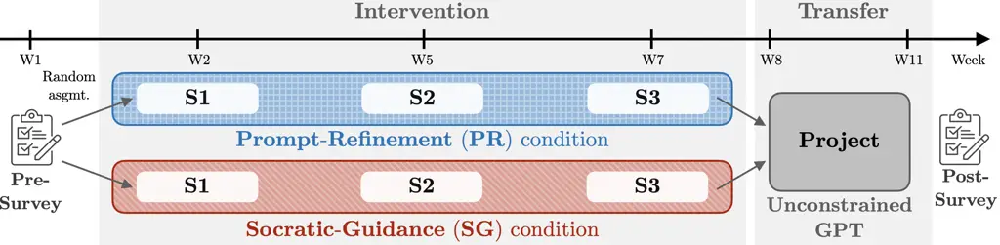
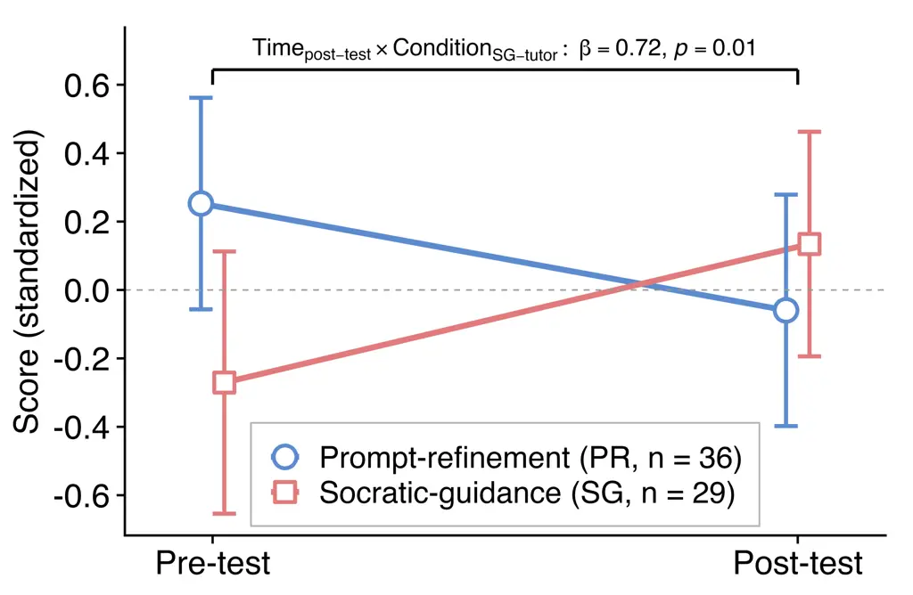
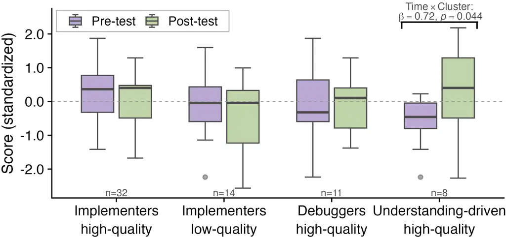

# Reflective Dialogue or Prompt Refinement? Effects of Tutor Scaffolding on Students’ Independent LLM Use for Programming Thanks: We thank our colleagues (M.B, A.B, L.C, E.C, M.D, A.S, G.D, V.D, F.E) for their support, and the students who generously volunteered to participate in the study.

Jérôme Brender

Affiliation: MOBOTS & LEARN, EPFL, Switzerland
E-mail [jerome.brender@epfl.ch, kim.uittenhove@epfl.ch,
francesco.mondada@epfl.ch](mailto:jerome.brender@epfl.ch,%20kim.uittenhove@epfl.ch,%20francesco.mondada@epfl.ch)
Affiliation: University of Teacher Education (Haute École Pédagogique)
Vaud, Switzerland E-mail [engin.bumbacher@hepl.ch,
laila.elhamamsy@hepl.ch](mailto:engin.bumbacher@hepl.ch,%20laila.elhamamsy@hepl.ch)
   Laila El-Hamamsy

Affiliation: University of Teacher Education (Haute École Pédagogique)
Vaud, Switzerland E-mail [engin.bumbacher@hepl.ch,
laila.elhamamsy@hepl.ch](mailto:engin.bumbacher@hepl.ch,%20laila.elhamamsy@hepl.ch)
   Kim Uittenhove

Affiliation: MOBOTS & LEARN, EPFL, Switzerland
E-mail [jerome.brender@epfl.ch, kim.uittenhove@epfl.ch,
francesco.mondada@epfl.ch](mailto:jerome.brender@epfl.ch,%20kim.uittenhove@epfl.ch,%20francesco.mondada@epfl.ch)
   Aitor Perez

Affiliation: Center for Digital Education & LEARN, EPFL, Switzerland
E-mail [aitor.perez@epfl.ch,
patrick.jermann@epfl.ch](mailto:aitor.perez@epfl.ch,%20patrick.jermann@epfl.ch)
   Patrick Jermann

Affiliation: Center for Digital Education & LEARN, EPFL, Switzerland
E-mail [aitor.perez@epfl.ch,
patrick.jermann@epfl.ch](mailto:aitor.perez@epfl.ch,%20patrick.jermann@epfl.ch)
   Francesco Mondada

Affiliation: MOBOTS & LEARN, EPFL, Switzerland
E-mail [jerome.brender@epfl.ch, kim.uittenhove@epfl.ch,
francesco.mondada@epfl.ch](mailto:jerome.brender@epfl.ch,%20kim.uittenhove@epfl.ch,%20francesco.mondada@epfl.ch)
   Engin Bumbacher

Affiliation: University of Teacher Education (Haute École Pédagogique)
Vaud, Switzerland E-mail [engin.bumbacher@hepl.ch,
laila.elhamamsy@hepl.ch](mailto:engin.bumbacher@hepl.ch,%20laila.elhamamsy@hepl.ch)

###### Abstract

While Large Language Models (LLMs) can provide personalized support in
learning, several studies have raised concerns regarding their use in
education. Importantly, learning depends on how students engage with
LLMs. This study examined how two types of LLM-based tutors shape
students’ prompting practices, learning, and subsequent LLM-use: a
Socratic-Guidance (SG) tutor, which structures interaction through
dialogic questioning, and a Prompt-Refinement (PR) tutor that guides the
formulation of effective prompts. We conducted a two-phase study in a
graduate-level mobile robotics course: 66 students used either the SG or
PR tutor during a 6-week intervention, followed by 52 students using an
unconstrained LLM during a 3-week course project. Results show that
while the SG- and PR tutors led to similar task performance and
prompting patterns during guided use, they differ in learning outcomes
and later LLM-use. SG-students, relative to PR-student, achieved higher
learning gains in later sessions, and were more likely to adopt
understanding-driven prompting strategies, which are predictive of
higher understanding, when using an unconstrained LLM. Although learners
perceived the SG tutor as less efficient, the findings suggest that
Socratic guidance supports the development of students’ capacity to
learn with LLMs over time, highlighting its importance for LLM tutor
design.

###### Keywords: 

Large Language ModelsComputing
EducationBehaviorsPerformanceLearningEffectivenessTutor

## 1 Introduction

With the rise of Large Language Models (LLMs), a growing body of work
has examined applications of LLM-based tools in education, including
curriculum development, automated assessment and feedback, and tools
that provide personalized support during learning activities \[14, 24\].
At the same time, researchers have argued that educational benefits are
not inherent to such LLM-based systems but depend on their pedagogical
design and integration, and have warned of substantial risks when these
conditions are not met \[14\].

### 1.1 Cognitive and metacognitive risks of LLM use in learning

One central risk associated with students’ use of LLM-based systems is
the conflation of improved task performance with learning. While studies
have found that students who use such systems to solve problems often
achieve higher performance, these gains are neither indicative of
students’ ability to perform without the tool¹¹ 1 Studies have found
that when access to LLMs is removed, students’ performance declines
significantly, and even “perform worse than those who never had access”
\[2\] nor of improved learning outcomes²² 2 Studies have found weak or
no correlation between performance during LLM-use and subsequent
learning \[3, 9\].

This disconnect between performance and learning can be partly explained
through research on cognition and metacognition. Several studies have
raised concerns that students’ use of LLMs may foster metacognitive
laziness \[23, 6, 9\]. As LLMs become more capable, students may
increasingly rely on these systems in ways that reduce their active
cognitive and metacognitive engagement \[34\]. Evidence for such effects
is provided by a recent EEG study in the context of a writing task
\[16\]: LLM-supported participants achieved higher task performance, but
the authors report a resulting “cognitive debt”, reflected in reduced
critical evaluation of LLM outputs and impaired long-term semantic
retention.

Importantly, these risks are not inherent to LLM-based systems but
depend on how interaction with them is structured in learning contexts.
Prior work shows that students adopt diverse LLM-use patterns, which are
associated with different performance and learning outcomes \[3\]. For
example, learning benefits are more likely when students engage LLMs
through conceptual questioning \[3\] or use prompts that foreground
understanding rather than solution generation, such as prompts focused
on reasoning about code \[4\].

### 1.2 Improving the effectiveness of LLMs for learning

Thus, if the goal is to support productive LLM use beyond instructional
settings, then the central design challenge is how to help students
develop productive ways of engaging with LLMs that persist beyond
instruction. Prior work has pursued two broad approaches toward this
end.

#### Socratic scaffolding for reflective LLM use.

One approach to supporting student learning with AI-based systems has
been to constrain assistance to explanations \[21\], hints \[31\], or
course-aligned guidance \[21, 17\] rather than providing direct answers,
thus encouraging students to actively construct solutions. A prominent
version of this design principle is Socratic questioning \[5\], which
relies on question-driven dialogue to promote reflective cognitive
processes \[22\].

When implemented in LLM-based tutors, Socratic scaffolding has been
shown to support deeper reasoning and understanding \[10, 25, 11\],
though effects are not uniform across students, which highlights the
need to combine this approach with other instructional strategies
\[12\]. Related work further underscores the importance of design
choices: One study found that access to an unguarded generative AI
interface can improve short-term performance, but it may lead to worse
subsequent performance once access is removed, an effect that in turn is
mitigated when pedagogical safeguards are in place \[2\].

These findings highlight the need to examine whether system-side
scaffolding strategies, such as Socratic questioning, also support
students in developing productive LLM use beyond structured instruction.

#### Teaching prompting for productive LLM use.

In contrast to Socratic scaffolding, which structures how the LLM
responds to students, a second approach seeks to shape how students
engage with LLMs. This line of work focuses on teaching students how to
formulate prompts and interact with LLMs in ways that support productive
use beyond instructional settings \[19\].

One strand of work has explored structuring chatbot interfaces to guide
prompt formulation \[4\]. While this approach has been found to improve
prompting behaviors in the moment, these effects did not persist after
removing constraints. Also, students resisted restrictive interfaces,
despite recognizing potential benefits, and may actively bypass
constraints to obtain full responses \[4, 13\].

A second strand focuses on teaching prompting strategies through
guidelines or instruction. LLM output quality depends strongly on users’
inputs \[1\], yet effective prompting remains challenging, particularly
for learners with limited domain expertise \[33\]. In response, numerous
prompting guidelines have been proposed \[7, 20, 27\]; however, many
lack empirical validation and rarely examine whether learned strategies
transfer to unconstrained LLM use \[32, 4\].

Research needs to examine whether such learner-side strategies support
productive LLM use without fostering over-reliance or superficial
adoption.

### 1.3 Present Work

These strands of work raise complementary questions about whether
productive LLM use is better supported by structuring how systems
respond to students or by teaching students how to engage with LLMs
themselves. The present study addresses this question by directly
comparing two contrasting design approaches for supporting students’
interaction with LLMs: (1) a Prompt-Refinement (PR) tutor that supports
students in formulating prompts conducive to learning, and (2) a
Socratic-Guidance (SG) tutor, which represents a state-of-the-art system
that structures the system responses to support student reflection.
Building on the literature reviewed above, we address the following
research questions (RQs):

- (RQ1)
  How do the SG and PR tutors shape students’ prompting behaviors, task
  performance, and learning during guided lab sessions?
- (RQ2)
  How do prompting practices relate to task performance and learning?
- (RQ3)
  How do students engage with an unconstrained LLM after the
  intervention?

We investigate these research questions in a mixed-methods study
conducted in a graduate-level mobile robotics course. During a six-week
intervention phase, students were randomly assigned to either the SG- or
PR-tutor condition across all practical lab sessions. This was followed
by a three-week project phase in which all students interacted freely
with an unconstrained LLM.

## 2 System Design and AI-tutor Variants

The study employed a web-based chatbot integrated with OpenAI’s API
(GPT-5) to provide real-time assistance to students. The system is built
on a Retrieval-Augmented Generation (RAG) architecture using all course
materials, including lecture slides, forum Q&A archives, exercises, and
solutions. Rather than generating responses in a single step, each
student prompt is processed through a multi-step, agentic workflow that
enables control over retrieval, response generation, and the timing of
pedagogical constraints. Using this architecture, we implemented two AI
tutor variants that differ in how interaction is structured.

#### The Prompt-Refinement (PR) tutor.

This tutor was designed to support students in crafting high-quality
prompts by requiring prompt refinement before any assistance is provided
\[18\]. For each incoming prompt, the system evaluates prompt quality
along two dimensions identified in prior works \[8, 4\]: (1) _Clarity
and specificity_, i.e., whether the prompt provides sufficient context,
constraints, and expected outputs; and (2) _Learning intent and
reasoning_, i.e., whether it articulates the student’s understanding or
poses a focused conceptual question rather than requesting a solution.
If a prompt is insufficient on either dimension, the PR tutor interrupts
the interaction and provides brief rubric-based feedback along with two
alternative prompt suggestions. Students may select one of these or
revise their original prompt. Only once the revised prompt meets the
minimum criteria does the system generate a response.

#### The Socratic-Guidance (SG) tutor.

This tutor was designed to scaffold learning by shaping how the system
responds to student queries. Rather than providing direct solutions, the
tutor generates open-ended, reflective questions that prompt students to
clarify their understanding and advance their reasoning toward a
solution \[15, 30, 10\]. This questioning stance is maintained
throughout the interaction, in line with established guidelines for
educational AI use \[28\].

## 3 Methodology

### 3.1 Study Context and Design

The study (see Fig. 1) was conducted in a graduate-level mobile robotics
course at EPFL³³ 3 The study was approved by EPFL’s Ethics
Committee(HREC000658/15.07.2025) and followed a mixed-methods,
between-subjects design.

Figure 1: Overview of the study design.

### 3.2 Study Procedure

As shown in Figure 1, students started with a perception survey (see
Section 3.4) and were then randomly assigned to one of the two AI tutor
conditions. The intervention consisted of three lab sessions (S1–S3),
during which students interacted with the assigned tutor while working
on programming tasks.

Each lab session followed the same structure: a content-related
pre-test, a 75-minute hands-on programming phase during which students
could use the chatbot for assistance, and a content-related post-test.
Prompt logs and submitted code were collected during the programming
phase.

Following the three lab sessions, students worked in teams of four on a
course project over a three-week period. During this project phase,
students could optionally interact with an unconstrained version of the
course chatbot, using the same RAG system architecture but without the
tutoring scaffolds described in Section 2. At the end of the course,
students completed a post-survey assessing their perceptions and use of
LLMs.

### 3.3 Participants

Participants were recruited from the course cohort. This study focuses
on session 3 and the course project. Of the 172 enrolled students, 66
participated in the lab session 3 ($`n_{male}=47`$, $`n_{female}=15`$,
$`n_{undisclosed}=4`$). Then, 52 students volunteered to use the
unconstrained course chatbot (RAG without scaffolds) during the course
project ($`n_{male}=33`$, $`n_{female}=15`$, $`n_{undisclosed}=4`$).
Participation was voluntary, based on informed consent, and financially
compensated.

### 3.4 Data Collection and Coding

#### The pre- and post-surveys (perception)

comprised multiple instruments. This paper focuses on analyses of
programming experience, perceptions of LLMs \[29\], and self-reported
LLM usage.⁴⁴ 4 The complete survey is accessible
[here](https://doi.org/10.5281/zenodo.19260026).

#### The lab session pre-tests (learning)

evaluated two components: (i) algorithmic explanation (3 pts) and (ii)
procedural sequencing of the algorithm targeting key theoretical
concepts from the lab (3 pts). Open-ended responses were anonymized and
graded by two Teaching Assistants (TAs). Inter-rater reliability (IRR)
reached substantial levels across the full dataset (Fleiss’
$`\kappa_{S1}=0.79`$, $`\kappa_{S2}=0.70`$, $`\kappa_{S3}=0.77`$). We
verified that students in both conditions had similar prior knowledge
(S1: $`U=327.5,p=.18,M=44.7\pm 18.0\%`$; S2:
$`U=369,p=.54,M=61.5\pm 21.3\%`$; S3:
$`U=380,p=0.06,M=54.5\pm 24.5\%`$), we observed a marginal trend toward
a lower score for S3, which is further discussed in the result section.

#### The lab session post-tests (learning)

consisted of multiple-choice questions targeting the same concepts as
the pre-test (S1: 5 items; S2: 8 items; S3: 5 items). In addition,
students completed a procedural sequencing task similar to the pre-test.
Each MCQ was one point, with an additional 25% weighting applied to the
sequencing task. Scores were summed and standardized to compute an
overall post-test score per session ($`M_{S1}=44.4\pm 18.6\%`$,
$`M_{S2}=45.5\pm 32.2\%`$, $`M_{S3}=64.9\pm 16.8\%`$).

#### The project understanding scores (learning)

were assigned to each group of 4 students by two experts based on a
45-minute oral exam assessing the students’ understanding of the
underlying course theory used in the project.

#### The practice lab scores (task performance)

were evaluated based on the practice lab tasks. Each task was graded as
0 for incomplete, 0.5 for over 70% correct, and 1 for fully correct. To
assess IRR, 20% of the submissions were graded by three TAs, yielding
substantial agreement (Fleiss’ $`\kappa_{S1}\in[0.72,0.81]`$;
$`\kappa_{S2}\in[0.67,0.78]`$; $`\kappa_{S3}\in[0.70,0.78]`$). The
remaining submissions were then distributed and graded individually. The
total performance score was computed as the standardized sum of
individual task scores.

#### The chatbot interactions and prompt coding (prompting)

comprised all student–chatbot interactions collected during the final
lab session (S3) and the project phase, totaling 599 student prompts
from S3 and 1120 student prompts from the project
($`M_{S3}=9.1\pm 5.8`$; $`M_{project}=21.5\pm 27.1`$ prompts per
student). Prompts unrelated to task completion were excluded.

To characterize students’ engagement with the chatbot systems, prompts
were coded along two dimensions based on prior work \[3, 4\]:

1.  1.  Prompt type (role of the prompt): comprises implementation (code
        generation or complete solutions), debugging (error identification
        or resolution), and conceptual (code comprehension or underlying
        computing concepts).
2.  2.  Prompt quality (how requests were formulated): understanding
        (explicit explanations requests), granularity (use of specific
        contextual details like variables or specific code), and clarity
        (well-specified/unambiguous instructions).

Three Teaching Assistants (TAs) independently annotated 20% of the
prompts, achieving substantial agreement (Fleiss’
$`\kappa_{\text{prompt-type}}=.72`$;
$`\kappa_{\text{prompt-quality}}\in[0.62,0.80]`$), before coding the
remaining data individually. Prompt-level codes were aggregated at the
student and group levels for subsequent analyses.

Finally, two TAs collaboratively annotated student-authored portions of
each prompt to identify copy-pasted segments. These annotations were
used to compute the proportion of personally written text per prompt.

### 3.5 Data Analysis

For the scope of this paper, analyses of process data focus on data from
the third lab session (S3) and the course project, which together
capture students’ behavior after sustained exposure to the tutor and
during subsequent unconstrained LLM use.

#### Prompting patterns during and after intervention.

Given the multi-dimensional nature of the prompt type and quality
metrics, we conducted separate cluster analyses on data from S3 and the
project to identify recurring prompting patterns. Clustering captured
students’ relative use of different prompt dimensions when using the
chatbots. We iteratively evaluated different feature combinations and
clustered students following the procedure described in \[26\].

First, for each feature, students were split into high- and low-use
groups based on pairwise Euclidean distances between students, which
were then converted into similarity matrices using a Gaussian kernel
($`\sigma=0.0001`$). Second, spectral clustering was applied to
different feature combinations, with the optimal number of clusters
selected using the Silhouette score. Third, clusters were labeled based
on the prevalence of high- versus low-use students for each feature.

Finally, the feature combination that maximized the Silhouette score was
selected. In particular, aggregating conceptual and understanding
prompts using a union-based (OR) aggregation into a single dimension for
Understanding, and aggregating clarity and granularity into a single
dimension for prompt Quality, consistently improved cluster cohesion and
separation. The final feature representation thus comprised four
dimensions: three prompt-type dimensions (Implementing, Debugging, and
Understanding) and one prompt Quality dimension.

This clustering procedure resulted in four prompting pattern types in S3
(average silhouette score $`s=0.74`$) and three in the project phase
($`s=0.64`$).

#### Task performance and learning during intervention.

To examine in-session task performance and learning outcomes, we used
linear mixed-effects models for practice lab scores and post-test
results. Post-test scores were analyzed using a repeated-measures
design, with students modeled as a random effect. Task performance was
analyzed using mixed-effects models with pre-test scores as a covariate.
All continuous variables were standardized, allowing regression
coefficients ($`\beta`$) to be interpreted as effect sizes. Model
assumptions were evaluated by inspecting residuals, with Shapiro-Wilk
tests used to assess normality.

#### Post-intervention project understanding score.

Project understanding was assessed at the group level for 30 project
groups, as scores were assigned based on a group oral examination rather
than individual performance. Groups varied in their composition of
intervention students (SG or PR) and non-inter-vention students, and
only a subset of intervention students used the chatbot, resulting in
partial observability of prompting patterns at the group level.

To account for this partial trace coverage, we fitted a linear
regression model predicting the non-standardized group-level
understanding score from (a) the total number of intervention students,
(b) the number of intervention students without chatbot use, and (c) the
number of students assigned to each intervention condition or
prompting-pattern cluster.

## 4 Results

### 4.1 Effect of the intervention on prompt type and prompt quality

As described in Section 3.5, the cluster analysis of S3 data across
conditions identified four distinct prompting patterns. Based on their
high–low distribution of prompt types and prompt quality, these were
labeled as (i) Implementers with low-quality prompts ($`n=14`$), (ii)
Debuggers with high-quality prompts ($`n=11`$), (iii)
Understanding-driven prompters with high-quality prompts ($`n=8`$), and
(iv) Implementers with high-quality prompts ($`n=33`$).

A $`\chi^{2}`$ test examining the distribution of students across
prompting-pattern clusters by intervention condition revealed no
significant differences between the SG- and PR-tutor conditions
($`\chi^{2}=1.12`$, $`p=0.77`$). This suggests that in the third lab
session, the type and quality of prompting patterns enacted by students
did not differ as a function of tutor condition.

### 4.2 Effect of the intervention on task performance and learning

We examined the impact of the SG- and PR-tutors on students’ task
performance during the lab sessions and on learning outcomes measured by
pre-post tests across sessions. To ensure comparability across sessions,
all analyses were restricted to the 66 students who attended session S3.

##### Task performance:

For each session, we fitted regression models with task performance as
the dependent variable and condition and pre-test scores as predictors.
Results showed no significant effect of condition on task performance in
sessions S2 and S3 (no significant main or interaction effects). In
contrast, in session S1, students in the SG condition exhibited
significantly lower task performance than those in the PR condition
(main effect of SG condition: $`\beta_{S1}=-0.8`$, $`p=0.001`$).

This initial task performance decrement suggests that students required
time to familiarize themselves with the SG-tutor, highlighting the
importance of repeated exposure to support effective use of the system.

Figure 2: Learning outcomes for S3: Mean standardized scores by
condition and time (pre–post). Error bars represent 95% confidence
intervals. Only the significant interaction from repeated-measures
mixed-effects model is indicated.

##### Learning outcomes:

Learning outcomes were analyzed using repeated-measures mixed-effects
models for each session, with test score as the dependent variable and
the main effects as well as the interaction between condition and time
(pre-post) as the predictors. Results indicated no significant effects
(main and interaction) of condition in sessions S1 and S2.

In session S3, however, a significant interaction between time and
condition was observed (Table 1). While students in the SG condition had
significantly lower pre-test scores (main effect of condition:
$`\beta=-0.52`$, $`p=0.02`$), they showed significantly greater gains
from pre- to post-test than students in the PR condition (interaction
effect: $`\beta=0.72`$, $`p=0.01`$), see Figure 2.

|                                                                                                                                           |           |               |      |
| ----------------------------------------------------------------------------------------------------------------------------------------- | --------- | ------------- | ---- |
| Predictors                                                                                                                                | Estimates | CI (95%)      | p    |
| (Intercept)                                                                                                                               | 0.25      | -0.06 – 0.56  | 0.11 |
| Time \[post-test\]                                                                                                                        | -0.31     | -0.70 – 0.07  | 0.11 |
| Condition \[SG-tutor\]                                                                                                                    | -0.52^(∗) | -0.98 – -0.07 | 0.02 |
| Time \[post-test\] : Condition \[SG-tutor\]                                                                                               | 0.72^(∗)  | 0.14 – 1.30   | 0.01 |
| Observations (students): 130 (65)   $`R^{2}_{\mathrm{marginal}}`$ / $`R^{2}_{\mathrm{conditional}}`$: 0.041 / 0.230  $`{}^{*}p\leq 0.05`$ |           |               |      |

Table 1: Repeated-measures mixed-effects model of test scores by Time
(pre–post), Condition (SG vs. PR), and their interaction. Estimates are
standardized coefficients ($`\beta`$). Reference levels: Time =
pre-test; Condition = PR-tutor.

In summary, these results indicate that while students using the
SG-tutor initially experienced lower task performance, sustained use of
the SG-tutor was associated with superior learning gains by session S3,
without differences in task performance relative to the PR condition.

### 4.3 Impact of prompt quality on task performance and learning

To examine the relation of specific prompting patterns with task
performance or learning, we analyzed the relationship between the
prompting-pattern clusters in session S3 (Section 4.1) and students’
task performance and learning outcomes.

Figure 3: Learning outcomes in S3 by prompting-pattern cluster. Only the
significant cluster is indicated, showing a significant interaction with
time in repeated-measures mixed-effects model and greater learning
relative to the grand mean across clusters (sum contrasts).

##### Task performance:

A Kruskal–Wallis test, complemented by regression analyses, revealed no
significant differences in task performance between prompting-pattern
clusters. Thus, there were comparable task-level outcomes across
different ways of interacting with the LLM.

##### Learning outcomes:

In contrast, learning outcomes differed across prompting patterns. A
repeated-measures mixed-effects regression predicting test scores from
time (pre-post), prompting-pattern cluster, and their interaction
revealed a significant interaction for the Understanding-driven
prompters with high-quality prompts cluster (Table 2). Students in this
cluster showed significantly greater learning gains than the grand mean
across clusters ($`\beta=0.72`$, $`p=0.044`$), see Figure 3. No other
cluster showed a significant interaction with time, indicating that
learning outcomes were associated with understanding-oriented prompting
rather than with prompt quality or implementation-focused prompting
alone. These results align with findings from prior studies \[4\].

|                                                                                                                                         |           |              |       |
| --------------------------------------------------------------------------------------------------------------------------------------- | --------- | ------------ | ----- |
| Predictors                                                                                                                              | Estimates | CI (95%)     | $`p`$ |
| (Intercept)                                                                                                                             | -0.16     | -0.43 – 0.10 | 0.235 |
| Time \[post-test\]                                                                                                                      | 0.12      | -0.22 – 0.47 | 0.484 |
| Implementers with low-quality                                                                                                           | 0.03      | -0.42 – 0.47 | 0.907 |
| Debuggers with high-quality                                                                                                             | 0.02      | -0.47 – 0.50 | 0.952 |
| Understanding-driven prompters with high-quality                                                                                        | -0.47     | -1.01 – 0.07 | 0.089 |
| Time \[post-test\] : Implement. with low-quality                                                                                        | -0.48     | -1.05 – 0.10 | 0.105 |
| Time \[post-test\] : Debuggers with high-quality                                                                                        | -0.03     | -0.66 – 0.59 | 0.915 |
| Time \[post-test\] : Understand.-driven with high-quality                                                                               | 0.72^(∗)  | 0.02 – 1.42  | 0.044 |
| Observations (students): 130 (65) $`R^{2}_{\mathrm{marginal}}`$ / $`R^{2}_{\mathrm{conditional}}`$: 0.083 / 0.222  $`{}^{*}p\leq 0.05`$ |           |              |       |

Table 2: Mixed effects repeated-measures regression of test scores by
Time (pre–post) and Clusters, with students as a random effect. The
individual clusters’ effects are compared to the grand mean of all
clusters using the sum of contrasts. Reference levels: Time = pre-test;
Estimates are standardized coefficients ($`\beta`$).

### 4.4 Post-intervention effects

After finding that students using the SG-tutor achieved greater learning
gains during the intervention while showing comparable task performance,
we next examined whether these differences extended to students’ use of
an unconstrained LLM in the course project.

#### Prompting patterns in the project.

Using prompt data from the course project, during which all students
interacted with an unconstrained version of the LLM, we examined whether
prompting patterns differed by intervention condition. A cluster
analysis of project prompts (Section 3.5) identified three prompting
patterns, labeled based on the high-low distribution of prompt types and
quality: (i) Implementers with high-quality prompts ($`n=25`$), (ii)
Understanding-driven prompters with high-quality prompts ($`n=17`$), and
(iii) Debuggers with low-quality prompts ($`n=10`$).

Unlike in session S3, the distribution of students across clusters
differed significantly by condition ($`\chi^{2}=8.14`$, $`p=0.017`$).
While the number of Implementers was similar across conditions
($`n_{SG}=14`$, $`n_{PR}=11`$), students from the SG condition were more
likely to enact Understanding-driven prompting patterns ($`n_{SG}=13`$,
$`n_{PR}=4`$), whereas students from the PR condition were more likely
to enact Debugger patterns ($`n_{PR}=8`$, $`n_{SG}=2`$).

These results suggest that participation in the SG condition was
associated with the adoption of prompting practices oriented toward
conceptual understanding that transferred to an unconstrained LLM-use
context.

#### Prompting patterns and project understanding.

Models examining the link between condition and project understanding
score showed that groups with a higher number of students who used the
unconstrained course chatbot in the project tended to achieve higher
understanding grades, regardless of condition.

However, analyses of the relation of prompting patterns with group-level
project understanding revealed significant differences. Specifically,
application of the regression model on group-level project understanding
scores, as explained in section 3.5, showed that neither the total
number of intervention students in a group nor the number of
intervention students without chatbot use was significantly related to
group understanding.

In contrast, prompting patterns were predictive of project
understanding. Groups with a higher number of Understanding-driven
prompters achieved significantly higher understanding grades than groups
with more Debuggers ($`\beta=1.30`$, $`p=0.025`$), whereas the
difference between Implementers and Debuggers was not significant
($`\beta=0.76`$, $`p=0.19`$). Overall, the model explained 33% of the
variance in group-level understanding (adjusted $`R^{2}=0.22`$).

This analysis suggests that the association between the SG condition and
higher project understanding operates through the prompting practices
students enact during unconstrained LLM use, rather than through
participation in the intervention alone.

### 4.5 Students’ perception of the different tutors

Despite the positive effects associated with the SG-tutor, students in
the PR condition reported more favorable perceptions of their tutor than
students in the SG condition, with respect to perceived effectiveness
for solving the task (Kruskal-Wallis $`H=482`$,
$`p_{\text{corrected}}=0.09`$, $`d=0.5`$), learning ($`H=449`$,
$`p_{\text{corr}}=0.045`$, $`d=0.5`$), and writing useful prompts
($`H=440`$, $`p_{\text{corr}}=0.045`$, $`d=0.6`$).

This difference may reflect more passive interaction in the PR
condition: in session S3, 17 of 35 tutor-suggested prompt refinements
were directly copy–pasted rather than revised.

These findings point to a trade-off between perceived usability and
learning effectiveness, consistent with prior work showing that
directive support can feel helpful while fostering shallower engagement
\[4\].

## 5 Discussion and Conclusion

This study examined how different forms of AI-tutor support shape
students’ engagement with large language models (LLMs), and how these
engagement patterns relate to task performance and learning during
guided activities and beyond. We compared a Socratic-Guidance tutor that
prompts reflective questioning with a Prompt-Refinement tutor that
targets prompt formulation. Across the three research questions, the
results indicate that tutor effects emerged over time, rather than
through immediate differences in behavior or performance.

### 5.1 AI-tutor-supported engagement during the intervention

#### Prompting behaviors, task performance, and learning during guided use (RQ1).

Analyses of prompting patterns during the guided lab sessions revealed
no differences between conditions in terms of prompt type or prompt
quality; at the level of observable prompting behaviors, students in
both conditions engaged with the LLM in comparable ways. In contrast,
analyses of task performance (based on practice lab scores) and learning
outcomes (based on pre-post tests) revealed a temporally evolving
pattern. Students in the SG condition initially showed lower task
performance but similar learning gains relative to students in the PR
condition. By the final session, students in the SG condition performed
comparably while achieving higher learning gains. Socratic questioning
requires learners to articulate reasoning and reflect on conceptual
relations \[5\], which may initially reduce efficiency but supports
progressively more productive engagement with the SG tutor’s reflective
interaction style.

Perception data further highlight this distinction. Despite stronger
learning outcomes, students in the SG condition rated their tutor less
favorably than students in the PR condition. These ratings may primarily
reflect perceived ease of use, as the PR tutor afforded interaction
patterns that made prompt reuse straightforward (e.g., direct
copy–pasting of suggested refinements), reducing user effort and
encouraging more passive engagement. From a learning-sciences
perspective, this misalignment aligns with concerns about metacognitive
offloading and overdependence, whereby supports that reduce
interactional effort may feel efficient while fostering shallower
engagement \[2\].

#### Prompting strategies and learning outcomes (RQ2).

Prior work shows that how students engage with LLMs matters for learning
beyond task completion, particularly when interaction emphasizes
conceptual explanation and sense-making rather than immediate solution
generation \[3, 4\]. Replicating this pattern, our results show that
prompting patterns were unrelated to task performance but systematically
associated with learning gains: students classified as
Understanding-driven prompters using high-quality prompts achieved
significantly greater learning gains than students with other prompting
patterns.

At the same time, a key tension emerges across RQ1 and RQ2. Although
learning-relevant prompting patterns were clearly associated with
improved learning, neither tutor led to greater adoption of such
patterns during guided use, suggesting that inducing learning-conducive
prompting strategies may require stronger or differently calibrated
forms of guidance than those explored here.

### 5.2 Transfer of the AI-tutor’s impact post-intervention (RQ3)

RQ3 examined whether the AI tutors influenced students’ later
interaction with an unconstrained LLM during the course project,
indicating more durable engagement. First, the learning-relevant
prompting pattern identified in RQ2 remained associated with higher
group-level understanding beyond guided use.

Second, prompting patterns during the project differed by prior tutor
condition. Students who had interacted with the SG tutor were more
likely to enact _understanding-driven prompting with high-quality
prompts_, whereas students from the PR condition were more likely to
rely on _debugger-type prompting with lower-quality prompts_. Notably,
these differences were not observed during the guided sessions, but
emerged only in the unconstrained setting.

These findings resolve the tension identified in RQ1 and RQ2. While
neither tutor produced immediate differences in prompting behavior
during guided use, the SG tutor was associated with how students later
engaged with LLMs once guidance was removed, suggesting a role of
Socratic guidance that lies less in shaping prompts in the moment than
in influencing how students develop approaches to problem solving and
LLM use over time.

### 5.3 Limitations

This study involved a relatively small, domain-specific sample of
graduate students, which limits generalizability. Participants
self-selected into the study; however, comparisons were conducted
between intervention conditions. Although we accounted for chatbot use
and partial trace observability, unobserved differences in motivation or
learning orientation may still have influenced prompting behavior and
outcomes. The observed effects may depend on how the Socratic and
prompt-refinement tutors were calibrated; different prompt designs or
levels of guidance may lead to different interaction patterns and
learning outcomes. Future studies with larger and more diverse
populations are needed to validate these findings and to support
stronger causal inferences.

### 5.4 Conclusion and future work

This study highlights the importance of designing AI tutors that support
students in learning how to learn with unconstrained LLMs, further
confirming that learning outcomes depend less on immediate task
performance or prompt efficiency than on understanding-oriented
engagement.

A key contribution of this work is to show that differences between
tutor designs emerge over time, rather than during guided interaction
itself. While immediate prompting behavior did not differ, prior
exposure to Socratic guidance was associated with more
understanding-oriented engagement and higher understanding once students
worked with LLMs independently, suggesting a developmental influence on
how students learn to engage with these systems.

From a design perspective, the contrast between the two approaches is
instructive. The SG tutor intervened by shaping how the LLM responds
through questioning and reflection, whereas the PR tutor focused on
improving the form of students’ prompts, such as clarity or granularity.
The findings suggest that response-level, pedagogically oriented
guidance may be more likely to influence how students later write
prompts and engage with LLMs in unconstrained contexts than approaches
centered on prompt efficiency alone. At the same time, these conclusions
remain tentative, and further work is needed to explore alternative ways
of fostering durable, learning-relevant engagement with LLMs.

## References

- \[1\] R. Appel, M. Massenkoff, P. McCrory, M. McCain, R. Heller, T.
  Neylon, and A. Tamkin (2026)Anthropic economic index report: economic
  primitives(Website) Cited by: §1.2.
- \[2\] H. Bastani, O. Bastani, A. Sungu, H. Ge, Ö. Kabakcı, and R.
  Mariman (2024) Generative ai can harm learning. The Wharton School
  Research Paper. Cited by: §1.2, §5.1, footnote 1.
- \[3\] J. Brender, L. El-Hamamsy, F. Mondada, and E. Bumbacher (2024)
  Who’s helping who? when students use chatgpt to engage in practice lab
  sessions. In International Conference on Artificial Intelligence in
  Education, pp. 235–249. Cited by: §1.1, §3.4, §5.1, footnote 2.
- \[4\] J. Brender, L. El-Hamamsy, K. Uittenhove, F. Mondada, and E.
  Bumbacher (2025) Structured prompts, better outcomes? exploring the
  effects of a structured interface with chatgpt in a graduate robotics
  course. In European Conference on Technology Enhanced Learning,
  pp. 91–106. Cited by: §1.1, §1.2, §1.2, §2, §3.4, §4.3, §4.5, §5.1.
- \[5\] S. Chen, I. R. Molnar, P. Li, A. Acunin, T. Hua, A.
  Ambrose, N. V. Chawla, and R. Metoyer (2025) Exploring Conversational
  Design Choices in LLMs for Pedagogical Purposes: Socratic and
  Narrative Approaches for Improving Instructor’s Teaching Practice.
  arXiv. Cited by: §1.2, §5.1.
- \[6\] I. Delikoura, Yi. R. Fung, and P. Hui (2025) From Superficial
  Outputs to Superficial Learning: Risks of Large Language Models in
  Education. arXiv. Cited by: §1.1.
- \[7\] P. Denny, J. Leinonen, J. Prather, A. Luxton-Reilly, T.
  Amarouche, B. A. Becker, and B. N. Reeves (2024) Prompt problems: a
  new programming exercise for the generative ai era. In Proceedings of
  the 55th ACM Technical Symposium on Computer Science Education V. 1,
  SIGCSE 2024, pp. 296–302. External Links: ISBN 9798400704239 Cited by:
  §1.2.
- \[8\] S. Ekin (2023) Prompt engineering for chatgpt: a quick guide to
  techniques, tips, and best practices. Authorea Preprints. Cited by:
  §2.
- \[9\] Y. Fan, L. Tang, H. Le, K. Shen, S. Tan, Y. Zhao, Y. Shen, X.
  Li, and D. Gašević (2025) Beware of metacognitive laziness: effects of
  generative artificial intelligence on learning motivation, processes,
  and performance. BJET 56 (2), pp. 489–530. Cited by: §1.1, footnote 2.
- \[10\] L. Favero, J. A. Pérez-Ortiz, T. Käser, and N. Oliver (2024)
  Enhancing critical thinking in education by means of a socratic
  chatbot. arXiv preprint arXiv:2409.05511. Cited by: §1.2, §2.
- \[11\] H. Goyal, R. Gupta, S. Sharma, K. Mittal, A. Mehra, J. Sesh,
  and D. Kumar (2025) Sakshm ai: advancing ai-assisted coding education
  for engineering students in india through socratic tutoring and
  comprehensive feedback. ACM Journal on Computing and Sustainable
  Societies. Cited by: §1.2.
- \[12\] P. Kampylis (2026) The timeless art of questioning: when
  socratic inquiry meets generative ai. Teaching and Learning in the
  Generative Artificial Intelligence Age, pp. 1. Cited by: §1.2.
- \[13\] A. Kapoor, P. Denny, L. Porter, S. MacNeil, and M. Diaz (2026)
  Exploring student behaviors and motivations when using ai teaching
  assistants with optional guardrails. In Proceedings of the 28th
  Australasian Computing Education Conference, ACE ’26, New York, NY,
  USA, pp. 22–31. External Links: ISBN 9798400723520 Cited by: §1.2.
- \[14\] E. Kasneci, K. Sessler, S. Küchemann, M. Bannert, D.
  Dementieva, F. Fischer, U. Gasser, G. Groh, S. Günnemann, E.
  Hüllermeier, S. Krusche, G. Kutyniok, T. Michaeli, C. Nerdel, J.
  Pfeffer, O. Poquet, M. Sailer, A. Schmidt, T. Seidel, M. Stadler, J.
  Weller, J. Kuhn, and G. Kasneci (2023) ChatGPT for good? On
  opportunities and challenges of large language models for education.
  Learning and Individual Differences 103 (en). Cited by: §1.
- \[15\] G. Kestin, K. Miller, A. Klales, T. Milbourne, and G.
  Ponti (2025) AI tutoring outperforms in-class active learning: an rct
  introducing a novel research-based design in an authentic educational
  setting. Scientific Reports 15 (1), pp. 17458. Cited by: §2.
- \[16\] N. Kosmyna, E. Hauptmann, Y. T. Yuan, J. Situ, X. Liao, A. V.
  Beresnitzky, I. Braunstein, and P. Maes (2025) Your brain on chatgpt:
  accumulation of cognitive debt when using an ai assistant for essay
  writing task. arXiv:2506.08872 4. Cited by: §1.1.
- \[17\] R. Liu, C. Zenke, C. Liu, A. Holmes, P. Thornton, and D. J.
  Malan (2024) Teaching cs50 with ai: leveraging generative artificial
  intelligence in computer science education. In Proceedings of the 55th
  ACM technical symposium on computer science education V. 1,
  pp. 750–756. Cited by: §1.2.
- \[18\] L. S. Lo (2023) The clear path: a framework for enhancing
  information literacy through prompt engineering. The Journal of
  Academic Librarianship 49 (4), pp. 102720. Cited by: §2.
- \[19\] E. Mollick and L. Mollick (2023) Assigning AI: Seven Approaches
  for Students, with Prompts. arXiv. Cited by: §1.2.
- \[20\] E. R. Mollick and L. Mollick (2022) New modes of learning
  enabled by ai chatbots: three methods and assignments. SSRN 4300783.
  Cited by: §1.2.
- \[21\] C. W. Okonkwo and A. Ade-Ibijola (2020) Python-bot: a chatbot
  for teaching python programming.. Engineering Letters 29 (1). Cited
  by: §1.2.
- \[22\] R. Paul and L. Elder (2007) Critical thinking: the art of
  socratic questioning. Journal of developmental education 31 (1),
  pp. 36. Cited by: §1.2.
- \[23\] M. Sabqat, N. Ain, S. Iqbal, and R. Ahmed Khan (2025) Shortcut
  to Knowledge or Shortcut to Thinking? Investigating AI-Induced
  Metacognitive Laziness in Future Doctors. Annals KEMU 31 (Spl2),
  pp. 146–154. Cited by: §1.1.
- \[24\] T. Shahzad, T. Mazhar, M. U. Tariq, W. Ahmad, K. Ouahada,
  and H. Hamam (2025) A comprehensive review of large language models:
  issues and solutions in learning environments. Discov Sustain 6 (1),
  pp. 27 (en). Cited by: §1.
- \[25\] S. Shetye (2024) An evaluation of khanmigo, a generative ai
  tool, as a computer-assisted language learning app. Studies in Applied
  Linguistics and TESOL 24 (1). Cited by: §1.2.
- \[26\] E. Shved, E. Bumbacher, P. Mejia-Domenzain, M. Kapur, and T.
  Käser (2024) Teaching and measuring multidimensional inquiry skills
  using interactive simulations. In International Conference on
  Artificial Intelligence in Education, pp. 482–496. Cited by: §3.5.
- \[27\] C. Stokel-Walker and R. Van Noorden (2023) What chatgpt and
  generative ai mean for science. Nature 614 (7947), pp. 214–216. Cited
  by: §1.2.
- \[28\] (2024) Teaching with AI. (en-US). External Links:
  [Link](https://openai.com/index/teaching-with-ai/) Cited by: §2.
- \[29\] T. Teo (2009) Modelling technology acceptance in education: a
  study of pre-service teachers. Computers & education 52 (2),
  pp. 302–312. Cited by: §3.4.
- \[30\] A. Vanzo, S. P. Chowdhury, and M. Sachan (2025) GPT-4 as a
  homework tutor can improve student engagement and learning outcomes.
  In Proceedings of the 63rd Annual Meeting of the Association for
  Computational Linguistics, Cited by: §2.
- \[31\] A. C. Yang, J. Lin, C. Lin, and H. Ogata (2024) Enhancing
  python learning with pytutor: efficacy of a chatgpt-based intelligent
  tutoring system in programming education. Computers and Education:
  Artificial Intelligence 7, pp. 100309. Cited by: §1.2.
- \[32\] H. Yang (2023) How i use chatgpt responsibly in my teaching.
  Nature 10. Cited by: §1.2.
- \[33\] J. D. Zamfirescu-Pereira, R. Y. Wong, B. Hartmann, and Q.
  Yang (2023) Why johnny can’t prompt: how non-ai experts try (and fail)
  to design llm prompts. In Proceedings of the 2023 CHI conference on
  human factors in computing systems, pp. 1–21. Cited by: §1.2.
- \[34\] C. Zhai, S. Wibowo, and L. D. Li (2024) The effects of
  over-reliance on ai dialogue systems on students’ cognitive abilities:
  a systematic review. Smart Learning Environments 11 (1), pp. 28. Cited
  by: §1.1.
