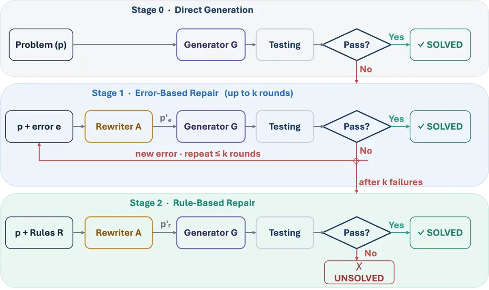
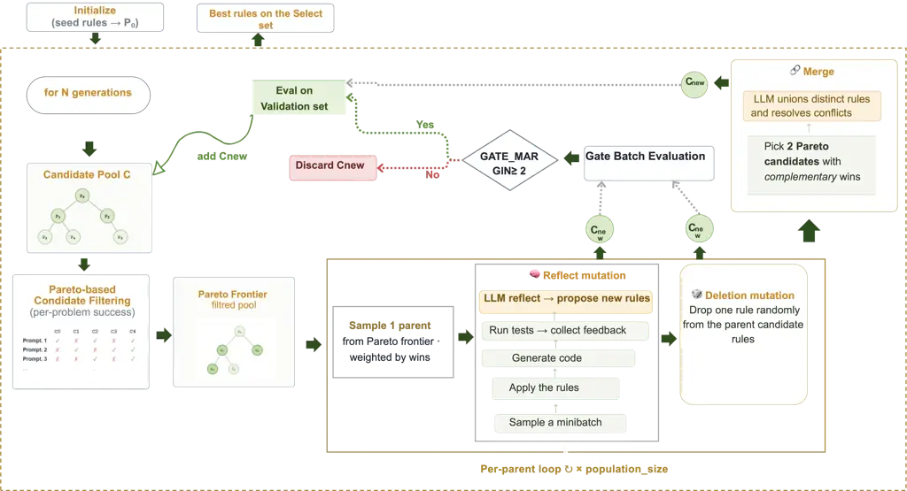
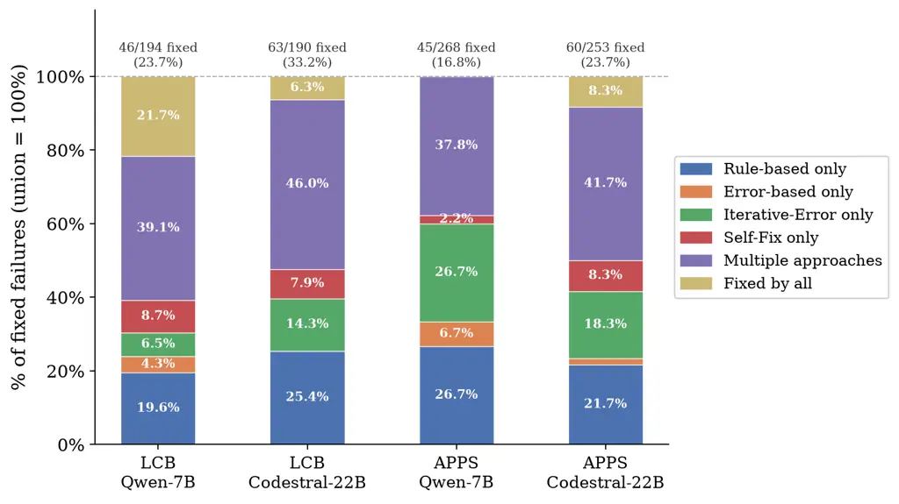
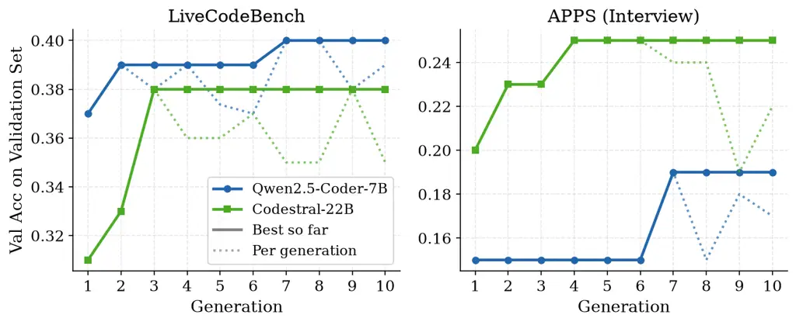

# From Failing to Passing: Evolving Natural Language Prompt Optimization Rules for LLM Code Generation

Amal Akli Affiliation: University of Luxembourg  
Luxembourg  
amal.akli@uni.lu    Melissa Akli Affiliation: University of Toulouse  
France  
melissa.akli@utoulouse.fr    Cedric Richter Affiliation: University of
Luxembourg  
Luxembourg  
cedric.richter@uni.lu Affiliation:     Mike Papadakis
Affiliation: University of Luxembourg  
Luxembourg  
michail.papadakis@uni.lu    Yves Le Traon Affiliation: University of
Luxembourg  
Luxembourg  
Yves.LeTraon@uni.lu

###### Abstract

Large language models are known to be sensitive to prompt formulation.
Even minor variations in wording can substantially degrade performance.
This sensitivity reveals an opportunity: if prompt phrasing can harm
performance, can it be used to improve it? To investigate this question,
we introduce a search-based approach that identifies and evolves a set
of natural language transformation rules with strong downstream effects
on coding performance. We then propose DualFix, a staged repair pipeline
that combines the evolved transformation rules with execution-feedback
repair, addressing both specification-level and implementation-level
failures. A key strength of our approach lies in its generality: the
evolved rules are error-agnostic, reusable across problems, and
transferable across models. We evaluate DualFix against
execution-feedback repair baselines across three models on two
challenging benchmarks, LiveCodeBench and APPS. Our results show that
the evolved transformations fix from _10-30%_ of failing cases,
including _12–17%_ of failures that execution-based repair alone cannot
resolve. Overall, DualFix recovers up to 30% of baseline failures and
fixes 3–5 times more failing cases than Self-Fix across all evaluated
settings. Furthermore, we also show that rules evolved on one model
transfer zero-shot to other models, outperforming execution-feedback
repair without any re-optimization.

###### Index Terms: 

Automatic prompt optimization, SSBSE, LLM Code Generation

## I Introduction

Large language models (LLMs) have become increasingly capable in code
generation tasks, achieving strong performance on benchmarks such as
HumanEval \[8\], APPS \[13\], and LiveCodeBench \[16\]. Despite these
advances, the generated code is often incorrect, as it may fail to fully
capture or adhere to the user’s intent \[5\]. Consequently, users must
manually test and validate the produced code to ensure that the
generated code meets its expectations. This raises an important
question: how can we effectively and efficiently repair faults in
LLM-generated code?

A key challenge in repairing LLM-generated code is that existing
approaches \[9, 29, 21\] are often ineffective at fixing errors when
relying on the original prompts and test failure signals. As a result,
users must engage in multiple iterations of ad-hoc prompt rewriting to
obtain acceptable solutions. Unfortunately, the question of automatic
repair falls short given the inability of the LLMs to extrapolate
correct implementations for challenging cases \[23\]. Indeed, our
results indicate that performing up to three repair iterations based on
the original prompts and test-execution (failure) feedback resolves just
10–19% of the failing cases.

This suggests that if we can develop generic and effective methods to
transform failing code into passing solutions without human
intervention, we could significantly mitigate the practical limitations
of automated code generation. Such approaches would enable generated
code to more reliably conform to both the intended task specification
and associated tests, thereby strengthening the effectiveness and
applicability of so-called “vibe coding.”

Existing work on prompt optimization, such as Chain-of-Thought
prompting \[33\], MIPRO \[26\], and GEPA \[1\], has primarily been
developed in the context of system-level prompting, where general
instructions are optimized to guide model reasoning across tasks. While
these approaches have proven effective, they typically require curated
examples and validation procedures, making them costly to deploy.
Moreover, they often involve evolving a dedicated system prompt for each
task, which limits scalability. Crucially, such methods operate at a
global prompt level and largely overlook the fine-grained details of
individual problem descriptions, leaving task-specific formulation
underexplored.

To improve task-specific formulations and increase the likelihood that
generated code satisfies the intended requirements, we aim to
reformulate problem descriptions in two complementary ways: (a)
rule-based rewriting - by leveraging, or deliberately avoiding,
empirically identified sensitive wording, i.e., phrasing that
significantly influences LLM behavior, and (b) error-based rewriting -
by integrating test failure signal in a coherent and natural manner by
appropriately prompting an LLM to rewrite the task description.

Both strategies aim to refine the wording and clarify the existing
information, thereby better aligning problem statements with the
inductive biases of the underlying models and improving the passing rate
of downstream code generation. We operationalize these strategies
through a staged pipeline, _DualFix_, which first applies error-based
rewriting and, when execution feedback alone is insufficient, falls back
to rule-based rewriting.

Conceptually, our approach is analogous to compiler optimization: just
as compilers transform code to improve execution efficiency, DualFix
operates at the level of natural language, optimizing task descriptions
to enhance downstream model performance. Unlike traditional compiler
optimizations, however, our transformations target the prompt itself,
aiming to reduce the likelihood of incorrect code generation by
improving how the task is communicated to the model.

To transform sensitive wording, i.e., phrasing that strongly influences
LLM code generation performance, we adopt a search-based approach \[11,
12\] that identifies and evolves natural language transformation rules.
The learned rules are derived from a set of example tasks and a target
model, yet remain error-agnostic, reusable across different problems,
and independent of any specific code generation model. As a result, once
learned, these rules can be applied without requiring additional
examples or further optimization. This enables a lightweight and
scalable mechanism for improving code generation through prompt
rewriting alone, without modifying the underlying model or relying on
costly task-specific tuning.

We empirically evaluate our approach on the APPS and LiveCodeBench
benchmarks. We compare against the current state of practice, namely,
direct code correction based on the addition of execution-failure
feedback (self-fix) \[9, 23\], as well as through ablation studies of
our two main components: (i) the natural language transformation rules
and (ii) the LLM-based integration of execution failure signals into
prompt descriptions. Our results show that our approach turns to passing
up to 30% of baseline failures on LiveCodeBench and up to 21.3% on APPS,
fixing 3–5$`\times`$ more problems than Self-Fix by leveraging signal by
only 1 failing test.

Our ablation study further demonstrates that the evolved transformation
rules alone makes passing up to 21.6% of failures on LiveCodeBench and
13.8% on APPS, including cases that execution-based repair is unable to
resolve in any of the evaluated settings. Similarly, incorporating
failure signals through LLM-based prompt rewriting turns to passing up
to 19.5% of failures on LiveCodeBench and 15.0% on APPS, compared to
only 7.9% and 5.9% achieved by naively appending failure messages
(Self-Fix). Furthermore, these gains are consistent across all evaluated
models. Finally, our analysis of cross-model transferability shows that
rules evolved on one model transfer zero-shot to an unseen model,
turning passing 45.8% of failures on LCB and outperforming all
error-based baselines without any re-optimization.

Interestingly, our rule-based optimization approach may extend beyond
the domain of code generation. In particular, model-specific
optimization of the language used can be both feasible and effective in
other domains, such as mathematical problem solving and general
reasoning tasks. For instance, such an approach could support beginners
and non-experts by providing automatically crafted transformation rules
that enhance LLM performance.

The main contributions of this paper are:

- •
  We propose DualFix, a staged pipeline that composes specification
  rewriting with execution-feedback repair, and show that it
  consistently outperforms either strategy alone across models and
  benchmarks.
- •
  We introduce a search-based framework that evolves reusable,
  error-agnostic transformation rules to rewrite problem statements
  prior to code generation.
- •
  We show that the evolved rules transfer zero-shot to other models,
  demonstrating that they capture general patterns rather than
  model-specific artifacts.

## II Related work

### II-A Prompt Sensitivity of Large Language Models

Large language models are highly sensitive to prompt design \[28, 30,
15, 22, 38, 6\]. Even small perturbations such as syntactical changes to
the prompt \[28, 38\], rephrasing of instructions \[30, 6\], and other
linguistic modifications \[15, 10, 20, 31\], influence whether the model
is able to answer a question correctly. These findings are not limited
to a specific task, but also translate into the coding domain.
ReCode \[32\] showed that perturbations of signatures and docstrings can
impact the ability of language model to complete an implementation. Chen
et al. \[7\] showed that small changes of natural language requirements
leads to the generation of incorrect code. Rabbi et al. \[27, 39\] shows
that this observation generalizes to various programming tasks in
different programming languages.

Beyond surface-level perturbations, Larbi et al. \[18\] demonstrated
that ambiguous, contradictory, or incomplete task descriptions cause
pass@1 drops of 20–40%, with 60–90% of the syntactically valid code
being underspecified. Akli et al. \[2\] further showed that the severity
of such defects depends on the benchmark, with harder task descriptions
like LiveCodeBench\[16\] providing greater resilience.

In this paper we view this sensitivity to prompt phrasing as an
opportunity rather than a limitation. The same perturbations that can
cause a model to generate incorrect code may equally steer it towards a
correct solution \[3\]. We therefore aim at improving LLM’s performance
through systematic natural language transformations that exploit model’s
biases and imperfections.

### II-B Program Repair from Execution-based Feedback

Program repair has become a central component of LLM-based code
generation \[34, 9, 29, 35\]. Rather than treating code generation as a
one-shot problem, a growing body of work investigates iterative repair
loops in which a generated program is executed against a test suite and
the resulting feedback is fed back to the model to guide correction.
Chen et al. \[9\] introduced Self-Debugging, which uses execution traces
to iteratively repair model-generated code. Shinn et al. \[29\] proposed
to accumulate execution outcomes as verbal feedback. Xia et al. \[35,
17\] has found that LLMs are capable to fix a variety of bugs from
execution-based feedback.

All of these approaches have a common assumption that test failures stem
from an incorrect translation of the specification. Our key insight in
this paper is that iterative repair in LLM-based code generation is a
_dual-level problem_: test failures may stem from either (1) an
incorrect implementation of the specification, or (2) a suboptimal
specification that leads the model to an interpretation diverging from
the developer’s intent. While existing approaches address only the first
level, this paper exploits both, treating specification perturbation as
a complementary repair strategy alongside code-level fixes.

### II-C Prompt Optimization

As the effectiveness of large language models is highly dependent on the
quality of the prompt, there is growing interest in automated approaches
for prompt optimization. While early works focused on gradient-based
methods \[19\] to optimize prompt embeddings, these approaches are often
computationally expensive and inapplicable to closed-source models.
Therefore, gradient-free methods \[37, 36, 26, 1\] have been proposed as
an alternative. Existing works, such as APE \[37\], OPRO \[36\],
MIPRO \[26\], and GEPA \[1\], iteratively generate prompt candidates
through LLMs and refine them according to task performance.

Overall, all these approaches optimize a single prompt template intended
to generalize across every task instance. Thus, they can discover
general “systemic” improvements of the prompt, such as the inclusion of
imports that are typically useful for all coding tasks, but do not
optimize specific descriptions or correct the phrasing of individual
task specifications. Nevertheless, these approaches are not used to turn
failing into passing code generation approaches as they are applied to
the system prompts before any code generation. In this work, we aim to
optimize a set of specification-level transformation that can be applied
to individual instances, enabling the model to generate better code for
tasks where the original specification led to failing code.

## III Proposed Approach

### III-A Overview

Fig. 1: The DualFix inference pipeline: Error-based repair is attempted
first; if the problem remains unsolved, rule-based rewriting is applied.
It must be noted that DualFix only requires one failing test to operate.

We propose DualFix, an approach that optimizes a set of natural language
transformation rules $`R`$ that rewrite a problem statement in a way
that is better aligned with the target LLM $`G`$, before it is used for
code-generation. $`G`$ is kept frozen: we never change its weights, only
the task description that $`G`$ reads is changed. By transforming the
task description, $`G`$ becomes more likely to produce correct code,
i.e., code that passes the held-out tests.

Our approach operates in two phases. In an offline phase (_rule
evolution phase_) that happens during “training time”, our approach uses
genetic search to discover sensitive phrases that when changed impacts
the execution outcome, turning failed code generation attempts into
passing ones. Our objective function is thus determined by the pass-fail
behaviour of the generated code and we seek to maximize the generation
of passing code.

In the second phase, the _inference phase_, the evolved rules are used
to rewrite the task description whenever the code generator fails with
the original description, supporting iterative program fixing with an
LLM. A staged pipeline that we call DualFix is formed by putting
together these two components, i.e., an approach that rewrites task
description first by using error-based feedback, followed then by a
rule-based rewriting that applies our transformation rule set.

### III-B Evolutionary Search: RuleEvol

Fig. 2: Overview of RuleEvol. A metaheuristic search optimization loop
that evolves transformation rule sets over $`N`$ generations. Each
generation samples a parent from the Pareto frontier, applies mutation
operators (reflect, delete, merge), evaluates the resulting child on a
gate batch, and admits it to the candidate pool only if it improves over
its parent. The best rule set is selected on a validation set and is
evaluated on a held-out test set after all generations complete.

RuleEvol uses a search-based approach \[11, 12\] to discover and evolve
effective transformation rule sets. The search-based methodology is an
adaptation of the GEPA \[1\] framework and involves the following three
components (llm requests):

- •
  Rewriter $`A`$, which applies the transformation rules $`R`$ to an
  original task description and returns the rewritten description;
- •
  Generator $`G`$, the target code-generation model, which generates
  code based on the given transformed description;
- •
  Mutator $`M`$, which is used to evolve transformation rules based on
  feedback from (failing) executions.

#### III-B1 Population of Transformation Rules

Each candidate in the population is a _set of transformation rules_
$`R`$, formatted as a short numbered list of rule definitions. Each rule
definition is written in a single IF--THEN--EXCEPT form:

- •
  the IF part names a recurring surface-level pattern in the text (a
  kind of notation, phrasing, or layout);
- •
  the THEN part defines one small, localized edit that is applied the
  same way to every match;
- •
  the EXCEPT part defines narrow cases where the edit would change the
  meaning and so must be skipped.

_Example rule:_

> IF constraints are written with mathematical symbols ($`\leq`$,
> $`\geq`$, ˆ ), THEN rewrite them in plain English while keeping the
> exact comparators and limits (e.g. “$`1\leq n\leq 10^{5}`$”
> $`\rightarrow`$ “$`n`$ is at least 1 and at most 100000”).

A rule may only restate, reorder, or make information explicit that is
already defined in the statement. It never adds new facts, hints, or
constraints that would alter the semantics of the task description. In
particular, rules should never add new facts, constraints, or hints that
narrow down the solution space, and it must keep sample inputs, outputs,
and numeric values unchanged.

#### III-B2 Initialization

The population is initialized with a single candidate rule set $`R_{0}`$
containing initial handwritten rules that target common surface
patterns. The training problems are then partitioned into three disjoint
subsets with a fixed random seed: a _development set_ used for
reflection mini-batches and gate evaluation during the search, a
_validation set_ used for Pareto ranking, and a _select set_ held out
for choosing the final rule set after all generations complete. This
three-way split ensures that rule selection is never evaluated on the
same problems used to guide the evolutionary search.

#### III-B3 Parent selection

In each generation, candidates are evaluated against the validation set,
forming a per-instance Pareto frontier. Each validation problem is
claimed by the candidate that scores highest on it, and a candidate
survives on the frontier as long as it solves at least one instance not
solved better by any other candidate. Parents are sampled from the
Pareto frontier via weighted random selection, where the weight of each
candidate is proportional to the number of validation instances it
uniquely solves. To promote diversity within a generation, a parent is
selected at most once per round; if all frontier members have been used,
sampling falls back to the full frontier with replacement.

#### III-B4 Mutation operations

Given a parent candidate, the mutator $`M`$ is employed to apply one of
the following three mutation operators:

Reflect mutation. The parent rule set and its execution results on a
development minibatch are passed to the Mutator $`M`$. The results are
categorized into four groups: _helped_ (fail$`\to`$pass), _regressed_
(pass$`\to`$fail), _still failing_, and _stably passing_. The Mutator is
instructed to preserve rules behind helped cases, tighten rules that
caused regressions, and propose new rules only for wrong-answer failures
(ignoring timeouts and import errors, which are not comprehension
problems). Each rule is capped at 45 words, and at most two new rules
may be added per mutation to prevent unbounded growth.

Deletion mutation. A single rule is removed uniformly at random from the
parent rule set. This operator tests whether individual rules contribute
positively or introduce regressions, acting as a form of ablation within
the search.

Merge. Two Pareto-frontier candidates with complementary validation wins
are selected. The Mutator unions their rules into a single set,
deduplicating overlapping patterns and resolving contradictions. This
operator combines discovered patterns into a more comprehensive
candidate. The number of merge invocations is bounded per generation to
limit cost.

#### III-B5 Mutation Gating

Each child is evaluated on the gate batch, fresh problems from the
development set (different from the mini-batch and larger to generalize
more). A child is accepted only if it solves strictly more problems than
its parent (margin $`\geq 1`$), filtering neutral or regressive
mutations early. Candidates that are accepted are included in the
population of the next generation.

#### III-B6 Pareto-Based Evolution

All these steps form a Pareto-based evolution: Candidates survive the
mutation process as long as they uniquely solve at least one problem
instance. This preserves diversity among transformation rule sets by
retaining candidate rule sets with complementary strengths. The final
solution to the genetic search process is the rule set that maximizes
performance on the held-out select set.

### III-C Staged Repair Pipeline: DualFix

At inference time, DualFix employs the evolved rules in a staged
pipeline that combines error-based feedback with rule-based rewriting.
Given a problem statement $`p`$, a generator $`G`$, the generated code
$`c=G(p)`$ that fails, and an error message $`e`$, the DualFix pipeline
proceeds as follows:

1.  1.  Error-based repair. DualFix first rewrites the original problem
        statement $`p`$ based on the error message $`e`$, producing a
        revised statement $`p^{\prime}_{e}`$ conditioned on $`e`$. The
        rewritten statement is given to $`G`$ to generate
        $`c^{\prime}_{e}=G(p^{\prime}_{e})`$ which is evaluated again
        against the tests. The error message contains the pass/fail count
        and only the first failing test case’s input–output pair; the
        rewriter never observes the remaining test cases. This step is
        repeated up to $`k`$ trials, each time pairing $`p`$ with the latest
        error to avoid drift from successive paraphrases. If it passes,
        DualFix returns $`c^{\prime}_{e}`$.
2.  2.  Rule-based repair. After unsuccessful repair attempts, DualFix
        applies the evolved rules $`R`$ to the _original_ statement $`p`$ to
        obtain $`p^{\prime}_{r}`$, generates code
        $`c^{\prime}_{r}=G(p^{\prime}_{r})`$ and returns $`c^{\prime}_{r}`$.

The ordering reflects the complementary nature of our dual-level
approach. Error-based repair is attempted first because it has access to
a concrete diagnostic signal and can correct implementation-level
misunderstandings directly. Rule-based rewriting is applied as a
fallback because it targets specification-level clarity issues,
ambiguous notation, implicit conditions, and formatting artifacts that
produce no informative error message. Crucially, the rule-based stage
always rewrites the original statement $`p`$, not the error-repaired
version, ensuring that the two repair approaches operate independently
and their contributions do not interfere.

## IV Experimental setup

### IV-A Research questions

##### RQ1. Does DualFix outperform execution-feedback repair in turning the code that initially failed to passing?

We aim to evaluate whether DualFix outperforms an LLM purely guided by
execution-based feedback.

##### RQ2. What is the individual contribution of each repair channel to DualFix?

We aim to isolate the effect of each component. We evaluate rule-based
and error-based repair independently and analyze the overlap between
their fixed sets.

##### RQ3. Do error-agnostic rules learned on one model transfer to a different code-generation model?

We aim to assess generalization. We apply rules evolved for one model
directly to another code generation model without any further
optimizations.

### IV-B Benchmarks

We evaluate on two benchmarks that cover distinct problem formats and
difficulty ranges.

#### IV-B1 LiveCodeBench (LCB) \[16\]

We use the release-v6 split (1,055 problems) from Codeforces, LeetCode,
and AtCoder, mixing functional and stdin/stdout formats. Its rolling
release window mitigates data contamination. We stratify-split by source
platform with a fixed seed (42), yielding 755 training and 300 test
problems. Within the training set, 100 problems are held out for final
rule-set selection, leaving 655 for the evolutionary search.

#### IV-B2 APPS \[13\]

We use the test split of APPS, filtered to the ”interview” difficulty
tier (1,000 problems), which provides sufficient baseline headroom
without falling into pure algorithmic-hardness territory. All problems
are stdin/stdout format. We apply the same split: 700 training (100
reserved for selection) and 300 test. Test cases are capped at 10 per
problem to remain within the evaluation timeout.

### IV-C Models

RuleEvol assigns code generation, rule application, and rule mutation to
three independent frozen models.

Generator (G). We evaluate three code-generation models as targets for
specification repair: Qwen2.5-Coder-7B-Instruct \[14\]¹¹ 1
https://huggingface.co/Qwen/Qwen2.5-Coder-7B-Instruct,
Codestral-22B-v0.1 ²² 2
https://huggingface.co/mistralai/Codestral-22B-v0.1, and Claude Haiku
4.5 \[4\]. All receive an identical system prompt and use greedy
decoding.

Rewriter (A), which performs the rule application by GPT-4o-mini \[24\]
through a structured prompt that checks each rule’s condition and
outputs the rewritten statement. Separating this role from the generator
ensures that the quality of the rewritten document does not conflate
with the ability to synthesize the code.

Mutator (M). Rule-set mutation is performed by GPT-5-mini \[25\]. The
mutator receives the current rule set along with categorized execution
feedback and proposes edits. Using a stronger model for this role
improves rule quality at minimal cost, since mutation is invoked only
once per parent per generation.

### IV-D Baselines and DualFix (ablation) configurations

All strategies are applied exclusively to problems that the baseline
(unmodified prompt, greedy decoding) fails.

Self-Fix (Baseline). The generator receives its own failing code and
error message and attempts a corrected solution, with no external model
involved. The generator acts as both author and repairer. This baseline
isolates the generator’s capacity to self-correct without additional
information.

Error-Based. An external model rewrites the problem statement
conditioned on the error message, and the generator produces code from
the rewritten prompt.

Iterative-Error ($`\times 3`$). The error-based strategy extended to
three rounds, each time pairing the original statement with the latest
error to avoid drift.

#### IV-D1 Prompt Templates

The pipeline uses six prompt templates. We summarize their objectives
and key constraints below; full templates are available in the
replication package.

Code generation. The generator receives a system prompt requiring a
complete Python solution with explicit imports inside a fenced code
block.

Rule application. The Rewriter checks each rule’s IF-condition against
the problem text and applies every matching rule. It must rewrite only
the words affected by matching rules, leave everything else identical,
not introduce information absent from the original, preserve all numeric
values and sample I/O, and keep the output within 2$`\times`$ the
original length.

Rule mutation. The Mutator receives the current rules and categorized
feedback (helped, regressed, still-failing, stably passing). It must
preserve rules behind helped cases, tighten rules that caused
regressions, and propose new rules only for wrong-answer failures
(ignoring timeouts and import errors). Each rule is capped at 45 words
in IF-THEN EXCEPT form, at most two new rules may be added per mutation,
and the total rule set may not exceed 10 rules. Rules must be general
and content-free, phrased by category, using no token from any specific
problem.

Error-based rewriting. The Rewriter receives the problem statement and
the error message. It must rewrite the statement to help the model avoid
the observed error, without adding constraints, examples, or inputs not
in the original.

Combined rewriting. The Rewriter receives the problem statement, the
error message, and the rule set. It must first apply all matching rules,
then clarify parts related to the specific error, under the same
constraints as rule application.

Self-Fix. The generator receives its own failing code, the problem
statement, and the error. It must output only corrected code, preserving
structure and imports unless the algorithm is fundamentally wrong.

#### IV-D2 Technical Details

All generators use float16 precision, greedy decoding
(temperature $`=0`$), and a maximum output length of 2,048 tokens.
Qwen2.5-Coder-7B runs on a single GPU with batch size 16; Codestral-22B
is distributed across two GPUs with batch size 8. The Rewriter and
Mutator also operate at temperature $`0`$. The evolutionary search runs
for 10 generations with 2 children per parent, a Pareto frontier of size
7, a reflection minibatch of 7 problems, a maximum of 10 merge calls,
and a gate batch of 40 fresh problems; a child is accepted only if it
solves at least 1 more gate problem than its parent. Rule sets are
capped at 10 rules, each at most 45 words, and seeded with 6
hand-written rules. Both benchmarks are stratified-split by source
platform with a fixed seed ($`s{=}42`$), reserving 100 problems for
validation and 100 for final rule-set selection. Iterative-Error runs up
to 3 rounds, always rewriting from the original statement to avoid
drift. We report the acceptance rate (percentage of baseline failures
fixed) as the primary metric; generated code executes in a sandboxed
subprocess with a 30-second timeout, and a problem counts as solved only
when all test cases pass.

## V Results

### V-A RQ1: DualFix performance

|                           |                    |         |        |           |                     |         |        |           |
| ------------------------- | ------------------ | ------- | ------ | --------- | ------------------- | ------- | ------ | --------- |
|                           | LCB (300 problems) |         |        |           | APPS (300 problems) |         |        |           |
| Approach                  | Passing            | Failing | Fixed  | Rec. rate | Passing             | Failing | Fixed  | Rec. rate |
| Qwen2.5-Coder-7B-Instruct |                    |         |        |           |                     |         |        |           |
| Direct generation         | 106                | 194     | —      | —         | 32                  | 268     | —      | —         |
| Self-Fix                  | 115                | 185     | 9/194  | 4.6%      | 38                  | 262     | 6/268  | 2.2%      |
| DualFix                   | 145                | 155     | 39/194 | 20.1%     | 63                  | 237     | 31/268 | 11.6%     |
| Iterative-DualFix         | 146                | 154     | 40/194 | 20.6%     | 73                  | 227     | 41/268 | 15.3%     |
| Codestral-22B             |                    |         |        |           |                     |         |        |           |
| Direct generation         | 110                | 190     | —      | —         | 47                  | 253     | —      | —         |
| Self-Fix                  | 125                | 175     | 15/190 | 7.9%      | 62                  | 238     | 15/253 | 5.9%      |
| DualFix                   | 159                | 141     | 49/190 | 25.8%     | 91                  | 209     | 44/253 | 17.4%     |
| Iterative-DualFix         | 167                | 133     | 57/190 | 30.0%     | 101                 | 199     | 54/253 | 21.3%     |

TABLE I: Acceptance rate results on LCB and APPS. All repairs are
applied to baseline failures only. Rec. rate = Fixed / Failures. DualFix
= one error round + rules. Iterative-DualFix = three error rounds +
rules.

Table I compares DualFix against direct generation and Self-Fix across
both benchmarks and generators. DualFix consistently outperforms the
baseline in every setting. On Codestral-22B, DualFix fixes 25.8% of all
failures on LCB and 17.4% on APPS. On Qwen-7B, it fixes 20.1% on LCB and
11.6% on APPS. Compared to Self-Fix, which relies solely on the
generator’s error signal and fixes at most 7.9% of failures, DualFix
fixes 3–5$`\times`$ more problems across all settings.

We see some differences among the fixes made by DualFix and the baseline
(Self-fix): DualFix fixed 29, 17, 17, 34 cases that Self-fix did not for
LCB–Qwen, LCB–Codestral, APPS–Qwen and APPS–Codestral, while Self-fix
fixed 4, 7, 3, 5, with 5, 8, 3, 10 fixed by both.

Additional error-repair rounds provide varying returns depending on the
benchmark. On LCB, Iterative-DualFix yields only marginal gains over
DualFix (20.1% vs. 20.6% for Qwen, 25.8% vs. 30.0% for Codestral),
suggesting that most failures on these tasks are resolved in a single
round. On APPS, the additional rounds provide a benefit (11.6% vs. 15.3%
for Qwen, 17.4% vs. 21.3% for Codestral) producing richer error signals
across iterations.

Interestingly, we observe that in both cases, execution feedback has
limits: in most of the failing cases, the error signal is not translated
to any improvement since the LLMs cannot link the error feedback with
the expected behavior. This results in some kind of a “deadlock”, the
LLMs make similar mistakes in multiple round despite the error feedback
they get. The rule-based on the other side addresses these cases by
rewriting the specification before any code is generated, sidestepping
uninformative error signals entirely.

### V-B RQ2: Ablation study

Fig. 3: Overlap analysis of fixed failures across model-benchmark
settings. Each bar shows the proportion of acceptance rate attributed to
each approach alone, to multiple approaches, or to all. Rule-based
rewriting and error-based repair fix largely disjoint failure sets.

To isolate the contribution of each DualFix component, we evaluate
Rule-Based rewriting, single-round Error-Based repair, and
Iterative-Error ($`\times`$3) independently on all baseline failures.
Table II shows the results.

Rule-Based rewriting alone turns passing 11.9–21.6% of failures on LCB
and 8.2–13.8% on APPS, consistently outperforming single-round
Error-Based repair in three of four settings. On Codestral-22B,
Rule-Based even surpasses Iterative-Error ($`\times`$3) on both
benchmarks (21.6% vs. 19.5% acceptance rate on LCB, 13.8% vs. 15.0% on
APPS), despite having no access to any runtime signal. This confirms
that specification-level defects represent a substantial and distinct
source of failures that error feedback alone cannot address.

Figure 3 shows the overlap between the failure sets that turns to
passing by each approach. Across all four settings, Rule-Based and
error-based repair fix largely disjoint sets of problems: 4.5–8.4% of
baseline failures are fixed exclusively by Rule-Based rewriting, while
only 0–1.1% are fixed exclusively by single-round Error-Based repair.
The low overlap explains why DualFix consistently outperforms either
channel alone; the two strategies target fundamentally different defect
classes, and composing them yields additive rather than redundant gains.
Notably, 66.8–83.2% of baseline failures remain unsolved by any
approach, indicating significant room for future improvement.

|                               |                    |         |        |           |                     |         |        |           |
| ----------------------------- | ------------------ | ------- | ------ | --------- | ------------------- | ------- | ------ | --------- |
|                               | LCB (300 problems) |         |        |           | APPS (300 problems) |         |        |           |
| Component                     | Passing            | Failing | Fixed  | Rec. rate | Passing             | Failing | Fixed  | Rec. rate |
| Qwen2.5-Coder-7B-Instruct     |                    |         |        |           |                     |         |        |           |
| Direct generation             | 106                | 194     | —      | —         | 32                  | 268     | —      | —         |
| Rule-Based                    | 129                | 171     | 23/194 | 11.9%     | 54                  | 246     | 22/268 | 8.2%      |
| Error-Based                   | 133                | 167     | 27/194 | 13.9%     | 45                  | 255     | 13/268 | 4.9%      |
| Iterative-Error ($`\times`$3) | 136                | 164     | 30/194 | 15.5%     | 60                  | 240     | 28/268 | 10.4%     |
| Codestral-22B                 |                    |         |        |           |                     |         |        |           |
| Direct generation             | 110                | 190     | —      | —         | 47                  | 253     | —      | —         |
| Rule-Based                    | 151                | 149     | 41/190 | 21.6%     | 82                  | 218     | 35/253 | 13.8%     |
| Error-Based                   | 130                | 170     | 20/190 | 10.5%     | 71                  | 229     | 24/253 | 9.5%      |
| Iterative-Error ($`\times`$3) | 147                | 153     | 37/190 | 19.5%     | 85                  | 215     | 38/253 | 15.0%     |

TABLE II: Ablation study: Acceptance rate of each DualFix component on
baseline failures. Rule-Based = specification rewriting only.
Error-Based = single error-repair round only. Iterative-Error = three
error-repair rounds only.

### V-C RQ3: Rules generalization (transferability)

|                               |                    |         |       |           |                     |         |        |           |
| ----------------------------- | ------------------ | ------- | ----- | --------- | ------------------- | ------- | ------ | --------- |
|                               | LCB (300 problems) |         |       |           | APPS (300 problems) |         |        |           |
| Approach                      | Passing            | Failing | Fixed | Rec. rate | Passing             | Failing | Fixed  | Rec. rate |
| Direct generation             | 228                | 72      | —     | —         | 192                 | 108     | —      | —         |
| Self-Fix                      | 248                | 52      | 20/72 | 27.8%     | 214                 | 86      | 22/108 | 20.4%     |
| Rule-Based                    | 254                | 46      | 26/72 | 36.1%     | 222                 | 78      | 30/108 | 27.8%     |
| Error-Based                   | 249                | 51      | 21/72 | 29.2%     | 207                 | 93      | 15/108 | 13.9%     |
| DualFix                       | 260                | 40      | 32/72 | 44.4%     | 225                 | 75      | 33/108 | 30.6%     |
| Iterative-Error ($`\times`$3) | 255                | 45      | 27/72 | 37.5%     | 220                 | 80      | 28/108 | 25.9%     |
| Iterative-DualFix             | 261                | 39      | 33/72 | 45.8%     | 231                 | 69      | 39/108 | 36.1%     |

TABLE III: Acceptance rate results for Claude Haiku 4.5 on LCB and APPS.
Rules transferred zero-shot from Codestral-22B (no Claude-specific
training). Rec. rate = Fixed / Failures.

To evaluate generalization/transferability, we apply the rule set
evolved on Codestral-22B directly to Claude Haiku 4.5 without any
re-optimization. Table III reports the transferability results for both
benchmarks.

The evolved rules consistently outperform all error-based baselines on
both datasets. On LCB, Rule-Based rewriting alone turns passing 36.1% of
failures, outperforming Self-Fix (27.8%) and Error-Based repair (29.2%).
On APPS, the gains are even larger: Rule-Based passes 27.8% of failures,
surpassing both Self-Fix (20.4%) and Error-Based (13.9%). The full
DualFix pipeline passes 45.8% of failures on LCB and 36.1% on APPS (33
and 39 problems, respectively). These results hold across two benchmarks
with different problem formats, suggesting that the evolved rules are
not overfit to the model or dataset they were optimized on.

To better understand the nature of the evolved rules and why they
transfer, we analyze all rule sets produced across the four
model-benchmark configurations (Table IV). We observe three categories:
(i) four _universal_ rules that emerge independently in every setting,
covering algorithmic terminology, math notation, binary predicates, and
function naming; (ii) _benchmark-specific_ rules that reflect the
dominant challenge of each dataset, mathematical notation for LCB,
procedural narratives for APPS; and (iii) _model-specific_ rules, such
as backtick formatting for the smaller Qwen-7B. The universal core is
present in every evolved rule set, which accounts for the successful
zero-shot transfer: the rules that matter most are not tied to a
particular model or benchmark but capture general specification clarity
patterns.

|                |                                               |                |                |                |                |                                                                                                     |
| -------------- | --------------------------------------------- | -------------- | -------------- | -------------- | -------------- | --------------------------------------------------------------------------------------------------- |
|                |                                               | LCB            |                | APPS           |                |                                                                                                     |
| Category       | Rule pattern                                  | Qwen           | Codestral      | Qwen           | Codestral      | Interpretation                                                                                      |
| Universal      | Algorithmic terminology clarification         | $`\checkmark`$ | $`\checkmark`$ | $`\checkmark`$ | $`\checkmark`$ | Core semantic clarification patterns that generalize across all models and benchmarks.              |
|                | Math symbols $`\rightarrow`$ plain English    | $`\checkmark`$ | $`\checkmark`$ | $`\checkmark`$ | $`\checkmark`$ |                                                                                                     |
|                | Binary predicate completion                   | $`\checkmark`$ | $`\checkmark`$ | $`\checkmark`$ | $`\checkmark`$ |                                                                                                     |
|                | Function name neutralization                  | $`\checkmark`$ | $`\checkmark`$ | $`\checkmark`$ | $`\checkmark`$ |                                                                                                     |
| LCB-specific   | Modular arithmetic clarification              |                | $`\checkmark`$ |                |                | LCB problems rely on heavy mathematical notation; rules target symbolic and exponent handling.      |
|                | Sequence notation $`\rightarrow`$ prose       | $`\checkmark`$ |                |                |                |                                                                                                     |
|                | Exponent expansion to decimal                 | $`\checkmark`$ |                |                |                |                                                                                                     |
|                | Preserve subscript notation as-is             |                | $`\checkmark`$ |                |                |                                                                                                     |
| APPS-specific  | Element-wise transform. preservation          |                |                | $`\checkmark`$ |                | APPS interview problems use procedural narratives; rules preserve or clarify operational sequences. |
|                | Repeated-operation clarification              |                |                |                | $`\checkmark`$ |                                                                                                     |
|                | Periodic event timing                         |                |                |                | $`\checkmark`$ |                                                                                                     |
| Model-specific | Backtick formatting for variables             | $`\checkmark`$ |                | $`\checkmark`$ |                | Qwen-7B needs formatting support; Codestral-22B benefits from terminology generalization.           |
|                | Domain-specific term. $`\rightarrow`$ generic |                | $`\checkmark`$ |                |                |                                                                                                     |

TABLE IV: Cross-configuration rule analysis. $`\checkmark`$ = rule
emerged during evolution.

## VI Discussion

### VI-A What Do the Evolved Rules Look Like?

Figure 4 illustrates a representative fail-to-pass case. The original
AtCoder problem uses raw LaTeX markup for constraints and states the
task goal only in formal summation notation. Three of the seven evolved
rules fire: R2 converts mathematical symbols to plain English, R1
restates the summation goal with a clarifying parenthetical, and R5
neutralizes the function signature. The rewritten version passes all
tests without adding any new information. Notably, each rule targets a
different surface pattern, notation, terminology, or naming, yet their
combined effect resolves a specification-level failure that three rounds
of error-based repair could not fix. This highlights a recurring pattern
across our results: the rules do not solve the problem for the model;
they remove surface-level ambiguity that prevents the model from
recognizing a task it already knows how to solve.

Fig. 4: A fail-to-pass example on Codestral-22B. The original problem
uses LaTeX markup and presents the task goal only in formal notation.
Three evolved rules triggered: constraints were expanded to plain
English, the summation goal was clarified in natural language, and LaTeX
markup was simplified. No new information was added. The rewritten
version passes all test cases.

### VI-B Evolution of natural language transformation rules

Fig. 5: Validation accuracy of the best rule set across evolutionary
generations on LiveCodeBench (left) and APPS (right) for both
generators.

Figure 5 shows the validation accuracy of the best rule set across
evolutionary generations. On both benchmarks, the search improves
steadily over the first five generations before plateauing, confirming
that the genetic loop discovers increasingly effective rules. At the
same time, these results show that the approach converges fast,
showcasing that it may require more stochastic mutations or a
significant higher number of additional generations to further improve
its performance. Nevertheless, it is interesting to see that the
approach provides actionable results in a relatively low number of
generations.

### VI-C Which Mutation Operators Drive the Search?

Table V summarizes the accepted mutations across all four
configurations. Reflect and Merge each account for 32 accepted
candidates, followed by Delete with 28, for an overall acceptance rate
of 52%. However, the three operators play distinct roles.

Reflect is the primary driver of rule _evolution_: it produced the final
selected rule set in both LCB configurations, confirming that LLM-guided
editing informed by categorized execution feedback is the most effective
mechanism for refining rules. Deletion produced the final selected rule
set in both APPS configurations, indicating that interview style
problems are particularly sensitive to over-specification; removing
rules that introduce regressions or interfere with other rules can be
more beneficial than adding new ones. Merge achieves a 100% acceptance
rate because it bypasses the gate batch and is admitted whenever the
merged candidate claims at least one Pareto win. Despite this, no merge
candidate was selected as the final best rule set in any configuration,
suggesting that combining complementary patterns into a single rule set
dilutes the specificity that makes individual candidates strong on
unseen problems. Rule diversity is thus better maintained through the
Pareto frontier, which keeps candidates in parallel, than through direct
combination.

| Configuration    | Reflect     | Delete     | Merge | Acc. rate    |
| ---------------- | ----------- | ---------- | ----- | ------------ |
| LCB - Qwen       | 8$`\star`$  | 9          | 8     | 25/44 (57%)  |
| LCB - Codestral  | 11$`\star`$ | 8          | 8     | 27/44 (61%)  |
| APPS - Qwen      | 6           | 8$`\star`$ | 8     | 22/44 (50%)  |
| APPS - Codestral | 7           | 3$`\star`$ | 8     | 18/44 (41%)  |
| Total            | 32          | 28         | 32    | 92/176 (52%) |

TABLE V: Accepted mutations by operator. $`\star`$ = produced the final
selected rule set. Acc. rate = total accepted / total generated across
all operators.

## VII Threats to validity

Internal validity. The seed rules used to initialize the evolutionary
search may bias the final rule sets. To assess this, we conducted an
additional experiment in which the population was initialized with an
empty rule set. The search independently rediscovered core patterns such
as the math-symbols-to-plain-English rule, confirming that the
evolutionary loop can converge on effective transformations without
manual initialization. However, the empty-seed rules improved training
accuracy but did not generalize to the test set, suggesting that the
seed rules provide useful inductive bias that accelerates convergence
toward generalizable patterns. The Rewriter (GPT-4o-mini) and Mutator
(GPT-5-mini) are external dependencies; different models in these roles
may produce different rule sets. However, the evolved rules are
standalone text artifacts that, once discovered, can be applied by any
instruction-following model. The data split relies on a fixed random
seed ($`s`$=42); different splits could affect which rules survive,
though the universal core (Table IV) emerges consistently across four
independent runs.

External validity. We evaluate on two benchmarks (LiveCodeBench and
APPS) and three generators of varying size and architecture (Qwen-7B,
Codestral-22B, Claude Haiku 4.5). While these cover diverse problem
formats, functional and stdin/stdout, competitive programming, and
interview-level, results may not generalize to other programming
languages beyond Python, to non-competitive problem styles such as
open-ended software engineering tasks, or to significantly larger models
where prompt sensitivity patterns may differ. APPS is filtered to the
interview tier; competition-level problems involving deep algorithmic
reasoning may respond differently to specification rewriting.

Construct validity. We report pass@1 under greedy decoding
(temperature $`=0`$) as the sole metric, which does not capture partial
correctness or sampling-based evaluation. Test suites may be incomplete,
and APPS test cases are capped at 10 per problem. However, test-suite
overfitting is structurally unlikely for either repair channel. The
error signal exposes only the input/output of the first failing test
case; the Rewriter never sees the full test suite. The model must
therefore infer the general bug from a single I/O pair, rather than
memorizing multiple specific cases. Rule-based repair receives no test
information at all, making it immune by construction. The 30-second
timeout may conflate slow solutions with specification defects. Finally,
while rules are constrained to never add new information, we rely on the
Rewriter to enforce this; subtle semantic shifts during rewriting cannot
be fully ruled out.

## VIII Conclusion

LLMs are sensitive to prompt formulation, and this sensitivity extends
to code generation: minor variations in how a programming task is worded
can turn a passing solution into a failing one. Existing repair
approaches focus on execution feedback, yet our results show that 10 -
19% of failures resist multiple rounds of error-based repair, suggesting
that at least some of these failures may stem from how the specification
is worded rather than from the implementation itself.

We propose DualFix, a staged pipeline that combines two complementary
repair channels: execution-feedback rewriting and error-agnostic
specification rewriting driven by evolved transformation rules. The
rules are discovered by RuleEvol, a search-based framework that uses a
genetic loop to evolve compact, reusable IF-THEN-EXCEPT patterns that
clarify task descriptions without altering their semantics.

Our evaluation on LiveCodeBench and APPS across three generators shows
that DualFix consistently outperforms all error-only baselines,
recovering up to 30% of baseline failures and 3–5$`\times`$ more
problems than Self-Fix. The ablation study reveals that the two channels
fix largely disjoint failure sets, with rules alone matching or
exceeding iterative error repair despite using no runtime signal. The
evolved rules transfer zero-shot to an unseen model, and a shared core
of four specification clarity patterns emerges independently across all
configurations. These findings suggest that how a task is worded can be
as much a source of failure as how the code is written, and that fixing
the specification complements rather than duplicates fixing the code.

Future work includes designing transformation rules that act as a
general-purpose preprocessing filter, applied to all prompts before code
generation, not only to failing cases but to every task description,
potentially preventing failures before they occur rather than repairing
them afterward. Finally, characterizing the 66–83% of failures that no
current approach can reach may partly reflect inherent model capability
limits or reveal fundamental limits of specification-level repair, and
point toward new strategies altogether.

## References

- \[1\] L. A. Agrawal, S. Tan, D. Soylu, N. Ziems, R. Khare, K.
  Opsahl-Ong, A. Singhvi, H. Shandilya, M. J. Ryan, M. Jiang, C.
  Potts, K. Sen, A. G. Dimakis, I. Stoica, D. Klein, M. Zaharia, and O.
  Khattab (2026) GEPA: reflective prompt evolution can outperform
  reinforcement learning. In The Fourteenth International Conference on
  Learning Representations, Cited by: §I, §II-C, §III-B.
- \[2\] A. Akli, M. Papadakis, M. Cordy, and Y. Le Traon (2026)
  Defective task descriptions in LLM-based code generation: detection
  and analysis. arXiv preprint arXiv:2604.24703. External Links:
  [Link](https://arxiv.org/abs/2604.24703),
  [Document](https://dx.doi.org/10.48550/arXiv.2604.24703) Cited by:
  §II-A.
- \[3\] A. Akli, M. Papadakis, M. Cordy, and Y. Le Traon (2026) When
  prompt under-specification improves code correctness: an exploratory
  study of prompt wording and structure effects on LLM-based code
  generation. arXiv preprint arXiv:2604.24712. External Links:
  [Link](https://arxiv.org/abs/2604.24712),
  [Document](https://dx.doi.org/10.48550/arXiv.2604.24712) Cited by:
  §II-A.
- \[4\] Anthropic (2025) System card: Claude Haiku 4.5. Technical report
  Anthropic. External Links:
  [Link](https://anthropic.com/claude-haiku-4-5-system-card) Cited by:
  §IV-C.
- \[5\] J. Austin, A. Odena, M. Nye, M. Bosma, H. Michalewski, D.
  Dohan, E. Jiang, C. Cai, M. Terry, Q. Le, and C. Sutton (2021) Program
  synthesis with large language models. arXiv preprint arXiv:2108.07732.
  Cited by: §I.
- \[6\] A. Chatterjee, H. S. V. N. S. K. Renduchintala, S. Bhatia,
  and T. Chakraborty (2024) POSIX: A prompt sensitivity index for large
  language models. In Findings of the Association for Computational
  Linguistics: EMNLP 2024, Miami, Florida, USA, November 12-16, 2024, Y.
  Al-Onaizan, M. Bansal, and Y. Chen (Eds.), Findings of ACL, Vol. EMNLP
  2024, pp. 14550–14565. External Links:
  [Link](https://doi.org/10.18653/v1/2024.findings-emnlp.852),
  [Document](https://dx.doi.org/10.18653/V1/2024.FINDINGS-EMNLP.852)
  Cited by: §II-A.
- \[7\] J. Chen, Z. Li, X. Hu, and X. Xia (2026) NLPerturbator: studying
  the robustness of code llms to natural language variations. ACM Trans.
  Softw. Eng. Methodol. 35 (4), pp. 89:1–89:20. External Links:
  [Link](https://doi.org/10.1145/3745764),
  [Document](https://dx.doi.org/10.1145/3745764) Cited by: §II-A.
- \[8\] M. Chen, J. Tworek, H. Jun, Q. Yuan, H. P. de Oliveira Pinto, J.
  Kaplan, H. Edwards, Y. Burda, N. Joseph, G. Brockman, et al. (2021)
  Evaluating large language models trained on code. arXiv preprint
  arXiv:2107.03374. Cited by: §I.
- \[9\] X. Chen, M. Lin, N. Schärli, and D. Zhou (2024) Teaching large
  language models to self-debug. In The Twelfth International Conference
  on Learning Representations, ICLR 2024, Vienna, Austria, May 7-11,
  2024, External Links:
  [Link](https://openreview.net/forum?id=KuPixIqPiq) Cited by: §I, §I,
  §II-B.
- \[10\] I. D. Fagadau, L. Mariani, D. Micucci, and O. Riganelli (2024)
  Analyzing prompt influence on automated method generation: an
  empirical study with Copilot. In Proceedings of the 32nd IEEE/ACM
  International Conference on Program Comprehension (ICPC 2024),
  pp. 24–34. External Links:
  [Document](https://dx.doi.org/10.1145/3643916.3644409) Cited by:
  §II-A.
- \[11\] M. Harman and B. F. Jones (2001) Search-based software
  engineering. Inf. Softw. Technol. 43 (14), pp. 833–839. External
  Links: [Link](<https://doi.org/10.1016/S0950-5849(01)00189-6>),
  [Document](https://dx.doi.org/10.1016/S0950-5849%2801%2900189-6) Cited
  by: §I, §III-B.
- \[12\] M. Harman, S. A. Mansouri, and Y. Zhang (2012) Search-based
  software engineering: trends, techniques and applications. ACM Comput.
  Surv. 45 (1), pp. 11:1–11:61. External Links:
  [Link](https://doi.org/10.1145/2379776.2379787),
  [Document](https://dx.doi.org/10.1145/2379776.2379787) Cited by: §I,
  §III-B.
- \[13\] D. Hendrycks, S. Basart, S. Kadavath, M. Mazeika, A. Arora, E.
  Guo, C. Burns, S. Puranik, H. He, D. Song, and J. Steinhardt (2021)
  Measuring coding challenge competence with APPS. In Proceedings of the
  Neural Information Processing Systems Track on Datasets and
  Benchmarks, Cited by: §I, §IV-B2.
- \[14\] B. Hui, J. Yang, Z. Cui, J. Yang, D. Liu, L. Zhang, T. Liu, J.
  Zhang, B. Yu, K. Lu, K. Dang, Y. Fan, Y. Zhang, A. Yang, R. Men, F.
  Huang, B. Zheng, Y. Miao, S. Quan, Y. Feng, X. Ren, X. Ren, J. Zhou,
  and J. Lin (2024) Qwen2.5-Coder technical report. arXiv preprint
  arXiv:2409.12186. Cited by: §IV-C.
- \[15\] M. I. Ismithdeen, M. U. Khattak, and S. Khan (2025)
  Promptception: how sensitive are large multimodal models to prompts?.
  In Findings of the Association for Computational Linguistics: EMNLP
  2025, Suzhou, China, November 4-9, 2025, C. Christodoulopoulos, T.
  Chakraborty, C. Rose, and V. Peng (Eds.), pp. 23950–23985. External
  Links: [Link](https://doi.org/10.18653/v1/2025.findings-emnlp.1302),
  [Document](https://dx.doi.org/10.18653/V1/2025.FINDINGS-EMNLP.1302)
  Cited by: §II-A.
- \[16\] N. Jain, K. Han, A. Gu, W. Li, F. Yan, T. Zhang, S. Wang, A.
  Solar-Lezama, K. Sen, and I. Stoica (2025) LiveCodeBench: holistic and
  contamination free evaluation of large language models for code. In
  International Conference on Learning Representations, Cited by: §I,
  §II-A, §IV-B1.
- \[17\] H. Jia, R. Morris, H. Ye, F. Sarro, and S. Mechtaev (2025)
  Automated repair of ambiguous problem descriptions for LLM-based code
  generation. In Proceedings of the 40th IEEE/ACM International
  Conference on Automated Software Engineering (ASE 2025), External
  Links: [Link](https://arxiv.org/abs/2505.07270) Cited by: §II-B.
- \[18\] M. Larbi, A. Akli, M. Papadakis, R. Bouyousfi, M. Cordy, F.
  Sarro, and Y. Le Traon (2025) When prompts go wrong: evaluating code
  model robustness to ambiguous, contradictory, and incomplete task
  descriptions. arXiv preprint arXiv:2507.20439. External Links:
  [Link](https://arxiv.org/abs/2507.20439),
  [Document](https://dx.doi.org/10.48550/arXiv.2507.20439) Cited by:
  §II-A.
- \[19\] X. L. Li and P. Liang (2021) Prefix-tuning: optimizing
  continuous prompts for generation. In Proceedings of the 59th Annual
  Meeting of the Association for Computational Linguistics and the 11th
  International Joint Conference on Natural Language Processing,
  ACL/IJCNLP 2021, (Volume 1: Long Papers), Virtual Event, August 1-6,
  2021, C. Zong, F. Xia, W. Li, and R. Navigli (Eds.), pp. 4582–4597.
  External Links: [Link](https://doi.org/10.18653/v1/2021.acl-long.353),
  [Document](https://dx.doi.org/10.18653/V1/2021.ACL-LONG.353) Cited by:
  §II-C.
- \[20\] W. Ma, Y. Yang, J. Ge, X. Xie, and L. Jiang (2025) Prompt
  stability in code LLMs: measuring sensitivity across emotion- and
  personality-driven variations. arXiv preprint arXiv:2509.13680. Cited
  by: §II-A.
- \[21\] A. Madaan, N. Tandon, P. Gupta, S. Hallinan, L. Gao, S.
  Wiegreffe, U. Alon, N. Dziri, S. Prabhumoye, Y. Yang, S.
  Welleck, B. P. Majumder, S. Gupta, A. Yazdanbakhsh, and P.
  Clark (2023) Self-refine: iterative refinement with self-feedback. In
  Advances in Neural Information Processing Systems, Vol. 36. Cited by:
  §I.
- \[22\] M. Mizrahi, G. Kaplan, D. Malkin, R. Dror, D. Shahaf, and G.
  Stanovsky (2024) State of what art? A call for multi-prompt LLM
  evaluation. Trans. Assoc. Comput. Linguistics 12, pp. 933–949.
  External Links: [Link](https://doi.org/10.1162/tacl%5C_a%5C_00681),
  [Document](https://dx.doi.org/10.1162/TACL%5FA%5F00681) Cited by:
  §II-A.
- \[23\] T. X. Olausson, J. P. Inala, C. Wang, J. Gao, and A.
  Solar-Lezama (2024) Is self-repair a silver bullet for code
  generation?. In International Conference on Learning Representations,
  Cited by: §I, §I.
- \[24\] OpenAI (2023) GPT-4 technical report. arXiv preprint
  arXiv:2303.08774. Cited by: §IV-C.
- \[25\] OpenAI (2025) OpenAI GPT-5 system card. arXiv preprint
  arXiv:2601.03267. Cited by: §IV-C.
- \[26\] K. Opsahl-Ong, M. J. Ryan, J. Purtell, D. Broman, C. Potts, M.
  Zaharia, and O. Khattab (2024) Optimizing instructions and
  demonstrations for multi-stage language model programs. In Proceedings
  of the 2024 Conference on Empirical Methods in Natural Language
  Processing, Miami, Florida, USA, pp. 9340–9366. External Links:
  [Document](https://dx.doi.org/10.18653/v1/2024.emnlp-main.525),
  [Link](https://aclanthology.org/2024.emnlp-main.525/) Cited by: §I,
  §II-C.
- \[27\] F. Rabbi, Z. Ding, and J. Yang (2026) A multi-language
  perspective on the robustness of LLM code generation. Empir. Softw.
  Eng. 31 (5), pp. 146. External Links:
  [Link](https://doi.org/10.1007/s10664-026-10882-8),
  [Document](https://dx.doi.org/10.1007/S10664-026-10882-8) Cited by:
  §II-A.
- \[28\] M. Sclar, Y. Choi, Y. Tsvetkov, and A. Suhr (2024) Quantifying
  language models’ sensitivity to spurious features in prompt design or:
  how I learned to start worrying about prompt formatting. In The
  Twelfth International Conference on Learning Representations, ICLR
  2024, Vienna, Austria, May 7-11, 2024, External Links:
  [Link](https://openreview.net/forum?id=RIu5lyNXjT) Cited by: §II-A.
- \[29\] N. Shinn, F. Cassano, A. Gopinath, K. Narasimhan, and S.
  Yao (2023) Reflexion: language agents with verbal reinforcement
  learning. In Advances in Neural Information Processing Systems 36:
  Annual Conference on Neural Information Processing Systems 2023,
  NeurIPS 2023, New Orleans, LA, USA, December 10 - 16, 2023, A. Oh, T.
  Naumann, A. Globerson, K. Saenko, M. Hardt, and S. Levine (Eds.),
  External Links: Cited by: §I, §II-B.
- \[30\] J. Sun, C. Shaib, and B. C. Wallace (2024) Evaluating the
  zero-shot robustness of instruction-tuned language models. In The
  Twelfth International Conference on Learning Representations, ICLR
  2024, Vienna, Austria, May 7-11, 2024, External Links:
  [Link](https://openreview.net/forum?id=g9diuvxN6D) Cited by: §II-A.
- \[31\] A. Voronov, L. Wolf, and M. Ryabinin (2024) Mind your format:
  towards consistent evaluation of in-context learning improvements. In
  Findings of the Association for Computational Linguistics, ACL 2024,
  Bangkok, Thailand and virtual meeting, August 11-16, 2024, L. Ku, A.
  Martins, and V. Srikumar (Eds.), Findings of ACL, Vol. ACL 2024,
  pp. 6287–6310. External Links:
  [Link](https://doi.org/10.18653/v1/2024.findings-acl.375),
  [Document](https://dx.doi.org/10.18653/V1/2024.FINDINGS-ACL.375) Cited
  by: §II-A.
- \[32\] S. Wang, Z. Li, H. Qian, C. Yang, Z. Wang, M. Shang, V.
  Kumar, S. Tan, B. Ray, P. Bhatia, R. Nallapati, M. K. Ramanathan, D.
  Roth, and B. Xiang (2023) ReCode: robustness evaluation of code
  generation models. In Proceedings of the 61st Annual Meeting of the
  Association for Computational Linguistics (Volume 1: Long Papers),
  Toronto, Canada, pp. 13818–13843. External Links:
  [Link](https://aclanthology.org/2023.acl-long.773) Cited by: §II-A.
- \[33\] J. Wei, X. Wang, D. Schuurmans, M. Bosma, B. Ichter, F.
  Xia, E. H. Chi, Q. V. Le, and D. Zhou (2022) Chain-of-thought
  prompting elicits reasoning in large language models. In Advances in
  Neural Information Processing Systems, Vol. 35. Cited by: §I.
- \[34\] C. S. Xia, Y. Wei, and L. Zhang (2023) Automated program repair
  in the era of large pre-trained language models. In 45th IEEE/ACM
  International Conference on Software Engineering, ICSE 2023,
  Melbourne, Australia, May 14-20, 2023, pp. 1482–1494. External Links:
  [Link](https://doi.org/10.1109/ICSE48619.2023.00129),
  [Document](https://dx.doi.org/10.1109/ICSE48619.2023.00129) Cited by:
  §II-B.
- \[35\] C. S. Xia and L. Zhang (2024) Automated program repair via
  conversation: fixing 162 out of 337 bugs for \$0.42 each using
  chatgpt. In Proceedings of the 33rd ACM SIGSOFT International
  Symposium on Software Testing and Analysis, ISSTA 2024, Vienna,
  Austria, September 16-20, 2024, M. Christakis and M. Pradel (Eds.),
  pp. 819–831. External Links:
  [Link](https://doi.org/10.1145/3650212.3680323),
  [Document](https://dx.doi.org/10.1145/3650212.3680323) Cited by:
  §II-B.
- \[36\] C. Yang, X. Wang, Y. Lu, H. Liu, Q. V. Le, D. Zhou, and X.
  Chen (2024) Large language models as optimizers. In The Twelfth
  International Conference on Learning Representations, External Links:
  [Link](https://openreview.net/forum?id=Bb4VGOWELI) Cited by: §II-C.
- \[37\] Y. Zhou, A. I. Muresanu, Z. Han, K. Paster, S. Pitis, H. Chan,
  and J. Ba (2023) Large language models are human-level prompt
  engineers. In The Eleventh International Conference on Learning
  Representations, ICLR 2023, Kigali, Rwanda, May 1-5, 2023, External
  Links: [Link](https://openreview.net/forum?id=92gvk82DE-) Cited by:
  §II-C.
- \[38\] J. Zhuo, S. Zhang, X. Fang, H. Duan, D. Lin, and K. Chen (2024)
  ProSA: assessing and understanding the prompt sensitivity of llms. In
  Findings of the Association for Computational Linguistics: EMNLP 2024,
  Miami, Florida, USA, November 12-16, 2024, Y. Al-Onaizan, M. Bansal,
  and Y. Chen (Eds.), Findings of ACL, Vol. EMNLP 2024, pp. 1950–1976.
  External Links:
  [Link](https://doi.org/10.18653/v1/2024.findings-emnlp.108),
  [Document](https://dx.doi.org/10.18653/V1/2024.FINDINGS-EMNLP.108)
  Cited by: §II-A.
- \[39\] Y. Zi, H. Menon, and A. Guha (2025) More than a score: probing
  the impact of prompt specificity on LLM code generation. In
  Proceedings of the 14th International Joint Conference on Natural
  Language Processing and the 4th Conference of the Asia-Pacific Chapter
  of the Association for Computational Linguistics (IJCNLP-AACL 2025),
  pp. 2380–2402. External Links:
  [Link](https://aclanthology.org/2025.ijcnlp-long.128) Cited by: §II-A.
