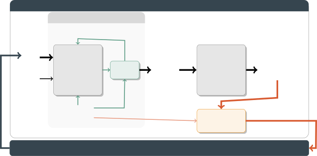

# Automatically Evolving Prompt Guidelines for Task-Specific Optimization

Cedric Richter Affiliation: SnT , University of Luxembourg, Luxembourg.
first.last@uni.lu    Salah Ghamizi Affiliation: SnT , University of
Luxembourg, Luxembourg. first.last@uni.lu Affiliation: Luxembourg
Institute of Health (LIH), Luxembourg    Mike Papadakis Affiliation: SnT
, University of Luxembourg, Luxembourg. first.last@uni.lu

###### Abstract

For Large Language Models to reliably answer user queries, users must
clearly specify requirements, context, and constraints. In practice,
however, user queries are often underspecified, forcing models to infer
unstated assumptions that may misalign with the actual user intent.
Existing prompt engineering guidelines aim to mitigate this issue, they
are typically generic and task-agnostic, limiting their practical
utility. Additionally, existing guidelines are formed manually and in a
non-systematic way. To this end, we study prompt guideline optimization:
the problem of automatically generating task-specific guidelines that
help write better-specified prompts for a given task and model. Our key
observation is that existing (completed) task examples (aka reference
answers) often implicitly encode the missing information required to
complete underspecified queries, including behavioral constraints,
contextual assumptions, and evaluation criteria. We therefore propose
AGOPS, an automatic approach that evolves task-specific guidelines via
an optimization scheme that involves a prompt LLM writer, a solver LLM
and prompt evolution, which maximize downstream effectiveness on a set
of examples (user queries with reference answers). At inference time,
our guidelines help users write well-specified prompts, boosting the
effectiveness of LLMs. We show across mathematical reasoning, medical
question answering, and coding tasks, that prompt underspecification
leads to major drops (up to 95.3%) in downstream task performance
(compared to well-specified prompts) and, perhaps more importantly, that
this drop can hardly be recovered by existing prompt optimization
techniques. Users following AGOPS guidelines can regain this loss
(increasing performance between 15.5 to 81.7% on average) consistently
across all benchmarks.

## 1 Introduction

Large Language Models (LLMs) are applied in high-stakes domains such as
medical diagnosis, software engineering, legal analysis, and financial
decision making \[7\]. Unfortunately, even small errors in LLM outputs
can have serious consequences \[7, 10, 35\]. To address this issue,
users must write clear and complete requirements, assumptions, and
constraints that reliably guide the LLM to the desired outcome \[60,
47\]. In practice, users are often unaware of what they know \[23\],
what they assume \[4\], and how to elicit their knowledge in a
conversation with an LLM \[60, 47\]. As a consequence, user prompts are
often underspecified \[58\], lacking critical details. This is
particularly evident in non-expert users, who tend to omit details that
are necessary or important \[60, 3\]. Our results confirm this issues
and show that prompt underspecification leads to major drops (up to
95.3%) in downstream task performance compared to well-specified
prompts.

Prompt engineering guidelines aim to address this by helping the user to
write better-specified prompts \[48\], prescribing what context to
include, what requirements to state explicitly, and which prompting
strategies to apply such as chain-of-thought prompting \[54\] or the use
of assertive language \[36\]. However, these guidelines are often
formulated manually, in a non-systematic way and are overly generic and
task-agnostic. Figure 1(a) illustrates this point through a coding
example: code generation guidelines \[36\] commonly instruct users to
specify pre- and postconditions in their prompt, but a user unaware of
which conditions matter for their task, such as order preservation when
retrieving unique elements from a list, gains little from such generic
advice.

We introduce the problem of prompt guideline optimization; the problem
of automatically synthesizing task-specific prompt engineering
guidelines based on a set of example resolved tasks. By following these
guidelines, users formulate well-specified prompts that boost the
effectiveness of LLMs. Unlike existing guidelines that summarize general
or domain-specific heuristics, our approach focuses on the generation of
concrete, actionable instructions tailored to a specific task and model
(see Figure 1(b)).

The key challenge involved in this problem is the identification and
optimization of the sought user knowledge (assumptions, context, and
output constraints) that must be specified by the user when writing a
prompt for a target task. This knowledge is typically known by the user,
but is absent in the user-defined prompts since the user is unaware of
its importance. It is noted that such omissions (underspecification) are
often critical in guiding the LLM to perform the intended task.

Our key idea is to rely on resolved tasks to extract relevant
information about the key elements that the task-specific prompts need
to include. For instance, we aim at extracting implicitly encoded
task-specific user knowledge from reasoning traces or a reference
implementations to evolve guidelines. At the same time, to ensure
generalization to unseen tasks/case it is imperative that the guidelines
are to some degree general, meaning that they should not include
solution-specific elements. To this end we aim at explicitly
constraining any copying from the resolved tasks.

In particular, we rely on a prompt writer LLM that, given a candidate
guideline and an underspecified query, derives task-specific knowledge
from a reference answer to produce a well-specified prompt. This prompt
is then passed to a solver LLM to generate an answer, providing
performance feedback (acting like an objective function) for systematic
evaluation of the guidelines. The above scheme is performed iteratively
for multiple runs on several examples to evolve and optimize the
guidelines.

We instantiate this framework as AGOPS (Automatic Guideline Optimization
via Prompt Simulation) that optimizes guidelines wrt downstream solver
performance. An excerpt of a guideline optimized by AGOPS for coding
tasks is shown in Figure 2. At inference time where confronted with new
(unseen) cases, users can follow these guidelines to formulate their
prompts and significantly improve the correctness of the produced code
in the MBPP+ coding tasks. This performance is superior to that of
following generic guidelines, add-hoc prompting, or even guidelines
produced by experts.

In practice, we envision the following two scenarios where such
guidelines can be used; a) by having the user consult them when writing
prompts, i.e., prompt engineering guidelines, and b) by embedding them
into the system prompts, to help models identify missing specification
and request them from the user, i.e., interactive information seeking.
An example of these two scenarios is shown in Figure 4.


(a) Generic Guideline


(b) Task-Specific Guideline

(c) Generic vs. Task-Specific

Figure 1: Task-specific guidelines. (a) Users lack concrete direction on
how to fully specify their prompts, e.g., omitting details such as order
preservation of the output. (b) Task-specific guidelines provide
concrete recommendations to the task (e.g. specifying concrete output
constraints for coding problems) (c) Task-specific guidelines lead to
better specified prompts than generic ones.

We evaluate AGOPS on underspecified user queries from mathematical
reasoning (MMLU-Math \[15\] and GSM8K \[9\]), medical question answering
(MediQ \[41\]), and coding (MBPP with incomplete problem
descriptions \[2\]), using both open-source models (Qwen3 32B \[50\])
and proprietary models (GPT-4.1-mini \[39\]). We find that prompt
writers equipped with task-specific guidelines optimized by AGOPS
produce better-specified prompts, consistently improving downstream
solver performance over both unguided and prompt-optimization baselines
(performance gains between 15.5 and 81.7% on average). For details
please refer to Table 1.

On well-specified coding benchmarks (HumanEval+ \[33\], MBPP+ \[33\],
and BigCodeBench \[66\]), prompts written with task-specific guidelines
outperform those written with generic coding guidelines, as illustrated
in Figure 1(c) and Appendix C.1. Furthermore, we show that using AGOPS
guidelines for information seeking leads to major improvements on
MBPP-Incomplete, approximately +33 Pass@1, and +14 accuracy points on
GSM8K-Abstain after 10 turns (please refer to Figure 6).


Figure 2: Excerpt of MBPP+ guidelines generated by GPT-4.1-mini. A user
can follow these guidelines when prompting the MBPP+ coding tasks and
significantly improve the correctness of the produced code than when
following generic guidelines, add-hoc prompting or even expert
guidelines.

## 2 Background and Related Work

Prompt Underspecification. When confronted with underspecification,
large language models are generally expected to abstain from
answering \[21, 59, 49, 62\], express uncertainty \[31, 51\], or request
additional information from the user \[26, 37\]. Prior work has examined
the extent to which current models exhibit these behaviors across a
range of settings, including unanswerable questions \[59\],
multiple-choice questions without a correct option \[34\], and more
general forms of underspecification \[49, 62\]. However, existing
evidence suggests that current models remain limited in their ability to
reliably identify underspecification \[24\], abstain \[21\] and request
further information \[26\]. Consequently, a line of work has explored
improving behavior of LLMs in underspecified scenarios through
fine-tuning \[6, 5, 18\], prompting strategies \[17\], and explanation
generation \[11\]. We go a step ahead by evolving task-specific
guidelines that help users formulate better-specified prompts and guide
models to effectively perform information seeking.

Prompt Optimization. As the behavior of large language models depends
heavily on the structure and quality of user prompts, automated
approaches to prompt optimization have recently received growing
attention. Early works focused on gradient-based methods \[28, 25, 53\]
where a limited set of parameters is optimized and incorporated into the
model as form of soft prompt. However, while effective in certain
settings, these approaches are often computationally expensive and
difficult to apply with closed-source models. To overcome these
limitations, gradient-free methods \[64, 57, 42, 1, 40\] have emerged as
an alternative. Existing approaches, such as APE \[64\], ORPO \[57\] and
MIPROv2 \[40\], iteratively generate candidate prompts via LLMs and
evaluate them to select the most effective one. Leveraging language
models for prompt optimization also enables the incorporation of textual
feedback to guide the search process \[42\]. Recent works, such as
GEPA \[1\], combines these ideas with evolutionary algorithms for
optimizing prompts via LLM-based mutation and cross-over.

These studies focus on optimizing task-level prompts based on
user-provided inputs/task descriptions, which are inherently
underspecified. In practice, some prompt optimizations may discover some
generic and recurrent task-level assumptions, however as these have to
be generally applicable they are rather limited, as we also show this in
our experiments. As a result, their effectiveness remains inherently
constrained to the completeness and quality of user queries.

Guidelines. Prompt engineering guidelines have been proposed to help
users directly formulate more complete and higher-quality prompts.
Existing efforts in this direction are largely manual, taking the form
of prompt tutorials \[48, 55\], best-practice checklists \[46, 13\] and
structured prompt templates \[55, 43\] provided by researchers or model
providers. Empirical studies have shown that users equipped with such
guidelines produce prompts that elicit more accurate and relevant model
responses \[60\], and that even lightweight interventions, such as
instructing users to specify the output format or to provide context
information, can yield measurable improvements \[19, 54\]. More
recently, there has been a growing interest in domain-specific
guidelines for software development \[44, 36\] and data annotation \[45,
52\] that help users write more effective prompts these problems.
However, existing guidelines are predominantly static, manually curated
through an ad-hoc procedure, and to some extent bounded to specific
models and tasks. Their utility is limited and potentially suboptimal in
specific domains. In contrast, our work automatically generates
task-specific guidelines tailored to the requirements of the given task.

## 3 Automatically Evolving Prompt Guidelines

### 3.1 Problem Statement

We consider a task $`\mathcal{T}`$, which represents a dataset or
distribution of input-output pairs
$`(\boldsymbol{q},\boldsymbol{a}^{*})`$, where $`\boldsymbol{q}`$ is an
(underspecified) user query and $`\boldsymbol{a}^{*}`$ is the ground
truth answer, and a target large language model $`\mathtt{LLM}`$. The
goal of prompt guideline optimization is to find a guideline $`G^{*}`$
that, when provided to a user $`\mathcal{U}`$, helps them write a
well-specified prompt $`\rho^{*}=\mathcal{U}_{G^{*}}(\boldsymbol{q})`$
that elicits a correct answer $`\boldsymbol{a}^{*}`$ from the
$`\mathtt{LLM}`$. Formally, we frame this as:
$`G^{*}=\arg\max_{G}~\mathbb{E}_{(\boldsymbol{q},\boldsymbol{a}^{*})\sim\mathcal{T}}\Big[\mu\Big(\texttt{LLM}(\mathcal{U}_{G}(\boldsymbol{q})),\boldsymbol{a}^{*}\Big)\lx@nobreakspace\Big],`$
where $`\mu`$ is an evaluation metric (e.g. accuracy, F1 score, test
pass rate, etc.) that measures the quality of the model’s answer
$`\boldsymbol{a}`$ against the ground truth answer
$`\boldsymbol{a}^{*}`$ on task $`\mathcal{T}`$. A guideline $`G`$ is a
set of task-specific instructions that helps users convert their latent
knowledge into a well-specified prompt.

### 3.2 Guideline Optimization via Prompt Engineering Optimization




Figure 3: Overview. (a) Reference answers encode user knowledge such as
assumptions (patient stability), context (symptoms and medical history),
and output constraints (medication). (b) Candidate guideline $`G`$,
prompt writer $`\mathcal{W}_{G}`$ decides what information (user
knowledge) needs to be encoded in the prompt $`\rho_{i}`$, enabling the
solver $`\mathtt{LLM}`$ to produce a correct answer. (c) The simulation
succeeds if the solver produces the correct answer for a prompt that
does not encode the reference answer verbatim. (d) Guidelines are
optimized based on the scores and feedback obtained across simulations.

We propose AGOPS (Automatic Guideline Optimization via Prompt
Simulation), an optimization framework for learning task-specific prompt
guidelines from underspecified user queries and reference answers. The
goal of AGOPS is to extract the task-specific information, express it in
a form that can be used in other cases while, at the same time, limits
the inclusion of solution-specific content that directly encodes the
related answer. All-in-all the goal is to specify in a guideline form,
what user knowledge would be needed to make the prompts well-specified.

Prompt Simulation. Figure 3 provides an overview of AGOPS. Optimizing
Section 3.1 against a real user is generally expensive if not
intractable at scale, AGOPS automates away the prompt writing process
with a prompt writer
$`\mathcal{W}_{G}(\boldsymbol{q},\boldsymbol{a}^{*})`$: a language model
that, given a guideline $`G`$, query $`\boldsymbol{q}`$, and reference
answer $`\boldsymbol{a}^{*}`$, produces a well-specified prompt
$`\rho`$. Unlike the real user, the prompt writer
$`\mathcal{W}_{G}(\boldsymbol{q},\boldsymbol{a}^{*})`$ lacks access to
latent user knowledge not explicitly stated in query $`\boldsymbol{q}`$;
we therefore condition the writer on the ground truth answer
$`\boldsymbol{a}^{*}`$ as a proxy. While the real user typically does
not have access to $`\boldsymbol{a}^{*}`$, they possess task-specific
knowledge allowing them to specify the problem which then
$`\boldsymbol{a}^{*}`$ reflects. We thus hypothesize that the
specification information necessary to write a well-specified prompt is
often recoverable from a sufficiently complete $`\boldsymbol{a}^{*}`$,
whether encoded as part of a reasoning chain or in the final output
itself.

AGOPS encourages guidelines that extract task-specific user knowledge
from reference answers while penalizing those that over-rely on
solution-specific content. Concretely, we penalize guidelines that lead
$`\mathcal{W}_{G}`$ to expose the solution rather than infer task
requirements. To this end, we define
$`\lambda_{\boldsymbol{q}}(\rho,\boldsymbol{a}^{*})`$ to measure the
degree to which the generated prompt $`\rho`$ reproduces answer content
beyond what is already present in the query $`\boldsymbol{q}`$:
$`\lambda_{\boldsymbol{q}}(\rho,\boldsymbol{a}^{*})=\frac{\left|(\rho_{n}\cap\boldsymbol{a}^{*}_{n})\setminus\boldsymbol{q}_{n}\right|}{\left|\boldsymbol{a}^{*}_{n}\setminus\boldsymbol{q}_{n}\right|},`$
where $`\rho_{n}`$, $`\boldsymbol{q}_{n}`$, and
$`\boldsymbol{a}^{*}_{n}`$ denote the sets of character $`n`$-grams of
$`\rho`$, $`\boldsymbol{q}`$, and $`\boldsymbol{a}^{*}`$ respectively.
Intuitively, $`\lambda_{\boldsymbol{q}}(\rho,\boldsymbol{a}^{*})`$
measures the fraction of answer-specific $`n`$-grams reproduced in the
prompt that are not already present in the user query; a high value thus
indicates that the prompt $`\rho`$ contains substantially more
answer-specific content than the original query $`\boldsymbol{q}`$.
During optimization, we enforce the constraint via rejection sampling:
we generate up to $`K`$ candidate prompts from $`\mathcal{W}_{G}`$ and
retain only those satisfying
$`\lambda_{\boldsymbol{q}}(\rho,\boldsymbol{a}^{*})\leq\tau`$,
discarding the rest. If no candidate satisfies this constraint, we fall
back to the original user query $`\boldsymbol{q}`$, ensuring the solver
always receives a valid input. Appendix B details the design and
calibration of $`\lambda_{\boldsymbol{q}}(\rho,\boldsymbol{a}^{*})`$,
$`\tau`$ and $`K`$.

This measure has known limitations: it remains low when the prompt
rephrases the answer or states the final conclusion of a longer
reasoning chain. To address these, we employ two complementary
strategies. First, we provide the prompt writer with a system prompt
that defines its role and target behavior, instructing it not to copy or
rephrase the answer, and only include answer-specific information when
explicitly requested (Figure 7). Second, we detect and reject prompts
containing explicit answer indicators (e.g. ”The final answer is 42.",
"The best option is D.", etc.) during optimization. A full list of
answer indicators is provided in Table 5.

Surrogate Objective. Based on our prompt simulation, we define a
tractable surrogate objective for automatic guideline optimization.
Formally, given a task $`\mathcal{T}`$ and target $`\mathtt{LLM}`$, we
seek an optimal guideline $`G^{*}`$ that, when provided to the prompt
writer $`\mathcal{W}_{G}`$, maximizes task performance of
$`\mathtt{LLM}`$ on task $`\mathcal{T}`$ while limiting answer exposure
of $`\boldsymbol{a}^{*}`$:

```math
\displaystyle G^{*}=\arg\max_{G}~\mathbb{E}_{(\boldsymbol{q},\boldsymbol{a}^{*})\sim\mathcal{T}}\Big[\mu\Big(\texttt{LLM}(\mathcal{W}_{G}(\boldsymbol{q},\boldsymbol{a}^{*})),\boldsymbol{a}^{*}\Big)\Big]
```

```math
\displaystyle\text{s.t.}\quad\lambda_{\boldsymbol{q}}\big(\mathcal{W}_{G}(\boldsymbol{q},\boldsymbol{a}^{*}),\boldsymbol{a}^{*}\big)\leq\tau
```

Optimization. The surrogate objective of AGOPS is compatible with any
off-the-shelf prompt optimizer that iteratively refines guidelines as
prompts with respect to task scores (and natural language feedback). In
this work, we instantiate AGOPS with GEPA \[1\], an evolutionary prompt
optimization algorithm that iteratively mutates and refines candidate
guidelines using scores and feedback from evaluated simulations
(Figure 3). At each iteration, AGOPS runs the prompt simulation for a
batch of task instances under a given candidate guideline $`G`$. For
each task instance, we compute a simulation rollout, consisting of the
query $`\boldsymbol{q}_{i}`$, reference answer
$`\boldsymbol{a}^{*}_{i}`$, generated prompt $`\rho_{i}`$, and solver
answer $`\boldsymbol{a}`$. Since the solver has only access to
$`\rho_{i}`$ and not the original $`\boldsymbol{q}_{i}`$ or the
reference answer $`\boldsymbol{a}^{*}`$, the generated prompt must be
fully self-contained. Rollouts are evaluated by a task-specific
verifier, which returns a numeric score to compute $`\mu`$ and a textual
feedback (like compiler error messages, erroneous conclusions, etc.).
The simulation rollouts, resulting scores, and feedbacks are then used
in the guideline evolution to refine the guideline $`G`$ in the next
iteration. The prompt simulation is transparent to the guideline
optimizer: It does not have access to prompt writer’s system prompt or
knowledge of the rejection sampling process. This design ensures that
optimized guidelines reflect genuine task requirements rather than
artifacts of the simulation process.

### 3.3 Practical Applications of Prompt Engineering Guidelines

(a) Without Guidelines

(b) Prompt Engineering

(c) Information Seeking

Figure 4: Application scenarios. (a) Without a guideline, a user often
omits important details that seem obvious to them, leading to
underspecified prompts. (b) Prompt guidelines help users to engineer
better-specified prompts. (c) Embedded in the solver’s prompt, prompt
guidelines help models to identify missing specification and request
them from the user.

Once optimized on a training set, our guidelines (Figure 4) can have the
following two applications: Prompt Engineering. During prompt
engineering, the user typically has an intended goal in mind, e.g.,
implementing a specific functionality or obtaining a medication
recommendation for their symptoms. AGOPS guidelines provide
task-specific instructions derived from prompts that performed well
during training, helping users identify what to specify and how to
phrase their prompt to achieve their intended outcome. For example,
given a coding guideline, a user can identify what needs to be specified
to describe the behavior of a function unambiguously (Figure 4(b)); a
medical guideline might prompt the user to mention their allergies to
avoid unsafe recommendations. Interactive Information Seeking. Rather
than relying on the user to specify all relevant details, AGOPS
guidelines can be encoded in the solver’s system prompt to enable
proactive information. This is practically relevant for LLM application
developers \[65\] who invest significant effort in tuning system prompts
for specific tasks. AGOPS guidelines help to identify task-specific
requirements that when encoded into the system prompt can help the model
to identify missing information to be requested from the user. We show
that AGOPS guidelines can be embedded into the system prompt with
minimal preprocessing (Figure 10) and improve the solver’s information
seeking behavior.

## 4 Evaluation

### 4.1 Baselines

We compare prompts written in two general setups: Base and Simulated
(Sim.). The base setup evaluates underspecified prompts as provided by
the user or optimized via a prompt optimizer. The simulated setup
simulates prompts written by a user with a given guideline. We optimize
prompts against GPT-4.1-mini and Qwen3 32B as the solver LLMs in their
recommended settings.

Original: The underspecified query directly evaluated without any
optimization.

MIPROv2 \[40\] is a widely used prompt optimizer that has been
integrated into DSPy \[20\]. It works by jointly optimizing the prompt
and demonstrations provided to the LLM via Bayesian optimization. To
optimize the prompt, it starts by bootstrapping candidate sets of
instructions and demonstrations. Candidates are selected and evaluated
via a Tree-Structured Parzen Estimator (TPE), favoring candidates that
achieve high performance. We implement the solver LLM as a DSPy module
and use MIPROv2 in the configuration auto = heavy, which corresponds to
proposing 18 instruction candidates together with 18 bootstrapped
few-shot sets.

GEPA \[1\] is a genetic algorithm for prompt optimization. GEPA
maintains a population of instructions to optimize and each optimization
round it selects instructions from the pareto frontier to mutate and
improve. We use GEPA with a population size of 8 instructions and let it
run for 10 epochs. During optimization, GEPA uses a minibatch size of 3,
and merge is invoked a maximum of 5 times.

### 4.2 Proposed approach(es)

No Guideline: Prompts generated by our prompt simulation using the seed
guideline (Figure 8). It is noted that this approach forms a 0-shot case
of our evolution scheme, meaning that the prompt writer writes a
candidate prompt for the given tasks, thus includes some non-optimized
user knowledge.

AGOPS Guideline: We initialize AGOPS with empty seed guidelines and use
GEPA for optimization. GEPA is instantiated with the same setting as
during prompt optimization and the guideline is optimized on our
training sets. For the prompt simulation, we use GPT-4.1-mini \[39\] as
prompt writer, set the n-gram size to $`n=6`$, $`K=8`$, and calibrate
$`\tau\in[0.2,0.45]`$ per task (see Appendix B).

### 4.3 Results and Analysis

|              |                  |                   |                |        |               |                |        |               |                |        |                 |                |        |
| ------------ | ---------------- | ----------------- | -------------- | ------ | ------------- | -------------- | ------ | ------------- | -------------- | ------ | --------------- | -------------- | ------ |
|              |                  | MMLU-Math-Abstain |                |        | GSM8K-Abstain |                |        | MediQ-Initial |                |        | MBPP-Incomplete |                |        |
|              | Prompt           | Acc.              | $`\Delta`$Full | %Abst. | Acc.          | $`\Delta`$Full | %Abst. | Acc.          | $`\Delta`$Full | %Abst. | Pass@1          | $`\Delta`$Full | %Abst. |
| GPT-4.1-mini |                  |                   |                |        |               |                |        |               |                |        |                 |                |        |
| Base         | Original         | 24.8              | -69.3          | 57.4   | 1.1           | -95.3          | 94.6   | 87.7          | -10.9          | 2.1    | 33.9            | -43.1          | 0.0    |
|              | MIPROv2          | 45.5              | -48.6          | 4.9    | 4.2           | -92.2          | 49.3   | 86.4          | -12.2          | 0.0    | 37.8            | -39.2          | 0.0    |
|              | GEPA             | 42.6              | -51.5          | 0.0    | 1.2           | -95.2          | 15.8   | 87.9          | -10.7          | 2.7    | 34.1            | -42.9          | 0.0    |
| Sim.         | No Guideline     | 54.6              | -39.5          | 18.8   | 8.9           | -87.5          | 77.6   | 74.9          | -23.7          | 16.0   | 49.7            | -27.3          | 0.0    |
|              | AGOPS Guidelines | 89.1              | -5.0           | 9.9    | 90.6          | -5.8           | 1.9    | 90.4          | -8.2           | 7.0    | 87.6            | +10.6          | 0.0    |
| Qwen3 32B    |                  |                   |                |        |               |                |        |               |                |        |                 |                |        |
| Base         | Original         | 43.6              | -42.3          | 22.8   | 4.8           | -91.3          | 62.3   | 79.6          | -13.5          | 7.4    | 30.2            | -41.8          | 0.0    |
|              | MIPROv2          | 50.5              | -34.7          | 2.2    | 9.4           | -86.7          | 0.0    | 80.6          | -12.5          | 1.4    | 38.9            | -33.0          | 0.0    |
|              | GEPA             | 51.5              | -33.7          | 3.0    | 9.9           | -86.2          | 11.9   | 78.7          | -14.4          | 6.6    | 33.4            | -38.5          | 0.0    |
| Sim.         | No Guideline     | 54.5              | -30.7          | 19.8   | 15.2          | -80.9          | 43.5   | 79.8          | -13.3          | 4.4    | 44.4            | -27.5          | 0.0    |
|              | AGOPS Guidelines | 75.2              | -1.0           | 10.9   | 86.6          | -9.5           | 2.6    | 90.1          | -3.0           | 1.5    | 74.9            | +3.0           | 0.0    |

Table 1: Results on underspecified user queries. We report accuracy, the
delta in accuracy when prompted with the well-specified prompt variant
($`\Delta`$Full), and the abstention rate ($`\%`$Abst.). Base prompts
are derived from the underspecified task and Sim. prompts are a result
of our approaches.

Table 1 summarizes our main results which leads us to the following
findings:

Finding 1: Missing specification cannot be recovered without user.
Well-specified prompts consistently outperform their underspecified
counterpart by 10.9 up to 95.3 percentage points across mathematical
reasoning, medical question answering, and coding. Consistent with
Kirichenko et al. \[21\], who show that LLMs tend to attempt
underspecified tasks rather than flagging missing information, we find
that language models struggle to reliably identify missing information
in the user prompt and fail to abstain from answering. This is most
pronounced for MediQ-Initial and MBPP-Incomplete, where prompts appear
complete enough for the model to attempt a solution yet lack the
critical details needed to produce a correct answer.

Applying prompt optimization techniques such as MIPROv2 \[40\] and
GEPA \[1\] to underspecified queries does not close the gap to
well-specified performance, revealing two distinct failure modes. First,
on MMLU-Math-Abstain and GSM8K-Abstain, optimization with respect to
task performance reduces abstention from 57.4% to 0.0% and from 94.6% to
15.8% for GPT-4.1-mini and from 22.8% to 2.2% and from 62.3% to 0.0% for
Qwen3 32B, causing the model to attempt tasks it would otherwise
decline, yet gaps of up to 51.5 and 95.2 to well-specified prompt
performance remain. Second, for MediQ-Initial and MBPP-Incomplete,
models are nearly incapable of detecting underspecification in the first
place, and prompt optimization yields only marginal improvements over
the unoptimized underspecified baseline.

This confirms that underspecification is fundamentally a problem falling
on the user side: missing information cannot be recovered from the
underspecified prompt alone at inference time, and must instead be
elicited from or provided by the user.

Finding 2: Task-specific guidelines help to produce better-specified
prompts. Task-specific guidelines enable the prompt writer to extract
and verbalize more of the implicit knowledge, yielding prompts with
gains up to 34.5, 81.7, 15.5, and 37.9 percentage points in downstream
performance over the No Guideline baseline on MMLU-Math-Abstain,
GSM8K-Abstain, MediQ-Initial, and MBPP-Incomplete, respectively.
Compared to the original user query, abstention drops by up to 47.5% on
MMLU-Math-Abstain, 92.7% on GSM8K-Abstain, and 5.9% on MediQ-Initial,
while improving task performance, indicating that AGOPS prompts are
better-specified.

Figure 5: Prompts written with task-specific guidelines are
better-specified. (a) Task performance on non-abstention responses for
question-answering tasks, averaged over three trials. (b) Response
consistency: fraction of prompts for which the solver response is
consistently correct across all trials. (c) Adversarial reconstruction:
ROUGE-L score between reference answer and answers reconstructed
adversarially from the prompt; lower indicates the prompt is
well-specified.

Solver Consistency. Well-specified prompts often elicit more consistent
behavior from language models \[58\]. Figure 5(a) shows that prompts
written via AGOPS guidelines approach the performance of fully-specified
prompts on non-abstention responses (i.e., when the model attempts to
answer). Model responses to AGOPS prompts are more consistent across
trials than to underspecified queries (Figure 5(b)): for over 80% of
questions, the model produces a correct response on every trial.

Adversarial Reconstruction. A well-specified prompt conveys the task
without revealing the answer. Following Hui et al. \[16\], we
investigate whether an adversary model can reconstruct the reference
answer from the prompt text alone. We quantify reconstruction by
computing the ROUGE-L score \[30\] between the reference answer and the
adversary’s output. Figure 5(c) shows that AGOPS prompts achieve
comparable reconstruction scores to the fully-specified prompt across
all question-answering datasets, indicating that the guideline-driven
specification clarifies the task without encoding more of the answer.

Coding Benchmarks. We omit MBPP-Incomplete from Figure 5 because its
reference specifications are themselves underspecified \[37\], making
fully-specified prompts an unreliable upper bound. In this benchmark
AGOPS prompts outperform the reference specifications (Table 1),
suggesting that task-specific guidelines can recover specification
quality even where the benchmark’s own ground truth falls short.
Detailed results can be found in the Appendix.

All these results demonstrate that underspecification can be drastically
reduced by following task-specific guidelines. This leads to a
significant boost in LLMs downstream performance (between 15.5 and 81.7%
on average) consistently across all benchmarks studied.

Finding 3: Task-specific guidelines can guide models in asking
clarifying questions.

The extent to which guidelines can help LLMs, i.e., the solver model,
recognize underspecification at inference time is also significant.
Figure 6 shows that when guidelines are embedded in the system prompt,
models use them as a checklist of task requirements and ask the user for
missing information – recovering substantial task performance in
relation to fully specified ones.

Overall, information seeking based on our guidelines leads to
substantial downstream task performance boost, consistently across all
benchmarks, with major gains on MBPP-Incomplete, approximately +33
Pass@1, and +14 accuracy points on GSM8K-Abstain after 10 turns.

Figure 6: Guidelines help information seeking. Embedding guidelines in
the system prompt enables models to detect underspecification and ask
clarifying questions. Task performance as a function of interaction:
guideline-equipped models resolve underspecification more effectively
than models with generic or no system prompts, with the largest gains on
MBPP-Incomplete.

## 5 Limitations and Societal Impact

User study: Our work has not evaluated the guidelines with real
end-users. Though, our manual inspection suggests that the guidelines
are general and reasonable for users and lead to performance boosts.
Yet, actual users may not provide accurate information, which may limit
their performance.

Information leakage: Our leakage detectors fail to capture information
leakage. We manually inspected the generated guidelines and checked the
consistency and reconstruction performance of our approach (Fig. 5), and
found no evidence that our guidelines leak any reference answers.

Scope of the claims: We used one open-source (Qwen3) and one commercial
LLM (GPT-4.1-mini) to ensure some level of generalizability to LLMs. To
make a fair and comparable evaluation, we followed the evaluation
protocol used by our baselines (MIPROv2, GEPA). We also qualitatively
inspected our guidelines and found them useful. In the case of coding
benchmarks we also contrasted them with human evolved guidelines and
found that ours lead to superior performance.

Complexity of the framework: We conducted extensive ablations and
complementary analyses of the prompt simulation component. The ablations
and hyperparameters of the LLM used in the Guideline evaluation
component were thoroughly evaluated in the GEPA paper \[1\].

#### Broader Impact.

LLMs providers are tightening their token quotas and increasing their
prices. Identifying cost-efficient strategy for LLMs deployments is
becoming of paramount importance, especially in clinical settings
\[22\]. Our approach, AGOPS, generates locally, task-specific
guidelines, that lead to lower conversation turns with high response
accuracy on downstream LLMs API.

## 6 Conclusion

In this paper, we studied the prompt underspecification and optimization
problem. We found that underspecification leads to major drops in
downstream performance, a drop that can hardly be reduced without user
knowledge. We developed AGOPS an evolutionary approach that infers
task-specific requirements (guidelines) that define what users should
include in their prompts to make them well-specified. We show that users
following task-specific guidelines can gain significant LLM downstream
performance boost (between 15 and 82% on average) consistently across
all the benchmarks we studied. Similarly, using our guidelines for
information seeking, in a sense making the models elicit missing
information from the user, leads to downstream performance boost, e.g.,
+33 Pass@1 on MBPP-Incomplete and +14 accuracy points on GSM8K-Abstain.

## References

- \[1\] L. A. Agrawal, S. Tan, D. Soylu, N. Ziems, R. Khare, K.
  Opsahl-Ong, A. Singhvi, H. Shandilya, M. J. Ryan, M. Jiang, C.
  Potts, K. Sen, A. G. Dimakis, I. Stoica, D. Klein, M. Zaharia, and O.
  Khattab (2025) GEPA: reflective prompt evolution can outperform
  reinforcement learning. CoRR abs/2507.19457. External Links:
  [Link](https://doi.org/10.48550/arXiv.2507.19457),
  [Document](https://dx.doi.org/10.48550/ARXIV.2507.19457), 2507.19457
  Cited by: §2, §3.2, §4.1, §4.3, §5.
- \[2\] J. Austin, A. Odena, M. Nye, M. Bosma, H. Michalewski, D.
  Dohan, E. Jiang, C. Cai, M. Terry, Q. Le, et al. (2021) Program
  synthesis with large language models. arXiv preprint arXiv:2108.07732.
  Cited by: §1.
- \[3\] H. M. Babe, S. Nguyen, Y. Zi, A. Guha, M. Q. Feldman, and C. J.
  Anderson (2024) StudentEval: A benchmark of student-written prompts
  for large language models of code. In Findings of the Association for
  Computational Linguistics, ACL 2024, Bangkok, Thailand and virtual
  meeting, August 11-16, 2024, L. Ku, A. Martins, and V. Srikumar
  (Eds.), Findings of ACL, pp. 8452–8474. External Links:
  [Link](https://doi.org/10.18653/v1/2024.findings-acl.501),
  [Document](https://dx.doi.org/10.18653/V1/2024.FINDINGS-ACL.501) Cited
  by: §1.
- \[4\] T. Bolander, R. Engelhardt, and T. S. Nicolet (2020) The curse
  of shared knowledge: recursive belief reasoning in a coordination game
  with imperfect information. CoRR abs/2008.08849. External Links:
  [Link](https://arxiv.org/abs/2008.08849), 2008.08849 Cited by: §1.
- \[5\] F. Brahman, S. Kumar, V. Balachandran, P. Dasigi, V. Pyatkin, A.
  Ravichander, S. Wiegreffe, N. Dziri, K. R. Chandu, J. Hessel, Y.
  Tsvetkov, N. A. Smith, Y. Choi, and H. Hajishirzi (2024) The art of
  saying no: contextual noncompliance in language models. In Advances in
  Neural Information Processing Systems 38: Annual Conference on Neural
  Information Processing Systems 2024, NeurIPS 2024, Vancouver, BC,
  Canada, December 10 - 15, 2024, A. Globersons, L. Mackey, D.
  Belgrave, A. Fan, U. Paquet, J. M. Tomczak, and C. Zhang (Eds.),
  External Links:
  [Link](http://papers.nips.cc/paper%5C_files/paper/2024/hash/58e79894267cf72c66202228ad9c6057-Abstract-Datasets%5C_and%5C_Benchmarks%5C_Track.html)
  Cited by: §2.
- \[6\] L. Chen, Z. Liang, X. Wang, J. Liang, Y. Xiao, F. Wei, J.
  Chen, Z. Hao, B. Han, and W. Wang (2024) Teaching large language
  models to express knowledge boundary from their own signals. CoRR
  abs/2406.10881. External Links:
  [Link](https://doi.org/10.48550/arXiv.2406.10881),
  [Document](https://dx.doi.org/10.48550/ARXIV.2406.10881), 2406.10881
  Cited by: §2.
- \[7\] Z. Chen, J. Ma, X. Zhang, N. Hao, A. Yan, A. Nourbakhsh, X.
  Yang, J. J. McAuley, L. R. Petzold, and W. Y. Wang (2024) A survey on
  large language models for critical societal domains: finance,
  healthcare, and law. Trans. Mach. Learn. Res. 2024. External Links:
  [Link](https://openreview.net/forum?id=upAWnMgpnH) Cited by: §1.
- \[8\] K. Cobbe, V. Kosaraju, M. Bavarian, M. Chen, H. Jun, L.
  Kaiser, M. Plappert, J. Tworek, J. Hilton, R. Nakano, C. Hesse, and J.
  Schulman (2021) Training verifiers to solve math word problems. CoRR
  abs/2110.14168. External Links:
  [Link](https://arxiv.org/abs/2110.14168), 2110.14168 Cited by: §A.3.
- \[9\] K. Cobbe, V. Kosaraju, M. Bavarian, M. Chen, H. Jun, L.
  Kaiser, M. Plappert, J. Tworek, J. Hilton, R. Nakano, et al. (2021)
  Training verifiers to solve math word problems. arXiv preprint
  arXiv:2110.14168. Cited by: §1.
- \[10\] M. Dahl, V. Magesh, M. Suzgun, and D. E. Ho (2024) Large legal
  fictions: profiling legal hallucinations in large language models.
  CoRR abs/2401.01301. External Links:
  [Link](https://doi.org/10.48550/arXiv.2401.01301),
  [Document](https://dx.doi.org/10.48550/ARXIV.2401.01301), 2401.01301
  Cited by: §1.
- \[11\] Y. Deng, Y. Zhao, M. Li, S. Ng, and T. Chua (2024) Don’t just
  say "i don’t know"! self-aligning large language models for responding
  to unknown questions with explanations. In Proceedings of the 2024
  Conference on Empirical Methods in Natural Language Processing, EMNLP
  2024, Miami, FL, USA, November 12-16, 2024, Y. Al-Onaizan, M. Bansal,
  and Y. Chen (Eds.), pp. 13652–13673. External Links:
  [Link](https://doi.org/10.18653/v1/2024.emnlp-main.757),
  [Document](https://dx.doi.org/10.18653/V1/2024.EMNLP-MAIN.757) Cited
  by: §2.
- \[12\] R. Fan, Z. Wang, and P. Liu (2025) MegaScience: pushing the
  frontiers of post-training datasets for science reasoning. CoRR
  abs/2507.16812. External Links:
  [Link](https://doi.org/10.48550/arXiv.2507.16812),
  [Document](https://dx.doi.org/10.48550/ARXIV.2507.16812), 2507.16812
  Cited by: Appendix B.
- \[13\] W. Han, X. Wei, X. Cui, N. Cheng, G. Jiang, W. Qian, and C.
  Zhang (2024) Prompt engineering 101 prompt engineering guidelines from
  a linguistic perspective. In Chinese Computational Linguistics - 23rd
  China National Conference, CCL 2024, Taiyuan, China, July 25-28, 2024,
  Proceedings, M. Sun, J. Liang, X. Han, Z. Liu, Y. He, G. Rao, Y. Chen,
  and Z. Tian (Eds.), Lecture Notes in Computer Science, pp. 571–592.
  External Links:
  [Link](https://doi.org/10.1007/978-981-97-8367-0%5C_34),
  [Document](https://dx.doi.org/10.1007/978-981-97-8367-0%5F34) Cited
  by: §2.
- \[14\] D. Hendrycks, C. Burns, S. Basart, A. Zou, M. Mazeika, D. Song,
  and J. Steinhardt (2021) Measuring massive multitask language
  understanding. In 9th International Conference on Learning
  Representations, ICLR 2021, Virtual Event, Austria, May 3-7, 2021,
  External Links: [Link](https://openreview.net/forum?id=d7KBjmI3GmQ)
  Cited by: §A.3.
- \[15\] D. Hendrycks, C. Burns, S. Basart, A. Zou, M. Mazeika, D. Song,
  and J. Steinhardt (2021) Measuring massive multitask language
  understanding. In International Conference on Learning Representations
  (ICLR), External Links:
  [Link](https://openreview.net/forum?id=d7KBjmI3GmQ) Cited by: §1.
- \[16\] B. Hui, H. Yuan, N. Gong, P. Burlina, and Y. Cao (2024) PLeak:
  prompt leaking attacks against large language model applications. In
  Proceedings of the 2024 on ACM SIGSAC Conference on Computer and
  Communications Security, CCS 2024, Salt Lake City, UT, USA, October
  14-18, 2024, B. Luo, X. Liao, J. Xu, E. Kirda, and D. Lie (Eds.),
  pp. 3600–3614. External Links:
  [Link](https://doi.org/10.1145/3658644.3670370),
  [Document](https://dx.doi.org/10.1145/3658644.3670370) Cited by: §A.5,
  §4.3.
- \[17\] S. Kadavath, T. Conerly, A. Askell, T. Henighan, D. Drain, E.
  Perez, N. Schiefer, Z. Hatfield-Dodds, N. DasSarma, E.
  Tran-Johnson, S. Johnston, S. E. Showk, A. Jones, N. Elhage, T.
  Hume, A. Chen, Y. Bai, S. Bowman, S. Fort, D. Ganguli, D.
  Hernandez, J. Jacobson, J. Kernion, S. Kravec, L. Lovitt, K.
  Ndousse, C. Olsson, S. Ringer, D. Amodei, T. Brown, J. Clark, N.
  Joseph, B. Mann, S. McCandlish, C. Olah, and J. Kaplan (2022) Language
  models (mostly) know what they know. CoRR abs/2207.05221. External
  Links: [Link](https://doi.org/10.48550/arXiv.2207.05221),
  [Document](https://dx.doi.org/10.48550/ARXIV.2207.05221), 2207.05221
  Cited by: §2.
- \[18\] S. Kapoor, N. Gruver, M. Roberts, K. Collins, A. Pal, U.
  Bhatt, A. Weller, S. Dooley, M. Goldblum, and A. G. Wilson (2024)
  Large language models must be taught to know what they don’t know. In
  Advances in Neural Information Processing Systems 38: Annual
  Conference on Neural Information Processing Systems 2024, NeurIPS
  2024, Vancouver, BC, Canada, December 10 - 15, 2024, A. Globersons, L.
  Mackey, D. Belgrave, A. Fan, U. Paquet, J. M. Tomczak, and C. Zhang
  (Eds.), External Links:
  [Link](http://papers.nips.cc/paper%5C_files/paper/2024/hash/9c20f16b05f5e5e70fa07e2a4364b80e-Abstract-Conference.html)
  Cited by: §2.
- \[19\] D. Khashabi, C. Baral, Y. Choi, and H. Hajishirzi (2022)
  Reframing instructional prompts to gptk’s language. In Findings of the
  Association for Computational Linguistics: ACL 2022, Dublin, Ireland,
  May 22-27, 2022, S. Muresan, P. Nakov, and A. Villavicencio (Eds.),
  Findings of ACL, pp. 589–612. External Links:
  [Link](https://doi.org/10.18653/v1/2022.findings-acl.50),
  [Document](https://dx.doi.org/10.18653/V1/2022.FINDINGS-ACL.50) Cited
  by: §2.
- \[20\] O. Khattab, A. Singhvi, P. Maheshwari, Z. Zhang, K.
  Santhanam, S. Vardhamanan, S. Haq, A. Sharma, T. T. Joshi, H.
  Moazam, H. Miller, M. Zaharia, and C. Potts (2024) DSPy: compiling
  declarative language model calls into state-of-the-art pipelines. In
  The Twelfth International Conference on Learning Representations, ICLR
  2024, Vienna, Austria, May 7-11, 2024, External Links:
  [Link](https://openreview.net/forum?id=sY5N0zY5Od) Cited by: §4.1.
- \[21\] P. Kirichenko, M. Ibrahim, K. Chaudhuri, and S. J. Bell (2025)
  AbstentionBench: reasoning llms fail on unanswerable questions. CoRR
  abs/2506.09038. External Links:
  [Link](https://doi.org/10.48550/arXiv.2506.09038),
  [Document](https://dx.doi.org/10.48550/ARXIV.2506.09038), 2506.09038
  Cited by: §A.2, §A.2, §A.3, §A.4, §2, §4.3.
- \[22\] E. Klang, D. Apakama, E. E. Abbott, A. Vaid, J. Lampert, A.
  Sakhuja, R. Freeman, A. W. Charney, D. Reich, M. Kraft, et al. (2024)
  A strategy for cost-effective large language model use at health
  system-scale. NPJ digital medicine 7 (1), pp. 320. Cited by: §5.
- \[23\] W. Kucharska and G. S. Erickson (2023) Tacit knowledge
  acquisition & sharing, and its influence on innovations: A polish/us
  cross-country study. Int. J. Inf. Manag. 71, pp. 102647. External
  Links: [Link](https://doi.org/10.1016/j.ijinfomgt.2023.102647),
  [Document](https://dx.doi.org/10.1016/J.IJINFOMGT.2023.102647) Cited
  by: §1.
- \[24\] M. Larbi, A. Akli, M. Papadakis, R. Bouyousfi, M. Cordy, F.
  Sarro, and Y. L. Traon (2025) When prompts go wrong: evaluating code
  model robustness to ambiguous, contradictory, and incomplete task
  descriptions. CoRR abs/2507.20439. External Links:
  [Link](https://doi.org/10.48550/arXiv.2507.20439),
  [Document](https://dx.doi.org/10.48550/ARXIV.2507.20439), 2507.20439
  Cited by: §A.3, §A.3, §2.
- \[25\] B. Lester, R. Al-Rfou, and N. Constant (2021) The power of
  scale for parameter-efficient prompt tuning. In Proceedings of the
  2021 Conference on Empirical Methods in Natural Language Processing,
  EMNLP 2021, Virtual Event / Punta Cana, Dominican Republic, 7-11
  November, 2021, M. Moens, X. Huang, L. Specia, and S. W. Yih (Eds.),
  pp. 3045–3059. External Links:
  [Link](https://doi.org/10.18653/v1/2021.emnlp-main.243),
  [Document](https://dx.doi.org/10.18653/V1/2021.EMNLP-MAIN.243) Cited
  by: §2.
- \[26\] B. Z. Li, B. Kim, and Z. Wang (2025) QuestBench: can llms ask
  the right question to acquire information in reasoning tasks?. CoRR
  abs/2503.22674. External Links:
  [Link](https://doi.org/10.48550/arXiv.2503.22674),
  [Document](https://dx.doi.org/10.48550/ARXIV.2503.22674), 2503.22674
  Cited by: §2.
- \[27\] S. S. Li, V. Balachandran, S. Feng, J. Ilgen, E.
  Pierson, P. W. W. Koh, and Y. Tsvetkov (2024) MediQ: question-asking
  llms and a benchmark for reliable interactive clinical reasoning. In
  Advances in Neural Information Processing Systems 38: Annual
  Conference on Neural Information Processing Systems 2024, NeurIPS
  2024, Vancouver, BC, Canada, December 10 - 15, 2024, A. Globersons, L.
  Mackey, D. Belgrave, A. Fan, U. Paquet, J. M. Tomczak, and C. Zhang
  (Eds.), External Links:
  [Link](http://papers.nips.cc/paper%5C_files/paper/2024/hash/32b80425554e081204e5988ab1c97e9a-Abstract-Conference.html)
  Cited by: §A.2, §A.3.
- \[28\] X. L. Li and P. Liang (2021) Prefix-tuning: optimizing
  continuous prompts for generation. In Proceedings of the 59th Annual
  Meeting of the Association for Computational Linguistics and the 11th
  International Joint Conference on Natural Language Processing,
  ACL/IJCNLP 2021, (Volume 1: Long Papers), Virtual Event, August 1-6,
  2021, C. Zong, F. Xia, W. Li, and R. Navigli (Eds.), pp. 4582–4597.
  External Links: [Link](https://doi.org/10.18653/v1/2021.acl-long.353),
  [Document](https://dx.doi.org/10.18653/V1/2021.ACL-LONG.353) Cited by:
  §2.
- \[29\] C. Lin and F. J. Och (2004) Automatic evaluation of machine
  translation quality using longest common subsequence and skip-bigram
  statistics. In Proceedings of the 42nd Annual Meeting of the
  Association for Computational Linguistics, 21-26 July, 2004,
  Barcelona, Spain, D. Scott, W. Daelemans, and M. A. Walker (Eds.),
  pp. 605–612. External Links:
  [Link](https://aclanthology.org/P04-1077/),
  [Document](https://dx.doi.org/10.3115/1218955.1219032) Cited by: §A.5.
- \[30\] C. Lin (2004) ROUGE: a package for automatic evaluation of
  summaries. In Text Summarization Branches Out, Barcelona, Spain,
  pp. 74–81. External Links: [Link](https://aclanthology.org/W04-1013)
  Cited by: §4.3.
- \[31\] S. Lin, J. Hilton, and O. Evans (2022) Teaching models to
  express their uncertainty in words. Trans. Mach. Learn. Res. 2022.
  External Links: [Link](https://openreview.net/forum?id=8s8K2UZGTZ)
  Cited by: §2.
- \[32\] J. Liu, C. S. Xia, Y. Wang, and L. Zhang (2023) Is your code
  generated by chatgpt really correct? rigorous evaluation of large
  language models for code generation. In Advances in Neural Information
  Processing Systems 36: Annual Conference on Neural Information
  Processing Systems 2023, NeurIPS 2023, New Orleans, LA, USA, December
  10 - 16, 2023, A. Oh, T. Naumann, A. Globerson, K. Saenko, M. Hardt,
  and S. Levine (Eds.), External Links:
  [Link](http://papers.nips.cc/paper%5C_files/paper/2023/hash/43e9d647ccd3e4b7b5baab53f0368686-Abstract-Conference.html)
  Cited by: §A.3, §C.1.
- \[33\] J. Liu, C. S. Xia, Y. Wang, and L. Zhang (2023) Is your code
  generated by chatgpt really correct? rigorous evaluation of large
  language models for code generation. In Thirty-seventh Conference on
  Neural Information Processing Systems (NeurIPS), External Links:
  [Link](https://openreview.net/forum?id=1qvx610Cu7) Cited by: §1.
- \[34\] N. Madhusudhan, S. T. Madhusudhan, V. Yadav, and M.
  Hashemi (2025) Do llms know when to NOT answer? investigating
  abstention abilities of large language models. In Proceedings of the
  31st International Conference on Computational Linguistics, COLING
  2025, Abu Dhabi, UAE, January 19-24, 2025, O. Rambow, L. Wanner, M.
  Apidianaki, H. Al-Khalifa, B. D. Eugenio, and S. Schockaert (Eds.),
  pp. 9329–9345. External Links:
  [Link](https://aclanthology.org/2025.coling-main.627/) Cited by: §2.
- \[35\] S. Maity and M. J. Saikia (2025) Large language models in
  healthcare and medical applications: a review. Bioengineering 12 (6),
  pp. 631. Cited by: §1.
- \[36\] A. Midolo, A. Giagnorio, F. Zampetti, R. Tufano, G. Bavota,
  and M. D. Penta (2026) Guidelines to prompt large language models for
  code generation: an empirical characterization. CoRR abs/2601.13118.
  External Links: [Link](https://doi.org/10.48550/arXiv.2601.13118),
  [Document](https://dx.doi.org/10.48550/ARXIV.2601.13118), 2601.13118
  Cited by: §C.1, §1, §2.
- \[37\] F. Mu, L. Shi, S. Wang, Z. Yu, B. Zhang, C. Wang, S. Liu,
  and Q. Wang (2024) ClarifyGPT: A framework for enhancing llm-based
  code generation via requirements clarification. Proc. ACM Softw. Eng.
  1 (FSE), pp. 2332–2354. External Links:
  [Link](https://doi.org/10.1145/3660810),
  [Document](https://dx.doi.org/10.1145/3660810) Cited by: §2, §4.3.
- \[38\] OpenAI (2025) GPT-5.2 series. Note:
  https://openai.com/index/introducing-gpt-5-2/Large language model
  series, released December 2025 Cited by: §A.4.
- \[39\] OpenAI (2025) Introducing gpt-4.1 in the api. External Links:
  [Link](https://openai.com/index/gpt-4-1/) Cited by: §A.4, §1, §4.2.
- \[40\] K. Opsahl-Ong, M. J. Ryan, J. Purtell, D. Broman, C. Potts, M.
  Zaharia, and O. Khattab (2024) Optimizing instructions and
  demonstrations for multi-stage language model programs. In Proceedings
  of the 2024 Conference on Empirical Methods in Natural Language
  Processing, EMNLP 2024, Miami, FL, USA, November 12-16, 2024, Y.
  Al-Onaizan, M. Bansal, and Y. Chen (Eds.), pp. 9340–9366. External
  Links: [Link](https://doi.org/10.18653/v1/2024.emnlp-main.525),
  [Document](https://dx.doi.org/10.18653/V1/2024.EMNLP-MAIN.525) Cited
  by: §2, §4.1, §4.3.
- \[41\] ProxyAyush (2026) MEDIQ: a bilingual hindi-english medical
  question-answering dataset. Zenodo. External Links:
  [Document](https://dx.doi.org/10.5281/zenodo.19364989),
  [Link](https://doi.org/10.5281/zenodo.19364989) Cited by: §1.
- \[42\] R. Pryzant, D. Iter, J. Li, Y. T. Lee, C. Zhu, and M.
  Zeng (2023) Automatic prompt optimization with "gradient descent" and
  beam search. In Proceedings of the 2023 Conference on Empirical
  Methods in Natural Language Processing, EMNLP 2023, Singapore,
  December 6-10, 2023, H. Bouamor, J. Pino, and K. Bali (Eds.),
  pp. 7957–7968. External Links:
  [Link](https://doi.org/10.18653/v1/2023.emnlp-main.494),
  [Document](https://dx.doi.org/10.18653/V1/2023.EMNLP-MAIN.494) Cited
  by: §2.
- \[43\] L. Reynolds and K. McDonell (2021) Prompt programming for large
  language models: beyond the few-shot paradigm. In CHI ’21: CHI
  Conference on Human Factors in Computing Systems, Virtual Event /
  Yokohama Japan, May 8-13, 2021, Extended Abstracts, Y. Kitamura, A.
  Quigley, K. Isbister, and T. Igarashi (Eds.), pp. 314:1–314:7.
  External Links: [Link](https://doi.org/10.1145/3411763.3451760),
  [Document](https://dx.doi.org/10.1145/3411763.3451760) Cited by: §2.
- \[44\] K. Ronanki, S. Arvidsson, and J. Axell (2025) Prompt
  engineering guidelines for using large language models in requirements
  engineering. In Software Engineering and Advanced Applications - 51st
  Euromicro Conference, SEAA 2025, Salerno, Italy, September 10-12,
  2025, Proceedings, Part III, D. Taibi and D. Smite (Eds.), Lecture
  Notes in Computer Science, pp. 245–262. External Links:
  [Link](https://doi.org/10.1007/978-3-032-04207-1%5C_17),
  [Document](https://dx.doi.org/10.1007/978-3-032-04207-1%5F17) Cited
  by: §2.
- \[45\] F. Ruggeri, E. Misino, A. Muti, K. Korre, P. Torroni, and A.
  Barrón-Cedeño (2024) Let guidelines guide you: A prescriptive
  guideline-centered data annotation methodology. CoRR abs/2406.14099.
  External Links: [Link](https://doi.org/10.48550/arXiv.2406.14099),
  [Document](https://dx.doi.org/10.48550/ARXIV.2406.14099), 2406.14099
  Cited by: §2.
- \[46\] S. K. K. Santu and D. Feng (2023) TELeR: A general taxonomy of
  LLM prompts for benchmarking complex tasks. In Findings of the
  Association for Computational Linguistics: EMNLP 2023, Singapore,
  December 6-10, 2023, H. Bouamor, J. Pino, and K. Bali (Eds.), Findings
  of ACL, pp. 14197–14203. External Links:
  [Link](https://doi.org/10.18653/v1/2023.findings-emnlp.946),
  [Document](https://dx.doi.org/10.18653/V1/2023.FINDINGS-EMNLP.946)
  Cited by: §2.
- \[47\] R. Sarkar, B. Sarrafzadeh, N. Chandrasekaran, N. Rangan, P.
  Resnik, L. Yang, and S. K. Jauhar (2025) Conversational user-ai
  intervention: A study on prompt rewriting for improved LLM response
  generation. CoRR abs/2503.16789. External Links:
  [Link](https://doi.org/10.48550/arXiv.2503.16789),
  [Document](https://dx.doi.org/10.48550/ARXIV.2503.16789), 2503.16789
  Cited by: §1.
- \[48\] S. Schulhoff, M. Ilie, N. Balepur, K. Kahadze, A. Liu, C.
  Si, Y. Li, A. Gupta, H. Han, S. Schulhoff, P. S. Dulepet, S.
  Vidyadhara, D. Ki, S. Agrawal, C. Pham, G. C. Kroiz, F. Li, H. Tao, A.
  Srivastava, H. D. Costa, S. Gupta, M. L. Rogers, I. Goncearenco, G.
  Sarli, I. Galynker, D. Peskoff, M. Carpuat, J. White, S.
  Anadkat, A. M. Hoyle, and P. Resnik (2024) The prompt report: A
  systematic survey of prompting techniques. CoRR abs/2406.06608.
  External Links: [Link](https://doi.org/10.48550/arXiv.2406.06608),
  [Document](https://dx.doi.org/10.48550/ARXIV.2406.06608), 2406.06608
  Cited by: §1, §2.
- \[49\] A. Slobodkin, O. Goldman, A. Caciularu, I. Dagan, and S.
  Ravfogel (2023) The curious case of hallucinatory (un)answerability:
  finding truths in the hidden states of over-confident large language
  models. In Proceedings of the 2023 Conference on Empirical Methods in
  Natural Language Processing, EMNLP 2023, Singapore, December 6-10,
  2023, H. Bouamor, J. Pino, and K. Bali (Eds.), pp. 3607–3625. External
  Links: [Link](https://doi.org/10.18653/v1/2023.emnlp-main.220),
  [Document](https://dx.doi.org/10.18653/V1/2023.EMNLP-MAIN.220) Cited
  by: §2.
- \[50\] Q. Team (2025) Qwen3 technical report. CoRR abs/2505.09388.
  External Links: [Link](https://doi.org/10.48550/arXiv.2505.09388),
  [Document](https://dx.doi.org/10.48550/ARXIV.2505.09388), 2505.09388
  Cited by: §A.4, §1.
- \[51\] K. Tian, E. Mitchell, A. Zhou, A. Sharma, R. Rafailov, H.
  Yao, C. Finn, and C. D. Manning (2023) Just ask for calibration:
  strategies for eliciting calibrated confidence scores from language
  models fine-tuned with human feedback. In Proceedings of the 2023
  Conference on Empirical Methods in Natural Language Processing, EMNLP
  2023, Singapore, December 6-10, 2023, H. Bouamor, J. Pino, and K. Bali
  (Eds.), pp. 5433–5442. External Links:
  [Link](https://doi.org/10.18653/v1/2023.emnlp-main.330),
  [Document](https://dx.doi.org/10.18653/V1/2023.EMNLP-MAIN.330) Cited
  by: §2.
- \[52\] P. Törnberg (2024) Best practices for text annotation with
  large language models. CoRR abs/2402.05129. External Links:
  [Link](https://doi.org/10.48550/arXiv.2402.05129),
  [Document](https://dx.doi.org/10.48550/ARXIV.2402.05129), 2402.05129
  Cited by: §2.
- \[53\] Z. Wang, R. Panda, L. Karlinsky, R. Feris, H. Sun, and Y.
  Kim (2023) Multitask prompt tuning enables parameter-efficient
  transfer learning. In The Eleventh International Conference on
  Learning Representations, ICLR 2023, Kigali, Rwanda, May 1-5, 2023,
  External Links: [Link](https://openreview.net/forum?id=Nk2pDtuhTq)
  Cited by: §2.
- \[54\] J. Wei, X. Wang, D. Schuurmans, M. Bosma, B. Ichter, F.
  Xia, E. H. Chi, Q. V. Le, and D. Zhou (2022) Chain-of-thought
  prompting elicits reasoning in large language models. In Advances in
  Neural Information Processing Systems 35: Annual Conference on Neural
  Information Processing Systems 2022, NeurIPS 2022, New Orleans, LA,
  USA, November 28 - December 9, 2022, S. Koyejo, S. Mohamed, A.
  Agarwal, D. Belgrave, K. Cho, and A. Oh (Eds.), External Links:
  [Link](http://papers.nips.cc/paper%5C_files/paper/2022/hash/9d5609613524ecf4f15af0f7b31abca4-Abstract-Conference.html)
  Cited by: §1, §2.
- \[55\] J. White, Q. Fu, S. Hays, M. Sandborn, C. Olea, H. Gilbert, A.
  Elnashar, J. Spencer-Smith, and D. C. Schmidt (2023) A prompt pattern
  catalog to enhance prompt engineering with chatgpt. CoRR
  abs/2302.11382. External Links:
  [Link](https://doi.org/10.48550/arXiv.2302.11382),
  [Document](https://dx.doi.org/10.48550/ARXIV.2302.11382), 2302.11382
  Cited by: §2.
- \[56\] K. Wu, E. Wu, R. Thapa, K. Wei, A. Zhang, A. Suresh, J. J.
  Tao, M. W. Sun, A. Lozano, and J. Zou (2025) MedCaseReasoning:
  evaluating and learning diagnostic reasoning from clinical case
  reports. CoRR abs/2505.11733. External Links:
  [Link](https://doi.org/10.48550/arXiv.2505.11733),
  [Document](https://dx.doi.org/10.48550/ARXIV.2505.11733), 2505.11733
  Cited by: §A.3.
- \[57\] C. Yang, X. Wang, Y. Lu, H. Liu, Q. V. Le, D. Zhou, and X.
  Chen (2024) Large language models as optimizers. In The Twelfth
  International Conference on Learning Representations, ICLR 2024,
  Vienna, Austria, May 7-11, 2024, External Links:
  [Link](https://openreview.net/forum?id=Bb4VGOWELI) Cited by: §2.
- \[58\] C. Yang, Y. Shi, Q. Ma, M. X. Liu, C. Kästner, and T. Wu (2025)
  What prompts don’t say: understanding and managing underspecification
  in LLM prompts. CoRR abs/2505.13360. External Links:
  [Link](https://doi.org/10.48550/arXiv.2505.13360),
  [Document](https://dx.doi.org/10.48550/ARXIV.2505.13360), 2505.13360
  Cited by: §1, §4.3.
- \[59\] Z. Yin, Q. Sun, Q. Guo, J. Wu, X. Qiu, and X. Huang (2023) Do
  large language models know what they don’t know?. In Findings of the
  Association for Computational Linguistics: ACL 2023, Toronto, Canada,
  July 9-14, 2023, A. Rogers, J. L. Boyd-Graber, and N. Okazaki (Eds.),
  Findings of ACL, pp. 8653–8665. External Links:
  [Link](https://doi.org/10.18653/v1/2023.findings-acl.551),
  [Document](https://dx.doi.org/10.18653/V1/2023.FINDINGS-ACL.551) Cited
  by: §2.
- \[60\] J. D. Zamfirescu-Pereira, R. Y. Wong, B. Hartmann, and Q.
  Yang (2023) Why johnny can’t prompt: how non-ai experts try (and fail)
  to design LLM prompts. In Proceedings of the 2023 CHI Conference on
  Human Factors in Computing Systems, CHI 2023, Hamburg, Germany, April
  23-28, 2023, A. Schmidt, K. Väänänen, T. Goyal, P. O. Kristensson, A.
  Peters, S. Mueller, J. R. Williamson, and M. L. Wilson (Eds.),
  pp. 437:1–437:21. External Links:
  [Link](https://doi.org/10.1145/3544548.3581388),
  [Document](https://dx.doi.org/10.1145/3544548.3581388) Cited by: §1,
  §2.
- \[61\] R. Zellers, Y. Bisk, R. Schwartz, and Y. Choi (2018) SWAG: A
  large-scale adversarial dataset for grounded commonsense inference. In
  Proceedings of the 2018 Conference on Empirical Methods in Natural
  Language Processing, Brussels, Belgium, October 31 - November 4,
  2018, E. Riloff, D. Chiang, J. Hockenmaier, and J. Tsujii (Eds.),
  pp. 93–104. External Links:
  [Link](https://doi.org/10.18653/v1/d18-1009),
  [Document](https://dx.doi.org/10.18653/V1/D18-1009) Cited by: Appendix
  B.
- \[62\] T. Zhang, P. Qin, Y. Deng, C. Huang, W. Lei, J. Liu, D. Jin, H.
  Liang, and T. Chua (2024) CLAMBER: A benchmark of identifying and
  clarifying ambiguous information needs in large language models. In
  Proceedings of the 62nd Annual Meeting of the Association for
  Computational Linguistics (Volume 1: Long Papers), ACL 2024, Bangkok,
  Thailand, August 11-16, 2024, L. Ku, A. Martins, and V. Srikumar
  (Eds.), pp. 10746–10766. External Links:
  [Link](https://doi.org/10.18653/v1/2024.acl-long.578),
  [Document](https://dx.doi.org/10.18653/V1/2024.ACL-LONG.578) Cited by:
  §2.
- \[63\] L. Zheng, W. Chiang, Y. Sheng, S. Zhuang, Z. Wu, Y. Zhuang, Z.
  Lin, Z. Li, D. Li, E. P. Xing, H. Zhang, J. E. Gonzalez, and I.
  Stoica (2023) Judging llm-as-a-judge with mt-bench and chatbot arena.
  In Advances in Neural Information Processing Systems 36: Annual
  Conference on Neural Information Processing Systems 2023, NeurIPS
  2023, New Orleans, LA, USA, December 10 - 16, 2023, A. Oh, T.
  Naumann, A. Globerson, K. Saenko, M. Hardt, and S. Levine (Eds.),
  External Links:
  [Link](http://papers.nips.cc/paper%5C_files/paper/2023/hash/91f18a1287b398d378ef22505bf41832-Abstract-Datasets%5C_and%5C_Benchmarks.html)
  Cited by: Appendix B.
- \[64\] Y. Zhou, A. I. Muresanu, Z. Han, K. Paster, S. Pitis, H. Chan,
  and J. Ba (2023) Large language models are human-level prompt
  engineers. In The Eleventh International Conference on Learning
  Representations, ICLR 2023, Kigali, Rwanda, May 1-5, 2023, External
  Links: [Link](https://openreview.net/forum?id=92gvk82DE-) Cited by:
  §2.
- \[65\] Z. Zhou, X. Feng, Z. Zhu, J. Yao, S. Koyejo, and B. Han (2025)
  From passive to active reasoning: can large language models ask the
  right questions under incomplete information?. In International
  Conference on Machine Learning, pp. 78714–78758. Cited by: §3.3.
- \[66\] T. Y. Zhuo et al. (2025) BigCodeBench: benchmarking code
  generation with diverse function calls and complex instructions. In
  The Thirteenth International Conference on Learning Representations
  (ICLR), External Links:
  [Link](https://openreview.net/forum?id=YrycTjllL0) Cited by: §C.1, §1.

## Appendix A Simulation Experiments

We detail the experimental design of our simulations used in our
evaluation.

### A.1 Computation cost

Experiments were run on 80th Intel(R) Xeon(R) Silver 4416+ @2.00GHz with
4 NVIDIA L40S GPU (48GB), and 503GB RAM. OpenAI calls cost about \$500
overall.

### A.2 User Simulations

To evaluate the impact of AGOPS guidelines, we perform two types of
simulation:


Figure 7: System prompt given to the prompt writer LLM during prompt
simulation. The system prompt sets ground rules for every simulation and
acts a soft constraint for prompt writing.


Figure 8: Initial seed guideline of AGOPS given as prompt to prompt
writer. task_description and reference_answer are placeholders that are
filled in with the user query and reference answer respectively.

#### Prompt Engineering Simulation.

We simulate prompt writing under _perfect knowledge_: the user is aware
of all task requirements and rewrites the original query guided by the
generated guidelines and the reference answer. This setting is realized
in our experiments by rewriting prompts via the prompt simulation with
access to both the underspecified query and the reference answer from
the test set. In practice, users lack access to the expected answer and
may not follow the guideline precisely; so our simulation represents an
upper bound on prompt engineering performance.

During prompt engineering simulation, we provide the prompt writer with
a static system prompt as shown in Figure 7. The system prompt sets
ground rules for every prompt engineering simulation, such as following
the guideline (given as a user prompt), only extracting information from
the reference answer when explicitly requested, and generally avoiding
exposing the answer. As shown in Figure 8, prompt guidelines are
optimized as prompt templates that contain placeholders for the original
task description (the underspecified user query) and the reference
answer.

#### Conversation Simulation.

Following the setup of Li et al. \[27\], we simulate an interactive
conversation between a user and a language model. The user opens up the
conversation with an underspecified query and the language model
responds by providing an answer or requesting further information. We
follow the setup of Kirichenko et al. \[21\] to detect abstention, e.g.
the model abstains from answering and requests new information. When
abstention is detected, we simulate the user responding to the question
with an LLM. Otherwise, the response is evaluated and we end the
conversation.

We frame the user language model interaction as a conversation between
teacher and student, as shown by the user simulation prompt in Figure 9.
Similar to a teacher, the user simulation knows the expected answer, but
only reveals enough information to guide the student (solver LLM) to the
expected answer. As before, we use rejection sampling to avoid simulated
user responses that expose too much of the reference answer. In each
turn, the abstention response and the answer of the user are added to
the conversation history to make the solver LLM increasingly aware of
the missing information.

We evaluate the solver over multiple turns by providing it with three
types of system prompts: (1) No system prompt, the solver as is. (2)
Generic system prompt by providing the solver with a general
instruction \[21\]. (3) Guideline system prompt, our approach to embed
an AGOPS generated guideline in the system prompt. The prompt template
for the guideline system prompt is shown in Figure 10. We lightly
preprocess the guideline with the code shown in Figure 11 to enable the
model to better distinguish between guideline requirements and system
instructions.


Figure 9: Prompt template for answering abstention responses.
task_description, reference_answer, and model_request are placeholders
for the original underspecified query, the reference answer and the
request of the solver LLM.


Figure 10: System prompt template given to the solver LLM during
conversation simulation. preprocessed_guideline is a placeholder for a
preprocessed AGOPS guideline.

def preprocess_guideline(guideline: str) -\> str: \# Replace
placeholders with neutral wording guideline = guideline.format(
task_description = "task description", reference_answer = "reference
answer" ) \# Remove markdown bold/italic emphasis guideline =
re.sub(r’\\+(\[^\*\]+)\\+’, r’\1’, guideline) \# Lowercase all-caps
words (3+ letters to avoid acronyms like OK, ID) guideline = re.sub(
r’\b\[A-Z\]{3,}\b’, lambda m: m.group(0).lower(), guideline ) \# Making
the distinction between guideline and system prompt clear via formatting
lines = guideline.splitlines(True) return "".join(\[f"\> {line}" for
line in lines\])

Figure 11: Python function to preprocess AGOPS generated guidelines for
the system prompt. Lightly preprocessing the guideline enables the
solver model to interpret the guideline as a checklist, instead of
additional instructions.

### A.3 Benchmarks

We assemble a set of benchmarks with underspecified user queries mostly
obtained from Kirichenko et al. \[21\] spanning various domains
including mathematical reasoning, medical question answering, and
coding. Each benchmark comes with a parallel set of well-specified user
prompts that we use as an upper ceiling on prompt engineering
performance. The well-specified prompts are not available during
optimization. The benchmarks of underspecified user queries and
reference answers are split into training, validation, and test sets.
Training and validation sets are used during prompt and guideline
optimization. We measure both task performance (accuracy or pass@1) and
abstention recall, i.e. whether the model abstains from answering due to
underspecification, on the test set.

MMLU-Math-Abstain \[14\]. MMLU-Math is a subset of mathematical
questions from the popular MMLU question answering datasets. It features
questions from college mathematics, abstract algebra, and high school
mathematics. MMLU-Math-Abstain collects underspecified variants of MMLU
questions by removing all relevant context keeping only the final query
together with four answer options. To obtain enough context to
reconstruct a well-specified prompt from the reference answer, we
annotate each task with a reasoning trace obtained from querying
GPT-4.1-mini with the fully specified variant of the task. The benchmark
contains 161 questions. We use 30 examples for training, 30 for
validation and the remaining 101 tasks for evaluation.

GSM8K-Abstain \[8\]. GSM8K is open-ended grade school math questions
answering dataset. Each task comes with a math-world problem and a
reasoning trace that derives the answer from information provided in the
problem. GSM8K-Abstain includes 1213 math problems where all answer
relevant context is removed from the problem and only the final question
is posed. We split the benchmark in 150 examples for training, 150 for
validation, and 913 for testing.

MediQ-Initial\[27\]. MediQ is a medical question answering benchmark
where patients pose questions to medical professionals. MediQ-Initial
collects underspecified variants that miss critical patient context,
rendering the question mostly unanswerable. Following \[56\], we
annotate each sample with a diagnostic trace that derives the final
diagnosis from the fully-specified question. The benchmark contains 1409
question answering pairs which we randomly split in 150 examples for
training, 150 for validation, and 1109 for testing.

MBPP-Incomplete \[24\]. MBPP \[32\] is a dataset of Python programming
problems. The dataset comes with a short problem description and a test
case provided to the model. Larbi et al. \[24\] recently introduced
three variants of the benchmark including incomplete, ambiguous, and
contradictory problem descriptions. We use the incomplete benchmark
(denoted as MBPP-Incomplete) for which the problem descriptions miss
critical informations to solve the task correctly. We evaluate on the
regular test set of 378 examples and randomly split the training set
into 295 examples for training and 295 examples for validation.

### A.4 Models

We evaluate AGOPS and the baselines with two solver LLMs, representing
both closed-source and open-source model families.

GPT-4.1-mini \[39\]: For closed-source models, we use GPT-4.1-mini
accessed via the OpenAI API. with a temperature of 0.7. During the
experiments, we instantiate AGOPS with GPT-4.1-mini as the default for
the prompt writer and the solver model.

Qwen3 32B \[50\]: To evaluate the guidelines with open-source models, we
use Qwen3 32B. Following the recommended settings \[21\], we use a
decoding temperature of 0.8 for inference and top-p of 0.95.

During training, we use GPT-5.2 \[38\] as the reflection model for all
baselines. The reflection model is used by GEPA, MiPROv2, and AGOPS to
interpret the task scores and feedback to evolve the original prompt or
guideline.

### A.5 Adversarial reconstruction

To evaluate how much content of the answer is encoded in the AGOPS
prompts, we task an LLM (GPT-4.1-mini, see Figure 17) to reconstruct the
reference answer verbatim from the delta between the original user query
and the generated prompt. To compute the reconstruction score, we
measure the ROUGE-L score \[29\] between the reference and the
reconstructed answer. A high ROUGE-L score \[16\] (\> 0.9) indicates
that the prompt encodes the answer verbatim or contains enough
information to reconstruct the answer verbatim.

## Appendix B Leakage Detection

To distinguish problem-specification from solution-specific content, we
employ the leakage constraint $`\lambda_{\boldsymbol{q}}`$ during
training. Our leakage constraint is motivated by Figure 12: Even when
the prompt writer is well-behaved at the start of the training, an
unconstrained prompt guideline optimizer finds guidelines to enforce the
reference answer. In practice, we observe that this behavior often
coincides with a higher prompt answer overlap (Figure 12(a)).

(a) MBPP-Incomplete

• Require the assistant to implement \*\*every function present in the
reference\*\* with \*\*exact same names\*\* and \*\*the same positional
parameters/arity\*\* (and any required imports). If there are multiple
functions, explicitly list \*\*all required function signatures\*\*. •
Describe behavior \*\*concretely and operationally\*\*, inferred from
the reference code: what each function receives, what it returns, and
the exact key steps/logic (e.g., sorting in-place vs returning a new
list, initial variable values, loop bounds, comparison operators like
‘\<=‘ vs ‘\<‘, index start values like ‘i=1, j=0‘, etc.).

(b) MBPP-Incomplete guideline without leakage constraint.

Figure 12: Example of distributional shift during naive optimization.
(a) After unconstrained optimization, prompts become more similar to the
reference answer. (b) Excerpt of an MBPP-Incomplete guideline produced
by unconstrained optimization. The guideline produces prompts that
enforce the reference answer.

#### Threshold Calibration.

For our experiments, we calibrate our leakage constraint with respect to
the well-specified prompts in our validation sets. We set $`\tau`$ per
dataset at the 99th percentile of the well-specified prompts, bounding
our false positive rate. Figure 13 shows the distribution of leakage
scores for well-specified prompts in comparison to naively generated
prompts (No Guideline and unconstrained). We find that even before
optimization there exists a higher leakage tail
($`\lambda_{\boldsymbol{q}}>0.5`$) that well-specified user-written
prompts do not exhibit. To avoid reinforcing high leaking prompts, we
bound the leakage by $`\tau`$. Table 2 shows the leakage thresholds and
the impact on leakage detection. Manual inspections confirmed that the
majority of generated prompts are genuine, with outliers representing
prompts that copy the answer verbatim. As a result, the rejection rate
on the generated samples remains relatively low (3.1% to 10.0%).

#### Failure patterns.

While $`\lambda_{\boldsymbol{q}}`$ can be used to identify prompts with
a strong prompt answer overlap, it misses cases where the prompt only
contains the conclusion to a question (e.g. ”The final answer is 42.",
"The best option is D.", etc.). To prevent this failure mode during
optimization, we collected a list of typical answer indicators used in
the training of language models \[12\] augmented this list with further
patterns observed in the training process. A full list is shown in
Table 5. We automatically reject any prompt that contains one of these
patterns. As shown in Table 2, we show the impact of the failure
patterns on the rejection process.

#### Limitations.

We developed our leakage detection as a lightweight mechanism to prevent
the distributional shift of Figure 12 during optimization, with the goal
of preventing guidelines that are over-reliant on the reference answer.
While we did not observe guidelines that directly instruct the prompt
writer to leak (e.g., “Copy the answer to the prompt”), we find that
guideline optimization still overvalues suboptimal guidelines that
accidentally leak the answer due to misbehavior of the prompt writer
LLM. Our leakage detection mitigates this failure mode for surface-level
leakage. Leakage due to search-space compression (e.g. prompts that
frame solved problems as questions), rephrasing, or paraphrasing of the
answer are not detected. Behavioral diagnostics such as adversarial
filtering \[61\], adversarial reconstruction (Appendix A.5), or
LLM-as-a-judge \[63\] could complement surface-level detection but are
prohibitively costly at scale during optimization. We leave exploring
more efficient behavioral methods for leakage detection to future work.

(a) MMLU-Math-Abstain

(b) GSM8K-Abstain

(c) MediQ-Initial

(d) MBPP-Incomplete

Figure 13: Distribution of leakage scores $`\lambda_{\boldsymbol{q}}`$
for well-specified and naively generated prompts before optimization,
across datasets ($`n=6`$ ngram size). Naively-generated prompts exhibit
a higher leakage tail ($`\lambda_{\boldsymbol{q}}>0.5`$) absent from
well-specified prompts. We set $`\tau`$ to clip the false positive rate
close to 0%.

| Dataset           |     | $`\tau`$ | FPR (well-specified) | Rej. (naive, $`\lambda_{\boldsymbol{q}}`$) | Rej. (naive, $`\lambda_{\boldsymbol{q}}`$+patterns) |
| ----------------- | --- | -------- | -------------------- | ------------------------------------------ | --------------------------------------------------- |
| MMLU-Math-Abstain |     | 0.30     | 0.0%                 | 10.0%                                      | 16.7%                                               |
| GSM8K-Abstain     |     | 0.45     | 0.0%                 | 7.3%                                       | 8.6%                                                |
| MediQ-Initial     |     | 0.40     | 0.0%                 | 6.7%                                       | 18.0%                                               |
| MBPP-Incomplete   |     | 0.25     | 0.3%                 | 3.1%                                       | 3.1%                                                |

Table 2: Results per dataset for the chosen threshold on our validation
set. The leakage threshold is chosen to be conservative (FPR of close to
0%). Rej. (naive, $`\lambda_{\boldsymbol{q}}`$) are the percentage of
naively generated prompts rejected by the leakage filter. Rej. (naive,
$`\lambda_{\boldsymbol{q}}`$+patterns) shows the impact of including
failure patterns in the filtering process.

| Dataset           |     | $`K=1`$ | $`K=2`$ | $`K=4`$ | $`K=8`$ | $`K=16`$ |
| ----------------- | --- | ------- | ------- | ------- | ------- | -------- |
| MMLU-Math-Abstain |     | 76.6    | 76.6    | 86.6    | 90.0    | 90.0     |
| GSM8K-Abstain     |     | 66.6    | 74.0    | 74.0    | 74.0    | 74.0     |
| MediQ-Initial     |     | 87.3    | 91.6    | 91.6    | 91.6    | 92.0     |
| MBPP-Incomplete   |     | 61.8    | 65.4    | 65.4    | 65.4    | 66.6     |

Table 3: Ablation of rejection sampling $`K`$ on validation set. We
select $`K=8`$ as the performance as the performance improvement is
marginal from larger $`K`$.

### B.1 Rejection Sampling

We ablate $`K`$ on the downstream solver performance of the baseline
simulation (No Guideline) in Table 3. We find that there are marginal
gains after $`K=8`$ and hence select this configuration for our
experiments.

### B.2 Impact on Optimization

(a) Direct Leakage

(b) Indirect Leakage

Prompt. Zack’s locker has a volume of 5 \* 4 = 20 cubic inches.
Timothy’s locker has double the volume of Zack’s locker, so it is 20 \*
2 = 40 cubic inches. If Peter’s locker is 5 cubic inches, how big is
Timothy’s locker in cubic inches?

(c) GSM8K (before)

Prompt. Peter’s locker has a volume of 5 cubic inches. Zack’s locker is
exactly 4 times the volume of Peter’s locker. Timothy’s locker is twice
the volume of Zack’s locker.  
Please calculate the volume of Zack’s locker and then use that to …

(d) GSM8K (after)

Figure 14: Constrained optimization reduces leakage. (a) Percentage of
tasks where at least one prompt is rejected due to verbatim answer
leakage $`\lambda_{\boldsymbol{q}}(\rho,\boldsymbol{a}^{*})>\tau`$. (b)
Rouge-L score between reference answer and adversially reconstructed
answer. (c) Example of GSM8K task before constraining the guideline
optimization. The prompt gives away the conclusion of the reference
answer as marked in red. (d) Same GSM8K task after constraining the
guideline optimization.

(a) MMLU-Math-Abstain

(b) GSM8K-Abstain

(c) MediQ-Initial

(d) MBPP-Incomplete

Figure 15: Distribution of Reconstruction (ROUGE-L). (a - c) show that
reference answers for question answering benchmarks are not more
recoverable from AGOPS prompts than from fully specified prompts. (d)
shows a significant drift for MBPP-Incomplete. Since AGOPS prompts are
better-specified than the ground-truth specification, the reference
implementation can be better reconstructed by the adversary.

We evaluate the impact of our leakage constrain on the AGOPS
optimization process.

Direct Leakage. Figure 14(a) shows the percentage of prompts rejected by
our leakage constraint. Constraining the guideline optimization process
reduces direct verbatim leakage of answer content, as further
illustrated by the examples in Figure 14(c) and Figure 14(d).

Indirect Leakage. Figure 14(b) shows the adversarial reconstruction of
prompts generated by different baselines. Strikingly, on all benchmarks
except MBPP-Incomplete, the reference answer is less recoverable from
the constrained augmented prompt than from the original well-specified
prompt. Across all benchmarks, constraining the guideline optimization
process further reduces the reconstruction of the reference answer
compared to the unconstrained variants, confirming that our leakage
constraint is effective.

Indirect Leakage Distribution. Figure 15 shows the distribution of
reconstruction scores per dataset. We find that for the question
answering datasets the distribution of AGOPS prompts closely matches the
distribution of the well-specified prompts. For MBPP-Incomplete, we find
that there is a distributional shift between the well-specified prompt
and the AGOPS prompts. The key reason is that MBPP+ prompts are
themselves underspecified. For example, consider the following task:

"""Write a function to check if a string represents an integer or
not.assert check_integer("python") == False"""GPT-4.1-mini fails
consistently to produce a correct answer over multiple trials where each
answer fails for assert check_integer(’’) == None. This check is quirk
of the reference implementation to return None for empty strings and
cannot be inferred from task description alone. Any guideline that would
help the user to provide these quirks as a specification also increases
the chance of the adversary to reconstruct the reference answer.

## Appendix C Additional Results

| GPT-4.1-mini        |     | HumanEval+ | MBPP+ | BigCodeBench | Aggregate | Improvement |
| ------------------- | --- | ---------- | ----- | ------------ | --------- | ----------- |
| Original            |     | 90.38      | 76.98 | 49.88        | 72.77     | —-          |
| Expert Guideline    |     | 89.42      | 70.90 | 72.62        | 77.65     | +4.88       |
| AGOPS Guideline     |     | 96.15      | 85.19 | 91.78        | 91.04     | +18.27      |
| AGOPS (Expert Seed) |     | 93.26      | 86.77 | 94.04        | 91.36     | +18.59      |

Table 4: Pass@1 for different prompt guidelines on code generation
benchmark tasks. We compare the original prompt with a prompt generated
by a prompt writer given an expert guideline and an AGOPS generated
guideline (seeded with and without the expert guideline).

### C.1 Comparison with Domain-Specific Guideline

We evaluate task-specific AGOPS guidelines against a domain-specific
guideline crafted by human experts \[36\] on three coding benchmarks:
HumanEval+ \[32\], MBPP+ \[32\], and BigCodeBench \[66\]. All benchmarks
are designed to investigate the abilities of coding models and hence aim
to supply sufficiently specified prompts. Our results in Table 4 however
show that most benchmark tasks miss critical requirements that coding
models need to succeed and that generate task-specific coding guidelines
can increase task performance. The AGOPS (Expert Seed) guideline for
MBPP+ is shown in Figure 2.

### C.2 Guidelines as system prompt improve abstention performance.

In Figure 16, we evaluate the effect of a system prompt derived from a
task-specific guideline on GPT-4.1-mini, encouraging the model to
selectively abstain when the user query fails to meet the guideline’s
specification requirements. We compare the impact of two system prompts:
a generic system prompt constructed from the No Guideline baseline, and
a task-specific system prompt constructed from the optimized guideline.

Abstention for Underspecified Prompts. In Figure 16(a), we observe that
a task-specific guideline significantly boosts abstention rate for
underspecified user prompts compared to no system prompt and the generic
system prompt. The largest gains are observed for MediQ-Initial and
MBPP-Incomplete, indicating that models can reliably identify
underspecification when provided with explicit task-specific
specification requirements. Importantly, as shown in Figure 16(b),
abstention rates remain lower for well-specified and augmented prompts
than for underspecified ones, confirming that the improvement reflects
selective identification of missing information.

(a) Impact of Sys. Prompt

(b) Impact of User Prompt

(c) Example

Figure 16: Guidelines as System Prompt improve abstention behavior. (a)
Impact of system prompt for underspecified user queries. The
task-specific system prompt integrates the optimized guideline to help
the model detect underspecification. (b) Impact of specification
completeness on the abstention performance of LLMs equipped with the
task-specific system prompt. (c) Example of MBPP-Incomplete prompt where
the LLM only abstained with a task-specific system prompt.

|                                                 |
| ----------------------------------------------- |
| The final answer to this question is \<ANSWER\> |
| The correct answer is \<ANSWER\>                |
| The best option is \<ANSWER\>                   |
| The answer is \<ANSWER\>                        |
| Answer: \<ANSWER\>                              |
| Answer should be: \<ANSWER\>                    |
| …                                               |
| \boxed{\<ANSWER\>}                              |
| \*\<ANSWER\>\*\*                                |
| = \<ANSWER\>                                    |
| = \$\<ANSWER\>                                  |
| …                                               |

Table 5: Answer patterns used to detect verbatim answers in the
generated prompt


Figure 17: Prompt template for the adversarial reconstruction.
task_description is the underspecified query and prompt is the generated
prompt.

## Appendix D Qualitative Examples

### D.1 Prompt optimization of underspecified queries

Example of prompt template generated by GEPA for MBPP-Incomplete with
GPT-4.1-mini as the solver. The prompt tries to circumvent arguments
missing in the instruction but expected during evaluation. Without the
functionality of the extra arguments, the solver still fails to solve
the task.

Please provide a self-contained Python script that solves the following
problem: {specification} Critical requirements (read carefully): 1)
Treat {specification} as a minimal/possibly ambiguous
competitive-programming style prompt. Infer the most likely expected
behavior from common “coding challenge dataset” conventions. 2) Match
the EXACT function name requested in {specification}. If the prompt is
underspecified, make the function \colorbox{red!30}{tolerant to extra
positional parameters by accepting \*args} and interpreting the most
common extra parameters (e.g., n = prefix length to consider) rather
than crashing. 3) Do NOT add interactive input prompts. Prefer a single
function definition. If you include a \_\_main\_\_ block, it must be
non-intrusive (no required stdin) and should not affect judge execution. 4) Before coding, explicitly consider hidden-test conventions and edge
cases; implement the convention most likely used by such datasets: -
Default-argument convention: if only one numeric argument is provided
but the formula needs two (e.g., cylinder radius & height), infer the
missing value using the dataset’s typical pattern. In particular, for
the task name \`topbottom_surfacearea\`, many datasets interpret it as
the \*area of the top and bottom only\* (2\*pi\*rˆ2), not total cylinder
surface area. This matches the sample failure where
topbottom_surfacearea(5) must equal 78.53750000000001 \$\approx\$
2\*pi\*5ˆ2. Therefore: \* Implement \`topbottom_surfacearea(r, h=None,
\*args)\` returning 2\*pi\*r\*r. Ignore height if provided. \* Use
\`math.pi\` and standard float operations (do not round), so results
like 78.53750000000001 are reproduced. - Bit-range convention: tasks
like \`all_Bits_Set_In_The_Given_Range\` are often 1-based bit positions
from the least significant bit, and ranges are inclusive. The example
all_Bits_Set_In_The_Given_Range(4, 1, 2) should be True because 4 (100b)
has bit positions 1..2 (LSB=position 1) equal to 0 and 0? Actually
datasets using 1-based positions often mean positions counted from 1 at
MSB within the binary length, OR they mean check that bits in \[l,r\] of
the binary representation substring are all 0/1 depending on problem
statement. \* To avoid this common mismatch, implement a robust checker
that supports BOTH plausible conventions and chooses the one that makes
typical tests pass: - Primary: 1-based from LSB (position 1 is LSB),
inclusive range. - Secondary fallback: 0-based from LSB, inclusive
range. \* If either convention indicates “all bits set” then return
True; otherwise False. (This makes the function robust to dataset
indexing differences.) \* Accept (num, l, r, \*args) and also handle
missing r by treating it as a single-bit check. 5) Numeric conversion
caveat: some “conversion” tasks may use nonstandard constants. If the
prompt/examples imply a specific numeric relationship (e.g.,
degree_radian(120) expected 6875.493541569878), reverse-engineer the
constant/factor from that relationship and implement that exact mapping;
document it in a short docstring. 6) Determinism and libraries: use only
the Python standard library. Avoid unnecessary printing. Avoid rounding
unless the judge expects it; prefer computing with \`math.pi\` etc. in a
direct expression to match float artifacts. Output format: - Enclose
the entire solution in a single \`\`\`python ... \`\`\` block. - The
script must be self-contained and runnable.

### D.2 Guideline for MBPP-Incomplete and GPT-4.1-mini

Guidelines generated by AGOPS include natural requirements for
constructing effective prompts. Users can interpret the guideline to
derive requirements for their prompt (e.g. precise definitions of inputs
and outputs, function name and signature, uncommon quirks of the
intended implementation).

Given the task description: \`\`\` {task_description} \`\`\` And a
reference answer: \`\`\` {reference_answer} \`\`\` Write a \*single user
prompt\* that will reliably make another coding assistant produce the
intended solution. Your generated user prompt must: 1) \*\*Be specific
about the required behavior inferred from the reference answer, not
generic.\*\* Translate the reference answer into clear natural-language
requirements (inputs, outputs, types, edge cases). Do \*not\* leave
“criteria to be determined by you” or vague wording. 2) \*\*Preserve the
exact required function name and signature intent\*\* as implied by the
reference (argument count/order, return type/shape). If the reference
processes a list of pairs/tuples, say so explicitly. 3) \*\*Describe the
exact algorithm/logic embodied by the reference answer\*\*, including
any early returns, loops, grouping, and conditions. Example patterns
seen in references: - \`word_len(s)\`: split the input string on
spaces; examine words in order; return \`True\` if the \*first\* word
checked has even length, otherwise \`False\` (note: the reference
returns on the first iteration, so later words are not considered). -
\`sort_on_occurence(lst)\`: input is a list of 2-item iterables \`(key,
value)\`; group values by key; for each key return a tuple-like record
\`(key, \<unique values in first-seen order\>, \<count of all values for
that key\>)\`; overall return a list of these records (no additional
sorting beyond preserving \`dict.items()\` order). - \`answer(L, R)\`:
if \`2\*L \<= R\` return the pair \`(L, 2\*L)\` else return \`-1\`. 4)
\*\*Explicitly constrain the assistant to match the reference
behavior\*\*, even if it seems unusual (e.g., early return after first
word; returning \`-1\` instead of \`(-1, -1)\`; preserving insertion
order; using uniqueness via first occurrence). 5) Require a
\*\*self-contained Python script\*\* with the function definition,
enclosed in a \`\`\`python code block, and avoid extra narrative text. 6) Encourage the assistant to include minimal sanity tests/examples only
if they do not change required outputs, but prioritize matching the
specified behavior. Output only the user prompt text you created (not an
analysis, not a solution).

### D.3 Guideline differences between models on GSM8K-Abstain

We compare two guidelines generated for GPT-4.1-mini and Qwen3 32B on
GSM8K-Abstain. While GPT-4.1-mini seems to benefit from chain-of-thought
reasoning, Qwen3 32B will be instructed to only output the final
answer.

GPT-4.1-mini:

You are given two inputs: (1) {task_description} (a short question or
problem statement that may omit key numeric details) and (2)
{reference_answer} (a worked solution that contains the missing givens
and the intended reasoning path). Your job is to WRITE a single user
prompt that, when later shown to a solver assistant by itself, contains
ALL information needed to reproduce the result in {reference_answer}.
Rules/guidelines: - Treat {reference_answer} as the source of truth for
the full problem context. Extract and restate any implicit
givens/assumptions needed (numbers, entities, constraints, setup). Do
NOT assume the solver has access to {reference_answer}. - Do NOT write
a vague meta-prompt (e.g., “use the information above”). Instead, embed
the concrete facts (e.g., total heads/legs; pieces per pack; per-day
rate; class sizes; percent girls; counts for other classes, etc.) so the
prompt is self-contained. - Keep the prompt consistent with
{task_description} and aligned with the scenario implied by
{reference_answer}. Preserve the same entities (e.g., geese/sheep;
packs/pieces; classes/students) and numerical values. - Do NOT include
the final numeric answer in the prompt. - Prefer a clear word-problem
style prompt; optionally request brief \colorbox{red!30}{step-by-step
reasoning}. - Output ONLY the user prompt text (no analysis, no extra
formatting beyond normal text). Example of what “self-contained” means:
if the question is “How many boys are in the third class?” and the
reference solution uses facts like “3 classes of 20 students each,”
“half the students are girls,” and “class 1 has 15 girls, class 2 has 12
girls,” you must include those facts explicitly in the prompt so a
solver can compute the number of boys in class 3 without needing any
other context.

Qwen3 32B:

Your job is to produce a single \*user prompt\* that, when given to
another assistant, will cause that assistant to respond with the \*same
final answer as the reference answer\* (i.e., the same numeric/value
conclusion), not a generic explanation. Requirements for the user prompt
you write: 1) Restate the full word-problem scenario implied by the
reference answer (all quantities, units, and relationships). Do NOT ask
the model to “use the information above” or request missing
values—include the values explicitly. 2) Ask the model to solve the
problem and return \colorbox{red!30}{ONLY the final result} (the final
numeric answer/value) exactly as in the reference answer. If the
reference answer ends with “The final answer is X”, instruct the model
to output exactly \`X\` (no words, no units, no steps). 3) Do not
include the reference answer text in the prompt and do not mention that
a reference answer exists. 4) Avoid vagueness: do not give a template,
variables, or an example with different numbers. The prompt must be
fully specified so the solver can compute the unique answer. 5) Keep the
prompt concise, but complete enough to reproduce the same computation as
the reference answer. Output: return only the constructed user prompt
(no analysis, no extra commentary).

### D.4 Guideline for MediQ-Initial

Guideline generated for MediQ-Initial with GPT-4.1-mini as the solver.
MediQ-Initial misses clincal details such as lab tests or medical
history. AGOPS recovered the requirement to add these results to the
prompt to make the task unambigious.

Write a single end-user prompt that will be shown to another assistant.
Goal of the user prompt: - It should ask the other assistant to answer
the question in the task_description and pick exactly one option from
the provided choices. - It must be constructed so that the other
assistant is very likely to arrive at the same final answer as in
reference_answer. How to write the prompt: 1) Reproduce the clinical
vignette/question and the full list of answer choices from
{task_description} (verbatim or very close paraphrase). 2) Add explicit
instructions to: (a) reason step-by-step, (b) compare each choice
against the key findings, and (c) finish with a clearly labeled final
choice. 3) IMPORTANT: The prompt must REQUIRE a definitive selection,
not an open-ended discussion. Include: “End with: ‘Final answer: \<exact
option text\>’ ”. 4) If {reference_answer} contains crucial supporting
details not explicitly stated in {task_description} (e.g., specific exam
findings, lab values, imaging clues, hallmark associations like APKD →
berry aneurysm compressing CN III, or milestone timing such as transfer
objects hand-to-hand at 6 months), incorporate those details into the
vignette in the prompt so the intended option is unambiguous. 5) Keep
the prompt self-contained, concise, and user-facing. Do NOT mention
“reference_answer” or that you were given an answer key. Output only the
user prompt text (no analysis, no extra commentary).

### D.5 Guideline for MMLU-Math-Abstain

Guideline generated for MMLU-Math-Abstain with GPT-4.1-mini as the
solver.

OUTPUT REQUIREMENT: - Output ONLY one realistic, self-contained user
prompt that would cause a competent assistant/student to produce the
SAME final answer/choice as implied by the reference answer. - No
analysis, no meta-commentary, no preface, no quoting the reference
answer, no extra text before/after the prompt. CORE METHOD: 1) Infer
the full original problem from {task_description}. If it’s
multiple-choice, keep the same choices. 2) Extract from
{reference_answer} every implicit/explicit given needed to make the
problem solvable and to force the same choice (definitions, context,
quoted passage, equations, constraints like “integers,” variable
domains, ordering like x\<y, geometry setup, random process, etc.). 3)
Rewrite the user prompt by using {task_description} as the base, but ADD
any missing context from step (2) so the problem is fully determined.
CRITICAL RULES (must follow): - The prompt must be self-contained:
include all necessary background that the reference answer relied on. -
For math: include the exact expressions/equations to manipulate; define
variables; include any constraints used. - For probability/geometry:
specify the random selection procedure and the relevant objects/lengths.

- For reading comprehension/literature: include the relevant excerpt or
  enough surrounding lines so the question can be answered; do NOT leave a
  dangling quotation fragment. - Do NOT answer the question in your
  output. Ask the solver to solve and select the correct option, showing
  steps/reasoning. - Do NOT change the answer choices (letters/values)
  unless {task_description} lacks them; if adding choices, ensure the
  correct one matches the reference answer. - Ensure the prompt is
  realistic and clearly worded (contest/worksheet style). COMMON FAILURE
  TO AVOID (seen previously): - If {task_description} is an incomplete
  fragment (e.g., only a quoted phrase like “that consulted the stars” and
  choices), you MUST supply the missing passage/context from
  {reference_answer} by embedding a short excerpt (e.g., lines contrasting
  “our America” and an invader, mention of poets since ancient times,
  consulting the stars). Without this, the problem is underspecified and
  the solver may pick the wrong option. FORMAT: - Output a single prompt
  block/paragraph (it may include line breaks for readability and the
  answer choices).
